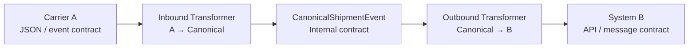
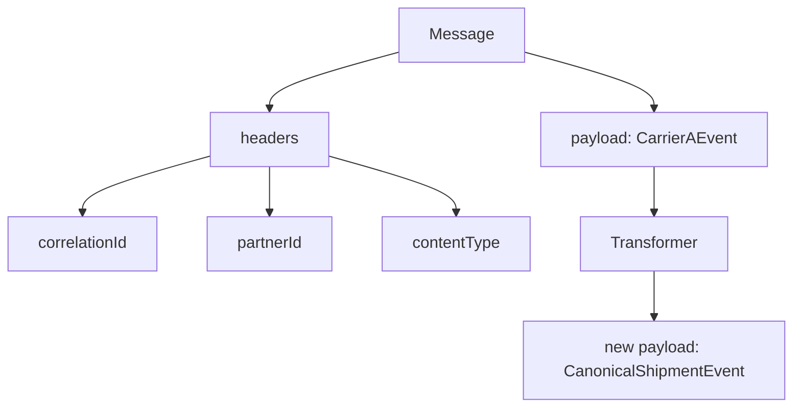
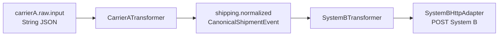
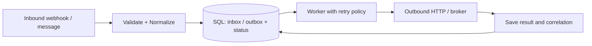

# Transformer and Payload Normalization Between Two Systems

In system integration, two applications may refer to the same event using **different data structures and semantics**. A shipping system sends `{"state":"WITH_COURIER"}`, while an order management system expects `{"deliveryState":"ON_THE_WAY"}`. Renaming properties is only the first step: we must also unify status codes, timestamp formats, data types, identifier keys, and how invalid fields are handled.

A **Transformer** is a component that converts a payload from an input representation into an output representation matching the receiving side's contract. In the **Routing and Transformation** chapter of the **SPRING_BOOT_INTEGRATION** module, transformers help organize flows across HTTP clients, databases, caches, message brokers, and Spring Integration adapters. When transformers are clearly designed, error handling, retries, deduplication, testing, and observability become more consistent across systems.

This lesson focuses on **Transformer and payload normalization between two systems**, using Spring Boot and Spring Integration with a shipping status event example. These design patterns apply equally whether the source or destination is HTTP, SQL, Kafka, RabbitMQ, or data files.

## 1. Learning Objectives

After this lesson, you will be able to:

1. Distinguish between **Transformer**, **message converter**, **Router**, **Filter**, **Enricher**, and communication adapters.
2. Build an intermediate data contract (canonical payload) to decouple two integrating sides.
3. Define mapping rules for field names, statuses, timestamps, monetary amounts, identifiers, nulls, and schema versions.
4. Write independently testable Java transformers and chain transformers using the **Spring Integration DSL**.
5. Design handling paths for invalid payloads, safe retries, and errors in a real integration flow.
6. Measure post-normalization data quality without exposing sensitive information.

## 2. What Problems Does a Transformer Solve?

### 2.1. Differences Between Two Systems' Data

Suppose **Carrier A** sends an event:

```json
{
  "event_id": "evt-7851",
  "parcel_code": "PKG-0037",
  "state": "WITH_COURIER",
  "occurred_at": "2026-11-21T09:15:40+07:00",
  "rev": 6
}
```

Meanwhile, the shipping management system **System B** accepts:

```json
{
  "trackingNumber": "PKG-0037",
  "deliveryState": "ON_THE_WAY",
  "eventTimeUtc": "2026-11-21T02:15:40Z",
  "externalEventKey": "carrier-a:evt-7851",
  "revision": 6
}
```

The changes required:

- `parcel_code` becomes `trackingNumber`.
- `state: WITH_COURIER` becomes `deliveryState: ON_THE_WAY` according to an **agreed status transition table**.
- A timestamp with offset `+07:00` is converted to the same instant in UTC.
- `event_id` is scoped by source name to form a **stable event key**.
- `rev` is preserved as a version so the destination system can detect stale or out-of-order events.
- Fields not needed by the destination are excluded from the outbound contract.

If normalization is skipped and JSON is forwarded directly from A to B, every time A changes a field name or status naming convention, B may be forced to change accordingly.

### 2.2. Canonical Payload and Anti-Corruption Boundary

A useful design is to translate through a canonical model owned by the **integration application**:



For example, the normalized intermediate data is:

```json
{
  "sourceSystem": "carrier-a",
  "eventId": "evt-7851",
  "shipmentId": "PKG-0037",
  "status": "OUT_FOR_DELIVERY",
  "occurredAt": "2026-11-21T02:15:40Z",
  "revision": 6
}
```

The intermediate contract isolates each partner's proprietary language and format. If Carrier C is added, we write a mapper from C into canonical; if System B is replaced with destination D, we write a mapper from canonical to D.

**This does not mean you must always build a huge enterprise-wide canonical schema.** For a one-off connection between two stable systems, a direct `A → B` mapper may be simpler. A canonical model adds value when there are multiple adapters, multiple contract versions, or domain logic that needs to be modeled independently of partners. It should remain small enough, clearly owned, and versioned.

## 3. Transformer, Router, and Commonly Confused Components

In **Enterprise Integration Patterns**, a transformer is responsible for converting message content. Other components address different decisions:

| Component | Question it answers | Example |
| --- | --- | --- |
| **Transformer** | What form must the payload be converted into? | Carrier A JSON → `CanonicalShipmentEvent` |
| **Message converter** | How are bytes/strings/objects serialized or deserialized? | JSON text → Java object via Jackson |
| **Router** | Which channel/destination must the message go to? | `DELIVERED` → completed-delivery channel |
| **Filter** | Which messages are allowed to continue processing? | Drop events not relevant to the system |
| **Header Enricher** | What metadata should be added to the message? | `partnerId`, `correlationId`, `schemaVersion` |
| **Splitter / Aggregator** | Split one message into many parts or combine multiple parts? | Split a file containing 1,000 events |
| **Inbound/Outbound Adapter** | Which system/transport to communicate with? | Receive HTTP webhook, publish Kafka, write SQL |

A transformer **can** perform both JSON parsing and domain mapping, but in larger systems it is often better to split them into two easily testable transformations: `JSON → input DTO → normalized DTO`.

### 3.1. What Is Inside a Spring Integration Message?

A `Message<T>` has two parts:

- **Payload**: the business data, such as a JSON `String`, `CarrierAEvent`, or `CanonicalShipmentEvent`.
- **Headers**: metadata such as `id`, `timestamp`, correlation ID, source name, content type, or adapter-specific information.



With a **payload-to-payload** transformer inside a Spring Integration endpoint, the framework typically builds a reply message with the new payload and handles header propagation according to its message-handling mechanism. However, **never assume all headers are always preserved across every adapter, converter, or step that constructs a new message**. Verify the header contract and explicitly preserve required metadata.

In particular:

- `partnerId`, tenant ID, and source identity must be derived from an **authenticated component**, not trusted directly from caller-supplied HTTP headers.
- Do not turn tokens, signatures, or passwords into normalized payload fields.
- When using a header as a routing key or correlation key, define behavior when the header is missing or modified.
- A transformer should not generate a new correlation ID on every retry if you want to trace the same event across multiple processing attempts.

## 4. Defining the Normalization Contract Before Writing Code

### 4.1. Mapping Table with Rules and Concrete Examples

| Source Carrier A | Canonical | Destination System B | Rule |
| --- | --- | --- | --- |
| `event_id` | `eventId` | Part of `externalEventKey` | Required; kept stable across redeliveries |
| Authenticated adapter source | `sourceSystem` | Part of `externalEventKey` | Set source name `carrier-a`; do not take from untrusted JSON |
| `parcel_code` | `shipmentId` | `trackingNumber` | Identifier string; do not cast to number and lose leading zeros |
| `state` | `status` | `deliveryState` | Map via an explicit code table |
| `occurred_at` | `occurredAt` of type `Instant` | `eventTimeUtc` | Parse ISO 8601 with offset, convert to UTC |
| `rev` | `revision` | `revision` | Positive integer, preserving version semantics |

Status mapping table:

| Carrier A | Canonical | System B |
| --- | --- | --- |
| `WITH_COURIER` | `OUT_FOR_DELIVERY` | `ON_THE_WAY` |
| `DELIVERED` | `DELIVERED` | `COMPLETED` |
| `DELIVERY_ISSUE` | `DELIVERY_FAILED` | `EXCEPTION` |

**The mapping table is part of the business contract.** Do not assume `DELIVERY_ISSUE` means "permanently failed delivery" if the partner defines it as a temporary issue. When meaning is unclear, clarify with the integration owner before changing statuses.

### 4.2. Distinguishing Syntactic Transformation from Semantic Transformation

**Syntactic transformation**: converting `snake_case` to `camelCase`, converting JSON text into objects, formatting timestamps according to ISO 8601.

**Semantic transformation**: deciding that A's status `WITH_COURIER` corresponds to the domain status `OUT_FOR_DELIVERY`; this cannot be reliably inferred by a JSON library alone.

**Domain data normalization** also includes:

- **Identifiers**: keep IDs as strings; scope uniqueness by source and tenant.
- **Time**: use `Instant` for absolute instants; only use `LocalDate` or `LocalDateTime` when the contract truly carries local date/time semantics and has explicit timezone rules.
- **Monetary amounts**: use `BigDecimal` and a currency code; clarify minor units and rounding rules; never use `double` for financial values.
- **Units of measure**: convert kg ↔ gram or cm ↔ mm according to confirmed rules, checking for overflow and precision.
- **Nulls and missing fields**: distinguish between "not sent", "sent as null", and "sent as empty value" if they carry different update semantics.
- **Enums**: explicitly specify whether unknown codes are rejected, quarantined, or mapped to `UNKNOWN`; avoid silently mapping them to a success status.
- **Sensitive data**: minimize data carried over to the destination system; do not log full payloads when reporting errors.

### 4.3. Schema Evolution

Contracts need an evolution policy:

1. **New optional field**: receivers may be allowed to ignore it if it does not affect semantics.
2. **New required field**: may break older consumers; requires versioning and a migration plan.
3. **Changing field type or meaning**: usually a breaking change even if the field name stays the same.
4. **Adding status codes**: must review the mapping table, business workflow, and handling of unrecognized codes.
5. **Version changes**: track both source version and canonical version, and test multiple active versions.

Allowing unknown JSON fields to be ignored is **different** from accepting unknown enum codes. Adding `trackingColor` can usually be ignored; adding `CANCELLED_BY_CUSTOMS` may require a new business decision.

## 5. Preparing the Spring Boot Project

The implementation example below assumes Spring Boot using Java 17+, Spring Integration Java DSL, and Jackson 2 (as in Spring Boot 3.x projects). For stacks with different Jackson API versions, adjust imports and mappers to match the actual library. The lesson focuses on transformer principles and applies similarly across versions.

**Gradle (Groovy DSL):**

```groovy
dependencies {
    implementation 'org.springframework.boot:spring-boot-starter-integration'
    implementation 'org.springframework.boot:spring-boot-starter-json'

    testImplementation 'org.springframework.boot:spring-boot-starter-test'
}
```

If the application already includes the web starter providing Jackson, the separate JSON dependency may not be needed; check the dependency management of your Spring Boot version. When sending to API B over HTTP, add the web starter if `RestClient` and corresponding HTTP infrastructure are needed.

**Spring Integration DSL** uses `IntegrationFlow` to declare the pipeline that receives messages, transforms them, and sends them to an outbound adapter. It does not force domain logic to depend on Spring Integration: Java mappers designed as pure conversion functions can be reused elsewhere.

## 6. Implementing the Data Models

The following classes belong to the example package `com.example.integration.shipping`. Each `public` record/enum is placed in a **Java file with the matching name**, per Java conventions.

### 6.1. DTO Received from Carrier A

**`CarrierAEvent.java`**

```java
package com.example.integration.shipping;

import com.fasterxml.jackson.annotation.JsonIgnoreProperties;
import com.fasterxml.jackson.annotation.JsonProperty;

@JsonIgnoreProperties(ignoreUnknown = true)
public record CarrierAEvent(
        @JsonProperty("event_id") String eventId,
        @JsonProperty("parcel_code") String parcelCode,
        @JsonProperty("state") String state,
        @JsonProperty("occurred_at") String occurredAt,
        @JsonProperty("rev") Integer revision
) {}
```

`Integer` is chosen over primitive `int` for `revision` to detect missing/null fields rather than confusing a missing field with `0`. `ignoreUnknown = true` allows side A to add out-of-contract fields without breaking parsing. However, critical fields must still be explicitly validated during normalization.

### 6.2. Canonical Model and Internal Enum

**`ShipmentStatus.java`**

```java
package com.example.integration.shipping;

public enum ShipmentStatus {
    OUT_FOR_DELIVERY,
    DELIVERED,
    DELIVERY_FAILED
}
```

**`CanonicalShipmentEvent.java`**

```java
package com.example.integration.shipping;

import java.time.Instant;

public record CanonicalShipmentEvent(
        String sourceSystem,
        String eventId,
        String shipmentId,
        ShipmentStatus status,
        Instant occurredAt,
        int revision
) {}
```

An immutable record after construction is well suited for passing payloads across processing steps. The normalized model contains no `ObjectMapper`, SQL entities, or HTTP clients; therefore domain layers can use it without depending on Carrier A's transport.

### 6.3. System B DTO

**`SystemBStatusUpdate.java`**

```java
package com.example.integration.shipping;

public record SystemBStatusUpdate(
        String trackingNumber,
        String deliveryState,
        String eventTimeUtc,
        String externalEventKey,
        int revision
) {}
```

System B does not need to understand Carrier A's proprietary status codes or depend on its Java record. The outbound adapter serializes this record into JSON according to B's contract.

## 7. Building the Inbound Transformer: Carrier A → Canonical

### 7.1. Input Data Exception

**`InvalidCarrierEventException.java`**

```java
package com.example.integration.shipping;

public class InvalidCarrierEventException extends RuntimeException {
    public InvalidCarrierEventException(String message) {
        super(message);
    }

    public InvalidCarrierEventException(
            String message, Throwable cause) {
        super(message, cause);
    }
}
```

This is an **invalid data/contract** exception, which normally cannot be fixed by retrying the exact same request. Do not include raw JSON in the exception message because it may contain sensitive data.

### 7.2. Transformer from JSON to Normalized Record

**`CarrierATransformer.java`**

```java
package com.example.integration.shipping;

import java.time.Instant;
import java.time.OffsetDateTime;
import java.time.format.DateTimeParseException;
import java.util.Map;

import com.fasterxml.jackson.core.JsonProcessingException;
import com.fasterxml.jackson.databind.ObjectMapper;

import org.springframework.integration.transformer.GenericTransformer;
import org.springframework.stereotype.Component;

@Component
public class CarrierATransformer
        implements GenericTransformer<String, CanonicalShipmentEvent> {

    private static final String SOURCE = "carrier-a";

    private static final Map<String, ShipmentStatus> STATUS_MAPPING =
            Map.of(
                    "WITH_COURIER", ShipmentStatus.OUT_FOR_DELIVERY,
                    "DELIVERED", ShipmentStatus.DELIVERED,
                    "DELIVERY_ISSUE", ShipmentStatus.DELIVERY_FAILED
            );

    private final ObjectMapper objectMapper;

    public CarrierATransformer(ObjectMapper objectMapper) {
        this.objectMapper = objectMapper;
    }

    @Override
    public CanonicalShipmentEvent transform(String json) {
        if (json == null || json.isBlank()) {
            throw new InvalidCarrierEventException("Empty payload");
        }

        CarrierAEvent incoming;
        try {
            incoming = objectMapper.readValue(json, CarrierAEvent.class);
        } catch (JsonProcessingException ex) {
            throw new InvalidCarrierEventException("Invalid JSON", ex);
        }

        if (incoming == null) {
            throw new InvalidCarrierEventException("Payload is not an object");
        }

        String eventId = required(incoming.eventId(), "event_id");
        String shipmentId = required(incoming.parcelCode(), "parcel_code");
        String stateCode = required(incoming.state(), "state");

        ShipmentStatus status = STATUS_MAPPING.get(stateCode);
        if (status == null) {
            throw new InvalidCarrierEventException(
                    "Unsupported status code: " + stateCode);
        }

        if (incoming.revision() == null || incoming.revision() <= 0) {
            throw new InvalidCarrierEventException(
                    "rev must be a positive integer");
        }

        Instant occurredAt;
        try {
            occurredAt = OffsetDateTime.parse(
                    required(incoming.occurredAt(), "occurred_at")
            ).toInstant();
        } catch (DateTimeParseException ex) {
            throw new InvalidCarrierEventException(
                    "occurred_at must be an ISO-8601 timestamp with offset", ex);
        }

        return new CanonicalShipmentEvent(
                SOURCE,
                eventId,
                shipmentId,
                status,
                occurredAt,
                incoming.revision()
        );
    }

    private static String required(String value, String name) {
        if (value == null || value.isBlank()) {
            throw new InvalidCarrierEventException(
                    "Missing required field: " + name);
        }
        return value.trim();
    }
}
```

**Notable points:**

1. Do not read `sourceSystem` from external JSON; this transformer assigns a fixed source because it belongs to an **authenticated adapter dedicated to Carrier A**. If a channel is shared across multiple partners, supply the source via a trusted header/context.
2. Valid JSON can still contain invalid business values: missing `event_id`, `rev <= 0`, or unsupported status codes.
3. The timestamp `2026-11-21T09:15:40+07:00` converts to `2026-11-21T02:15:40Z` while remaining the exact same absolute instant.
4. The transformer does not call SQL, HTTP, or message brokers itself. Given the same input, it produces the same output or throws a deterministic error, making it easy to unit test.
5. The transformer preserves `eventId` and `revision` from the source. Do not generate replacement UUIDs or `Instant.now()`, as doing so can break deduplication and ordering during retries.

**Limitation of the example:** The code uses a `Map` for a small set of statuses. With many partners/statuses, the mapping table needs an owner, versioning, documented semantics, and thorough tests. Rules for lengths, schema versions, additional enums, and access permissions must still be defined according to the actual contract.

## 8. Building the Outbound Transformer: Canonical → System B

**`SystemBTransformer.java`**

```java
package com.example.integration.shipping;

import java.time.format.DateTimeFormatter;

import org.springframework.integration.transformer.GenericTransformer;
import org.springframework.stereotype.Component;

@Component
public class SystemBTransformer
        implements GenericTransformer<
                CanonicalShipmentEvent, SystemBStatusUpdate> {

    @Override
    public SystemBStatusUpdate transform(CanonicalShipmentEvent event) {
        String destinationStatus = switch (event.status()) {
            case OUT_FOR_DELIVERY -> "ON_THE_WAY";
            case DELIVERED -> "COMPLETED";
            case DELIVERY_FAILED -> "EXCEPTION";
        };

        return new SystemBStatusUpdate(
                event.shipmentId(),
                destinationStatus,
                DateTimeFormatter.ISO_INSTANT.format(event.occurredAt()),
                event.sourceSystem() + ":" + event.eventId(),
                event.revision()
        );
    }
}
```

The outbound mapper only knows about the **canonical model** and the **System B contract**. If Carrier A renames `state` to `delivery_stage` with the same meaning, the outbound mapper does not need to change. Conversely, if B requires a meaningful new field that canonical does not yet have, the data design must be updated and its impact on all sources reviewed.

Not every internal status code necessarily has a one-to-one translation to B. If B only supports a subset of statuses, you must explicitly specify how to group, skip, or fail; do not default to picking a similar-looking value just because the name sounds close.

## 9. Wiring Transformers into the Spring Integration DSL

### 9.1. IntegrationFlow

**`ShippingIntegrationConfig.java`**

```java
package com.example.integration.shipping;

import org.springframework.context.annotation.Bean;
import org.springframework.context.annotation.Configuration;
import org.springframework.integration.dsl.IntegrationFlow;

@Configuration
public class ShippingIntegrationConfig {

    @Bean
    IntegrationFlow carrierAToSystemBFlow(
            CarrierATransformer inboundTransformer,
            SystemBTransformer outboundTransformer,
            SystemBHttpAdapter outboundAdapter) {

        return IntegrationFlow
                .from("carrierA.raw.input")
                .transform(inboundTransformer)
                .channel("shipping.normalized")
                .transform(outboundTransformer)
                .handle(outboundAdapter, "send")
                .get();
    }
}
```

Diagram:



- The inbound channel `carrierA.raw.input` receives messages whose payload is a **JSON string** from an authenticated inbound adapter, such as an HTTP webhook adapter.
- The first transformer normalizes it into `CanonicalShipmentEvent`.
- The intermediate channel establishes a data boundary and allows attaching a wiretap/monitoring if truly needed.
- The second transformer produces the destination DTO.
- `handle(...)` invokes the HTTP adapter; transport is not the transformer's responsibility.

This is a **demonstration synchronous pipeline**. With default channels using direct invocation, errors in a mapper or outbound handler may propagate back to the sender. Adding asynchronous channels, queues, or brokers changes how errors are routed to error flows and what acknowledgment means; you must design according to delivery requirements rather than assuming the system guarantees delivery automatically.

### 9.2. Demonstration HTTP Adapter

**`SystemBHttpAdapter.java`**

```java
package com.example.integration.shipping;

import org.springframework.beans.factory.annotation.Value;
import org.springframework.http.MediaType;
import org.springframework.stereotype.Component;
import org.springframework.web.client.RestClient;

@Component
public class SystemBHttpAdapter {

    private final RestClient client;

    public SystemBHttpAdapter(
            RestClient.Builder builder,
            @Value("${integration.system-b.base-url}") String baseUrl) {
        this.client = builder.baseUrl(baseUrl).build();
    }

    public void send(SystemBStatusUpdate update) {
        client.post()
                .uri("/api/v1/shipping/status")
                .contentType(MediaType.APPLICATION_JSON)
                // Only use this header if API B supports it by contract.
                .header("Idempotency-Key", update.externalEventKey())
                .body(update)
                .retrieve()
                .toBodilessEntity();
    }
}
```

**`application.yml`** (illustrative):

```yaml
integration:
  system-b:
    base-url: ${SYSTEM_B_BASE_URL}
```

A production adapter also needs authentication, TLS, connect/read timeouts, HTTP status classification, retry limits, and observability. Do not put passwords/tokens in source code. System B accepting the `Idempotency-Key` header is a **specific contract assumption of this example**: it does not automatically apply to every API.

### 9.3. When to Use Converters vs. Specialized Transformers

If the inbound adapter already deserializes JSON into `CarrierAEvent`, change the inbound transformer to `GenericTransformer<CarrierAEvent, CanonicalShipmentEvent>` and remove `ObjectMapper.readValue`. This cleanly separates:

```text
HTTP/broker bytes
  -> JSON message converter
  -> CarrierAEvent (external contract)
  -> domain transformer
  -> CanonicalShipmentEvent
```

For pure transformations such as date formatting, JSON/XML conversion, or adding headers, Spring Integration provides built-in transformers/converters according to module dependencies. Avoid creating large classes just to replace standard built-in operations; conversely, **business semantic rules** belong in clear, tested code.

## 10. Designing Errors, Retries, and Idempotency for Transformation Flows

### 10.1. Not All Errors Are the Same

| Error | Example | Recommended behavior |
| --- | --- | --- |
| **Parsing / format** | Malformed JSON, timestamp missing offset | Reject/quarantine, report contract error; do not retry the raw payload |
| **Validation / semantic** | Unmapped status, negative `rev` | Quarantine, record reason code, review contract updates |
| **Schema incompatibility** | Partner changed field meaning | Block unsupported versions; update mapping and contract tests |
| **Transient destination HTTP error** | Timeout, 429, 502, 503 | Bounded retry with backoff if the operation is safe to resend |
| **Permission/configuration error** | 401, 403, wrong URL | Fix configuration or credentials; avoid infinite retries |
| **Destination business error** | 422 due to invalid status | Classify error, reconcile mapping, do not hide under default values |

When a transformer throws an exception:

- With a **DirectChannel** and synchronous processing flow, exceptions usually propagate to the sender; the caller decides the HTTP response or transaction rollback.
- With a **poller/async executor/broker consumer**, error handling depends on the configured endpoint, acknowledgment, retry advice, and `errorChannel`. Do not assume messages automatically go to a dead-letter queue.
- Define which cases qualify for retry and which belong in quarantine/DLQ with a reason; avoid trapping bad-data messages in an infinite retry loop.

### 10.2. Normalization Does Not Automatically Make an Operation Idempotent

In the example, `externalEventKey = sourceSystem + ":" + eventId` stays stable across deliveries. However, **generating the key alone does not prevent duplicate processing**. The receiver or state layer must enforce it:

- A unique constraint on `(source_system, event_id)` when storing an inbox in SQL.
- Processing status/version checks to prevent repeated side effects when a consumer retries.
- Idempotency mechanisms on API B if B supports them, or a lookup procedure before resending.
- Rules for handling two deliveries with the same event key but different payloads.

Do not use message arrival time or a fresh UUID per attempt to build an idempotency key. For non-idempotent operations where a timeout leaves the remote outcome unknown, design reconciliation or agree on an idempotent endpoint.

### 10.3. Transactions and Durability

The synchronous example above uses an HTTP client at the end of the flow; if B succeeds and the connection drops before returning a response, system A may not know the outcome. `@Transactional` on the internal database **cannot roll back** HTTP side effects on B.

For critical business flows, consider:



Durably persisting events to be processed inside a SQL transaction helps recovery after crashes. Workers must still handle safe redelivery; durable persistence and HTTP/broker dispatch do not have cross-boundary atomicity just by being in the same flow.

## 11. Testing Transformers and Data Contracts

Pure transformers are the easiest part to unit test quickly and thoroughly. Test the **meaning** of the output data, not merely that the code runs without exceptions.

### 11.1. Unit Testing the Inbound Transformer

JUnit 5 example for Jackson 2:

```java
package com.example.integration.shipping;

import static org.junit.jupiter.api.Assertions.*;

import java.time.Instant;

import com.fasterxml.jackson.databind.ObjectMapper;
import org.junit.jupiter.api.Test;

class CarrierATransformerTest {

    private final CarrierATransformer transformer =
            new CarrierATransformer(new ObjectMapper());

    @Test
    void normalizesStateAndUtcInstant() {
        var json = """
                {
                  "event_id": "evt-7851",
                  "parcel_code": "PKG-0037",
                  "state": "WITH_COURIER",
                  "occurred_at": "2026-11-21T09:15:40+07:00",
                  "rev": 6
                }
                """;

        CanonicalShipmentEvent result = transformer.transform(json);

        assertEquals("carrier-a", result.sourceSystem());
        assertEquals("evt-7851", result.eventId());
        assertEquals("PKG-0037", result.shipmentId());
        assertEquals(ShipmentStatus.OUT_FOR_DELIVERY, result.status());
        assertEquals(Instant.parse("2026-11-21T02:15:40Z"),
                result.occurredAt());
        assertEquals(6, result.revision());
    }

    @Test
    void rejectsUnknownStatus() {
        String json = """
                {
                  "event_id": "evt-2",
                  "parcel_code": "PKG-0038",
                  "state": "REVERSE_PICKUP",
                  "occurred_at": "2026-11-21T09:15:40+07:00",
                  "rev": 1
                }
                """;

        assertThrows(InvalidCarrierEventException.class,
                () -> transformer.transform(json));
    }
}
```

### 11.2. Test Case Coverage Matrix

| Test group | Input data | Expected result |
| --- | --- | --- |
| Normal mapping | `WITH_COURIER`, timestamp with offset | `OUT_FOR_DELIVERY`, same instant in UTC |
| All valid statuses | `DELIVERED`, `DELIVERY_ISSUE` | Mapped per table, never falling into a default branch |
| Missing field | Missing `event_id` or `rev` | Validation exception with clear reason |
| Blank field | `parcel_code: " "` | Rejected instead of producing an empty ID |
| Wrong type | `rev: "abc"` | Parse/contract error |
| Timestamp without offset | `2026-11-21T09:15:40` | Rejected per defined contract |
| Timestamp offset conversion | `+07:00`, `Z` for same instant | Equivalent `Instant` result |
| New enum | `REVERSE_PICKUP` | Observable rejection/quarantine |
| Additional optional field | `tracking_color` | Ignored if contract is compatible |
| Identifiers | `parcel_code: "00042"` | Leading zeros preserved |
| Retry same event | Same payload/ID | Mapping preserves ID, status, timestamp |
| Outbound mapper | `OUT_FOR_DELIVERY` | `ON_THE_WAY`, stable `externalEventKey` |

Beyond unit tests, add **contract tests** using real payload samples scrubbed of sensitive data and **integration tests** with real flows/adapters or a fake HTTP server. For example, use WireMock or an HTTP mock server to verify System B JSON, proper headers sent, HTTP error classification, and that timeouts do not cause infinite retries.

### 11.3. Commonly Missed Testing Mistakes

- Testing only one status while skipping others in the mapping.
- Testing timestamps in UTC without testing non-UTC offsets to catch timezone bugs.
- Failing to test null fields, wrong types, unknown enums, oversized payloads, or new schema versions.
- Mocking adapter success without verifying the actual JSON serialized body.
- Testing message ordering only in a single-threaded flow, whereas production has multiple consumers and retries.

A contract test should state **which payload version** is supported, who owns the fixtures, and which failures indicate a breaking contract change.

## 12. Observing Data After Normalization

A buggy transformer can manifest in many forms: quarantined messages, unmapped status codes, shifted timestamps, or data attributed to the wrong partner. Add observability signals at each boundary:

- **Count of messages received and normalized successfully** by adapter name, schema version, and event type.
- **Invalid rate** by reason code (`invalid_json`, `missing_field`, `unknown_status`, `invalid_timestamp`).
- **Latency** from receipt to normalization and from event occurrence to processing.
- **Duplicate/retry event counts** by source; count of messages waiting or sitting in quarantine/DLQ.
- **System B call success/failure counts**, response time, timeouts, and HTTP statuses.
- **Correlation ID/event ID** in logs/traces to reconcile individual events across HTTP, SQL, message brokers, and adapters.

Use **bounded-cardinality** metric tags such as partner name, version, and reason code; avoid putting `eventId` or `shipmentId` into metric labels due to high cardinality. Those IDs belong in controlled logs/traces. Do not log full sensitive payloads or tokens to diagnose failures; use reason codes and PII-scrubbed samples when needed.

### 12.1. Example Message Trace

```text
correlationId: corr-2c95
sourceSystem: carrier-a
eventId: evt-7851
contractVersion: carrier-a-v1
receivedAt: 2026-11-21T02:15:41Z
normalizeResult: OK
normalizedStatus: OUT_FOR_DELIVERY
destination: system-b
deliveryResult: ACCEPTED
```

Keeping a correlation ID across steps (or trace/span relationships) helps pinpoint whether a failure occurred during parsing, mapping, queuing, or System B's API. On retries, keep the business event key stable and record the attempt count separately.

## 13. Recommended Patterns and Pitfalls to Avoid

### 13.1. Do

1. Define the **mapping table and data contract** before writing transformers.
2. Separate **partner DTOs**, **canonical DTOs**, and **destination system DTOs**.
3. Keep transformers close to **pure functions**: take payload, validate, produce new payload; keep side effects in adapters/services.
4. Define **rules for unknown codes**, missing fields, and schema changes.
5. Preserve IDs, revisions, timestamps, and metadata needed for replay/idempotency.
6. Test mappings, timezones, null fields, contract errors, and outbound serialization.
7. Monitor data errors separately from infrastructure errors to make appropriate retry decisions.

### 13.2. Avoid

- Concatenating JSON strings manually or using string replacement to rename fields.
- Mapping every unknown enum to `UNKNOWN` and letting the flow continue silently when the status affects business logic.
- Treating `String.replace("WITH_COURIER", "ON_THE_WAY")` as a valid mapping across an entire JSON document.
- Reusing the same DTO for database entities, partner requests, and broker payloads.
- Calling HTTP/SQL inside a transformer mixed with formatting logic, making retries and unit tests hard to isolate.
- Generating a new event ID on each transform or relying on current time to infer source ordering.
- Overlooking security headers, correlation, and message acknowledgment when changing channel types.
- Assuming that having a transformer eliminates the need for contract management or end-to-end tests.

## 14. Self-Check Questions and Exercises

1. **How does a Transformer differ from a Router?** If you need to convert `WITH_COURIER` to `OUT_FOR_DELIVERY` and then send `DELIVERED` events to a separate channel, what should the order of steps be?
2. Why should `parcel_code` be kept as a string if it can be `00042`?
3. Why are `2026-11-21T09:15:40+07:00` and `2026-11-21T02:15:40Z` the same instant in time?
4. What could happen if a new enum from a partner is automatically converted into the `DELIVERED` status?
5. Why should the canonical model not directly use persistence annotations and internal fields of a single partner?
6. If System B's API times out after receiving an event, is having the transformer produce a stable `externalEventKey` alone enough to prevent duplicate processing?
7. How do invalid JSON errors and HTTP 503 errors from System B differ in terms of retry policy?
8. When adding Carrier C, which classes need to be modified while keeping the contract sent to System B unchanged?
9. If messages pass through an asynchronous channel, how does error handling differ from a synchronous `DirectChannel`?
10. Choose at least 5 test cases to protect a mapper handling timestamps and three status codes.

**Hands-on exercise:** Extend the example so Carrier A adds a `RETURNED_TO_SENDER` status. Confirm the business meaning of that status, update the mapping table and contract, add the corresponding canonical and System B codes if supported, and write tests for both valid cases and cases where System B does not recognize the new status. Then build a test for receiving the same `eventId` twice to prove that the state-persistence/adapter layer truly deduplicates, beyond the transformer producing consistent data.

## 15. Key Takeaways

- A **Transformer** converts payloads between representations and semantics; a **Router** selects paths; **adapters** communicate with sources/destinations; **converters** handle wire-format representations.
- Good normalization controls **schemas, enums, nulls, timezones, identifiers, versions, and business semantics**, not just field renaming.
- The **A → canonical → B** model reduces coupling between partners and destination systems when multiple adapters exist; use it only when the benefit justifies the complexity.
- Mappers should be side-effect free, fail deterministically, and be tested independently. Data mapping errors and infrastructure errors require different handling policies.
- Preserving **event keys, revisions, timestamps, and correlation** is a prerequisite for idempotency, observability, replay, and out-of-order handling. A transformer does not automatically provide transactional guarantees or exactly-once delivery.

When building a real Spring Boot integration flow, treat transformers as a **protective boundary for data contracts** between independent systems. From there, routing, SQL persistence, caching, broker publishing, or HTTP calls operate on data that is more consistent, testable, and operable.
