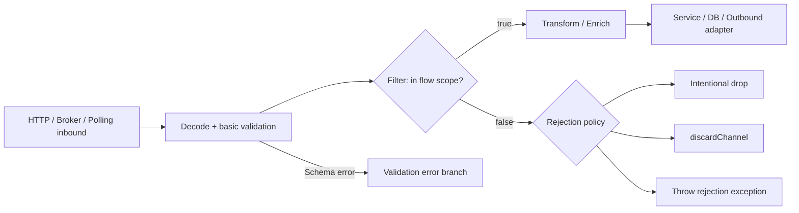
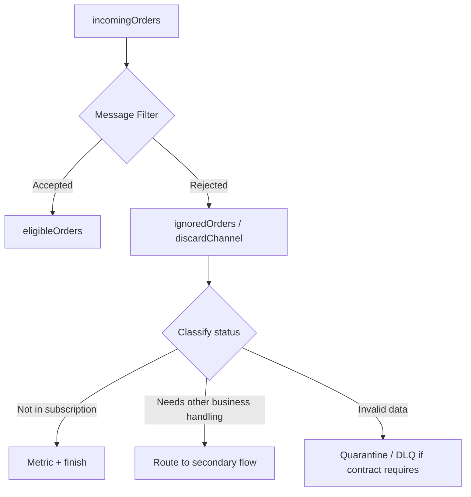
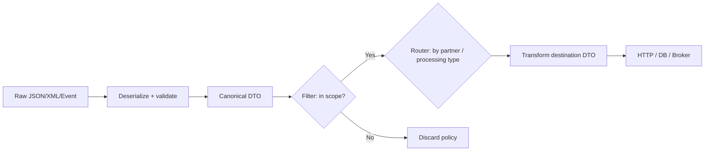

# Filter and Dropping Messages That Do Not Meet Conditions

> **Chapter:** Routing and Transformation  
> **Scope:** Within the **SPRING_BOOT_INTEGRATION** module, a Spring Boot service may receive messages from HTTP, databases, caches, or brokers and process them with Spring Integration adapters. This article focuses on **Filter** in Spring Integration: deciding which messages proceed, handling rejected messages via `discardChannel` or exceptions, and choosing policies aligned with data contracts, transactions, errors, deduplication, testing, and observability.

## 1. What Problem Does a Filter Solve?

Suppose an order synchronization service receives multiple event types from a partner: `order.created`, `order.updated`, `order.cancelled`. A target flow is only responsible for creating new orders, so the other events are **out of scope for that flow**. Sending every event through transformation, partner HTTP calls, and database writes wastes resources and risks unintended side effects.

A **Message Filter** in Spring Integration applies a condition to a message:

- Condition is **true** (`true`): the message is forwarded to the next step of the flow.
- Condition is **false** (`false`): the message is **rejected at the filter**. Depending on configuration, it may be discarded, sent to a discard channel, or throw an exception.
- Evaluating the condition **throws an exception**: this is a **filter processing error**, not a normal rejection result; how the error propagates depends on the execution point and flow error handling.

A key distinction: **dropping at a filter does not mean deleting the original message from a broker, rolling back a transaction, or emitting an error notification**. A filter is a message-processing endpoint inside the application; storage, acknowledgment, and retry policies belong to the surrounding components.

### Flow Diagram



**Example:** A filter allows `eventType = "order.created"` and `partnerStatus = "ENABLED"`. It is not responsible for fixing payload structure, recovering from HTTP timeouts, or checking whether an order has already been written to the database.

## 2. Filter's Place Among Enterprise Integration Patterns

Filter implements the **Message Filter pattern**: deciding whether to accept or discard a message, typically via a predicate. It is usually placed before expensive steps or steps with side effects.

| Spring Integration Component | Question Solved | Typical Outcome |
| --- | --- | --- |
| **Filter** | Should this message continue on this flow? | Continue or be rejected |
| **Router** | Which branch should this message go to? | One or more configured target channels |
| **Transformer** | What should the payload/format be converted into? | Message with transformed payload |
| **Header enricher** | What metadata needs to be added? | Message with additional headers |
| **Validator** | Does the payload comply with schema and data rules? | Valid or validation error |
| **Idempotent receiver** | Has this business key been processed before? | Processed once per contract, skip/mark duplicate |
| **Service activator** | What business operation should be executed? | Side effect, reply, or error |

**Filter vs. Router:** if there are only two choices ("continue / do not continue"), Filter is usually clearer. If you need to select among `urgentOrders`, `normalOrders`, `partnerAOrders`, and `partnerBOrders`, Router expresses the intent better. If a message must reach **multiple** independent downstream consumers, design a pub-sub or appropriate router rather than trying to use filters as a message-duplication mechanism.

**Filter vs. validation:** a message with a malformed schema or missing a required ID usually needs to be rejected with an error code, routed to a DLQ/quarantine, or answered with a 4xx response. A valid message whose `eventType` is not part of the subscription can be skipped normally. Mixing the two cases harms observability and causes broken messages to be treated as "don't care".

## 3. Processing Mechanism in Spring Integration

Spring Integration filter endpoints rely on evaluating a message. You can supply a `MessageSelector`, a payload predicate, an expression, or a method annotated with `@Filter` depending on configuration style.

Conceptually:

```java
boolean accept(Message<?> message) {
    // Principle illustration only, not a specific interface to implement.
    return "order.created".equals(message.getHeaders().get("eventType"));
}
```

A predicate should be:

1. **Fast and clear:** check event type, status, tenant/partner, or already-available metadata.
2. **Free of side effects:** do not create orders, update balances, or call APIs just to decide whether to proceed.
3. **Explicit about `null` or unknown fields:** do not let a `NullPointerException` turn a classifiable case into an unpredictable failure.
4. **Independently testable:** the same input and policy snapshot produce the same decision.

A filter does not strictly have to be pure: it can look up external policy. However, if a predicate calls Redis/HTTP/DB, each retry or broker redelivery may evaluate against changed state. In that case, define policy versioning, timeouts, behavior when the dependency fails, and whether the decision needs durable persistence.

### 3.1. Paths When the Result Is False

| Setting | Expected Behavior | When Appropriate |
| --- | --- | --- |
| No discard configured, `throwExceptionOnRejection = false` | Message is rejected and does not continue; no automatic business reply | Ignoring out-of-subscription data that may be dropped on this branch |
| `discardChannel` configured | Rejected message is sent to the discard handling channel | Recording metrics, auditing, or routing to an alternate branch for non-matching data |
| `throwExceptionOnRejection = true` | Rejection becomes an exception such as `MessageRejectedException` | Contract requires rejection to be treated as an error handled by caller/error flow |

**`discardChannel` receives the rejected message**, not automatically an `ErrorMessage`. If you need to know why it was dropped, the predicate/flow must follow a convention to store the reason (e.g., headers or metadata from a prior step) or safely re-classify it. Merely sending a message to a discard channel does not automatically make it a durable DLQ.

When using both `discardChannel` and exception-throwing mode together, precedence/behavior must be verified against the application's Spring Integration version. For clear intent, this lesson chooses **one primary policy per filter** and tests the corresponding path.

### 3.2. Paths When the Selector Throws an Exception

Unlike `return false`, errors such as NPE, Redis connection failures, or authorization service exceptions cause the endpoint to **fail while evaluating the condition**. With a synchronous `DirectChannel`, the error normally propagates to the sender; with asynchronous execution points and a suitable error handler, the error may be wrapped into an `ErrorMessage` sent to an error channel. An `errorChannel` header does not guarantee that every synchronous exception is turned into an error message.

**Do not use `catch (Exception e) { return false; }` for all errors**: doing so can silently swallow configuration errors, network failures, or bugs and cause a broker to treat the message as successfully processed.

## 4. Practical Example: Processing Only order.created Events from Enabled Partners

Suppose an application receives events from an inbound adapter (Kafka, AMQP, or HTTP gateway), while the order-creation flow only handles `order.created` events for partners configured as enabled. We design two channels:

- `eligibleOrders`: accepted events; the business service may persist to the database or call downstream services.
- `ignoredOrders`: events outside the flow; only record metadata/metrics or forward to another tracking mechanism if required by contract.

Example using Spring Integration Java DSL on Spring Boot 3.x, Java 17+:

```xml
<dependency>
    <groupId>org.springframework.boot</groupId>
    <artifactId>spring-boot-starter-integration</artifactId>
</dependency>
```

```java
package com.example.integration.orders;

import org.slf4j.Logger;
import org.slf4j.LoggerFactory;
import org.springframework.context.annotation.Bean;
import org.springframework.context.annotation.Configuration;
import org.springframework.integration.annotation.ServiceActivator;
import org.springframework.integration.channel.DirectChannel;
import org.springframework.integration.config.EnableIntegration;
import org.springframework.integration.dsl.IntegrationFlow;
import org.springframework.messaging.Message;
import org.springframework.messaging.MessageChannel;

@Configuration
@EnableIntegration
public class OrderFilteringConfiguration {

    private static final Logger log =
            LoggerFactory.getLogger(OrderFilteringConfiguration.class);

    @Bean
    public MessageChannel inboundOrders() {
        return new DirectChannel();
    }

    @Bean
    public MessageChannel eligibleOrders() {
        return new DirectChannel();
    }

    @Bean
    public MessageChannel ignoredOrders() {
        return new DirectChannel();
    }

    @Bean
    public IntegrationFlow orderFilterFlow() {
        return IntegrationFlow.from("inboundOrders")
                .filter(OrderEvent.class,
                        event -> "order.created".equals(event.eventType())
                                && event.partnerEnabled(),
                        spec -> spec
                                .discardChannel("ignoredOrders")
                                .throwExceptionOnRejection(false))
                .channel("eligibleOrders")
                .get();
    }

    @ServiceActivator(inputChannel = "eligibleOrders")
    public void onAccepted(OrderEvent order) {
        // Demo: call business service; production needs transactions,
        // validation, and idempotency for externalId/eventId.
        log.info("Accepted eventId={}", order.eventId());
    }

    @ServiceActivator(inputChannel = "ignoredOrders")
    public void onIgnored(Message<OrderEvent> originalMessage) {
        OrderEvent event = originalMessage.getPayload();
        log.info("Ignored eventId={}, eventType={}",
                event.eventId(), event.eventType());
    }

    public record OrderEvent(
            String eventId,
            String eventType,
            boolean partnerEnabled,
            String externalId
    ) {}
}
```

The flow above intentionally **does not drop valid events simply because an ID already exists**: deduplication based on `eventId`/`externalId` should be handled by the service alongside durable state. Required fields should also be validated non-empty before the filter; the example uses a Java record to keep the routing part simple.

### 4.1. Sending Messages into the Flow

A producer, adapter, or test can send:

```java
import org.springframework.beans.factory.annotation.Qualifier;
import org.springframework.messaging.MessageChannel;
import org.springframework.messaging.support.MessageBuilder;
import org.springframework.stereotype.Component;
import com.example.integration.orders.OrderFilteringConfiguration.OrderEvent;

@Component
class OrderEventSender {
    private final MessageChannel inboundOrders;

    OrderEventSender(
            @Qualifier("inboundOrders") MessageChannel inboundOrders) {
        this.inboundOrders = inboundOrders;
    }

    public void submit(OrderEvent event, String correlationId) {
        inboundOrders.send(
                MessageBuilder.withPayload(event)
                        .setHeader("correlationId", correlationId)
                        .build()
        );
    }
}
```

Sending `OrderEvent("evt-1", "order.created", true, "ORD-1")` routes the message to `eligibleOrders`. If `eventType = "order.cancelled"` or `partnerEnabled = false`, the message goes to `ignoredOrders`. The discard channel receives the original message and its headers; the filter does not convert the event into a new DTO.

**Do not equate `send()` returning true with business success.** It reflects delivery into the channel according to `MessageChannel` semantics. In an asynchronous flow, the service may process and fail after the sender has returned; in a synchronous flow, exceptions from the handler can propagate back to the sender.

### 4.2. What Happens When There Is No Subscriber on discardChannel?

A channel without a receiving endpoint may cause message sending to fail depending on the channel type and configuration. In the example, `ignoredOrders` has a service activator receiving it. In production, the discard branch must have a **controlled final destination**, such as a metric/audit handler or an intentional persistence adapter; never point a discard channel into an infinite loop back to `inboundOrders`.

## 5. Three Rejection Policies and How to Choose

### 5.1. Intentional Drop

No discard configuration is needed when an event is completely unrelated to the service—for instance, a consumer subscribed to a shared topic that only cares about one event type. Confirm this skipping aligns with the **consumer contract**, and record a metric counting discarded messages so you can detect if a producer accidentally renames an event type.

The risk of silent dropping is hiding bugs: if the producer suddenly renames `order.created` to `order.v2.created`, all messages might be filtered out without any exception. Set alerts on sudden spikes in the discard rate.

### 5.2. Routing to discardChannel

A discard channel is useful when the system needs auditing, inspection, or handling of cases "outside the current flow's scope." For example:



A discard channel is an **in-application MessageChannel**, not a durable dead-letter queue. If discarded data needs replay after a restart, add an error store, broker queue, or message store with appropriate persistence. Also record the reason, timestamp, schema version, correlation ID, and owner for investigation.

### 5.3. Throwing an Exception When Rejection Is a True Error

If the business contract states that a certain type of data is not allowed at this endpoint, enable `throwExceptionOnRejection(true)` so rejection is treated as an error.

```java
// Configuration snippet inside IntegrationFlow:
.filter(OrderEvent.class,
        event -> "order.created".equals(event.eventType()),
        spec -> spec.throwExceptionOnRejection(true))
```

In a synchronous flow, the exception can propagate to the caller/gateway; in an asynchronous flow, an appropriate error-publishing handler is needed to route to `errorChannel`. Choose this strategy when **error behavior** is genuinely required—such as returning a failure response or triggering an error flow. Do not use it for every valid out-of-subscription event, as it causes pointless retries and fills the DLQ.

## 6. Payload, Header, and Expression Filters

### 6.1. Payload Predicate

The approach in the example uses `OrderEvent.class` so Spring Integration converts the already-deserialized payload to the right type before evaluating `event -> ...`. This is easy to test when internal DTOs are stable.

For messages from HTTP, XML, JSON, Kafka, or AMQP, **deserialization and validation** should occur in an appropriate adapter/transformer before the filter reads domain fields.

### 6.2. Header-Based Filter

Some operational conditions do not require decoding the payload: tenant, destination, event version, or message type name may reside in headers. A selector based on the full `Message<?>` can read headers.

Illustrative predicate:

```java
import org.springframework.messaging.Message;

static boolean isSupportedVersion(Message<?> message) {
    Object version = message.getHeaders().get("schemaVersion");
    return Integer.valueOf(1).equals(version);
}
```

When systems send headers with different types (e.g., `"1"` as a String or `1` as an Integer), **normalize/validate** before comparing. Headers sent by untrusted sources must not be treated as proof of authentication or authorization.

### 6.3. SpEL and `@Filter`

Spring Integration also supports declarations via Spring Expression Language (SpEL) or the `@Filter` method annotation, which is convenient for short cases. However, for complex predicates, clearly named Java code is usually easier to test and review than long expressions in YAML/DSL.

Example of an annotated method:

```java
import org.springframework.integration.annotation.Filter;
import org.springframework.stereotype.Component;

@Component
class SupportedEventTypeFilter {

    @Filter(inputChannel = "eventsToCheck",
            outputChannel = "supportedEvents",
            discardChannel = "unsupportedEvents")
    public boolean accept(OrderEvent event) {
        return "order.created".equals(event.eventType());
    }
}
```

This example assumes the channels are configured and `OrderEvent` is a DTO within appropriate scope/imports. Use only **one** flow definition style on the same input channel when you intend a single filtering path; accidentally registering multiple subscribers on a `DirectChannel` can cause messages to be load-balanced across subscribers rather than passing through all filters.

## 7. Multi-Condition Filtering Without Unreadable Code

Each condition should reflect a named rule:

```java
boolean shouldProcess(OrderEvent event) {
    return acceptsType(event)
            && isPartnerEnabled(event)
            && isInServiceScope(event);
}

boolean acceptsType(OrderEvent event) {
    return "order.created".equals(event.eventType());
}

boolean isPartnerEnabled(OrderEvent event) {
    return event.partnerEnabled();
}

boolean isInServiceScope(OrderEvent event) {
    return event.externalId() != null
            && event.externalId().startsWith("ORD-");
}
```

This illustrates splitting predicates, assuming the methods reside in the same class with access to `OrderEvent`. **Be careful with rules like "`externalId` starts with `ORD-`":** if this is a data contract requirement, it may belong in validation rather than filtering; putting it in a predicate is a design choice that should be agreed with the sender.

If you need to know the exact reason a message was dropped, consider:

1. Evaluating into a **decision object** (`ACCEPTED`, `IGNORED_TYPE`, `PARTNER_DISABLED`, `INVALID_CONTRACT`), then routing by decision.
2. Splitting sequential filters with separate discard channels when per-criterion statistics are needed.
3. Normalizing and enriching classification metadata before the filter (do not mutate a message after it has already been discarded just to "find the reason").

Avoid stuffing validation, DB lookups, idempotency checks, auditing, and side effects into one filter lambda, as transactions and retries become hard to control.

## 8. Proper Rules for Combining Filter with Transformer and Router

An integration flow typically crosses data boundaries like this:



- Place the filter **early** if the criteria are already available and clear after decoding, to avoid unnecessary expensive operations.
- Place the filter **after enrichment** if it depends on legitimately enriched policy metadata.
- Use a **router** to split into multiple business branches; use a **transformer** to change the payload structure expected downstream.
- When a message fails validation, do not default to sending it into the same discard path as "not interested" events.
- If the flow has only one outbound direction, a filter is often cleaner than a router whose default channel drops messages; however, observability and contracts must be weighed.

## 9. Impact on HTTP Gateways, Brokers, and Transactions

### 9.1. HTTP Request-Reply: Dropping Can Leave the Caller Without a Reply

Suppose an inbound HTTP gateway receives a request and pushes it into a flow that must return a response. If a filter returns `false` and silently drops the message, the gateway may **receive no reply** and hit a timeout or error depending on configuration. That is rarely the expected API behavior.

For a synchronous HTTP contract, choose one of the following approaches:

- If failing the condition is an input error, return a **structured 4xx** via validation/exception mapping.
- If the request is valid but intentionally skipped, return an explicit reply (e.g., an `IGNORED` result or `202 Accepted` if truly accepted for async processing) through a reply-producing flow.
- If the condition selects how to process the request, use a router to reach the appropriate response-building branch.

**Do not assume `throwExceptionOnRejection(true)` automatically maps to the right HTTP status code**; configure the gateway, error handler, and error response contract.

### 9.2. Broker Consumers: Skipping Does Not Equal Retaining the Message

When a message from Kafka/RabbitMQ/JMS enters a filter and is normally dropped, downstream processing may consider the flow **completed**. The broker listener/container may ack/commit the offset according to its configuration, preventing redelivery. Verify actual behavior on your real adapter.

| Scenario | Appropriate Policy |
| --- | --- |
| Topic has multiple event types; consumer handles only one | Intentional filter/drop, discard metric |
| Event type is in contract, but payload fails schema | Validation error, quarantine/DLQ, avoid infinite retries |
| Consumer cannot process because partner HTTP is down | Retry/backoff or retry topic/queue; do not return `false` to swallow errors |
| Duplicate `eventId` | Idempotent receiver/durable inbox; decide ack based on processed state |
| Out-of-order event | Check version/state transition or reordering policy; do not silently filter if it corrupts state |

Events discarded from the flow are **no longer guaranteed to remain in the broker after offset commit/ack**. If audit or replay is required, persist them durably and define how successful persistence relates to source acknowledgment.

### 9.3. DB Transactions and Cross-System Failures

Spring's `@Transactional` with `JpaTransactionManager` only protects DB operations within that transaction. A filter does not start or roll back a distributed transaction across DB, cache, HTTP, and broker.

If a filter runs on the same thread as an open transaction, dropping a message does not automatically trigger a rollback. If the flow crosses onto an `ExecutorChannel`, the previous thread's transaction context **does not automatically propagate** to the new thread. Place transactions on the service performing data changes; do not hold transactions open just to wait on external filters or HTTP calls.

For "write DB then emit event", consider a **transactional outbox** when reliability is required: write business state and outbox in the same DB transaction, and let a publisher emit the message afterward. Receivers still need idempotency because events may be delivered more than once.

## 10. Does a Filter Replace an Idempotent Receiver?

**No.** A filter returns `false` based on a single message's condition at one point in time; deduplication in distributed systems must determine **whether a business operation has already been performed**, even across broker redeliveries, application restarts, or multiple concurrent instances.

Unsafe example:

```java
// Do not rely on non-atomic check-then-act:
if (!repository.existsByExternalId(event.externalId())) {
    repository.save(new OrderEntity(event.externalId()));
}
```

Two workers can both read "does not exist" and then both insert. A durable solution is a **unique constraint** on the business key, combined with transactions and contract-defined duplicate handling. For distinct events, use an inbox table keyed by `eventId` or `sourceSystem + eventId`. Spring Integration provides `IdempotentReceiverInterceptor` and `MetadataStoreSelector` for suitable cases, though you must understand the atomicity and durability of the chosen metadata store.

Redis `SET NX` can help claim work to prevent concurrent execution; however, TTL expiration or Redis failover can still lose the claim before the DB transaction finishes. For critical operations, a Redis claim **does not replace** a unique constraint and committed state in durable storage.

## 11. Observing Discarded Messages

An abnormal spike in a filter's rejection rate is often an early sign of schema drift, partner misconfiguration, or a producer contract change.

Metrics to track:

| Metric | Meaning |
| --- | --- |
| `integration_filter_accepted_total` | Messages passing through the filter |
| `integration_filter_discarded_total` | Messages legitimately rejected per policy |
| `integration_filter_evaluation_errors_total` | Times predicate evaluation errored |
| `integration_filter_discard_ratio` | Rejection ratio within a measurement window |
| `integration_flow_processing_latency` | Post-filter latency per flow |
| `integration_discard_store_failures_total` | Failures writing audit/DLQ in a durable discard branch |

These names are **suggested application metrics**, not default names guaranteed to be published by Spring Integration. They can be implemented with Micrometer/Actuator or appropriate instrumentation; verify actual metrics for your dependencies and versions.

Tags should have low cardinality such as `flowName`, `eventType`, `reasonCode`, `partnerGroup`. Do not put `eventId`, `orderId`, email, or unbounded data into metric labels. In traces/logs, a correlation ID can link the inbound message to the discard branch or downstream steps.

**When `discardChannel` only receives the original message**, if you want accurate `reasonCode` reporting, the reason must be computed and stored explicitly. Do not assume the framework automatically supplies a specific reason just because the predicate returned `false`.

## 12. Security and Resource Limits

- **Do not use Filter as the sole security boundary.** Authentication and authorization must be enforced with proper mechanisms at HTTP/broker/endpoint boundaries; headers like `tenantId` or `role` on unauthenticated messages can be spoofed.
- **Do not dump entire payloads into discard logs.** Payloads may contain tokens, PII, orders, or transaction details. Log metadata selectively, and enforce audit retention and access controls.
- **Set size limits before decoding/filtering.** If a huge JSON/XML message is already fully parsed before the filter, the filter cannot prevent the CPU/memory already spent.
- **Avoid blocking HTTP/DB calls inside predicates on event loops.** If external lookups are needed, structure execution boundaries, timeouts, and concurrency; consider enriching before filtering.
- **Define drop criteria by contract.** Configuration state changes can cause new messages to be dropped; maintain policy version audits if traceability is required.

## 13. Testing Filter Behavior

### 13.1. Unit Testing the Predicate

The purer the predicate, the easier it is to test:

```java
@Test
void acceptsCreatedEventFromEnabledPartner() {
    OrderEvent event = new OrderEvent(
            "evt-1", "order.created", true, "ORD-1");
    assertTrue(shouldProcess(event));
}

@Test
void rejectsOtherType() {
    OrderEvent event = new OrderEvent(
            "evt-2", "order.cancelled", true, "ORD-2");
    assertFalse(shouldProcess(event));
}
```

The snippet above illustrates the test idea (assuming JUnit imports, `OrderEvent` record, and `shouldProcess` helper in appropriate scope). In production test suites, move the predicate into a dedicated component or an independently callable classifier function.

### 13.2. Integration Testing Through Real Channels

A realistic Spring Integration test should use `@SpringBootTest` or an equivalent test context configuration and send messages into `inboundOrders`. Attach appropriate test subscribers/`QueueChannel` probes to assert that **the right channel received the message**, rather than only calling the predicate and assuming the whole flow works.

| Test Case | Expected Result |
| --- | --- |
| `order.created` + partner enabled | Routed to `eligibleOrders` exactly once |
| `order.cancelled` | Routed to `ignoredOrders`, DB service not called |
| Partner disabled | Rejected with audit/metric matching policy |
| Schema missing `eventId` | Validation error; not confused with valid discard |
| Filter throws exception reading policy | Follows configured error flow/caller path, not swallowed as false |
| `throwExceptionOnRejection(true)` | Rejection exception on expected execution path |
| Discard channel has no subscriber or audit write fails | Failure/alert detected, not silently losing critical info |
| Gateway expects reply but message is dropped | Defined response or timeout/error per contract |
| Broker redelivery with same eventId | No duplicate side effects thanks to idempotency/DB constraint |
| Message rate spike | Channel/worker/metrics do not accumulate unbounded backlog |

In broker integration tests, use a broker/database close to real configuration (e.g., via Testcontainers) to verify ack, redelivery, transactions, and DLQ; mocked channels do not prove those properties. For asynchronous flows, tests need finite timeouts and observable outcomes to avoid flaky tests.

## 14. Common Design Mistakes

1. **"The predicate returned false, so the system will retry."** False: this is normally a successful discard decision at the filter endpoint; retries depend on error/broker policy.
2. **"All invalid messages should be silently filtered out."** False: distinguish out-of-scope data from violated schema/business invariants.
3. **"discardChannel is errorChannel."** False: discard receives rejected messages, whereas error flows typically handle exceptions wrapped as `ErrorMessage`.
4. **"Filter can replace Router."** False: a filter only decides continue vs. stop; multi-branch routing requires a router or corresponding components.
5. **"Filter prevents duplicates when two consumers both check the DB."** False: non-atomic check-then-act still suffers from race conditions.
6. **"An HTTP gateway dropping a message automatically returns HTTP 204."** False: missing replies can lead to timeouts/errors depending on gateway configuration.
7. **"Dropping a message means it is deleted from the broker."** False: ack/commit, redelivery, and retention belong to the adapter/broker.
8. **"Enabling `throwExceptionOnRejection` is enough to return the right HTTP status."** False: error mapping at the inbound boundary is still required.
9. **"Adding metrics to a filter has zero performance impact."** False: synchronous logging/IO in a predicate can become a bottleneck; high-cardinality metric tags also cause overload.

## 15. Pre-Deployment Checklist

1. **Define acceptance criteria:** which fields/headers are checked, who owns the policy, and when does it change?
2. **Separate invalid from ignored:** do contract-violating messages have a separate error response/DLQ?
3. **Choose rejection policy:** drop, `discardChannel`, or exception; what observability exists for each?
4. **Verify downstream behavior:** when the filter returns false, does a gateway need a reply? Does the broker ack? Is a transaction active?
5. **Design deduplication:** business key, event ID, durable inbox/unique constraint, and redelivery rules.
6. **Control predicate failures:** timeouts, Redis/DB/HTTP dependencies, and behavior when the policy store is unavailable.
7. **Measure and alert:** accepted/discarded/error ratios, and risk of dropping everything on schema changes.
8. **Test end-to-end:** valid data, out-of-scope data, malformed data, broker redelivery, and gateway replies.

### Self-Check Questions

1. How does Message Filter differ from Router and Transformer?
2. When a selector returns `false`, why is there not necessarily an `ErrorMessage`?
3. What kind of message does `discardChannel` receive? Does it automatically become a durable DLQ?
4. When should `throwExceptionOnRejection(true)` be enabled?
5. If an HTTP gateway awaits a reply but the message is dropped by a filter, what can happen?
6. Why is checking `repository.existsByExternalId()` inside a filter insufficient to guarantee deduplication?
7. Why should you not turn every predicate exception into `false`?
8. Which metrics help detect a producer schema change causing the filter to reject nearly all messages?

**Key takeaway:** **Filter** decides whether a message continues along a flow. When the condition fails, the application must explicitly choose to **drop**, route to **`discardChannel`**, or **throw an exception** according to contract, while clearly distinguishing rejections from processing errors and invalid data. In Spring Boot integration systems, reliability also depends on validation, idempotency, transactions, broker acknowledgments, testing, and observability of discarded messages.

### References

- [Spring Integration Reference](https://docs.spring.io/spring-integration/reference/) — channel architecture, endpoints, Java DSL, and Enterprise Integration Patterns.
- [Spring Integration API](https://docs.spring.io/spring-integration/api/) — `MessageFilter`, `MessageSelector`, `MessageRejectedException`, and related annotations.
