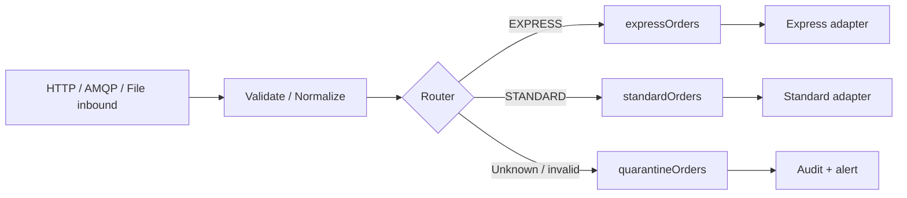
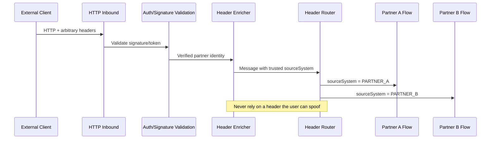
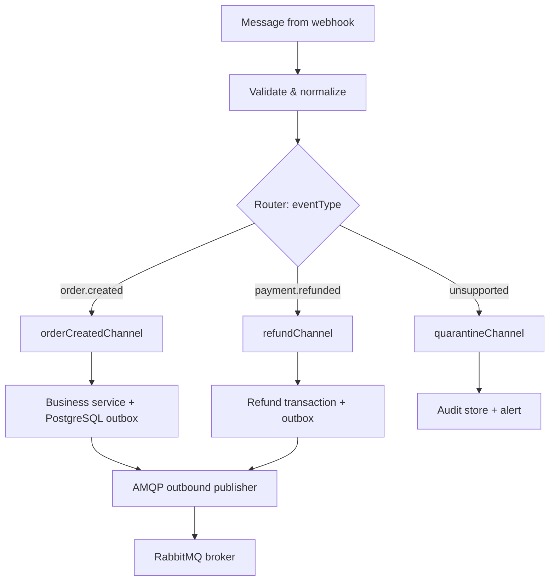
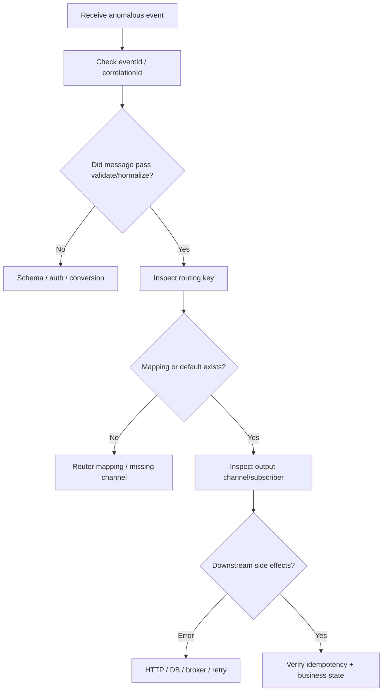
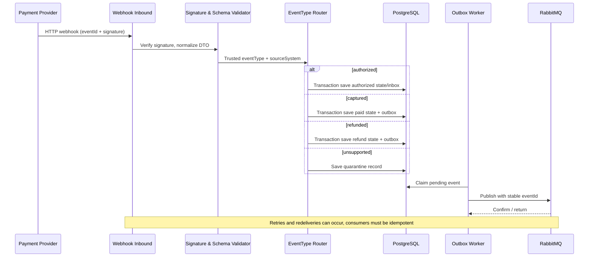

# Router and Branching by Content or Header

## 1. Context: The Same Message May Need Multiple Processing Paths

In the **SPRING_BOOT_INTEGRATION** module, a Spring Boot application may receive events via HTTP, databases, caches, message brokers, or Spring Integration adapters. After receiving a message, the application often needs to choose the right business flow:

- Express orders are routed to the priority shipping system.
- Standard orders are routed to the regular delivery system.
- Payment events go to reconciliation, while refund events go to the refund step.
- A specific tenant or partner is placed into a dedicated pipeline per contract.
- Unrecognized messages are routed to a quarantine channel for investigation instead of silently disappearing.

In **Spring Integration**, the component that performs this job is a **router**: it inspects a `Message` and decides which target `MessageChannel`(s) to send the message to. A router can decide based on **payload**, **headers**, expressions, or custom logic.

This is the lesson **"Router and Branching by Content or Header"**, in the **Routing and Transformation** chapter. The focus goes beyond Java DSL syntax: a wrong route can send data to the wrong partner, cause duplicate processing, leak data across tenants, or lose messages. Therefore, this lesson also covers validation, fallbacks, transactions, retries, testing, and observability.

### Learning Objectives

1. Distinguish a router from a filter, transformer, splitter, service activator, and publisher/subscriber.
2. Choose between payload-content routing and header-metadata routing based on the contract.
3. Write `IntegrationFlow.route(...)` and `@Router` with explicit channel mappings.
4. Handle unmatched routes, message delivery failures, synchronous/asynchronous channels, and outcome verification.
5. Test individual routing decisions and write integration tests against HTTP, databases, or brokers when needed.

> Examples use Java 17+, Spring Boot, and Spring Integration DSL common in modern versions. Exact module names, API details, and especially error mechanics may vary by version and channel type. Verify documentation against your running Spring Integration BOM/version before going to production.

## 2. What Does a Router Do in a Message Flow?

A message in Spring Messaging has two main parts: **payload** (content) and **headers** (metadata).

```java
import org.springframework.messaging.Message;
import org.springframework.messaging.support.MessageBuilder;

Message<String> message = MessageBuilder
    .withPayload("{\"eventType\":\"order.created\",\"orderId\":\"ORD-501\"}")
    .setHeader("sourceSystem", "ERP")
    .setHeader("schemaVersion", 2)
    .setHeader("correlationId", "trace-abc")
    .build();
```

In this example, the payload is a JSON string. Headers carry the source system, schema version, and correlation ID. For a router to access the `eventType` field inside JSON, the JSON typically must first be decoded/validated into a structured DTO; a router does not automatically understand every binary or JSON string format.

An illustrative flow:



**A router selects a path**, not a message storage location. If the output is a `DirectChannel`, sending normally dispatches the message immediately to an in-process subscriber. If the output is an outbound AMQP adapter, the message may proceed to a broker. Do not assume that merely having a "channel" means data is durably persisted.

### How Many Branches to Route To?

A router can choose **one** or **multiple** destinations depending on the router type and decision outcome. Clearly distinguish the contract:

- **Exclusive routing:** one business message goes to only one dedicated branch.
- **Recipient-list routing:** one message can go to multiple independent branches, such as auditing and business processing.
- **Broadcast:** delivered to multiple subscribers, typically modeled with a `PublishSubscribeChannel` or equivalent mechanism.
- **Discard/filter:** drops a message by condition, rather than automatically choosing an alternate business branch.

When an order command with side effects must be handled by **only one** partner, make a single deterministic decision and verify there is no unintended destination duplication.

## 3. Distinguishing Router from Transformer, Filter, Splitter, and Aggregator

| Component | Question it answers | Primary outcome | Example |
| --- | --- | --- | --- |
| **Router** | Which branch must the message take? | Selects destination channel(s) | `EXPRESS` → express delivery flow |
| **Transformer** | What shape should payload/headers become? | Message with transformed data | Partner JSON → `OrderEvent` |
| **Filter** | Should the message continue? | Keeps or drops a message | Drops irrelevant test events |
| **Splitter** | Should one payload be split into multiple messages? | A set of element messages | Batch of 100 orders → individual orders |
| **Aggregator** | When should multiple messages be combined? | Grouped result | All invoice line items collected |
| **Service Activator** | Which business logic should be invoked? | Executes handler | Writes database, calculates fees |
| **Gateway** | How does the application call into/out of the flow? | Method-call interface to messages | `@MessagingGateway` |
| **Outbound Adapter** | Which external system receives the message? | Interacts via HTTP, AMQP, files... | Publishes to RabbitMQ |

A common pipeline is:

```text
HTTP webhook
   -> Validate signature
   -> JSON decoder / transformer
   -> Normalize headers
   -> Router by eventType
        -> paymentAuthorizedChannel
        -> paymentRefundedChannel
        -> unsupportedEventChannel
   -> Transactional business handler / outbox
```

The router sits **after authentication and normalization**. If a router decides on raw unvalidated data, a malformed payload or a caller-supplied header can send a message into an unauthorized branch.

### Routing Does Not Replace Validation

For example, `eventType="payment.refunded"` does not mean the message is genuinely a signed/authorized refund event. The router only forwards the message to the branch; the branch's service must still verify contracts, permissions, and business preconditions.

## 4. Routing by Payload vs. by Header?

There are two fundamental choices:

| Criterion | Payload-based routing | Header-based routing |
| --- | --- | --- |
| Decision source | Business fields inside a parsed payload | `MessageHeaders` metadata |
| Examples | `order.deliveryMode`, `event.type` | `sourceSystem`, `tenantTier`, `schemaVersion` |
| Suitable when | Branch varies by **business content** | Branch varies by **source, route, policy, or metadata** |
| What to check | Schema, null, enum, semantics, and permissions | Whether header exists, has valid type, and comes from a trusted source |
| Risks | Unparsed/unnormalized payload | Forged external headers or routing directly to channel names |
| Risk mitigation | Validated DTOs, explicit mapping, default branch | Verify/overwrite trusted metadata, allowlist, explicit mapping |

Example order payload:

```json
{
  "eventId": "evt-2026-001",
  "orderId": "ORD-501",
  "deliveryMode": "EXPRESS",
  "amount": 120000
}
```

If choosing a shipping service by `deliveryMode`, that is a **business rule**, so routing on payload makes sense. Conversely, if every message from an authenticated partner must go through a partner-specific adapter, you can route on a **`sourceSystem` header attached by a trusted inbound adapter**.

**Do not use HTTP headers sent directly by clients as proof of tenant identity.** Verify bearer tokens, mTLS, signatures, or equivalent mechanisms first, then attach a fresh internal header from the authenticated result.

## 5. Required Dependencies and the Role of Auto-Configuration

To use Spring Integration DSL with Spring Boot, add the Integration starter managed by the BOM:

```xml
<dependency>
    <groupId>org.springframework.boot</groupId>
    <artifactId>spring-boot-starter-integration</artifactId>
</dependency>
```

Or Gradle:

```groovy
dependencies {
    implementation 'org.springframework.boot:spring-boot-starter-integration'
}
```

The starter provides core Spring Integration infrastructure and integrates with Spring Boot auto-configuration when classpath/conditions match. If routing to AMQP, HTTP, JDBC, SFTP, or specialized adapters, **you need the corresponding protocol dependencies**; the Integration starter does not pull in every adapter automatically.

Example paired with RabbitMQ:

```groovy
dependencies {
    implementation 'org.springframework.boot:spring-boot-starter-integration'
    implementation 'org.springframework.boot:spring-boot-starter-amqp'
    implementation 'org.springframework.integration:spring-integration-amqp'
}
```

This dependency snippet illustrates **distinguishing Spring AMQP from the Spring Integration AMQP adapter**, not that every router must use a broker. Core Spring Integration is usually sufficient to write and test internal routers. Channels in the DSL are not automatically backed by RabbitMQ queues.

### Related Beans

| Bean/Type | Role |
| --- | --- |
| `IntegrationFlow` | Defines a processing chain containing a router |
| `MessageChannel` | Input/output paths for the router |
| `DirectChannel` | Synchronous channel commonly used in tests/simple flows |
| `QueueChannel` | Pollable channel with an internal buffer |
| `MessageHandler` | Handler behind a branch |
| `Message<?>` | Payload + headers arriving at the router |
| `@Router` | Annotation-based method declaring routing decisions |

If Spring cannot find your declared `IntegrationFlow` or channel beans, check dependencies, package scanning, configuration classes, and bean names before assuming the broker is broken.

## 6. Designing the Message Contract Before Writing the Router

In an integration system, routing must rely on **stably defined** information. Example order event contract:

```json
{
  "eventId": "evt-1001",
  "eventType": "order.created",
  "schemaVersion": 2,
  "orderId": "ORD-501",
  "deliveryMode": "EXPRESS",
  "occurredAt": "2026-11-21T04:00:00Z"
}
```

And accompanying metadata, attached by the inbound adapter **after authentication**:

```text
sourceSystem = ERP
correlationId = req-8f90
contentType   = application/json
```

In Spring Messaging's `MessageHeaders`, headers like `id` and `timestamp` are framework-managed. When you need a durable idempotency key across HTTP, databases, and brokers, use `eventId` defined by the business contract; **do not rely on a framework-regenerated message ID at each step as the sole deduplication key**.

Rules to establish explicitly:

1. Valid values of `deliveryMode` are `EXPRESS`, `STANDARD`, or others per version.
2. Where do `null`, blank strings, or unsupported values go?
3. Can routing change mid-operation when a message with the same `eventId` is retried?
4. Can a route trigger irreversible side effects or only internal dispatch?
5. When a trusted header is missing, must the message be quarantined or take a safe fallback?
6. Are events from an unsupported schema version handled by a compatible branch?

If these decisions are not written into the contract, two deployed instances on different versions may route the same message differently.

## 7. Java DSL: Routing by Payload Content

Example using a parsed and validated type:

```java
public record OrderEvent(
    String eventId,
    String orderId,
    String deliveryMode
) {}
```

We configure one input channel, three output channels, and an `IntegrationFlow` that routes by `deliveryMode`:

```java
import org.springframework.beans.factory.annotation.Qualifier;
import org.springframework.context.annotation.Bean;
import org.springframework.context.annotation.Configuration;
import org.springframework.integration.channel.DirectChannel;
import org.springframework.integration.dsl.IntegrationFlow;
import org.springframework.messaging.MessageChannel;

@Configuration(proxyBeanMethods = false)
public class OrderRoutingConfiguration {

    @Bean("orderInput")
    MessageChannel orderInput() {
        return new DirectChannel();
    }

    @Bean("expressOrders")
    MessageChannel expressOrders() {
        return new DirectChannel();
    }

    @Bean("standardOrders")
    MessageChannel standardOrders() {
        return new DirectChannel();
    }

    @Bean("unsupportedOrders")
    MessageChannel unsupportedOrders() {
        return new DirectChannel();
    }

    @Bean
    IntegrationFlow orderRoutingFlow(
            @Qualifier("orderInput") MessageChannel input) {

        return IntegrationFlow.from(input)
            .route(
                OrderEvent.class,
                OrderEvent::deliveryMode,
                mapping -> mapping
                    .channelMapping("EXPRESS", "expressOrders")
                    .channelMapping("STANDARD", "standardOrders")
                    .defaultOutputChannel("unsupportedOrders")
            )
            .get();
    }
}
```

**Key mechanics:**

- `IntegrationFlow.from(input)` starts from the `orderInput` channel bean.
- The router invokes `OrderEvent::deliveryMode` to extract the **routing key** from the payload.
- `channelMapping("EXPRESS", "expressOrders")` maps the business value to the **channel bean name**.
- `defaultOutputChannel("unsupportedOrders")` receives values that do not match any mapping when the router uses a fallback.
- The message continues onto the selected channel; the router does not call HTTP or write to a DB without a downstream handler/adapter.

**Precondition to run:** the three output channels must have appropriate subscribers/consumers. `DirectChannel` is not a queue that buffers messages without a handler. Sending to an output channel with no subscriber can throw `MessageDeliveryException` even when the routing decision itself was correct.

In production code, avoid constructing an `OrderEvent` from raw JSON without validating `deliveryMode` or `eventId`. Separate schema validation/normalization from the router so contract errors do not mix with missing-branch errors.

## 8. Attaching Dedicated Handlers to Each Branch

One way to illustrate the subscribers:

```java
import org.springframework.context.annotation.Bean;
import org.springframework.context.annotation.Configuration;
import org.springframework.integration.dsl.IntegrationFlow;

@Configuration(proxyBeanMethods = false)
public class OrderBranchConfiguration {

    @Bean
    IntegrationFlow expressOrderFlow(OrderDispatchService dispatch) {
        return IntegrationFlow.from("expressOrders")
            .handle((payload, headers) -> {
                dispatch.sendExpress((OrderEvent) payload);
                return null;
            })
            .get();
    }

    @Bean
    IntegrationFlow standardOrderFlow(OrderDispatchService dispatch) {
        return IntegrationFlow.from("standardOrders")
            .handle((payload, headers) -> {
                dispatch.sendStandard((OrderEvent) payload);
                return null;
            })
            .get();
    }

    @Bean
    IntegrationFlow unsupportedOrderFlow(OrderReviewService review) {
        return IntegrationFlow.from("unsupportedOrders")
            .handle((payload, headers) -> {
                review.recordUnsupported((OrderEvent) payload);
                return null;
            })
            .get();
    }
}
```

`OrderDispatchService` and `OrderReviewService` are **project-implemented interfaces/services**, not built-in Spring Integration classes. The methods `sendExpress`, `sendStandard`, and `recordUnsupported` must be defined and registered as beans in a real application.

Why return `null` from the handler lambda: this is one-way processing, **emitting no new reply payload**. For request/reply flows, you must separately design reply channels, timeouts, and result types.

In this example, the channels are `DirectChannel`, so the router and handler are normally invoked synchronously on the sender's thread unless another endpoint switches to async. If `dispatch.sendExpress` calls a broker or HTTP and fails, the exception can propagate back to the sender through the synchronous channel. Never assume every router is asynchronous.

## 9. Sending Messages into the Flow and Preserving Correlation ID

A service constructing a message once a valid DTO is obtained:

```java
import org.springframework.beans.factory.annotation.Qualifier;
import org.springframework.messaging.MessageChannel;
import org.springframework.messaging.support.MessageBuilder;
import org.springframework.stereotype.Service;

@Service
public class OrderRoutingGateway {

    private final MessageChannel orderInput;

    public OrderRoutingGateway(
            @Qualifier("orderInput") MessageChannel orderInput) {
        this.orderInput = orderInput;
    }

    public void route(OrderEvent event, String correlationId) {
        boolean accepted = orderInput.send(
            MessageBuilder.withPayload(event)
                .setHeader("correlationId", correlationId)
                .setHeader("schemaVersion", 2)
                .build()
        );

        if (!accepted) {
            throw new IllegalStateException(
                "Order integration channel did not accept message"
            );
        }
    }
}
```

`MessageChannel.send()` returns a boolean per the API, though on a `DirectChannel` a subscriber failure may throw an exception before the method returns. **`accepted=true` does not mean partner HTTP responded successfully or the RabbitMQ consumer committed**.

The `correlationId` enables tracing across adapters. When sending to RabbitMQ/HTTP, configure the appropriate mapping to propagate it into protocol headers properly. Do not assume every Spring Message header automatically survives across external system boundaries.

## 10. Java DSL: Routing by Header

When the decision comes from verified metadata, a SpEL expression on headers can be used:

```java
import org.springframework.context.annotation.Bean;
import org.springframework.context.annotation.Configuration;
import org.springframework.integration.dsl.IntegrationFlow;

@Configuration(proxyBeanMethods = false)
class SourceSystemRoutingConfiguration {

    @Bean
    IntegrationFlow partnerSourceRoutingFlow() {
        return IntegrationFlow
            .from("partnerInbound")
            .route(
                "headers['sourceSystem']",
                mapping -> mapping
                    .channelMapping("ERP", "erpOrders")
                    .channelMapping("CRM", "crmOrders")
                    .defaultOutputChannel("unrecognizedSource")
            )
            .get();
    }
}
```

This snippet assumes channel beans named `partnerInbound`, `erpOrders`, `crmOrders`, and `unrecognizedSource` are defined in another configuration. The expression `headers['sourceSystem']` reads a header as the routing key.

Unlike the payload router in section 7:

- You do not need to know the payload structure to pick a branch, provided the metadata is trusted.
- If the header is unset, the route value may be `null`; a fallback policy must be defined and tested.
- If the header has the wrong type, such as an object instead of a normalized string, the mapping may fail to match.
- If the header comes directly from an HTTP request header sent by a user, it is **untrusted**. The inbound gateway should reassign the header based on authenticated information.

### Never Bind Channel Names Directly from External Input

A dangerous design is letting `headers['destination']` contain an arbitrary channel bean name directly and having the router attempt to send to that channel. In multi-tenant systems, this can become **routing injection**: an external caller forces a message into another tenant's or workflow's handler.

Prefer an explicit **allowlist** mapping:

```text
sourceSystem = ERP  -> erpOrders
sourceSystem = CRM  -> crmOrders
other / null         -> unrecognizedSource
```

Even if a router supports dynamic channel-name resolution, do not use that mechanism on untrusted data.

## 11. HeaderValueRouter and PayloadTypeRouter

Beyond the DSL, Spring Integration provides router implementations for common needs:

| Router | Decision based on | When to use |
| --- | --- | --- |
| `HeaderValueRouter` | Value of a specific message header | Routing by source system, tenant tier, schema version |
| `PayloadTypeRouter` | Java class of the payload | Distinguishing DTO/event classes after decoding |
| `MethodInvokingRouter` | Invoked method/functional logic | Simple business rules or custom conditions |
| `ExpressionEvaluatingRouter` | SpEL expression over the message | Routing by structured fields or headers |
| `RecipientListRouter` | Static/dynamic recipient list by condition | One message needs to go to multiple branches |
| `ErrorMessageExceptionTypeRouter` | Exception type inside an error message | Branching error handling |
| Custom `AbstractMessageRouter` | Application-written router logic | Cases needing handling more specialized than DSL |

For example, use `PayloadTypeRouter` when an inbound adapter has already converted messages into distinct DTOs: `OrderCreatedEvent` can go to the creation branch, `RefundRequestedEvent` to the refund branch. Watch out for class hierarchies, proxies, subtypes, and default routes; **Java class does not necessarily equal semantic eventType** across schema versions.

**HeaderValueRouter** is often convenient for selecting branches by `MessageHeaders`. However, design upfront for missing headers or unsupported values. Declaring mappings without handling out-of-set values risks message errors or drops driven by unintended default behavior.

## 12. Method-Based Router with @Router

Java DSL is not the only declaration style. Spring Integration lets you mark a routing decision method with `@Router`:

```java
import org.springframework.integration.annotation.MessageEndpoint;
import org.springframework.integration.annotation.Router;
import org.springframework.messaging.Message;

@MessageEndpoint
public class OrderPriorityRouter {

    @Router(
        inputChannel = "validatedOrders",
        defaultOutputChannel = "unsupportedOrders"
    )
    public String selectChannel(Message<OrderEvent> message) {
        OrderEvent order = message.getPayload();
        String mode = order.deliveryMode();

        return switch (mode == null ? "" : mode) {
            case "EXPRESS" -> "expressOrders";
            case "STANDARD" -> "standardOrders";
            default -> "unsupportedOrders";
        };
    }
}
```

Here the method returns the **target channel name**. Those channel names must exist, have subscribers/endpoints, and fall within the allowed set. `@MessageEndpoint` helps Spring discover the bean when component scanning covers the right scope.

Notes:

- `defaultOutputChannel` helps when the router cannot select a channel, though if the method itself returns a valid channel name, the router uses that name.
- The pattern above selects channels with an explicit `switch`. If input contains an unverified string, never return that string directly as a bean name.
- When the same business flow has both `IntegrationFlow.route(...)` and `@Router` consuming the same input, check whether you are accidentally creating **two competing subscribers** or overlapping route policies. Choose a single owner implementation or separate channels clearly.
- With multiple subscribers on a `DirectChannel`, the behavior is not "broadcast to every router." If you want fan-out, use appropriate patterns/channels.

### When to Choose @Router vs. DSL?

Use `@Router` when the routing decision needs a Java method that is easy to unit test and reuse. Use `IntegrationFlow.route(...)` when routing is one step inside a DSL pipeline and you want to see channels, transformers, filters, and handlers together in one configuration.

Both are Spring Integration mechanisms and do not automatically provide cross-process delivery durability.

## 13. Mapping, defaultOutputChannel, and Unrecognized Branches

A good router must have a **policy for every input**, including unexpected cases.

Suppose there are three `deliveryMode` values:

| Routing key | Selected channel | Action |
| --- | --- | --- |
| `EXPRESS` | `expressOrders` | Process express delivery service |
| `STANDARD` | `standardOrders` | Process standard delivery |
| `SAME_DAY` | `unsupportedOrders` when not yet implemented | Quarantine/alert/new contract version |
| `null`, blank, or invalid data | `unsupportedOrders` or pre-router validation error | Do not silently fall back to standard delivery on contract violation |

**A default route is not a place to succeed silently.** If an unmatched message carries an important command, the default branch should record the reason, event ID, source, and schema version, with retention/alerts and controlled reprocessing capability.

Some routers have configuration controlling **whether finding a channel is required** or whether messages can go to a default/discard channel. Flags such as `resolutionRequired` and default output channels have version- and router-dependent behavior. Do not assume every unmatched message is automatically sent to `errorChannel`; explicitly configure and test unmatched cases.

### When to Use nullChannel?

Spring Integration provides `nullChannel` to intentionally **discard messages**. It is an internal sink, not a DLQ. Only route to it when dropping the message is an **approved business decision**, such as discarding a harmless already-metered heartbeat.

For events involving transactions, payments, or inventory, never use `nullChannel` to hide invalid data. Route to a quarantine/DLQ or owned error path so events are not silently lost.

## 14. Branching on Multiple Conditions

Payload routing may need to inspect multiple fields:

- `deliveryMode` is `EXPRESS`.
- `destinationCountry` is in the supported country set.
- `tenantTier` entitles use of express service.
- `paymentStatus` is verified as `PAID`.

Instead of stuffing everything into a long SpEL expression, create a unit-testable **route selector**:

```java
public record ShippingCommand(
    String orderId,
    String deliveryMode,
    String destinationCountry,
    boolean expressEntitled
) {}

public enum ShippingRoute {
    EXPRESS,
    STANDARD,
    MANUAL_REVIEW
}

public final class ShippingRouteSelector {

    public ShippingRoute select(ShippingCommand command) {
        if (command == null || command.orderId() == null) {
            return ShippingRoute.MANUAL_REVIEW;
        }

        if ("EXPRESS".equals(command.deliveryMode())
                && command.expressEntitled()
                && "VN".equals(command.destinationCountry())) {
            return ShippingRoute.EXPRESS;
        }

        if ("STANDARD".equals(command.deliveryMode())) {
            return ShippingRoute.STANDARD;
        }

        return ShippingRoute.MANUAL_REVIEW;
    }
}
```

The selector does not call databases/HTTP; its routing decision is a **pure function** over normalized data. You can unit test the entire matrix of cases, then wire it into the DSL:

```java
@Bean
IntegrationFlow shippingRoutingFlow(ShippingRouteSelector selector) {
    return IntegrationFlow.from("validatedShippingCommands")
        .route(
            ShippingCommand.class,
            command -> selector.select(command).name(),
            mapping -> mapping
                .channelMapping("EXPRESS", "expressShipping")
                .channelMapping("STANDARD", "standardShipping")
                .channelMapping("MANUAL_REVIEW", "manualReview")
        )
        .get();
}
```

In this example, `ShippingRouteSelector` must be registered as a bean, and the input/output channels must be defined. When routing needs other data (e.g., looking up tenant entitlement from a DB), consider **enrichment before the router** instead of making a blocking HTTP call inside the route selector itself.

### Why Limit I/O Inside a Router?

Message routing usually sits on the hot path of the flow. If it performs synchronous HTTP/DB calls to pick a branch, downstream latency and failures can stall the entire channel. Separate concerns:

1. Validate and enrich metadata using adapters with timeouts/circuit breakers.
2. Keep routing pure, fast, and deterministic.
3. Have branch handlers perform side effects under transaction/retry policies.

This separation improves testability and observability at each layer.

## 15. Distinguishing Single-Route from Recipient-List and Publish-Subscribe

An order needs to be sent to **one** carrier while also emitting an audit event. Common misconceptions are "a router can only have one destination, so it cannot send audit" or "fanning out to two branches with a router guarantees no duplicate processing."

| Mechanism | Purpose | Caution needed |
| --- | --- | --- |
| Single-branch router | Select primary handler for a message | Accurate mapping, clear fallback |
| `RecipientListRouter` | Send one message to multiple recipients by condition | Failure of one recipient, send order, per-branch side effects |
| `PublishSubscribeChannel` | Broadcast to multiple subscribers in a flow | Error/async delivery, not durable by default |
| Splitter | Split one payload into multiple new messages | Sequence/correlation to aggregate when needed |
| Broker fan-out/topic | Cross-process distribution | Queues/subscriptions, ack, redelivery, reliability |

For "execute business action and audit," they do not have to share a single synchronous flow to two external systems. If the domain requires durable auditing, persist audit state in the database transaction or use an outbox, then publish events separately.

A `RecipientListRouter` can return multiple target channels; consider processing order, stopping policy when one branch fails, and idempotency requirements on each side. **Fanning out to two handlers that both trigger the same business effect duplicates business operations**, rather than being a harmless routing variation.

## 16. Header Enrichment and Metadata Trustworthiness

Headers are often used for routing because they separate metadata from the business payload. However, external adapters map different headers into Spring `MessageHeaders`, and not every header is trustworthy.

A sound design for webhooks:



In practice, distinguish `X-Source-System` from an external HTTP request from an internal header like `verifiedSourceSystem` attached by the authentication layer. Using both interchangeably without verifying the trusted source creates a security bypass.

### Headers to Consider

| Header | Purpose | Recommendation |
| --- | --- | --- |
| `verifiedSourceSystem` | Authenticated source identity | Set only by trusted adapter/security layer |
| `tenantId` | Data partitioning | Verify tenant relationship to identity and permissions |
| `schemaVersion` | Version-compatible payload reading | Value must be verified, not blindly trusted from sender |
| `correlationId` | Cross-flow tracing | Propagate across protocol hops; do not treat as sole idempotency key |
| `eventId` | Business event key if specified by contract | Prefer placing in payload or clearly normalized metadata |
| `replyChannel` | Reply destination in message flow | Infrastructure header; do not let external clients control it |
| `errorChannel` | Error destination in some async contexts | Do not treat as a global catch-all for every exception |

Spring `MessageHeaders` are essentially immutable in design. When adding or replacing metadata in a step, use `MessageBuilder`, a header enricher, or APIs that build a new message; do not attempt to mutate the headers Map of an existing message.

## 17. Router Failures vs. Failures Inside the Selected Branch

There are at least four categories of failures:

1. **Routing decision failure:** wrong payload type, broken expression, unsupported enum, unhandled null in logic.
2. **Channel resolution failure:** no matching channel, wrong bean name, or unregistered branch.
3. **Channel send failure:** channel has no subscriber, queue channel is full, send timeout, or channel rejection.
4. **Downstream handler failure:** DB/HTTP/broker call fails, authorization failure, or business validation failure.

Example:

```text
Input: deliveryMode = EXPRESS
      |
      v
Router picks "expressOrders"   <- routing decision succeeded
      |
      v
DirectChannel has no subscriber
      |
      v
MessageDeliveryException       <- downstream channel error, not invalid enum
```

Log/emit metrics clearly distinguishing **failure layer** to avoid misdiagnosis. If an outbound RabbitMQ handler throws an exception because the broker connection dropped, do not switch `EXPRESS` to `STANDARD` as a retry workaround; that changes business semantics rather than recovering transport.

### errorChannel and Sync/Async

In many synchronous flows using `DirectChannel`, handler exceptions are thrown back onto the sending thread and handled by the caller/transaction. With asynchronous endpoints or pollers, errors may be wrapped in an `ErrorMessage` and sent to a configured `errorChannel`.

Therefore:

- **Do not assume every router error automatically reaches `errorChannel`**.
- Do not catch all exceptions and return success, which suppresses retry/rollback signals.
- If routing errors to a DLQ or quarantine, design an explicit error flow ensuring enough metadata is retained for recovery.
- When routing errors by exception type, distinguish permanent errors (schema, authorization) from transient errors (network, DB locks).
- Test error paths using the exact channel, executor, and poller types used in production.

## 18. DirectChannel, QueueChannel, and Thread Boundaries

| Channel type | Key characteristic | Impact on routing |
| --- | --- | --- |
| `DirectChannel` | Dispatches to subscriber typically on sender's thread | Exceptions/transactions can propagate along the call stack |
| `ExecutorChannel` | Hands off execution to an executor | Breaks direct thread/transaction context boundary; needs async error handling |
| `QueueChannel` | Buffers messages for a poller/receiver to pick up later | Requires poller/consumer, capacity management, and lifecycle control |
| `PublishSubscribeChannel` | Sends to multiple subscribers | Broadcast semantics, different from single-route |
| Message store-backed channel | Can use appropriate storage to persist messages | Must configure transactions/retention/locking/recovery explicitly |

Do not assume routing to a `QueueChannel` gives you a durable queue. By default, `QueueChannel` is in-memory; if the process dies, messages only in memory are lost. If crash survival is required, use a broker/outbox or configure an appropriate persistent message store.

### Impact on Transactions

Suppose a `@Transactional` service sends a message to a `DirectChannel` and a same-thread handler writes to a repository: operations may participate in the same transaction depending on configuration. Switching that channel to `ExecutorChannel` runs processing on a different thread, and **the original transaction context does not automatically propagate**. Tests that only check whether the message reached a branch will miss lost atomicity unless they verify real DB commit/rollback behavior.

## 19. Routing Across HTTP, Broker, and Database Boundaries

A Spring Integration router usually selects only the **handler or channel**, while downstream adapters perform I/O:



Boundaries to manage separately:

- **HTTP inbound:** signature verification, payload limits, and replay protection.
- **DB:** local transactions, unique constraints, schema migrations, consistency.
- **Cache:** keys/TTL/invalidation; never use cache as proof of a committed transaction.
- **Broker:** publisher confirms, returns/unroutable handling, ack/redelivery, DLQ.
- **Spring Integration:** mapping, channel subscriptions, error channels, pollers/executors, message conversion.
- **HTTP outbound:** timeouts, circuit breakers, retries, idempotency keys when calling partners.

If a router branch calls `RabbitTemplate` directly inside a DB transaction, **the JPA transaction does not make broker publishing atomic with SQL commit**. Use a transactional outbox if send intent must survive a process crash.

## 20. Idempotency When Messages Are Re-Routed or Redelivered

An event may enter the router multiple times:

- RabbitMQ redelivers because a consumer died before ack.
- An HTTP caller retries a webhook after a timeout.
- An outbox worker resends after losing a confirm.
- An operator replays messages from DLQ/quarantine.
- A new pipeline deploys and route mappings changed while an event was pending.

Therefore, the router should **make consistent decisions on normalized messages**, while branch handlers with side effects check event IDs before updating business state.

Example PostgreSQL inbox table:

```sql
CREATE TABLE processed_event (
    source_system VARCHAR(80) NOT NULL,
    event_id      VARCHAR(120) NOT NULL,
    handler_type  VARCHAR(60) NOT NULL,
    processed_at  TIMESTAMPTZ NOT NULL DEFAULT CURRENT_TIMESTAMP,
    PRIMARY KEY (source_system, event_id, handler_type)
);
```

Here the key includes `handler_type` when **each event is allowed to produce a separate effect in multiple handlers**. If the contract allows only one business execution per event, a stricter unique key like `(source_system, event_id)` may be required. **Design keys according to business semantics**, not by blindly copying a sample schema.

In the handler, record processing completion and apply business changes within the **same database transaction** whenever possible. Do not mark an event "processed" before an external HTTP call outside the transaction without a recovery plan if the call fails. For non-DB side effects, use outbox/saga patterns and partner idempotency when supported.

### When Routing Rules Change Between Retries

Suppose `EXPRESS` went via carrier A yesterday and switches to carrier B today. A partially processed message could be sent to **both** if replay does not remember the initially chosen branch. For critical tasks, store `routingDecision` or `routingPolicyVersion` in the outbox/dispatch record; on retry, reuse the saved decision or migrate under an explicit policy.

This is especially critical for payments, logistics, and refunds, where switching branches between attempts can create two non-equivalent side effects.

## 21. Routing by Schema Version and Incompatible Content

Integration systems often run multiple producer/consumer versions concurrently. A router can inspect `schemaVersion`, but should not treat a version header as sole proof that the payload matches the schema.

Example policy:

| Version | Condition | Handling |
| --- | --- | --- |
| v1 | Supported, missing some newer fields | Transformer v1 → canonical model |
| v2 | Supported | Transformer v2 → canonical model |
| v3 | Unsupported | Quarantine and alert |
| Missing version | Accept only with explicit fallback contract | Reject or controlled legacy adapter |

Sometimes a router should run **before the transformer** to choose the v1/v2 decoder, then normalize both into one canonical DTO. In other architectures, the inbound adapter decodes into an envelope with `schemaVersion` and routes by that field. Either way, restrict the accepted version set and test old messages still sitting in queues.

Never let a `defaultOutputChannel` silently process v3 payloads with v2 logic when breaking semantic changes exist.

## 22. Optimizing Router Performance Without Sacrificing Correctness

Routing is usually fast when decisions rely on enums or a few normalized headers. When latency rises, pinpoint the real bottleneck:

- Overly complex SpEL expressions or re-parsing large payloads on every message.
- Blocking database/HTTP lookups inside the router.
- Output branch is a `DirectChannel` whose downstream handler performs slow I/O.
- `QueueChannel` sized too small causing send timeouts, or too large causing memory pressure.
- Backlog from broker consumer concurrency or downstream rate limits.
- Misconfigured multiple subscribers causing unintended load balancing or broadcast.

Effective optimizations usually are:

1. Decode and validate the payload **once** before the router.
2. Route on stable types or enums rather than arbitrary strings.
3. Move I/O into services/adapters with timeouts, retries, and metrics.
4. Pick channel types matching your synchronicity, throughput, and durability requirements.
5. Measure per-stage latency and queue backlog, not just total request time.
6. Bound concurrency and queued work when downstream slows down.

Do not scale threads indefinitely to work around an exhausted DB connection pool; the router may simply push more messages into an already overloaded dependency.

## 23. Testing Routing Decisions in Isolation

A pure selector like `ShippingRouteSelector` in section 14 should be unit tested before bringing in Spring context or brokers:

```java
import static org.assertj.core.api.Assertions.assertThat;

import org.junit.jupiter.api.Test;

class ShippingRouteSelectorTest {

    private final ShippingRouteSelector selector =
        new ShippingRouteSelector();

    @Test
    void eligibleExpressOrderUsesExpressBranch() {
        ShippingCommand command =
            new ShippingCommand("ORD-1", "EXPRESS", "VN", true);

        assertThat(selector.select(command))
            .isEqualTo(ShippingRoute.EXPRESS);
    }

    @Test
    void expressWithoutEntitlementGoesToReview() {
        ShippingCommand command =
            new ShippingCommand("ORD-2", "EXPRESS", "VN", false);

        assertThat(selector.select(command))
            .isEqualTo(ShippingRoute.MANUAL_REVIEW);
    }

    @Test
    void standardOrderUsesStandardBranch() {
        ShippingCommand command =
            new ShippingCommand("ORD-3", "STANDARD", "VN", false);

        assertThat(selector.select(command))
            .isEqualTo(ShippingRoute.STANDARD);
    }
}
```

Add cases for `null`, blank, uppercase/lowercase, unsupported countries, and invalid combinations. If policies have effective windows, inject a `Clock` for deterministic tests and store policy versions for replay.

Such unit tests **do not prove** that `MessageChannel` beans, mappings, or external adapters are wired properly. A further testing step is needed.

## 24. Component Test: Proving Messages Reach the Right Output Channel

A component test can use `QueueChannel` **only in tests** to observe messages arriving at each branch. You do not need RabbitMQ to verify router decisions.

```java
import static org.assertj.core.api.Assertions.assertThat;

import org.junit.jupiter.api.Test;
import org.springframework.beans.factory.annotation.Autowired;
import org.springframework.beans.factory.annotation.Qualifier;
import org.springframework.context.annotation.Bean;
import org.springframework.context.annotation.Configuration;
import org.springframework.integration.channel.DirectChannel;
import org.springframework.integration.channel.QueueChannel;
import org.springframework.integration.config.EnableIntegration;
import org.springframework.integration.dsl.IntegrationFlow;
import org.springframework.messaging.Message;
import org.springframework.messaging.MessageChannel;
import org.springframework.messaging.PollableChannel;
import org.springframework.messaging.support.MessageBuilder;
import org.springframework.test.context.junit.jupiter.SpringJUnitConfig;

@SpringJUnitConfig(classes = OrderRouterComponentTest.RouterTestConfig.class)
class OrderRouterComponentTest {

    @Autowired
    @Qualifier("orderInput")
    MessageChannel input;

    @Autowired
    @Qualifier("expressOrders")
    PollableChannel express;

    @Autowired
    @Qualifier("unsupportedOrders")
    PollableChannel unsupported;

    @Test
    void routesExpressPayload() {
        OrderEvent event =
            new OrderEvent("evt-1", "ORD-1", "EXPRESS");

        input.send(MessageBuilder.withPayload(event).build());

        Message<?> routed = express.receive(1000);
        assertThat(routed).isNotNull();
        assertThat(routed.getPayload()).isEqualTo(event);
        assertThat(unsupported.receive(0)).isNull();
    }

    @Test
    void unknownValueGoesToFallbackChannel() {
        OrderEvent event =
            new OrderEvent("evt-2", "ORD-2", "SAME_DAY");

        input.send(MessageBuilder.withPayload(event).build());

        Message<?> routed = unsupported.receive(1000);
        assertThat(routed).isNotNull();
        assertThat(routed.getPayload()).isEqualTo(event);
        assertThat(express.receive(0)).isNull();
    }

    @Configuration(proxyBeanMethods = false)
    @EnableIntegration
    static class RouterTestConfig {

        @Bean("orderInput")
        MessageChannel input() {
            return new DirectChannel();
        }

        @Bean("expressOrders")
        PollableChannel express() {
            return new QueueChannel();
        }

        @Bean("standardOrders")
        PollableChannel standard() {
            return new QueueChannel();
        }

        @Bean("unsupportedOrders")
        PollableChannel unsupported() {
            return new QueueChannel();
        }

        @Bean
        IntegrationFlow routerFlow() {
            return IntegrationFlow.from("orderInput")
                .route(
                    OrderEvent.class,
                    OrderEvent::deliveryMode,
                    mapping -> mapping
                        .channelMapping("EXPRESS", "expressOrders")
                        .channelMapping("STANDARD", "standardOrders")
                        .defaultOutputChannel("unsupportedOrders")
                )
                .get();
        }
    }
}
```

The example uses `SpringJUnitConfig`, JUnit Jupiter, AssertJ, and corresponding Spring Integration core/test dependencies. `OrderEvent` is the record declared in section 7. This is a **dedicated test configuration**, not adding test `QueueChannel` beans to production.

**What the test proves:** for the chosen input, the router delivers the message to the right output channel and unselected branches receive nothing. **What it does not yet prove:** HTTP endpoints, database transactions, RabbitMQ routing/ack, retries, or cross-process idempotency.

To avoid flaky tests, isolate test data and contexts. When testing flows with async executors/pollers, use bounded eventual assertions and also verify unselected branches.

## 25. Testing Header Routing and Source Trustworthiness

For routing by `sourceSystem`, build a test matrix table:

| Input header | Expected | Notes |
| --- | --- | --- |
| `sourceSystem=ERP` | `erpOrders` | Authenticated source |
| `sourceSystem=CRM` | `crmOrders` | Authenticated source |
| `sourceSystem=UNKNOWN` | `unrecognizedSource` | Expanded value set must be controlled |
| Missing header | Fallback/reject with reason | Do not allow default routing to side-effecting branch |
| Header is number/list | Fallback or validation failure | Type does not match contract |
| Forged external ERP header | Denied ERP branch access | Security/inbound adapter must verify and overwrite |

Importantly: a unit test manually setting `sourceSystem=ERP` in `MessageBuilder` only proves the router reads the header. To prove **security**, write integration tests on the HTTP/broker inbound adapter confirming that identity comes from a trusted source rather than raw headers.

### Conflicting Header and Payload

Suppose a message has header `sourceSystem=ERP` while the payload states `origin="CRM"`. Do not let the router arbitrarily pick one. Define the **source of truth** and mismatch policy: reject, quarantine, or normalize from verified identity. This case warrants a contract test.

## 26. Integration Testing with Broker or HTTP Adapters

When the final branch of a router publishes events through RabbitMQ, an isolated/real broker test should verify:

1. Inbound messages deserialize into the expected DTO/headers.
2. The router picks the right channel from normalized payload or headers.
3. The outbound AMQP adapter publishes to the expected exchange and routing key.
4. The broker has a binding/queue that actually receives the message.
5. Unroutable errors are observed via publisher returns/confirms if policy requires.
6. The consumer processes and writes business state once when a message is redelivered.
7. Invalid branches reach quarantine/DLQ or investigation records without disappearing.

For HTTP outbound adapters, use an HTTP stub server **over a socket** to test URL, method, auth, serialization, status mapping, and timeouts. Tests that simply mock `OrderDispatchService` will miss HTTP header mistakes or malformed wire payloads.

### Test Evidence Matrix

| Test type | What it proves | What it does not prove |
| --- | --- | --- |
| Pure selector unit test | Branching rules, out-of-set values | Spring channel wiring |
| Router + channel component test | Mapping, default route, payload/header forwarding | Real broker/HTTP/database |
| Contract test | Schema, field semantics, header names, versions | Network/ACL resources |
| RabbitMQ integration test | Exchange/binding/queue, publisher/consumer | Full production multi-service journey |
| PostgreSQL integration test | Transactions, unique constraints, idempotency, outbox | Real remote HTTP provider |
| End-to-end test | Business journey across services | Every failure mode under heavy load |

A `@SpringBootTest` that merely asserts the context starts **is not enough to prove** the router behaves correctly under errors, duplicates, or schema changes.

## 27. Observing the Router and Downstream Branches

A real operational system must measure both **routing decisions** and **processing outcomes**:

- **Route count:** messages entering each branch, broken down by event type/route policy version.
- **Fallback/quarantine count:** unrecognized messages and validation failure reasons.
- **Route latency:** time spent in the router and stage-to-stage deltas; do not lump HTTP/DB time into "router CPU" during investigations.
- **Downstream outcome:** success/failure/retry/DLQ counts per handler.
- **Backlog:** queued messages in brokers, pollable channels, or outboxes.
- **Correlation:** `eventId`, `correlationId`, source system, schema version, and routing decision.
- **Security:** messages rejected due to invalid source/tenant identity.

Spring Boot Actuator/Micrometer and Spring Integration observability features can assist depending on dependencies/versions/configuration. Do not assume every route automatically emits metrics with your desired labels.

**Watch cardinality:** never use high-cardinality `eventId`, `orderId`, or millions of `tenantId` values as metric labels, which causes time-series explosions. Keep those IDs in controlled traces/logs; metric labels should stay bounded like route name, event type, and outcome.

### Correlation Across Protocols

When going HTTP → Spring Message → RabbitMQ → consumer → database, each adapter has its own header mechanics. Explicitly map `correlationId`, `eventId`, and trace context per contract while avoiding forwarding sensitive headers. Routing correctly inside the JVM does not guarantee metadata survives a broker hop.

## 28. Troubleshooting: Wrong Branch or Lost Messages

| Symptom | Likely cause | First check |
| --- | --- | --- |
| Always hits default route | Routing key mismatches mapping, case difference, missing header | Log normalized key, mapping keys, schema version |
| Channel not found | Wrong bean name, channel missing, scan/config issue | `/actuator/beans`, channel names, context |
| `MessageDeliveryException` | Target `DirectChannel` has no subscriber, or handler threw error | Stack trace and channel subscribers |
| Message enters two business flows at once | Misconfigured recipient-list/pub-sub or duplicate handlers | Flow graph and subscribers/recipient lists |
| Message disappears on unknown branch | Sent to `nullChannel`/discard or unmonitored default route | Check default/discard flow and metrics |
| HTTP 403 on one branch | Router succeeded, downstream auth failed | Credentials, service identity, token audience |
| Message in broker but consumer misses it | Exchange/routing key/binding/queue or consumer policy | Broker topology, ready/unacked counts, DLQ |
| DB committed but event missed broker | Transaction boundary and missing outbox | Outbox state, publisher confirm/return |
| One event creates two shipments | Retry/redelivery, changed routing policy, missing dedup | Event ID, routing decision version, unique constraints |
| Header routes to wrong tenant | Trusted raw external header or broken header mapper | Inbound authentication and trusted enrichment |
| Slow route processing | I/O in selector or blocking downstream | Stage timings, thread dumps, pool metrics |
| Errors miss errorChannel | Synchronous flow throws exceptions directly | Channel type, caller error handling, async error publication |

An investigation workflow:



Fix **at the right layer**: misrouting due to unnormalized payloads requires fixing the validator/transformer; valid routing with an unavailable broker requires hardening outbound adapter reliability, not rewriting routing logic.

## 29. Anti-Patterns to Avoid

1. **Using raw HTTP headers as channel names:** risks bypassing tenant/role isolation.
2. **No default route or error policy:** new enum values can break the flow or drop messages depending on configuration.
3. **Routing all errors to `nullChannel`:** hides lost business events.
4. **Cramming database/HTTP calls into selectors:** adds latency, coupling, and hard-to-classify failures.
5. **Confusing a router with broadcast:** multiple `DirectChannel` subscribers do not all receive every message.
6. **Confusing `QueueChannel` with a durable broker:** messages are lost on process crash if only in memory.
7. **Relying on transient framework message IDs for cross-system deduplication:** IDs can change when messages are recreated.
8. **Changing routes mid-retry without saving the decision:** the same event can produce side effects on two branches.
9. **Testing only the selector and declaring the integration flow safe:** ignores adapters, transactions, bindings, and error propagation.
10. **Retrying every exception blindly:** validation or authorization failures will not succeed on retry.
11. **Logging raw payloads/headers with PII or tokens:** increases data exposure risk.
12. **Using unbounded `eventId` or `tenantId` as metric labels:** causes cardinality explosion.
13. **Assuming `send()` returning true means business completion:** does not prove remote commit or consumer ack.
14. **Ignoring schema version mismatches in routing:** producer changes can silently send messages to the wrong branch.
15. **Skipping concurrency/replay tests:** duplicate bugs often appear only with multiple instances or post-timeout retries.

## 30. Decision Table for Choosing a Routing Approach

| Need | Suitable approach |
| --- | --- |
| A DTO enum selects one branch | `IntegrationFlow.route(PayloadType.class, selector, channelMapping)` |
| Inbound-adapter-verified header value | Header router/SpEL on `headers['...']` with allowlist |
| Rule needing unit testing and reuse | `@Router` method or standalone selector bean |
| Branching by decoded Java type | `PayloadTypeRouter` when semantic types align |
| Event must go to both audit and business | Recipient-list/pub-sub or intentional outbox fan-out |
| Unrecognized event | Default route to quarantine with audit/replay or explicit error |
| Migrating JSON from older versions | Version-appropriate transformer/decoder before or after router |
| Asynchronous and durable processing | Broker or persistent message store/outbox; router only chooses the path |
| Decision depends on remote state | Enricher/service with timeouts → pure selector → downstream |
| Multi-tenant with security boundaries | Verify identity → trusted metadata → allowlisted route; enforce permissions in handler |

**Primary criteria:** clarity, testability, zero silent message loss, no misdelivery to wrong parties, and clean handling when rules evolve.

## 31. Applied Scenario: Payment Webhook with Multiple Event Types

A Spring Boot service receives webhooks with `eventType` values:

- `payment.authorized` → record authorization state.
- `payment.captured` → confirm capture and create `order.paid` outbox event.
- `payment.refunded` → process refund and emit reconciliation event.
- Anything else → save to quarantine, notify contract owner.

The provider sends `X-Partner-Code` and a signed payload. The same event may arrive multiple times, and HTTP clients occasionally time out even after the server has committed.

Recommended design:



### Design Review Questions

**1. Should we route before verifying the signature?** No. Raw unauthenticated payloads/headers must never select tenant-specific handlers with data access.

**2. Can we trust `X-Partner-Code` directly?** Not as identity proof. Verify the signature/identity first, then set an internal `verifiedPartnerCode` header against an allowlist.

**3. Should the `payment.captured` route call `RabbitTemplate` inside the DB transaction and assume atomic commit?** No. Write an outbox row in the same transaction; let a publisher send asynchronously with confirms and retry state.

**4. On receiving an unsupported `payment.disputed`, should we automatically route it to `payment.refunded`?** No, unless the business contract explicitly dictates it; normally quarantine it and update schema/router safely.

**5. If the provider resends the same `eventId`, does the router deduplicate it automatically?** A router mainly selects branches. Deduplication requires database unique constraints, an inbox, and business transactions; temporary caches or framework message IDs are insufficient.

**6. If a handler hits a network error after a branch is chosen, should we reroute to a different branch?** Only if an explicit business fallback is defined. In most cases, retry the same branch with a stable key and timeouts/backoff rather than arbitrarily changing processors.

**7. Which tests prove correctness?** Unit tests for the route table; component tests for output channels; webhook contract tests; PostgreSQL inbox/outbox and RabbitMQ publish integration tests; replay/timeout/crash tests at critical boundaries.

## 32. Pre-Deployment Checklist

- [ ] Clearly state whether the **routing key** comes from payload or header; identify the trusted data source.
- [ ] Payload is parsed/validated; headers are normalized to a schema/version contract.
- [ ] Route mappings are explicit and version-managed; never accept arbitrary channel names from user input.
- [ ] Fallback, reject/quarantine, or error strategy exists for missing/unknown keys.
- [ ] Destination channels exist and have subscribers/pollers; tested that no messages are silently dropped.
- [ ] Direct/Executor/Queue/PubSub chosen to match thread, transaction, concurrency, and durability needs.
- [ ] Router is not confused with filter, transformer, splitter, or fan-out; each branch has clear ownership.
- [ ] Handlers have error-classified timeouts/retries and idempotency for side effects.
- [ ] Database transactions, outbox/broker, and remote calls have defined consistency boundaries.
- [ ] For replays, track route policy version or persisted decision where business rules require.
- [ ] Unit tests for selectors, component tests for channels, contract tests, and DB/broker/HTTP integration tests where needed.
- [ ] Observe route counts, fallbacks, errors, latency, backlogs, and business outcomes by correlation ID.
- [ ] Never log raw tokens, PII, or sensitive headers; control metric label cardinality.
- [ ] When upgrading Spring Integration, verify DSL/annotation/router behaviors for that version and rerun missing/invalid-branch tests.

**Key takeaway:** A router in Spring Integration **decides the destination of a `Message`** from payload, headers, or rules. `channelMapping`, default routes, and error handling must be explicitly designed. A router does not replace validation, transactions, broker durability, idempotency, or integration testing. A reliable **SPRING_BOOT_INTEGRATION** flow delivers messages to the **right branch**, the **right recipient**, with **exactly one business effect per contract**, and leaves evidence to recover on failure.

## References

- [Spring Integration Reference – Routers](https://docs.spring.io/spring-integration/reference/router.html): EIP routers, header/payload routing, recipient lists, and routing configuration.
- [Spring Integration Reference – Java DSL](https://docs.spring.io/spring-integration/reference/dsl.html): defining `IntegrationFlow`, channels, and endpoints in DSL.
- [Spring Integration Reference – Error Handling](https://docs.spring.io/spring-integration/reference/error-handling.html): distinguishing sync/async errors and `errorChannel`.
- [Spring Framework Reference – Integration](https://docs.spring.io/spring-framework/reference/integration.html): messaging abstractions and integration with the Spring ecosystem.
- [Enterprise Integration Patterns – Content-Based Router](https://www.enterpriseintegrationpatterns.com/patterns/messaging/ContentBasedRouter.html): design rationale for content-based routing.

Examples are instructional. Before using them in production, verify your exact Spring Boot/Spring Integration versions, API signatures, adapter header propagation, and per-channel error/transaction semantics.
