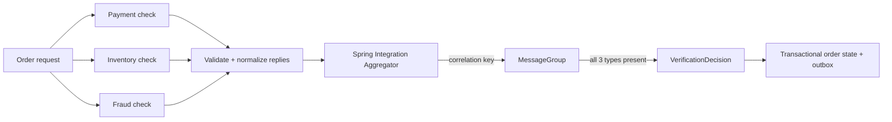
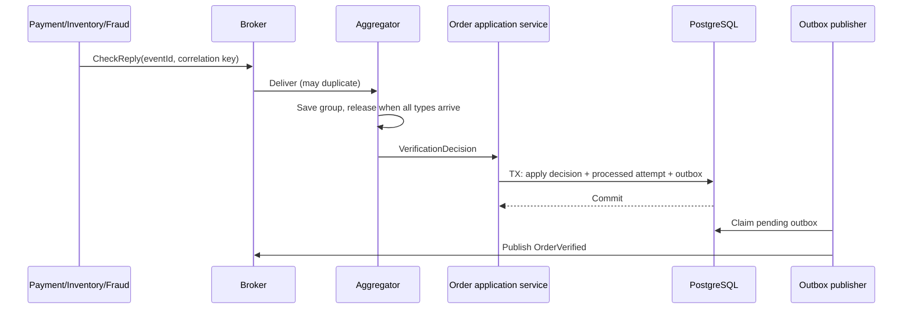

# Aggregator and Combining Results by Correlation Key

## 1. The Problem: Multiple Results Arrive at Different Times Yet Require One Decision

In integration systems, a single business event may spawn **multiple independent requests** to different systems. For example, before confirming an order, the Order Service needs results from three checks:

1. **Payment** verifies payment status.
2. **Inventory** verifies stock reservation capability.
3. **Fraud** evaluates transaction risk.

The three systems operate at different speeds. Results may arrive in the order `FRAUD → PAYMENT → INVENTORY`, be redelivered after timeouts, or even arrive **after** the flow has closed. You cannot rely on broker arrival order, nor can you simply count three messages and assume all three types arrived: a `PAYMENT` result delivered twice still does not replace a missing `INVENTORY` result.

Spring Integration's **Aggregator** handles **grouping related messages**, deciding **when a group qualifies to emit a result**, and **turning the group into a single output message**. The key mechanism is the **correlation key**, not merely message count.

This lesson belongs to the **Routing and Transformation** chapter of the **SPRING_BOOT_INTEGRATION** module. The module teaches Spring Boot integration across HTTP clients, databases, caches, message brokers, and Spring Integration adapters; emphasizing configuration management, data contracts, transactions, errors, deduplication, testing, and observability. Therefore, the examples go beyond `aggregate()` configuration: covering timeouts, idempotency, durable storage, late-arrival errors, scalability, and transaction boundaries.

After this lesson, you will be able to:

- Distinguish **correlation strategy**, **release strategy**, **output processor**, and **message group store**.
- Design correlation keys that prevent mixing results from two tenants, two orders, or two workflow attempts.
- Use Spring Integration Java DSL to build an aggregator that waits for **distinct required result types**.
- Explain the impact of out-of-order delivery, duplicates, timeouts, late arrivals, and overload.
- Choose between memory stores and persistent stores, clean up expired groups, and handle restarts.
- Combine aggregators with HTTP, JDBC/JPA, RabbitMQ/Kafka, Redis, and transactional outboxes at the right boundaries.
- Test integration flows, concurrency, and recovery mechanisms with realistic data.

> **Version context:** Examples use Java 17+, Spring Boot 3.2+, Spring Integration 6.x, and Java DSL APIs under `org.springframework.integration.dsl`. Manage versions via the Spring Boot BOM to avoid mixing incompatible major versions. Common imports are omitted for brevity; verify method names and defaults against your deployed Spring Integration version before production use.

## 2. A Realistic Flow Showing the Role of Correlation

### 2.1. Each Step Returns a Fragment with Identity

Suppose three systems receive the same `orderId` and each returns a distinct fragment:

```json
{
  "schemaVersion": 1,
  "tenantId": "TENANT-A",
  "orderId": "O-1001",
  "attemptId": "verify-2026-11-21-001",
  "type": "PAYMENT",
  "approved": true,
  "revision": 7
}
```

Fragments from `INVENTORY` and `FRAUD` share the same `tenantId`, `orderId`, and `attemptId` but carry different `type` values.

| Field | Role | Why it matters |
|---|---|---|
| `schemaVersion` | Message contract version | Prevents reading payloads from unsupported versions |
| `tenantId` | Customer/organization partition | Prevents merging data across tenants |
| `orderId` | Business identifier | Links the result to the order |
| `attemptId` | Identifier of **one verification attempt** | Prevents mixing retry results after an earlier workflow expired |
| `type` | `PAYMENT`, `INVENTORY`, `FRAUD` | Distinguishes required result types |
| `approved` | Each system's decision | Emits overall decision only once the group is valid |
| `revision` | Result version from the same source | Helps handle duplicates or out-of-order revisions |

`attemptId` must be **reused consistently within the same workflow attempt**, while changing when a new verification run carries distinct semantics from an old one. It is neither a broker-assigned message ID nor a random value regenerated on each redelivery.

### 2.2. Routing and Aggregation Flow



A group is keyed logically by:

```text
verification:v1:TENANT-A:O-1001:verify-2026-11-21-001
```

If a reply for `O-1002` arrives concurrently, it must enter a **different group**. If `O-1001` starts a new workflow attempt, results from the old attempt must not automatically join the new group.

### 2.3. Aggregator Is Not Router, Splitter, or Resequencer

| Spring Integration Component | Responsibility | Example |
|---|---|---|
| Router | Selects channel/branch by header/payload | Routes `PAYMENT` to payment queue |
| Transformer | Converts one message's representation | JSON → schema-valid `CheckReply` |
| Splitter | Splits one message into multiple parts | One list of line items → N messages |
| Filter | Blocks or allows a message | Drops unsupported schema payloads |
| **Aggregator** | Combines multiple messages into one result when release condition holds | Three check types → one decision |
| Resequencer | Reorders messages by sequence | Emits parts in defined sequence |
| Scatter-gather | Dispatches request to multiple targets and gathers replies | Calls three services in parallel to aggregate |

A splitter can automatically generate `correlationId`, `sequenceNumber`, and `sequenceSize` headers, which the default aggregator leverages. However, a **multi-system reply** problem must know the exact required result types and cannot assume a `sequenceSize` match alone solves duplicates or out-of-order replies.

## 3. Four Decisions That Make Up an Aggregator

### 3.1. Correlation Strategy: Which Group Does a Message Belong To?

`CorrelationStrategy` maps a message to a **group ID**. In this example:

```text
correlationKey =
    tenantId + ":" + orderId + ":" + attemptId
```

This identifier must be **stable**, consistent across producers, and specific enough to isolate workflows. Never use arrival timestamps to construct the key, because related messages would never find each other. Never use only `orderId` if an order can undergo multiple attempts or span multiple tenants.

If key components may contain `:`, encode/escape them or use an unambiguous canonical format; the example in section 5 validates a safe character set. With a persistent group store, the key format must survive serialization/restarts and schema changes.

### 3.2. Release Strategy: When May a Group Be Emitted?

Common rules:

- **Fixed count:** `N` messages received. Simple, yet **unsafe if duplicates are counted as new results**.
- **By sequence metadata:** all sequence parts received; fits when a splitter ensures metadata and duplicates are controlled upstream.
- **By business type:** all required types `PAYMENT`, `INVENTORY`, `FRAUD` present regardless of order.
- **By deadline:** emit **PARTIAL/TIMED_OUT** on timeout or discard the group per contract.
- **Fail-fast:** if one system rejects, conclude early in certain use cases, while still managing trailing messages.

This lesson's rule:

```text
required = {PAYMENT, INVENTORY, FRAUD}
observed = set(types of valid replies in the group)
release if observed contains all required
```

A duplicate `PAYMENT` increases message count, **without** releasing the group while `FRAUD` is still missing.

### 3.3. MessageGroupStore: Where Are Groups Held?

An Aggregator is a **stateful component**. It must retain replies while waiting for missing parts. `MessageGroupStore` abstracts message group storage:

- **Memory store:** fast, easy to test; typically loses pending groups on process restart and requires bounds on pending group count.
- **Persistent store** (e.g., an appropriate JDBC or Redis implementation): preserves messages across restarts, but requires schemas, serialization, locking, expiry, and multi-instance coordination rules.

A persistent store **does not automatically make** a flow exactly-once or keep business state synchronized with databases/brokers. Writing to the group store may happen at a different time than broker ack or database commit.

### 3.4. Output Processor: What Combined Result Is Built?

`MessageGroupProcessor` builds **one output payload** from the group's messages. For example:

```json
{
  "tenantId": "TENANT-A",
  "orderId": "O-1001",
  "attemptId": "verify-2026-11-21-001",
  "approved": true,
  "resultsReceived": ["PAYMENT", "INVENTORY", "FRAUD"]
}
```

The output processor should:

1. Verify all parts in the group share the same `tenantId`/`orderId`/`attemptId`.
2. Validate each `type` and apply conflict/duplicate selection rules.
3. Never rely on the iteration order of the group's collection (which may vary).
4. Never turn a failed or missing reply into `approved=true`.
5. Include correlation/operation IDs in the result so downstream updates state idempotently.

**Separating release from output:** the release strategy returns a boolean (whether to emit); the output processor constructs the new message content. Mixing everything into one hard-to-test block complicates timeout and duplicate handling.

## 4. Setting Up Spring Boot and Message Contracts

### 4.1. Maven Dependencies

Using the Spring Boot parent/BOM:

```xml
<dependencies>
  <dependency>
    <groupId>org.springframework.boot</groupId>
    <artifactId>spring-boot-starter-integration</artifactId>
  </dependency>
  <!-- Add only if HTTP, RabbitMQ, JDBC, or Redis adapters are needed. -->
  <dependency>
    <groupId>org.springframework.integration</groupId>
    <artifactId>spring-integration-http</artifactId>
  </dependency>
  <dependency>
    <groupId>org.springframework.integration</groupId>
    <artifactId>spring-integration-jdbc</artifactId>
  </dependency>
  <dependency>
    <groupId>org.springframework.boot</groupId>
    <artifactId>spring-boot-starter-test</artifactId>
    <scope>test</scope>
  </dependency>
  <dependency>
    <groupId>org.springframework.integration</groupId>
    <artifactId>spring-integration-test</artifactId>
    <scope>test</scope>
  </dependency>
</dependencies>
```

Core flows run with just the Spring Integration starter; HTTP/JDBC modules are added when their adapters/stores are used. RabbitMQ/Kafka/Redis adapters need their own matching dependencies from the same BOM. Never mix Spring Integration 5.x with Spring Framework 6.x.

### 4.2. Minimal Payload Contract

```java
// CheckType.java
public enum CheckType {
    PAYMENT,
    INVENTORY,
    FRAUD
}

// CheckReply.java — record used as message payload.
public record CheckReply(
        int schemaVersion,
        String tenantId,
        String orderId,
        String attemptId,
        CheckType type,
        boolean approved,
        long revision
) {}

// VerificationDecision.java
public record VerificationDecision(
        String tenantId,
        String orderId,
        String attemptId,
        boolean approved
) {}
```

These records illustrate the Java contract; real systems must validate fields, length limits, schema versions, and verify that producers are authorized to send results for that `tenantId`/`orderId`. When persisting groups via binary/JSON serializers in a persistent store, lock down format compatibility and schema migrations.

### 4.3. Where Should Correlation Metadata Live?

A Spring Integration message has two parts: **payload** and **headers**. You can keep business keys in the payload and also add a correlation key to headers:

```java
Message<CheckReply> message = MessageBuilder
        .withPayload(reply)
        .setHeader(
                "verificationCorrelation",
                reply.tenantId() + ":" + reply.orderId()
                        + ":" + reply.attemptId())
        .build();
```

In this example, **the payload is the source of business truth**; the header aids routing/diagnostics. Never trust headers sent by untrusted HTTP requests without cross-checking the payload and authorization. If producers use standard splitter/aggregator conventions, Spring Integration provides `correlationId`, `sequenceNumber`, and `sequenceSize` headers; however, those carry **sequence** semantics and do not replace validating all three distinct business types.

## 5. Building an Aggregator with Java DSL

### 5.1. Contract-Validated Correlation Key

Write a pure function usable across unit tests, inbound adapters, and the aggregator:

```java
// VerificationKeys.java — imports omitted for brevity
public final class VerificationKeys {
    private VerificationKeys() {}

    public static String of(CheckReply reply) {
        if (reply == null || reply.schemaVersion() != 1
                || reply.type() == null
                || reply.revision() < 0) {
            throw new IllegalArgumentException(
                    "CheckReply has invalid schema/type/revision");
        }
        validateId(reply.tenantId(), "tenantId");
        validateId(reply.orderId(), "orderId");
        validateId(reply.attemptId(), "attemptId");

        return "verification:v1:"
                + reply.tenantId() + ":"
                + reply.orderId() + ":"
                + reply.attemptId();
    }

    private static void validateId(String value, String name) {
        if (value == null
                || !value.matches("[A-Za-z0-9_-]{1,100}")) {
            throw new IllegalArgumentException(
                    name + " has invalid characters or length");
        }
    }
}
```

Restricting IDs to letters, digits, underscores, and hyphens ensures the delimiter `:` cannot appear inside individual segments. This is **illustrative**; systems supporting international identifiers or UUIDs with other characters should use canonical encoding and appropriate length bounds rather than silently truncating or altering values in ways that cause two distinct IDs to collide into one key.

**Security isolation:** syntax validation alone does not prove a message source is authorized to submit results into that tenant's group. Inbound adapters must verify source identity, order/workflow ownership, schema version, and signatures/tokens where required, preventing attackers from injecting fake `FRAUD approved=true` replies.

### 5.2. Release Strategy by Result-Type Set

```java
// AllChecksReleaseStrategy.java
public final class AllChecksReleaseStrategy
        implements ReleaseStrategy {

    private static final Set<CheckType> REQUIRED =
            EnumSet.allOf(CheckType.class);

    @Override
    public boolean canRelease(MessageGroup group) {
        EnumSet<CheckType> seen =
                EnumSet.noneOf(CheckType.class);

        for (Message<?> message : group.getMessages()) {
            if (!(message.getPayload() instanceof CheckReply reply)
                    || reply.type() == null) {
                // Contract error: do not emit decision from invalid payload.
                throw new IllegalArgumentException(
                        "Message in group is not a valid CheckReply");
            }
            seen.add(reply.type());
        }
        return seen.containsAll(REQUIRED);
    }
}
```

If a group receives `PAYMENT, PAYMENT, INVENTORY`, `seen` contains only two values, so the aggregator **keeps waiting for FRAUD**. This prevents premature release from duplicates, though it **does not yet resolve** duplicates with conflicting payloads: two `PAYMENT` messages with different revisions or outcomes need an explicit policy.

### 5.3. Output Processor Enforcing Consistency

```java
// VerificationGroupProcessor.java
public final class VerificationGroupProcessor
        implements MessageGroupProcessor {

    @Override
    public Object processMessageGroup(MessageGroup group) {
        EnumMap<CheckType, CheckReply> parts =
                new EnumMap<>(CheckType.class);

        for (Message<?> message : group.getMessages()) {
            if (!(message.getPayload() instanceof CheckReply reply)) {
                throw new IllegalArgumentException(
                        "Invalid payload in group");
            }
            CheckReply prior =
                    parts.putIfAbsent(reply.type(), reply);
            if (prior != null && !prior.equals(reply)) {
                throw new IllegalStateException(
                        "Two results with same type have different contents");
            }
        }

        if (!parts.keySet().containsAll(
                EnumSet.allOf(CheckType.class))) {
            throw new IllegalStateException(
                    "Missing one or more required check types");
        }

        CheckReply payment = parts.get(CheckType.PAYMENT);
        for (CheckReply part : parts.values()) {
            if (!payment.tenantId().equals(part.tenantId())
                    || !payment.orderId().equals(part.orderId())
                    || !payment.attemptId().equals(part.attemptId())) {
                throw new IllegalStateException(
                        "Group contains messages from different workflows");
            }
        }

        boolean approved = parts.values().stream()
                .allMatch(CheckReply::approved);

        return new VerificationDecision(
                payment.tenantId(),
                payment.orderId(),
                payment.attemptId(),
                approved);
    }
}
```

This enforces a **zero-tolerance policy for conflicting duplicates**: throwing an error for external handling/reconciliation rather than silently picking "whichever arrived last." It permits **identical duplicates** because record `equals` compares all fields. In production, if a valid source can emit a newer revision within the **same attempt**, define revision/version selection rules and handle races atomically. Often it is cleaner to normalize/deduplicate at the boundary before messages enter the aggregator.

### 5.4. Declaring Channels, Store, and IntegrationFlow

```java
// VerificationAggregationConfiguration.java — imports omitted for brevity
@Configuration(proxyBeanMethods = false)
public class VerificationAggregationConfiguration {

    @Bean("verificationReplies")
    MessageChannel verificationReplies() {
        return new DirectChannel();
    }

    @Bean("verificationDecisions")
    PollableChannel verificationDecisions() {
        return new QueueChannel(128);
    }

    @Bean("verificationGroupStore")
    MessageGroupStore verificationGroupStore() {
        // Local/test only; restarts lose pending groups.
        return new SimpleMessageStore();
    }

    @Bean
    IntegrationFlow verificationAggregatorFlow(
            @Qualifier("verificationReplies")
            MessageChannel input,
            @Qualifier("verificationDecisions")
            PollableChannel output,
            @Qualifier("verificationGroupStore")
            MessageGroupStore store
    ) {
        return IntegrationFlow.from(input)
                .aggregate(a -> a
                        .correlationStrategy(message ->
                                VerificationKeys.of(
                                    (CheckReply) message.getPayload()))
                        .releaseStrategy(
                                new AllChecksReleaseStrategy())
                        .outputProcessor(
                                new VerificationGroupProcessor())
                        .messageStore(store)
                        .groupTimeout(30_000L)
                        .sendPartialResultOnExpiry(false)
                        .expireGroupsUponCompletion(true))
                .channel(output)
                .get();
    }
}
```

These illustrative beans use Spring Messaging `MessageChannel`/`PollableChannel`, Spring Integration `DirectChannel`/`QueueChannel`, `SimpleMessageStore`, `IntegrationFlow`, and aggregator strategies. `QueueChannel(128)` is merely a bounded output channel inside **one JVM**, not a durable broker queue. When production applications publish decisions to HTTP/DB/brokers, route the output to a real handler/adapter and manage retries accordingly.

**Why inject channels/store into the flow method?** With `@Configuration(proxyBeanMethods=false)`, calling another `@Bean` method directly like a plain Java method can create **a new instance** instead of retrieving the managed singleton. Injecting via `@Qualifier` ensures the flow uses the exact beans that tests/inbound adapters send to.

**Input precondition:** the example flow assumes the adapter **has already authenticated and validated the payload** as a `CheckReply`. Casting directly to `CheckReply` will fail on mismatched payload types; at production ingress, place validators/filters/error-channels and quarantine/DLQ policies before untrusted data enters the store.

### 5.5. Explanation of Each Option

| Setting | Meaning |
|---|---|
| `correlationStrategy` | Computes group ID from `tenantId + orderId + attemptId` |
| `releaseStrategy` | Releases only when `PAYMENT`, `INVENTORY`, and `FRAUD` are all present |
| `outputProcessor` | Constructs a consistent `VerificationDecision` |
| `messageStore` | Holds fragments while waiting for the group to complete |
| `groupTimeout(30_000L)` | Sets timeout policy in milliseconds driven by the aggregator's scheduler mechanism |
| `sendPartialResultOnExpiry(false)` | Does not emit incomplete results down the normal decision flow |
| `expireGroupsUponCompletion(true)` | Cleans up group state upon completion per configured policy |
| `channel(output)` | Forwards the aggregated result to the next channel |

**Warning on timeout:** with `sendPartialResultOnExpiry(false)`, a group may expire **without emitting a `VerificationDecision`**. The workflow originator must still maintain a **durable deadline and `TIMED_OUT` status** so it does not wait forever. Aggregator group timeout does not replace a full workflow SLA/process manager; test exact scheduler, expiry, and group cleanup behavior against your Spring Integration version.

### 5.6. Example Sending Three Messages

```java
// Example in a test or post-validation inbound adapter.
CheckReply payment = new CheckReply(
        1, "TENANT-A", "O-1001", "attempt-1",
        CheckType.PAYMENT, true, 7);
CheckReply inventory = new CheckReply(
        1, "TENANT-A", "O-1001", "attempt-1",
        CheckType.INVENTORY, true, 4);
CheckReply fraud = new CheckReply(
        1, "TENANT-A", "O-1001", "attempt-1",
        CheckType.FRAUD, false, 2);

input.send(MessageBuilder.withPayload(fraud).build());
input.send(MessageBuilder.withPayload(payment).build());
input.send(MessageBuilder.withPayload(inventory).build());

Message<?> outputMessage = decisions.receive(1_000);
VerificationDecision decision =
        (VerificationDecision) outputMessage.getPayload();

assertEquals("O-1001", decision.orderId());
assertFalse(decision.approved()); // FRAUD rejected
```

`input` is the injected `verificationReplies` `MessageChannel` bean, `decisions` is the injected `verificationDecisions` `PollableChannel` bean, and tests must verify `outputMessage != null` before reading its payload. In a synchronous `DirectChannel` flow, the aggregator callback may run on the sending thread; with brokers/`ExecutorChannel`, ordering, threads, errors, and wait times differ. Tests should therefore assert **outcomes**, without depending on arrival order.

## 6. Correlation Keys: Designing Against Cross-Group Pollution

### 6.1. Keys That Are Not Specific Enough

| Correlation key | Risk |
|---|---|
| `orderId` only | Mixes old and new attempts; can mix tenants |
| `customerId` only | Combines multiple orders from the same customer |
| Service name `PAYMENT` | Collapses every order into one giant group |
| Broker message UUID | Each reply becomes its own group and never aggregates |
| Message arrival timestamp | Each source arrives at a different timestamp |
| `tenantId + orderId + attemptId` with explicit encoding | Isolates the exact workflow scope when IDs are verified |

Not every use case needs `attemptId`: a splitter creating N parts of **one single payload** can rely on the correlation ID generated by the splitter. In asynchronous sagas/workflows, explicit attempt/version identifiers isolate late responses and retries.

### 6.2. Correlation ID vs. Idempotency ID

These two identifiers answer different questions:

- **Correlation key:** "Which messages belong to the same waiting group?"
- **Idempotency key:** "Has this business effect already been applied?"

All `CheckReply` messages in one attempt share one correlation key, yet a `PAYMENT` reply may be redelivered multiple times with new message IDs; deduplicate using `tenantId + orderId + attemptId + type + revision` or a durable `sourceEventId` from the producer. After the aggregator emits `VerificationDecision`, the application service also needs an idempotency key over `tenantId + orderId + attemptId` so it never updates the order twice if the output is re-emitted.

### 6.3. Correlation Headers Can Be Lost During Transformation

If using default correlation/release based on Spring Integration sequence headers, custom transformers, HTTP gateways, serialization adapters, or broker consumers can accidentally drop headers. Fragments then split into separate groups, hang until expiry, or emit incorrectly.

Checklist:

1. Decide which metadata belongs in the **payload business contract** versus message headers.
2. Across HTTP/broker hops, explicitly map payload/headers to external protocol fields and back.
3. Never assume Java Message headers pass intact across JMS, AMQP, Kafka, or REST APIs.
4. Use explicit payload-based correlation strategies for critical workflows to minimize header coupling, or test header mapping/contracts directly.
5. Keep `correlationId` in logs/traces within security limits, never as a unique metric label.

## 7. Duplicates, Out-of-Order, Conflicting Replies, and Late Arrivals

### 7.1. Out-of-Order Arrival Is Normal

An aggregator is built to group messages by correlation key **regardless of arrival order**. For the same `attempt-1`:

```text
T+00ms  FRAUD     approved=true
T+12ms  INVENTORY approved=true
T+45ms  PAYMENT   approved=true

Observed types:
T+00  {FRAUD}                       -> wait
T+12  {FRAUD, INVENTORY}            -> wait
T+45  {FRAUD, INVENTORY, PAYMENT}   -> release
```

The output processor must look up replies by `type` rather than assuming `group.getMessages().toArray()[0]` is PAYMENT. When business rules require deterministic sequence ordering in another workflow (e.g., replaying ledger entries in order), use a resequencer or explicit sequencing policy; an aggregator does not order business events chronologically on its own.

### 7.2. Duplicates from Broker Redelivery or HTTP Retries

```text
T+00  PAYMENT   messageId=uuid-1  revision=7
T+05  PAYMENT   messageId=uuid-2  revision=7  (redelivery)
T+10  FRAUD     messageId=uuid-3  revision=2
T+20  INVENTORY messageId=uuid-4  revision=4
```

The default `MessageStore`/group may store both `uuid-1` and `uuid-2` because they have **two different Spring Message IDs**. `AllChecksReleaseStrategy` still checks the distinct type set so it will not prematurely release on two PAYMENTs and one FRAUD. However, the group now holds **four messages**, increasing memory/store size, and the output processor must decide whether duplicates are acceptable.

**Production recommendation:** deduplicate at **ingress before the aggregator** using a trusted event ID or revision-qualified business key; if durability is needed, persist processed keys with unique constraints/transactions rather than only an in-JVM `ConcurrentHashMap`. Framework-generated message IDs created upon deserialization/reconstruction are not reliable idempotency IDs across broker redeliveries.

### 7.3. Two Replies of the Same Type with Different Decisions

For example, `PAYMENT revision=7, approved=false` followed by `PAYMENT revision=8, approved=true` sharing the same `attemptId`. Answer **before coding**:

1. Are these two valid snapshots of the same attempt, or a producer bug?
2. Does revision increase monotonically within **that source** or across the whole workflow?
3. May a finalized decision be overturned?
4. If a stale revision arrives after a newer one, how do you prevent overwriting?
5. When a source changes state after timeout, should a new attempt or compensation occur?

The processor in section 5 **throws on differing duplicates** so it never silently picks one. Another policy might keep the highest revision, requiring atomic per-type updates and defining what happens if a higher revision arrives **after the group has already released**. When state evolves continuously, a **process manager/state table in PostgreSQL** may fit better than a plain aggregator.

### 7.4. Late Messages After Group Completion

A dangerous race:

```text
T1 PAYMENT, INVENTORY, FRAUD arrive -> group releases.
T2 Consumer updates Order=CONFIRMED.
T3 Group is deleted to free store space.
T4 Broker redelivers PAYMENT from the old attempt.
T5 Aggregator sees the key with no existing group
   -> may create a brand-new group with the same correlation key.
```

`expireGroupsUponCompletion(true)` cleans up group state; it **does not permanently keep a durable tombstone** proving the attempt was already finalized. Even if a store is configured to retain completed groups for some period, you still need explicit rules for TTL, restarts, and late arrivals.

The application layer should persist workflow state keyed by `(tenantId, orderId, attemptId)` with states `PENDING/COMPLETED/TIMED_OUT/CANCELLED`, backed by unique constraints or optimistic locking. Ingress checks whether the attempt still accepts replies; the consumer commits only when the attempt is in an eligible state, and ignores/audits late replies.

### 7.5. Failure Modes to Distinguish

| Scenario | Group state | Appropriate handling |
|---|---|---|
| Out-of-order reply | Continues accumulating | Release by type set, not arrival order |
| Identical duplicate | May inflate message count | Deduplicate before aggregator or handle in processor |
| Conflicting duplicate | Group holds inconsistent data | Quarantine/reconcile; never pick arbitrarily |
| Invalid schema reply | Must not enter group | Validate before ingress, error channel/DLQ |
| Wrong tenant/attempt reply | Wrong group or forged key | Auth + payload cross-check, reject |
| Expired reply | Group may already be expired | Check durable attempt state before accepting |
| Post-completion reply | Could spawn a new group if store cleaned up | Durable tombstone/business state dedup, ignore |
| Permanently lost reply | Group never completes | Deadline, timeout event, compensation |
| Output consumer fails | Group may be released while business commit failed | Reliable handoff + idempotent retry; test specifically |

**Important:** releasing a group and committing the business outcome are **two distinct actions**. If the output processor emits a payload and the downstream handler rolls back, group state does not automatically revert across every store/channel/transaction combination.

## 8. Timeouts, Partial Results, and Group Expiry

### 8.1. Every Workflow Needs a Business Deadline

Suppose an Order must be decided within 30 seconds:

```text
Attempt createdAt       = 10:00:00
Business deadline       = 10:00:30
PAYMENT arrives         = 10:00:05
FRAUD arrives           = 10:00:10
INVENTORY never arrives
```

At the deadline, **never default to `approved=true`**. Three common policies exist:

1. **Fail closed:** record `TIMED_OUT`/`REJECTED`, do not confirm the order.
2. **Bounded wait/retry:** reschedule or re-request the missing source using the same operation ID without stretching the workflow indefinitely.
3. **Partial result:** emit a payload explicitly marking `INVENTORY` missing so downstream decides per documented rules; never disguise partial as complete.

`groupTimeout(30_000L)` in an aggregator relates to **message group lifecycle** per scheduler/version; **do not treat it as an absolute deadline starting from Order creation** if delays in the first message or group updates shift when timeout is evaluated. To enforce SLAs, persist `createdAt/deadlineAt` in the database/workflow state and run a recoverable scheduler/process manager.

### 8.2. `sendPartialResultOnExpiry(false)`: Never Emit Fake Results

In this lesson's configuration, when a group times out and expires, the aggregator **does not emit an incomplete `VerificationDecision`** down the success path. This is safe when consumers expect only complete decisions.

Even so, the producer/Order Service still needs to know the attempt failed due to a missing reply. An **independent deadline worker** can execute:

```text
UPDATE verification_attempt
   SET status = 'TIMED_OUT'
 WHERE attempt_id = ?
   AND status = 'PENDING'
   AND deadline_at <= CURRENT_TIMESTAMP;
```

Checking `status='PENDING'` prevents two workers from transitioning state after completion, though production also needs tenant/order ownership checks, optimistic locking, timeout event/outbox emission, and consistent timezones. Group timeout is aggregator housekeeping; business timeout is a durably persisted state transition.

### 8.3. When Partial Results Are Allowed

If the goal is statistical reporting (not authorizing payments or reserving inventory), incomplete aggregation may be acceptable. Enable `sendPartialResultOnExpiry(true)` and design the output processor to **explicitly represent missing parts**:

```java
// Illustrative DTO for a domain allowing incomplete results
public record PartialVerification(
        String tenantId,
        String orderId,
        String attemptId,
        Set<CheckType> receivedTypes,
        Set<CheckType> missingTypes,
        boolean complete
) {}
```

That output processor must **not throw solely due to missing types** and must not use `allMatch` on an empty collection to conclude `approved=true`. For the order-confirmation workflow above, the processor in section 5 intentionally requires all three types, so **do not flip `sendPartialResultOnExpiry(true)` alone while keeping that processor**: expiry could throw exceptions.

A clean contract separation defines sealed/enum outcomes `COMPLETE`, `PARTIAL`, and `TIMED_OUT` and routes each to a distinct channel with tailored policies. `PARTIAL` reports only observed facts and must never be mistaken for confirmed reservation/payment.

### 8.4. Group Timeout vs. Other Timeouts

| Timeout | Scope | What it does NOT do |
|---|---|---|
| HTTP connect timeout | Establishing TCP/TLS connection | Does not clear replies already saved in aggregator |
| HTTP response timeout | Waiting for downstream HTTP response | Does not prove the remote server did not process the command |
| Broker redelivery/visibility | Message redelivery schedule | Does not replace the order's business deadline |
| Aggregator group timeout | When group expiry/release is evaluated | Does not automatically write durable `TIMED_OUT` in DB |
| MessageGroupStoreReaper | Sweeps old groups per policy | Does not mean business messages were processed/acked |
| Workflow deadline | Attempt SLA on durable state | Needs workers/transactions/compensation to enforce |

Coordinate timeouts under a shared budget. If Inventory HTTP timeout is 3 seconds with 5 retries while the aggregator deadline is 4 seconds, late replies will keep arriving after the attempt closed. Budget deadlines down to each adapter and discard/reconcile trailing replies.

### 8.5. Group Cleanup Is Not Arbitrary Data Deletion

Long-lived groups caused by missing replies can make Redis/JDBC message stores grow unboundedly. `MessageGroupStoreReaper` and aggregator expiry options clean up stale groups, but you must manage:

- When a group is considered expired, including groups that never completed.
- Whether partial results are emitted or discarded, and which consumer is notified.
- Whether minimal completed-group state is retained to reject late messages.
- Whether cleanup reschedules/recovers after application restarts.
- Whether reaping deletes data still needed for recovery.
- How group store retention differs from business attempt/outbox retention.

Never set an aggressive TTL just to purge pending groups because memory grew. First diagnose why replies are missing, misconfigured timeouts, and backlogs.

## 9. MessageGroupStore: RAM, JDBC, Redis, and Recoverability

### 9.1. When Is an In-Memory Store Appropriate?

`SimpleMessageStore` works well for **small unit/integration tests, demos, and flows reproducible on restart**. It has minimal configuration and low I/O. For real workloads, however:

- Restarts lose incomplete message groups.
- State is not shared across multiple JVMs/pods.
- Pending groups grow with in-flight attempts; memory footprint scales with payload size.
- Mutable payloads in memory can suffer unintended cross-reference mutations.

If you must use an in-memory store, ensure the **event/command source can be safely replayed**, bound pending groups, enforce group expiry, and test restarts. Never assume adding `ConcurrentHashMap` provides durability.

### 9.2. Persisting Groups with JDBC

Spring Integration JDBC provides persistent store implementations such as `JdbcMessageStore`, requiring a compatible database schema for your module/version and a proper serializer. Skeleton configuration:

```java
// Example replacing SimpleMessageStore with JDBC persistence.
@Bean("verificationGroupStore")
MessageGroupStore verificationGroupStore(DataSource dataSource) {
    return new JdbcMessageStore(dataSource);
}
```

**Define only one bean with that name**; never register both memory and JDBC beans in the same profile without profiles/conditions/qualifiers. Run schema migrations matching your **Spring Integration JDBC version and database vendor**—never guess table/column names or let production run `ddl-auto=create`.

Persisting group messages to JDBC requires:

1. A serializer that reads/writes message headers and `CheckReply` under a durable contract—avoid untrusted Java object serialization.
2. Stable group IDs and a version migration plan for key formats.
3. Limits on pending groups, expired group cleanup, and indexes for store queries.
4. **Multi-instance concurrency coordination** with proper locks/coordinators; sharing one table alone does not prevent races.
5. Group migration/recovery plans across rolling deployments, DB failovers, and schema migrations.
6. Never assume the group store transaction and the Order/outbox application transaction **commit atomically together** unless explicitly designed and tested with a shared transaction manager.

### 9.3. RedisMessageStore: Distinguishing Speed from Durability

Spring Integration supports Redis-backed message group stores with the appropriate module/version. Redis offers fast access, shared cross-instance state, and TTL/lifecycle features, yet:

- Redis persistence/replication/failover may not guarantee keeping every write under all failure modes.
- Eviction policies can delete pending groups if unmanaged.
- Key serialization, namespaces, TTLs, and cross-slot behavior require verification on Redis Cluster.
- Aggregator state in Redis **does not commit atomically** with Order PostgreSQL or broker acks.

For critical business effects, **database workflow state and outbox** remain the source of truth; a Redis group store can be used when analyzed state-loss windows are acceptable or replayable.

### 9.4. Multiple Replicas and Per-Correlation-Key Locking

An easily overlooked requirement: messages for the same group may arrive at **two different pods concurrently**. With local `SimpleMessageStore`s, each pod sees only part of the group and neither releases. Even sharing a JDBC/Redis store, check what happens when two aggregator instances simultaneously:

- Read the current group;
- Append a new message and evaluate the release strategy;
- Decide to emit the output;
- Clean up the group;
- Crash mid-way between writing the store, emitting output, and acking the broker.

Solutions include **partitioning by correlation key** so one worker handles a given group at a time, using a store-supported `LockRegistry`/distributed coordinator, or choosing a stateful process manager with database optimistic locking. An in-JVM lock is insufficient across multiple replicas. Account for lease expiration, fencing/ownership, and crash/restart tests to avoid duplicate outputs.

**Do not equate a JDBC store with exactly-once:** the store transaction and the downstream consumer side effect may be separate transactions. Even distributed locks can expire while a worker stalls; the final consumer must be idempotent.

### 9.5. Memory and Group Size Estimation

Suppose 50,000 attempts are pending, each holding an average of 2 fragments of 2 KiB serialized each:

```text
50,000 groups × 2 messages/group × 2 KiB
≈ 200,000 KiB ≈ 195 MiB payload bytes
```

This is only **raw payload estimate**, excluding Java object/header metadata, index structures, JDBC row overhead, Redis internal memory, replication, and buffer copies. Actual usage can be substantially higher. Monitor group count/age, store size, and latency, and enforce per-tenant/attempt quotas rather than relying purely on max heap.

If each message carries large PDFs or huge JSON blobs, store **references** in object storage/databases with access control and pass only metadata/IDs for aggregation. An aggregator is not meant to hold gigabytes in RAM just because the API allows it.

## 10. Transaction Boundaries Across HTTP, Database, and Broker

### 10.1. A Spring Integration Message Flow Is Not a Distributed Transaction

A flow may start at `@RabbitListener`, an HTTP inbound gateway, or a JDBC polling adapter, pass through a router/aggregator, and finally persist an Order:



There are at least three **independent boundaries**:

1. Broker delivery/ack and the source message transaction.
2. Message group store (RAM/JDBC/Redis) with its own transactions/locking.
3. Order database transaction and outbox.

Running all three in the same Spring Boot process does not make them commit atomically. If the aggregator deletes a group upon release before `OrderApplicationService` commits, define what can **replay the decision**. If Order commits and the broker redelivers a message, the consumer must **ignore duplicate effects**.

### 10.2. Applying Decisions in an Idempotent Application Service

The consumer should handle `VerificationDecision` inside a short SQL use case, e.g.:

```java
// Application service sketch; requires matching entities/repositories.
@Service
public class VerificationDecisionService {
    private final VerificationAttemptRepository attempts;
    private final OutboxRepository outbox;

    public VerificationDecisionService(
            VerificationAttemptRepository attempts,
            OutboxRepository outbox
    ) {
        this.attempts = attempts;
        this.outbox = outbox;
    }

    @Transactional
    public void apply(VerificationDecision decision) {
        VerificationAttempt attempt = attempts
                .findForUpdate(
                        decision.tenantId(),
                        decision.orderId(),
                        decision.attemptId())
                .orElseThrow();

        if (attempt.isTerminal()) {
            // Already COMPLETE/TIMED_OUT/CANCELLED:
            // duplicates or expired replies cause no new effect.
            return;
        }
        if (attempt.isExpired()) {
            attempt.markTimedOut();
            outbox.save(VerificationEvent.timedOut(attempt));
            return;
        }

        attempt.complete(decision.approved());
        outbox.save(VerificationEvent.completed(attempt));
    }
}
```

This is an **architectural sketch**: `VerificationAttempt`, `VerificationAttemptRepository`, `OutboxRepository`, and `VerificationEvent` are abstractions to implement against your schema. `findForUpdate` implies **row locking or optimistic CAS** implemented in the repository with the right transaction manager—it is not a built-in Spring Data method. Enforce a unique constraint on `(tenantId, orderId, attemptId)` and stable event IDs.

The core principle: the same decision can arrive repeatedly without producing extra side effects once the attempt is terminal. Partial results or post-deadline replies must never silently flip an expired attempt back to completed.

### 10.3. Database Failure After Aggregator Release

Suppose the aggregator emits a `VerificationDecision`, but PostgreSQL is temporarily unavailable. If the output travels through an **in-RAM QueueChannel**, a restart loses the result. If the upstream broker has already acked, there may be no message left to redeliver.

Safer options depending on criticality:

- Use a **durable handoff**: durably persist the output to a queue or database with an operation ID **before** considering delivery complete.
- Use a **database state machine/process manager** persisting each reply and the final decision in the same database transaction; Spring Integration handles only transformation/routing.
- Design replay from reply sources that can re-emit fragments, rebuild the group, and apply idempotently.
- Coordinate transaction managers/acks/stores where supported and test explicit crash windows; never assume putting `@Transactional` on an aggregator creates distributed exactly-once.

For ordering/payment domains, if nothing protects against PostgreSQL commit failure after aggregator release, **do not deploy an in-memory QueueChannel as the sole bridge between the two steps**.

### 10.4. Role of the Transactional Outbox

Outbox applies in two directions:

**When dispatching verification checks:** the Order Service writes `VerificationRequested` with the attempt ID to the outbox in the same transaction that creates the attempt. A worker dispatches the three commands (`PAYMENT`, `INVENTORY`, `FRAUD`) to brokers/HTTP per policy, reusing operation IDs across retries.

**When handling outcomes:** the consumer persists the attempt/order state together with `VerificationCompleted` in the outbox inside one SQL transaction; a publisher forwards the event after commit. If the publisher crashes after broker confirm but before marking `SENT`, duplicates can still occur; downstream consumers must remain idempotent.

An outbox does not make an in-memory aggregator survive restarts if the group store stays in RAM. Every stage needs its own durability and replay/expiry policies.

### 10.5. What If Sources Are Concurrent HTTP Fan-Out Instead of Brokers?

When Order Service calls three HTTP endpoints concurrently with `WebClient`, there are two options:

1. **Composite single request-response:** use Reactor `Mono.zip`/`Flux` with bounded concurrency and deadlines to compute a decision within **one short flow**; a stateful Spring Integration Aggregator may be unnecessary.
2. **Asynchronous workflow:** sources reply via callbacks/queues over seconds or minutes, needing correlation, state storage, timeouts, and recovery. Here an aggregator fits well.

Do not force an Aggregator just to replace a simple `Mono.zip` when all results fit within one short reactive request. Conversely, `Mono.zip` in a single HTTP request does not survive process restarts and cannot replace a long-running process manager.

### 10.6. Redis Cache and Stale Data

If an `INVENTORY` reply comes from a Redis cache, verify whether that snapshot is fresh enough for reservation decisions. The aggregator only combines what it receives; it cannot prove the underlying data is still valid. Include `revision`, `observedAt`, or lease/status in the contract; final stock reservation must still rely on atomic reservations/transactions in Inventory rather than cached counts.

Similarly, if a reply originates from a JPA transaction, committing a row in database A does not guarantee the reply reached the Aggregator. Use transactional outbox/CDC when events must be durable; do not publish messages directly inside a SQL transaction expecting a rollback to unsend them.

## 11. Testing the Aggregator from Unit Strategies to Integration Flows

### 11.1. Unit Testing Correlation Strategy and Key Format

No Spring context is needed to test a pure function:

```java
@Test
void keysIncludeTenantOrderAndAttempt() {
    CheckReply first = new CheckReply(
            1, "TENANT-A", "O-1001", "attempt-1",
            CheckType.PAYMENT, true, 7);
    CheckReply second = new CheckReply(
            1, "TENANT-A", "O-1001", "attempt-2",
            CheckType.PAYMENT, true, 7);

    assertNotEquals(
            VerificationKeys.of(first),
            VerificationKeys.of(second));
    assertEquals(
            "verification:v1:TENANT-A:O-1001:attempt-1",
            VerificationKeys.of(first));
}
```

Add tests for different `tenantId`, different `orderId`, strings containing `:` or invalid characters, oversized IDs, `schemaVersion != 1`, and `type=null`. These catch miscorrelation bugs early.

### 11.2. Unit Testing Group Strategy and Processor

Construct test `MessageGroup` instances with `Message<CheckReply>` payloads to verify:

| Input types | Release? | Expected output |
|---|---|---|
| `PAYMENT` | No | None yet |
| `PAYMENT, INVENTORY` | No | None yet |
| `PAYMENT, INVENTORY, FRAUD` | Yes | `approved=true/false` matching replies |
| `FRAUD, PAYMENT, INVENTORY` | Yes | Same result, independent of order |
| `PAYMENT, PAYMENT, FRAUD` | No | Still waiting for INVENTORY |
| `PAYMENT, PAYMENT, INVENTORY, FRAUD` (identical duplicate) | Yes | One decision |
| Two differing `PAYMENT` replies plus other two types | Release strategy returns true; processor detects conflict | Throws/reconciles, never picks arbitrarily |
| Non-`CheckReply` payload | Invalid | Validation error, never enters store |

Testing the release strategy and output processor separately prevents adapter HTTP/broker/DB noise from hiding logic bugs.

### 11.3. Full Integration Test on the Spring Integration Flow

With `VerificationAggregationConfiguration` from section 5 imported and Spring Integration enabled, tests can inject both channels:

```java
// VerificationAggregatorIT.java — imports/static imports omitted
@SpringBootTest(
        classes = VerificationTestApplication.class,
        webEnvironment = SpringBootTest.WebEnvironment.NONE
)
class VerificationAggregatorIT {
    @Autowired
    @Qualifier("verificationReplies")
    MessageChannel input;

    @Autowired
    @Qualifier("verificationDecisions")
    PollableChannel decisions;

    @Test
    void releasesOnlyAfterThreeDistinctReplyTypes() {
        String attempt = "attempt-" + UUID.randomUUID();
        CheckReply fraud = reply(
                attempt, CheckType.FRAUD, true);
        CheckReply payment = reply(
                attempt, CheckType.PAYMENT, true);
        CheckReply inventory = reply(
                attempt, CheckType.INVENTORY, true);

        assertTrue(input.send(
                MessageBuilder.withPayload(fraud).build()));
        assertTrue(input.send(
                MessageBuilder.withPayload(payment).build()));

        assertNull(decisions.receive(0));

        // Duplicate PAYMENT must not count as INVENTORY.
        assertTrue(input.send(
                MessageBuilder.withPayload(payment).build()));
        assertNull(decisions.receive(0));

        assertTrue(input.send(
                MessageBuilder.withPayload(inventory).build()));

        Message<?> result = decisions.receive(1_000);
        assertNotNull(result);
        VerificationDecision decision =
                (VerificationDecision) result.getPayload();
        assertEquals(attempt, decision.attemptId());
        assertTrue(decision.approved());
        assertNull(decisions.receive(0));
    }

    private static CheckReply reply(
            String attempt, CheckType type, boolean approved) {
        return new CheckReply(
                1, "TENANT-A", "O-1001", attempt,
                type, approved, 1L);
    }
}
```

`VerificationTestApplication` in the example is a dedicated bootstrap class you **must create** with `@SpringBootConfiguration`, `@EnableAutoConfiguration`, and `@Import(VerificationAggregationConfiguration.class)` (or use the main Boot application if a full context is desired). Avoid starting unrelated production JDBC/broker adapters in unit-focused integration tests. Use unique attempt IDs because the group store is stateful; if parallel tests share a single output `QueueChannel`, one test could consume another test's messages—isolate contexts/channels or serialize tests.

`QueueChannel.receive(0)` polls immediately, good for verifying "no decision emitted yet"; in async or scheduler-driven flows, use bounded polling/deadlines to avoid flaky tests. When verifying a decision belongs to the right attempt, assert full `tenantId/orderId/attemptId` rather than relying on order.

### 11.4. Testing Timeouts with Clear Clocks and Boundaries

With the 30-second timeout in the example config, sleeping `Thread.sleep(31_000)` is slow and brittle. When testing:

1. Make `groupTimeout` an **overridable configuration property** in test profiles (e.g., 200–500 ms) rather than hardcoding 30 seconds everywhere.
2. Send two distinct reply types and withhold the third.
3. Verify **no approved `VerificationDecision`** is emitted upon expiry.
4. Run a dedicated workflow deadline test transitioning `PENDING → TIMED_OUT` in the database.
5. Send the third reply late; ingress must reject it or the process manager must ignore the terminal attempt.
6. Do not assert `groupMemoryCount == 0` and assume the Order was properly timed out.

Task schedulers and CI CPUs exhibit jitter. Use bounded polling/await with generous margins, never exact millisecond assertions. When enabling `sendPartialResultOnExpiry(true)` in another use case, test `PARTIAL` outputs and their missing-type fields explicitly.

### 11.5. Testing Persistent Stores and Restarts

A serious persistent-store integration test should:

- Use PostgreSQL Testcontainers (for `JdbcMessageStore`) with compatible Spring Integration schema migrations.
- Start context A and send `PAYMENT`/`FRAUD` without `INVENTORY`.
- Shut down context A **without wiping the database**.
- Start context B pointing to the **same store/region/schema** and group key.
- Send `INVENTORY` and verify exactly one `VerificationDecision` is emitted.
- Verify group cleanup and late-duplicate handling after completion.

This tests a **real restart**; instantiating `new JdbcMessageStore(dataSource)` inside one context proves nothing about surviving process death. Also test serializer compatibility across contract versions, DB downtime, transaction/lock failures, and concurrent aggregator instances.

### 11.6. Testing Concurrency and Duplicate Outputs

With two threads or two service instances, interleave events:

```text
Worker A receives PAYMENT
Worker B receives INVENTORY
Worker A receives FRAUD
Worker B redelivers PAYMENT

Goal: one business attempt undergoes exactly one valid
state transition, even when groups or outputs are reprocessed.
```

Also verify unique constraints/optimistic versions in `VerificationDecisionService`: two identical decisions arriving concurrently must never produce two outbox events or double-update the order. Do not assert output count in **one JVM** and conclude multi-instance exactly-once is solved.

## 12. Observability, Performance, and Security

### 12.1. Metrics to Monitor

| Category | Recommended Metric/Event | Meaning |
|---|---|---|
| Ingress | Replies received by `sourceType`, accepted/rejected, invalid schema | Are adapters receiving all check types? |
| Correlation | Pending group count, new groups, groups by status | Are bad keys spawning groups or leaking unboundedly? |
| Release | Completed group count, latency from first reply to release | Is the aggregator meeting SLA? |
| Timeout | Expired groups, deadlines exceeded, partial/discarded counts | Which groups lacked full data? |
| Duplicate | Identical duplicates, conflicting duplicates, late arrivals | Are redeliveries/retries causing anomalies? |
| Store | Read/write latency, DB pool/Redis memory, serialization errors | Is the store bottlenecked or failing? |
| Output | Decisions delivered, persisted, retry count, downstream failures | Do released groups lead to business commits? |
| Broker | Delivery lag, unacked messages, consumer retries, DLQ depth | Are messages stuck at broker boundaries? |
| Business | PENDING/COMPLETED/TIMED_OUT attempts, oldest pending age | Are workflows stuck outside aggregator memory? |

Spring Integration offers Micrometer observability hooks depending on configuration/version, yet **none of the domain metrics above appear automatically** just by adding the starter. Instrument ingress, group lifecycle, state tables, and downstream transactions deliberately. Build dashboards combining **pending groups + group age + reply source backlog + committed business outcomes**.

### 12.2. Metric Cardinality and Sensitive Data

Never put `tenantId`, `orderId`, `attemptId`, message UUIDs, or raw correlation keys into metric tags; every attempt would spawn a new time series. Use bounded labels:

```text
integration_flow=verification
source_type=PAYMENT|INVENTORY|FRAUD
outcome=accepted|duplicate|expired|completed|error
store=memory|jdbc|redis
```

To investigate a specific order, use **access-controlled logs/traces** containing correlation IDs permitted by data policies. Never log access tokens, payment data, fraud scores, or raw sensitive payloads. A correlation key is not an authentication secret and never proves a message came from a trusted source.

### 12.3. Monitoring a Group Does Not Grant Access to All Payloads

In multi-tenant systems, restrict store/group inspection permissions by service/tenant. Group state may hold payment and inventory details; access to Redis/JDBC tables, logs, traces, and admin endpoints must follow least privilege. If exposing a diagnostic endpoint like `GET /internal/aggregator/groups/{id}`, enforce authentication/authorization, limit returned fields, and audit access. Usually a redacted group ID, age, received type count, and status suffice without returning raw fragments.

### 12.4. Backpressure, Channel Capacity, and Workload

An aggregator does not throttle ingress automatically. If 10,000 new attempts start every second while `FRAUD` replies take minutes or stop arriving, pending groups surge rapidly. Control load **across multiple layers**:

1. Rate limiting/admission control where workflows originate.
2. Broker consumer concurrency, prefetch, and ack policies.
3. Spring Integration channel types/capacities and executor queues.
4. Pending group limits, message sizes, store quotas, and retention/expiry.
5. JDBC/Redis store write throughput, connections, and latency.
6. Post-release processor throughput and durable handoffs.

`DirectChannel` normally dispatches synchronously on the sender thread; `ExecutorChannel` hands off to an executor needing its own queue/capacity/backpressure; `QueueChannel` buffers up to a configured capacity. Changing channel types does not automatically make events replayable across restarts. Understand how **exception propagation and broker acks** change when moving from synchronous to asynchronous paths.

Never use unbounded `QueueChannel`s or unbounded in-memory stores for uncontrolled attempt volumes. When downstream falls behind, reject/rate-limit or hold back in a properly configured broker instead of letting heap grow to OOM.

### 12.5. Alerts Should Reflect Business SLAs

A threshold like `pending_group_count > 1000` helps, yet falls short under fluctuating traffic. Combine it with:

- `oldest_pending_attempt_age` exceeding the business SLA.
- Sudden spikes in `TIMED_OUT` rates.
- One reply type (e.g., FRAUD) dropping sharply relative to PAYMENT.
- Rising store serialization/write errors or database lock waits.
- Groups completing without committing decisions within SLA.
- Surges in DLQ depth or broker redeliveries.

Every alert needs a runbook: check which source stopped replying, whether the group store is healthy, whether replay is safe, and how to avoid replaying terminal attempts.

## 13. Common Pitfalls and How to Fix Them

| Symptom | Likely Cause | How to Verify/Fix |
|---|---|---|
| No groups ever release | Mismatched correlation keys, missing replies, broken release strategy | Safely log keys, inspect types/reply contract |
| 3 messages arrived, still waiting | 3 messages did not cover 3 distinct types | Inspect `seen` set, deduplicate upstream |
| Premature release with missing type | Count-based `group.size() >= 3` | Switch to distinct-type release strategy |
| One Order receives another Order's result | Customer/order ID alone collided | Include tenant+order+attempt and validate |
| Second reply emits another decision | Group deleted, late reply spawned a new group | Durable workflow tombstone/terminal state and idempotent consumer |
| Source sends conflicting replies | Unclear revision/attempt, retry generated new snapshot | Contract versioning, conflict policy, quarantine |
| Memory grows after an outage | Pending groups missing replies without timeout/cleanup/quotas | Monitor pending age, deadline worker, retention, store quotas |
| Restart loses 2/3 replies | In-memory `SimpleMessageStore` | Persistent store or durable replay |
| JDBC group store fails on startup | Missing schema or incompatible serializer/version | Apply vendor/version migrations, test restarts |
| Two pods misprocess the same group | Local memory stores or missing coordination | Key partitioning, shared store + distributed locks/ownership |
| Decision emitted, Order never updated | Output handler failed, in-memory QueueChannel lost state, TX rolled back | Durable handoff, retries, DB idempotency |
| Timeout emits nothing | `sendPartialResultOnExpiry(false)` configured | Separate DB deadline/timeout flow, never emit fake success |
| Partial throws exception | Output processor requires all three types | Dedicated partial DTO and explicit processor branch |
| Aggregator processes invalid data type | Adapter skipped validating `CheckReply` | Ingress validation, error channel/DLQ |
| Broker redelivery adds duplicate reply | Relied on Spring Message ID instead of source event ID | Deduplicate by durable business ID |
| Error rate rises switching QueueChannel to ExecutorChannel | Async/error/ack boundary changed | Design explicit backpressure and error flow |
| Tests pass, production loses events | Tested only single JVM without crash/restart | Test store, broker ack, publish confirms, business commits |

### 13.1. Runbook When a Group Is "Stuck"

**Step 1 — Identify group and scope.** Start from the authenticated business attempt (tenant/order/attempt), avoiding searches by a user ID spanning many orders.

**Step 2 — Check durable workflow state.** If the attempt is already `COMPLETED` or `TIMED_OUT`, do not re-trigger the group as new. If `PENDING`, inspect the deadline and received reply types.

**Step 3 — Check message sources.** Inspect broker DLQ/unacked queues, HTTP callback failures, serialization/version errors, and rate limits; do not immediately blame the aggregator.

**Step 4 — Check the group store.** Inspect group ID, message count, type set, age, serialization errors, memory/DB/Redis health, lock waits, and repeated redeliveries stored in the group.

**Step 5 — Check release/output.** Does the strategy expect the right types, did the processor throw on conflicting duplicates, or did the output channel/handler fail?

**Step 6 — Check downstream transactions.** An emitted `VerificationDecision` does not guarantee Order committed; inspect state tables/outbox and unique constraints.

**Step 7 — Controlled recovery.** If the workflow is still pending, replay only the missing fragment **under its existing operation ID** rather than spawning arbitrary new attempts. If terminal, ignore late replies. Every replay must be idempotent.

### 13.2. Incident: "3 Replies, 2 Groups"

Suppose logs show:

```text
PAYMENT   key=TENANT-A:O-1001:attempt-1
INVENTORY key=TENANT-A:O-1001:attempt-1
FRAUD     key=TENANT-A:O-1001:attempt-2
```

The aggregator behaved **correctly** by creating two groups. The bug is FRAUD carrying a different attempt ID; never "fix" this by removing `attemptId` from the correlation key, which would merge separate runs. Fix producer/contract propagation and test header/payload mapping across broker/HTTP hops.

### 13.3. Incident: "All Replies Present, No Decision"

Different root causes produce the same symptom:

- Release strategy returned true, but the output processor threw on conflicting duplicates.
- Group store failed during update/cleanup.
- Output channel has no subscriber or `QueueChannel` is full.
- Processor produced a decision, but the downstream handler failed without durable retry.
- Workflow state was already terminal, so the consumer **intentionally ignored** the late decision.

Emit separate metrics (`group_released`, `decision_emitted`, `decision_persisted`, `business_committed`) instead of a single `success=true` flag.

## 14. Choosing Aggregator at the Right Time and Implementation Checklist

### 14.1. Aggregator vs. Mono.zip vs. Database Process Manager

| Characteristic | Spring Integration Aggregator | Reactor `Mono.zip` | Database workflow/process manager |
|---|---|---|---|
| Multiple replies with correlation key | Good fit | Fits if publishers live within one request | Good fit |
| Replies arrive over minutes across channels | Fits with durable store/lifecycle | Does not survive process restarts | Good fit |
| Arbitrary arrival order | Supported via grouping | Depends on publishers, no business ordering | Manageable |
| Timeout/partial | Group timeout/expiry policy | Reactor timeout/error operators | Explicitly modeled deadlines/states |
| Duplicate/late replies | Requires explicit policy/idempotency | Requires source/consumer policies | Enforces unique constraints/versions |
| Restart recovery | Requires persistent store/replay | Not durable by itself | Durable via DB transactions |
| Complex long-running saga | Needs process state/outbox pairing | Insufficient | Usually the best fit |
| Simple HTTP request awaiting 3 GETs | Often over-engineered | Usually simpler | Usually unnecessary |

**Selection criteria:** when fragments arrive as **independent asynchronous messages over time** needing correlation-key grouping, an aggregator is helpful. When you need **multi-hour durable workflows, compensation, manual review, and terminal states**, a database-backed process manager should be the source of truth, with the aggregator serving purely as an orchestration component.

### 14.2. 16-Point Checklist

- [ ] Clearly defined who creates workflow attempts, deadlines, and required reply counts/types.
- [ ] Correlation key includes tenant/order/attempt or a sufficiently unique identifier; canonical versioned format.
- [ ] Schema validation, source authorization, and payload/header consistency checks run **before** the aggregator.
- [ ] Release strategy relies on **distinct result types**, not duplicate-vulnerable counts.
- [ ] Policies defined for identical duplicates, conflicting duplicates, and out-of-order revisions.
- [ ] Output processor is order-independent and avoids hard-to-retry side effects.
- [ ] Durable terminal workflow states exist to handle late arrivals and prevent group recreation.
- [ ] Business deadlines are independent of group cleanup; partial results can never pass as complete.
- [ ] `MessageGroupStore` matches restart/durability needs; migrations/serializers/versions tested.
- [ ] Multi-instance deployments sharing keys use partitioning/locking/ownership—never in-memory locks alone.
- [ ] Bounds enforced on pending groups, message sizes, channel capacities, broker prefetch, and TTL/retention.
- [ ] Output decisions use durable handoffs or persistent process managers; downstream is idempotent.
- [ ] Broker acks, SQL transactions, and outboxes analyzed across crash and duplicate windows.
- [ ] Tests cover out-of-order, duplicates, timeouts, late arrivals, restarts, concurrency, and DB commit failures.
- [ ] Metrics distinguish group release from business commit without high-cardinality tag keys.
- [ ] Runbooks exist for replay/cleanup/quarantine with tenant-scoped data access controls.

### 14.3. Extended Exercises

**Exercise A — Flawed correlation key:** key only by `orderId`, and send replies for two tenants sharing the same order number and two workflow attempts. Write a test proving they collide, then switch to a canonical tenant/order/attempt key.

**Exercise B — Duplicates and conflicts:** send `PAYMENT, PAYMENT, FRAUD` and verify no release occurs. Add `INVENTORY` to release one decision. Next send two `PAYMENT` messages in the same attempt with differing revisions and decisions; implement a conflict policy and test quarantine handling.

**Exercise C — Restart:** replace `SimpleMessageStore` with a JDBC persistent store on PostgreSQL Testcontainers using proper migrations. Send two replies in context A, shut down and start context B, send the third reply, and verify one decision. Send a late duplicate after completion and prove workflow state is unchanged.

**Exercise D — Timeout:** configure a 3-second deadline in a test workflow table, send only PAYMENT/FRAUD, and let a timeout worker transition `PENDING → TIMED_OUT`. Send INVENTORY after the deadline; the consumer must not flip the attempt back to `COMPLETED`.

**Exercise E — Transaction boundary:** simulate PostgreSQL unavailability right after aggregator release. Compare an in-RAM `QueueChannel` against a durable handoff/outbox; design a crash-window test proving replay works without emitting `OrderConfirmed` twice.

### 14.4. Self-Check Questions

1. Which four distinct concerns do correlation strategy, release strategy, output processor, and `MessageGroupStore` solve?
2. Why is keying correlation purely by `orderId` dangerous in multi-tenant and retry-capable workflows?
3. In which duplicate scenario does `group.size() >= 3` fail? How do you write a distinct-type release strategy?
4. Why does an aggregator not guarantee messages arrive in order, and when should you use a resequencer?
5. Why does a `@ServiceActivator`/handler receiving decisions still need idempotency even if the aggregator releases once in tests?
6. Does `expireGroupsUponCompletion(true)` prevent every late duplicate after restarts?
7. How do group timeout and business deadline differ?
8. When is `sendPartialResultOnExpiry(true)` reasonable, and how must the output processor change?
9. How do `SimpleMessageStore` and `JdbcMessageStore` differ across JVM restarts?
10. Does sharing a JDBC/Redis group store automatically guarantee two pods cannot emit duplicate outputs?
11. Are broker acks and JPA transactions automatically atomic with the group store?
12. Why does producing a `VerificationDecision` not prove the Order committed?
13. When a Payment reply arrives late with a newer revision, what data-source and state policies are needed?
14. Why must metrics exclude raw correlation keys from labels?
15. When is `Mono.zip` a better fit than Spring Integration Aggregator?
16. How would you test a crash occurring after release but before Order commit?

**Key takeaway:** Spring Integration **Aggregator** is a stateful integration pattern for **combining messages sharing a correlation key** into one result. Design quality depends on **unambiguous keys, type-aware release strategies, safe output processors, durable lifecycle-managed stores, timeouts, deduplication, and late-reply handling**. Across HTTP–database–broker–cache integrations, group completion does not equal business commit: place transactions and idempotency in the **application service**, use outboxes/durable handoffs where needed, test failure windows, and observe both group lifecycle and committed business outcomes.
