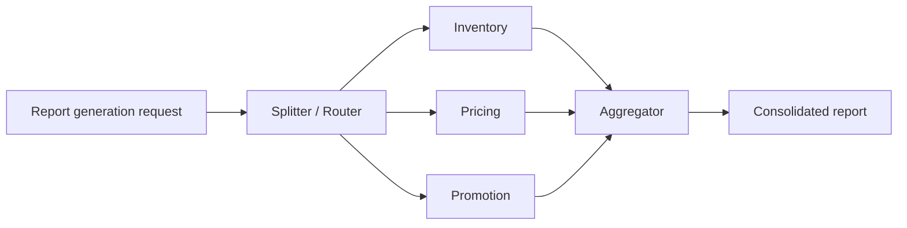
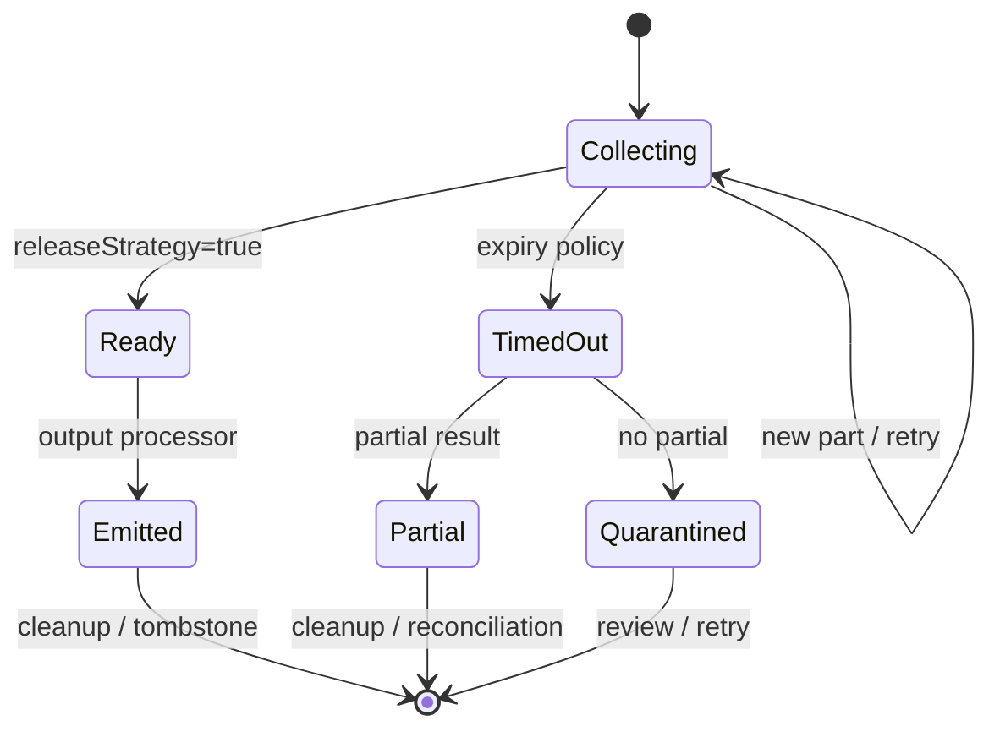
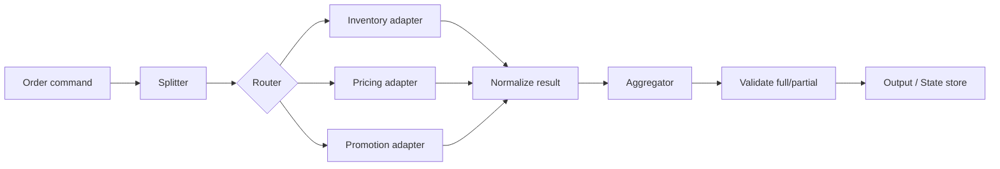
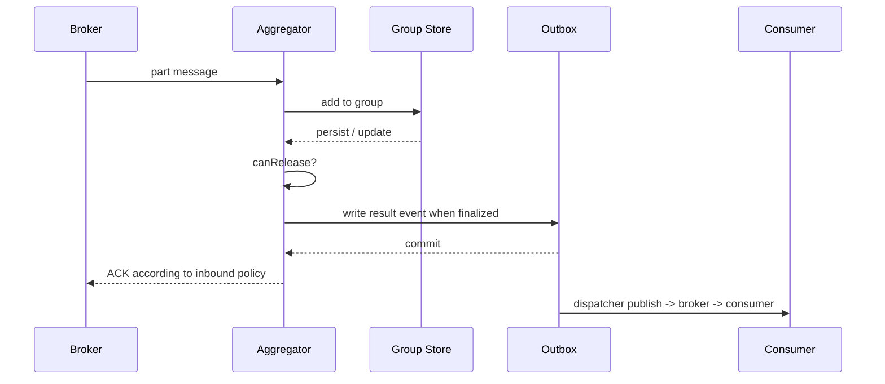
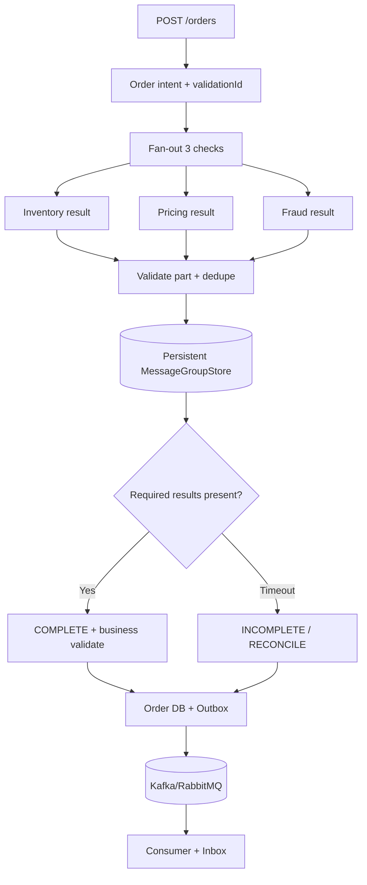

# Release Strategy, Timeouts, and Incomplete Message Groups

## 1. Why Can a Message Group Remain Incomplete?

In the **SPRING_BOOT_INTEGRATION** module, Spring Boot orchestrates integration flows across HTTP clients, databases, Redis, message brokers, and Spring Integration adapters. A flow may **split** a request into parts, process them concurrently, and **aggregate** the results via an Aggregator.



On the happy path, three sources return three results and the aggregator has full data. However, when a source fails to respond, a broker redelivers a message, HTTP times out, a service restarts, or a message arrives after results were emitted, you must know **when a group is considered complete**, **when to stop waiting**, and **how to handle missing data**.

Three core concepts:

- **CorrelationStrategy**: determines which messages belong to the same logical group.
- **ReleaseStrategy**: answers when a group is **ready to emit output**.
- **Group timeout/expiry**: after waiting for a threshold, if the group has not been released, applies a policy: partial result, discard, quarantine, or recovery.

This lesson, **"Release Strategy, Timeouts, and Incomplete Message Groups,"** belongs to the **Routing and Transformation** chapter and uses Java 17+, Spring Boot 3.x, and Spring Integration 6.x. APIs and default behaviors may change across versions; testing against your actual stack is mandatory before production.

A successful release **does not** guarantee that a downstream DB committed, a broker received the output, or a consumer processed it. Whenever output crosses process boundaries, continue designing transactions, retries, idempotency, and observability.

## 2. Message Headers: Correlation, Sequence, and Business IDs

`org.springframework.messaging.Message<T>` carries a payload and `MessageHeaders`. Aggregators commonly rely on:

| Header / ID | Meaning | Example |
| --- | --- | --- |
| `MessageHeaders.CORRELATION_ID` | Group key | `report:req-8021` |
| `MessageHeaders.SEQUENCE_NUMBER` | 1-based part order in sequence | 1, 2, 3 |
| `MessageHeaders.SEQUENCE_SIZE` | Expected number of parts | 3 |
| `MessageHeaders.ID` | Spring message instance ID | UUID |
| Custom `partId` header | Business ID of one part | `req-8021:pricing` |
| Custom `source` header | Contributing source | inventory/pricing/promotion |
| `tenantId` | Verified tenant scope | tenant-17 |
| `traceparent` | Trace context | W3C trace metadata |

Example constructing a message:

```java
import org.springframework.messaging.Message;
import org.springframework.integration.support.MessageBuilder;

Message<String> inventory = MessageBuilder
    .withPayload("inventory-ok")
    .setCorrelationId("report:req-8021")
    .setSequenceNumber(1)
    .setSequenceSize(3)
    .setHeader("partId", "req-8021:inventory")
    .setHeader("source", "inventory")
    .build();
```

Pricing and Promotion must carry **the same correlation ID**, distinct sequence numbers, and a shared contract `sequenceSize`. A Spring Integration Splitter can attach sequence headers automatically, yet **not every broker or HTTP adapter supplies this metadata out of the box**.

### 2.1. Correlation Keys Must Never Mix Tenants

If two tenants share a request ID and the group key uses only request ID, the aggregator can mix their data. Build stable group IDs scoped by owner/tenant without trusting raw `tenantId` headers from unauthenticated callers. Correlation ID is distinct from trace ID and business event ID.

### 2.2. Duplicates Can Carry Different MessageHeaders.ID Values

Broker redelivery can create a new Spring Message with a fresh UUID even though it represents the **same logical part**. Deduplicating by `MessageHeaders.ID` is insufficient to prevent double-counting a source. Use a stable `partId`/event ID and unique constraints wherever durability is required.

## 3. MessageGroup Lifecycle and Incomplete State

The Aggregator uses a `MessageGroupStore` to collect messages by correlation key:

1. Receives a message from the input channel.
2. Resolves the group key.
3. Fetches or creates the group in the store, applying locking/concurrency rules.
4. Adds the message to the group.
5. Evaluates `ReleaseStrategy.canRelease(group)`.
6. If satisfied, the output processor merges messages into one output message/result.
7. Sends the output downstream and cleans up state per the expiry policy.
8. If not yet satisfied, waits for further messages or timeout/reaper action.



This diagram is a conceptual business model, **not an internal framework enum**. A group may be retained as an empty group or metadata after release to detect late messages depending on configuration; do not claim that release always wipes every trace of the group.

### 3.1. Stopping Waiting Does Not Mean "Data Is Complete"

If a request requires `inventory`, `pricing`, and `promotion` and only two arrive, group timeout triggering processing only concludes **stop waiting per policy**. The result must never be marked `complete=true`.

### 3.2. Relationship with Routing and Transformation

A `Router` picks target channels/workers; a `Transformer` alters payloads/headers; a `Splitter` produces parts; an `Aggregator` combines parts. If a router drops a message, a transformer strips headers, or a filter discards a part without adjusting the expected count, the aggregator stalls. Incomplete-group bugs often originate in the **contract of the entire flow**, not inside the aggregator alone.

## 4. ReleaseStrategy and Sequence-Based Defaults

Spring Integration defines `ReleaseStrategy`:

```java
package org.springframework.integration.aggregator;

public interface ReleaseStrategy {
    boolean canRelease(
        org.springframework.integration.store.MessageGroup group
    );
}
```

The snippet shows the API signature, not a class you need to redeclare. A `ReleaseStrategy` should be **fast, deterministic, and side-effect free**. The framework may evaluate a group multiple times; if the strategy calls HTTP or updates a database, behavior under external state changes becomes unpredictable.

### 4.1. SequenceSizeReleaseStrategy

The default aggregator often relies on `SequenceSizeReleaseStrategy` and sequence headers generated by a Splitter. Once the full sequence per `SEQUENCE_SIZE` arrives, the group is ready.

```text
correlationId = report:req-8021
  inventory: sequenceNumber=1, sequenceSize=3
  pricing:   sequenceNumber=2, sequenceSize=3
  promotion: sequenceNumber=3, sequenceSize=3

=> released under the 3-part contract
```

**Never assume** a group containing three messages guarantees all three business sources: if Pricing is duplicated twice and Promotion never arrives, `group.size()` might be 3 while data is still missing. Check how your specific version of the default sequence strategy handles duplicate sequences, and reinforce it with business `partId` validation.

Nor can a default strategy rescue an upstream that sends `sequenceSize=3` yet only ever emits two parts. That is an upstream contract bug; timeouts only prevent the group from waiting forever.

### 4.2. Customizing the Release Condition

Example releasing only when all three required sources are present:

```java
package example.integration.report;

import java.util.Set;
import java.util.stream.Collectors;

import org.springframework.integration.aggregator.ReleaseStrategy;
import org.springframework.messaging.Message;

public final class RequiredSourcesReleaseStrategy
        implements ReleaseStrategy {

    private static final Set<String> REQUIRED =
        Set.of("inventory", "pricing", "promotion");

    @Override
    public boolean canRelease(
            org.springframework.integration.store.MessageGroup group) {

        Set<String> present = group.getMessages().stream()
            .map(Message::getHeaders)
            .map(h -> h.get("source", String.class))
            .filter(source -> source != null)
            .collect(Collectors.toSet());

        return present.containsAll(REQUIRED);
    }
}
```

Using a **set of sources** rather than a raw message count resists duplicate sources, though it does not by itself verify payload validity or source authenticity. Inputs must be validated; the final processor must still enforce semantic contract checks.

## 5. Count, Quorum, Completion Marker, and Hybrid Strategies

| Release strategy | Condition | When appropriate | Pitfalls |
| --- | --- | --- | --- |
| Sequence size | Full sequence per metadata | Standard splitter–aggregator | Missing/wrong headers |
| Count threshold | `group.size() >= N` | Uniqueness guaranteed | Duplicates trigger early release |
| Required sources | Full source ID set present | API fan-out by source | Spoofed sources or invalid payloads |
| Quorum | K of N trusted sources present | Certain decision workflows | Mandatory source could still be missing |
| Completion marker | `endOfBatch=true` arrived | Producer emits clear boundary | Marker may overtake data messages |
| Content predicate | Payload satisfies rule | Specialized domain aggregation | Strategy turns into complex business service |
| Timeout-driven | Wait window elapsed | Best-effort analytics | Does not guarantee completeness |
| Hybrid | Parts met **or** timeout | Bounded waiting | Must distinguish FULL vs. PARTIAL |

Count-based lambda:

```java
ReleaseStrategy afterThree =
    group -> group.size() >= 3;
```

Use only when messages already have deduplication guarantees or duplicates do not alter the business outcome.

### 5.1. Quorums Must Enforce Mandatory Invariants

A risk assessment may accept at least 2 of 3 signals, **while** still requiring the compliance signal. Then the release rule is `compliancePresent && distinctTrustedSources >= 2`, not `group.size() >= 2`.

### 5.2. Completion Markers Require Ordering Contracts

An `endOfBatch` marker traveling across different Kafka partitions or queues may arrive **before** data messages. Releasing immediately on seeing the marker would lose data. Producers must supply sequence IDs, watermarks, or a protocol proving all required parts were emitted and received.

### 5.3. Do Not Call External Services Inside canRelease()

Because `ReleaseStrategy` can run on every incoming message and during state scans, never call another database, `RestClient`, or an untimeouted Redis lookup inside it. Keep required data inside the validated group contract and keep the strategy cheap and deterministic.

## 6. Output Processor: Representing Full vs. Partial Results

When the release strategy permits emission, **MessageGroupProcessor** transforms the group into one output message/payload. It should do more than concatenate strings. For reports, include **completeness metadata**.

```java
package example.integration.report;

import java.time.Instant;
import java.util.Map;
import java.util.Set;

public record ReportAggregate(
    String reportId,
    boolean complete,
    Set<String> missingSources,
    Map<String, Object> results,
    String completionReason,
    Instant emittedAt
) {}
```

A production processor should:

- Verify all parts belong to the same request and tenant.
- Check schema/version of each payload.
- Deduplicate by stable business `partId` or source key.
- Identify which sources are mandatory versus optional.
- When incomplete, set `complete=false` and populate `missingSources`.
- Never substitute defaults like zero for missing sources unless permitted by business rules.
- Never assume `List<Message<?>>` has a stable order without sorting by sequence.

Example sorting:

```java
import java.util.Comparator;
import java.util.List;
import org.springframework.messaging.Message;
import org.springframework.messaging.MessageHeaders;

List<Message<?>> ordered = group.getMessages().stream()
    .sorted(Comparator.comparingInt(message ->
        message.getHeaders().get(
            MessageHeaders.SEQUENCE_NUMBER,
            Integer.class
        )
    ))
    .toList();
```

This snippet assumes every message has a valid `SEQUENCE_NUMBER`. With untrusted inputs, validate before sorting; otherwise missing/null headers throw during release and strand the group.

## 7. Group Timeouts: Controlled Waiting Limits

Spring Integration's aggregator DSL provides `groupTimeout` and `sendPartialResultOnExpiry`:

```java
.aggregate(spec -> spec
    .groupTimeout(5_000L)
    .sendPartialResultOnExpiry(true)
)
```

This lives inside an `IntegrationFlow` definition. It means that if a group has not met its release condition after the framework-evaluated duration, an expiry action triggers.

| Timeout | What does it bound? | What it does NOT replace |
| --- | --- | --- |
| HTTP response timeout | Waiting on a downstream service | Group expiry |
| Broker retry delay | Delay between attempts | Business deadline |
| Group timeout | Waiting for parts | End-to-end SLA |
| Message TTL | Message lifespan in broker/store | Group decision |
| Store reaper interval | Sweep interval for stale groups | Accurate real-time clock |
| Database transaction timeout | Local transaction duration | HTTP/broker timeouts |
| Business request deadline | Time by which a request must conclude | Group store cleanup |

**Group timeout does not guarantee millisecond precision:** scheduler load, JVM pauses, store I/O, and locks introduce jitter. Also, how timers reset or start counting depends on `groupTimeoutExpression`, version, and configuration; **never treat it as a hard deadline measured from the first message** without checking semantics. When strict SLAs are required, persist `requestedAt/deadlineAt` in durable job state and enforce it when committing results.

### 7.1. Example Partial Result

```json
{
  "reportId": "report:req-8021",
  "status": "PARTIAL",
  "receivedSources": ["inventory", "pricing"],
  "missingSources": ["promotion"],
  "completionReason": "GROUP_TIMEOUT",
  "emittedAt": "2026-11-21T04:00:05Z"
}
```

Such a report may be acceptable for a dashboard, yet **must never** become `OrderCompleted` while waiting on `PaymentCaptured`. In payment/inventory workflows, an `UNKNOWN/RECONCILIATION_REQUIRED` outcome is safer than a fake "success" output.

### 7.2. Group Timeout Is Not countLimit

If upstream specifies `sequenceSize=5` and only 4 arrive, lowering the timeout will not fix the missing fifth part. Timeout policies decide how to handle incomplete groups; producer contracts and message delivery must be investigated separately.

## 8. Policies for Handling Incomplete Groups

| Policy | Suitable for | Accompanying requirements |
| --- | --- | --- |
| Emit partial | Best-effort analytics/reports | Explicit status + `missingParts` |
| Discard | Expired group with no remaining value | Error/expired event, never silent success |
| Quarantine | Invalid payloads/untrusted sources | Durable record + operator review |
| Retain and keep waiting | Long-running workflows | Durable store + quotas + retention |
| Compensate | Sagas with prior side effects | State machine, idempotent compensation |
| Escalate | High-risk decisions | Alerts, manual cases, audit trail |

**Common bug:** enabling `sendPartialResultOnExpiry(true)` while the output processor always returns `complete=true`. The framework followed configuration, while business logic emitted misleading semantics.

When choosing not to emit partials, expired groups still require **visibility** (metrics, logs, job state, discard channel, or events). If nothing is emitted, an HTTP caller struggles to tell "no request happened" from "partial data was lost."

## 9. Why Does a MessageGroup Get Stuck?

A group waiting too long is usually a **symptom of an upstream issue**, not necessarily a broken aggregator.

| Cause | Symptom | Where to investigate |
| --- | --- | --- |
| Splitter emits fewer parts than `SEQUENCE_SIZE` | Group always misses one part | Compare producer counts and sequence headers |
| Router sends a part to wrong channel | Group consistently misses one source | Check routing decisions and channel mappings |
| Filter drops a message | Source produced output, aggregator missed it | Check filter discard channel and business rules |
| Transformer strips correlation header | Parts splinter into separate groups | Check header propagation |
| Consumer fails and routes message to DLQ | One part never reaches aggregator | DLQ, retry policy, ack order |
| HTTP timeout | One source fails to produce reply part | Timeout/error flow and fallback contract |
| Correlation algorithm changed in deploy | Old/new messages land in different groups | Group key versioning/migration |
| Duplicate or missing sequence numbers | Release strategy never satisfies | Validate producer metadata |
| Consumer receives duplicates | Inflated size breaks count-based release | Stable `partId` and deduplication |
| MessageGroupStore fails | Groups lost or not updated | Store exceptions, durability, connections |
| TaskScheduler/expiry not running | Groups linger indefinitely past timeout | Scheduler config, thread pools, logs |
| Too many groups waiting concurrently | Memory/pool/store exhaustion | Metrics, quotas, backpressure |

### 9.1. Two Different "Missing Message" Scenarios

**Case A — Source never emitted:** Promotion Service timed out and the workflow never produced `promotionResult`. Replaying queues cannot conjure a part that never existed. Retry upstream or emit an explicit failure part.

**Case B — Source emitted, never reached aggregator:** The message is sitting ready/unacked in a broker, misrouted, or stuck in consumer retries. Inspect transport delivery, queues/DLQs, consumer group offsets, and routing keys.

Both show only 2/3 parts in the group, yet recovery differs completely. Tracking per-source/part ID progress guides the right action.

### 9.2. Preventing Stalls: Emitting Contracted Failure Results

If a source fails permanently, instead of staying silent, a worker can emit a **typed failure part**:

```json
{
  "reportId": "report:req-8021",
  "partId": "req-8021:promotion",
  "source": "promotion",
  "outcome": "FAILED",
  "errorCode": "PROMOTION_PROVIDER_UNAVAILABLE"
}
```

The aggregator can receive all three **terminal outcomes** while producing a `FAILED/PARTIAL` business result. This clarifies that "all branches finished" is **different from** "all branches succeeded."

Remember that failure messages also require event IDs, auth/schema/version checks, and deduplication. If failures can later recover, the workflow must specify whether a subsequent success reply after a failure is permitted.

## 10. Late Messages: Arrivals After Release or Timeout

Suppose a group with correlation `report:req-8021` has a 10-second deadline:

```text
t=0.0s  inventory arrives
t=0.5s  pricing arrives
t=10s   group timeout -> PARTIAL
t=10.3s promotion arrives late
```

How should Promotion be handled now? Options:

1. **Discard/quarantine late part:** keep the partial snapshot as final and audit the late arrival.
2. **Correction event:** emit `ReportCorrected(version=2)` and update results when permitted.
3. **Reopen group:** only if the contract supports it with durable state/versioning and explicit rules.
4. **Delay finalization:** add a short grace period if latency allows, still bounded by a hard deadline.
5. **Manual review:** for high-stakes business decisions.

### 10.1. Understanding expireGroupsUponCompletion as a Policy

Spring Integration provides `expireGroupsUponCompletion(...)`. Once a group releases, the framework may delete group state or retain minimal metadata/empty group state depending on version and configuration to detect late messages.

If **the group is completely deleted upon release**, a late message sharing the same correlation key can spawn **a brand-new group**. That "zombie" group might linger until timeout or even emit a second output if release conditions are careless.

Keeping group metadata to catch late arrivals introduces retention/cleanup needs and store growth. Never assume that framework metadata acts as a **durable tombstone** shared across all workers and restarts; test your exact implementation.

### 10.2. Tombstone/Application Registry for Critical Results

For workflows that must never emit twice:

```text
aggregation_registry
  group_key        = tenant-17:report:req-8021
  status           = COMPLETE | PARTIAL | FAILED
  result_version   = 1
  emitted_at       = 2026-11-21T04:00:10Z
  expires_at       = 2026-11-28T04:00:10Z
```

When a late part arrives, the handler checks durable state and applies the discard or correction policy. Use unique keys/conditional updates so two instances never emit the same result version. The registry can live in a SQL/MongoDB table/collection, publishing events via an outbox.

**Tombstone lifetime** must be at least as long as the published redelivery/replay/reconciliation window. Too short, and late messages arriving after expiry can trigger duplicate side effects.

### 10.3. Race Between the Last Part and Timeout

One thread appends the final part just as the scheduler expires the group. Never guess the winner from millisecond logs; the outcome depends on locks, state transitions, scheduling, and transactions.

Applications requiring exactly one final result should use:
- Atomic state transitions (`PENDING → COMPLETE/PARTIAL`) keyed by group key.
- Stable output event IDs and result versions.
- Durable outbox publishing after commit.
- Consumer deduplication by aggregate result ID/version.
- Race tests against real stores/locks, not just unit tests on release lambdas.

## 11. Storing Group State: SimpleMessageStore vs. Persistent Store?

`MessageGroupStore` determines where collected messages reside. An aggregator holding 2/3 parts needs storage while awaiting the third.

| Store | Pros | Risks/Limitations |
| --- | --- | --- |
| `SimpleMessageStore` | Simple, in-memory | Loses groups on JVM restart; not shared across nodes |
| `JdbcMessageStore` | Durable DB-backed message groups | Schemas, indexes, transactions, serialization, contention |
| `RedisMessageStore` | Shared Redis state per adapter support | Durability/eviction/TTL, atomicity, network |
| `MongoDbMessageStore` | Stores groups in MongoDB | Schemas/indexes, transactions/locking, driver semantics |
| Custom `MessageGroupStore` | Tailored to workflow | Must handle concurrency/cleanup/serialization yourself |

Verify exact implementation names and dependency/config requirements against your Spring Integration version and modules. A persistent store **does not automatically** place input broker, store, and output broker in a single atomic transaction.

### 11.1. In-Memory Store for Simple Environments

```java
import org.springframework.context.annotation.Bean;
import org.springframework.integration.store.MessageGroupStore;
import org.springframework.integration.store.SimpleMessageStore;

@Bean
MessageGroupStore reportMessageStore() {
    return new SimpleMessageStore();
}
```

Fine for prototypes or tests, yet a node crash before completion loses pending groups. With HTTP retries or Kafka replays, verify whether the entire group can be reconstructed. Multiple replicas each running a local `SimpleMessageStore` split groups across nodes unless load balancing enforces group affinity.

### 11.2. Persistent Stores and Schemas/Versions

Moving from memory to JDBC/Redis/MongoDB raises questions beyond "where is it stored":

- Do message payloads serialize and deserialize reliably?
- Will renamed Java class names/type headers break reading old groups after a deploy?
- Is group timeout metadata persisted and restored properly?
- Do expiry/reaper and transaction managers share consistent store semantics?
- Are indexes present on group key/last modified/expiry to avoid full scans?
- When the database is unavailable, is the inbound message NACKed/retried or ACKed and lost?
- When one instance crashes, can another node resume the group?
- Is there distributed locking preventing two nodes from releasing the same group?

**Redis does not equal durable** if eviction or persistence settings can drop state. For financial messages, verify store durability across topology, backup/restore, and contracts rather than relying on Redis's name.

### 11.3. Old Persisted Payloads May Fail Deserialization After Upgrades

If a group store holds serialized v1 Java Message payloads and v2 changes packages or drops fields during deploy, existing groups may fail to load. Choose versioned schemas with explicit lifecycles and test rolling deployments for long-lived groups. Never store raw JPA entities or lazy proxies in a group store.

## 12. How MessageGroupStoreReaper Differs from groupTimeout

Spring Integration provides `MessageGroupStoreReaper` to manage stale groups inside a store. Depending on configuration, the reaper scans for aged groups and triggers expiry/cleanup callbacks supported by the framework.

**Conceptual differences:**

- `groupTimeout` on the aggregator typically schedules expiry for groups actively managed by that aggregator.
- `MessageGroupStoreReaper` scans the store periodically for old groups by timeout/age policy, useful for cleanup/recovery.
- The two **are not identical clocks**. How group age is measured, scan schedules, and expiry callbacks can differ.
- Configuring both on the same store without coordination can cause competing expiry runs, duplicate partial outputs, or races.

### 12.1. Operational Decisions for a Reaper

1. **Which groups to scan?** Only this aggregator's groups, or groups belonging to other endpoints sharing the store?
2. **How often to scan?** Every few seconds or minutes based on SLA, group volume, and store load.
3. **What is the age reference?** Last modification, creation time, or business deadline?
4. **Expiry action:** partial output, discard, or mark job failed?
5. **Cluster leadership/locking:** which node runs reaping, and do multiple nodes contend?
6. **Retention:** how long are incomplete groups retained for audit/replay?
7. **Recovery:** if the reaper crashes mid-run, can the next scan resume safely?

For pure cleanup, a cron job deleting group store rows **without emitting results or updating business state** silently abandons waiting customer requests. Treat expiry as an explicit state transition with a clear outcome, not merely row deletion.

### 12.2. Conceptual Configuration Sketch

```text
Aggregator:
  groupTimeout = 10 s
  partialOnExpiry = true
  MessageGroupStore = persistent

Reaper:
  scan interval = 1 min
  expiry policy = explicit
  lock/leadership = defined
  no duplicate final emission
```

This is a *conceptual outline*, not Spring Boot YAML properties. Instantiate reaper, scheduler, and store beans using your version's APIs, and test groups surviving across restarts. Never let a reaper touch groups owned by another flow unintentionally.

## 13. Multi-Instance Deployments, Group Locks, and Concurrency

A Spring Boot service often runs multiple replicas concurrently consuming parts with the same correlation ID:

```text
part #1 -> instance A
part #2 -> instance B
part #3 -> instance A
```

If each node uses a local memory store, A sees only #1/#3 and B sees only #2: neither ever completes the group. A shared store is necessary for cross-node grouping, **and concurrency coordination is still required**.

### 13.1. Race When Two Nodes Receive Parts Concurrently

Suppose A and B both:

1. Read a 2-part group.
2. Append a new part.
3. Evaluate release.
4. Emit the output.

Without proper store/lock/update protocols, group state can be overwritten or duplicate outputs emitted. Spring Integration supports `LockRegistry` mechanisms keyed by correlation key, such as `JdbcLockRegistry`, Redis lock registries, or suitable distributed locks.

**Never treat an in-JVM `DefaultLockRegistry` as a cluster-wide distributed lock.** An in-memory implementation coordinates only within one process. Multi-replica deployments require cluster-safe lock registries/durable state and explicit race testing.

### 13.2. Connecting Transaction Managers and Group Stores

If the group store lives in PostgreSQL, a DB transaction can protect group updates as supported by the store. However, publishing output to a broker is a separate step. Upstream messages may be ACKed before output is persisted/delivered if flow/transaction boundaries are misaligned.

For high reliability, one pattern is:
- Durable incoming event/part IDs for deduplication.
- Durable group state with atomic finalization by group key.
- Outbox events for result emission.
- Producer retries + publisher confirms.
- Consumer inbox to deduplicate emitted results.

Never slap `@Transactional` on a flow assuming a JDBC store, Kafka, and RabbitMQ automatically share an atomic commit.

### 13.3. Group Affinity Is an Optimization, Not a Durability Replacement

Kafka partitioning by group key routes most messages sharing a key to the same consumer instance, reducing lock contention. Yet rebalances and restarts shift ownership; durable state and idempotency remain mandatory. RabbitMQ with multiple queues/consumers likewise does not guarantee all parts land on the same node without deliberate routing.

## 14. Duplicates, Out-of-Order, and Missing Parts: Clear Distinctions

| Event | Symptom | Handling |
| --- | --- | --- |
| Duplicate logical part | Same `partId`/source appears repeatedly | Inbox/unique key or deduplication policy |
| Out-of-order | Sequence #3 arrives before #1 | Never rely on arrival order |
| Missing part | Sequence #2 never arrives | Timeout + recovery |
| Conflicting duplicates | Same `partId` with differing payloads | Quarantine/version conflict, never pick randomly |
| Late part | Arrives after finalization | Tombstone/correction policy |
| Mis-correlated part | Wrong tenant/request enters group | Validate group key and reject |
| Invalid sequence | Negative number, exceeds size, inconsistent size | Fail contract immediately, do not wait forever |
| Unknown schema | Consumer cannot deserialize | DLQ/compatibility path |
| Unroutable output | Aggregator releases, outbound route fails | Error/return handling + outbox |

### 14.1. Never Use Message Count as Proof of Uniqueness

One of the biggest dangers of count-based release is duplicate delivery:

```text
Expected sources: Inventory, Pricing, Promotion
Messages arrived:
  Inventory  (partId=i-1)
  Pricing    (partId=p-1)
  Pricing    (partId=p-1)  <- duplicate
Count = 3, distinct source count = 2
```

A `group.size() >= 3` release strategy triggers a false release. Counts must track **distinct business units** rather than transport deliveries. Depending on the message store, duplicate Spring message IDs may behave differently, yet recreated broker messages always demand stable deduplication.

### 14.2. Sorting Fixes Order, Not Missing Parts

Sorting a received list by `SEQUENCE_NUMBER` will not make missing part #2 appear. If downstream requires a complete sequence, the strategy must check the set of sequence IDs, expected size, and payload validity.

### 14.3. Unbounded Streams Require Bounded Windows/Groups

An unbounded Kafka stream with no end marker or expected count will accumulate indefinitely in an aggregator. Define **windows (event time/processing time)**, business sessions, batch IDs, watermarks, or completion protocols. Event-time windows require clock-skew and late-event policies; plain `groupTimeout` does not automatically implement event-time watermarks.

## 15. Timeout Policies with Event-Time Data

There are two kinds of time:

- **Processing time:** when the message actually reaches the instance/aggregator.
- **Event time:** when the event occurred at the producer (e.g., `occurredAt`).

A message with `occurredAt=10:00` may arrive at 10:02 due to broker lag. A group timeout based on processing activity cannot tell whether all events from minute 10:00 have arrived.

```text
Event-time window: 10:00:00 – 10:00:59
  e1 occurred 10:00:10, arrived 10:00:11
  e2 occurred 10:00:30, arrived 10:02:00
  e3 occurred 10:00:50, arrived 10:00:51
```

If event-time aggregation is required, design **watermarks/allowed lateness** or choose a stream-processing engine supporting those semantics. Spring Integration aggregators handle correlation groups/timeouts well, but do not automatically provide full event-time window guarantees under skewed producer clocks and variable delivery delays.

### 15.1. Choosing Policies by Business Purpose

| Goal | Suitable Completion Signal |
| --- | --- |
| Report fanning out to 3 HTTP APIs | All source outcomes or deadline |
| Batch import with 500-record manifest | Exactly 500 distinct record IDs |
| Complete file with checksum | Completion marker + checksum |
| Fraud quorum | Mandatory signals + minimum distinct sources |
| Time-window analytics | Watermarks/windows + allowed lateness |
| Payment saga | Explicit state machine, not just aggregator timeouts |
| Order fulfillment | Business milestones/event IDs, reconciliation |

**Never "pick 10 seconds" just because tests run fast.** Derive timeouts from SLOs, p99/p99.9 source latencies, retry budgets, broker lag, and group-state retention costs.

## 16. Routing, Filtering, and Transformation Directly Impact Release

In the **Routing and Transformation** chapter, the Aggregator does not stand alone. Routers, Transformers, and Filters upstream determine how many messages ever arrive.



### 16.1. Filter Discards Must Be Accounted For in expectedParts

Suppose a splitter emits 3 parts with `sequenceSize=3`, and a filter drops Promotion because the order has no promotion. If `sequenceSize` stays 3, the default aggregator may wait forever. Solutions:
- Compute expected sources **before** dispatching/splitting.
- Or emit a `SKIPPED` terminal outcome for Promotion if the contract treats it as a part.
- Or use a ReleaseStrategy backed by validated dynamic expected sources/manifests.
- Never pad counts with duplicates to reach size.

### 16.2. Transformers Must Not Lose Critical Metadata

When transforming `Message<PartnerResponse>` into a new payload object, intentionally preserve or restore correlation, sequence, and source/partId headers. Use `MessageBuilder` from the original message when appropriate:

```java
import org.springframework.integration.support.MessageBuilder;
import org.springframework.messaging.Message;

Message<NormalizedPart> normalized = MessageBuilder
    .withPayload(normalize(original.getPayload()))
    .copyHeadersIfAbsent(original.getHeaders())
    .setHeader("schemaVersion", 1)
    .build();
```

`original` is a `Message<PartnerResponse>` and `normalize` returns an application-defined `NormalizedPart`. **Never copy all untrusted headers** across an external boundary to every downstream consumer; allowlist verified correlation/sequence/tenant metadata. `copyHeadersIfAbsent` illustrates keeping metadata within a trusted flow, not bypassing security filtering.

### 16.3. Routers Need Explicit Default Routes or Failures

An unmatched message may be rejected, routed to a default channel, or dropped depending on configuration. If an aggregator expects that part, a missing route must surface as an **observable error signal**, never a silent disappearance.

## 17. DSL Example: Waiting for All Sources or Emitting Partial on Timeout

An `IntegrationFlow` using an explicit release strategy:

```java
package example.integration.report;

import org.springframework.context.annotation.Bean;
import org.springframework.context.annotation.Configuration;
import org.springframework.integration.dsl.IntegrationFlow;
import org.springframework.integration.store.MessageGroupStore;

@Configuration
class ReportAggregationConfiguration {

    @Bean
    IntegrationFlow reportAggregationFlow(
            MessageGroupStore reportMessageStore,
            RequiredSourcesReleaseStrategy releaseStrategy) {

        return IntegrationFlow
            .from("reportPartsInput")
            .aggregate(spec -> spec
                .correlationStrategy(message -> {
                    String tenant = message.getHeaders()
                        .get("tenantId", String.class);
                    String report = message.getHeaders()
                        .get("reportId", String.class);

                    if (tenant == null || report == null) {
                        throw new IllegalArgumentException(
                            "Missing group identity"
                        );
                    }

                    return tenant + ":" + report;
                })
                .releaseStrategy(releaseStrategy)
                .messageStore(reportMessageStore)
                .groupTimeout(10_000L)
                .sendPartialResultOnExpiry(true)
                .expireGroupsUponCompletion(true)
            )
            .channel("reportAggregationOutput")
            .get();
    }

    @Bean
    RequiredSourcesReleaseStrategy releaseStrategy() {
        return new RequiredSourcesReleaseStrategy();
    }
}
```

**Code note:** this is an illustrative Spring Integration 6.x DSL configuration. `reportMessageStore` is an injected bean—use `SimpleMessageStore` for tests and a persistent store in production. Downstream consumers of the default aggregator output must match whatever payload type the aggregator emits; if you need a domain DTO `ReportAggregate` with a partial flag, add a custom `MessageGroupProcessor`/validated transformer.

### 17.1. The Output Processor Must Know Partial vs. Full

With the default output processor, output is typically an aggregated collection/messages depending on configuration. A downstream `Transformer` must:

1. Extract source/partId from each member.
2. Deduplicate/validate.
3. Compare against the request's expected sources.
4. Set `COMPLETE` or `PARTIAL/TIMED_OUT` per business contract.
5. Attach missing sources, event ID, and finalization reason.
6. Block duplicate result emission via a durable result registry when critical.

Never assume `.sendPartialResultOnExpiry(true)` alone causes the framework to inject `"status":"PARTIAL"` into a business Java DTO.

### 17.2. Aspects Requiring Dedicated Configuration/Testing

- `TaskScheduler` running group timeouts and scheduler lifecycle on app restart.
- Message store and serialization durability across restarts.
- Group locks/lock registry across multiple consumers/nodes.
- `expireGroupsUponCompletion`/timeout retention and late arrivals.
- Output error/discard channels or policy when the processor throws.
- Business result registry/idempotent outbox if output triggers side effects.
- Group size/timeout quotas and metrics.

## 18. Domain Output Processor: Turning MessageGroup into a Stateful Result

Instead of forcing downstream to interpret a raw collection of messages, write a dedicated **MessageGroupProcessor**. It enforces the contract for full/partial results and explicitly lists missing sources.

Payload and result definitions (the two `public record` types below belong in separate Java files `ReportPart.java` and `ReportResult.java` in the same package):

```java
package example.integration.report;

import java.util.Map;
import java.util.Set;

public record ReportPart(
    String reportId,
    String source,
    String value
) {}

public record ReportResult(
    String groupId,
    String status,
    Set<String> missingSources,
    Map<String, String> values
) {}
```

Processor:

```java
package example.integration.report;

import java.util.HashMap;
import java.util.HashSet;
import java.util.Map;
import java.util.Set;

import org.springframework.integration.aggregator.MessageGroupProcessor;
import org.springframework.integration.store.MessageGroup;
import org.springframework.messaging.Message;

public final class ReportGroupProcessor
        implements MessageGroupProcessor {

    private static final Set<String> REQUIRED =
        Set.of("inventory", "pricing", "promotion");

    @Override
    public Object processMessageGroup(MessageGroup group) {
        Map<String, String> values = new HashMap<>();

        for (Message<?> message : group.getMessages()) {
            if (!(message.getPayload() instanceof ReportPart part)) {
                throw new IllegalArgumentException(
                    "Unsupported report part payload"
                );
            }

            String source = part.source();
            if (!REQUIRED.contains(source)) {
                throw new IllegalArgumentException(
                    "Unexpected report source"
                );
            }

            if (part.value() == null) {
                throw new IllegalArgumentException(
                    "Missing report value"
                );
            }

            String previous =
                values.putIfAbsent(source, part.value());

            if (previous != null
                    && !previous.equals(part.value())) {
                throw new IllegalStateException(
                    "Conflicting duplicate report part"
                );
            }
        }

        Set<String> missing = new HashSet<>(REQUIRED);
        missing.removeAll(values.keySet());

        return new ReportResult(
            String.valueOf(group.getGroupId()),
            missing.isEmpty() ? "COMPLETE" : "PARTIAL",
            Set.copyOf(missing),
            Map.copyOf(values)
        );
    }
}
```

Here each `source` represents a single logical part. If the same source can produce multiple valid parts, change the uniqueness key to `partId`/sequence and model `Map<String,List<...>>`. This logic rejects unexpected sources and conflicting duplicates instead of letting iteration order pick arbitrary data.

**Never assume the processor automatically knows the timeout reason.** It can derive `complete/partial` from group members, yet not every partial group comes from a timeout (an admin/operator might force release). If `completionReason=GROUP_TIMEOUT/MANUAL_RELEASE` is required, pass metadata/events from lifecycle handlers/job state or separate output paths.

### 18.1. Wiring the Processor into the Aggregation Flow

In the DSL from section 17, update:

```java
.aggregate(spec -> spec
    .correlationStrategy(message ->
        message.getHeaders().get("reportId", String.class)
    )
    .releaseStrategy(new RequiredSourcesReleaseStrategy())
    .outputProcessor(new ReportGroupProcessor())
    .groupTimeout(10_000L)
    .sendPartialResultOnExpiry(true)
)
```

This snippet illustrates **one configuration variant**; do not add a second `aggregate(...)` in the same flow. This simplified correlation strategy uses only `reportId`, fitting single-tenant demos; multi-tenant deployments must include verified identity as shown in section 2.

### 18.2. Do Not Let Output Processor Errors Lose Business Context

If the processor throws on an invalid payload, the framework routes to error flows/exception paths per channel/endpoint settings. Define an **error-channel/quarantine policy** so groups do not retry endlessly without diagnosis. Schema errors may be permanent; store/network errors may be transient. Retries must keep the same business event ID so results are not emitted multiple times.

## 19. Transactions, Acknowledgments, and Avoiding Duplicate Aggregate Emission

An aggregator may persist parts in a JDBC store while sending results over HTTP or brokers. Example:



Key points:

- Persisting group state does not justify ACKing the consumer if the business contract demands durable finalization.
- `ReleaseStrategy` returning true does not prove the broker received the output.
- Emitting the result to a broker and crashing before marking `RELEASED` can cause retries to re-emit the result.
- Marking `RELEASED` before publishing and crashing can lose the output.
- Use **outbox/inbox**, idempotent result IDs, or job state to narrow failure windows when outcomes matter.

### 19.1. ACK After Durable Outcome

An AMQP/Kafka inbound adapter has its own ack mode and lifecycle. For group processing:

- If each part is **durably persisted to the group store**, the part can be ACKed after persistence per designed policy.
- If the store is in-memory and inbound broker messages are ACKed, an instance crash permanently loses parts.
- When a group releases, the output event needs its own durable handoff.
- Never assume listener containers wait for a reactive operation to finish if a handler manually calls `subscribe()` or dispatches asynchronously.
- Specify error channels, backoff, DLQ, and ack/retry semantics matching your actual transport/version.

### 19.2. Group Finalization Is Not Automatically Atomic with Brokers

A local transaction in `JdbcMessageStore` cannot cover RabbitMQ/Kafka simply by running inside one Java method. When placing `@Transactional` around an aggregator, verify which transaction manager participates and run fault-injection tests.

### 19.3. Result ID and Version

Results can be keyed as:

```text
aggregateResultId = report:req-8021
resultVersion = 1
eventId = aggregate:report:req-8021:v1
```

When a late part is permitted to amend a result, emit `v2` with a distinct event ID under the same aggregate ID. Consumers can apply only newer versions. Replaying `v1` deduplicates cleanly by event ID without repeating side effects. If the business forbids corrections, emit an investigation/quarantine event instead of `v2`.

## 20. Testing Release Strategies, Group Timeouts, and Late Arrivals

Simple release lambdas can be unit tested, yet timeout scheduling, stores/locks, and output channels require real Spring Integration tests.

### 20.1. Testing Source Mapping with MessageGroup

For `RequiredSourcesReleaseStrategy`, verify these cases:

| Test input | Expected |
| --- | --- |
| Inventory + Pricing | Does not release |
| Inventory + Pricing + Promotion | Releases |
| Inventory + Pricing + duplicate Pricing | Does not release |
| Missing `source` | Does not release / fails validation per policy |
| Source not in allowlist | Does not release / invalid |
| All three sources present, invalid schema payload | Strategy may return true; processor must reject |
| Different tenant group with same reportId | Must not mix when correlation key is right |

A test asserting only `group.size() == 3` **fails** to verify source correctness.

### 20.2. Testing Through Input/Output Channels

Build a test flow with a `DirectChannel` input and `QueueChannel` output. Example configuration:

```java
package example.integration.report;

import org.springframework.boot.autoconfigure.EnableAutoConfiguration;
import org.springframework.context.annotation.Bean;
import org.springframework.context.annotation.Configuration;
import org.springframework.integration.channel.DirectChannel;
import org.springframework.integration.channel.QueueChannel;
import org.springframework.integration.config.EnableIntegration;
import org.springframework.integration.dsl.IntegrationFlow;

@Configuration
@EnableIntegration
@EnableAutoConfiguration
class AggregatorTestConfiguration {

    @Bean
    DirectChannel reportPartsInput() {
        return new DirectChannel();
    }

    @Bean
    QueueChannel reportAggregationOutput() {
        return new QueueChannel();
    }

    @Bean
    IntegrationFlow testReportFlow() {
        return IntegrationFlow
            .from("reportPartsInput")
            .aggregate(spec -> spec
                .correlationStrategy(msg ->
                    msg.getHeaders().get("reportId", String.class)
                )
                .releaseStrategy(
                    new RequiredSourcesReleaseStrategy()
                )
                .outputProcessor(
                    new ReportGroupProcessor()
                )
                .groupTimeout(200L)
                .sendPartialResultOnExpiry(true)
                .expireGroupsUponCompletion(true)
            )
            .channel("reportAggregationOutput")
            .get();
    }
}
```

This is a **test-only configuration**; do not reuse bean names from a production flow in the same `ApplicationContext` where duplicate endpoints could conflict. `groupTimeout(200L)` is intentionally short for testing; production timeouts must reflect SLAs and real load. Requires Spring Integration DSL starter/dependencies and a `TaskScheduler` in the test context.

Happy path test (JUnit 5, AssertJ; test context loads `AggregatorTestConfiguration`):

```java
package example.integration.report;

import static org.assertj.core.api.Assertions.assertThat;

import org.junit.jupiter.api.Test;
import org.springframework.beans.factory.annotation.Autowired;
import org.springframework.boot.test.context.SpringBootTest;
import org.springframework.integration.channel.DirectChannel;
import org.springframework.integration.channel.QueueChannel;
import org.springframework.integration.support.MessageBuilder;
import org.springframework.messaging.Message;

@SpringBootTest(classes = AggregatorTestConfiguration.class)
class ReportAggregatorIntegrationTest {

    @Autowired DirectChannel reportPartsInput;
    @Autowired QueueChannel reportAggregationOutput;

    private void send(String reportId, String source) {
        reportPartsInput.send(
            MessageBuilder.withPayload(
                new ReportPart(reportId, source, "ok-" + source)
            )
            .setHeader("reportId", reportId)
            .setHeader("source", source)
            .build()
        );
    }

    @Test
    void releasesWhenAllRequiredSourcesArrive() {
        send("report:one", "inventory");
        send("report:one", "pricing");

        // Do not block waiting for timeout; no full result yet.
        assertThat(reportAggregationOutput.receive(0)).isNull();

        send("report:one", "promotion");

        Message<?> out =
            reportAggregationOutput.receive(1_000);

        assertThat(out).isNotNull();
        ReportResult result =
            (ReportResult) out.getPayload();

        assertThat(result.status()).isEqualTo("COMPLETE");
        assertThat(result.missingSources()).isEmpty();
        assertThat(result.values())
            .containsKeys("inventory", "pricing", "promotion");
    }
}
```

**Test caveat:** a 200 ms timeout can be too short on heavily loaded CI runners and cause flakiness if pauses occur between the three sends. In serious suites, use a long timeout for happy-path tests and a dedicated short-timeout flow/context for expiry tests, or a controllable scheduler.

### 20.3. Testing Expiry/Partial with Bounded Waiting

Additional test in a short-timeout class/context:

```java
@Test
void emitsPartialWhenOneSourceIsMissing() {
    send("report:partial", "inventory");
    send("report:partial", "pricing");

    Message<?> out =
        reportAggregationOutput.receive(3_000);

    assertThat(out).isNotNull();

    ReportResult result =
        (ReportResult) out.getPayload();

    assertThat(result.status()).isEqualTo("PARTIAL");
    assertThat(result.missingSources())
        .containsExactly("promotion");
}
```

This test **avoids `Thread.sleep`**, though it still relies on a real scheduler; CI delays can happen if scheduler threads are starved. Isolate stores/group IDs between tests and clean up group state. Strong integration suites also test expiry across app restarts, lost scheduler tasks, persistent store resumption, and last-part races.

### 20.4. Test Matrix for Hard Edge Cases

| Scenario | Expected |
| --- | --- |
| All three parts valid, out-of-order arrival | One valid COMPLETE result |
| Pricing redelivery with different technical ID | Duplicate never counts as Promotion |
| Only two parts arrive before deadline | One PARTIAL or explicit failure per policy |
| Promotion arrives after partial emission | Properly discarded/corrected, no zombie group |
| Last part arrives concurrently with timeout | Single finalization, never two results |
| Output processor throws exception | Error path/quarantine, never silent success |
| Store down when receiving part | Inbound retry/ACK policy prevents message loss |
| JVM crashes at 2/3 parts | Persistent store recovers properly |
| Two instances receive parts for same key | Shared lock/store, no double release |
| Group key missing tenant | Rejected, no cross-tenant mixing |
| Wrong or changing `SEQUENCE_SIZE` in group | Contract error, does not hang forever |
| One part enters DLQ | Job status incomplete and flagged for reconciliation |
| Broker publish fails after release | Outbox retry and consumer deduplication |
| 10,000 incomplete groups | Group quotas, memory/store/scheduler remain stable |

**Never mock only `ReleaseStrategy.canRelease`**: the hardest bugs hide in scheduling, message stores, group locks, transactions, and real message delivery.

## 21. Testing Group Store Persistence and Restart Recovery

An advanced integration test can run two application contexts pointed at **the same JDBC message store** (mind schema/test isolation):

1. Context A receives inventory + pricing for group G; not yet released.
2. Wait until the store confirms both parts are persisted, then close A.
3. Context B starts against the same store and aggregator/correlation configuration.
4. B receives promotion; group G must release exactly one COMPLETE result.
5. B or the reaper handles older expired groups per expiry policy.
6. Verify no duplicate emission when two B instances run concurrently.
7. Reprocess an old part; final outcome must not duplicate.

### 21.1. Why Enabling JdbcMessageStore Alone Is Not Enough

- JDBC message store schemas/indexes may not be properly migrated.
- Java payload serialization may break across builds.
- Context B might not use the exact same group key algorithm.
- Timeout tasks scheduled in A vanish when A dies; B must reschedule/reap.
- Outputs created before crash but not yet published can be lost without an outbox.
- In-memory deduplication registries reset on restart.

### 21.2. Meaningful Fault Injection

Kill workers at these exact points:

```text
A. Before the message is added to the group store
B. After the store saves the part, before inbound ACK
C. After release strategy returns true, before output publish
D. After output publish, before saving final state
E. Between expiry scan and group cleanup
F. After partial result, before late part arrives
```

Document the **observable state** and recovery path at each point. No single DSL flag guarantees exactly-once side effects across every step.

## 22. Observability: Measuring Group Health and SLAs

Measuring only input-channel throughput hides stuck aggregators. Track metrics on **group counts** and **group age**, not just message rate.

| Metric/SLO | Meaning | Alert suggestion |
| --- | --- | --- |
| `aggregation.groups.active` | Currently waiting groups | Rising continuously |
| `aggregation.groups.oldest_age` | Age of oldest waiting group | Exceeds business deadline |
| `aggregation.groups.completed` | Full releases | Abnormal drop |
| `aggregation.groups.partial` | Partial releases | Spikes after dependency outages |
| `aggregation.groups.expired` | Expiry events | Deviates from expected baseline |
| `aggregation.parts.duplicates` | Deduplications/conflicts | Broker redelivery or producer bug |
| `aggregation.parts.late` | Arrivals post-finalization | Delay/retry/clock drift issues |
| `aggregation.output.failures` | Processor/publish failures | Outbox/retry attention needed |
| `aggregation.store.latency` | `MessageGroupStore` read/write delay | DB/Redis contention |
| `aggregation.group.size` | Parts per group at finalization | Schema and source correctness |
| `aggregation.completion.latency` | From `requestedAt` to final result | Business SLO |
| `integration.outbox.oldest_pending` | Unpublished result events | Downstream issue |

**Never use `groupId`, `tenantId`, `orderId`, or `partId` as metric tags** when cardinality is unbounded. Use low-cardinality tags like `flow=report`, `outcome=partial`, `source=inventory`, `failure=timeout`; put specific IDs in access-controlled, masked structured logs/traces.

### 22.1. Timestamps Worth Distinguishing

```text
requestedAt       request/business job created
firstPartAt       aggregator receives first part
lastPartAt        aggregator receives last part
decisionAt        release or timeout decision
outputPersistedAt result durably committed
publishedAt       broker confirms publish per policy
consumedAt        consumer completes durable effect
```

A `group_timeout=5s` metric does not prove 5s end-to-end latency. Between `firstPart` and finalization sit network hops, executor queues, store waits, and scheduler delays.

### 22.2. Tracing and Correlation

Events from three sources may carry **three separate tracing spans** sharing the same `reportId`. Reactor/MDC contexts, Spring Integration headers, and broker properties do not automatically propagate across every adapter; use allowlisted metadata and proper observation/tracing instrumentation. Never forward raw auth tokens or HTTP cookies just to connect traces.

### 22.3. Observable Events

Structured logs might look like:

```json
{
  "flow": "report-aggregate",
  "groupKeyHash": "short-safe-hash",
  "outcome": "PARTIAL",
  "receivedCount": 2,
  "expectedCount": 3,
  "missingSources": ["promotion"],
  "reason": "GROUP_TIMEOUT"
}
```

Never log raw Pricing/Payment payloads if they contain sensitive data. All group logs and traces must obey retention and tenant isolation rules.

## 23. Runbook: Diagnosing Incomplete Groups

A repeatable investigation procedure:

**Step 1 — Verify the group contract.** What is the expected count, which sources are mandatory, and how is the correlation key computed? Did it change in a recent deploy?

**Step 2 — Inspect upstream.** Did the splitter emit all parts? Did a router/filter discard one? Did an HTTP adapter time out? Are there pending/unacked/DLQ broker messages?

**Step 3 — Inspect the store.** Which `partId`/source/sequences are in the group? Are there duplicates/conflicts? Can payloads deserialize? Is the store suffering evictions/index/connection issues?

**Step 4 — Inspect the release strategy.** Is the predicate deterministic? Does it require a header lost during transformation? Is there a logic flaw like `size==N` with duplicates?

**Step 5 — Inspect the expiry scheduler/reaper.** Is the task scheduler running? Which timestamp anchors timeout? Is the reaper scanning the right store and groups?

**Step 6 — Check late arrivals/concurrency.** Is another node processing the same group? Is the tombstone still intact? Were duplicate v1/v2 results emitted?

**Step 7 — Check output.** Did the aggregator release while downstream message channel/broker/DB updates failed? What are outbox pending age and producer confirms?

**Step 8 — Controlled recovery.** Replay the specific missing source, rerun the group under its operation ID, or apply manual correction; never blindly delete the group and re-trigger all side effects.

### 23.1. Quick Symptom Table

| Symptom | Likely Cause | Fix |
| --- | --- | --- |
| Groups grow continuously, never full release | Missing parts or mismatched headers | Compare sequences/required sources |
| High CPU in aggregator | `canRelease` does I/O or oversized groups | Make strategy pure, bound group size |
| Memory growth | `SimpleMessageStore` groups never expire | Timeouts/reaper/quotas |
| Sudden spike in partial releases | Dependency down or broker lag | Investigate source failures and SLAs |
| No output after timeout | Scheduler inactive or partial policy disabled | Check expiry config and error channels |
| Two outputs for one group | Late messages or release race | Tombstone, distributed lock, result ID |
| Restarts lose groups | In-memory store | Persistent group store |
| JDBC store errors after deploy | Schema/serialization mismatch | Migrations, compatible decoders |
| Full group, output processor fails | Payload/schema conflict | Quarantine, error mapping |
| Occurs only on multi-instance | Group split across nodes/lock registry | Shared store, cluster-safe coordination |
| Low Kafka lag yet stuck groups | Producer missing parts or filter discards | Investigate by business group, not just lag |
| Partial emitted, user sees COMPLETE | Output contract lacks completeness status | Add status/missing sources |

## 24. Case Study: Consolidating Order Verification Checks

An Order Service requires three checks before fulfilling an order:

1. Inventory confirms stock reservation.
2. Pricing calculates price and currency.
3. Fraud Engine evaluates risk.

Order Service creates a `validationId` and three expected parts. Flow:



### 24.1. Contract for Each Part

```json
{
  "validationId": "val-1024",
  "partId": "val-1024:inventory",
  "tenantId": "tenant-17",
  "source": "inventory",
  "schemaVersion": 1,
  "outcome": "SUCCESS",
  "producedAt": "2026-11-21T04:00:01Z",
  "data": {
    "reservationId": "rsv-6701"
  }
}
```

Pricing and Fraud have distinct `partId`/`source` values with the same `validationId`. Retried parts must preserve stable `partId`; never key uniqueness on delivery attempt number.

### 24.2. Business-Driven Release Strategy, Not Just Group Size

An order becomes `READY_FOR_FULFILLMENT` only when:

- Inventory succeeded with a valid reservation.
- Pricing succeeded with valid currency and precision.
- Fraud returned an approving decision.
- All belong to the right tenant and current validation version.
- No conflicting duplicates or stale results exist.

The aggregator can release once all three **terminal outcomes** arrive, after which a domain validator decides `APPROVED/REJECTED`. If one outcome is `FAILED`, receiving three messages does not mean the order is approved.

### 24.3. Timeouts Must Never Become Confirmed Orders

If Fraud has not returned after 10 seconds:

```json
{
  "validationId": "val-1024",
  "status": "RECONCILIATION_REQUIRED",
  "missingSources": ["fraud"],
  "nextAction": "RETRY_FRAUD_OR_MANUAL_REVIEW"
}
```

Never emit `OrderConfirmed` without a risk decision. If Inventory already reserved stock, lease expiration or compensation is required if the workflow cannot finish.

### 24.4. Failure Windows to Guard Against

| Failure | Consequence | Safeguard |
| --- | --- | --- |
| Pricing retries twice | Duplicate source | Stable `partId` + deduplication |
| Fraud replies after timeout | Late result | Durable status + correction policy |
| Instance restarts at 2/3 | Lost state if in memory | Persistent store/replay |
| Two nodes receive final part | Double release race | Lock + finalization CAS |
| Result broker down | Order updated, event undelivered | Transactional outbox |
| Broker redelivers completed result | Consumer double-processes | Inbox/event ID |
| Group expired without emitting output | Stuck job | Reaper + reconciliation |
| Correlation ID lacks tenant | Cross-tenant merge | Trusted composite identity |
| Schema v2 reaches v1 consumer | Conversion fails | Versioned contracts, DLQ |
| Client HTTP timeout | Unknown order state | Operation status endpoint |

### 24.5. Defining Levels of Completion

A workflow can pass through distinct states:

```text
PENDING_CHECKS
  -> ALL_CHECKS_RECEIVED
  -> APPROVED
  -> READY_FOR_FULFILLMENT

PENDING_CHECKS
  -> TIMED_OUT
  -> RECONCILIATION_REQUIRED
  -> RETRYING / MANUAL_REVIEW / REJECTED
```

**Group release** is a technical decision that enough messages exist to aggregate. **Business approval** is a domain decision potentially enforcing many additional rules. Never reuse a single boolean variable for both concepts.

## 25. Design Checklist and Conclusion

### 25.1. Before Promoting the Flow to Production

- [ ] Correlation key uniquely identifies tenant/request/workflow and is verified?
- [ ] Upstream defines clear `SEQUENCE_NUMBER`/`SEQUENCE_SIZE` or expected sources?
- [ ] Can a Router/Filter drop a part, and is a replacement terminal outcome emitted?
- [ ] Is `ReleaseStrategy` deterministic, free of I/O/side effects, and tested for duplicates/out-of-order?
- [ ] Does count-based release guarantee business uniqueness?
- [ ] Does the output processor validate schema, payload, currency, and required sources?
- [ ] Are full/partial/failed modeled as **explicit outcomes**, never sharing a success DTO?
- [ ] Is group timeout derived from realistic SLAs, with scheduler/expiry behavior tested?
- [ ] Are hard business deadlines enforced outside timers where needed?
- [ ] Are `sendPartialResultOnExpiry` and discard/error policies chosen per domain?
- [ ] Are late arrivals, tombstones/corrections, and result versions handled?
- [ ] Is a persistent store configured for restarts and multi-instance deployments?
- [ ] Is `LockRegistry` cluster-safe and tested against last-part vs. timeout races?
- [ ] Does the reaper have clear ownership, cadence, group selection, and cleanup rules?
- [ ] Can store schemas/serializations deserialize across rolling deployments?
- [ ] Does inbound broker ACK align with durable persistence policies?
- [ ] Do outbound broker results use outbox/idempotency where required?
- [ ] Do consumers deduplicate output by event ID/version?
- [ ] Are full, partial, duplicate, late, restart, store-down, and race scenarios tested?
- [ ] Do metrics cover active/oldest groups, partial rates, duplicates, and completion latency?
- [ ] Are runbooks/reconciliation ready instead of silently deleting incomplete groups?

### 25.2. Suggested Exercises

**Exercise 1 — Complete sources:** send Inventory, Pricing, and Promotion in order 3–1–2; verify one `COMPLETE` result with all three values.

**Exercise 2 — Duplicates:** send Inventory, Pricing, Pricing without Promotion; prove the group **does not release simply because count=3**.

**Exercise 3 — Timeout:** omit Promotion, verify a `PARTIAL` result with `missingSources=["promotion"]`; for domains requiring completeness, switch the policy to `RECONCILIATION_REQUIRED`.

**Exercise 4 — Late message:** send Promotion after a partial has been emitted; verify tombstone/correction behavior and no zombie group creation.

**Exercise 5 — Restart:** persist two parts, restart the instance, send the third part, and verify exactly one release.

**Exercise 6 — Concurrency:** have two consumers/nodes receive the final part concurrently while racing against timeout; verify atomic finalization and outbox event deduplication.

**Exercise 7 — Contract drift:** alter `sequenceSize` or correlation format between producer and consumer; verify validation/quarantine catches it instead of stalling the group forever.

### 25.3. Conclusion

In Spring Integration, **ReleaseStrategy** decides **when a group has enough parts to emit output**, while **timeouts/expiry** allow the workflow to **stop waiting and handle incomplete groups** under a documented policy. `CorrelationStrategy`, sequence headers, `MessageGroupStore`, schedulers, group locks, and output processors jointly determine result accuracy.

Reliable systems do not merely ask "how many messages arrived?"—they ask: **"Which logical parts arrived, are they valid and unique, what is the workflow deadline, how are late parts handled, and are FULL/PARTIAL/FAILED outcomes persisted and emitted exactly once in business terms?"**

With Spring Boot Integration across HTTP, databases, Redis, and Kafka/RabbitMQ, use **persistent state, idempotency, outbox/inbox, bounded retries, reconciliation, and observability** at every critical boundary. Timely group release is a technical prerequisite; a **trustworthy and recoverable business outcome** is the ultimate goal.
