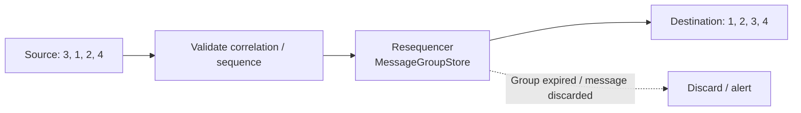

# Resequencer and Handling Out-of-Order Data

## 1. The Problem: Right Data, Wrong Order

In Spring Boot integration flows, data frequently passes through HTTP clients, databases, queues, message brokers, or Spring Integration adapters. Asynchronous processing, retries, partitioning, multiple consumers, and varying response times can cause **arrival order** to differ from **business order**.

For example, the system processes an order `O-42` through these steps:

1. `1 - ORDER_CREATED`
2. `2 - PAYMENT_CONFIRMED`
3. `3 - INVENTORY_RESERVED`
4. `4 - ORDER_PACKED`

Because message `3` finishes faster than `2`, the consumer receives `3, 1, 2, 4`. If state updates immediately upon receipt, the system could pack the order before payment is confirmed. We need a component that buffers and emits messages in a defined order: a **Resequencer**.

This is part of the *Enterprise Integration Patterns* (EIP) catalog. In Spring Integration, a resequencer sits between an out-of-order input and a step requiring strict ordering. It operates on **message groups** (groups of related messages) rather than guessing order from payload contents.

## 2. Mechanism of a Resequencer

A Resequencer collects messages by `CORRELATION_ID`, reads `SEQUENCE_NUMBER` to order them, and commonly uses `SEQUENCE_SIZE` to tell when the group is complete. Once release conditions are satisfied, it pushes out **each message individually** in order. Payloads are not merged into a single aggregate result.

| Field | Purpose | Example |
| --- | --- | --- |
| `CORRELATION_ID` | Identifies messages belonging to one independent sequence. | `O-42:fulfillment:v7` |
| `SEQUENCE_NUMBER` | Position in the sequence, usually starting at `1`. | `3` |
| `SEQUENCE_SIZE` | Expected total number of messages in a finite sequence. | `4` |
| `Message ID` / event ID | Identifies a message for tracing and deduplication. | `evt-83d` |

Header constants are provided by Spring Integration via `IntegrationMessageHeaderAccessor.CORRELATION_ID`, `SEQUENCE_NUMBER`, and `SEQUENCE_SIZE`. **They are metadata that the sender must populate accurately**, or that an upstream component like `Splitter` generates; the resequencer does not invent sequence numbers from arrival times.



### Two Emission Modes

Suppose a group has `SEQUENCE_SIZE = 5` and messages arrive in order `3 → 1 → 2 → 5 → 4`:

| Arrival step | Wait for full group: `releasePartialSequences(false)` | Emit contiguous prefixes: `releasePartialSequences(true)` |
| --- | --- | --- |
| Receive `3` | Hold | Hold because `1` is missing |
| Receive `1` | Hold | Emit `1` |
| Receive `2` | Hold | Emit `2, 3` |
| Receive `5` | Hold | Hold `5` because `4` is missing |
| Receive `4` | Emit `1, 2, 3, 4, 5` | Emit `4, 5` |

- **Wait for full group (default)** fits workflows that may only begin once every step in the sequence has arrived. Latency can equal the arrival time of the slowest message.
- **Emit contiguous prefixes** fits workflows where confirmed early steps can proceed immediately. Even after `1, 2, 3` are emitted, `5` arriving before `4` must still wait; this mode never skips over gaps.

Groups with distinct `CORRELATION_ID` values operate independently. A resequencer guarantees order **within each group at its output**, not global ordering across all orders, and it does not protect against a parallel downstream step reordering messages again.

## 3. Distinguishing from Other Integration Components

| Component | Function | Typical Output |
| --- | --- | --- |
| `Router` | Picks processing branch based on content or headers. | One or more target channels. |
| `Transformer` | Changes data representation. | Message with transformed payload. |
| `Splitter` | Splits one message into parts, often setting correlation/sequence headers. | Multiple child messages. |
| `Aggregator` | Combines related messages into a consolidated result. | Typically one message containing a list or result. |
| **`Resequencer`** | Buffers and emits messages in sequence order. | Individual messages, properly ordered. |

A common flow: `Splitter → parallel processing → Resequencer → Aggregator`. A Resequencer is necessary when a downstream step must *observe the order* of child messages; if only the set of results matters and merging is order-independent, an aggregator alone may suffice. Conversely, if the goal is picking a target API or queue, use a router rather than a resequencer.

## 4. Setting Up in Spring Boot with Java DSL

Add `spring-boot-starter-integration` along with the starters needed for HTTP, JDBC, Redis, or brokers in use. The example below assumes each message already carries all three sequence headers. An output `QueueChannel` makes results easy to inspect in the example; in real applications, replace it with the appropriate handler or adapter.

```java
import org.springframework.context.annotation.Bean;
import org.springframework.context.annotation.Configuration;
import org.springframework.integration.channel.DirectChannel;
import org.springframework.integration.channel.QueueChannel;
import org.springframework.integration.dsl.IntegrationFlow;
import org.springframework.messaging.MessageChannel;
import org.springframework.messaging.PollableChannel;

@Configuration
public class OrderResequencingConfiguration {

    @Bean
    public MessageChannel incomingOrderEvents() {
        return new DirectChannel();
    }

    @Bean
    public PollableChannel orderedOrderEvents() {
        return new QueueChannel();
    }

    @Bean
    public PollableChannel discardedOrderEvents() {
        return new QueueChannel();
    }

    @Bean
    public IntegrationFlow orderResequencingFlow() {
        return IntegrationFlow.from("incomingOrderEvents")
                .resequence(spec -> spec
                        .releasePartialSequences(false)
                        .groupTimeout(30_000L)
                        .sendPartialResultOnExpiry(false)
                        .discardChannel("discardedOrderEvents"))
                .channel("orderedOrderEvents")
                .get();
    }
}
```

Meaning of the key settings:

| Setting | Effect |
| --- | --- |
| `releasePartialSequences(false)` | Emits only when the group satisfies the completion condition. |
| `groupTimeout(30_000L)` | Sets group wait timeout (milliseconds); triggers expiration behavior upon expiry. |
| `sendPartialResultOnExpiry(false)` | Prevents incomplete groups from being treated as valid results on the main flow. |
| `discardChannel("discardedOrderEvents")` | Dedicated channel receiving discarded or expired messages per configuration. |

Do not confuse `groupTimeout` with `sendTimeout`: `groupTimeout` governs **group age/waiting**, whereas `sendTimeout` governs **blocking attempts to send** to a bounded output channel.

Depending on the Spring Integration version, timeout configuration may use a `TaskScheduler` alongside options for expiry, reaping, and group metadata retention. Verify exact library behavior for timeout handling in your deployment environment.

### Creating Messages with Sequence Headers

```java
import org.springframework.integration.IntegrationMessageHeaderAccessor;
import org.springframework.messaging.Message;
import org.springframework.messaging.support.MessageBuilder;

public Message<String> orderEvent(
        String batchId, int position, int total, String eventName) {

    if (batchId == null || batchId.isBlank()
            || total <= 0 || position < 1 || position > total) {
        throw new IllegalArgumentException("Invalid sequence metadata");
    }

    return MessageBuilder.withPayload(eventName)
            .setHeader(IntegrationMessageHeaderAccessor.CORRELATION_ID, batchId)
            .setHeader(IntegrationMessageHeaderAccessor.SEQUENCE_NUMBER, position)
            .setHeader(IntegrationMessageHeaderAccessor.SEQUENCE_SIZE, total)
            .build();
}
```

For example, send `(O-42:v1, 3, 4)`, `(O-42:v1, 1, 4)`, `(O-42:v1, 2, 4)`, `(O-42:v1, 4, 4)` into `incomingOrderEvents`. `orderedOrderEvents` receives payloads in positions `1 → 2 → 3 → 4`. Messages with another `batchId` are buffered and ordered independently.

**Critical rule:** the same correlation ID must represent **one consistent finite sequence**. Never reuse `O-42` across distinct processing runs; include a version or run suffix like `O-42:v1`, `O-42:v2` so runs do not mix.

## 5. What to Do on Missing, Late, or Duplicate Messages?

### Missing a Position in the Sequence

With `SEQUENCE_SIZE = 4`, if only `1, 3, 4` arrive, full-group mode never emits successfully. With contiguous-prefix mode enabled, only `1` emits while `3, 4` wait on `2`. When `2` is permanently lost, you need wait limits, alerts, and an operational procedure:

1. Record `correlationId`, received positions, and the missing position.
2. Expire after a reasonable threshold derived from producer SLOs and retry windows.
3. Route problematic groups/messages to an incident flow for replay, investigation, or controlled business cancellation.
4. Proceed with missing steps only if the domain **explicitly permits it**.

Enabling `sendPartialResultOnExpiry(true)` emits available messages upon expiry. However, those results **no longer guarantee a complete sequence**; for instance, `1, 3, 4` emit despite missing `2`. This fits best-effort data, yet is usually dangerous for payments, inventory, or strict state transitions.

### Messages Arriving After Group Completion or Expiry

A completed group can retain metadata to detect late arrivals and divert them to `discardChannel`. Expiry and metadata-cleanup policies directly govern this: **if metadata is purged too early, a late message can start a brand-new group with the same correlation ID**. Match retention and late-arrival policies to your system's maximum retry window.

### Duplicate Messages from Retries

A Resequencer solves **ordering**, not *exactly-once* delivery. At-least-once brokers, HTTP retries, or consumer restarts can yield multiple copies sharing the same `correlationId` and `sequenceNumber`. Do not rely on the resequencer alone to eliminate all duplicates:

- Attach an `eventId` or durable idempotency key such as `sourceId + entityId + eventVersion`.
- Deduplicate at ingress or before side effects; persist processed IDs durably.
- On data updates, enforce unique/version constraints and transactions so retries never deduct stock or charge twice.
- Define handling when two messages share a position yet have different payloads: treat as a **data conflict** and escalate for investigation.

## 6. MessageStore, State, and Multi-Instance Deployments

A Resequencer needs a buffer for pending messages. By default, it may hold them in process memory; if the app restarts mid-group, pending state risks being lost. In production, consider a persistent `MessageGroupStore` such as JDBC or Redis matching your stack and version:

```java
// messageStore is a separately configured MessageGroupStore bean.
@Bean
public IntegrationFlow durableResequencingFlow(
        org.springframework.integration.store.MessageGroupStore messageStore) {
    return IntegrationFlow.from("durableInput")
            .resequence(spec -> spec
                    .messageStore(messageStore)
                    .releasePartialSequences(false)
                    .groupTimeout(30_000L))
            .channel("durableOutput")
            .get();
}
```

This illustrates **injecting an existing store**; in real code, also declare `durableInput`, `durableOutput`, and the store bean. Do not accidentally register two flows consuming the same input unless intentionally distributing messages.

A shared store **is not enough** for correctness in a multi-node cluster. Coordinate concurrent group access with locking (e.g., an appropriate `LockRegistry`) so two instances do not process or release the same correlation ID concurrently, and analyze crashes between persisting state and emitting messages. Also note:

- `MessageGroupStore` persists groups; acknowledging Kafka/RabbitMQ/JMS messages and guarding consumer side effects require dedicated transaction/retry designs.
- Retention for completed/expired groups must outlast late arrivals without growing unboundedly.
- Pending group count, buffered message count, payload sizes, and gap lengths dictate memory, store capacity, and latency.
- If downstream uses a thread pool or multiple consumers for one business key, **completion order** can still diverge from resequencer output order; serialize downstream processing by key when required.

Spring Integration documentation also notes that resequencers are designed primarily for **relatively short sequences with few gaps**. For huge numbers of long sequences with widespread missing numbers, consider dedicated reordering storage or redesigning partitioning and event collection.

## 7. Boundaries with Broker Ordering Guarantees

For example, in Kafka, records within the **same partition** follow offset order, while records across **multiple partitions** have no global order. If events for one entity land in different partitions, a resequencer works only if all reach the same resequencer with valid correlation/sequence metadata and controlled emission. With RabbitMQ or multi-consumer queues, completion times can also diverge from receipt order.

Decide where ordering belongs:

| Requirement | Approach |
| --- | --- |
| Single entity processed sequentially; source supports entity-ID partitioning | Same routing/partition key with single-threaded per-key processing is usually simpler. |
| Fan-out/fan-in tasks finish in varying order | Use sequence headers and `Resequencer` before steps requiring order. |
| Events arrive out of *event time* with unknown final count | Requires stream-processing window/watermark and late-event policies; resequencer does not solve this alone. |
| Need an aggregated result rather than individual messages | Use `Aggregator` or an equivalent consolidation pattern. |

**Never use timestamps as a default substitute for sequence numbers**: clocks across systems drift, multiple events can share a timestamp, and creation time does not always equal business order. When `SEQUENCE_SIZE` is unknown upfront, define an explicit end-of-batch event or completion strategy instead of expecting the resequencer to guess.

## 8. End-to-End Testing at the Resequencer Boundary

With the configuration from section 4, test by intentionally sending messages out of order. A `PollableChannel` output allows deterministic inspection.

```java
import static org.junit.jupiter.api.Assertions.assertEquals;
import static org.junit.jupiter.api.Assertions.assertNull;

import org.junit.jupiter.api.Test;
import org.springframework.beans.factory.annotation.Autowired;
import org.springframework.beans.factory.annotation.Qualifier;
import org.springframework.boot.test.context.SpringBootTest;
import org.springframework.integration.IntegrationMessageHeaderAccessor;
import org.springframework.messaging.Message;
import org.springframework.messaging.MessageChannel;
import org.springframework.messaging.PollableChannel;
import org.springframework.messaging.support.MessageBuilder;

@SpringBootTest
class OrderResequencingTest {

    @Autowired
    @Qualifier("incomingOrderEvents")
    MessageChannel input;

    @Autowired
    @Qualifier("orderedOrderEvents")
    PollableChannel output;

    @Test
    void releasesOnlyWhenGroupIsCompleteAndInOrder() {
        String group = "test-order-42:attempt-1";

        input.send(event(group, 3, 3, "RESERVED"));
        input.send(event(group, 1, 3, "CREATED"));
        assertNull(output.receive(100)); // Missing 2 of 1, 2, 3

        input.send(event(group, 2, 3, "PAID"));

        assertEquals("CREATED", output.receive(1_000).getPayload());
        assertEquals("PAID", output.receive(1_000).getPayload());
        assertEquals("RESERVED", output.receive(1_000).getPayload());
    }

    private static Message<String> event(
            String group, int number, int total, String payload) {
        return MessageBuilder.withPayload(payload)
                .setHeader(IntegrationMessageHeaderAccessor.CORRELATION_ID, group)
                .setHeader(IntegrationMessageHeaderAccessor.SEQUENCE_NUMBER, number)
                .setHeader(IntegrationMessageHeaderAccessor.SEQUENCE_SIZE, total)
                .build();
    }
}
```

This is a minimal integration test requiring `spring-boot-starter-test` and Spring Integration on the classpath. In real systems, expand test coverage by **behavior**:

| Test case | Expected |
| --- | --- |
| Receive `3, 1, 2` for group of size `3` | Nothing emitted while incomplete; emits `1, 2, 3` once complete. |
| Two interleaved correlation IDs | Messages never mix across groups. |
| `releasePartialSequences(true)` receiving `3, 1, 2` | Emits `1` then `2, 3`; never skips gaps. |
| Missing `2` until timeout | Executes configured expiry/discard/partial policy. |
| Duplicates, very late messages, invalid sequences | Handled per idempotency, validation, retention, and business error policies. |
| Restart/multiple instances | Verify store/locks preserve state and emit no duplicates on recovery. |

For timeout tests, avoid fixed `Thread.sleep` guesses; observe output channels with bounded timeouts and inspect post-expiry group state.

## 9. Operating and Observing Message Flows

When a group gets stuck, counting received messages is not enough. Emit metrics and logs for:

- **Pending group count**, buffered message count, oldest group age, and expired group count.
- **Latency from arrival to emission**, broken down by flow type; full vs. partial emissions.
- **Dropped, duplicate, and late message counts**, output send errors, and retries.
- **Sequence gaps** (`expectedNextSequence` vs. `receivedSequences`), to pinpoint exactly which message is missing.

Logs and traces should carry `correlationId`, `sequenceNumber`, `sequenceSize`, `eventId`, flow name, and discard reason. Never log full payloads containing personal data or payment details. Alert when groups wait past SLA, expiry rates spike, or `MessageStore` capacity trends upward.

A sound troubleshooting workflow: find the stuck correlation ID → identify missing sequence numbers → check source/broker/retries → decide whether to replay, cancel, or compensate → verify idempotency and final order state after recovery.

## 10. Common Mistakes

1. **Missing sequence headers or reusing correlation IDs across runs:** messages cannot be ordered properly or mix across runs.
2. **Confusing "enough messages arrived" with "all positions arrived":** duplicates can fool custom count-based release strategies; enforce validation and deduplication upfront.
3. **Enabling partial emission in strictly sequential workflows:** processing later steps without earlier ones breaks business invariants.
4. **No timeouts or retention management:** one lost message leaves a group sitting in the store forever.
5. **Assuming a shared store alone suffices for multiple nodes:** you must also coordinate locks, transactions, downstream serialization, and crash/retry behavior.
6. **Assuming a resequencer provides exactly-once delivery:** side-effecting endpoints still require idempotency.
7. **Using a resequencer for unbounded streams with huge gaps:** drives high memory usage and expensive sequence scanning/emission.

## 11. Pre-Production Design Checklist

Answer these questions before turning on live traffic:

- Does the correlation key include tenant, entity, and processing run/version?
- Who assigns `SEQUENCE_NUMBER` and `SEQUENCE_SIZE`, and are they consistent across retries and multiple producers?
- When a position is missing, how long may we wait, and should we retry, dead-letter, compensate, or accept data loss?
- How long is metadata retained for completed/expired groups to catch late messages?
- Do stores and locks handle restarts, horizontal scaling, and storage quotas?
- Do side-effecting endpoints guarantee idempotency and preserve per-entity ordering?
- Are there tests for out-of-order, duplicates, missing messages, timeouts, late arrivals, and recovery?
- Are metrics/alerts in place to detect stuck groups before customers notice failures?

## Summary of Key Takeaways

A Resequencer is an **ordering gate** for message sequences carrying accurate metadata. It groups by `CORRELATION_ID`, sorts by `SEQUENCE_NUMBER`, and decides emission timing from `SEQUENCE_SIZE` and release strategies. Use full-group waiting when completeness is mandatory; enable partial emission only when contiguous prefixes are safe to process. In real Spring Boot integration systems, pair it with timeouts, `MessageStore` durability, late-event handling, idempotency, distributed locking, and observability.

### References

- [Spring Integration Reference — Resequencer](https://docs.spring.io/spring-integration/reference/resequencer.html)
- [Spring Integration Reference — Aggregators and Resequencers (Java DSL)](https://docs.spring.io/spring-integration/reference/dsl/java-aggregators.html)
- [Spring Integration Reference — Aggregator and MessageGroup Management](https://docs.spring.io/spring-integration/reference/aggregator.html)
