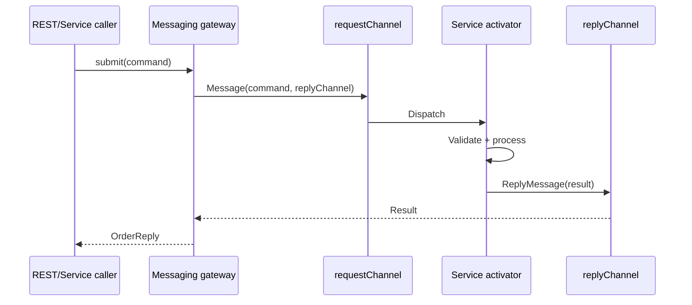
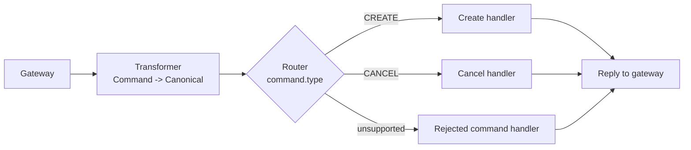
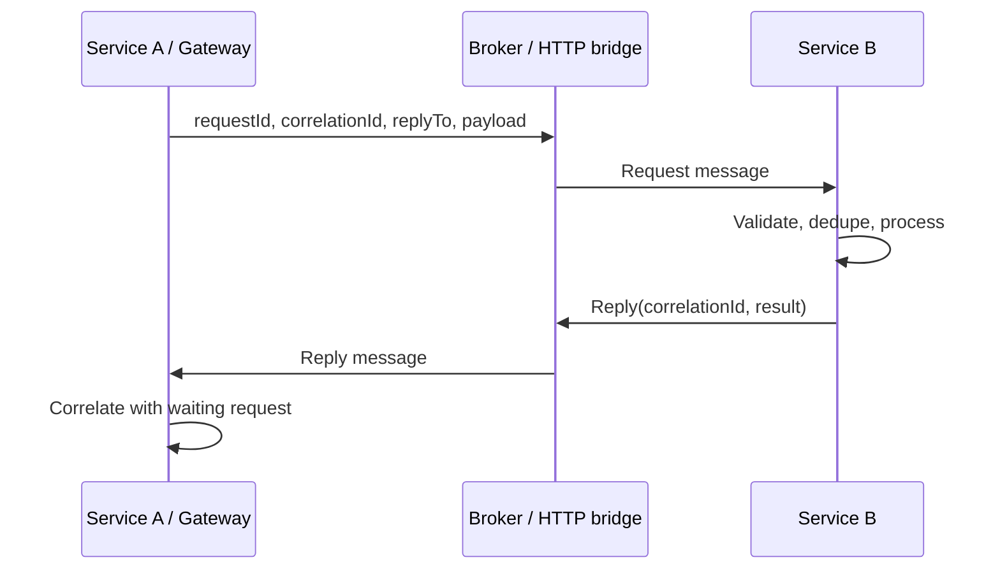

# Request-Reply Gateway, replyChannel, and Timeouts

## 1. How Does a Gateway Bridge a Java Method Call to a Message Flow?

In the `SPRING_BOOT_INTEGRATION` module, a REST API request may need data contract validation, payload transformation, routing by order type, calling an external HTTP API or writing to a database, and returning a result to the caller. Spring Integration lets you build that pipeline from **messages**, **channels**, and **endpoints** instead of coupling controllers to every step.

A **messaging gateway** lets Java code invoke an integration flow like an ordinary method call:

```java
OrderReply reply = orderGateway.submit(
        new OrderCommand("order-4711", "CREATE"));
```

Behind the scenes, the gateway wraps the call into a request message, sends it to a channel, waits for a reply per contract, converts the reply into the method's return type, and reports errors if the request cannot complete properly.

The challenge is that the call looks synchronous, while the underlying flow may span very different execution models:

- `DirectChannel`: handler runs directly on the sender thread in standard synchronous cases.
- `ExecutorChannel`: hands work off to another thread.
- `QueueChannel`: buffers messages for a poller/worker to pick up later.
- Routers, transformers, service activators: transform or route messages across multiple steps.
- HTTP, AMQP, JMS, Kafka, or other adapters: introduce network boundaries and potentially asynchronous communication.

Therefore, this lesson **"Request-Reply Gateway, replyChannel, and Timeouts"** focuses on four questions: how replies return to the right caller, what phase each timeout actually bounds, what happens when replies arrive late, and how to coordinate retries and idempotency to protect business data.

## 2. Components of the Request-Reply Pattern

| Component | Role | Key Point |
| --- | --- | --- |
| **Gateway proxy** | Translates Java interface calls into request messages | Does not automatically make the whole flow end-to-end synchronous |
| **Request channel** | Channel where the gateway sends requests | Channel type dictates blocking behavior and throughput |
| **Message handler** | Transformer, router, service activator, or outbound gateway handling requests | Must produce a reply when the contract requires one |
| **`replyChannel` header** | Reply return address in Spring Integration | Must survive across asynchronous steps that owe a reply |
| **`errorChannel` header** | Error routing destination where supported | Does not replace exception/timeout contract handling |
| **`requestTimeout`** | Wait limit when **sending** a request to a potentially blocking channel | Not an end-to-end business deadline |
| **`replyTimeout`** | Wait limit at the gateway **receiving a reply** when waiting applies | Does not automatically interrupt a running handler |
| **Correlation ID** | Links requests with replies, logs, and business transactions | Essential across brokers or parallel branches |
| **Message ID** | Framework-assigned message identifier | Should not substitute for a business idempotency key |

Basic diagram:



The diagram shows the reply going to a specific return address, not merely "the next message in a topic." Within a single application, the gateway can use a temporary per-invocation reply channel. Across brokers or process boundaries, design explicit reply addresses and correlation; you cannot ship a live `MessageChannel` object over the network and expect another process to call it.

## 3. Minimal Example: @MessagingGateway and DirectChannel

### 3.1. Dependencies and Enabling Integration

Maven example using Spring Boot dependency management:

```xml
<dependency>
    <groupId>org.springframework.boot</groupId>
    <artifactId>spring-boot-starter-integration</artifactId>
</dependency>
```

In a Spring Integration application, configuration can be declared explicitly:

```java
import org.springframework.context.annotation.Bean;
import org.springframework.context.annotation.Configuration;
import org.springframework.integration.annotation.IntegrationComponentScan;
import org.springframework.integration.config.EnableIntegration;
import org.springframework.integration.channel.DirectChannel;
import org.springframework.messaging.MessageChannel;

@Configuration(proxyBeanMethods = false)
@EnableIntegration
@IntegrationComponentScan
public class OrderIntegrationConfiguration {

    @Bean("orderRequests")
    MessageChannel orderRequests() {
        return new DirectChannel();
    }
}
```

`@IntegrationComponentScan` discovers `@MessagingGateway` interfaces within the component-scan scope. Depending on the application and Spring Boot configuration, parts of Integration infrastructure are auto-configured; the example shows annotations explicitly so gateway registration is clear.

### 3.2. Declaring the Gateway Interface

```java
import org.springframework.integration.annotation.MessagingGateway;
import org.springframework.integration.annotation.Gateway;

@MessagingGateway(
        defaultRequestChannel = "orderRequests",
        defaultRequestTimeout = "200",
        defaultReplyTimeout = "3000")
public interface OrderGateway {

    @Gateway
    OrderReply submit(OrderCommand command);
}
```

Example data contract definitions:

```java
public record OrderCommand(String orderId, String action) {}

public record OrderReply(String orderId, String status) {}
```

Timeout values in this annotation are in milliseconds. `defaultRequestChannel` names the channel bean receiving messages from the gateway. Both timeout attributes are shown explicitly for illustration—they are **not** a guarantee that a synchronous handler finishes within three seconds.

### 3.3. Handler Replying via replyChannel

```java
import org.springframework.integration.annotation.ServiceActivator;
import org.springframework.stereotype.Component;

@Component
public class OrderRequestHandler {

    private final OrderApplicationService orderService;

    public OrderRequestHandler(OrderApplicationService orderService) {
        this.orderService = orderService;
    }

    @ServiceActivator(inputChannel = "orderRequests")
    public OrderReply handle(OrderCommand command) {
        return orderService.process(command);
    }
}
```

`OrderApplicationService` is a project-defined business service. It may write to PostgreSQL, call HTTP, or interact with another adapter. `@ServiceActivator` is a request-reply endpoint: when the method returns a value, the framework wraps it into a reply message and uses the flow's reply routing mechanism.

A controller can simply call:

```java
@RestController
@RequestMapping("/api/orders")
public class OrderController {

    private final OrderGateway gateway;

    public OrderController(OrderGateway gateway) {
        this.gateway = gateway;
    }

    @PostMapping("/process")
    public OrderReply process(@RequestBody OrderCommand command) {
        return gateway.submit(command);
    }
}
```

This example assumes Spring MVC dependencies and standard controller imports. Production code must add validation, authorization, and HTTP contracts.

**Crucial point:** because `DirectChannel` invokes the handler directly on the sender thread, `gateway.submit(...)` blocks until `orderService.process(...)` returns. Setting `defaultReplyTimeout="3000"` will not interrupt a service executing a 10-second HTTP call.

## 4. replyChannel Is a Return Address, Not an Event ID

Spring Messaging uses a header named `replyChannel`, accessible via `MessageHeaders.REPLY_CHANNEL`. A request-reply gateway attaches a per-call reply channel to the header so downstream endpoints know where to send the reply.

Illustration of an internal message:

```text
Message<OrderCommand>
  payload = OrderCommand("order-4711", "CREATE")
  headers:
    id             = <message id>
    replyChannel   = <gateway-managed reply channel>
    errorChannel   = <error destination, if any>
    correlationId  = "checkout-abc"
```

In this diagram, `<gateway-managed reply channel>` is symbolic, not a literal string to put in a payload. Within a local flow, the header may hold the channel object directly or a channel name resolved by the framework.

Best practices:

1. **Never strip `replyChannel` accidentally** in transformers, routers, header filters, or when constructing new messages.
2. **Never replace `replyChannel` with a Kafka topic name** just because both are "addresses." Local `MessageChannel`s and broker reply destinations are distinct mechanisms.
3. **Never use `replyChannel` as a deduplication ID.** It identifies a single call's return path and may be regenerated on retries.
4. **Never treat `correlationId` as a substitute for `replyChannel`.** Correlation matches requests with replies; the channel specifies where to send the reply.
5. **Never log raw channel objects or headers containing secrets** while debugging. Logging correlation IDs and stage names suffices in most cases.

### 4.1. When a Handler Returns a Value

A request-reply endpoint like `@ServiceActivator` normally turns its return value into a reply and routes it to its configured output channel, or falls back to the request's `replyChannel` when no explicit output channel is configured. That is why section 3 works without calling `replyChannel.send(...)` manually.

However, if a handler is **one-way** and returns `void`/produces no reply, a waiting gateway hits its timeout without receiving a message. That is a flow contract error, not the framework "randomly losing replies."

### 4.2. Transformers Must Preserve the Reply Path

Suppose input is one DTO while the next handler expects another:

```java
import org.springframework.integration.annotation.Transformer;

@Component
public class OrderCommandTransformer {

    @Transformer(inputChannel = "rawOrderRequests",
                 outputChannel = "validatedOrderRequests")
    public ValidatedOrderCommand transform(OrderCommand command) {
        return new ValidatedOrderCommand(command.orderId(),
                command.action());
    }
}
```

This snippet illustrates payload transformation, omitting `ValidatedOrderCommand` and validation steps. When the framework creates a reply message from standard payload transformation, it preserves headers per endpoint semantics. If code manually builds a brand-new `Message<?>`, uses custom adapters, or filters headers, **directly test** that `replyChannel`, `errorChannel`, and correlation reach the final handler.

Avoid configuring a header filter that strips all headers except business fields along a flow where a gateway is waiting for a reply.

## 5. Temporary Reply Channels vs. Named Reply Channels

### 5.1. Default Choice: Per-Invocation Managed Reply

For a local request-reply gateway, letting the gateway manage a reply destination per invocation is simpler and safer:

```java
@MessagingGateway(
        defaultRequestChannel = "orders.inbound",
        defaultReplyTimeout = "3000")
public interface SubmitOrderGateway {
    OrderReply submit(OrderCommand command);
}
```

The gateway creates a reply context and attaches routing metadata to the request message. When the handler finishes, the reply returns to the matching call. Under concurrency, this avoids manually polling a shared reply queue and hoping to pick the right response.

### 5.2. When Specifying a Named replyChannel

Spring Integration allows declaring a reply channel on the gateway or operation when needed:

```java
@MessagingGateway(
        defaultRequestChannel = "orders.requests",
        defaultReplyChannel = "orders.replies")
public interface CustomReplyGateway {
    OrderReply submit(OrderCommand command);
}
```

However, **never turn concurrent requests into arbitrary consumers of one shared reply `QueueChannel`** assuming the first response always belongs to the first waiting caller. Understand how your gateway correlates/receives replies and test out-of-order completion under concurrency. An uncorrelated shared reply channel causes mismatched responses or lost replies.

Name a reply channel only when the architecture truly needs a channel with explicit routing or lifecycle. For straightforward local RPC, prefer gateway-managed replies rather than adding a named channel just to "see it in config."

### 5.3. replyChannel Can Be Overridden at Routing Points

If an endpoint in the flow declares `outputChannel`, its reply travels to that output channel instead of immediately returning to the gateway. This works cleanly **as long as the remaining flow continues toward a final reply-producing step**.

Example:

```text
gateway
  -> requestChannel
  -> transformer
  -> router
      -> channelA -> serviceActivator A
      -> channelB -> serviceActivator B
  -> reply back to original replyChannel
```

A router sending a message down a branch with no reply-producing handler leaves the caller waiting until timeout. A filter dropping a message without generating a discard/rejection reply likewise starves request-reply callers. Define explicitly whether each branch returns **success, failure, or timeout** and how it is represented.

## 6. How Request Timeout and Reply Timeout Differ

### 6.1. requestTimeout: Waiting to Send the Request

`requestTimeout` applies when sending a message into a request channel that can block—for instance, a bounded `QueueChannel` that is currently full.

```text
Gateway thread:
  send(request, requestTimeout)
    |
    +-- channel has space -> sent -> proceed to wait for reply
    |
    +-- channel full/overloaded -> send may time out
```

With `DirectChannel`, sending runs the handler synchronously; `requestTimeout` **is not a timeout on handler execution**. If the handler makes a slow HTTP call, the sending thread remains blocked past `requestTimeout`. With `ExecutorChannel`, sending submits to an executor; a full pool/queue throws task rejection rather than merely waiting for a send timeout.

### 6.2. replyTimeout: Waiting to Receive the Result

`replyTimeout` bounds how long the gateway waits for a reply after dispatching the request when an async wait phase exists. In asynchronous flows, it prevents callers from blocking forever.

```text
Caller ------ request sent -----> async worker
  |                                 |
  +-- wait up to replyTimeout       +-- process...
  |
  +-- timed out                      +-- reply arrives later
```

Crucially, **a caller's timeout is not a reliable cancellation signal to the worker**. The worker may still be calling HTTP, writing to a database, or publishing broker messages after the gateway stopped waiting.

What happens when no reply arrives in time depends on gateway type, return type, error handling, and framework version; applications must explicitly define and test timeout representation. Never build an API that silently interprets `null` as "completed successfully." Wrap gateways in an adapter that maps timeouts/missing replies into clear domain outcomes.

### 6.3. Timeouts Do Not Replace Each Other

| Limit | Layer Applied | Automatically Stops an In-Flight Handler? |
| --- | --- | --- |
| Gateway `requestTimeout` | Sending message to channel | No |
| Gateway `replyTimeout` | Waiting for reply at gateway | Not guaranteed; not end-to-end cancellation |
| HTTP connect timeout | Establishing outbound HTTP connection | Only bounds that phase |
| HTTP response/read timeout | Waiting for HTTP server response | Does not guarantee the server stopped processing |
| JDBC query timeout | Waiting on SQL query per driver/DB support | Depends on driver, DB, and query cancellation |
| Broker request/reply timeout | Waiting on broker/RPC adapter reply | Request may already be sent; never rolls back remote side effects |
| Application deadline | Overall operation time budget | Requires explicit cancellation, rollback, idempotency, and tracking |

For synchronous flows performing I/O, configure **timeouts directly on HTTP/JDBC/broker clients**. Once async steps are introduced, add gateway reply timeouts to cap caller waiting to SLA.

## 7. Why replyTimeout Does Not Stop a Slow DirectChannel Handler

Consider:

```java
@MessagingGateway(
        defaultRequestChannel = "slowOrderRequests",
        defaultReplyTimeout = "1000")
public interface SlowOrderGateway {
    OrderReply submit(OrderCommand command);
}
```

If `slowOrderRequests` is a `DirectChannel` and the handler waits on an 8-second HTTP call, the gateway's calling thread is stuck inside the synchronous `send(...)` call chain. It never enters an independent reply-channel wait as many expect, so **1,000 ms cannot be treated as an overall deadline**.

Valid fixes:

1. Configure timeouts on downstream HTTP clients so requests never hold threads indefinitely.
2. Switch to an asynchronous channel with a bounded executor/queue when contractually valid, letting the gateway wait on replies with a clear limit.
3. Define an overall deadline and return `PENDING` or a job ID if the work inherently takes long.
4. Never dispatch non-idempotent side effects to workers and treat reply timeout as "processing cancelled."
5. Monitor send duration, reply wait duration, and actual handler execution duration separately.

An API operation taking minutes usually belongs in an **asynchronous workflow**: accept the command, persist `ACCEPTED`/outbox state, return HTTP 202 with a correlation/job ID, and let clients poll for status instead of forcing RPC over a gateway.

## 8. ExecutorChannel: Async Boundary for Reply Timeouts

When the gateway must not hold caller threads inside handler code, use an `ExecutorChannel` backed by a bounded thread pool.

### 8.1. Channel and Executor

```java
import org.springframework.beans.factory.annotation.Qualifier;
import org.springframework.context.annotation.Bean;
import org.springframework.context.annotation.Configuration;
import org.springframework.integration.channel.ExecutorChannel;
import org.springframework.messaging.MessageChannel;
import org.springframework.scheduling.concurrent.ThreadPoolTaskExecutor;

@Configuration(proxyBeanMethods = false)
public class AsyncOrderChannelsConfiguration {

    @Bean("orderWorkerExecutor")
    ThreadPoolTaskExecutor orderWorkerExecutor() {
        ThreadPoolTaskExecutor executor = new ThreadPoolTaskExecutor();
        executor.setCorePoolSize(4);
        executor.setMaxPoolSize(8);
        executor.setQueueCapacity(100);
        executor.setThreadNamePrefix("order-worker-");
        return executor;
    }

    @Bean("asyncOrderRequests")
    MessageChannel asyncOrderRequests(
            @Qualifier("orderWorkerExecutor")
            ThreadPoolTaskExecutor executor) {
        return new ExecutorChannel(executor);
    }
}
```

This resource configuration is **illustrative**. Size workers and queues to match downstream DB and HTTP capacity; never create huge queues to mask slow processing. When the task executor rejects submissions under full queues, treat it as an overload signal; `requestTimeout` does not turn an executor into a backpressure-aware queue meeting SLAs.

### 8.2. Gateway Waiting for a Worker Reply

```java
@MessagingGateway(
        defaultRequestChannel = "asyncOrderRequests",
        defaultRequestTimeout = "200",
        defaultReplyTimeout = "3000")
public interface AsyncOrderGateway {
    OrderReply submit(OrderCommand command);
}
```

Handler:

```java
@Component
public class AsyncOrderHandler {

    private final OrderApplicationService service;

    public AsyncOrderHandler(OrderApplicationService service) {
        this.service = service;
    }

    @ServiceActivator(inputChannel = "asyncOrderRequests")
    public OrderReply handle(OrderCommand command) {
        return service.process(command);
    }
}
```

Assuming submission to the executor succeeds quickly, the gateway waits for the reply; if the worker finishes in time, the caller receives `OrderReply`. If the worker exceeds the timeout, the caller times out while the task keeps running. Late replies may be rejected or go unhandled per reply channel mechanics; monitor them instead of assuming they will be delivered to a future call.

**Transaction note:** `ExecutorChannel` switches threads and normally breaks ThreadLocal transaction context continuity. A transaction opened on the REST caller thread does not wrap DB updates inside the worker. Place `@Transactional` on the worker's service boundary and test actual commit/ack timing.

### 8.3. Do Not Use ExecutorChannel as Automatic Cancellation

A timed-out gateway **does not remove queued tasks from the executor**, roll back an in-flight HTTP request, or stop the worker thread. If post-timeout execution is unacceptable, design explicit cancellation/deadline propagation or change the interaction model; cancellation itself must distinguish unstarted tasks from already-committed side effects.

## 9. QueueChannel: requestTimeout and Bounded Queues

`QueueChannel` is a `PollableChannel`. It fits flows where workers/pollers actively pull messages.

```java
import org.springframework.context.annotation.Bean;
import org.springframework.integration.channel.QueueChannel;

@Bean("boundedOrderQueue")
QueueChannel boundedOrderQueue() {
    return new QueueChannel(100);
}
```

Once 100 unconsumed messages sit in the queue, subsequent sends block up to `requestTimeout` before failing. A poller can consume them:

```java
import org.springframework.integration.annotation.Poller;
import org.springframework.integration.annotation.ServiceActivator;

@ServiceActivator(
        inputChannel = "boundedOrderQueue",
        poller = @Poller(fixedDelay = "100", maxMessagesPerPoll = "5"))
public OrderReply processQueuedOrder(OrderCommand command) {
    return orderService.process(command);
}
```

This is a sketch; real code belongs inside a bean/component with `orderService` and appropriate poller/thread pool configuration. Without a poller draining the channel, the gateway succeeds in sending yet **never receives a reply** even while queue space remains.

Design points:

- `requestTimeout` covers failing to enqueue the request on time.
- `replyTimeout` covers requests already queued whose replies have not arrived yet.
- Never use an in-RAM `QueueChannel` to hold work **durably** across process crashes. Use a database/outbox or broker when durability is required.
- If 100 messages sit in the queue and one poller takes 1 second per message, a 3-second reply timeout is unrealistic for messages near the back.
- Bound backlogs, monitor message age, verify pollers, and handle overload explicitly.

## 10. How Routers and Transformers Affect replyChannel

A Spring Integration flow may route by business type:



For a request-reply gateway, **every valid branch must define reply behavior**. For instance, a transformer builds `CanonicalOrderCommand`, a router chooses `CreateOrderHandler` or `CancelOrderHandler`, and the terminal service activator returns an `OrderReply`. Rejection branches for invalid commands must return a rejection reply or trigger an error policy rather than silently dropping messages.

Common mistakes:

- Custom transformer constructs a new message without preserving `replyChannel`.
- Router sends to a channel with no subscriber or no poller.
- Filter returns `false` and discards the message without returning a reply.
- `PublishSubscribeChannel` sends one request to multiple reply-producing handlers, producing multiple replies incompatible with a single-call gateway.
- Splitter divides one request into multiple messages without an aggregator combining them back into **one** final reply.
- A branch ends at a one-way outbound adapter, producing no reply for the gateway.
- Setting `outputChannel` to another channel and forgetting to route the final reply back to the caller.

Increasing `replyTimeout` fixes none of these. Map the flow clearly, identify which endpoints produce replies, and test success, rejection, error, and timeout paths.

## 11. Request-Reply Correlation with Splitters, Aggregators, and Parallel Branches

When a request contains order lines, a splitter can fan out child messages for concurrent processing:

```text
Gateway: SubmitOrder(order-4711, lines=[L1, L2, L3])
        |
        v
     Splitter
       / | \
     L1 L2 L3
       \ | /
     Aggregator
        |
        v
 Reply: OrderResult(order-4711, processed=3)
```

Spring Integration splitter/aggregator pairs rely on headers like `correlationId`, `sequenceNumber`, and `sequenceSize` to group parts and determine completion. Release conditions, timeouts, and group storage must be explicitly defined.

**There are two distinct levels of correlation:**

1. **Internal message-group correlation** so the aggregator collects parts belonging to the same request.
2. **Request-reply correlation** returning the final result to the right gateway invocation.

To protect business outcomes, there is also a **business correlation/idempotency key** like `orderId` or `requestId`. These IDs relate closely yet must not be conflated when their semantics differ.

If the aggregator waits for three replies and one branch errors without emitting a result, the gateway may time out even though the other two branches succeeded. Define policies for partial results, group expiry, dead-letters, state cleanup, and compensating side effects. If persisting group state in a durable `MessageGroupStore`, manage store size, TTLs, and transactions alongside the main flow.

## 12. errorChannel and Errors in Request-Reply Gateways

A request-reply flow can fail at multiple layers:

| Error Type | Example | Expected Behavior |
| --- | --- | --- |
| Cannot send request | Queue full, channel has no subscriber, executor rejected | Report overload/routing error; never treat as business success |
| Synchronous handler throws | Validation failure, DB error | Map to business or technical error |
| Async handler fails | Worker throws after request was accepted | Route via configured error handling; wake/notify caller if still waiting |
| Missing reply | Router/filter dropped branch, one-way handler | Timeout/missing reply; handle explicitly |
| Wrong reply type | Handler returns payload violating gateway contract | Fix mapping/transformer; never retry infinitely |
| Reply arrives post-timeout | Worker too slow | Record late reply; reconcile side effects, never re-apply blindly |
| HTTP/broker timeout | Partner unresponsive | Outcome unknown; use idempotency/reconciliation |

`MessageHeaders.ERROR_CHANNEL` specifies where errors are routed when supported by the flow. Spring Integration uses `ErrorMessage` and error flows; gateways also offer `errorChannel` or error-mapping configuration.

However, setting an `errorChannel` does not automatically yield a domain reply or turn every exception into a structured error. An error handler that merely logs and swallows exceptions leaves the gateway blocking until `replyTimeout` with no clue why; an error flow returning the wrong payload type causes conversion errors at the gateway.

Standardize on **one of two contracts**:

- **Return-value contract:** gateway returns `OrderReply` with controlled `status=ACCEPTED/REJECTED/PENDING` and reason fields.
- **Exception contract:** gateway returns a DTO on success and throws standardized operational/business exceptions on failure.

Never mix both styles unpredictably across branches without documentation and tests. Exceptions containing stack traces, SQL, internal URLs, or tokens must never be leaked raw in REST responses.

## 13. Request Timeout, Reply Timeout, and Business Deadlines

A call requires a coordinated time budget:

```text
HTTP API caller            desired total SLA: 4.0 s
    |
    +-- Validate / auth                   0.2 s
    |
    +-- Send/enqueue request              0.1 s
    |
    +-- Worker queue + processing         0.3 s
    |
    +-- HTTP downstream                   2.5 s
    |
    +-- Reply / serialization             0.2 s
    |
    +-- Operational buffer                0.7 s
```

Numbers are illustrative. If the downstream HTTP client has a 15-second response timeout while the gateway waits only 3 seconds, workers waste work from the caller's perspective. Conversely, if HTTP times out in 1 second while gateway `replyTimeout` is 30 seconds, callers wait unnecessarily if the error flow fails to emit a reply.

A sound policy requires:

1. Choose a **total deadline** aligned with SLA and operation type.
2. Set outbound HTTP/JDBC/broker timeouts below the remaining deadline, accounting for retries and buffers.
3. Configure `requestTimeout` based on channel capacity and overload tolerance.
4. Configure `replyTimeout` to cover queue wait plus async execution.
5. Attach deadline metadata such as `deadlineAt` so workers can skip expired requests **before triggering side effects** when semantics permit.
6. Provide idempotency/reconciliation when partial execution or uncertain outcomes occur.
7. Track actual latency percentiles and timeouts to tune budgets.

**Never simply sum downstream timeouts to pick `replyTimeout`** and assume operations cap at that sum. Timeouts often exclude synchronous work, DNS, pool acquisition, retries, and transaction commit time.

## 14. Crossing HTTP Clients or Brokers: replyChannel Does Not Cross Networks

A gateway inside one Spring `ApplicationContext` holds a temporary reply channel object in message headers. Once a flow sends payloads over RabbitMQ, Kafka, JMS, or HTTP to another service, the remote process **cannot directly invoke that local Java object**.

Turn request-reply into an explicit transport contract:



Essential elements typically include:

- **Unique Correlation ID** per request/reply exchange, separate from business IDs when needed.
- **Reply destination** such as a concrete broker queue/topic, never a local `replyChannel` Java object.
- **Timeouts and retention** for pending requests, unroutable replies, and late replies.
- **Idempotency key** to guard against duplicate requests/replies.
- **Security/ACL** on reply destinations so unauthorized clients cannot spoof replies.
- **State/correlation store** when awaiting replies must survive process restarts.

Spring Integration provides transport-specific inbound/outbound gateways and adapters; broker request-reply requires configuring correlation and reply-to semantics for that technology. Never serialize raw Spring `MessageHeaders` to JSON or ship local `replyChannel` names over Kafka expecting automatic RPC.

### 14.1. Late Replies After Gateway Timeout

Suppose a REST caller receives HTTP 504 because the gateway timed out, yet Service B succeeds and replies afterward:

- The original caller is gone.
- The reply may no longer correlate to a live invocation.
- The order or payment **may actually have completed**.
- The client may retry and re-submit the command if idempotency is missing.

Therefore, expose a status-lookup endpoint/query by request ID or document `PENDING/UNKNOWN` outcomes explicitly; never equate a timeout with a rollback. For sensitive operations, prefer async commands + status tracking over multi-hop synchronous waiting.

## 15. Transactions and Idempotency When Gateways Trigger Side Effects

A service activator may update a database and call HTTP or publish to a broker before replying. If DB commits and the reply gets lost, callers retry and risk double-writing.

Simple example:

```text
Gateway receives order requestId=req-774
  -> DB inserts order O-774: COMMITTED
  -> worker prepares OrderReply
  -> caller replyTimeout / network error
  -> caller retries req-774
```

Prevent double execution with a durable logical key:

```java
public record OrderCommand(
        String requestId,
        String orderId,
        String action) {}
```

In the database:

```sql
CREATE TABLE processed_command (
    consumer_name VARCHAR(80) NOT NULL,
    request_id VARCHAR(120) NOT NULL,
    result_json TEXT,
    processed_at TIMESTAMPTZ NOT NULL DEFAULT CURRENT_TIMESTAMP,
    PRIMARY KEY (consumer_name, request_id)
);
```

A service can transactionally insert the marker alongside the order update while storing the serialized reply. When a duplicate arrives with the same `requestId`, it returns the committed result instead of repeating side effects. The marker and data changes must share the **same transaction**; committing the marker before business logic risks skipping failed operations on retry.

When calling external HTTP APIs:

- Pass an idempotency key if the target API supports it.
- If an HTTP call times out after sending, query status before retrying.
- If writing DB and publishing events, consider a transactional outbox.
- Do not hold DB transactions open across slow HTTP calls when state tables/outboxes can preserve consistency.

**A Spring Integration gateway does not create distributed transactions.** It provides message routing and Java return-value semantics. Consistency across DB, HTTP, and brokers still requires explicit per-system design.

## 16. Backpressure and Concurrent Calls Awaiting Replies

Request-reply loads both callers and workers. Each waiting call ties up a thread or state; without limits, thousands of concurrent calls exhaust HTTP threads and heap.

Mitigations:

| Risk | Mitigation |
| --- | --- |
| Unbounded executor queue growth | Enforce bounded queue capacities and explicit rejection policies |
| Thousands of callers waiting 30 seconds | Bound concurrency and enforce realistic deadlines |
| Slow downstream HTTP | Connect/read timeouts, circuit breakers, bulkheads |
| `QueueChannel` holding messages too long | Monitor backlog age, shed load, or use durable storage |
| Retry storms | Backoff + jitter and overall retry budgets |
| High rate of late replies | Track late replies and reconcile business outcomes |
| Gateway fails after side effect committed | Idempotency and durable result records |
| System only needs command acceptance | Use one-way/async commands instead of forcing request-reply |

Using `ThreadPoolTaskExecutor` with a large `queueCapacity` lets workers accept commands fast while delaying execution far too long; gateway `replyTimeout` does not cancel queued work. Manage expired tasks and persist results so callers can inspect status later.

## 17. Testing Request-Reply, replyChannel, and Timeouts

Do not stop at unit testing handlers; test the **full path gateway → channel → transformer/router → handler → reply**, especially across async boundaries.

| Scenario | What to Verify |
| --- | --- |
| `DirectChannel` with immediate reply | Gateway returns right payload type with right correlation |
| Slow `DirectChannel` handler | Gateway timeout is not mistaken for handler cancellation |
| `ExecutorChannel` handler finishes on time | Gateway delivers reply to the matching invocation |
| `ExecutorChannel` handler replies late | Caller stops waiting on time; worker finishes/handled per design |
| `QueueChannel` with poller | Messages are polled and replied properly |
| Full `QueueChannel` | Send cannot block forever; overload reported properly |
| Router hits unsupported branch | Returns structured error/rejection per policy, never loses reply |
| Transformer strips headers | Test catches lost `replyChannel` or correlation |
| Splitter + aggregator | Emits one final reply, never mixes groups |
| Concurrent gateway invocations | Responses never cross between callers |
| Outbound HTTP timeout | Exceptions and unknown outcomes properly classified |
| DB commit followed by lost reply | Retrying same request ID causes zero duplicate side effects |
| Error channel in async flow | Exceptions surface and yield contracted outcome/timeout |
| Broker request-reply | Correlation ID, reply destination, and late replies behave properly |

### 17.1. Minimal Integration Test Using SpringBootTest

Illustrative test structure for a synchronous flow:

```java
import static org.junit.jupiter.api.Assertions.assertEquals;
import org.junit.jupiter.api.Test;
import org.springframework.beans.factory.annotation.Autowired;
import org.springframework.boot.test.context.SpringBootTest;

@SpringBootTest
class OrderGatewayIntegrationTest {

    @Autowired
    OrderGateway orderGateway;

    @Test
    void receivesReplyFromServiceActivator() {
        OrderReply reply = orderGateway.submit(
                new OrderCommand("order-4711", "CREATE"));

        assertEquals("order-4711", reply.orderId());
        assertEquals("ACCEPTED", reply.status());
    }
}
```

Real tests need a test `OrderApplicationService` implementation or DB fixture returning `ACCEPTED`. For async timeouts, use a `CountDownLatch`/controlled synchronization to hold the handler and release it after the caller times out; avoid brittle tests relying purely on `Thread.sleep` and CI timings.

To test missing replies, write a dedicated test flow that intentionally emits no reply and assert how the gateway represents timeout on your exact version. For gateways invoking HTTP/brokers, use Testcontainers or controllable mock/stub transports to inject delays, errors, and duplicates, asserting **final business state** rather than just elapsed time.

### 17.2. Avoid Testing Only Direct Method Calls

Calling `OrderApplicationService.process(...)` directly skips the gateway, channels, headers, timeouts, and error routing. It works for unit testing business logic, yet proves nothing about the request-reply contract. Integration tests must go through the real gateway proxy.

## 18. Observability: Seeing Where Calls Wait

Metrics and logs should distinguish:

- **Gateway invocation count** by operation and outcome.
- **Send latency** into the request channel and send failures.
- **Reply latency** and reply timeout counts.
- **Queue depth / active executor threads / rejected tasks** when using async channels.
- **Handler processing duration**, including downstream HTTP/DB/broker calls.
- **Missing/late replies**, type conversion failures, and error flow routing.
- **Request ID and correlation ID** across steps, without putting high-cardinality IDs in metric labels.
- **Business outcome**: DB committed, event emitted, reconciled, or unknown.

A trace should reveal:

```text
HTTP POST /orders
  -> Gateway.submit(requestId=req-774)
     -> send orders.requests [12ms]
     -> worker.queue.wait [40ms]
     -> ERP SOAP request [1.8s]
     -> DB commit [35ms]
     -> reply received [1ms]
  <- HTTP 200: OrderReply(ACCEPTED)
```

This timeline is illustrative, not a built-in Spring Integration metric output. Tracing/Micrometer instrumentation must be added for your stack. Avoid logging raw payloads containing PII, passwords, access tokens, sensitive SOAP XML, or `replyChannel` objects.

When gateway timeouts rise, pinpoint **where time is spent**: channel send, queuing, handler execution, outbound HTTP, or reply return. Raising `replyTimeout` without measuring queues and handlers usually turns timeout errors into thread exhaustion.

## 19. Troubleshooting Common Failures

| Symptom | Common Cause | How to Check |
| --- | --- | --- |
| Gateway called but no handler runs | Channel lacks subscriber or wrong channel name | Check bean names, endpoint registration, routing |
| Handler ran yet no reply returned | Handler returns `void`, filter discarded, wrong router branch | Inspect `outputChannel` and reply path |
| Caller A gets Caller B's reply | Uncorrelated shared reply queue/channel | Use per-call replies or proper correlation |
| `replyTimeout=1000` yet call takes 10 s | Synchronous `DirectChannel` handler ran 10 s | Add downstream timeouts or async boundary and test |
| Gateway timed out yet DB updated | Async worker kept running past timeout | Idempotency, cancellation/deadlines, or async API |
| Request send timeout | Full `QueueChannel` or rejecting channel | Check queue depth, pollers/consumers, backpressure |
| No response from `QueueChannel` | Missing poller or failing poller | Inspect polling endpoint and error channel |
| Error lands on global `errorChannel`, gateway hangs | Async exception not mapped into reply | Build explicit error flow returning clear outcome |
| Splitter finished yet gateway timed out | Aggregator did not release or missed a branch | Check correlation/sequence/group expiry |
| HTTP client times out despite large gateway timeout | Outbound client has its own limits | Inspect connect/read/pool timeouts |
| Broker replay causes double writes | Gateway caller retried after uncertain outcome | Durable request IDs and idempotent consumers |
| Adding executor workers increases errors | DB/API saturation, late replies | Bulkheads, queue sizing, timeout budgets, metrics |

Ordered investigation checklist:

1. Confirm gateway proxy and channel names match.
2. Check channel type: `DirectChannel`, `ExecutorChannel`, or `QueueChannel`.
3. Locate the final endpoint responsible for producing the reply and preserving `replyChannel`.
4. Measure send time, queue wait, handler time, and reply receipt.
5. Inspect error channels and exception handling.
6. Reconcile whether transactions/side effects committed before timeout.
7. Verify concurrent invocations and correlation.
8. Across brokers, verify reply-to, correlation IDs, and expired-request cleanup.

## 20. End-to-End Scenario: Processing Order Confirmation Requests

A REST API receives `ConfirmOrder` and forwards it as a message into Spring Integration. The flow validates data, writes PostgreSQL state, calls an ERP SOAP API, and returns a result.

**Fragile design:**

- Gateway sets `replyTimeout=2000` with a `DirectChannel`.
- ERP SOAP call has a 30-second read timeout.
- When users lose patience or the reverse proxy times out, the frontend resends the same command.
- Database and ERP receive two executions because idempotency is absent.
- A custom transformer drops `replyChannel`, leaving processed requests without replies.

**Controlled design:**

1. Gateway contract takes `ConfirmOrderCommand(requestId, orderId)` and returns `ConfirmOrderResult`.
2. Validation, authorization, and deduplication by `requestId` happen before side effects.
3. Use synchronous channels only if all downstream steps meet short SLAs **and client timeouts actively protect execution time**; use async boundaries/command workflows for slow work.
4. Transformers/routers preserve the reply path and define outcomes for every branch.
5. HTTP/SOAP clients enforce connect/read timeouts and operation-appropriate retry budgets; timeout does not imply ERP missed the request.
6. DB transactions and outbox persist business state and can store the reply to return on duplicate requests.
7. If a reply fails to arrive on time, callers have a request ID to query status instead of blindly re-issuing side-effecting commands.
8. Metrics capture queue wait, gateway reply latency, ERP latency, errors/timeouts, and idempotent duplicates.
9. Integration tests simulate slow ERP, DB commit before reply timeout, concurrent gateway calls, and late replies.

For workflows spanning minutes or multiple external services, **HTTP 202 Accepted + request ID + status query/webhook** is usually far better than holding thousands of waiting request-reply gateways. Gateways remain ideal for short internal request-reply segments, without stretching them into faux distributed transactions.

## 21. Request-Reply Gateway Design Checklist

- [ ] Clearly decide whether callers need an immediate reply or can consume asynchronous status.
- [ ] Pick the right request channel type for required blocking and backpressure semantics.
- [ ] Gateway interface declares clear payload and reply types.
- [ ] Flow provides a reply-producing endpoint for every valid branch.
- [ ] `replyChannel` and error/correlation headers survive transformers and routers.
- [ ] Never use an uncorrelated shared reply channel under concurrent callers.
- [ ] Understand `requestTimeout` as send timeout, not execution deadline.
- [ ] Understand `replyTimeout` as reply wait time, not worker cancellation.
- [ ] Configure HTTP/JDBC/broker timeouts, total deadlines, and retry budgets.
- [ ] Plan for late replies, missing replies, and contract-mismatched replies.
- [ ] Remember async boundaries do not preserve the caller's ThreadLocal transaction context.
- [ ] Protect side effects with idempotency keys, transactions/outbox, and reconciliation.
- [ ] Bound executor queues/concurrency and monitor backlogs and late replies.
- [ ] Test concurrent calls, timeouts, `errorChannel`, missing replies, and crashes/retries.
- [ ] Across processes/brokers, use explicit transport reply destinations and independent correlation.

**Conclusion:** Spring Integration gateways express message flows behind clean, strongly typed Java method calls. `replyChannel` steers responses back to waiting callers, while `requestTimeout` and `replyTimeout` bound specific send and receive stages. Ultimately, system correctness depends on channel selection, reply paths through routers/transformers, real downstream deadlines, error handling, transactions, and idempotency when responses arrive late or get lost.
