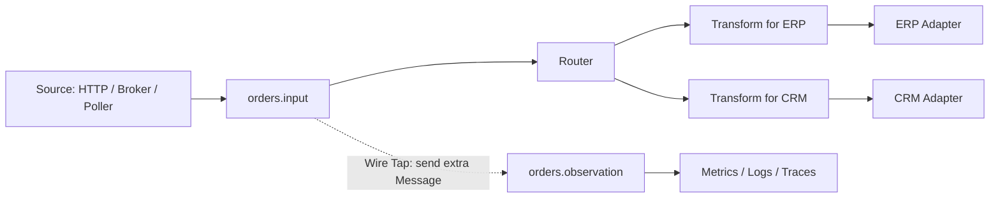
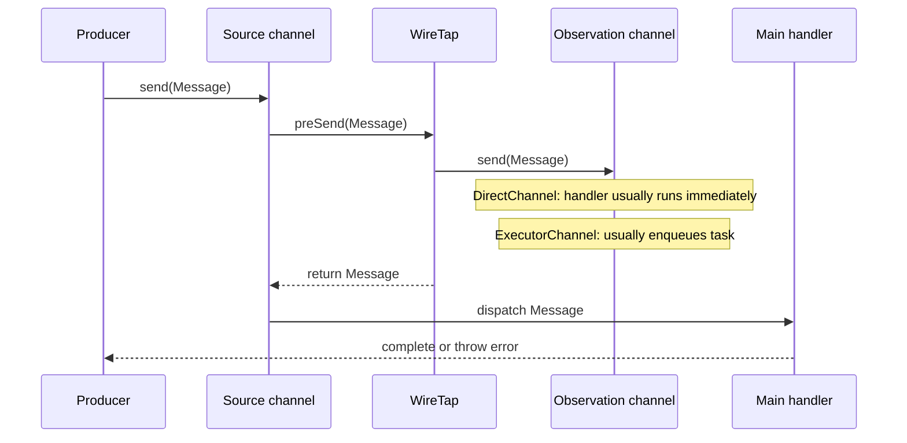
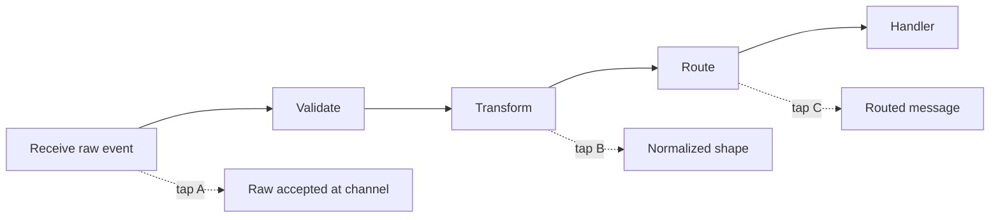

# Wire Tap and Observing Flows Without Altering Main Processing

A Spring Boot integration flow typically receives events from HTTP, databases, caches, message brokers, or Spring Integration adapters, then routes and transforms data for business operations. In operations, teams need to know which channel a message passed through, whether its payload type is right, how long processing took, and where bottlenecks occur. Yet embedding logging calls, metric emission, or audit system calls directly inside business handlers can slow down main logic or alter outcomes.

**Wire Tap** is an Enterprise Integration Pattern that lets you **observe messages passing through a channel by sending a copy to a secondary channel**. In Spring Integration, `WireTap` is a `ChannelInterceptor`: it hooks into message sending, forwards the message to a side branch, and lets the main flow proceed. It is a clean tool for attaching logging, diagnostics, metrics, and certain audit hooks **at message channel boundaries**.

This lesson belongs to the **Routing and Transformation** chapter of the **SPRING_BOOT_INTEGRATION** module: integrating Spring Boot across HTTP clients, databases, caches, message brokers, and Spring Integration, emphasizing configuration, data contracts, transactions, errors, deduplication, testing, and real-flow observability. Its scope is designing observation branches with Wire Tap **without intentionally interfering with business routing, transformers, and handlers**, while clarifying the technical conditions required for true isolation.

After this lesson, you will be able to:

- Explain exactly where Wire Tap intercepts and how it differs from `router`, `transformer`, `filter`, `publish-subscribe`, and custom `ChannelInterceptor`s.
- Configure Wire Tap via Spring Integration Java DSL and global channel interceptors, choosing synchronous or asynchronous target channels.
- Collect logs/metrics/traces safely without mutating message contents or leaking sensitive data.
- Design policies when the observation branch fails, stalls, rejects tasks, or sees duplicate messages.
- Write tests proving main handler results and invocation counts remain unchanged whether observation is enabled or disabled.

> **Version scope:** examples use modern Spring Boot and Spring Integration Java DSL, conceptually aligned with Spring Integration 6.x/7.x. Exact overloads, required Java versions, and metric names depend on your deployed dependencies; verify APIs against your actual version. Channel names, domain interfaces, and thread-pool limits in examples are illustrative.

## 1. Where Does Wire Tap Sit in an Integration Flow?

### 1.1. Main Flow and Observation Branch



Key distinctions:

1. The main flow still delivers messages from `orders.input` to the router as before.
2. Wire Tap **additionally sends** that message to `orders.observation`; it neither load-balances nor picks business branches.
3. The observation branch has its own consumer; whether it runs on the same thread or another thread is determined by the **target `MessageChannel` type**.
4. As long as the observer only reads metadata, leaves payload/headers untouched, and isolates errors, the business handler keeps its expected behavior.

The dotted line represents a logical side branch—it **does not guarantee asynchronous execution, delivery, or durable persistence**.

### 1.2. Core Behavior of Wire Tap

At its simplest, `WireTap` attaches to an `InterceptableChannel` and effectively runs:

```text
sender → preSend(message, sourceChannel)
                |
                +---- tapChannel.send(message)
                |
                +---- return message so sourceChannel dispatches onward
                                      |
                                      v
                               main handler
```

Crucial detail: Spring Integration's `WireTap` normally sends to the side branch during `preSend` of the source channel. Observing a message here means **"arrived at the channel send point,"** not **"processed successfully, committed to database, or published to broker."** If the main handler fails afterward, the tap branch may already have received and recorded the event.

Never treat an ingress Wire Tap trace as proof of business completion. To record `COMPLETED` or `FAILED`, observe at the appropriate terminal point, via error flows, or via events emitted **after commit** per business guarantees.

### 1.3. Is the Message Actually "Cloned"?

`WireTap` forwards a `Message<?>` to the observation channel. Standard Spring Messaging messages have immutable header maps and expose no payload setter; however, **envelope immutability does not imply payload object immutability**.

Suppose both branches see a `Message<OrderCommand>` where `OrderCommand` holds a mutable `ArrayList`. If the observation handler adds an element to that list, the main handler sees the mutated data. Even building a new `Message` wrapper can keep **references to the same mutable payload**.

Rules:

- Prefer immutable payloads, such as Java `record`s holding immutable values.
- Never call setters on DTOs/collections received via Wire Tap; never mutate objects stored inside headers.
- If auditing needs independent manipulation, copy into an **immutable snapshot DTO** deliberately instead of assuming Wire Tap deep-copies.
- Never tap raw single-use `InputStream`s, file streams, or iterators/cursors directly into a separate reader: consuming the stream in the tap branch prevents the main handler from reading it. Observe metadata beforehand or materialize bounded data at a safe point.

## 2. Comparing Wire Tap with Other Splitting Mechanisms

| Component | Primary Purpose | Impact on Business Flow |
|---|---|---|
| `WireTap` | Forwards a copy of messages from a channel to an observation channel | Main flow still receives the message, though tap latency and errors **can** impact it unless isolated |
| `Router` | Selects one or more destinations by business condition | Decides message routing; core business logic |
| `Transformer` | Produces a new payload/header representation | Intentionally alters forwarded data shape |
| `Filter` | Accepts or drops messages by condition | Can prevent messages from continuing |
| `PublishSubscribeChannel` | Broadcasts to multiple subscribers | Every subscriber is a receiving branch; order, errors, and synchronicity depend on config |
| Custom `ChannelInterceptor` | Hooks before/after send/receive for control or observation | Can alter, block, or fail sends; must explicitly preserve messages |
| `MessageHistory`, traces, Micrometer | Tracks path/timing via configuration | Dedicated observability tooling; does not replace all branching needs |
| Durable outbox/audit events | Persists business audit rows in the same transaction for later delivery | Far better suited to mandatory audit records than an in-memory tap |

**When to use Wire Tap?** When you want to add logging, diagnostics, statistics, sampling, or message inspection at a clear channel boundary without rewriting routers or transformers. When domain requirements mandate guaranteed audit persistence with delivery semantics, a standalone Wire Tap is rarely enough.

### 2.1. Distinguishing "Observation" from "Business Obligations"

An `orderReceived` event sent to Grafana/OTel for counting is **telemetry**: under overload, it may be sampled or shed per policy. A `paymentAuthorized` record required for reconciliation or financial auditing is **business data**: it needs contracts for transactions, retries, retention, idempotency, permissions, and recovery.

Never assume naming a channel `auditChannel` makes messages persistent. A channel name creates no durability.

## 3. Minimal Configuration with Spring Integration Java DSL

### 3.1. Dependencies and Responsibility Boundaries

For a Gradle project using compatible Spring Boot versions, e.g.:

```kotlin
dependencies {
    implementation("org.springframework.boot:spring-boot-starter-integration")
    implementation("org.springframework.boot:spring-boot-starter-actuator")
}
```

This lesson uses three logical groups:

- **Source and main flow:** receives `OrderCommand` and executes existing business logic.
- **Wire Tap on source channel:** forwards the same message to the observation branch.
- **Observation flow:** extracts safe metadata for logging/metrics without modifying payloads or calling back into the main flow.

In this example, business handlers and observation sinks are modeled as interfaces; in real applications, provide concrete services/adapters.

### 3.2. Complete Example Wiring Components Together

```java
package example.integration;

import java.math.BigDecimal;
import java.time.Instant;
import java.util.UUID;
import java.util.concurrent.Executor;

import org.springframework.beans.factory.annotation.Qualifier;
import org.springframework.context.annotation.Bean;
import org.springframework.context.annotation.Configuration;
import org.springframework.integration.channel.ExecutorChannel;
import org.springframework.integration.config.EnableIntegration;
import org.springframework.integration.dsl.IntegrationFlow;
import org.springframework.integration.dsl.MessageChannels;
import org.springframework.messaging.MessageChannel;
import org.springframework.scheduling.concurrent.ThreadPoolTaskExecutor;

@Configuration
@EnableIntegration
public class OrderWireTapConfiguration {

    // Illustrative business types; real implementations provided by application.
    public record OrderCommand(String orderId, BigDecimal amount) { }

    public interface OrderService {
        void process(OrderCommand command);
    }

    public record ObservationRecord(
            UUID messageId,
            String observedStage,
            String payloadType,
            Instant recordedAt) { }

    public interface ObservationSink {
        void record(ObservationRecord record);
    }

    // Source channel with Wire Tap attached: main flow remains a normal subscriber.
    @Bean("orders.input")
    public MessageChannel ordersInput() {
        return MessageChannels.direct()
                .wireTap("orders.observation")
                .get();
    }

    // Observation branch runs on its own thread pool.
    @Bean("orders.observation")
    public MessageChannel observationInput(
            @Qualifier("observationExecutor") Executor executor) {
        return new ExecutorChannel(executor);
    }

    @Bean("observationExecutor")
    public ThreadPoolTaskExecutor observationExecutor() {
        ThreadPoolTaskExecutor executor = new ThreadPoolTaskExecutor();
        executor.setCorePoolSize(2);
        executor.setMaxPoolSize(4);
        executor.setQueueCapacity(200);
        executor.setThreadNamePrefix("obs-");
        return executor;
    }

    // Business flow: no logger clutter inside business handlers.
    @Bean
    public IntegrationFlow orderFlow(OrderService orderService) {
        return IntegrationFlow.from("orders.input")
                .handle(message ->
                        orderService.process((OrderCommand) message.getPayload()))
                .get();
    }

    // Forward only allowlisted metadata to the observation system.
    @Bean
    public IntegrationFlow observationFlow(ObservationSink sink) {
        return IntegrationFlow.from("orders.observation")
                .handle(message -> sink.record(
                        new ObservationRecord(
                                message.getHeaders().getId(),
                                "orders.input",
                                message.getPayload().getClass().getSimpleName(),
                                Instant.now())))
                .get();
    }
}
```

*Code note:* this configuration integrates cleanly into modern Java applications; provide `OrderService` and `ObservationSink` beans and align versions with your Spring Boot setup. `@EnableIntegration` is included explicitly for clarity; with the appropriate starter, Spring Boot auto-configuration often enables Spring Integration automatically. `@IntegrationComponentScan` is unnecessary when no annotation-based integration gateway is declared.

Suppose a REST adapter or consumer sends an inbound message:

```java
Message<OrderWireTapConfiguration.OrderCommand> message =
        MessageBuilder.withPayload(
                new OrderWireTapConfiguration.OrderCommand(
                        "ORD-1042", new BigDecimal("89.00")))
            .setHeader("correlationId", "request-8f3")
            .build();

ordersInput.send(message);
```

Here `ordersInput` is the `MessageChannel` bean injected by name `orders.input`; `MessageBuilder` comes from `org.springframework.integration.support.MessageBuilder` or `org.springframework.messaging.support.MessageBuilder` depending on API choice. The example avoids sending customer info, cards, or access tokens to the observation sink.

**Async caveat:** `ExecutorChannel` hands work to an executor, so the observer handler runs off the sender thread and outside the main thread's transaction context. Still, **submitting the task to the executor** happens on the sender's path; if pool and queue fill up, the executor may reject tasks and throw immediately during the tap step.

### 3.3. Choosing the Observation Channel Type

| Target Channel | Observer Execution Thread | What Must Be Controlled |
|---|---|---|
| `DirectChannel` | Usually the sender thread | Slow/failing observer slows/fails sender; handy when same-transaction auditing is intentional |
| `ExecutorChannel` | Usually a thread from `Executor` | Decouples handler duration, yet requires bounding queues, rejections, and trace/transaction context |
| `QueueChannel` | Consumer polls messages later via poller | Buffers messages; requires poller/capacity/timeout; in-memory queue is not durable |
| `PublishSubscribeChannel` | Depends on whether an executor is configured | Fits multiple observers; must define fan-out, errors, and order |
| Durable broker channel | Depends on adapter and send mode | Check broker ack timing, transactions/retries, and failure handling |

In Spring Integration, **Wire Tap is not inherently asynchronous**. Never glance at a side-branch diagram and declare "the main flow definitely won't wait." Choosing `DirectChannel` can be intentional when auditing must share the main transaction—just make the failure and latency trade-offs explicit.

### 3.4. Synchronicity and Transaction Boundaries



With `ExecutorChannel`, local transactions on the sender thread do not automatically propagate to the observer thread, nor is there any guarantee whether the observer finishes before or after the main handler. If you need commit proof, never infer it from Wire Tap receipt.

## 4. Where Should Wire Tap Be Attached?

### 4.1. On an Explicitly Declared Channel

When you own the channel bean definition, attaching it on the builder is clearest:

```java
@Bean("orders.input")
public MessageChannel ordersInput() {
    return MessageChannels.direct()
            .wireTap("orders.observation")
            .get();
}
```

This keeps observation visible right at channel creation and suits channels with stable roles. Use clear channel names/beans and ensure the Wire Tap never points back into its own source to create a feedback loop.

### 4.2. Global Wire Tap by Channel Name Pattern

To turn on logging across a group of channels without editing every builder, use a global interceptor:

```java
import org.springframework.context.annotation.Bean;
import org.springframework.integration.channel.interceptor.WireTap;
import org.springframework.integration.config.GlobalChannelInterceptor;

@Bean
@GlobalChannelInterceptor(patterns = "orders.input", order = 100)
public WireTap globalOrdersTap() {
    return new WireTap("orders.observation");
}
```

Notice the example specifies `orders.input` rather than `orders.*`. Wildcards help cover multiple channels, yet you must audit **every matching channel**, especially the observation channel itself and error flows. Avoid attaching both an inline Wire Tap and a global Wire Tap pointing to the same target unless intentional; double tapping inflates metrics and logs.

A global interceptor also has ordering relative to other interceptors. Never rely on interceptor order to infer business completion; `preSend` always runs before the main dispatch.

### 4.3. Conditional Wire Tap

Not every message deserves verbose logging. Spring Integration lets you tap selectively via a `MessageSelector`:

```java
import org.springframework.context.annotation.Bean;
import org.springframework.integration.channel.interceptor.WireTap;
import org.springframework.integration.config.GlobalChannelInterceptor;

@Bean
@GlobalChannelInterceptor(patterns = "orders.input")
public WireTap importantOrdersTap() {
    return new WireTap(
            "orders.observation",
            message -> "HIGH".equals(message.getHeaders().get("priority")));
}
```

Here only messages carrying `priority=HIGH` are copied to the side branch; all messages still proceed down the main flow unchanged. Keep selectors lightweight—avoid database queries, API calls, or parsing large payloads inside `preSend`.

If sampling 1% of events, design **intentional sampling** on the observation branch; hashing a correlation ID gives consistent selection across stages of the same flow. Record the sampling rate so metrics remain interpretable. Never use random sampling for mandatory complete audits.

## 5. What to Observe While Protecting Sensitive Data

### 5.1. Designing a Minimal Observation Record

A useful observation record typically carries:

| Field | Example | Usage |
|---|---|---|
| `messageId` | Message UUID | Distinguishes messages at the observation point; not guaranteed stable across transformations |
| `correlationId` | `req-8f3` | Connects steps across one request/flow when propagated consistently |
| `stage/channel` | `orders.input` | Pinpoints where observation occurred; avoids confusing ingress with success |
| `payloadType` | `OrderCommand` | Validates data contracts without logging bodies |
| `payloadSize` | Safely measured byte/char size | Detects anomalous sizes without serializing whole payloads solely to measure |
| `observedAt` | Timestamp | Distinguishes tap capture time from observer processing time |
| `outcome` | Set only at actual completion points | Never hardcode `SUCCESS` on an ingress tap |

This metadata feeds structured event logs or metrics. **Never** dump full HTTP bodies, JWTs, `Authorization` headers, cookies, passwords, DB credentials, or PII into logs just because "tapping is convenient."

If order IDs are needed for support, pass that choice through data classification and access policies rather than exporting every ID unconditionally. To stitch traces, rely on correlation IDs or span contexts rather than logging raw payloads.

### 5.2. Structured Logging and Overhead

Illustrative sink:

```java
@Component
public class LoggingObservationSink
        implements OrderWireTapConfiguration.ObservationSink {

    private static final Logger log =
            LoggerFactory.getLogger(LoggingObservationSink.class);

    @Override
    public void record(OrderWireTapConfiguration.ObservationRecord event) {
        log.info(
                "integration_observed stage={} messageId={} payloadType={} recordedAt={}",
                event.observedStage(),
                event.messageId(),
                event.payloadType(),
                event.recordedAt());
    }
}
```

This snippet uses `org.slf4j.Logger`, `org.slf4j.LoggerFactory`, and `org.springframework.stereotype.Component`; imports are omitted for readability. `INFO` is illustrative; under high throughput, logging every message burns CPU, I/O, storage, and adds noise. Consider sampling, time-boxed `DEBUG`, or counters/histograms with bounded tag sets.

**Never attach `messageId` or `correlationId` as time-series metric tags**: unbounded unique values explode cardinality. Keep those IDs in logs/traces. For metrics, stick to low-cardinality tags such as `flow=orders`, `stage=ingress`, `result=accepted/rejected`, `adapter=erp/crm`.

### 5.3. Using Metrics and Traces in the Right Places

Wire Tap excels at:

- Counting messages entering a stage.
- Measuring `payloadType` distributions or router splits with bounded labels.
- Catching messages missing routing headers or violating contracts.
- Attaching correlation IDs to logs across HTTP → channel → adapter → broker.

To measure **main handler duration**, instrument the handler or endpoint directly with a timer/observation. A pre-dispatch Wire Tap cannot measure handler execution time. To track **failures**, observe exceptions, error channels, or failure events at the relevant boundaries. To verify **commits**, observe post-commit hooks or durable DB state.

Spring Boot Actuator, Micrometer/Observation, and Spring Integration management can publish send/receive metrics, timers/counters, and integration graphs depending on version and config. Verify actual metrics in your monitoring system rather than assuming enabling Wire Tap automatically builds trace spans or business KPIs.

### 5.4. Correlation ID Across Thread Boundaries

Suppose an HTTP request holds `traceId` in MDC. When Wire Tap sends to an `ExecutorChannel`, the observer runs on a different thread pool; **sender `MDC`/`ThreadLocal` context does not automatically propagate there**.

Mitigations depend on stack:

- Read correlation IDs from controlled message headers instead of relying solely on `ThreadLocal`.
- For distributed tracing/Observation, configure context propagation matching your library, version, and executor—using context-propagating task decorators where appropriate.
- Never trust arbitrary client-supplied IDs blindly; normalize, bound lengths, and redact sensitive values.
- Distinguish event time at the main stage from processing time inside the observer when analyzing latency.

## 6. Ensuring "No Impact on Main Processing" in Practice

The name Wire Tap implies passive eavesdropping, yet actual isolation depends on design. Control three forms of interference separately:

1. **Data interference:** observer mutating payload/headers or consuming streams.
2. **Timing/resource interference:** slow observers, full queues, CPU/heap, or executor contention.
3. **Error/transaction interference:** tap send throwing, same-thread audit failing, or observation emitting before rollback.

### 6.1. Synchronous Branches Can Block or Throw

If the target is a `DirectChannel`, the observation handler runs on the sender thread:

```java
@Bean("orders.observation")
public MessageChannel observationInput() {
    return new DirectChannel();
}
```

A slow or failing audit adapter stalls or aborts `send()` at the source **before the main handler even runs**. That directly impacts the main path even though the business handler had no bug. Choose `DirectChannel` only when shared thread/transaction semantics are deliberate and failure policies are agreed.

### 6.2. Asynchronous Branches Still Share Chokepoints

With `ExecutorChannel`, observers normally run on separate threads. Even so:

- Enqueuing/scheduling still executes on the main sender path.
- Once thread pool and queue saturate, the executor rejects tasks and throws back to the sender.
- `CallerRunsPolicy` forces the main sender thread to run the observer handler, causing sudden latency spikes.
- Shared CPU, memory, DB connections, or network bandwidth consumed by observers can still slow the whole service.
- If the process crashes after tap enqueue but before observer completion, in-memory observations are lost.

Thus, "using `ExecutorChannel`" only **decouples execution timing**; it is not absolute isolation.

### 6.3. Designing a Loss Policy for Observation Data

For non-critical telemetry, agree on an explicit shedding policy:

- **Bound load:** capped pools, bounded queues, and CPU/memory budgets.
- **When full:** drop with counters, tighten sampling, or pause observation per config. Message shedding **must be built deliberately**; a `WireTap` wired straight to an `ExecutorChannel` with default rejection will not shed gracefully on its own.
- **Isolate failures:** route observer errors to an appropriate sink/error flow, distinguishing enqueue failures from async handler failures.
- **Monitor the observer itself:** track received, tapped, processed, dropped, rejected, errored, and queued counts.
- **Never retry the main handler due to telemetry errors** unless required by business contract; keep main retry boundaries separate.
- **Never swallow real main-handler errors** when wrapping side branches in fallbacks.

You can build a dedicated **best-effort observation** channel/adapter that catches and classifies tap send errors, increments `observation_dropped_total`, and lets the main flow continue. Test it thoroughly, because sloppy exception handling can accidentally swallow business errors or hide prolonged observation outages. Never assume default `WireTap` comes with that contract.

### 6.4. When Audits Must Never Be Lost

If the requirement is "every money transfer must have a reconcilable audit record," consider:

1. Writing an outbox/audit row **in the same transaction** as business state changes.
2. Having a worker forward from outbox to the broker or audit store with retries.
3. Using message/idempotency keys so audit consumers handle duplicates safely.
4. Monitoring forwarding lag, retries, dead-letters, retention, and replay tools.

Wire Tap remains great for **performance and flow diagnostics**, yet never replaces transactional outboxes or durable audit guarantees. Nor does an ingress tap prove a business transaction committed.

## 7. Preserving Data Contracts and Routing Semantics

### 7.1. Never Modify Headers Used by Routers

Suppose the main router inspects a header:

```java
// Illustrative main flow:
.route(message -> message.getHeaders().get("destination"),
       mapping -> mapping
           .channelMapping("ERP", "erp.input")
           .channelMapping("CRM", "crm.input"))
```

If an observer alters `destination` or mutates DTO fields read by the router, business routing shifts unexpectedly. Wire Tap handlers must treat messages as strictly read-only. If the observation pipeline needs `observationStage`, construct a separate observation DTO inside the observer rather than modifying the source message.

Headers like `replyChannel` and `errorChannel` are part of messaging mechanics. Never alter them in a tap branch; sending replies over shared channels or triggering reply handlers accidentally creates duplicate signals or broken routing.

### 7.2. Observation Point Determines Data Meaning



Three taps mean three different things:

- **Tap A:** sees raw events prior to validation, including events soon to be rejected.
- **Tap B:** sees normalized payloads after transformation, useful for verifying post-transform contracts.
- **Tap C:** sees messages entering a post-router channel, confirming branch selection without proving downstream handler success.

Never reuse a single metric name `processed_total` across all three points. Name them `received_total`, `validated_total`, `routed_total`, etc., separating "attempted," "accepted," and "completed" telemetry cleanly.

### 7.3. Redeliveries and Duplicate Handling

Paths involving Kafka, RabbitMQ, HTTP retries, DB pollers, or transactional redeliveries can transmit the same event repeatedly. Wire Tap observes the message every time it traverses that channel; **one business event can trigger multiple observations**.

Clarify:

- Spring's `messageId` is not guaranteed to remain the business ID across retries or message reconstructions.
- Source-supplied `eventId` or idempotency keys should be retained and forwarded consistently for reconciliation.
- Delivery attempt counts and unique business event counts are different metrics.
- If emitting observation records into brokers or audit stores, consumers must handle duplicates using keys and retention rules.

Never attempt to deduplicate observation metrics by dropping messages from the main flow. Business deduplication belongs at its own dedicated boundary and contract.

## 8. Monitoring the Observation Branch Itself

An overloaded observation branch needs its own runbook. At minimum track:

| Signal Group | Examples | When to Investigate |
|---|---|---|
| Source traffic | Total messages entering `orders.input` | Unexpected divergence from request/job/broker ingress |
| Tap branch | Messages matched by selector and attempted to tap | Divergence from expected selector match rate |
| Executor/queue | Active threads, queue depth, remaining capacity | Growing backlog or near-full queue |
| Rejections/drops | Rejected tasks, shed telemetry per policy | Sustained > 0 or exceeding drop budget |
| Observer handler | Duration, error rate, timeouts | Log/metric/broker sink slowing or failing |
| Main system | Main handler latency, throughput, error rate | Negative correlation when enabling tap or during observer congestion |

Compare counts only when accounting for **filters/sampling, retries, fan-out, and async lag**. Within a one-minute window, fewer observer completions than tap inputs may simply reflect queue backlog rather than lost data.

### 8.1. Avoid Self-Loops

An overly broad global Wire Tap pattern can accidentally tap `orders.observation` itself, causing recursive logging, infinite duplicates, or runaway queues. Prevent this with clear channel namespaces, tightly scoped patterns, and cycle tests. With global interceptors, inspect the full list of matched channels at startup including dynamically created channels.

### 8.2. Do Not Let Observation Starve the Database

A common production pitfall: every tapped message opens a new SQL transaction to write an audit row, sharing the exact same database connection pool as the main handler. Under traffic spikes, observers exhaust the pool and stall core business traffic precisely when diagnostics are needed most.

Budget extra queries, use dedicated connection pools if truly warranted, and assess required audit durability. For telemetry, prefer dedicated non-blocking sinks/batching with load caps. For mandatory business audits, design transactions and connection budgets explicitly instead of routing every event to an unbounded JDBC handler.

### 8.3. Toggling Observation Safely During Incidents

If supporting dynamic feature flags for taps, verify whether toggling alters only event emission or touches channel wiring and transactions. Stopping a `WireTap` via lifecycle APIs can be exposed operationally with proper authorization; never hot-toggle blindly when full auditing is legally required. Log every config toggle and confirm expected shifts in tap metrics on dashboards.

## 9. Testing to Prove the Main Flow Remains Unchanged

### 9.1. Testing Basic Behavior Without a Spring Boot Context

JUnit 5 + AssertJ directly testing Spring Integration channels:

```java
import static org.assertj.core.api.Assertions.assertThat;

import java.util.concurrent.atomic.AtomicInteger;
import java.util.concurrent.atomic.AtomicReference;

import org.junit.jupiter.api.Test;
import org.springframework.integration.channel.DirectChannel;
import org.springframework.integration.channel.QueueChannel;
import org.springframework.integration.channel.interceptor.WireTap;
import org.springframework.messaging.Message;
import org.springframework.messaging.support.MessageBuilder;

class WireTapBehaviorTest {

    @Test
    void tapObservesWithoutChangingMainMessage() {
        DirectChannel main = new DirectChannel();
        QueueChannel observed = new QueueChannel(4);
        main.addInterceptor(new WireTap(observed));

        AtomicInteger businessInvocations = new AtomicInteger();
        AtomicReference<Message<?>> businessMessage = new AtomicReference<>();

        main.subscribe(message -> {
            businessInvocations.incrementAndGet();
            businessMessage.set(message);
        });

        Message<String> original =
                MessageBuilder.withPayload("ORD-1042")
                    .setHeader("destination", "ERP")
                    .build();

        assertThat(main.send(original)).isTrue();

        Message<?> tapped = observed.receive(1000);

        assertThat(tapped).isSameAs(original);
        assertThat(businessMessage.get()).isSameAs(original);
        assertThat(businessInvocations.get()).isEqualTo(1);
        assertThat(original.getHeaders().get("destination")).isEqualTo("ERP");
    }
}
```

Here `WireTap` accepts a `QueueChannel` instance directly, needing no `BeanFactory` channel resolution. The test uses `QueueChannel` as a **probe** to inspect captured messages; it does not simulate production `ExecutorChannel` behavior. Asserting `tapped` and `original` share identity reinforces why payloads must stay immutable.

What this test proves: the source sent once; the main handler received one message; the tap captured the message; routing headers remained intact. Pair it with integration tests verifying final business outputs/side effects remain identical with tap on versus off.

### 9.2. Failure-Isolation Test Matrix

| Scenario | Setup | What Must Be Proven |
|---|---|---|
| Happy path | Send message through tapped channel | Main handler runs once; observer captures valid event |
| Slow observer | Inject controlled delay into observation sink | With async target, main latency does not scale with observer duration while queue has space |
| Observer throws | Make sink fail upon receiving message | Error follows async error policy; never masks main errors |
| Full executor | Small pool/queue under bounded load | Rejection matches contract; if best-effort, drop counter increments and main still succeeds |
| Mutable payload | DTO with mutable collection | Observer does not mutate state; consider immutability/snapshots |
| Sensitive payload | Message with mock secret header | Logs/metrics/sink exclude secrets and raw body |
| Duplicate/retry | Emit same `eventId` repeatedly | Metrics separate attempts from unique events per design |
| Global wildcard interceptor | Boot full channel set | Never taps observation/error channels; no loops |
| Toggle on/off | Controlled toggle of tap | Business routing/outputs remain identical; only telemetry changes |

For `ExecutorChannel`, never use `Thread.sleep` expecting deterministic ordering between main handler and observer. Use `CountDownLatch`, `Awaitility`, or bounded synchronization to wait on observer signals. Test pool/queue saturation in isolated load tests with bounded resources, never by inducing artificial bottlenecks in production.

### 9.3. Contract Test for Observation Points

Include at least one test where the business handler throws after the message passed the tap. Verify: the ingress observation may still appear, yet the system **must never mark** that message `SUCCESS`. For post-commit observations, verify they emit only when the transaction actually commits.

This prevents a classic bug: dashboards counting every ingress message as a completed order.

## 10. Real-World Scenarios in Integration Systems

### Scenario A — Observing ERP/CRM Routing

**Context:** a service receives `CustomerUpdated`, transforms HTTP DTOs into an internal schema, and routes to ERP or CRM. Operations wants visibility into misrouted messages.

**Design:** attach a tap after normalization and before the router to capture `schemaVersion`/`destination`; attach separate taps on each route's output channel if per-branch counts are needed. Keep payloads immutable; use a bounded-cardinality `destination` metric label.

**Interpreting results:** the pre-router tap shows input conditions; the tap on `erp.input` shows messages entering the ERP channel; confirming ERP accepted them requires instrumentation on the ERP adapter/response or terminal completion event.

### Scenario B — Logging Increases HTTP Latency

**Context:** Wire Tap connects to a `DirectChannel` whose observer sends logs to a REST endpoint. When that endpoint stalls for 4 seconds, the main API slows down too.

**Cause:** `DirectChannel` runs handlers on the sender thread; tapping in `preSend` makes the sender block on the side sink.

**Fix:** switch to a bounded async branch, emit logs through dedicated logging/telemetry pipelines, enforce timeouts, and define task rejection policies. Benchmark API latency before/after under equal load and test full-queue behavior.

### Scenario C — Async Enabled, Yet Errors Still Surface Under Spike Load

**Context:** the observer runs on an `ExecutorChannel`. Under traffic bursts, logs show `TaskRejectedException` and some main requests fail.

**Cause:** submitting tasks to the executor still executes during the tap; async does not eliminate enqueue/rejection errors.

**Fix:** decide whether telemetry may be dropped. If yes, implement a **best-effort metered drop** path, cap telemetry volume, and skip infinite retries. If data must never be lost, redesign durable persistence with adequate capacity. Monitor queue growth, CPU, and application health.

### Scenario D — Audit Records "Success" Despite Transaction Rollback

**Context:** a Wire Tap on `orders.input` logs `ORDER_COMPLETED`, yet the downstream SQL handler throws and rolls back.

**Cause:** an ingress tap runs before the main handler; arriving at the tap never implies transaction commit.

**Fix:** rename the ingress event to `ORDER_RECEIVED`. Emit `ORDER_COMPLETED` only after commit or via an outbox in the same business transaction; add tests for rollbacks and retries/idempotency.

### Scenario E — Logger Corrupts Business Payload

**Context:** payloads carry a mutable `List<Item>`, and the observation handler normalizes the list in place before logging. Some main orders lose items.

**Cause:** both branches reference the same payload instance; Wire Tap does not deep-copy.

**Fix:** use immutable payloads, build a read-only observation projection from permitted fields, and never mutate source objects. Test concurrent execution of observer and main handler on the same message.

## 11. Runbook for Troubleshooting Wire Tap Issues

When issues appear after enabling observation, inspect in order:

1. **Identify attachment points:** source channel, target channel, channel types, global patterns, selectors, and interceptor order.
2. **Compare timestamps:** main latency/errors before and after enabling tap; do spikes correlate with observer backlogs?
3. **Inspect executor/queues:** thread counts, queue capacity, rejection policy, task duration, drop counts, and errors.
4. **Separate send errors from handler errors:** enqueue errors affect senders; async handler errors belong in configured error flows.
5. **Check data safety:** are payloads mutable or streams? Are business headers altered, or are side messages looping back into source channels?
6. **Verify event semantics:** is the tap at ingress or post-transform/post-route? Are ingress counts being misreported as completed outcomes?
7. **Verify toggling/disabling safely:** business outputs, side effects, error rates, and p95/p99 must stay consistent while telemetry shifts as expected.

Short pre-deployment review checklist:

- [ ] Taps sit on intended channels; global patterns exclude observer/error channels and avoid double tapping.
- [ ] Side branches only read messages, headers, and payloads; single-use streams are handled specially.
- [ ] Isolation level (direct/executor/queue) matches latency and transaction goals.
- [ ] Thread/queue budgets and explicit policies exist when observers are slow, fail, or reject tasks.
- [ ] Secrets, PII, and raw bodies are excluded by default; metric labels have bounded cardinality.
- [ ] Correlation IDs, event IDs, and stage names carry accurate meaning; ingress is never labeled completed.
- [ ] Tests cover main flow, exceptions, full queues, mutable payloads, retries, and duplicates.
- [ ] Mandatory audits use durable persistence/idempotency independent of best-effort telemetry.

## 12. Key Takeaways and Reference Documentation

**Wire Tap reveals messages crossing channel boundaries without polluting every router, transformer, and handler with observation code.** It copies messages to a side flow while keeping business logic on the main line. Still, achieving *truly minimal interference* requires guarding shared data, choosing channel types deliberately, isolating errors, and bounding resources. An ingress tap only proves a message **reached the tap point**, never that business processing succeeded.

Official documentation to cross-check by version:

- [Spring Integration — Configuring Message Channels / Wire Tap](https://docs.spring.io/spring-integration/reference/channel/configuration.html).
- [Spring Integration — Java DSL `MessageChannelSpec.wireTap()`](https://docs.spring.io/spring-integration/reference/dsl/java-wiretap.html).
- [Spring Integration — Message Channel Implementations](https://docs.spring.io/spring-integration/reference/channel/implementations.html).
- [Spring Integration — Message and Payload Immutability](https://docs.spring.io/spring-integration/reference/message.html).

These references explain `WireTap`, channel attachment, synchronous vs. asynchronous channel mechanics, and `Message` immutability limits. Before deploying to production, verify directly against your running **Spring Integration version** and business requirements for logging, auditing, transactions, retries, and sensitive data.
