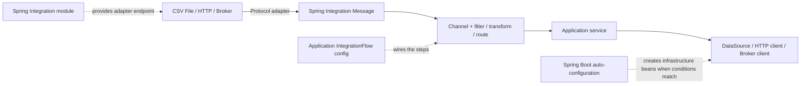
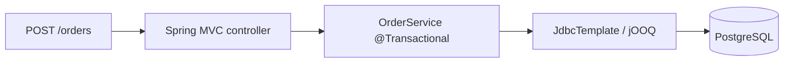
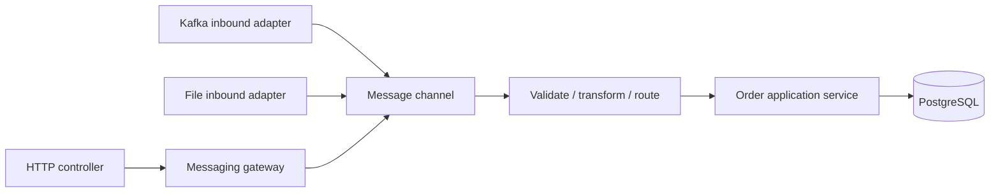
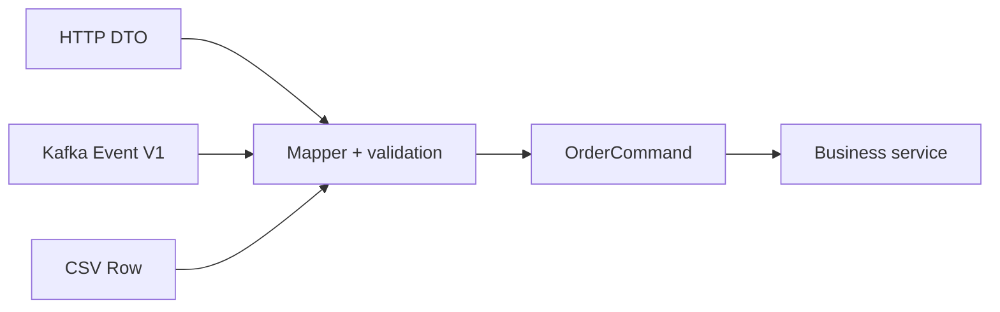

# Choosing an adapter module and distinguishing what Boot auto-configures

In **SPRING_BOOT_INTEGRATION**, a Spring Boot application typically connects to many types of systems: HTTP APIs, databases, caches, message brokers, files, and partner systems. Spring Integration provides **adapters** to bring data from external systems into a `Message` flow or send data from that flow outward. Spring Boot, on the other hand, helps create and configure certain **infrastructure** based on dependencies, properties, and application conditions. These two capabilities complement each other, but they are not synonymous.

This lesson in the **Integration Adapters** chapter focuses on answering two practical questions: **when should you add which adapter module** and **what does Boot actually auto-configure on the developer's behalf**. The examples clarify the boundaries between data contracts, transactions, error handling, deduplication, testing, and observability of an integration flow. The syntax shown is based on the Spring Boot 3.x / Spring Integration 6.x model; when using a different version, verify dependencies and APIs against your project's BOM.

## 1. Learning objectives

After this lesson, you will be able to:

1. Distinguish **starters**, **Spring Integration modules**, **beans auto-configured by Boot**, and **endpoints/flows declared by the application**.
2. Choose the right module for HTTP, JDBC, AMQP, Kafka, JMS, Redis, file, SFTP, and common integrations.
3. Identify inbound/outbound, adapter/gateway, push vs. polling mechanisms, and the implications of each choice.
4. Configure a flow using an adapter, manage environment properties, and verify which components are actually created.
5. Identify transaction, retry, idempotency, and observability boundaries when an adapter interacts with an external system.
6. Design tests sufficient to prove that the flow works, rather than merely checking that the application starts up.

## 2. Four layers that are often confused

Suppose a service periodically receives CSV files, reads the data, and writes it to PostgreSQL. There are four distinct layers:

| Layer | Role | Example |
| --- | --- | --- |
| Transport/infrastructure library | Provides connection APIs, drivers, clients, and pools | PostgreSQL JDBC driver, `DataSource`, Spring JDBC, Kafka client |
| Spring Boot starter/auto-configuration | Pulls in convenient dependencies and, when conditions match, creates infrastructure beans | `spring-boot-starter-jdbc` + `spring.datasource.*` properties |
| Spring Integration module | Provides message endpoints and adapters for a protocol or data source | `spring-integration-file`, `spring-integration-jdbc` |
| Application-declared flow | Defines which flow runs, when to poll, which messages to receive, and where to transform and handle them | `@Bean IntegrationFlow`, file inbound adapter, filter, service activator |



**Dependencies do not define business behavior on their own.** Adding `spring-integration-file` to the classpath does not make the application automatically scan an arbitrary directory. Adding `spring-integration-kafka` does not make the application automatically subscribe to every topic. Boot may create an appropriate connection factory or client template, but topic names, directories, polling schedules, DTO mapping, and error behavior are decisions the application must make.

The converse is equally important: **not every integration needs Spring Integration**. A controller calling `RestClient` and persisting data with `JdbcTemplate` can be clear enough. Spring Integration is a better fit when the problem requires coordinating message endpoints, channels, transformations, filtering, routing, polling, or processing messages from multiple sources under a unified flow model.

## 3. Adapters and gateways: direction and exchange style

In Spring Integration, a **message** carries a payload, headers, and routing context. Adapters connect messages with external protocols; gateways represent **request–reply** exchanges. Some adapters receive events actively (message-driven); others must fetch data periodically via a poller.

| Component | Data direction | Characteristics | Example |
| --- | --- | --- | --- |
| Inbound channel adapter | External system → channel | Receives or fetches data and emits a `Message`, typically without waiting for a business reply | Reading new files, reading from a queue and emitting messages |
| Inbound gateway | External system → flow → external system | Receives a request and returns a response within the protocol's contract | HTTP inbound gateway returning a synchronous result |
| Outbound channel adapter | Channel → external system | Sends data, typically in a one-way style | Publishing a notification to a broker or writing a file |
| Outbound gateway | Channel → external system → flow | Calls an external system and brings the response back into the flow | HTTP outbound gateway calling a partner REST API |

The terms **inbound/outbound** are viewed from the Spring Integration application's perspective: *inbound* enters the flow; *outbound* goes out to another system. Do not infer request/reply from the protocol name alone: HTTP has both inbound gateways and outbound gateways, and AMQP/JMS have both one-way and request–reply components.

`@MessagingGateway` is a **Java interface** pattern for calling into or receiving results from a Spring Integration flow via channels. It does not by itself turn the application into an HTTP server or a broker consumer. The actual protocol endpoint still requires an appropriate adapter/gateway or an external controller/consumer invoking that Java gateway.

### Message-driven and polling

- **Message-driven**: the source pushes events, and an adapter or listener receives callbacks/messages and sends them into a channel. Examples: an AMQP listener or a Kafka consumer container. You must handle acknowledgments, concurrency, and redelivery according to the protocol.
- **Polling**: the application actively queries the source on a schedule. Examples: a file directory, a database table to scan, or an endpoint that only supports periodic fetching. You must choose `fixedDelay`/`fixedRate`, batch size, contention locking, and how progress is persisted.

A poller is not just a timer to "wake up" a flow. A single poll can retrieve 0, 1, or many messages depending on the adapter and configuration. Polling too fast can exhaust connection pools or emit duplicates; polling too slowly increases integration latency. When multiple instances poll the same source, you need appropriate coordination and data locking/claiming mechanisms.

## 4. Map for choosing a Spring Integration module

The following modules are **Spring Integration components**. Module names are used to pick which adapter to add as a dependency; they differ from dependencies that only provide a client or enable Boot to auto-configure a connection.

| Use case | Common adapter module | Related infrastructure and notes |
| --- | --- | --- |
| Receiving or calling HTTP within a flow | `spring-integration-http` | Includes inbound/outbound HTTP gateways; may require corresponding Spring MVC/HTTP client support. If there are only a few endpoints, `@RestController` and `RestClient`/`WebClient` are often simpler. |
| Reading/writing tables via messaging | `spring-integration-jdbc` | Uses `DataSource` and JDBC; different from a repository calling `JdbcTemplate` directly. |
| Sending/receiving messages with RabbitMQ/AMQP | `spring-integration-amqp` | Leverages connection factory and template/listener from the Spring AMQP ecosystem; requires separate topology, ack, retry, and DLQ configuration. |
| Reading/writing Kafka topics in a flow | `spring-integration-kafka` | Leverages Spring Kafka `ConsumerFactory`/`ProducerFactory`; requires group ID, offset/ack, and duplicate-handling semantics. |
| Integrating with a JMS broker | `spring-integration-jms` | Requires a JMS `ConnectionFactory`, a specific broker, and transaction/ack configuration. |
| Redis pub/sub, streams, or suitable message endpoints | `spring-integration-redis` | Built on Spring Data Redis and a connection factory; different from `CacheManager` using Redis as a cache. |
| Watching/manipulating local files | `spring-integration-file` | File inbound/outbound adapters; requires a poller, filters, and moving or archiving processed files. |
| Transferring files from an SFTP server | `spring-integration-sftp` | Requires a session factory, authentication, connection control, and file synchronization; not just enabling a Boot property. |
| Sending/receiving email | `spring-integration-mail` | Requires accounts, protocols, authentication, and email state management. |
| MQTT message flow | `spring-integration-mqtt` | Requires an MQTT client, broker, QoS, and reconnect/duplicate policies. |

This list does not mean you should add all of them. Declare only the modules you actually use and their supporting protocol dependencies, using Spring Boot dependency management/BOM to keep versions compatible. Different Spring Boot/Spring Integration versions may organize starters or supporting dependencies differently; check the exact version alignment when adding an adapter.

### When is a separate adapter module unnecessary?

| Practical need | Sufficient choice | When to consider a Spring Integration adapter? |
| --- | --- | --- |
| A controller calls a REST API to fetch data | Spring Web `RestClient` or `WebClient` in a service | When calling HTTP is one step in a flow with routing, transformation, retry, and channels. |
| Reading/writing business SQL inside a transaction | `JdbcTemplate`, `NamedParameterJdbcTemplate`, jOOQ, or JPA | When you want to turn a table/change stream into a message source or use JDBC as a message endpoint. |
| Using Redis to cache query results | Spring Cache + Redis `CacheManager` | When you want message integration over Redis rather than caching alone. |
| Sending a Kafka message from a service | `KafkaTemplate` with Spring Kafka | When you need an adapter that fits into a Spring Integration `Message` pipeline. |
| An HTTP API that simply receives a request and calls a service | `@RestController`/Spring MVC | When the inbound endpoint needs to be modeled as a gateway into an integration flow. |

The selection rule is to **start from the flow characteristics**, not from the list of available adapters: which system initiates the data, whether a reply is needed, synchronous vs. asynchronous processing, data rate, required consistency, and failure recovery.

## 5. How far does Boot auto-configure?

**Spring Boot auto-configuration** is a set of configurations conditional on the classpath, properties, existing beans, and other conditions. A starter is a convenient dependency bundle; a starter by itself is not an integration flow. Boot can help create infrastructure beans and bind configuration, but it does not know which topic the business wants to consume from or which partner to call.

| Given matching dependencies and configuration | Boot can provide | The application must still define |
| --- | --- | --- |
| `spring-boot-starter-integration` / Spring Integration core | Spring Integration infrastructure and Boot integration; conditionally detects/configures supporting components | `IntegrationFlow`, custom `MessageChannel`s when needed, endpoints, and message processing rules. |
| JDBC starter + driver + `spring.datasource.*` | `DataSource`, connection pool, `JdbcTemplate`, and an appropriate transaction manager | SQL, DTO mapping, business boundaries, and retry/idempotency strategy. |
| Spring AMQP starter + `spring.rabbitmq.*` | Connection factory, template, and Spring AMQP infrastructure conditionally | Queues/exchanges/routing keys to use, consumers/flows, dead-lettering, and business handling. |
| Spring Kafka + `spring.kafka.*` | Producer/consumer factories, `KafkaTemplate`, and appropriate Kafka infrastructure based on classpath/beans | Topics, groups, specific adapters/listeners, offset policy, and event contracts. |
| Spring Data Redis starter + `spring.data.redis.*` | Redis connection factory and certain Redis access beans conditionally | Cache policy, Redis message adapters if needed, data isolation, and TTL. |
| Spring Web / HTTP client | Dispatcher/HTTP client builder and corresponding web infrastructure conditionally | HTTP routes, controller endpoints or Spring Integration HTTP gateways, timeouts, and partner contracts. |

These are **conditional auto-configuration capabilities**, not a guarantee that every bean in the middle column will always exist. For example, if you declare a custom `DataSource`, Boot may back off from creating the default bean; if there are multiple data sources or transaction managers, you need `@Qualifier`/`@Primary` and accurate flow configuration. Properties in `application.yml` are only used if an auto-configuration or an application bean actually reads them.

Distinguish three mechanisms further:

1. **Auto-configuration**: Boot evaluates conditions to create general-purpose infrastructure beans.
2. **Component scan / bean definition**: `@Configuration`, `@Bean`, `@Service` classes or related annotations actually declare application components.
3. **Property binding**: `@ConfigurationProperties` binds configuration values into beans registered by Boot or the application; **binding does not create business behavior by itself**.

Therefore, adding `spring-integration-file` along with `app.import.inbox=/data/inbox` does not make Boot automatically create a file inbound adapter. You must declare an `IntegrationFlow` or file inbound endpoint and attach a poller. Similarly, Boot having a `KafkaTemplate` does not mean there is a `KafkaMessageDrivenChannelAdapter` for your topic.

### How to verify what Boot actually created?

When the application lacks an expected adapter or encounters bean conflicts, inspect in this order:

1. **Classpath/BOM:** Are the Spring Integration module, client driver/starter, and versions compatible?
2. **Properties:** Have host, credentials, bean names, `enabled` flags, and profile-specific settings been loaded?
3. **Actual beans:** Is the adapter/flow declared, covered by component scan, and satisfying `@ConditionalOnProperty`?
4. **Condition report:** Enable `--debug` at startup to inspect the auto-configuration report, or use the Actuator `conditions` endpoint when properly configured and secured.
5. **Endpoint status:** Are the poller/listener actually running, does the channel have a consumer, and has the endpoint been started by the lifecycle manager?

Do not guess that "Boot failed to pick up the dependency" when the real cause is an **undeclared flow**, a conditionally disabled flow, or a listener connected to the wrong destination.

## 6. Complete example: choosing a file adapter and declaring a flow

Problem: check an input directory every 10 seconds, pick up `*.csv` files, and hand them off to an import service. Because the source is the **filesystem** and does not actively invoke HTTP, choose `spring-integration-file` with an **inbound polling adapter**. Boot helps manage the context, lifecycle, property binding, and supporting beans; the application defines the directory, poller, handler, and duplicate-handling policy.

### 6.1. Maven dependencies

```xml
<dependencies>
    <dependency>
        <groupId>org.springframework.boot</groupId>
        <artifactId>spring-boot-starter-integration</artifactId>
    </dependency>
    <dependency>
        <groupId>org.springframework.integration</groupId>
        <artifactId>spring-integration-file</artifactId>
    </dependency>
    <dependency>
        <groupId>org.springframework.boot</groupId>
        <artifactId>spring-boot-starter-validation</artifactId>
    </dependency>
</dependencies>
```

Do not specify arbitrary versions for modules when a Spring Boot BOM/parent already manages compatible versions. If `CsvImportService` writes to PostgreSQL, add the JDBC starter and appropriate driver; those are dependencies of the **data-processing step**, not prerequisites for the file inbound adapter itself to work.

### 6.2. Externalized configuration

```yaml
app:
  import:
    enabled: true
    inbox: ${IMPORT_INBOX:/var/app/inbox}
    poll-delay: 10s
```

`app.import.*` is a **custom namespace**. Spring Boot has no knowledge of its business meaning unless a bean is registered to bind and use these properties.

```java
import jakarta.validation.constraints.NotNull;
import java.nio.file.Path;
import java.time.Duration;
import org.springframework.boot.context.properties.ConfigurationProperties;
import org.springframework.validation.annotation.Validated;

@Validated
@ConfigurationProperties(prefix = "app.import")
public record FileImportProperties(
        boolean enabled,
        @NotNull Path inbox,
        @NotNull Duration pollDelay
) {}
```

For production configurations, also validate that `pollDelay` is positive, the directory exists, read/move permissions are granted, and disk space is available. Bean validation checks the declared types and constraints, not that the filesystem path is actually accessible.

### 6.3. Declaring the adapter with Java DSL

The snippet below uses `Files` from the **Spring Integration DSL**, not `java.nio.file.Files`:

```java
import java.io.File;

import org.springframework.boot.autoconfigure.condition.ConditionalOnProperty;
import org.springframework.boot.context.properties.EnableConfigurationProperties;
import org.springframework.context.annotation.Bean;
import org.springframework.context.annotation.Configuration;
import org.springframework.integration.dsl.IntegrationFlow;
import org.springframework.integration.dsl.Pollers;
import org.springframework.integration.file.dsl.Files;

@Configuration(proxyBeanMethods = false)
@EnableConfigurationProperties(FileImportProperties.class)
public class FileImportFlowConfiguration {

    @Bean
    @ConditionalOnProperty(
            prefix = "app.import", name = "enabled", havingValue = "true")
    IntegrationFlow csvImportFlow(
            FileImportProperties properties,
            CsvImportService csvImportService) {

        return IntegrationFlow
                .from(
                        Files.inboundAdapter(properties.inbox().toFile())
                                .patternFilter("*.csv"),
                        endpoint -> endpoint.poller(
                                Pollers.fixedDelay(properties.pollDelay())))
                .handle(File.class, (file, headers) -> {
                    csvImportService.importCsv(file);
                    return null; // One-way handler; no reply needed.
                })
                .get();
    }
}
```

`CsvImportService` is a business service implemented by the application; it validates the CSV contents, maps them to internal DTOs/commands, persists data, and decides how to handle the file upon success. `File` in the handler is the payload produced by the file inbound adapter. In this setup:

| Component | Who provides it? |
| --- | --- |
| `IntegrationFlow`, `Pollers`, and message infrastructure | Spring Integration core + supporting configurations |
| `Files.inboundAdapter(...)` | `spring-integration-file` module |
| `FileImportProperties` | Application class; Boot binds properties because `@EnableConfigurationProperties` is registered |
| `csvImportFlow(...)`, directory, pattern, poller, and handler | Decided by the application itself |
| `CsvImportService.importCsv(...)` | Business logic and database access implemented by the application |

**A file polling demo is not yet a reliable file ingestion pipeline.** A filename filter and in-memory tracking may not prevent duplicates across restarts or multiple instances. In practice, consider moving successful files to an archive directory, moving failed files to quarantine, using file identifiers/checksums or an import status table with a unique constraint, avoiding files still being written, and reconciling progress after abrupt shutdowns.

If the import writes to a database, the transaction only protects DB operations within the same Spring transaction boundary; **moving a file on the filesystem does not roll back together with the database**. To survive a crash between DB commit and file move, design the import to be idempotent and add a reconciliation/retry process. Prefer an input directory that supports atomic file moves (when the filesystem allows) or a "file complete" marker convention from the producer.

## 7. Alternative example: plain HTTP and JDBC vs. IntegrationFlow?

Suppose an API receives an order creation command, validates the data, and writes it to the database.

**Simple option:**



Spring Web + JDBC/jOOQ, a request DTO, a service, and a repository are all you need. Adding Spring Integration would increase configuration surface without necessarily solving a real problem.

**IntegrationFlow option:** when the same command must arrive from HTTP, a broker, and batch files, and pass through shared validation, transformation, routing, and handler steps:



Example Java DSL flow for handling messages **once received**:

```java
import org.springframework.context.annotation.Bean;
import org.springframework.context.annotation.Configuration;
import org.springframework.integration.dsl.IntegrationFlow;

@Configuration(proxyBeanMethods = false)
public class OrderFlowConfiguration {
    @Bean
    IntegrationFlow orderCommandFlow(OrderCommandHandler handler) {
        return IntegrationFlow.from("orders.commands")
                .handle(OrderCommand.class, (command, headers) -> {
                    handler.accept(command);
                    return null;
                })
                .get();
    }
}
```

Here `OrderCommand` is an internal command with a clear contract; `OrderCommandHandler.accept(...)` is a service method implementing business rules, transactions, and deduplication. This snippet **does not yet receive Kafka or HTTP traffic**: you need an appropriate controller/gateway or adapter pushing messages into the `orders.commands` channel. This directly illustrates the boundary: Boot configures infrastructure when conditions match, Spring Integration provides the flow API, and the application **wires the sources** into the channel.

If using `@MessagingGateway` for a controller to send to the flow, declare the gateway interface and its request channel, and ensure the interface is registered in the Spring context (for instance via `@IntegrationComponentScan`). `@MessagingGateway` does not replace an HTTP controller. If using a Kafka inbound adapter, add `spring-integration-kafka`, configure the consumer container, topic, group, and error handling, and connect the adapter to the flow.

## 8. Transaction, error, and deduplication boundaries

An integration flow often spans two or more resources: a database, an HTTP service, a cache, a broker, and a filesystem. Having the adapters live inside the same Spring Boot application does **not** make those systems participate in the same transaction.

| Scenario | Risk | Design point to clarify |
| --- | --- | --- |
| Kafka/AMQP consumer writing to DB | DB commits but broker ack fails; message is redelivered | Stable event ID/business key, inbox/unique constraint, commit/ack order, and retry. |
| DB write followed by broker event | DB commit succeeds but publisher fails | Transactional outbox or an appropriate compensation/re-publish mechanism. |
| File import writing DB then moving file | DB and filesystem do not share a transaction | Idempotent import, archive/quarantine, and post-crash reconciliation. |
| HTTP outbound gateway calling a partner | Timeout occurs, yet the partner may have processed the request | Partner-contract idempotency key, deadlines, and bounded retries. |
| JDBC polling adapter selecting pending records | Two instances pick the same row or reprocess after failure | Claim/lock/lease, processing state, and appropriate transactions. |
| Redis cache update after DB change | Cache invalidation fails or data remains stale | Define source of truth, TTL, invalidation/refresh strategy, and access controls. |

**Synchronous errors differ from asynchronous errors.** With a `DirectChannel`, an exception from a handler typically propagates back to the sender on the same thread unless caught by another mechanism. With an `ExecutorChannel`, poller, or asynchronous listener, exceptions are handled by the endpoint's mechanism and configured error channel/handler. Do not assume every exception automatically lands on a global `errorChannel`, nor assume retries appear automatically just because a dependency was added.

An error-handling policy can include:

1. **Validation:** payloads that violate schema or invariants should generally not be retried indefinitely; route them to a reject/dead-letter flow with appropriate diagnostics.
2. **Transient errors:** timeouts, temporary connection drops, and overload can be retried with appropriate backoff, attempt limits, and deadlines.
3. **Duplicate effects:** protect with idempotency keys and unique constraints, not merely an in-memory filter in RAM.
4. **Quarantine/dead-letter:** record failed messages/files for tracing, triage, and controlled replay.
5. **Transaction/ack:** specify the exact points of DB commit, broker acknowledgment, and conditions under which the source may redeliver.

Retry APIs and semantics differ across HTTP, Kafka, AMQP, and pollers. Choose the policy based on the **specific source and endpoint type**, then test with real failures rather than copying one retry config across every adapter.

## 9. Designing DTOs and configuration at the adapter boundary

An adapter should **translate external communication contracts into the application's model** as early as practical. For example, a Kafka message carries `OrderCreatedEventV1`, HTTP receives `CreateOrderRequest`, and a CSV parser produces `ImportedOrderRow`; all three can be validated and mapped to `CreateOrderCommand`. Avoid passing raw Kafka records, servlet requests, file parser objects, or database rows throughout services that do not genuinely need protocol details.



At the HTTP boundary, check `@Valid`, data types, response status codes, and timeouts. At the broker boundary, check `eventId`, `eventType`, `schemaVersion`, correlation ID, and unsupported-event policies. For files, check encoding, headers, delimiters, size, and column layout. For JDBC, check mappings and DB constraints. These errors may lead to different response paths; do not collapse all of them into a contextless `RuntimeException`.

For configuration, prefer:

- Validated `@ConfigurationProperties` for application-owned settings; separate URL, topic, queue, directory, timeout, poll interval, and `enabled` flags per adapter.
- Environment variables or a secret manager for credentials, keys, and tokens; never commit secrets to `application.yml`.
- Profile/environment-specific configuration for test vs. production; guard conditional beans so adapters do not connect to real external systems during tests.
- Timeouts, pool/concurrency, and batch sizes tuned to load and target system limits; avoid sharing single-instance poller settings across many replicas.

An `app.integration.partner.enabled=false` property only has effect **if the application's beans conditionally read it**. Likewise, a `spring.kafka.*` property configures the underlying client but does not declare business topics or Spring Integration adapters by itself.

## 10. Observing a flow from source to destination

A reliable integration flow must be traceable: where data entered, which steps processed it, whether it retried, where it failed, and whether it committed/acknowledged successfully. Do not rely solely on `HTTP 200` or the application still being alive.

| Signal | Operational meaning | Example |
| --- | --- | --- |
| Input rate/backlog | How many messages/files remain unprocessed, ingress vs. egress rate | Kafka consumer lag, pending file count, pending DB rows to poll |
| Throughput/latency | Time from receipt until business side effects complete | Per-handler processing time, outbound HTTP latency |
| Retry/reject/dead-letter | Rate of transient vs. contract errors | Retry count, messages routed to DLQ, files moved to quarantine |
| Connection infrastructure | Infrastructure bottlenecks stalling the flow | JDBC pool timeouts, broker disconnects, HTTP connection timeouts |
| Data consistency | Duplicate, missing, or unsynchronized data | Unique conflicts, unpublished outbox rows, stale cache |

Spring Boot Actuator/Micrometer and Spring Integration's observability support can provide metrics/tracing depending on versions and configuration; **do not assume every endpoint emits custom business metrics out of the box**. For business outcomes like "successfully imported files" or "rejected orders", emit metrics at the business completion point. Propagate `correlationId`, `eventId`/`fileId`, adapter name, and status through logs/traces; avoid logging payloads containing personal data or credentials.

If enabling Actuator to inspect beans/conditions or internal metrics, configure appropriate security and access controls. In particular, never expose detailed configuration endpoints publicly just to debug auto-configuration.

## 11. Testing: proving the adapter actually runs

Adapter testing must cover both **wiring** and **behavior when sources/targets fail**. A `@SpringBootTest` that merely starts the context does not prove that files are polled, Kafka offsets are acknowledged properly, or webhooks return valid responses.

| Test level | Goal | Suggested approach |
| --- | --- | --- |
| Mapper/handler unit test | Verify DTO mapping, validation, business rules, and processing results | JUnit; mock services/repositories at the right boundary. |
| Context/wiring test | Verify bean conditions, dependencies, and channel subscribers | Start the context with test profiles/properties; verify flows toggle on/off correctly. |
| File adapter integration test | Poll matching files, skip incomplete files, transition state on success/failure | Dedicated temp directory for tests, short bounded poll intervals, verify outcomes and idempotency. |
| HTTP adapter test | Request/response mapping, status codes, timeouts, and retries | Mock HTTP server like WireMock/MockWebServer or corresponding web adapter tests. |
| Broker adapter integration test | Topic/queue, serializer, ack, redelivery, DLQ, and consumer concurrency | Real Kafka/RabbitMQ/JMS via Testcontainers or an equivalent test environment. |
| JDBC poller test | Transactions, locking/claiming, concurrent processing, and restarts | Database matching production dialect, real migrations, and crash/retry scenarios. |

For the file inbound example, test at least:

1. When `app.import.enabled=false`, the `csvImportFlow` bean is not created and no directory scanning occurs.
2. When the adapter is enabled, a matching `A.csv` file is delivered to `CsvImportService` and data is persisted accurately.
3. Files not matching the pattern do not enter the handler.
4. Malformed/failing files are marked or moved to quarantine according to policy and are not reprocessed infinitely.
5. Restarts or multiple instances do not duplicate business side effects for the same file beyond contract guarantees.

For brokers, test **redelivery of the same message ID**, failure after DB commit and before ack, and consumer restarts. For outbound HTTP, test timeouts where the partner **already** completed the request but the response was lost; testing `500` responses alone is not enough to prove safe retries.

## 12. Quick decision guide across three scenarios

### Scenario A: partner data sync over REST

The application receives an HTTP request, calls a partner REST API, and saves to a database. If there is only a single sequential flow, choose Spring Web `RestClient`/`WebClient` and a service with a clear data contract. If you need routing across multiple partners, transformations, splitters/aggregators, or multiple message sources sharing a pipeline, consider `spring-integration-http` and `IntegrationFlow`. Boot helps configure HTTP/JDBC clients within auto-configuration's scope; the application still owns timeouts, error mapping, and idempotent retries.

### Scenario B: consuming orders from Kafka and writing to DB

Choose Spring Kafka directly if a simple listener suffices; choose `spring-integration-kafka` when Kafka needs to be a message endpoint in a flow with filters, transformers, routers, and multiple handlers. Boot can configure Kafka infrastructure from `spring.kafka.*`; the application must declare topics/groups, adapters or listeners, event DTOs, transaction/ack behavior, and inbox/idempotency. When downstream events must be published after a DB commit, consider an outbox.

### Scenario C: reading CSV files every 10 seconds

Choose `spring-integration-file` with an inbound adapter and poller if you need lifecycle management, filters, message handling, and coordination with other flows. Boot supports property binding and lifecycle, but code must declare the directory and poller. Add archive/quarantine handling, protection against partially written files, and restart-safe idempotency.

## 13. Checklist when reviewing a new adapter

- **Source and exchange style:** outbound or inbound? One-way adapter or request–reply gateway? Message-driven or polling?
- **Dependencies:** are the right Integration module and client/driver added using a compatible BOM?
- **Auto-configuration:** which infrastructure beans did Boot create; which must the application declare; are there `@Primary` or `@Qualifier` conflicts?
- **Data contract:** are DTOs, mappers, schema versions, validation, and sensitive-field policies clear?
- **Execution:** are channels, endpoints, pollers, timeouts, concurrency, batch sizes, lifecycle, and enable/disable flags clear?
- **Reliability:** are bounded retries, durable idempotency, deduplication, transactions/acks, outbox/inbox, and DLQ/quarantine appropriate?
- **Testing:** are there real tests for wiring, connectivity, invalid payloads, source/target failures, retries, duplicates, and restarts?
- **Observability:** are correlation IDs, backlog/latency/error metrics, and secret-free logs in place?

**Key takeaway:** Spring Boot helps **create infrastructure when auto-configuration conditions are met**; Spring Integration provides the **flow DSL and adapter modules**; and the application is responsible for **choosing protocols, declaring endpoints/flows, and designing business correctness**. Selecting the right adapter based on data exchange requirements and fault tolerance makes HTTP, database, cache, broker, and file integrations clearer, easier to test, and easier to operate.
