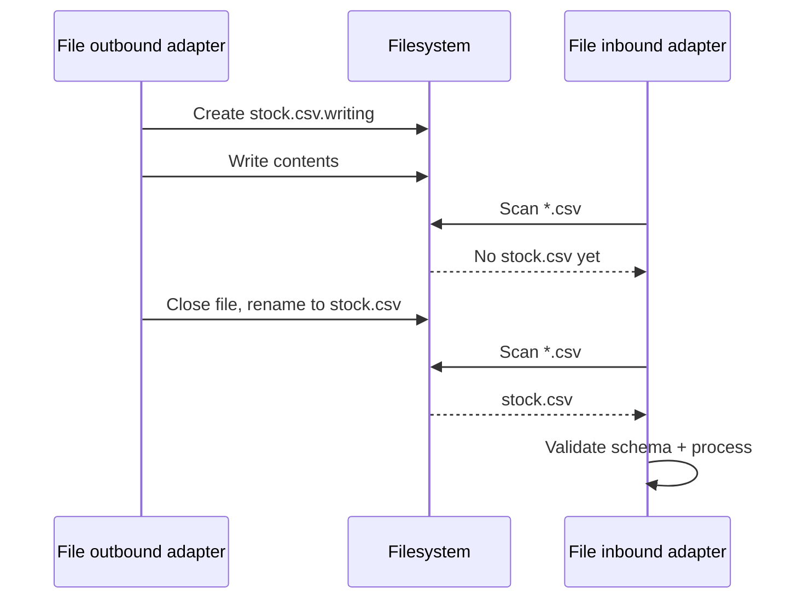
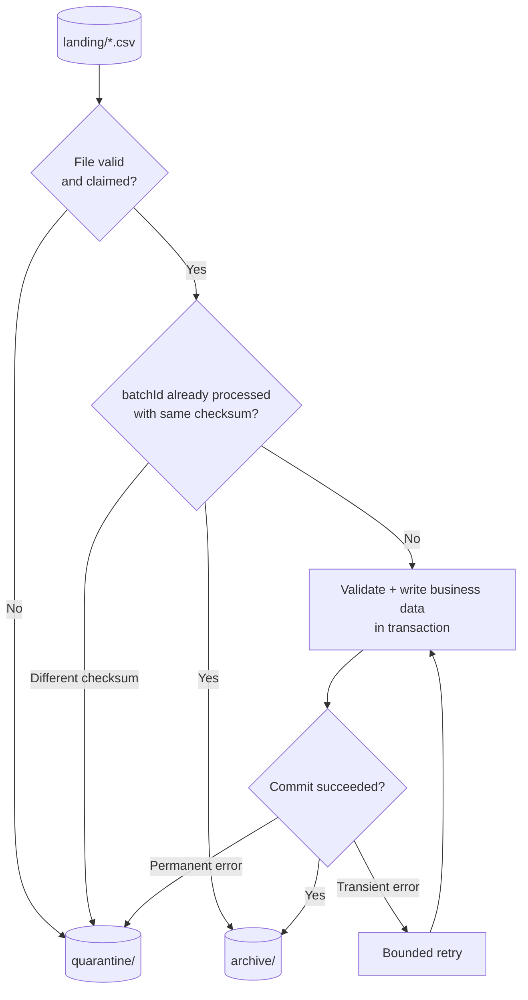

# Receiving and writing files with file adapters, filters, and temporary filenames

## 1. Context and objectives

In enterprise integration, not every partner exposes an HTTP API or a message broker. Many accounting, ERP, payment reconciliation, and warehouse systems still exchange data using CSV, JSON, XML, or binary files placed in a shared directory. For example, a warehouse system exports `inventory-20261121.csv`; `order-service` reads the file, updates stock levels, and produces a result report for the partner to pick up.

Spring Integration provides **file adapters** to connect the filesystem to Spring's message/channel/flow model. This lesson belongs to the **SPRING_BOOT_INTEGRATION** module, where integration flows also involve HTTP clients, databases, caches, and message brokers. The focus is on designing a reliable file pipeline: picking only completed files, avoiding unwanted files, writing output files safely, handling retries/duplicates, testing, and observability.

After this lesson, you will be able to:

1. Distinguish file inbound channel adapters from file outbound channel adapters/gateways.
2. Configure `FileReadingMessageSource`, pollers, `IntegrationFlow`, and `FileWritingMessageHandler`.
3. Combine pattern filters, file-age filters, and accept-once filters in the proper order.
4. Use the `.writing` temporary suffix and the **write temp → rename** workflow to avoid publishing incomplete files.
5. Choose an appropriate `FileExistsMode`, filename strategy, directory layout, and archive/quarantine policy.
6. Design error handling, idempotency, multi-instance coordination, testing, and metrics for a real-world file exchange flow.

> **Version scope:** Java examples use Java 17+, Spring Boot 3.x, and Spring Integration 6.x with Java DSL. Select versions managed by the Spring Boot BOM, especially when using Boot 4.x/Spring Integration 7.x. Specific APIs are aligned with Spring Integration 6.5; this material does not assume a shared directory provides distributed transactions or exactly-once semantics on its own.

## 2. Where do file adapters sit in an IntegrationFlow?

```mermaid
flowchart LR
    P["Partner writes file<br/>inventory.csv.writing"] --> R["Renames on completion<br/>inventory.csv"]
    R --> DIR[("input/")]
    DIR --> IN["File inbound adapter<br/>poll + filter"]
    IN --> CH["Message channel"]
    CH --> PROC["Handler: validate, parse,<br/>persist business state"]
    PROC --> DB[("Database<br/>+ inbox/outbox")]
    DB --> OUT["Export service"]
    OUT --> OC["Message channel"]
    OC --> WR["File outbound adapter<br/>writes .writing"]
    WR --> FIN[("output/report.csv")]
```



An **inbound channel adapter** receives data from an external system and brings it into the application as messages. An **outbound channel adapter** receives messages in the flow and writes them to an external system; it is a one-way endpoint. When you need the resulting path or a reply payload back after writing, consider an **outbound gateway**, but do not switch models merely to log results.

| Component | Role | Payload/output |
| --- | --- | --- |
| `FileReadingMessageSource` | Lists and detects eligible files in a directory. | Message whose payload is `java.io.File`. |
| Poller | Controls when and how many files are received per scan. | Triggers the source periodically. |
| `FileListFilter<File>` | Selects files by name, state, age, or receipt history. | Only qualifying `File` instances. |
| `MessageChannel` | Delivers messages to handlers/transformers/routers. | `Message<?>` with headers. |
| Handler/transformer | Reads CSV/XML/JSON, validates schema, maps to business commands. | Processing result or new message. |
| `FileWritingMessageHandler` | Writes payload to disk and handles output name collisions. | File on disk; one-way adapter. |
| `FileHeaders.FILENAME` | Suggested name for the target file. | Message header; must be controlled. |
| `FileHeaders.ORIGINAL_FILE` | Reference to the source file across transformation steps. | Aids archiving/logging; not a unique business ID. |

A regular directory is **not a durable message queue**: seeing a file does not prove the writer has finished; putting a `File` on a channel does not mean the database write succeeded; two instances may see the same file at the same time. Therefore, you need an explicit file-exchange contract and safeguards at every stage.

## 3. Dependencies and environment configuration

For Spring Boot 3.x, use the Spring Integration starter and file module:

```xml
<!-- pom.xml: versions inherited from Spring Boot parent/BOM -->
<dependency>
    <groupId>org.springframework.boot</groupId>
    <artifactId>spring-boot-starter-integration</artifactId>
</dependency>
<dependency>
    <groupId>org.springframework.integration</groupId>
    <artifactId>spring-integration-file</artifactId>
</dependency>
<dependency>
    <groupId>org.springframework.boot</groupId>
    <artifactId>spring-boot-starter-test</artifactId>
    <scope>test</scope>
</dependency>
<dependency>
    <groupId>org.springframework.integration</groupId>
    <artifactId>spring-integration-test</artifactId>
    <scope>test</scope>
</dependency>
```

`IntegrationFlow` and `Pollers` belong to Spring Integration's Java DSL. In Spring Integration 6.x, the DSL is built into the relevant Spring Integration modules, so you do not need the legacy `spring-integration-java-dsl` artifact.

### 3.1. Externalizing paths

```yaml
# application.yml
app:
  file-exchange:
    input-dir: ${INBOUND_FILE_DIR:/var/app/exchange/input}
    output-dir: ${OUTBOUND_FILE_DIR:/var/app/exchange/output}
    poll-delay: 2s
```

Adjust default paths for your OS and deployment environment. In Docker, `/var/app/exchange/input` is a path **inside the container**, so exchange data must be mounted or backed by appropriate storage. If the container restarts and the directory is not on a persistent volume, files can vanish. Do not conflate local directories with FTP/SFTP or object storage: those protocols use separate adapters.

Declare typed configuration properties:

```java
// FileExchangeProperties.java
import java.nio.file.Path;
import java.time.Duration;
import org.springframework.boot.context.properties.ConfigurationProperties;

@ConfigurationProperties(prefix = "app.file-exchange")
public record FileExchangeProperties(
    Path inputDir,
    Path outputDir,
    Duration pollDelay
) {}
```

Paths must point to directories with explicit permissions; check existence, read/write permissions, and disk space at deployment time. Never build a directory expression directly from an HTTP header or an unvalidated tenant name.

## 4. Receiving files with a file inbound channel adapter

### 4.1. Polling and message payload

`FileReadingMessageSource` scans a directory, queues eligible files internally, and emits one message at a time. The poller triggers `receive()` on schedule. Each emitted message has a `File` payload rather than automatically loading all bytes into memory:

```text
input/
├── inventory-20261121.csv
├── inventory-20261122.csv.writing
└── readme.txt

poll -> filter "*.csv" -> java.io.File(inventory-20261121.csv)
```

`inventory-20261122.csv.writing` should not enter the flow yet, and `readme.txt` is not an input document according to the contract.

### 4.2. Full inbound flow configuration

The following example accepts files ending with `.csv` and forwards them to `CsvImportService`. The filter uses `ChainFileListFilter` so that a file is marked "accepted" **only after** passing the hidden-file and pattern filters:

```java
// FileInboundConfiguration.java
import java.io.File;
import org.springframework.boot.context.properties.EnableConfigurationProperties;
import org.springframework.context.annotation.Bean;
import org.springframework.context.annotation.Configuration;
import org.springframework.integration.dsl.IntegrationFlow;
import org.springframework.integration.dsl.Pollers;
import org.springframework.integration.file.dsl.Files;
import org.springframework.integration.file.filters.AcceptOnceFileListFilter;
import org.springframework.integration.file.filters.ChainFileListFilter;
import org.springframework.integration.file.filters.IgnoreHiddenFileListFilter;
import org.springframework.integration.file.filters.SimplePatternFileListFilter;

@Configuration(proxyBeanMethods = false)
@EnableConfigurationProperties(FileExchangeProperties.class)
public class FileInboundConfiguration {

    @Bean
    IntegrationFlow importCsvFlow(
        FileExchangeProperties props,
        CsvImportService importer
    ) {
        ChainFileListFilter<File> filters = new ChainFileListFilter<>();
        filters.addFilter(new IgnoreHiddenFileListFilter());
        filters.addFilter(new SimplePatternFileListFilter("*.csv"));
        filters.addFilter(new AcceptOnceFileListFilter<>());

        return IntegrationFlow.from(
                Files.inboundAdapter(props.inputDir().toFile())
                    .filter(filters)
                    .autoCreateDirectory(false),
                endpoint -> endpoint.poller(
                    Pollers.fixedDelay(props.pollDelay())
                        .maxMessagesPerPoll(10)
                )
            )
            .handle(File.class, (file, headers) -> {
                importer.importFile(file);
                return null; // One-way endpoint, produces no reply.
            })
            .get();
    }
}
```

In this example:

- `Files.inboundAdapter(directory)` builds the Java DSL file-reading source configuration.
- `endpoint.poller(Pollers.fixedDelay(...).maxMessagesPerPoll(10))` receives at most 10 messages per poller trigger; if more remain queued, the next cycle continues—10 does not mean 10 concurrent threads.
- `autoCreateDirectory(false)` requires the input directory to be provisioned by infrastructure beforehand; misconfigured paths fail early.
- `.handle(File.class, ...)` passes the file message to the business layer. Processing can fail; **handler errors do not automatically undo the "accepted" mark** held in memory by the filter.
- `return null` in this handler means no reply message is produced, fitting a one-way terminal handler.

`CsvImportService` illustrates streaming a file instead of loading large files completely into memory:

```java
// CsvImportService.java
import java.io.File;
import java.io.IOException;
import java.nio.charset.StandardCharsets;
import java.nio.file.Files;
import org.springframework.stereotype.Service;

@Service
public class CsvImportService {

    public void importFile(File file) {
        try (var reader = Files.newBufferedReader(
                file.toPath(),
                StandardCharsets.UTF_8)) {
            String header = reader.readLine();
            if (!"sku,quantity".equals(header)) {
                throw new IllegalArgumentException(
                    "Invalid file header: " + file.getName()
                );
            }

            for (String line; (line = reader.readLine()) != null;) {
                // Simple format illustration: in practice use a CSV library
                // supporting quotes, embedded commas, escaping, and BOM.
                String[] cells = line.split(",", -1);
                if (cells.length != 2) {
                    throw new IllegalArgumentException("Invalid CSV column count");
                }
                String sku = cells[0];
                int quantity = Integer.parseInt(cells[1]);
                // Call an application service that handles transactions/deduplication.
                // Do not assume success just because a line was read.
            }
        } catch (IOException e) {
            throw new IllegalStateException(
                "Failed to read file " + file.getName(), e
            );
        }
    }
}
```

This example demonstrates the adapter mechanism and **is not a complete business importer yet**: you still need validation, DB persistence, rollback/compensation, and idempotency before confirming success. If files are very large, decide on chunked transactions, per-row progress tracking, and resume logic rather than wrapping an entire file in one DB transaction by default.

### 4.3. Characteristics of file headers

Inbound messages may include these headers:

| Header | Role |
| --- | --- |
| `FileHeaders.FILENAME` | Original filename, e.g., `inventory-20261121.csv`. |
| `FileHeaders.ORIGINAL_FILE` | `File` object pointing to the source resource. |
| `FileHeaders.RELATIVE_PATH` | Relative path from the scanned root directory, useful when reading directory trees. |

Do not use `FileHeaders.FILENAME` as a unique business ID if a partner can overwrite a file with the same name on a different day. Attach a stable batch ID (from a manifest, filename convention, checksum, or partner-supplied metadata) and define a policy for when the same filename arrives with different content.

## 5. File filters: name, completion status, and duplicate prevention

### 5.1. Types of `FileListFilter`

| Filter | Selection criteria | Limitations |
| --- | --- | --- |
| `SimplePatternFileListFilter` | Filename pattern, e.g., `*.csv`. | Does not know whether the file is still being written. |
| `RegexPatternFileListFilter` | Regular expression on the filename. | Easy to miswrite patterns; does not guarantee complete content. |
| `IgnoreHiddenFileListFilter` | Skips files considered hidden by the OS. | Linux and Windows hidden-file semantics differ. |
| `AcceptOnceFileListFilter` | Passes a file only once using in-process memory state. | Does not survive restarts; does not signify business completion. |
| `FileSystemPersistentAcceptOnceFileListFilter` | Persists name/mtime history in a `MetadataStore`. | Guarantees metadata-based discovery history, not business deduplication. |
| `LastModifiedFileListFilter` | Selects files "old enough" based on last-modified time. | Timestamps can drift; writers can pause and resume. |
| `ChainFileListFilter` | Applies filters sequentially to the output of the previous filter. | Filter order matters. |
| `CompositeFileListFilter` | Combines conditions over the same input list. | Stateful filters may mark files before other filters accept them. |

Spring Integration's file inbound adapter includes default filtering such as `IgnoreHiddenFileListFilter` and `AcceptOnceFileListFilter`. When replacing the filter with a custom chain, explicitly re-add any criteria you want to keep; do not assume `.filter(customFilter)` automatically keeps all default conditions the way you expect.

### 5.2. Why filter order matters

Suppose a producer starts writing `a.csv` at 10:00 and finishes at 10:01. If the chain runs `AcceptOnce` **before** the age filter, the file may be marked as accepted while it is still too new. When it later becomes old enough, `AcceptOnce` blocks it and it is never processed.

Place conditional filters **first**, and duplicate-prevention filters **last**:

```text
File list -> IgnoreHidden -> "*.csv" -> LastModified(age) -> AcceptOnce
                                                |
                                                v
                                           Emit message
```

`ChainFileListFilter` fits this scenario because later filters only see files that passed earlier ones. `CompositeFileListFilter` fits different problems—for example, a filter that needs to see both `invoice.csv` and `invoice.done` together when evaluating the list; choose the type based on the exact logic rather than swapping them blindly.

### 5.3. When renaming is not possible: filtering by file age

If the producer cannot implement a "write temp then rename" workflow, you can accept only files that have not been modified for a period of time:

```java
// Example filter chain for a FileReadingMessageSource.
import java.io.File;
import org.springframework.integration.file.filters.ChainFileListFilter;
import org.springframework.integration.file.filters.LastModifiedFileListFilter;
import org.springframework.integration.file.filters.SimplePatternFileListFilter;
import org.springframework.integration.file.filters.AcceptOnceFileListFilter;

ChainFileListFilter<File> filters = new ChainFileListFilter<>();
filters.addFilter(new SimplePatternFileListFilter("*.csv"));

LastModifiedFileListFilter ageFilter = new LastModifiedFileListFilter();
ageFilter.setAge(120); // Seconds: wait until the file has stopped being modified for at least 120 seconds.
filters.addFilter(ageFilter);
filters.addFilter(new AcceptOnceFileListFilter<>());
```

**This is a heuristic, not an absolute completion protocol.** A writer might stall for 3 minutes due to network issues and then resume writing; clocks across servers can also skew. Whenever you control or can agree with the producer, a `.done` marker/manifest or renaming to the final name is far clearer. Note that Spring Integration 6.5 also has `RecentFileListFilter` for the opposite criterion (only files not too old); do not confuse it with `LastModifiedFileListFilter` used to avoid files still being written.

## 6. Temporary filenames: preventing consumers from reading in-progress files

### 6.1. Completion via rename

When exporting `stock-20261121.csv`, a safe publisher can:

1. Open `stock-20261121.csv.writing` in the target directory and write bytes.
2. Flush/close the stream; if durability across power loss is required, also evaluate `fsync` and filesystem policies.
3. Rename `stock-20261121.csv.writing` to `stock-20261121.csv`.
4. Have the consumer accept only `*.csv`, so it never reads the in-progress file.



Spring Integration's `FileWritingMessageHandler` has a **default temporary file suffix of `.writing`** in standard file-writing mode. You can change it via `temporaryFileSuffix(".tmp")`; pick a suffix that the inbound adapter does **not** accept.

### 6.2. How atomic is rename?

Renaming within the **same filesystem** generally ensures the consumer only sees the final name once the file is complete, but you should not promise atomic guarantees across all network shares, object mounts, or operating systems. Java's `Files.move(source, target, ATOMIC_MOVE)` may throw an unsupported exception; do not silently fall back to copy-then-delete if the contract forbids exposing partial files.

The `.writing` suffix solves **visibility of incomplete files**, not:

- Two producers writing to the same final filename.
- Server crashes after the file appears but before the receiver persists business results.
- Completed files that have invalid schemas, are empty, fail checksums, or lack read permissions.
- Data loss when the filesystem has not flushed physically to storage.
- A producer writing directly to the final name, bypassing the staging rule.

Therefore, align with partners on the contract: temporary suffix, allowed final extensions, encoding, checksum/manifest, unique naming, retention period, and error paths.

## 7. Writing files with an outbound adapter

### 7.1. Payloads and filename resolution

`FileWritingMessageHandler` supports common payloads such as `File`, `String`, `byte[]`, and `InputStream`. By default, the output filename is resolved in this order:

1. An expression/filename generator if configured.
2. The `FileHeaders.FILENAME` header if present and suitable.
3. For a `File` payload, the source filename.
4. If none of the above provides a name, the message ID with a `.msg` suffix.

In practice, **choose filenames explicitly** per export batch, e.g., `order-report-20261121-batch42.csv`. Leaving random message IDs as filenames usually prevents consumers from telling the date, file type, or business batch.

### 7.2. Outbound flow with temporary suffix and overwrite protection

```java
// FileOutboundConfiguration.java
import org.springframework.context.annotation.Bean;
import org.springframework.context.annotation.Configuration;
import org.springframework.integration.dsl.IntegrationFlow;
import org.springframework.integration.file.dsl.Files;
import org.springframework.integration.file.support.FileExistsMode;

@Configuration(proxyBeanMethods = false)
public class FileOutboundConfiguration {

    @Bean
    IntegrationFlow exportCsvFlow(FileExchangeProperties props) {
        return IntegrationFlow.from("writeCsvFiles")
            .handle(
                Files.outboundAdapter(props.outputDir().toFile())
                    .fileExistsMode(FileExistsMode.FAIL)
                    .temporaryFileSuffix(".writing")
                    .autoCreateDirectory(true)
                    .charset("UTF-8")
            )
            .get();
    }
}
```

Configuration breakdown:

- `Files.outboundAdapter(...)` creates a one-way file-writing endpoint.
- `FileExistsMode.FAIL` prevents overwriting an existing output file; the adapter throws an exception so error handling can respond.
- `temporaryFileSuffix(".writing")` prevents exposing the final filename while writing.
- `autoCreateDirectory(true)` may be convenient locally or in tests; in production, control directory creation permissions and expected paths.
- `charset("UTF-8")` sets the character encoding when the payload is a `String`.

`FAIL` is chosen here because batch export reports have unique names and overwriting is abnormal. For flows that legitimately revise versioned reports, another mode may fit, provided it is specified upfront.

### 7.3. Sending messages into the outbound flow

Example sender service building a message with a validated filename header:

```java
// CsvExportService.java
import org.springframework.beans.factory.annotation.Qualifier;
import org.springframework.integration.file.FileHeaders;
import org.springframework.messaging.MessageChannel;
import org.springframework.messaging.support.MessageBuilder;
import org.springframework.stereotype.Service;

@Service
public class CsvExportService {
    private final MessageChannel channel;

    public CsvExportService(
        @Qualifier("writeCsvFiles") MessageChannel channel
    ) {
        this.channel = channel;
    }

    public void export(String batchId, String csvContent) {
        // Accept only a validated batchId, never a user-supplied path.
        if (batchId == null
            || !batchId.matches("[A-Za-z0-9_-]{1,64}")) {
            throw new IllegalArgumentException("Invalid batchId");
        }

        String fileName = "order-report-" + batchId + ".csv";
        boolean accepted = channel.send(
            MessageBuilder.withPayload(csvContent)
                .setHeader(FileHeaders.FILENAME, fileName)
                .build()
        );

        if (!accepted) {
            throw new IllegalStateException("Failed to send file write message");
        }
    }
}
```

With a synchronous `DirectChannel` created by default in Java DSL above, the handler writes the file on the caller's thread and errors propagate back to the sender. If the flow is changed to a `QueueChannel`, `ExecutorChannel`, or broker, `channel.send(...) == true` only indicates the **message was accepted by the channel** under its contract; it does not prove the file was written successfully. Never treat the send boolean as business confirmation on an asynchronous channel.

### 7.4. Avoiding path traversal with dynamic filenames

Filenames from message headers can be abused to write outside the intended directory if the application allows path separators, `..`, or uncontrolled directory expressions. Never pass a raw `originalFilename` from an HTTP upload directly to `FileHeaders.FILENAME`. Instead:

- Map external filenames to a validated **business ID** and construct the new name yourself.
- Restrict allowed characters, length, extensions, and OS-reserved names.
- If subdirectories are permitted, normalize the path and verify after `normalize()` that it remains under the trusted root; guard against symlinks in environments where an adversary can manipulate the filesystem.
- Run the application with minimal write permissions scoped to the output directory; never grant write access to the entire filesystem.

## 8. Policies when the target file already exists: `FileExistsMode`

The file outbound adapter supports these common modes:

| Mode | Behavior | When to use |
| --- | --- | --- |
| `REPLACE` | Overwrites the target file; this is the default. | Contract permits replacing outputs and versioning/backups exist. |
| `REPLACE_IF_MODIFIED` | Replaces only when source/header timestamp indicates the file changed. | `File` payload with reliable timestamps; does not compare content. |
| `APPEND` | Appends data and closes after each message. | Logs or cumulative files with proper write synchronization. |
| `APPEND_NO_FLUSH` | Appends without flushing/closing after each message per handler behavior. | High throughput where delayed flush / data-loss risk is acceptable. |
| `FAIL` | Throws an exception if the final file already exists. | Batch outputs must never be overwritten. |
| `IGNORE` | Does not write if the file exists, without raising an error. | Duplicate output is ignored per contract. |

**Note:** With `APPEND`/`APPEND_NO_FLUSH`, data is written directly to the target file, so there is no per-message "write a complete temp file then rename" cycle as in normal write modes. On the same filename, repeated appends from retries can duplicate lines. When exporting idempotently, prefer **one immutable file per batch** over arbitrary appends.

`IGNORE` is not an exactly-once mechanism either: it can silently skip an existing file that has wrong or partial content. `FAIL` detects name collisions but does not by itself resolve concurrent writers across multiple hosts/shared filesystems or post-crash states.

## 9. Duplicate-prevention filters: in-memory, persistent, and business-level

### 9.1. `AcceptOnceFileListFilter` only remembers in-process

In the first inbound flow, `AcceptOnceFileListFilter` holds state in application memory. It reduces polling the **same file** repeatedly within a single run. However:

1. Restarts wipe the seen history.
2. Separate instances have independent memory.
3. A file being **emitted as a message** does not prove the handler committed to the DB.
4. Renaming, touching timestamps, or copying the file elsewhere may cause it to be treated as a new file.

If the handler throws an error without separate recovery, a file may remain blocked by `AcceptOnce` and **never be picked up again within the same process**. Do not treat this filter as a retry queue.

### 9.2. `FileSystemPersistentAcceptOnceFileListFilter`

When discovery history must survive restarts, use the persistent filter backed by a `ConcurrentMetadataStore`. Illustrative example:

```java
import java.io.File;
import org.springframework.integration.file.filters.FileSystemPersistentAcceptOnceFileListFilter;
import org.springframework.integration.metadata.SimpleMetadataStore;

// SimpleMetadataStore is still in-memory only. To survive restarts,
// replace it with a truly durable/shared MetadataStore for your system.
var metadata = new SimpleMetadataStore();
var persistentFilter =
    new FileSystemPersistentAcceptOnceFileListFilter(
        metadata, "inventory-import:"
    );
```

**Do not mistake the class name for automatic persistence.** `FileSystemPersistentAcceptOnceFileListFilter` stores state in whatever `MetadataStore` **you pass to it**. With `SimpleMetadataStore` in the snippet, metadata still lives only in RAM. To survive restarts, use an appropriate file/JDBC/Redis-backed implementation; for multi-instance coordination, the metadata store must be shared and support atomic compare-and-set as required by the filter.

The filter relies on metadata such as path/name and last-modified time. If a file keeps the same name but its content/timestamp changes, the filter may treat it as a new version depending on policy. When content versions must be distinguished reliably, add a checksum/manifest or partner batch ID rather than relying solely on mtime.

### 9.3. Idempotency is the final boundary of business processing

Suppose `inventory-20261121.csv` was emitted, the handler updated the DB, and the app crashed before archiving the file. On restart, the file is still in `input/` and may be picked up again. If the handler executes `stock = stock + quantity`, stock will be added twice.

The solution is a **stable file/batch ID** checked in the database inside the same transaction as the business updates:

```sql
CREATE TABLE imported_batches (
    partner_id VARCHAR(80) NOT NULL,
    batch_id VARCHAR(120) NOT NULL,
    checksum_sha256 CHAR(64) NOT NULL,
    imported_at TIMESTAMP NOT NULL DEFAULT CURRENT_TIMESTAMP,
    PRIMARY KEY (partner_id, batch_id)
);
```

Workflow:

1. Determine `partnerId`, `batchId`, and checksum from the file/manifest contract.
2. Attempt to insert the unique key `(partnerId, batchId)` inside the transaction.
3. If the key is new, validate/write all side effects within the transaction and commit.
4. If the key already exists and the checksum matches, skip re-execution; if the checksum differs, report a conflict and quarantine the file.
5. Only after commit, move the file to `archive/` or record completion status.

If importing in chunks and the entire file cannot fit in one transaction, persist per-chunk/per-row state with unique keys and resume rules; never "mark completed" at the start and risk skipping lines after a crash. This is **business idempotency**, independent of file list filters.

## 10. Safe input workflow: landing, processing, archive, quarantine

A production architecture commonly partitions directories by state:

```text
file-exchange/
├── landing/       # Partner completes writes via rename.
├── processing/    # Worker claimed the file and is processing it (if needed).
├── archive/       # File confirmed as processed successfully.
├── quarantine/    # Schema-invalid files or unrecoverable failures.
└── outbound/      # Exported files for partner pickup.
```

Operating flow:

1. Producer writes to `landing/foo.csv.writing`, then renames to `foo.csv` upon completion.
2. Inbound adapter polls `landing/*.csv`; filters admit only ready files.
3. If multiple workers share a directory, **claim the file** using an exclusive operation or a lock/metadata store designed for that environment. `Files.move(..., ATOMIC_MOVE)` on the same filesystem can work where supported, but handle unsupported platforms explicitly.
4. Validate size, encoding, checksum, schema, and filename. Persist the batch ID and business side effects under transactional/idempotent guarantees.
5. On success, archive the file and record metadata (timestamp, checksum, row count, status).
6. On permanent failure, move to quarantine with a sanitized failure reason; on transient failure, perform bounded retries with a clear schedule and owner.
7. Clean up abandoned `.writing` files, archives, and quarantine entries per retention policy; never delete before reconciliation is assured.



**Two operations cannot be combined atomically across every system:** committing the database and renaming/archiving the file. Design for the case where the DB commits but archiving fails. When the file reappears, the durable batch ID skips duplicate side effects and finishes archiving; never treat presence in `archive/` as the sole proof.

## 11. Error handling, backpressure, and multi-instance operation

### 11.1. Where do errors commonly occur?

| Step | Error example | Handling approach |
| --- | --- | --- |
| Directory scan | Missing directory/bad permissions, disconnected network share. | Health check, alerting, retry once infrastructure recovers. |
| File filtering | Wrong pattern or filter marking files too early. | Test input lists and Chain ordering; provide controlled metadata reset tooling. |
| File reading | File deleted/renamed mid-read, wrong encoding, incomplete file. | Staging/rename contract, validation, quarantine. |
| Parsing | CSV commas inside quoted strings, invalid XML/JSON, schema drift. | Standards-compliant parser and per-batch/row error reporting. |
| DB writes | Deadlocks, unique conflicts, timeouts. | Bounded transaction retries; idempotency and conflict classification. |
| Output file write | Disk full, permission denied, duplicate filename. | Appropriate `FAIL`/policy, clean up temp files, controlled retry. |
| Archiving | DB committed but move fails. | Safe replay by batchId, separate archive retry. |

A poller does not automatically provide a dead-letter topic like a message broker. You can use Spring Integration's `errorChannel`, advice chains, retry advice, transaction advice, or routing to send failures to dedicated handlers, but you must define **which file needs retry, which business state has already committed, and when it is considered done**. Swallowing generic exceptions can silently drop files without alerts.

### 11.2. Backpressure and throughput

`Pollers.fixedDelay(...).maxMessagesPerPoll(10)` caps the number of messages fetched per cycle; it does not prevent a handler from reading a 5 GB file or blocking indefinitely. Measure processing time per file, backlog, and disk usage; consider:

- Tuning poll delay and max messages to actual ingestion capacity.
- Using asynchronous channels with **bounded capacity** rather than unbounded queues that exhaust memory.
- Limiting concurrent file processing and shared DB/API connections.
- For large files, streaming/parsing in chunks with progress tracking and controlled transaction scope.
- When file order matters, using sequence metadata and a single-worker policy per partner; lexicographical filename sorting does not guarantee business order.

### 11.3. Two pods polling the same directory

The default file adapter and `AcceptOnceFileListFilter` **do not guarantee only one pod processes a file** on a shared volume. Two pods can scan and see `foo.csv` simultaneously.

Mitigations:

1. Run a single active reader with explicit leader election if the architecture permits.
2. Use a shared persistent metadata store with atomic claims and a defined timeout/recovery strategy.
3. Claim via filesystem rename/lock **only if** the underlying storage provides the required guarantees (NFS/SMB/overlay filesystems behave differently).
4. Still enforce a unique business `batchId` in the database as the final defense against duplicate processing after crashes/restarts.

Never rely on a short-TTL Redis `SETNX` as your sole uniqueness guarantee: if the TTL expires while processing is still running, another worker can reprocess the file. If using leases, include fencing/version tokens and handle lost ownership.

## 12. Contract testing the file adapter

Tests that only invoke `CsvImportService.importFile(...)` directly are **parser unit tests**; they do not prove the inbound flow has the right poller, filters, and handler wiring. Add tests with a temporary directory and Spring context to observe real emitted messages.

### 12.1. Testing the file-writing handler

JUnit 5 example verifying `FileWritingMessageHandler` writes the final filename and cleans up the temporary suffix:

```java
import static org.junit.jupiter.api.Assertions.assertFalse;
import static org.junit.jupiter.api.Assertions.assertTrue;

import java.nio.file.Files;
import java.nio.file.Path;
import org.junit.jupiter.api.Test;
import org.junit.jupiter.api.io.TempDir;
import org.springframework.integration.file.FileHeaders;
import org.springframework.integration.file.FileWritingMessageHandler;
import org.springframework.integration.file.support.FileExistsMode;
import org.springframework.messaging.support.MessageBuilder;

class FileWriterTest {

    @TempDir
    Path outputDir;

    @Test
    void publishesOnlyCompletedFile() {
        FileWritingMessageHandler writer =
            new FileWritingMessageHandler(outputDir.toFile());
        writer.setFileExistsMode(FileExistsMode.FAIL);
        writer.setTemporaryFileSuffix(".writing");
        writer.afterPropertiesSet();

        writer.handleMessage(
            MessageBuilder.withPayload("sku,quantity\nSKU-42,3\n")
                .setHeader(FileHeaders.FILENAME, "batch-42.csv")
                .build()
        );

        assertTrue(Files.exists(outputDir.resolve("batch-42.csv")));
        assertFalse(Files.exists(outputDir.resolve("batch-42.csv.writing")));
    }
}
```

This tests the handler **after writing finishes**; it does not prove an external watcher cannot observe the temp file during writing, nor does it verify atomic rename behavior across all filesystems or durability across power loss.

### 12.2. Required integration test suite

| Test case | Expectation |
| --- | --- |
| Valid file | Place `good.csv` in input; poller emits one message and handler processes it accurately. |
| File being written | Place `good.csv.writing`; inbound ignores it. After renaming to `good.csv`, it picks it up. |
| Wrong extension | `readme.txt` and hidden files are not emitted. |
| Malformed CSV | No business side effects committed; moved to quarantine/alerted per policy. |
| Same-name duplicate | Within one process, `AcceptOnce` does not emit the same file twice across polls. |
| Restart | Behavior matches in-memory vs. persistent metadata choice; already-imported files do not double-write the DB. |
| Two-worker race | Two consumers/pods claim concurrently; only one business transaction succeeds for a `batchId`. |
| Outbound name collision | `FAIL` throws an error and does not overwrite existing reports. |
| Outbound mid-write | Consumer does not pick up files with the `.writing` suffix. |
| Output error | Disk full/permission denied is detected; retries/alarms trigger without falsely reporting success. |
| Crash after DB commit | File stays in landing; replay skips business side effects and completes archiving. |
| Large file | Memory footprint and processing time stay within acceptable limits. |

Real tests of rename semantics, NFS/SMB behavior, and filesystem permissions should run in an environment close to production. Tests using `@TempDir` on local disk do not prove Kubernetes volume-driver or network-share behavior. For inbound pollers, wait with bounded polling/deadlines rather than fixed `Thread.sleep(...)` calls that cause flaky tests.

## 13. Observability, security, and file lifecycle

Signals worth monitoring:

- **Input:** pending file count in landing, age of oldest file, count of `.writing` files lingering too long, scan error count.
- **Process:** successful/duplicate/failed batch counts, p95/p99 processing duration, error row count, throughput in bytes/second.
- **Output:** exported report count, write failures, name collisions, abandoned temp files, time from export request to final filename appearance.
- **Recovery:** quarantined files, retry count, unarchived batches, checksum conflict count.
- **Resources:** disk/inode capacity, mount permissions, DB wait times, and backlog when downstream HTTP/brokers fail.

Include `batchId`/correlationId in structured logs and audit records, but avoid putting per-file names/IDs into high-cardinality metric tags. Files may contain personal, financial, or credential data; restrict read/write permissions, encrypt storage per policy, and enforce retention and deletion procedures. Never dump entire files into logs or forward raw failed content to monitoring by default.

### 13.1. Minimum partner specification

A clear file exchange contract should cover:

1. Filename/extension convention, batch ID, and name-collision rules.
2. Encoding (UTF-8), delimiter, quoting/escaping, header, schema/version, and date/time/number formats.
3. Completion signaling: temp suffix + rename, `.done` marker, or manifest/checksum.
4. Directory permissions, TLS for remote file transfers, max file size, and rate limits.
5. Policies for empty files, invalid records, missing rows, and re-submitted batches.
6. Timeouts, retries, retention periods, archive/quarantine handling, and reconciliation procedures.
7. Distinction between "received" and "processed successfully", error feedback channels, and replay ownership.

## 14. Common mistakes

| Mistake | Consequence | Fix |
| --- | --- | --- |
| Accepting all `*.csv` files as soon as they appear | Reading files while the producer is still writing. | Write to temp suffix, rename to final name, accept only completed files. |
| Assuming `AcceptOnce` guarantees exactly-once processing | State lost on restart or duplicate side effects after crash. | Persistent metadata + DB idempotency; distinguish receipt from commit. |
| Using `CompositeFileListFilter` when needing "filter age first then mark seen" | Stateful filter may record the file too early. | Use `ChainFileListFilter` with condition filters first and `AcceptOnce` last. |
| Treating TTL/mtime alone as completion proof | Slow writers or clock skew cause partial file reads. | `.writing` + rename or manifest contract. |
| Leaving default `REPLACE` for immutable exports | Old reports get silently overwritten. | `FileExistsMode.FAIL` and batch/version-scoped names. |
| Using `APPEND` and expecting atomic temp-file swaps | Consumers see partially appended lines. | Use immutable per-batch files or an explicit completion protocol. |
| Assuming sending to an async channel means the file is written | Reports success before the handler runs. | Confirm at the end of the flow; use gateways/callbacks/audit records as appropriate. |
| Using raw HTTP header filenames directly | Path traversal or invalid filenames. | Construct filenames from validated IDs and enforce the output root. |
| Deleting source files immediately upon message receipt | Loses ability to retry if DB/HTTP fails. | Archive after commit; quarantine with replay support. |
| Two pods sharing a folder with an in-memory filter | Same batch processed twice. | Atomic claim/leader + unique business `batchId`. |
| Reading huge files fully into `byte[]` | Heap spikes and `OutOfMemoryError`. | Stream/chunk, enforce size limits, apply backpressure. |
| Not monitoring leftover `.writing` files | Failed writers go unnoticed. | Alert on age and run cleanup/reconciliation. |

## 15. Practical implementation workflow

1. **Agree on the file contract:** format, encoding, schema version, naming, batch ID, temp suffix, checksum, and completion signaling.
2. **Prepare directories/mounts:** landing, processing, archive, quarantine, output; least-privilege permissions, capacity, and retention.
3. **Build the inbound flow:** `Files.inboundAdapter`, tuned poller, properly ordered filters, `File` payload.
4. **Design durable processing:** validate then persist transaction/inbox by `batchId`; define retries and quarantine.
5. **Build the outbound flow:** `Files.outboundAdapter`, batch-scoped output names, explicit `FileExistsMode`, temp suffix.
6. **Test failure modes:** mid-write files, malformed formats, restarts, concurrent readers, output name collisions, DB commit followed by archive failure.
7. **Monitor:** backlog, file age, parser errors, duplicates, stale temp files, disk space, processing time, and replay readiness.

**Self-check questions**

1. Does `FileReadingMessageSource` emit a `File` or automatically parse CSV contents?
2. How do the `*.csv` pattern and `.writing` suffix work together to avoid reading in-progress files?
3. When do you need `ChainFileListFilter` instead of `CompositeFileListFilter`?
4. Why is `AcceptOnceFileListFilter` insufficient to prevent double database updates after a crash?
5. What is the difference between `FileExistsMode.FAIL` and `IGNORE` when an output file already exists?
6. With `APPEND`, why can't you rely on the default temporary-file rename mechanism?
7. Which layers should protect two pods polling the same NFS share?
8. If the database committed but moving the file to archive failed, how should the next run behave?

## 16. References

- [Spring Integration 6.5 — Reading Files](https://docs.spring.io/spring-integration/reference/6.5/file/reading.html): `FileReadingMessageSource`, filters, polling, WatchService, and file headers.
- [Spring Integration 6.5 — Writing Files](https://docs.spring.io/spring-integration/reference/6.5/file/writing.html): `FileWritingMessageHandler`, filenames, temporary file suffix, and `FileExistsMode`.
- [Spring Integration 6.5 — FileInboundChannelAdapterSpec Javadoc](https://docs.spring.io/spring-integration/docs/6.5.0/api/org/springframework/integration/file/dsl/FileInboundChannelAdapterSpec.html): Java DSL for configuring file reading sources.
- [Spring Integration 6.5 — FileWritingMessageHandlerSpec Javadoc](https://docs.spring.io/spring-integration/docs/6.5.0/api/org/springframework/integration/file/dsl/FileWritingMessageHandlerSpec.html): Java DSL for configuring file writers.
- [Spring Integration 6.5 — File Filters Javadoc](https://docs.spring.io/spring-integration/docs/6.5.0/api/org/springframework/integration/file/filters/package-summary.html): filter categories and persistent accept-once.
- [Spring Integration — Channel Adapter](https://docs.spring.io/spring-integration/reference/channel-adapter.html): inbound/outbound adapters, pollers, and the effect of `maxMessagesPerPoll`.
- [Spring Integration — Java DSL](https://docs.spring.io/spring-integration/reference/dsl.html): `IntegrationFlow` and organizing flows in Spring.
