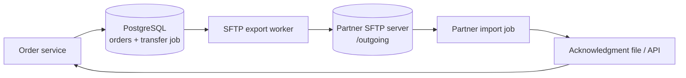
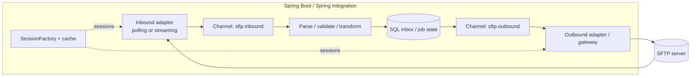
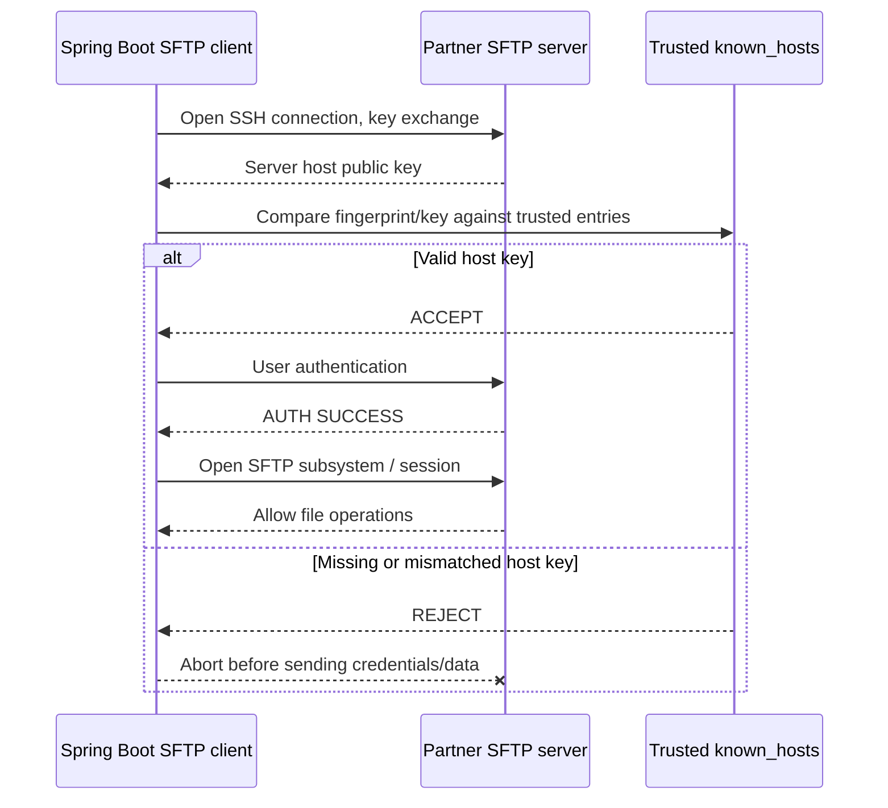
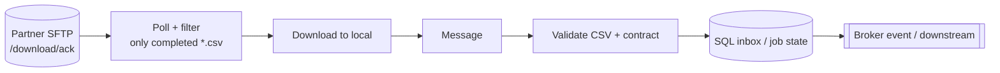
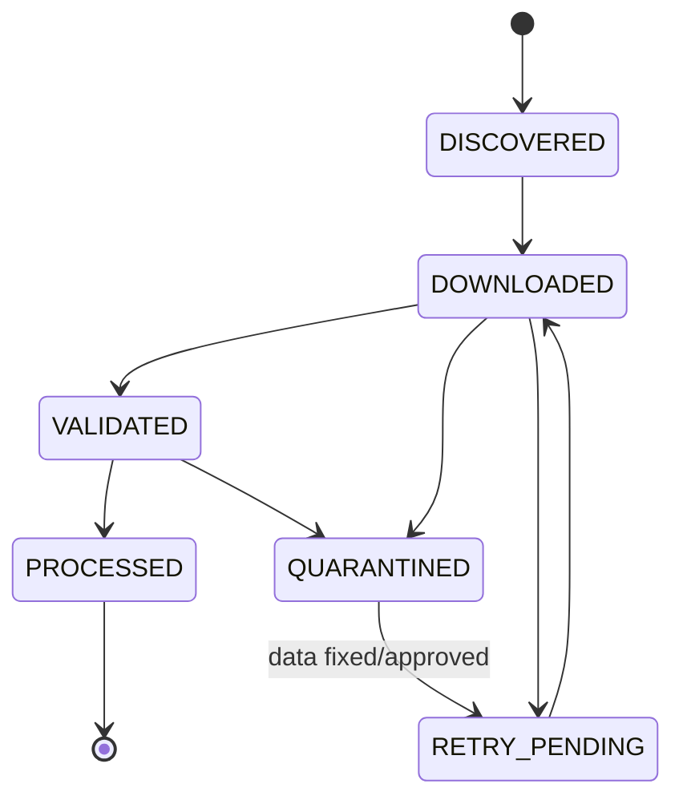
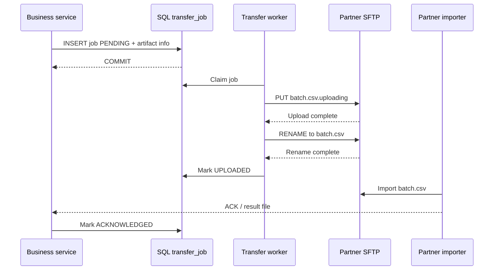

# SFTP adapters, host key verification, and session lifecycle management

Enterprises often still exchange data via **files** even when internal services have moved to REST, SQL, and message brokers. Payment systems export reconciliation files every night; shipping partners receive order lists over SFTP; ERP systems drop CSV reports into a directory for another application to ingest. In these cases, Spring Boot needs an adapter that can **upload files to a server, download files, manage connections, and recover safely when transfers fail**.

**Spring Integration SFTP** provides inbound adapters, outbound adapters, outbound gateways, and remote file manipulation components built on the message-driven model. SFTP runs over SSH, so there are two independent security layers that must be configured properly: **verifying the server via its host key** and **authenticating the application account via password/private key**.

This lesson belongs to the **Integration Adapters** chapter of the **SPRING_BOOT_INTEGRATION** module. Alongside SFTP connectivity, we connect the design to HTTP clients, SQL, caches, brokers, and Spring Integration flows—focusing on secret configuration, data contracts, transactions, errors, idempotency, testing, and observability.

> **Version scope:** Java examples use **Spring Boot 3.x, Spring Integration 6.x, Java 17+** and the **Apache MINA SSHD** SFTP implementation. Older Spring Integration 5.x examples may use JSch and different types; do not copy old imports, host-key configurations, or session factory setups verbatim. For Spring Boot 4.x/Spring Integration newer releases, verify APIs against your project's managed versions.

## 1. Learning objectives

After this lesson, you will be able to:

1. Distinguish SFTP from FTP/FTPS and explain why SSH **host key verification** must occur before transferring data.
2. Distinguish **inbound channel adapters**, **outbound channel adapters**, **outbound gateways**, and `RemoteFileTemplate`.
3. Configure `DefaultSftpSessionFactory` with `known_hosts` and a private key without disabling server identity checks.
4. Understand `CachingSessionFactory`, shared SSH connections, SFTP sessions, reconnection, and connection limits.
5. Build an upload flow using a temporary filename and renaming to the official filename after transfer completes.
6. Build a polling/download flow using file filters so partially written partner files are not read.
7. Design durable processing state, deduplication, retries, and behavior when a transfer succeeds but acknowledgment fails.
8. Test against a real SFTP server in an isolated environment, verifying host key mismatches, session lifecycle, and file integrity.
9. Monitor latency, backlog, session exhaustion, authentication errors, and mismatches between files and business records.

## 2. What SFTP is and is not

### 2.1. Protocol comparison

| Protocol | Transport mechanism | Security | Notable points |
| --- | --- | --- | --- |
| **FTP** | FTP control/data channels | No default protection for content or credentials | Unsuitable for sensitive data without additional safeguards |
| **FTPS** | FTP over TLS | Uses TLS certificates and FTPS configuration | Not the same as SFTP; may require multiple channels/ports |
| **SFTP** | SSH File Transfer Protocol over a single SSH connection | Encrypted SSH, server and user authentication | Uses SSH host keys, not HTTPS TLS certificates in place of host keys |
| **SCP** | Copy mechanism over SSH | SSH | Not synonymous with SFTP even though both commonly use port 22 |

SFTP typically uses **TCP port 22**, though partners may use a different port. Host, port, protocol, algorithms, and SSH policies must be part of the deployment contract.

**Do not confuse layers:** SFTP files travel over an encrypted connection, yet **CSV/XML/JSON contents still require validation**. SFTP does not validate schemas, status codes, business signatures, or row-level validity.

### 2.2. A single file transfer is not a business transaction

Order exchange example:



SFTP can confirm that writing the file to the server succeeded at the protocol layer, but **it does not confirm the partner imported the file into their business system**. That requires an explicit acknowledgment, such as an `ACK` file, an API response, a reconciliation report, or a partner-published processing status.

## 3. Spring Integration SFTP components

In Spring Integration, an *adapter* connects an external system to a **message channel**. A file may be represented as a `File`, byte array, stream, or message with payload/headers depending on the endpoint type.

| Component | Data direction | Role |
| --- | --- | --- |
| **SFTP inbound channel adapter** | SFTP server → application | Polls and downloads files from the remote server to local storage, then emits messages |
| **SFTP streaming inbound adapter** | SFTP server → application | Reads remote files as streams without necessarily creating local file copies |
| **SFTP outbound channel adapter** | Application → SFTP server | Sends files/payloads to the server; typically used in one-way flows |
| **SFTP outbound gateway** | Application ↔ SFTP server | Executes commands such as `ls`, `get`, `put`, `rm`, `mv` with appropriate replies |
| **SFTP session factory** | Infrastructure configuration | Creates SSH/SFTP sessions to the partner host |
| **Caching session factory** | Resource optimization | Caches sessions instead of opening new connections/SSH handshakes repeatedly |
| **Remote file template** | Programmatic API | Performs remote file operations outside the DSL flow when needed |
| **Remote file filters** | File selection step | Selects files by pattern, metadata, or processed markers |

Conceptual diagram:



An SFTP **inbound adapter** in Spring Integration is typically an **SFTP client actively polling a remote server**, **not an embedded SFTP server listening for incoming SSH connections**. If you need to operate your own SFTP server, use dedicated server software or infrastructure.

## 4. Security model: host key and user authentication

### 4.1. Two distinct security questions

When the application connects to `sftp.partner.example:2222`:

1. **Is the application talking to the partner's genuine SFTP server?** Answered by **SSH host key verification**.
2. **Is the application authorized to log in?** Answered by password, SSH user private key, certificate, or an agreed authentication mechanism.



These two types of keys are not interchangeable:

| Key | Who owns it? | Purpose |
| --- | --- | --- |
| **Server host public key** | Partner's SFTP server | Verifies **server identity** |
| **Server host private key** | Held only by the SFTP server | Proves the server owns the host key |
| **User public key** | Installed by partner in authorized keys or auth store | Allows the application account to log in |
| **User private key** | Held by the application or secret storage | Authenticates the **client/user** to the server |

Even when username/password or the SSH private key is valid, connecting to an **impostor server** remains a risk if host key verification is skipped.

### 4.2. What is `known_hosts`?

A `known_hosts` file stores trusted SSH host public keys associated with a host/port (or other SSH-supported identifiers). Example **illustrative syntax, not a valid key for actual use**:

```text
[sftp.partner.example]:2222 ssh-ed25519 AAAAC3NzaC1lZDI1NTE5AAAAI...REPLACE_WITH_REAL_KEY
```

For the default SSH port, the format is usually `hostname keytype base64-public-key`. For non-default ports, many SSH tools use `[hostname]:port`. Depending on the library and policy, `known_hosts` may also contain hashed hostnames or special markers; verify what your runtime supports.

**Never build a `known_hosts` file by blindly copying an unverified public key and calling it secure.** A man-in-the-middle attacker can present their own host key if initial key collection lacks a trusted channel.

### 4.3. First-time host key verification workflow

Recommended process:

1. Ask the partner to provide the SSH **host key fingerprint** (typically SHA-256), host, port, and algorithm over an **independent trusted out-of-band channel** with verified identity.
2. Retrieve the host public key from the partner's infrastructure using an approved operational procedure.
3. Compute the fingerprint of the public key and compare it with the value confirmed **out-of-band** by the partner.
4. Only add matching keys to the `known_hosts` deployed with the application.
5. Test connecting with strict checking enabled, and also test with a wrong `known_hosts` entry to confirm fail-closed behavior.
6. Record the key owner, verification date, verification channel, and rotation plan.

An SSH tool can display fingerprints from a `known_hosts` file:

```bash
ssh-keygen -lf ./known_hosts -E sha256
```

A command that fetches public keys directly from the network like `ssh-keyscan` **does not verify server identity by itself**. It is handy for retrieving the raw key, but you must verify the fingerprint over **another trusted channel** before accepting it. Do not run `ssh-keyscan ... > known_hosts` automatically on every deployment without verification.

### 4.4. Treat a host key change as a security event

When an SFTP server rotates its host key, the application may report a host key mismatch error. Do not immediately flip `allowUnknownKeys=true` to "fix" connectivity.

Check:

- Did the partner announce an official key rotation?
- Did the hostname/port change or start pointing to a new server?
- Was the new fingerprint verified out-of-band?
- Is a load balancer fronting multiple backends with different SSH host keys?
- Was DNS/IP redirected to an unexpected endpoint?
- Is an old session still cached/open, or has it reconnected with the new host key?

During an authorized rotation, deploy `known_hosts` updates across a coordinated transition window, then remove the old key once retired. Prepare a rollback plan and metrics alerting on mismatch spikes. A mismatch must never be treated as a transient network error to retry endlessly.

## 5. Dependencies and Spring Boot configuration

### 5.1. Dependencies for Spring Integration SFTP

Gradle (Groovy DSL) example for Spring Boot 3.x and Spring Integration 6.x:

```groovy
dependencies {
    implementation 'org.springframework.boot:spring-boot-starter-integration'
    implementation 'org.springframework.integration:spring-integration-sftp'

    // When the pipeline needs SQL/inbox/outbox persistence:
    implementation 'org.springframework.boot:spring-boot-starter-jdbc'

    testImplementation 'org.springframework.boot:spring-boot-starter-test'
    testImplementation 'org.springframework.integration:spring-integration-test'
}
```

Let Spring Boot dependency management select compatible Spring Integration and Apache MINA SSHD versions; **do not force JSch or older Spring Integration versions** onto the classpath without a verified compatibility reason. When testing against a real SFTP server container, add the Testcontainers dependency matching your project's test stack.

### 5.2. Connection configuration without inline secrets

Example `application-local.yml`:

```yaml
integration:
  sftp:
    host: ${PARTNER_SFTP_HOST}
    port: ${PARTNER_SFTP_PORT:22}
    username: ${PARTNER_SFTP_USERNAME}
    private-key-path: ${PARTNER_SFTP_PRIVATE_KEY_PATH}
    private-key-passphrase: ${PARTNER_SFTP_PASSPHRASE:}
    known-hosts-path: ${PARTNER_SFTP_KNOWN_HOSTS_PATH}
    remote-outbound-directory: "/upload/orders"
    remote-inbound-directory: "/download/ack"
    local-inbound-directory: "./var/sftp/ack"
```

These values come from environment variables/settings supplied at deployment time:

- **Private key path** must point to a securely mounted key file readable only by the required runtime account; never commit private keys to source repositories.
- **Passphrase** is a secret and belongs in a secret manager, Kubernetes Secret, or equivalent protection. Never log, trace, or put it into message headers.
- **`known_hosts`** holds trusted server public keys; although not secret, the file must be **integrity-protected** so unauthorized actors cannot alter it.
- Host/port, remote directories, and local paths must be restricted per partner; never accept arbitrary remote roots from user requests.
- HTTP client TLS certificates do not substitute for SSH host key verification in SFTP.

**Note:** `./var/sftp/ack` is an illustrative local path. Production should choose directories with appropriate filesystem capacity, write permissions, cleanup policies, and backup/replay mechanisms.

## 6. DefaultSftpSessionFactory: verifying the server and account

In Spring Integration 6.x, a basic session factory setup looks like:

**`SftpSessionConfiguration.java`**

```java
package com.example.integration.sftp;

import org.apache.sshd.sftp.client.SftpClient;
import org.springframework.beans.factory.annotation.Value;
import org.springframework.context.annotation.Bean;
import org.springframework.context.annotation.Configuration;
import org.springframework.core.io.FileSystemResource;
import org.springframework.integration.file.remote.session.SessionFactory;
import org.springframework.integration.file.remote.session.CachingSessionFactory;
import org.springframework.integration.sftp.session.DefaultSftpSessionFactory;

@Configuration
public class SftpSessionConfiguration {

    @Bean
    SessionFactory<SftpClient.DirEntry> sftpSessionFactory(
            @Value("${integration.sftp.host}") String host,
            @Value("${integration.sftp.port}") int port,
            @Value("${integration.sftp.username}") String username,
            @Value("${integration.sftp.private-key-path}") String keyPath,
            @Value("${integration.sftp.private-key-passphrase:}") String passphrase,
            @Value("${integration.sftp.known-hosts-path}") String knownHostsPath) {

        // true: multiple SFTP sessions can share one SSH connection.
        var delegate = new DefaultSftpSessionFactory(true);
        delegate.setHost(host);
        delegate.setPort(port);
        delegate.setUser(username);

        delegate.setPrivateKey(new FileSystemResource(keyPath));
        if (!passphrase.isBlank()) {
            delegate.setPrivateKeyPassphrase(passphrase);
        }

        // Do not skip host key verification.
        delegate.setKnownHostsResource(new FileSystemResource(knownHostsPath));
        delegate.setAllowUnknownKeys(false);

        // Cache sessions borrowed and returned by adapters.
        var cache = new CachingSessionFactory<SftpClient.DirEntry>(
                delegate, 8);
        cache.setSessionWaitTimeout(10_000L);
        return cache;
    }
}
```

**What each part does:**

1. `DefaultSftpSessionFactory` configures connectivity and initializes SFTP sessions over SSH.
2. `setHost`, `setPort`, and `setUser` specify the target server and application account.
3. `setPrivateKey` and `setPrivateKeyPassphrase` configure **user authentication** via a private key.
4. `setKnownHostsResource` and `setAllowUnknownKeys(false)` configure **host key verification**. If the host key is untrusted or unexpectedly changed, the connection must fail.
5. `CachingSessionFactory` pools/caches sessions borrowed during polling and uploads.
6. `setSessionWaitTimeout(10_000L)` is the wait limit for acquiring a session from the cache, **not the SSH transport connect timeout or read timeout**.

**API note:** The example uses `SftpClient.DirEntry` per Spring Integration 6.x based on Apache MINA SSHD. Older projects or articles use JSch's `ChannelSftp.LsEntry`; do not use that type with Spring Integration 6.x here.

### 6.1. If a partner uses a password instead of a private key

You can configure `delegate.setPassword(password)` in a session factory dedicated to password authentication, retrieving the password from a secure secret provider. Do not "add both password and private key just in case" unless the server contract explicitly requires multi-factor authentication.

Using a **password instead of a private key** only changes how **user identity** is proven; host key verification must remain strict.

### 6.2. Missing `known_hosts` errors differ from bad credentials

| Error category | When it occurs | Handling approach |
| --- | --- | --- |
| Host key missing from trusted list | After key exchange, before login succeeds | Check fingerprint onboarding and `known_hosts` |
| Host key differs from trusted value | When the SSH server presents a different key | Investigate rotation/MITM/DNS; fail closed |
| Wrong private key or server denied access | User authentication | Check account, server-side public key, permissions |
| SFTP folder access denied | After SSH login and SFTP open | Check directory permissions and chroot |
| Remote path does not exist | During list/get/put | Check directory contract and auto-create policy |

Do not wrap everything in `catch (Exception)` and turn every failure into "file not found". Different error classes call for different remediation.

## 7. Session lifecycle management: SSH connections, SFTP sessions, and caching

### 7.1. Connection layers often confused

An application may create:

- A **TCP connection** to the SFTP host/port.
- An **SSH connection/session** handling key exchange, host-key verification, and authentication.
- An **SFTP subsystem/session/channel** to perform list/read/write/rename file operations.

Running a fresh SSH handshake for **every file** costs CPU and latency. On the other hand, keeping sessions open indefinitely risks dead sockets, idle timeouts, or hitting server limits on concurrent channels. Balance **reuse** against **connection health**.

### 7.2. Shared connection does not mean single operation

With `new DefaultSftpSessionFactory(true)`, the implementation can share **one underlying SSH connection** across multiple SFTP sessions. This reduces connection setup overhead, but it does not serialize every SFTP operation nor mean servers allow unlimited concurrent channels.

Test these questions against the partner server:

- How many concurrent sessions/channels does the server allow per SSH connection?
- Do concurrent uploads/downloads hit bandwidth, I/O, or server throttling limits?
- If the single SSH connection drops, how many shared operations are impacted?
- After a server restart, does the factory/cache recover fresh sessions properly?

`new DefaultSftpSessionFactory(false)` typically opens a separate SSH connection per session as configured, paying more handshake overhead in exchange for different connection isolation characteristics. No single choice fits every workload.

### 7.3. Role of `CachingSessionFactory`

`CachingSessionFactory` manages a session pool/cache:

1. An adapter borrows a session.
2. It executes SFTP operations.
3. Calling `close()` on the wrapper **returns the session to the cache**.
4. Another adapter can reuse the session if it remains valid.

If the entire pool is busy, callers wait up to `sessionWaitTimeout` or fail with a timeout per policy. That signals **saturation**, not necessarily that the SFTP server is down.

Cache configuration example:

```java
var cache = new CachingSessionFactory<SftpClient.DirEntry>(delegate, 8);
cache.setSessionWaitTimeout(10_000L);
```

The number `8` is illustrative, not a fixed recommendation. Size it based on concurrency, file rates, upload/download durations, and server limits.

Some versions of `CachingSessionFactory` support **testing sessions on borrow** (e.g., `setTestSession(true)` per the relevant API). If the server aggressively closes idle connections, this helps detect stale sessions before use, at the cost of an extra round trip. Check version behavior and benchmark in a realistic environment.

### 7.4. Connection leaks and closing principles

If you use the `SessionFactory` API directly, always return the session in a `finally` block or try-with-resources where the interface supports it:

```java
Session<SftpClient.DirEntry> session = sessionFactory.getSession();
try {
    // session.exists(...), session.list(...), ...
} finally {
    session.close();
}
```

With `CachingSessionFactory`, calling `close()` on the session wrapper usually **returns it to the pool** rather than tearing down all TCP connections immediately. Conversely, forgetting to close leaks pool capacity even without network failures.

**Prefer adapters or `RemoteFileTemplate`**, which manage session lifecycles automatically rather than manually opening sessions throughout business services. If the server resets or rotates its host key, you may need controlled cache reset/eviction and reconnection.

### 7.5. Multiple types of timeouts

| Timeout | Purpose |
| --- | --- |
| DNS/connect timeout | Bounds initial connection establishment |
| SSH handshake/auth timeout | Bounds server identification and user authentication |
| SFTP read/write timeout | Bounds waiting on individual operations or transport |
| Session pool wait timeout | Bounds waiting to borrow a session from the cache |
| Polling interval | Time between poll runs |
| Job deadline | Total time allowed for a file/batch including retries and post-processing |

Do not mistake `setSessionWaitTimeout` for a "file upload timeout". To bound network/SSH operations, configure timeouts on the underlying SSH/SFTP factory/client and in job orchestration with appropriate cancellation/cleanup.

## 8. Uploading with an outbound channel adapter

### 8.1. Outbound file contract

Suppose the system generates an orders CSV and uploads it to `/upload/orders`. The partner specifies:

- Read only files ending with `.csv`.
- While uploading, files must have the `.uploading` suffix.
- Only after full upload may the filename be renamed to `.csv`.
- Filenames contain a stable batch ID, e.g., `orders-20261121-batch-0042.csv`.
- Files use UTF-8 encoding and the agreed header/column order.

This is an **integration contract**, not just path configuration. Renaming reduces the chance of the partner reading a partially uploaded file, but only works if both sides respect the convention.

### 8.2. Spring Integration outbound handler

**`SftpOutboundConfiguration.java`**

```java
package com.example.integration.sftp;

import java.io.File;

import org.apache.sshd.sftp.client.SftpClient;
import org.springframework.context.annotation.Bean;
import org.springframework.context.annotation.Configuration;
import org.springframework.expression.common.LiteralExpression;
import org.springframework.integration.annotation.ServiceActivator;
import org.springframework.integration.file.remote.session.SessionFactory;
import org.springframework.integration.sftp.outbound.SftpMessageHandler;
import org.springframework.messaging.MessageHandler;

@Configuration
public class SftpOutboundConfiguration {

    @Bean
    @ServiceActivator(inputChannel = "sftpUploadRequests")
    MessageHandler sftpUploadHandler(
            SessionFactory<SftpClient.DirEntry> sessionFactory) {

        SftpMessageHandler handler = new SftpMessageHandler(sessionFactory);
        handler.setRemoteDirectoryExpression(
                new LiteralExpression("/upload/orders"));

        // Pass a filename validated by the application.
        handler.setFileNameGenerator(message -> {
            File file = (File) message.getPayload();
            return file.getName();
        });

        handler.setUseTemporaryFileName(true);
        handler.setTemporaryFileSuffix(".uploading");
        return handler;
    }
}
```

A message with a `File` payload is sent to the `sftpUploadRequests` channel. The handler uses the session factory to upload the file—first under a temporary name, then renaming upon completion per server capabilities and adapter settings.

**Execution note:** This snippet only illustrates the outbound handler for a `File` payload. In a real system, declare the producer/messaging gateway or flow pushing messages into this channel. Verify your Spring Integration version and server policies regarding rename behavior, directories, write permissions, and existing-file collisions.

### 8.3. Sending messages to the channel

You can use `MessageChannel` and `MessageBuilder` inside an adapter/application service:

```java
package com.example.integration.sftp;

import java.io.File;

import org.springframework.beans.factory.annotation.Qualifier;
import org.springframework.messaging.MessageChannel;
import org.springframework.messaging.support.MessageBuilder;
import org.springframework.stereotype.Component;

@Component
public class SftpExportPublisher {

    private final MessageChannel uploadChannel;

    public SftpExportPublisher(
            @Qualifier("sftpUploadRequests") MessageChannel uploadChannel) {
        this.uploadChannel = uploadChannel;
    }

    public void upload(File preparedCsv) {
        if (!preparedCsv.isFile() || !preparedCsv.canRead()) {
            throw new IllegalArgumentException("CSV file is not ready");
        }
        boolean accepted = uploadChannel.send(
                MessageBuilder.withPayload(preparedCsv).build());
        if (!accepted) {
            throw new IllegalStateException("Channel did not accept message");
        }
    }
}
```

To make the example self-contained, declare the channel explicitly:

```java
@Bean("sftpUploadRequests")
MessageChannel sftpUploadRequests() {
    return new DirectChannel();
}
```

In real source files, import `org.springframework.integration.channel.DirectChannel` and `org.springframework.messaging.MessageChannel`. With a `DirectChannel`, the handler typically runs **synchronously on the calling thread** and exceptions propagate to the caller. If changed to an `ExecutorChannel` or queue, `send(...)` returning `true` only means the channel accepted the message, **not that the SFTP upload finished**.

### 8.4. Stable filenames and overwrite prevention

`File.getName()` is only one piece of filename policy and does not protect against every edge case:

- Normalize batch ID, tenant/partner ID, business date, and extension.
- Reject empty filenames, control characters, path traversal, or unexpected leading dots.
- Never allow inbound HTTP requests to supply arbitrary remote directories.
- Define overwrite, fail, hash-comparison, or versioned-filename rules if the same filename already exists.
- Do not generate a fresh `UUID.randomUUID()` on every retry of the same batch if the partner deduplicates by filename.
- Compute checksums, record counts, or manifests when file integrity is a business requirement.

## 9. Inbound: polling/downloading files from an SFTP server

### 9.1. Separating "downloaded" from "processed"

An inbound adapter typically:

1. Connects to SFTP via the session factory.
2. Lists the remote directory.
3. Filters matching files by name/metadata.
4. Downloads files to a local directory.
5. Emits a message containing the local `File` to the downstream handler.
6. The handler parses, validates, writes SQL/inbox records, and produces downstream events.



**Downloading a file does not mean business processing succeeded.** If the parser fails on row 5,000, the file was downloaded, yet the job must be marked failed, quarantined, or scheduled for retry/replay per contract.

### 9.2. Synchronizer and message source example

**`SftpInboundConfiguration.java`**

```java
package com.example.integration.sftp;

import java.io.File;

import org.apache.sshd.sftp.client.SftpClient;
import org.springframework.context.annotation.Bean;
import org.springframework.context.annotation.Configuration;
import org.springframework.integration.annotation.InboundChannelAdapter;
import org.springframework.integration.annotation.Poller;
import org.springframework.integration.file.filters.FileSystemPersistentAcceptOnceFileListFilter;
import org.springframework.integration.file.remote.session.SessionFactory;
import org.springframework.integration.metadata.MetadataStore;
import org.springframework.integration.metadata.SimpleMetadataStore;
import org.springframework.integration.sftp.filters.SftpPersistentAcceptOnceFileListFilter;
import org.springframework.integration.sftp.filters.SftpSimplePatternFileListFilter;
import org.springframework.integration.sftp.inbound.SftpInboundFileSynchronizer;
import org.springframework.integration.sftp.inbound.SftpInboundFileSynchronizingMessageSource;
import org.springframework.integration.file.filters.CompositeFileListFilter;

@Configuration
public class SftpInboundConfiguration {

    @Bean
    MetadataStore sftpMetadataStore() {
        // Example only: metadata is lost when the application restarts.
        return new SimpleMetadataStore();
    }

    @Bean
    @InboundChannelAdapter(
            channel = "sftpInboundFiles",
            poller = @Poller(fixedDelay = "10000", maxMessagesPerPoll = "5"))
    SftpInboundFileSynchronizingMessageSource sftpInboundSource(
            SessionFactory<SftpClient.DirEntry> sessionFactory,
            MetadataStore sftpMetadataStore) {

        var synchronizer = new SftpInboundFileSynchronizer(sessionFactory);
        synchronizer.setRemoteDirectory("/download/ack");

        var remoteFilters =
                new CompositeFileListFilter<SftpClient.DirEntry>();
        remoteFilters.addFilter(
                new SftpSimplePatternFileListFilter("*.csv"));
        remoteFilters.addFilter(
                new SftpPersistentAcceptOnceFileListFilter(
                        sftpMetadataStore, "partner-ack:remote:"));
        synchronizer.setFilter(remoteFilters);

        synchronizer.setDeleteRemoteFiles(false);

        var source = new SftpInboundFileSynchronizingMessageSource(
                synchronizer);
        source.setLocalDirectory(new File("./var/sftp/ack"));
        source.setAutoCreateLocalDirectory(true);
        source.setLocalFilter(
                new FileSystemPersistentAcceptOnceFileListFilter(
                        sftpMetadataStore, "partner-ack:local:"));
        return source;
    }
}
```

Explanation:

- The poller runs periodically, emitting up to the configured maximum messages per poll. How many remote files are synchronized per cycle also depends on fetch limits and local directory state.
- `SftpSimplePatternFileListFilter("*.csv")` matches filenames ending in `.csv` per the example rule.
- `SftpPersistentAcceptOnceFileListFilter` tracks accepted files in metadata to reduce duplicate downloads. It **does not by itself prove exactly-once business processing**.
- `FileSystemPersistentAcceptOnceFileListFilter` controls re-emitting local files; metadata durability depends on the actual `MetadataStore`.
- `setDeleteRemoteFiles(false)` keeps files on the server in this example; remote deletion/archiving needs its own policy.
- `SimpleMetadataStore` holds state in memory only for this example; production should use `JdbcMetadataStore` or `RedisMetadataStore` as appropriate, accounting for concurrency and durability.

**Important caveat:** When multiple application instances poll the same directory, a local/in-memory filter is insufficient to ensure only one instance receives a file. Coordinate polling via a shared metadata store supporting atomic updates per contract, or a reliable server-side claim/rename mechanism.

### 9.3. Handler for local files

A bean can handle messages emitted to the channel:

```java
package com.example.integration.sftp;

import java.io.File;

import org.springframework.integration.annotation.ServiceActivator;
import org.springframework.stereotype.Component;

@Component
public class SftpAckFileHandler {

    private final AckIngestionService ingestionService;

    public SftpAckFileHandler(AckIngestionService ingestionService) {
        this.ingestionService = ingestionService;
    }

    @ServiceActivator(inputChannel = "sftpInboundFiles")
    public void handle(File file) {
        ingestionService.ingest(file);
    }
}
```

`AckIngestionService` is your application's business contract: parse/validate CSV, write inbox/job state, handle duplicates, and classify invalid files. Do not cram full business mapping into the session factory or adapter configuration.

### 9.4. Remote filters do not replace a file-readiness protocol

`orders.csv` can appear on the SFTP server while the partner is still uploading it. Polling `*.csv` directly risks reading an incomplete file.

Ways to mitigate this:

- **Temporary filename convention**: partner uploads `.uploading` and renames to `.csv`; inbound accepts only `*.csv`.
- **Marker/manifest file**: process `orders.csv` only after `orders.csv.done` or a valid manifest appears.
- **Stable size/mtime check** across multiple polls when the partner cannot be changed, though this is only a heuristic.
- **File locking/claiming** when supported by the server and contract, preventing multiple consumers from picking the same file.
- **Checksums and record counts** to verify integrity before committing business state.

Never treat a `5-second sleep` or `file size > 0` as proof that a file is complete.

## 10. Streaming inbound and outbound gateways

### 10.1. When to use streaming inbound?

Downloading a 10 GB file locally before parsing consumes disk space and time. For large files or incremental processing, **streaming inbound** delivers remote file content via a stream without necessarily saving a full local copy.

Trade-offs:

- The session may remain held for as long as the consumer reads the stream.
- The consumer must **close the stream** and release the session per the adapter's contract; otherwise, the pool will exhaust.
- When an error happens mid-stream, determine whether processing can resume via offset/checkpoint or must restart from the beginning.
- Downstream processing needs appropriate backpressure/batching and must not buffer the entire stream in RAM.
- You cannot assume data has been durably persisted if it is only processed in an in-memory stream.

A local-downloading inbound adapter fits better when you need audit artifacts, replay, checksum verification, and parsers that do not stream; streaming fits when I/O resources and latency goals allow. Choose based on requirements rather than assuming streaming is always better.

### 10.2. Outbound gateway for remote operations

An outbound gateway executes SFTP commands per its endpoint contract, for example:

| Command | Typical purpose | Considerations |
| --- | --- | --- |
| `ls` | List files | Large directories, permissions, filtering |
| `get` | Fetch file | Streaming/downloading, paths, hash checks |
| `put` | Upload file | Overwrite rules, temporary files, retries |
| `mget` / `mput` | Fetch/upload multiple files | Partial success, batch size |
| `rm` | Delete file | Permissions, irreversible business side effect |
| `mv` | Rename/move file | Server atomic rename rules and filesystem scope |

A gateway produces a **reply** suited to each command and is used when downstream logic needs the command result; a one-way outbound adapter is simpler when you only need to upload files.

Never use `rm` to "acknowledge" a file as processed before SQL commits or durable job state exists. Deleting a remote file is a hard-to-reverse side effect.

## 11. `RemoteFileTemplate` and explicit operations

When a flow needs to list or rename files explicitly, you can use **`SftpRemoteFileTemplate`** or the `SessionFactory` API directly instead of a fixed polling adapter.

Example rename using a session inside the template callback:

```java
package com.example.integration.sftp;

import org.apache.sshd.sftp.client.SftpClient;
import org.springframework.integration.file.remote.session.SessionFactory;
import org.springframework.integration.sftp.session.SftpRemoteFileTemplate;
import org.springframework.stereotype.Component;

@Component
public class RemoteArchiveCommand {

    private final SftpRemoteFileTemplate template;

    public RemoteArchiveCommand(
            SessionFactory<SftpClient.DirEntry> sessionFactory) {
        this.template = new SftpRemoteFileTemplate(sessionFactory);
    }

    public void archive(String sourcePath, String archivePath) {
        template.execute(session -> {
            session.rename(sourcePath, archivePath);
            return null;
        });
    }
}
```

**Strength:** `execute(...)` passes a session to the callback and manages its lifecycle via the template instead of services manually borrowing sessions and risking leaks.

**Danger:** Both remote paths are high-impact inputs. Production code must validate remote roots, filenames, tenant/partner scope, and permissions; never pass raw `sourcePath`/`archivePath` from an end-user HTTP request.

Do not assume `rename` is atomic across every server/mount configuration or guarantees "exactly-once consumption". Verify the SFTP server's rename semantics and maintain separate business state.

## 12. Designing idempotency and file processing state

### 12.1. The same filename can carry different data

An SFTP system might deliver:

```text
2026-11-21 01:00  /incoming/orders.csv  size=5 MB
2026-11-21 02:00  /incoming/orders.csv  size=7 MB
```

Using filename alone as the deduplication key could cause the 7 MB file to be skipped. Conversely, a retry sending the same data under a different filename could be processed twice.

**The file contract should define a stable transfer identifier**, such as `partner_id`, `batch_id`, `schema_version`, and checksum. For files lacking a batch ID, agree on a policy combining path + metadata/content digest rather than guessing arbitrarily.

### 12.2. SQL inbox model

Example job-tracking table:

```sql
CREATE TABLE sftp_ingestion (
    partner_id       VARCHAR(64) NOT NULL,
    transfer_id      VARCHAR(128) NOT NULL,
    remote_path      VARCHAR(1024) NOT NULL,
    sha256_hex       CHAR(64) NOT NULL,
    state            VARCHAR(24) NOT NULL,
    attempt_count    INTEGER NOT NULL DEFAULT 0,
    received_at      TIMESTAMPTZ NOT NULL DEFAULT CURRENT_TIMESTAMP,
    processed_at     TIMESTAMPTZ,
    PRIMARY KEY (partner_id, transfer_id)
);
```

Illustrative state transitions:



The table allows you to:

- Block duplicates on `(partner_id, transfer_id)` via a primary-key constraint.
- Detect whether the hash changed when the same transfer ID is re-sent.
- Track attempt count, timestamps, errors, and final status.
- Retry transiently failing files without duplicating business records.
- Reconcile received files against partner manifests/`ACK` files.

**Do not assume the entire batch is processed atomically** when a parser inserts thousands of rows. Define transaction boundaries per batch or per record, with checkpoints and an explicit error strategy.

### 12.3. Spring Integration's metadata store is not a business inbox

`SftpPersistentAcceptOnceFileListFilter` and local accept-once filters help avoid repeated downloads or message emissions. Yet they do not replace:

- SQL unique constraints.
- Record/event-level idempotency.
- Checksum/record-count validation.
- Tracking whether a batch is imported or quarantined.
- Replaying when the app crashes between download, SQL writes, and metadata updates.

A filter may record a file as **accepted** before downstream business work commits. If downstream processing fails, you need a way to reset filter state or replay from a durable artifact. Guaranteeing "never lose a file" requires an end-to-end workflow, not just an accept-once filter.

## 13. Transaction boundaries: SFTP, SQL, and brokers

### 13.1. No distributed transactions by default

Suppose a service does:

```java
@Transactional
public void exportOrderBatch(String batchId) {
    batchRepository.markReady(batchId);
    sftpExporter.upload(batchId);
    batchRepository.markTransferred(batchId);
}
```

If the upload succeeds but `markTransferred` fails:

- The SQL transaction rolls back.
- **The uploaded file remains on the SFTP server**.
- A retry may re-upload the file or overwrite it if filenames match.

JDBC `@Transactional` **does not roll back SFTP transfers**. This is a boundary between two systems that do not share a single transaction.

### 13.2. Outbox-like transfer job design

A safer outbound design:

1. Inside a SQL transaction, create a `transfer_job` with a stable ID, status `PENDING`, and the generated artifact location.
2. Commit SQL.
3. A worker claims the job with an appropriate lease, opens a session, and uploads the file under a temporary name.
4. When the server confirms upload completion, rename to the official filename.
5. Persist status `UPLOADED` along with checksum/remote path.
6. Wait for partner `ACK` to transition to `ACKNOWLEDGED` if required by the contract.
7. If the worker times out right after renaming, **check remote state** or reconcile rather than blindly re-sending.



Note: SFTP server responses only prove the SFTP protocol operation succeeded; they do not prove the partner imported the business data.

### 13.3. Ingesting from SFTP and publishing broker events

Inbound flow:

```text
SFTP download → validate CSV → SQL inbox / business rows → SQL outbox
                                                  ↓
                                          commit database
                                                  ↓
                                         outbox publisher
                                                  ↓
                                         Kafka / RabbitMQ
```

SQL business rows and outbox events are written in the same transaction, whereas file downloads and remote renames do not participate in that transaction. Workers may retry and broker consumers may receive duplicates. Use stable business keys and test redelivery.

### 13.4. "Exactly once" is an end-to-end goal

A system might boast an `AcceptOnce` filter, a transactional broker, and SFTP temp names. Still, **combining them does not yield exactly-once side effects across SFTP → SQL → broker → HTTP**.

Be explicit about semantics:

- **At-least-once transfer:** files may reappear; the target must deduplicate.
- **At-most-once action:** risk of data loss if marked processed before the side effect.
- **Effectively-once business processing:** repeated runs yield the same business state via IDs, constraints, versioning, and reconciliation.

In most file transfer pipelines, the practical design is **at-least-once + idempotent processing + reconciliation**.

## 14. SFTP errors and retry strategies

Not every SFTP connection error should be handled the same way.

| Error group | Example | Should you retry the same operation immediately? | Handling approach |
| --- | --- | --- | --- |
| **Host key mismatch** | Server presents an untrusted key | **No** | Stop, investigate security/rotation, verify out-of-band |
| **Authentication failure** | Wrong private key, locked account | **No** | Fix secrets/permissions; avoid account lockouts from tight retries |
| **DNS/connect timeout** | Transient network outage | Conditionally | Exponential backoff, bounded attempts/deadline |
| **SFTP permission denied** | Chroot/ACL denies writes | Usually no | Fix permissions or remote directory |
| **Remote disk full/quota** | Upload rejected mid-transfer | Retry after remediation | Clean up temp files, alert operations |
| **Broken connection during upload** | Unknown byte count received remotely | With reconciliation | Inspect temp/target files and hash/size before retrying |
| **Rename failure** | Target exists or cross-filesystem issue | Per contract | Do not delete/overwrite arbitrarily |
| **Payload/schema error** | Bad CSV encoding/fields | Do not retry the same file | Quarantine and report error to partner |
| **Session pool exhausted** | Too many workers holding sessions | After shedding load | Cap concurrency, audit for session leaks |
| **Remote file vanished after list** | Partner moved/deleted file | Per workflow | Skip cleanly/reconcile; avoid error loops |

### 14.1. Safe upload retries

A sound retry should:

1. Reuse the **same transfer ID, filename, and checksum** for the same batch.
2. Before re-uploading, check whether the official remote file or completion marker already exists if the contract permits.
3. If a temporary file remains, follow the agreed policy on deleting, resuming, or overwriting from scratch; never assume resume works.
4. Cap attempts with backoff/jitter and deadlines; prevent thousands of jobs reconnecting simultaneously when the server recovers.
5. Separate security/credential/permission failures from transient network errors.
6. Persist job state so recovery after a restart does not depend on logs.

**Unknown outcome:** If the socket drops right after the client sends a rename command, the target file may already exist. Retrying the rename or upload without checking can fail with "file already exists", create duplicates, or overwrite valid data.

### 14.2. Timeouts and poller error channels

In Spring Integration, errors from pollers, message handlers, and inbound/outbound adapters travel differently depending on synchronous channels, executors, schedulers, error channels, and retry advice.

- With `DirectChannel`, handler exceptions typically bubble up the call stack to the sender.
- With pollers/async endpoints, exceptions may be routed to `errorChannel` or the scheduler's error handler depending on configuration.
- If a listener/handler catches every exception and returns normally, the poller or workflow may treat the file as processed even though SQL never committed.
- Polling too aggressively while the SFTP server is down causes log storms and spikes authentication failure counters.

Design alerts and pause/backoff policies for host key mismatches, authentication failures, and prolonged outages.

## 15. Security for files, paths, and data

### 15.1. Defense layers

- **Strict SSH host key verification** with a controlled `known_hosts` file.
- **User authentication** using securely stored private keys/passwords with minimal read permissions.
- **Network segmentation**: permit egress only to agreed host/port pairs.
- **Least privilege**: SFTP account only has list/read/write access in required directories; withhold delete permissions if unnecessary.
- **Local filesystem**: enforce quotas, cleanup, access controls, and encryption where needed for temp/quarantine folders.
- **Data validation**: cap file size, record count, encoding, extensions, schema, checksums, and IDs.
- **Path safety**: sanitize filenames, forbid `../`, path traversal, abnormal path separators, and control characters.
- **Malware scanning**: evaluate scanning when partners may upload hazardous files, especially binaries or attachments.

### 15.2. Never trust file contents just because they came over SFTP

A file received over an authenticated SSH channel can still contain:

- Nonexistent product SKUs.
- Out-of-contract XML structures, malformed CSV, or mismatched encodings.
- Replayed data from yesterday.
- Data belonging to another tenant.
- Abnormally huge payloads exhausting disk or memory.
- Dangerous CSV formula values when opened in spreadsheets.

When exporting CSVs for human spreadsheet users, guard against **CSV formula injection** in cells starting with special characters such as `=`, `+`, `-`, or `@` per your reporting policy. This data-safety layer is **unrelated to SSH encryption**.

### 15.3. Host key rotation and credential rotation

Two independent operational procedures:

| Rotation type | What changes? | Impact |
| --- | --- | --- |
| **SSH server host key rotation** | Public key in `known_hosts` | Clients reject SSH handshakes until trust is properly updated |
| **SFTP user private key rotation** | Private/public key pair for account auth | Server must trust the new user public key; client must receive the new private key |
| **Password/passphrase rotation** | Auth secret or key passphrase | Update secrets and recycle connections/sessions properly |

Do not wipe the cache and auto-accept a new host key when the app hits a mismatch error. After an authorized rotation, manage old connection lifecycles, test reconnection, and monitor instances that have not yet picked up the new config.

## 16. Testing the SFTP adapter at the right scope

### 16.1. Testing layers

| Level | What to prove |
| --- | --- |
| **Unit tests** | Filename rules, CSV/XML mapping, checksums, validation, and business IDs |
| **Session factory integration tests** | SSH connectivity, `known_hosts`, user auth, and host key failures |
| **Outbound adapter integration tests** | Uploads to right directory/name, temp suffix, rename, intact bytes |
| **Inbound adapter integration tests** | Polling, filters, downloads, skipping in-progress files, metadata store |
| **Concurrency/reconnect tests** | Pool limits, dropped sessions, server restarts, no session leaks |
| **Failure/recovery tests** | Partial uploads, timeouts after rename, vanished remote files, permission denied |
| **Business end-to-end tests** | File → SQL inbox/outbox → broker/HTTP, dedup/retry/ack, and reconciliation |

Mocking `SessionFactory` is fine for testing mapping and control flow, but **it does not prove SSH host key verification, server permissions, or rename behavior work**. Include at least one integration suite against a real, isolated SFTP server.

### 16.2. Using Testcontainers or an isolated SFTP test server

An integration test can start an SFTP server container, provision accounts, mount a data volume, and supply a **stable test-controlled host key**. Steps:

1. Pick a test SFTP server image compatible with your licensing and CI architecture.
2. Provide a **test-only host private key** so the server always presents the same host public key.
3. Build a `known_hosts` fixture containing that known test public key for the exact host/port the client will connect to.
4. Configure the session factory just like production with `setAllowUnknownKeys(false)`.
5. Test successful authentication, upload, download, and rename.
6. Swap `known_hosts` with a wrong key to assert **the connection is rejected**.
7. Test invalid user private keys, permission denied, network resets, and server restarts.
8. Inspect local/remote artifacts after the test and clean up within the test's scope.

**Mapped port note:** Testcontainers usually assigns dynamic host ports. For SSH host key verification, `known_hosts` must match the **actual hostname and port the client connects to**. Do not hardcode port 22 on the test host when the container exposes a dynamic mapped port.

Never "fix" failing tests by disabling host verification in integration tests. If a host key test fails because the container regenerates keys on every run, stabilize the server key fixture or test trust bootstrap.

### 16.3. Essential test matrix

| Scenario | Expected outcome |
| --- | --- |
| Valid `known_hosts`, valid user key | Connects and completes SFTP operations |
| Host key mismatch | Fails before data exchange with a clear reason |
| Missing host key | Does not auto-trust out-of-contract servers |
| Wrong password/private key | Authentication fails; no infinite retry loop |
| 100 MB upload | Exact byte count/hash; never read mid-upload |
| Temp file then rename | Consumer only picks up the official name per protocol |
| Polling the same file twice | Filter reduces duplicates; business inbox blocks double processing |
| Same filename, different checksum | Raises conflict or applies versioning policy; never silently skipped |
| Server restart mid-download | Controlled job retry; sessions properly released |
| Two concurrent workers | Never claim the same job when claim/lock design is sound |
| SQL rollback after file download | File remains replayable/quarantinable; source data not lost |
| Broker redelivery | No duplicate business records created |
| Network drop after rename | Reconciliation determines whether the target file already exists |

### 16.4. Testing host key rotation

An operational test should simulate:

```text
Known host key K1, server K1 → PASS.
Known host key K1, server K2 → REJECT.
Verify K2 out-of-band over a trusted channel.
Update known_hosts to trust K2 per rotation plan.
Initialize/reconnect session with server K2 → PASS.
Do not automatically enable allowUnknownKeys(true).
```

This security test is just as important as testing "login succeeds".

## 17. Observability and operations

### 17.1. Signals to measure

| Signal | Operational question |
| --- | --- |
| SSH connection successes/failures per partner | Is the server reachable? |
| Host key mismatch count | Is there an unannounced rotation or security anomaly? |
| Authentication failure rate | Are secrets/keys/permissions wrong or expired? |
| Session pool borrowed/available/wait time | Is the pool saturated or leaking sessions? |
| Upload/download bytes, duration, throughput | Are transfer speeds or file sizes abnormal? |
| Pending file count, oldest file age | Is there a backlog or missed polling? |
| Transfer retry and quarantine counts | Which files are failing and why? |
| Ingestion duplicate/conflict count | Is the partner re-sending or is the pipeline double-processing? |
| Business ACK rate and reconciliation time | Did the partner actually ingest the uploaded files? |
| Local disk free/quota | Are downloads/temp/quarantine filling up disk? |

Do not assume Spring Integration automatically exports **every** metric above: several require instrumentation in transfer jobs, SFTP adapters, metadata stores, or infrastructure monitors. With Spring Boot Actuator/Micrometer, attach low-cardinality tags such as partner, operation, and error category.

**Never** place arbitrary paths, random filenames, transfer IDs, or user credentials into high-cardinality metric labels. Those identifiers belong in access-controlled, retention-bounded logs and traces.

### 17.2. Logging a file transfer job safely

```text
operation=sftp-upload
partner=shipping-partner
transferId=batch-20261121-0042
remoteDir=/upload/orders
fileType=CSV
bytes=1048576
state=UPLOADED
attempt=2
checksumSha256=...
elapsedMs=1234
correlationId=trace-a18c
```

Never log passwords, private keys, passphrases, full `known_hosts` contents, or file payloads containing personal data. For host key mismatches, log a **normalized endpoint and reason code**, without automatically adding unverified fingerprints to the trusted store.

### 17.3. Troubleshooting checklist

| Symptom | What to check |
| --- | --- |
| `UnknownHostKey` or host key mismatch | Trusted `known_hosts`, hostname/port, rotation, trust bootstrap |
| Terminal works but app fails | Java process identity, file permissions, SSH algorithms, `known_hosts` path, port |
| `Auth fail` | Username, private/public key pair, passphrase, authorized keys, server policy |
| `Permission denied` on upload | Chroot, remote path, write/rename permissions |
| File appears but partner sees truncated content | Is a rename protocol used? Is the consumer reading temp files? Checksums? |
| Files not getting polled | Remote directory, filter pattern, permissions, metadata store state |
| File processed twice | Duplicate transfer ID, metadata persistence, concurrency, retries |
| Pool out of sessions | Session leaks, unclosed streaming readers, concurrency exceeding pool |
| File written but SQL state stays `PENDING` | Unknown outcome between SFTP and SQL; needs remote reconciliation |
| Retry overwrites a valid file | Filename policy, atomic rename, remote existence/checksum checks |
| After restart, seen-file tracking vanishes | In-memory metadata store, missing durable inbox/ledger |
| After server restart, all sessions fail | Cached stale connections, reconnect policy, host key trust, and server readiness |

## 18. Process for designing a reliable SFTP flow

When building a file integration from scratch, follow this order:

1. **Confirm partner contract:** host, port, account, server host key fingerprint, SSH algorithms, remote directories, filename patterns, encoding, timezone, CSV/XML schema, checksums, and ACKs.
2. **Establish trust:** pin the host key in `known_hosts` after out-of-band verification; keep user auth private keys separate from server host keys.
3. **Choose adapters:** inbound poll/download, streaming inbound, outbound upload, or remote command gateway.
4. **Define the file-ready protocol:** temporary suffix + rename or manifest/marker; never read files mid-write.
5. **Choose session policy:** shared SSH connection, caching, pool size, network timeouts, reconnect, and concurrency aligned with server limits.
6. **Define IDs and ledger:** stable transfer ID, checksum, SQL inbox/outbox, or transfer job state.
7. **Design retry/recovery:** error classification, backoff, unknown outcomes after rename, deduplication, and reconciliation.
8. **Scope transactions:** SQL commit/rollback does not control SFTP, HTTP, or brokers; use jobs/outbox and idempotent processing.
9. **Test security and failure modes:** strict host key mismatches, invalid credentials, partial files, restarts, timeouts, and multi-worker races.
10. **Observe and operate:** file age, backlog, retries/quarantine, pool saturation, ACK latency, safe logging, and key rotation plans.

## 19. Self-check questions

1. How does SFTP differ from FTPS in security protocol and the keys used to verify server identity?
2. Why is a valid user private key not enough to guarantee the application is connected to the genuine SFTP server?
3. Why is fetching a host key with `ssh-keyscan` without out-of-band fingerprint verification dangerous?
4. When a partner changes its host key, why shouldn't you set `allowUnknownKeys=true` to keep traffic flowing?
5. How do the responsibilities of `DefaultSftpSessionFactory(true)` and `CachingSessionFactory` differ?
6. Is `setSessionWaitTimeout` a timeout for uploading a 1 GB file? Why or why not?
7. Is a Spring Integration inbound adapter an SFTP server waiting for clients to upload, or a client actively polling?
8. Why can a `*.csv` filter still read an incomplete file if the partner uploads directly under the final filename?
9. Does `SftpPersistentAcceptOnceFileListFilter` guarantee exactly-once business processing?
10. When an upload finishes but the SQL transaction rolls back, what happens to the remote file?
11. If the socket drops right after a rename command, how do you verify whether the file completed before retrying?
12. What can streaming inbound exhaust in the session pool if callers forget to do what?
13. When should you use an outbound gateway instead of an outbound channel adapter?
14. What happens if two workers process a batch while relying solely on an in-memory `SimpleMetadataStore`?
15. Which tests prove host key verification works properly, not just that user authentication succeeds?

### Hands-on exercise

Design an application that ingests `shipment-status-<batch-id>.csv` files from an SFTP partner and updates delivery statuses:

- Stand up a test SFTP server with a stable host key and a restricted read/write account.
- Generate `known_hosts` for the test host/port and configure `DefaultSftpSessionFactory` with `setAllowUnknownKeys(false)`.
- Use an inbound synchronizer matching `*.csv`, save locally, and emit messages to a parser.
- Parse/validate UTF-8 CSV, checking batch ID, checksum, and per-row event IDs.
- Persist a SQL inbox with a unique constraint and an outbox for events to publish.
- Test duplicate file retries, same-name files with different hashes, wrong host keys, server restarts mid-download, and timeouts after upload/rename.
- Measure queue/backlog, transfer duration, host key failures, authentication failures, and duplicate hit counts.
- Trigger acknowledgment or archiving only after the business transaction genuinely commits.

**Completion criteria:** The application rejects untrusted servers, never processes incomplete files, never loses files on mid-pipeline errors, handles duplicates safely, and maintains enough state for recovery and reconciliation.

## 20. Takeaways

- **SFTP runs over SSH**: verifying the **server host key** and authenticating the **user** are two separate steps, both requiring proper configuration.
- **`known_hosts` and `setAllowUnknownKeys(false)`** ensure the client fails closed when server identity is untrusted; host key rotation requires independent verification.
- **`DefaultSftpSessionFactory`** creates sessions; **`CachingSessionFactory`** supports reuse and caps concurrency. Manage closing, reconnection, and pool sizing explicitly.
- **Inbound adapters** typically poll the SFTP server and emit local files; **outbound adapters** upload files; **gateways/templates** run specific remote commands.
- **Temp-file + rename** reduces the risk of partners reading partially uploaded files, but does not provide distributed transactions or prove the partner imported the data.
- **Accept-once filters do not replace a business inbox**: you still need transfer IDs, checksums, SQL uniqueness, job states, retries, and replay support.
- In **SPRING_BOOT_INTEGRATION**, SFTP is an external boundary much like HTTP or a broker: errors, timeouts, and unknown outcomes must be handled explicitly so SQL data and side effects stay consistent.

### Official references

1. [Spring Integration — SFTP Adapters](https://docs.spring.io/spring-integration/reference/sftp.html)
2. [Spring Integration — SFTP Session Factory](https://docs.spring.io/spring-integration/reference/sftp/session-factory.html)
3. [Spring Integration — SFTP Inbound Channel Adapter](https://docs.spring.io/spring-integration/reference/sftp/inbound.html)
4. [Spring Integration — SFTP Outbound Channel Adapter](https://docs.spring.io/spring-integration/reference/sftp/outbound.html)
5. [Spring Integration — SFTP Outbound Gateway](https://docs.spring.io/spring-integration/reference/sftp/outbound-gateway.html)
6. [Spring Integration — Remote File Streaming](https://docs.spring.io/spring-integration/reference/sftp/streaming.html)
7. [OpenSSH — ssh-keygen manual](https://man.openbsd.org/ssh-keygen)

**Conclusion:** A reliable SFTP adapter does more than open a connection and move bytes. The system must verify servers with trusted host keys, size sessions/caching within limits, process only completed files, persist durable business state, and support safe retry/reconciliation when transfer outcomes are uncertain. Only when designed alongside SQL, caching, HTTP, brokers, and Spring Integration flows does file transfer become testable, observable, and safely recoverable.
