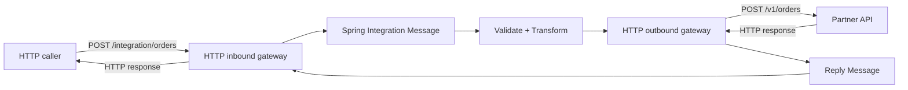
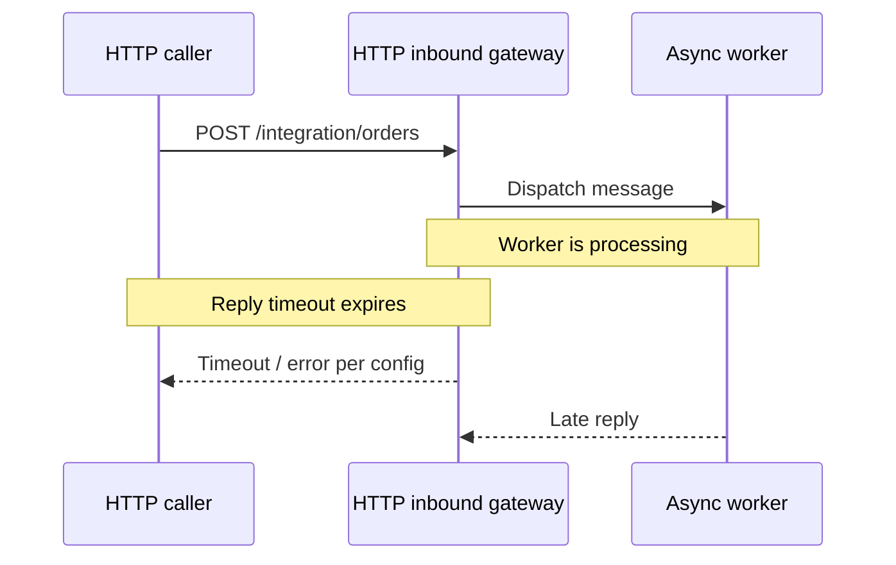
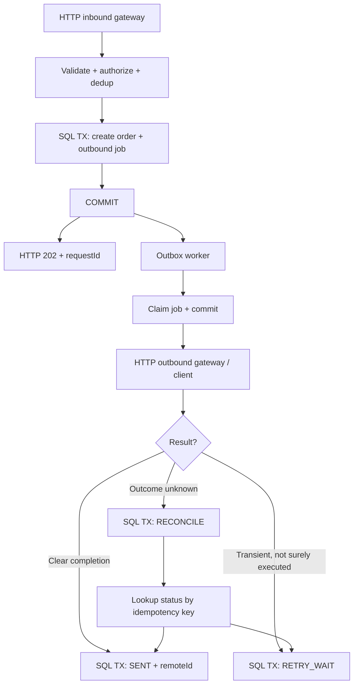
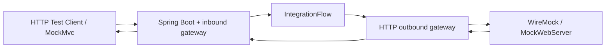

# HTTP inbound gateway and outbound gateway

> **Chapter:** Integration Adapters  
> **Scope:** The **SPRING_BOOT_INTEGRATION** module organizes system connectivity in Spring Boot across HTTP clients, SQL, caches, brokers, and Spring Integration adapters. This lesson explains the **HTTP inbound gateway** and **HTTP outbound gateway** in Spring Integration, how to configure request–reply flows, convert between HTTP and `Message<?>`, and protect data contracts, transactions, error handling, idempotency, testing, and observability when integrating with external services.

## 1. Scenario: receive HTTP, process a message, call another HTTP API

Suppose an ordering system receives a request from an internal application:

```http
POST /integration/orders HTTP/1.1
Content-Type: application/json
X-Correlation-Id: corr-824

{"externalOrderId":"ORD-42","amountMinor":125000,"currency":"VND"}
```

The application needs to:

1. Accept the HTTP request and turn it into a message processed by Spring Integration.
2. Validate, inspect data, and translate to the partner API's contract.
3. Send an HTTP POST to the partner's `/v1/orders` endpoint.
4. Receive the partner's response, classify the status, and return an appropriate response to the caller.
5. Never turn timeouts, HTTP 4xx/5xx responses, or connection drops into "transaction completed".
6. Track correlation IDs, per-hop timeouts, and side effects when retries are needed.

Two gateways at the two boundaries perform the protocol-to-message translation:



**Key point:** An inbound gateway and an outbound gateway **are not two names for the same endpoint**. One accepts incoming HTTP connections from callers into the application; the other acts as an **HTTP client** calling another service. Both participate in the same request–reply flow when wired together properly.

## 2. Distinguishing gateways, adapters, and direct HTTP clients

Spring Integration builds on **Enterprise Integration Patterns**: a `Message` has a payload and headers; a `MessageChannel` carries messages between endpoints; transformers, routers, filters, and service activators perform intermediate work.

| Component | Direction and model | When to use? |
| --- | --- | --- |
| **HTTP inbound gateway** | HTTP request → message, then waits for reply message → HTTP response | Synchronous API that needs to return processing results from an integration flow |
| **HTTP inbound channel adapter** | HTTP request → message in one-way style | Receiving data without needing a downstream business reply; still must handle HTTP acknowledgment appropriately |
| **HTTP outbound gateway** | Message → HTTP request, waits for HTTP response → reply message | Flow needs the partner's response to continue or reply to the caller |
| **HTTP outbound channel adapter** | Message → HTTP request, emits no business reply into the flow | One-way push; avoid when you need to inspect the response body for business decisions |
| **`RestClient`/`WebClient`** | HTTP client called directly by a service | Simple integrations or when building a message flow is unnecessary |
| **Spring MVC `@RestController`** | Standard HTTP endpoint | CRUD/request–response APIs that do not need Spring Integration channels/routers/endpoints |

**A gateway is request–reply, not asynchronous by default.** An HTTP inbound gateway may wait for a reply message. If downstream delegates to an asynchronous worker without producing a reply within the time limit, the caller can time out.

In a traditional Servlet/imperative setup, Spring Integration's HTTP outbound gateway uses Spring's HTTP client mechanism (typically backed by `RestTemplate`). It **does not automatically become a `RestClient` just because the application defines a separate `RestClient` bean**. If you want reactive/WebFlux-backed Spring Integration, use **Spring Integration WebFlux** and its corresponding gateways rather than assuming the Servlet HTTP gateway is non-blocking.

### 2.1. Gateway vs. controller + service

Use Spring Integration HTTP gateways when a request truly belongs to an **integration flow**: multiple channels, message-type routing, header enrichment, transformers, external calls, retries, or error channels. If an API simply reads a SQL table and returns JSON, a standard controller/service is usually clearer and simpler.

Do not pick a gateway thinking it "upgrades HTTP into a message queue": an in-memory message channel **does not provide persistence, message durability, or broker semantics**.

## 3. Required dependencies

Examples use **Spring Boot 3.x**, Java 17+, and Spring Integration Java DSL with Spring MVC/Servlet:

```xml
<dependencies>
    <dependency>
        <groupId>org.springframework.boot</groupId>
        <artifactId>spring-boot-starter-integration</artifactId>
    </dependency>
    <dependency>
        <groupId>org.springframework.integration</groupId>
        <artifactId>spring-integration-http</artifactId>
    </dependency>
    <dependency>
        <groupId>org.springframework.boot</groupId>
        <artifactId>spring-boot-starter-web</artifactId>
    </dependency>
</dependencies>
```

The HTTP adapters live in `spring-integration-http`; the web starter provides the Servlet/Spring MVC foundation and JSON conversion. Use the Spring Boot BOM so Spring Framework, Spring Integration, and codecs stay compatible.

Example configuration:

```yaml
server:
  port: 8080

partner:
  orders:
    base-url: ${PARTNER_ORDERS_BASE_URL:http://localhost:8089}

integration:
  http:
    reply-timeout-ms: 8000
```

Values and timeouts are illustrative. In production, the partner base URL must come from an approved configuration—never arbitrarily from a caller's request. `http://localhost` is unsuitable for production connections requiring security; apply TLS, service authentication, and certificate validation per contract.

## 4. How HTTP is converted into a Spring Message

A Spring Integration `Message<?>` has two parts:

```text
Message
 ├── payload: converted Java object or bytes
 └── headers: metadata for the flow
       ├── id / timestamp
       ├── HTTP details mapped per configuration
       ├── correlation ID if added
       └── intentional business headers
```

The HTTP inbound gateway reads the HTTP request via web infrastructure, applies content negotiation/message converters, and emits a Spring Message onto its request channel. The reply message is converted into an HTTP response based on its payload, headers, and converter/status configuration.

| HTTP part | Into the message world | Decisions needed |
| --- | --- | --- |
| URL path + HTTP method | Selects HTTP inbound endpoint/route | Which endpoints allow POST/GET, any path variables |
| Request body | Message payload | Deserialize JSON/XML/binary by content type and expected class |
| Request headers | Subset mapped into message headers by mapper | Never copy arbitrary sensitive headers blindly |
| Query/path variables | Metadata/arguments supported by the adapter | Validate parameter names, types, and authorization |
| Reply payload | HTTP response body | JSON contract, null/empty body, response schema |
| Reply status header | HTTP response status code | Choose 200/201/202/4xx/5xx per contract |
| Exception or missing reply | Error / timeout path | Do not assume automatic conversion to the right JSON error status |

Spring Integration defines HTTP header constants such as `org.springframework.integration.http.HttpHeaders.STATUS_CODE`. Note that Spring Integration's `HttpHeaders` class is distinct from `org.springframework.http.HttpHeaders` (the standard HTTP headers representation). Import the right class when setting response status headers.

**Do not assume every request header passes through the gateway.** Header mapping uses policies and allowlists; unmapped headers can be dropped, and caller-supplied headers are not automatically trustworthy.

## 5. HTTP inbound gateway: creating a request-receiving endpoint

A simple Java DSL configuration:

```java
package com.example.integration.http;

import org.springframework.context.annotation.Bean;
import org.springframework.context.annotation.Configuration;
import org.springframework.http.HttpMethod;
import org.springframework.integration.dsl.IntegrationFlow;
import org.springframework.integration.http.dsl.Http;

@Configuration
class InboundOrderConfiguration {

    @Bean
    IntegrationFlow orderLookupFlow(OrderLookupService service) {
        return IntegrationFlow.from(
                Http.inboundGateway("/integration/orders/lookup")
                        .requestMapping(
                                mapping -> mapping.methods(HttpMethod.POST))
                        .requestPayloadType(OrderLookupRequest.class)
                        .replyTimeout(5000))
                .handle(OrderLookupRequest.class,
                        (payload, headers) -> service.lookup(payload))
                .get();
    }
}

record OrderLookupRequest(String tenantId, String orderId) {}
record OrderLookupReply(String orderId, String status) {}
```

`OrderLookupService` is an application-provided business bean whose method returns `OrderLookupReply`. The DSL creates an inbound endpoint bound to the POST path, deserializes the JSON body into the DTO, and routes the message to the service activator. When the handler returns an object, the inbound gateway uses the reply message to build the HTTP response. This is a **request–reply** structure; no outbound HTTP call exists in this example.

Points to clarify:

- `requestPayloadType(OrderLookupRequest.class)` only specifies the target payload type; **it does not replace Bean Validation, authentication, or authorization**.
- JSON decoding requires a compatible converter/codec, such as Jackson on the classpath.
- `replyTimeout(5000)` is how long the gateway waits for a reply from the flow; **it is not an HTTP connect timeout** to a remote partner.
- Request mapping permits only POST on the registered path; it does not enable every HTTP method.
- If a message goes to a channel with no subscriber, or a handler returns no reply, the API will not magically "succeed" as intended.

### 5.1. When multiple HTTP endpoints share a path

Avoid overlapping path/method mappings between an inbound gateway and a Spring MVC controller, or between multiple inbound gateways without controlled ordering. You risk ambiguous mappings or requests hitting an unexpected endpoint.

In tests, send a real HTTP request to the path/method and verify the right handler executed; merely asserting a bean exists is not enough.

### 5.2. Reply timeout is not business success

If the flow hands the message to an `ExecutorChannel` or processes asynchronously:



A late reply **does not undo** side effects that already happened in the worker. If the caller needs immediate "request accepted" confirmation, design an explicit `202 Accepted` response **after durably persisting a job/outbox** rather than holding the HTTP connection open for a long-running task.

## 6. HTTP outbound gateway: turning a message into an outgoing request

An HTTP outbound gateway receives a message from a channel, builds an HTTP request, calls a partner endpoint, and turns the response into a reply message for subsequent steps:

```java
package com.example.integration.http;

import org.springframework.context.annotation.Bean;
import org.springframework.context.annotation.Configuration;
import org.springframework.http.HttpMethod;
import org.springframework.integration.dsl.IntegrationFlow;
import org.springframework.integration.http.dsl.Http;

@Configuration
class PartnerOutboundConfiguration {

    @Bean
    IntegrationFlow partnerLookupFlow() {
        return IntegrationFlow.from("lookupPartnerRequests")
                .handle(
                        Http.outboundGateway(
                                "http://localhost:8089/v1/orders/lookup")
                                .httpMethod(HttpMethod.POST)
                                .expectedResponseType(PartnerOrderReply.class))
                .get();
    }
}

record PartnerOrderReply(String partnerOrderId, String status) {}
```

Here `lookupPartnerRequests` is an input channel of the integration flow, and the gateway sends an **HTTP POST** to a fixed destination URL. This snippet omits the upstream producer; an upstream gateway or handler must send a message with an appropriate reply channel to receive `PartnerOrderReply`.

**`expectedResponseType(...)` specifies the target type for decoding the response body.** It does not convert HTTP 400/503 responses into valid business DTOs, nor does it validate response schema compliance. Codec-incompatible responses can throw exceptions; add error flows and tests.

### 6.1. Fixed URLs vs. dynamic URLs

A fixed URL works for a single partner endpoint. If you need path/query variables from a message, use Spring Integration's URI template/variable support or expressions **with validated inputs**.

Never construct an HTTP destination by blindly trusting a `targetUrl` from untrusted JSON or HTTP headers: doing so exposes **SSRF** risks (calling internal addresses, metadata endpoints, or unintended hosts). Select hosts from a configured allowlist, guard DNS/redirects, and enforce per-partner authorization.

### 6.2. Outbound gateway vs. direct REST client

If a service just makes a single HTTP call and immediately processes the result in Java, `RestClient` can be simpler. The HTTP outbound gateway fits when you want to wire the call into Spring Integration's **routers, transformers, filters, retry advice, error channels, claim-check, or channel orchestration**.

Do not expect the outbound gateway to provide distributed transactions, safe HTTP retries, or persisted messages on its own. Those guarantees must be built into the flow and persistence layer.

## 7. End-to-end example: inbound HTTP → transform → outbound HTTP → reply

The complete example below demonstrates a **contract-translating HTTP proxy**. It does not write to a database or automatically retry POST requests. In production, add authentication/authorization, validation, HTTP timeouts, and idempotency as covered in later sections.

### 7.1. DTOs on both sides

The internal API accepts a DTO distinct from the partner's contract:

```java
package com.example.integration.http;

public record CreateOrderRequest(
        String externalOrderId,
        long amountMinor,
        String currency
) {}

public record PartnerCreateOrder(
        String externalId,
        long totalMinor,
        String currencyCode
) {}

public record PartnerCreateOrderReply(
        String partnerOrderId,
        String state
) {}

public record CreateOrderReply(
        String orderId,
        String status
) {}
```

Both DTO pairs serve different purposes: the inbound contract is the internal API, while `PartnerCreateOrder`/`PartnerCreateOrderReply` belong to the partner's contract version. Do not share one DTO "for convenience" if schemas or versions evolve independently.

### 7.2. IntegrationFlow with two gateways

```java
package com.example.integration.http;

import org.springframework.beans.factory.annotation.Value;
import org.springframework.context.annotation.Bean;
import org.springframework.context.annotation.Configuration;
import org.springframework.http.HttpMethod;
import org.springframework.http.HttpStatus;
import org.springframework.integration.dsl.IntegrationFlow;
import org.springframework.integration.http.dsl.Http;
import org.springframework.messaging.support.MessageBuilder;

@Configuration
public class OrderBridgeFlowConfiguration {

    @Bean
    IntegrationFlow orderBridgeFlow(
            @Value("${partner.orders.base-url}") String partnerBaseUrl) {
        return IntegrationFlow.from(
                Http.inboundGateway("/integration/orders")
                        .requestMapping(
                                mapping -> mapping.methods(HttpMethod.POST))
                        .requestPayloadType(CreateOrderRequest.class)
                        .replyTimeout(8000))
                .handle(CreateOrderRequest.class, (request, headers) -> {
                    if (request.externalOrderId() == null
                            || request.externalOrderId().isBlank()
                            || request.amountMinor() < 0) {
                        throw new IllegalArgumentException(
                                "Invalid order request");
                    }
                    return new PartnerCreateOrder(
                            request.externalOrderId(),
                            request.amountMinor(),
                            request.currency());
                })
                .handle(
                        Http.outboundGateway(
                                partnerBaseUrl + "/v1/orders")
                                .httpMethod(HttpMethod.POST)
                                .expectedResponseType(
                                        PartnerCreateOrderReply.class))
                .handle(PartnerCreateOrderReply.class, (partner, headers) ->
                        MessageBuilder.withPayload(
                                new CreateOrderReply(
                                        partner.partnerOrderId(),
                                        partner.state()))
                                .setHeader(
                                        org.springframework.integration.http
                                                .HttpHeaders.STATUS_CODE,
                                        HttpStatus.CREATED)
                                .build())
                .get();
    }
}
```

The flow has five steps:

1. The inbound gateway receives POST and converts JSON to `CreateOrderRequest`.
2. The handler checks basic invariants (illustrative; production requires full validation).
3. The handler transforms to `PartnerCreateOrder`; this is a **transform via service activator**, avoiding manual JSON string construction.
4. The outbound gateway sends the HTTP POST and decodes the JSON reply into `PartnerCreateOrderReply`.
5. The final handler creates `CreateOrderReply` and attaches HTTP status `201 Created` for the inbound gateway.

**Characteristic:** one caller HTTP request triggers **one partner HTTP request** in flight. If the partner is slow, the caller waits too (unless the flow is redesigned to reply early).

**Intentional limitations of the example:** it only throws a plain `IllegalArgumentException` without mapping to a 400 JSON body; the outbound client lacks connect/read timeouts or credentials; there is no `Idempotency-Key` propagation; and a failure after the remote side effect can still show failure to the caller even though the partner processed the request. Add these before production.

### 7.3. Example interaction

```http
POST /integration/orders HTTP/1.1
Content-Type: application/json

{"externalOrderId":"ORD-42","amountMinor":125000,"currency":"VND"}
```

Expected outbound request at the HTTP mock server:

```http
POST /v1/orders HTTP/1.1
Content-Type: application/json

{"externalId":"ORD-42","totalMinor":125000,"currencyCode":"VND"}
```

Suppose the partner responds with `201` and body:

```json
{"partnerOrderId":"P-419","state":"ACCEPTED"}
```

Internal response returned by the flow:

```http
HTTP/1.1 201 Created
Content-Type: application/json

{"orderId":"P-419","status":"ACCEPTED"}
```

**Do not confuse business state `ACCEPTED` with completion.** If the partner defines `ACCEPTED` to mean asynchronous processing in progress, do not rewrite it to `COMPLETED` or promise the order is finalized; use a status lookup or separate confirmation mechanism.

## 8. HTTP status, body, and errors must be mapped explicitly

A common mistake is **the outbound HTTP call returning an error status that the inbound side treats as success** or vice versa. Internal APIs and partner APIs can use different status conventions.

| Outbound result | Interpretation | Suggested inbound policy |
| --- | --- | --- |
| `200` / `201` with valid JSON per contract | Partner confirmed a concrete outcome | Transform DTO and return 200/201 per internal contract |
| `202 Accepted` | Partner accepted work; completion is not assured yet | Return 202 and a status resource if internal contract permits, or save pending state |
| `204 No Content` | Empty body | Do not enforce DTO decoding if partner specifies 204; handle explicitly |
| `400` / `422` | Invalid input per partner contract | Map to structured error; do not retry blindly |
| `401` / `403` | Invalid service-to-service credentials/permissions | Alert on security/config; never leak tokens or partner details |
| `404` | Missing route/resource | Distinguish URL misconfiguration from business not-found |
| `409` | Conflict/duplicate | Check idempotency semantics; could be key mismatch or already processed |
| `429` | Rate limited | Backoff, bounded retry, respect `Retry-After` if supported |
| `5xx` / timeout / connection reset | Downstream error or unknown outcome | Bounded retry, circuit breaker, status lookup/idempotency |

Traditional Spring Integration `Http.outboundGateway(...)` relies on the underlying HTTP client's status/error handling; non-2xx responses normally throw an exception rather than decoding into the success DTO. Verify exact rules against your client/request factory and Spring Integration version. **Never assume a 404/500 error response will flow through the same `PartnerCreateOrderReply` handler.**

### 8.1. Translating errors into HTTP responses

In a synchronous request–reply flow, exceptions can propagate back to the HTTP inbound gateway; in asynchronous flows with error publishing, errors may be wrapped as `ErrorMessage` and sent to an error channel. An `errorChannel` header does not guarantee **every synchronous error** automatically routes to a separate error channel.

A safe strategy:

1. Explicitly classify **validation**, **authentication/authorization**, **downstream business rejection**, **transient infrastructure failure**, and **unknown outcome**.
2. Define stable internal API error codes; never return raw stack traces or sensitive partner bodies.
3. Configure real error mapping on the HTTP inbound gateway/flow (or appropriate boundary/controller) to turn exceptions into reply messages with **designated status codes and error DTOs**.
4. For requests with side effects whose outcome is unknown, return an appropriate status and expose lookup by request ID rather than claiming total failure.

For Spring Integration HTTP, the `org.springframework.integration.http.HttpHeaders.STATUS_CODE` header on the reply message is one mechanism for setting the HTTP response status. Test status, content type, and error body with a real HTTP client; **do not assume `@ControllerAdvice` catches every integration gateway exception** identically to regular REST controllers.

### 8.2. Handling empty response bodies

If a partner can return 204, `expectedResponseType(PartnerCreateOrderReply.class)` is no longer a complete contract. Pick one policy:

- Ensure the partner always returns a JSON object on 200/201 for that endpoint.
- Or use configuration/converters supporting optional/empty responses and construct replies based on outcome.
- Or split endpoints/flows when response shapes diverge sharply by status.

Never return a fabricated empty DTO as success just to avoid a decoding error.

## 9. Header mapping: correlation, tenant, and idempotency

Metadata matters because messages cross layers, yet **HTTP headers must never be forwarded blindly without control**.

| Header | Source and usage | Notes |
| --- | --- | --- |
| `X-Correlation-Id` | Links inbound → outbound logs/traces | If caller-supplied, bound length/format and do not treat as security proof |
| `Idempotency-Key` | Stable across attempts of the **same side-effecting operation** | Must be scoped to tenant/operation and fingerprint; never regenerate on retry |
| `Authorization` | Caller or service-to-service credentials | **Never forward caller tokens to partners** unless explicit delegation design requires it |
| `X-Tenant-Id` | Tenant context verified by gateway/identity layer | Never trust self-asserted user headers without verification |
| `Content-Type` | Outgoing body format | Must match encoder (JSON/XML) and partner contract |
| `Accept` | Expected partner response format | Must match decoders and supported media types |
| `traceparent` | Standard tracing context when configured | Do not use as an idempotency key |
| `Host`, `Connection`, `Content-Length` | Transport/hop-by-hop headers | Never copy blindly from inbound to outbound |

Spring Integration provides **HTTP header mapper** options for inbound/outbound endpoints. In some cases you must explicitly allowlist application headers; in others you must **strip** unsafe headers. Verify which headers actually reach downstream using a mock HTTP server, because a header present in a Spring Message is not guaranteed to be sent verbatim by default.

### 9.1. Creating controlled metadata

Illustrative snippet when building an outbound message:

```java
Message<PartnerCreateOrder> outbound = MessageBuilder
        .withPayload(new PartnerCreateOrder(
                "ORD-42", 125000L, "VND"))
        .setHeader("X-Correlation-Id", correlationId)
        .setHeader("Idempotency-Key", stableRequestId)
        .build();
```

This is an **illustrative snippet inside a service** where `correlationId` and `stableRequestId` have already been validated/derived from trusted sources. Ensure the outbound HTTP header mapper is configured to map both headers onto the physical request. If the message passes through routers or other gateways, transformers must not inadvertently drop these headers.

### 9.2. Data contracts and request identity

Payloads should include a schema version when needed, business IDs, and meaningful attributes. An idempotency key is a **request identifier**, not the payload itself. If a client reuses the same key with a different payload, the server/partner must verify the fingerprint and return a conflict per contract.

Keys must be scoped by tenant/operation; a correlation ID may span multiple actions in a workflow and is therefore unsuitable as a default idempotency key.

## 10. Timeouts: multiple distinct layers

An inbound → outbound flow can face multiple time limits:

| Timeout | What does it govern? | If exceeded |
| --- | --- | --- |
| **HTTP caller timeout** | How long the caller waits on the internal API | Caller may retry while the server is still working |
| **Inbound gateway reply timeout** | Gateway waiting for a reply message from the flow | May error/time out; late replies do not roll back side effects |
| **Message channel send timeout** | Time spent trying to send into certain channel types | Does not replace HTTP network timeouts |
| **Outbound connect timeout** | Establishing TCP/TLS connection to the partner | Cannot always tell whether the request was sent |
| **Outbound response/read timeout** | Waiting for the partner's HTTP response | Partner may have committed business work before the response dropped |
| **Database/Redis timeout** | Waiting on queries, locks, or connections | Each resource's transactions have separate semantics |
| **Reverse proxy/load balancer timeout** | Waiting at the edge layer in front of the app | May sever the connection while the Spring flow is still running |

**Budget timeouts end-to-end:** outbound timeouts must have explicit bounds aligned with the inbound deadline. If a service makes sequential calls, total elapsed time (including retries/backoff) can exceed the caller's deadline even when individual calls fit their own timeouts.

### 10.1. Client request factory and connection pool

Traditional HTTP outbound gateways can be configured with a request factory/HTTP client suited to your Spring Integration version. Configure connect/read/response timeouts, pooling, TLS, proxies, and connection reuse there.

Never assume setting `replyTimeout(8000)` on the inbound gateway caps partner socket connections to eight seconds. If the outbound HTTP client blocks on the network on a synchronous thread, it can keep occupying threads and connections even after the HTTP caller gave up.

### 10.2. Avoid stacked retries

Suppose the client retries 3 times, the gateway retries 3 times, and the HTTP client retries 3 times: during an outage, a single operation could be sent far more times than intended. Designate **one primary retry owner**, cap attempt counts, apply exponential backoff/jitter, and require idempotency for write operations.

Do not retry 400/422 payload errors; do not retry 401/403 endlessly; for 429, respect `Retry-After` if supported by contract. For timeouts or 5xx after a POST, verify the partner's idempotency guarantees.

## 11. Transactions: SQL and outbound HTTP do not commit together

A method like:

```java
@Transactional
public void createAndNotify(CreateOrderRequest request) {
    orderRepository.save(toEntity(request));
    // Calling HTTP outbound gateway inside a SQL transaction
    partnerGateway.send(toPartnerRequest(request));
}
```

is an **anti-pattern** if treated as a single ACID transaction across both side effects. `@Transactional` with a SQL manager governs SQL transactions; a successful HTTP POST is not rolled back if the database rolls back afterward. Keeping DB transactions open while waiting on HTTP also extends lock duration, ties up connections, and reduces throughput.

Failure scenarios:

- SQL wrote data, HTTP failed → SQL may roll back, yet remote state might still have changed.
- HTTP succeeded, DB commit failed → partner has the order, internal DB does not.
- HTTP timed out after remote commit → caller may retry and create duplicate side effects without idempotency.
- Process crash between the two systems → no ordinary JDBC transaction can recover both atomically.

### 11.1. Reliable design: transactional outbox for HTTP



In this design, the inbound gateway returns **202 Accepted only after durably persisting the job**, without waiting for remote business commit. The job record stores:

| Field | Meaning |
| --- | --- |
| `jobId` | Durable identifier, usable as the idempotency key per contract |
| `tenantId, operation` | Business scope of the request |
| `payloadSnapshot` | Normalized outbound body; kept identical across retries |
| `requestFingerprint` | Detects key reuse with a different payload |
| `status` | `PENDING`, `IN_FLIGHT`, `SENT`, `RETRY_WAIT`, `UNKNOWN`, or `FAILED_FINAL` |
| `attempts, nextAttemptAt` | Retry cap, backoff, and schedule |
| `leaseToken, leasedUntil` | Multi-worker coordination and crash recovery |
| `remoteReference` | Partner reference used for status lookup/reconciliation |

When the worker calls HTTP outside the transaction, it uses the exact same payload and idempotency key, then opens a short SQL transaction to record the outcome. If the response is lost, query partner status before re-sending a risky POST.

**An outbox makes send intent durable; it does not provide exactly-once across SQL and HTTP by itself.** The partner must still support idempotency/business unique constraints or reconciliation.

### 11.2. When is synchronous inbound → outbound still appropriate?

For read-only GET queries with no side effects, a synchronous request–reply flow with clear deadlines is usually sensible. For low-impact POSTs where the partner guarantees strong idempotency, synchronous flows can also work if timeout outcomes are clearly defined. For payment commands, order creation, or hard-to-compensate operations, prefer durable jobs + async status when latency and reliability demand it.

## 12. Request–reply and channel boundaries

Spring Integration offers channels with distinct semantics:

- **`DirectChannel`:** dispatches on the caller's thread to the subscriber, convenient for synchronous request–reply and thread-bound transaction propagation.
- **`ExecutorChannel`:** dispatches via an executor; decouples caller from handler, and **thread-bound transaction contexts do not automatically propagate**.
- **`QueueChannel`:** buffers messages in an application queue when configured; not durable by default and does not imply automatic business replies.
- **`PublishSubscribeChannel`:** broadcasts to subscribers; not a single-responder request–reply mechanism by default.

Do not swap `DirectChannel` for `ExecutorChannel` just to "make HTTP respond faster". If the inbound gateway still awaits a reply message, the caller will still wait until timeout; if the message finishes after the caller timed out, you need business state tracking and deduplication.

### 12.1. Reply routing

Spring Integration request–reply relies on the message's reply channel header and endpoint configuration. If a custom transformer or service activator builds a brand-new message and drops routing headers, the reply may never return to the expected inbound gateway.

Use DSL transformers/handlers that preserve headers/context appropriately, and construct new `Message<?>` instances intentionally. Test end-to-end over HTTP to verify **requests traverse the flow and responses actually return to the caller**.

### 12.2. Preventing flow loops

A routing mistake can send replies back to the request channel, or an error flow can publish back into the inbound flow and loop infinitely. When adding discard or error channels, define clear terminal destinations, cap retries, and expose metrics to catch looping messages.

## 13. Security when HTTP stands at both ends of the flow

### 13.1. The inbound gateway is an API boundary

Minimum requirements:

1. **Authentication:** Spring Security or your organization's gateway/identity layer.
2. **Authorization:** verify the caller is permitted to act on the order and tenant; never trust `tenantId` from the request body/headers independently.
3. **Validation:** schema, body size, required fields, money/currency, lengths, and business invariants.
4. **Rate limiting:** prevent callers from holding unbounded concurrent synchronous requests waiting on downstream.
5. **Content negotiation:** accept only expected `Content-Type`/`Accept` values; disable dangerous XML parser features if XML is used.
6. **Error responses:** never leak internal URLs, stack traces, SQL, tokens, keys, or sensitive partner response bodies.

Specifically, never turn a Spring Security user principal into outbound auth by blindly copying `Authorization`. Service-to-service credentials must have their own issuer, audience, scope, and lifecycle for the partner; if token exchange/on-behalf-of is used, design it explicitly.

### 13.2. The outbound gateway is a trust boundary

Outbound hosts should come from an allowlist/deployment config. Enforce TLS certificates, hostname verification, proxy rules, and HTTP redirect policies. If dynamic endpoints must be supported, regex validation alone is insufficient—restrict internal IPs, DNS rebinding, ports, schemes, and redirects.

Header mappers should maintain **an explicit allowlist**; do not forward cookies, bearer tokens, forwarded headers, or sensitive trace baggage unnecessarily. Cap response sizes and validate content types so a misbehaving partner cannot exhaust JVM resources.

### 13.3. Do not use filters as final authorization

A Spring Integration `Filter` can drop messages by event type or partner state, but it does not replace authentication/authorization. If a filter returns `false` in a request–reply flow without sending a reply, the HTTP caller may hang until timeout; for unauthorized requests, return a clear 403 at the proper boundary.

## 14. Observability and performance tuning

In an inbound → outbound flow, caller-perceived latency roughly equals the **sum** of body reading, validation, channel/handler execution, outbound HTTP network time, reply decoding, and response writing. When degradation strikes, you need to pinpoint which layer slowed down.

| Metric | Meaning |
| --- | --- |
| `http_inbound_requests_total` by endpoint and status | Request volume and success/error ratio |
| `integration_gateway_reply_timeout_total` | Gateway did not receive a reply in time |
| `integration_http_outbound_latency` by partner | HTTP call duration and downstream health |
| `integration_http_outbound_errors_total` by error type | Separates 4xx, 5xx, timeouts, SSL, decode failures |
| `integration_flow_inflight` | Number of flows currently executing concurrently |
| `integration_channel_queue_depth` when queued | Backlog/saturation indicator |
| `integration_idempotency_replay_total` | Duplicate retries served from stored results |
| `integration_outbox_pending_age` | Durable jobs waiting too long to be sent |

These names are **suggested application metrics**, not a promise that Spring Boot exports all of them automatically. Combine Actuator/Micrometer, tracing, and HTTP client/broker/database instrumentation. Verify actual metric names and lifecycles against your framework/provider versions.

**Metric tags:** keep to bounded values like endpoint/route, partner, status class, and error category. Never tag `orderId`, idempotency keys, access tokens, user emails, or full URLs carrying sensitive data; high cardinality increases cost and risk.

### 14.1. Safe tuning practices

- Cap inbound concurrency and request body size before deserialization.
- Configure outbound connection pooling, connect/response timeouts, and TLS on the underlying client.
- Avoid holding SQL transactions open during HTTP calls.
- Cache relatively static read data, but never drive side-effect decisions off a cache miss alone.
- If downstream rate-limits aggressively, move heavy load to a job queue/outbox instead of holding synchronous HTTP connections.
- Test throughput during rolling deployments when replica counts temporarily spike; total outbound HTTP and DB pool connections scale up too.

## 15. Testing from the HTTP boundary to the partner

### 15.1. Do not only unit test handlers

Calling `orderBridgeFlow()` directly or testing a DTO converter in isolation **does not prove** HTTP paths, request mappings, header mappers, reply channels, HTTP client codecs, and status codes work together. Write at least one **integration test**:



Use a mock HTTP server to verify paths, methods, headers, JSON bodies, timeouts, and error codes. If the flow uses SQL/outbox, use a real database (e.g., via Testcontainers) to verify transactions and unique constraints; mocking repositories cannot prove atomicity or concurrency-safe idempotency.

### 15.2. Required test cases

| Test case | Expected result |
| --- | --- |
| Valid POST JSON and route | Inbound accepts, transformer runs, outbound calls expected host/path, returns reply DTO |
| Sending GET to POST-only path | Rejected by HTTP mapping without calling partner |
| Unsupported `Content-Type` | Appropriate client error, no bad payload sent |
| Missing `externalOrderId` or negative amount | Structured validation error, no remote call made |
| Partner returns 201 + valid JSON | Internal API returns promised result/status code |
| Partner returns 204 when client expects DTO | Handles empty body per contract without fabricating a DTO |
| Partner returns 400/422 | Does not retry; maps error clearly |
| Partner returns 401/403 | Alerts on credentials/permissions without leaking secrets |
| Partner returns 409 | Distinguishes duplicate vs. payload mismatch per contract |
| Partner returns 429 / `Retry-After` | Bounded retry/backoff if policy permits |
| Partner returns 500 or times out | Not treated as business success; classified as unknown outcome |
| Reply arrives after inbound timeout | No duplicate business execution triggered if caller retries |
| Missing/mapped correlation header | Trace propagates per policy without dropping or leaking credentials |
| Two tenants with the same order ID | No cross-tenant access; authorization runs before side effects |
| Client retries with same idempotency key | Returns stored outcome without duplicating side effects |
| Crash after SQL commit before HTTP | Outbox job persists and worker recovers it |
| Crash after remote commit before local status update | Reconciliation/stable key prevents duplicate side effects |

### 15.3. HTTP test skeleton

```java
// JUnit/MockMvc skeleton assuming Spring Boot context and
// mock HTTP partner are already started/configured:
mockMvc.perform(post("/integration/orders")
        .contentType(MediaType.APPLICATION_JSON)
        .content("""
            {"externalOrderId":"ORD-42",
             "amountMinor":125000,"currency":"VND"}
            """))
    .andExpect(status().isCreated())
    .andExpect(jsonPath("$.orderId").value("P-419"));

// Next, assert the mock server received:
// POST /v1/orders
// body with externalId=ORD-42, totalMinor=125000, currencyCode=VND.
```

This is a **test skeleton**: add static JUnit/MockMvc imports, stub the mock HTTP partner to return `201` with `PartnerCreateOrderReply` JSON, and ensure test config points the base URL to the mock server rather than production. For real socket tests outside mock servers, set finite deadlines and inspect actual request bytes and statuses.

### 15.4. Testing timeouts and unknown outcomes

An essential test for side-effecting POSTs: configure the mock partner to **record the request, then delay or drop the response**. The caller hits a timeout even though the remote side processed the request. A subsequent retry with the **same request identity** must fetch the existing outcome or reconcile without creating a second order. Verifying only that a network exception was thrown does not prove safe behavior.

## 16. Common misconceptions

1. **"An inbound gateway only receives messages and does not return an HTTP reply."** False: gateways are request–reply; one-way channel adapters serve the fire-and-receive role.
2. **"An outbound gateway means an async call that does not wait for a response."** False: an outbound gateway normally waits for the HTTP response to produce a reply message.
3. **"Adding `spring-integration-http` turns every controller into a gateway."** False: you must explicitly define endpoints/flows and mappings.
4. **"`replyTimeout` is the connection timeout to the partner."** False: flow reply timeout differs from HTTP connect/read timeouts.
5. **"Partner response bodies always decode automatically to DTOs."** False: you need compatible converters, media types, and `expectedResponseType`.
6. **"HTTP status 500 can be processed like a 200 business reply."** False: classify exceptions/error flows and status contracts properly.
7. **"Forwarding all request headers outbound preserves full context."** False: that risks leaking tokens, cookies, PII, or hop-by-hop headers.
8. **"Using `DirectChannel` provides message durability."** False: it is not a persisted queue or broker.
9. **"An HTTP client timeout means the partner never processed the POST."** False: side effects may have committed before the response dropped.
10. **"`@Transactional` rolls back remote HTTP calls."** False: JDBC/JPA transactions only protect resources owned by that transaction manager.
11. **"Switching to `ExecutorChannel` makes the inbound gateway return HTTP immediately."** False: a request–reply gateway still awaits a reply and can time out.
12. **"`errorChannel` catches every exception identically on every channel type."** False: behavior depends on synchronous vs. asynchronous propagation and endpoint config.
13. **"A short-lived cache or TTL stops duplicate retries."** False: you need durable idempotency/unique constraints and contract-aligned retention.
14. **"A unit test calling the Java handler proves the HTTP gateway works."** False: you must test mappings, headers/codecs, replies/statuses, and wire bytes end-to-end.

## 17. Checklist for deploying gateways in Spring Boot

1. **Pick the right endpoint:** inbound gateway vs. inbound adapter; outbound gateway vs. outbound adapter/`RestClient`?
2. **Define the contract:** method/path, `Content-Type`, DTO/schema version, status codes, retry semantics, and headers.
3. **Establish trust boundaries:** authentication/authorization on inbound; TLS/service credentials/allowlists on outbound.
4. **Structure the flow:** `DirectChannel` or intentional async boundary; reply channels returning cleanly to callers.
5. **Build error mapping:** validation, HTTP 4xx/5xx, decode errors, timeouts, and unknown outcomes.
6. **Bound resources:** request body sizes, connect/read timeouts, concurrency, and connection pools.
7. **Enforce idempotency:** stable keys, payload fingerprints, scoping, TTL/retention, and status lookup for side-effecting POSTs.
8. **Separate transactions:** never hold SQL transactions across HTTP calls; use an outbox/worker/reconciliation for durable delivery.
9. **Observe:** traces/correlation, per-hop latency, error categories, reply timeouts, and backlog.
10. **Test:** HTTP inbound → integration flow → mock partner → reply; crashes/retries/tenant isolation for side effects.

### Self-check questions

1. How does an HTTP inbound gateway differ from an HTTP inbound channel adapter?
2. How do an HTTP outbound gateway and an outbound channel adapter differ regarding responses?
3. Why is `Http.inboundGateway("/integration/orders")` not equivalent to a standard `@RestController`?
4. What do `requestPayloadType` and `expectedResponseType` tell converters, and what validations can they not replace?
5. At which step is `org.springframework.integration.http.HttpHeaders.STATUS_CODE` used?
6. Why can copying the caller's `Authorization` header verbatim to a partner be a security flaw?
7. Does an inbound gateway returning a timeout prove the partner did not process the POST?
8. Why can `ExecutorChannel` break request–reply expectations if replies are not coordinated properly?
9. How can you both commit an order to SQL and reliably invoke HTTP when no distributed transaction exists?
10. Why do you need end-to-end integration tests with real HTTP and a mock server rather than testing Java methods alone?
11. Does HTTP 202 from a partner always mean the order is completed?
12. When HTTP 429 or 503 occurs, which layer should own the retry policy to avoid multiplying attempts?

**Key takeaway:** An **HTTP inbound gateway** turns an incoming HTTP request into a Spring Message and returns the reply message to the caller; an **HTTP outbound gateway** turns a message into an outgoing HTTP request and produces a reply message from the HTTP response. They fit when HTTP forms the edges of a **Spring Integration request–reply flow**, though they do not inherently provide durable queues, distributed transactions, or exactly-once semantics. Correctness comes from **explicit payload/header/status contracts, layered timeouts, error classification, authorization, idempotency, and end-to-end testing**; for high-reliability side-effecting commands, combine them with a SQL outbox, worker, and reconciliation.
