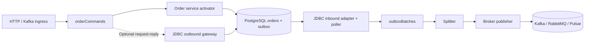
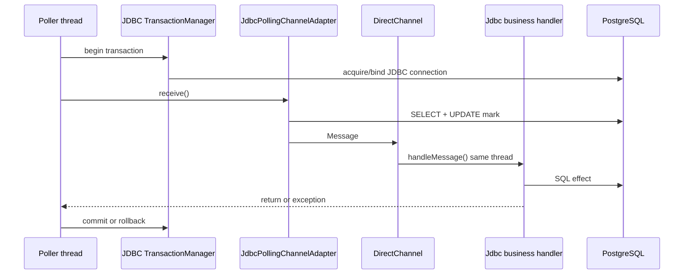
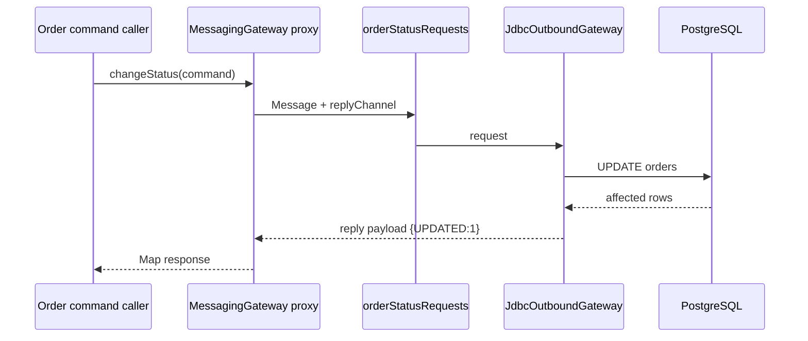
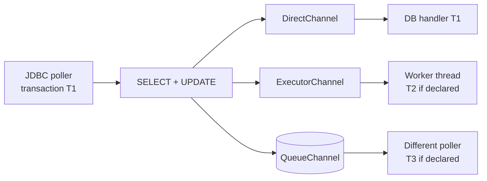
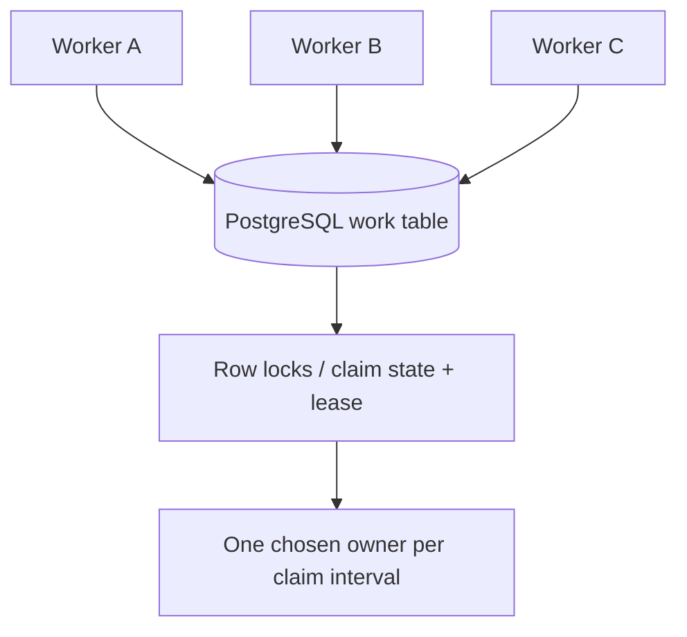
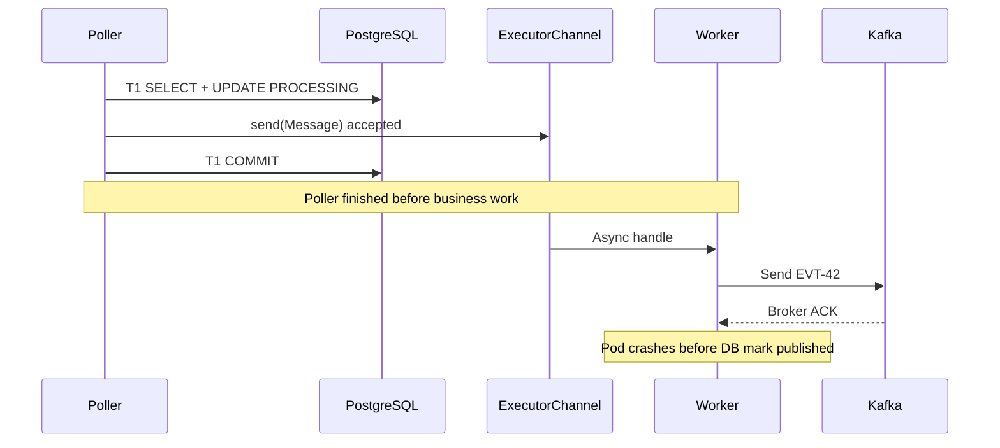

# JDBC adapters or gateways and their relationship with transaction managers

## 1. What problem does a JDBC adapter solve in an integration system?

In the **SPRING_BOOT_INTEGRATION** module, a Spring Boot application commonly connects HTTP flows, databases, caches, and message brokers. Some data must be fetched from PostgreSQL on a schedule and turned into Spring Integration `Message`s; other messages must be written to a database or execute SQL requests and return replies. Spring Integration provides **JDBC channel adapters** and the **JDBC outbound gateway** to connect these endpoints via `MessageChannel`s instead of scattering ad-hoc SQL queries across every step of a flow.

Example of an order-processing service:



In this diagram, the database is a **durable state store**; channels are in-application message boundaries. A JDBC adapter does not turn PostgreSQL into Kafka or automatically grant exactly-once delivery. That requires explicit transaction design, row locking/claiming, idempotency, retries, and ACK rules.

### Learning objectives

After this lesson, you will be able to:

1. Distinguish **JDBC inbound channel adapters**, **JDBC outbound channel adapters**, and **JDBC outbound gateways** by data direction and request-reply semantics.
2. Understand `JdbcPollingChannelAdapter`, `JdbcMessageHandler`, `JdbcOutboundGateway`, `DataSource`, `JdbcTemplate`, and Spring Integration endpoints/pollers.
3. Configure adapters in Spring Integration 6.x with Java configuration/Java DSL and know the version-specific availability of the dedicated JDBC DSL.
4. Define a **`PlatformTransactionManager` bound to the right `DataSource`** and explain the conditions for polling, updates, and downstream handlers to share a transaction.
5. Distinguish `DirectChannel` from `QueueChannel`/`ExecutorChannel` with respect to thread-bound JDBC transactions.
6. Design safe claiming/retries across multiple workers, crashes between database commit and broker publish, and duplicate event handling.
7. Test against real PostgreSQL, transaction rollbacks, gateway replies, and shutdown/timeout scenarios.

> **Version assumptions:** Spring Boot 3.5.x, Spring Integration 6.x, Java 17+, and PostgreSQL. Code examples use APIs available in the 6.x line. **Spring Integration 7.0** introduced the dedicated `org.springframework.integration.jdbc.dsl.Jdbc` DSL factory; do not copy `Jdbc.inboundAdapter(...)` examples from 7.x docs into a 6.x project and expect them to compile. Always verify defaults if your project uses a different release line.

## 2. Three roles: inbound adapter, outbound adapter, and outbound gateway

| Component | Message direction | SQL work | Produces reply? | Related class |
| --- | --- | --- | --- | --- |
| JDBC **inbound channel adapter** | Database → Spring Integration flow | Scheduled `SELECT`; optional `UPDATE` to mark rows read | Not request-reply | `JdbcPollingChannelAdapter` |
| JDBC **outbound channel adapter** | Spring Integration flow → database | `INSERT`/`UPDATE`/`DELETE` from message | One-way, emits no business reply | `JdbcMessageHandler` |
| JDBC **outbound gateway** | Request message → SQL → reply message | SQL update and optional select query; returns affected rows, generated keys, or result set per config | Yes | `JdbcOutboundGateway` |

Example flows:

```text
Inbound:
  PostgreSQL SELECT → List<Map<String,Object>> → MessageChannel → handler

Outbound adapter:
  Message<AuditEvent> → INSERT audit_events → terminates

Outbound gateway:
  Message<ChangeOrderStatus> → UPDATE orders → Message<{UPDATED: 1}>
  gateway caller awaits reply and decides business outcome
```

### 2.1. "Inbound" and "outbound" are relative to the flow

An inbound adapter **brings data from the database into the messaging flow**; an outbound adapter **writes data from the messaging flow out to the database**. Never think of inbound as SQL `INSERT` and outbound as SQL `SELECT`. The same `DataSource` can serve multiple adapters.

A Spring Integration *gateway* uses request-reply, which does not automatically mean an HTTP gateway. `JdbcOutboundGateway` is a **SQL request-reply endpoint**; `@MessagingGateway` is a **Java interface gateway** bringing Java method calls into a flow. Both concepts can be used together, but they are not the same class.

### 2.2. `MessageChannel` does not start transactions by itself

`MessageChannel.send()` passes messages between endpoints. Starting, committing, or rolling back a JDBC transaction is the responsibility of **Spring transaction management** and execution scope. The channel type determines threading and therefore affects whether a transaction carries through.

## 3. Dependencies, driver, `DataSource`, and JDBC module

Maven example using Spring Boot parent/BOM:

```xml
<dependencies>
    <dependency>
        <groupId>org.springframework.boot</groupId>
        <artifactId>spring-boot-starter-integration</artifactId>
    </dependency>
    <dependency>
        <groupId>org.springframework.integration</groupId>
        <artifactId>spring-integration-jdbc</artifactId>
    </dependency>
    <dependency>
        <groupId>org.springframework.boot</groupId>
        <artifactId>spring-boot-starter-jdbc</artifactId>
    </dependency>
    <dependency>
        <groupId>org.postgresql</groupId>
        <artifactId>postgresql</artifactId>
        <scope>runtime</scope>
    </dependency>
</dependencies>
```

Gradle:

```groovy
dependencies {
    implementation 'org.springframework.boot:spring-boot-starter-integration'
    implementation 'org.springframework.integration:spring-integration-jdbc'
    implementation 'org.springframework.boot:spring-boot-starter-jdbc'
    runtimeOnly 'org.postgresql:postgresql'
}
```

`spring-integration-jdbc` provides the JDBC adapters and gateway; `spring-boot-starter-jdbc` provides JDBC infrastructure and HikariCP; the JDBC driver connects to PostgreSQL. The Spring Integration starter **does not automatically pull in** adapters for HTTP, Kafka, RabbitMQ, or Redis.

### 3.1. Configuring the `DataSource`

```yaml
spring:
  datasource:
    url: jdbc:postgresql://localhost:5432/orders
    username: ${DB_USERNAME}
    password: ${DB_PASSWORD}
    hikari:
      maximum-pool-size: 10
      connection-timeout: 3s
      pool-name: orders-integration-pool

  sql:
    init:
      mode: never
```

A JDBC adapter requires a compatible **`DataSource` or `JdbcOperations`/`JdbcTemplate`**. You cannot pass an R2DBC `ConnectionFactory` directly into `JdbcPollingChannelAdapter`: Spring Integration's JDBC adapters use **blocking JDBC APIs**.

When an R2DBC `ConnectionFactory` is also present, Spring Boot's JDBC `DataSourceAutoConfiguration` may back off. In that situation, explicitly define a `@Bean DataSource` or adjust Boot configuration rather than relying solely on `spring.datasource.url`.

### 3.2. Managing schemas with Flyway

Tables such as `orders`, `integration_outbox`, and `processed_event` should be managed via versioned Flyway/Liquibase migrations. Never let `schema.sql`, Hibernate `ddl-auto=update`, and Flyway mutate a production schema concurrently.

```yaml
spring:
  flyway:
    enabled: true
    locations: classpath:db/migration
    validate-on-migrate: true
    clean-disabled: true
```

Recent Flyway PostgreSQL setups may require both `flyway-core` and `flyway-database-postgresql` alongside the JDBC driver. Manage migration dependencies via the Spring Boot BOM; Flyway can also run in a dedicated deployment job.

**The SQL snippets below are illustrative schema examples for this lesson, not a requirement to create external migration files outside this Markdown document.**

## 4. Transaction managers for JDBC adapters

Both `JdbcTransactionManager` and `DataSourceTransactionManager` are `PlatformTransactionManager` implementations for JDBC. With Spring JDBC on Spring Framework 6.x, `JdbcTransactionManager` is the preferred choice when JDBC exception translation on commit/rollback is desired. The essential requirement is that the transaction manager manages the **exact `DataSource`** used by the adapter and handler.

```java
package example.integration.config;

import javax.sql.DataSource;
import org.springframework.beans.factory.annotation.Qualifier;
import org.springframework.context.annotation.Bean;
import org.springframework.context.annotation.Configuration;
import org.springframework.jdbc.support.JdbcTransactionManager;
import org.springframework.transaction.PlatformTransactionManager;

@Configuration(proxyBeanMethods = false)
public class JdbcTransactionConfiguration {

    @Bean("integrationJdbcTransactionManager")
    PlatformTransactionManager integrationJdbcTransactionManager(
            @Qualifier("dataSource") DataSource dataSource) {
        return new JdbcTransactionManager(dataSource);
    }
}
```

In a single-`DataSource` app, Boot normally creates a default transaction manager when conditions match. Defining an explicit bean as above is helpful when you want to **name the manager unambiguously** for a poller. The snippet assumes a bean named `dataSource` exists; adjust `@Qualifier` if your bean name differs.

### 4.1. Remembering differences across transaction managers

| Manager | Coordinated resource | Notes |
| --- | --- | --- |
| `JdbcTransactionManager` | JDBC `DataSource` | For JDBC adapters, `JdbcTemplate`, and plain SQL |
| `DataSourceTransactionManager` | JDBC `DataSource` | Core Spring JDBC transaction manager variant |
| `JpaTransactionManager` | JPA `EntityManagerFactory`, can synchronize compatible JDBC | Choose when services use Hibernate/JPA |
| `R2dbcTransactionManager` | R2DBC `ConnectionFactory` | Reactive transactions; does **not** directly coordinate JDBC adapters |
| JTA manager | Multiple XA resources when properly configured | Never magically enabled just by `@Transactional` |

An application already using `JpaTransactionManager` should not casually add a `JdbcTransactionManager` on the same tables assuming the two transactions merge. Decide the **transaction owner** and verify `EntityManager`/JDBC connection participation. When multiple managers exist, specify the name in `@Transactional(transactionManager = "...")` or transaction advice.

### 4.2. Thread-bound transactions and JDBC connections

Spring JDBC uses `TransactionSynchronizationManager` to bind a JDBC connection to the current thread while a transaction is active. `JdbcTemplate` and Spring transaction-aware JDBC operations reuse that same connection.



If the downstream handler throws an exception **inside the same synchronous transaction**, both the `SELECT`/claim `UPDATE` and downstream JDBC writes can roll back together. However, if the handler invokes HTTP or Kafka, those external side effects **do not roll back with the JDBC transaction**.

### 4.3. Never mix the wrong `DataSource`

Very dangerous setup:

```text
Poller transaction manager: DataSource A
JdbcPollingChannelAdapter: DataSource B
Business JdbcTemplate:      DataSource B
```

The transaction manager holds a transaction on A, while the adapter and queries on B run outside the expected transaction. Seeing `@Transactional` in logs does not prove all three operations shared one transaction. With multiple `DataSource`s, use `@Qualifier` consistently across managers, adapters, `JdbcTemplate`s, and tests.

## 5. JDBC inbound adapter: scheduled `SELECT` → `Message`

`JdbcPollingChannelAdapter` is a `MessageSource` that runs a SQL `SELECT` on each poll. Its default payload is typically **`List<Map<String, Object>>`**: one message holds the **entire result set** from the query, not one message per row.

```text
Database rows:
  R1, R2, R3
      ↓ JDBC SELECT
Message<List<Map>> [R1,R2,R3]
      ↓ splitter (if needed)
Message<Map> R1
Message<Map> R2
Message<Map> R3
```

If the query returns zero rows, no business message is emitted; the adapter returns `null` for an empty poll. A `RowMapper` can map each row to a DTO, provided you keep SQL aliases/IDs compatible when `updateSql` is also used.

### 5.1. `maxRows` vs. `maxMessagesPerPoll`

| Parameter | Belongs to | Meaning |
| --- | --- | --- |
| `JdbcPollingChannelAdapter.setMaxRows(10)` | JDBC source | Maximum rows placed into one message from a single query |
| Poller `maxMessagesPerPoll(1)` | Scheduler/endpoint | Maximum times `receive()` is invoked in one poll cycle |
| SQL `LIMIT 10` | PostgreSQL query | Caps rows directly inside the database |
| Poller fixed delay 500 ms | Scheduler | Delay from completion of one poll cycle to the start of the next |

For example: `maxMessagesPerPoll=3` where each `SELECT` returns 10 rows ⇒ a single poll cycle can execute **three queries** and emit up to three messages, each holding up to 10 rows. Never misread `maxMessagesPerPoll=10` as fetching 10 rows total.

On large tables, rely on **SQL `LIMIT` and indexes** so the database does not build a massive result set only for Java to truncate it. `maxRows` is a secondary guardrail, not a substitute for query planning.

### 5.2. Why is update SQL needed?

If you only run:

```sql
SELECT * FROM integration_outbox WHERE delivery_state = 'PENDING';
```

then the next poll sees the exact same rows and re-emits them forever. The JDBC inbound adapter supports `updateSql` to mark fetched rows **during the poll** inside an appropriate transaction.

Conceptual flow:

```text
SELECT PENDING rows
    → UPDATE selected rows to PROCESSING
    → emit Message<List<row>>
    → downstream handler
    → commit or roll back per transaction scope
```

**Never call `PROCESSING` "already published".** Until downstream finishes its business effect, that is only an in-database claim/state transition. If the transaction commits after `SELECT`+`UPDATE` before downstream executes, you need leases and recovery to prevent stuck rows.

## 6. Practical schema: work table and receipt table

Assume PostgreSQL has been migrated with:

```sql
CREATE TABLE integration_work (
    work_id VARCHAR(80) PRIMARY KEY,
    work_type VARCHAR(80) NOT NULL,
    payload_json JSONB NOT NULL,
    state VARCHAR(20) NOT NULL DEFAULT 'PENDING',
    retry_count INTEGER NOT NULL DEFAULT 0,
    created_at TIMESTAMPTZ NOT NULL DEFAULT now(),
    processed_at TIMESTAMPTZ
);

CREATE INDEX idx_work_pending
    ON integration_work(created_at, work_id)
    WHERE state = 'PENDING';

CREATE TABLE processed_work (
    consumer_name VARCHAR(100) NOT NULL,
    work_id VARCHAR(80) NOT NULL,
    processed_at TIMESTAMPTZ NOT NULL,
    PRIMARY KEY (consumer_name, work_id)
);
```

`state` can be `PENDING`, `PROCESSING`, `DONE`, or `FAILED` per business contract. Add appropriate check constraints if the state set is fixed. The unique key on `processed_work` lets a consumer workflow **receive duplicate messages without applying side effects twice**.

### 6.1. Bounded queries and row locking in PostgreSQL

```sql
SELECT
    work_id AS id,
    work_type,
    payload_json
FROM integration_work
WHERE state = 'PENDING'
ORDER BY created_at, work_id
LIMIT 10
FOR UPDATE SKIP LOCKED;
```

`FOR UPDATE SKIP LOCKED` avoids multiple transactions blocking on or claiming the same rows in PostgreSQL. It requires understanding isolation and lock semantics, and its exact syntax is not universal across every RDBMS. Holding a transaction open while calling a slow partner HTTP API locks rows for a long time; production systems often prefer **short claim transactions + leases** rather than holding DB locks across external calls.

Matching update statement:

```sql
UPDATE integration_work
SET state = 'PROCESSING'
WHERE work_id IN (:id);
```

By Spring Integration JDBC inbound adapter parameter-projection convention, an alias column **`id`** in selected rows produces the `:id` parameter list for `updateSql`. When using a custom `RowMapper`, verify the parameter source factory or normalize IDs so you never update the wrong rows.

### 6.2. One poll does not equal one message per row

When the adapter returns a list of 10 rows, a downstream `splitter` emits 10 messages. If the poller advice opens one transaction and downstream runs synchronously on the same thread, all 10 handler invocations share **one poll transaction**. An exception on row 8 rolls back updates for the entire batch, meaning the first 7 rows will be reprocessed.

If the first 7 rows already sent messages to a broker, the database rollback **cannot recall** those 7 broker events. Avoid wrapping external sends inside long DB transactions; use outbox/inbox/idempotency for at-least-once delivery.

## 7. Java example: configuring the JDBC source and transaction advice

In Spring Integration **6.x**, instantiate the existing JDBC adapter class and pass it to `IntegrationFlow.from(...)`. Do not look for the `Jdbc.inboundAdapter(...)` factory introduced in 7.x.

### 7.1. `JdbcPollingChannelAdapter` bean

```java
// JdbcWorkSourceConfiguration.java
package example.integration.jdbc;

import javax.sql.DataSource;

import org.springframework.context.annotation.Bean;
import org.springframework.context.annotation.Configuration;
import org.springframework.integration.jdbc.JdbcPollingChannelAdapter;

@Configuration(proxyBeanMethods = false)
public class JdbcWorkSourceConfiguration {

    @Bean
    JdbcPollingChannelAdapter jdbcWorkSource(DataSource dataSource) {
        String selectSql = """
                SELECT work_id AS id, work_type, payload_json
                FROM integration_work
                WHERE state = 'PENDING'
                ORDER BY created_at, work_id
                LIMIT 10
                FOR UPDATE SKIP LOCKED
                """;

        var source = new JdbcPollingChannelAdapter(
                dataSource, selectSql);

        source.setUpdateSql("""
                UPDATE integration_work
                SET state = 'PROCESSING'
                WHERE work_id IN (:id)
                """);

        // Extra safeguard on the JDBC source side.
        source.setMaxRows(10);
        return source;
    }
}
```

With default row mapping, the source produces `List<Map<String,Object>>`; `id` is the alias used by the update query. If mapping to DTOs via `setRowMapper(...)`, ensure update parameter extraction still matches.

### 7.2. Transaction advice bean for the poller

```java
// JdbcPollTransactionAdviceConfiguration.java
package example.integration.jdbc;

import java.util.Properties;

import org.springframework.beans.factory.annotation.Qualifier;
import org.springframework.context.annotation.Bean;
import org.springframework.context.annotation.Configuration;
import org.springframework.transaction.PlatformTransactionManager;
import org.springframework.transaction.interceptor.TransactionInterceptor;

@Configuration(proxyBeanMethods = false)
public class JdbcPollTransactionAdviceConfiguration {

    @Bean("jdbcPollTransactionAdvice")
    TransactionInterceptor jdbcPollTransactionAdvice(
            @Qualifier("integrationJdbcTransactionManager")
            PlatformTransactionManager manager) {

        Properties attributes = new Properties();
        attributes.setProperty("*", "PROPAGATION_REQUIRED");

        var advice = new TransactionInterceptor();
        advice.setTransactionManager(manager);
        advice.setTransactionAttributes(attributes);
        return advice;
    }
}
```

This is a Spring AOP `TransactionInterceptor` used by the poller to wrap `receive()` and **synchronous** downstream handling. Handlers must not swallow exceptions if rollback is expected. With multiple managers, the bean must reference the JDBC transaction manager owning the source `DataSource`.

**Note:** poller transaction advice and `@Transactional` on services interact according to propagation rules. With the same manager, `PROPAGATION_REQUIRED` joins the active transaction. If a service uses `REQUIRES_NEW`, it can commit independently even if the poller later rolls back; verify carefully for sensitive operations.

### 7.3. `IntegrationFlow`: poll → split → service activator

```java
// JdbcWorkFlowConfiguration.java
package example.integration.jdbc;

import java.time.Duration;
import org.springframework.context.annotation.Bean;
import org.springframework.context.annotation.Configuration;
import org.springframework.integration.dsl.IntegrationFlow;
import org.springframework.integration.dsl.Pollers;
import org.springframework.integration.jdbc.JdbcPollingChannelAdapter;
import org.springframework.transaction.interceptor.TransactionInterceptor;

@Configuration(proxyBeanMethods = false)
public class JdbcWorkFlowConfiguration {

    @Bean
    IntegrationFlow jdbcWorkFlow(
            JdbcPollingChannelAdapter jdbcWorkSource,
            TransactionInterceptor jdbcPollTransactionAdvice,
            WorkProcessingService workProcessingService) {

        return IntegrationFlow
                .from(
                        jdbcWorkSource,
                        endpoint -> endpoint
                                .id("jdbcWorkPoller")
                                .poller(
                                        Pollers.fixedDelay(
                                                        Duration.ofSeconds(1))
                                                .maxMessagesPerPoll(1)
                                                .advice(
                                                        jdbcPollTransactionAdvice)))
                .split()
                .handle(workProcessingService, "process")
                .get();
    }
}
```

Endpoints between the source, splitter, and handler use synchronous channels by default in Java DSL unless an async channel is explicitly introduced. Thus the poll advice covers JDBC writes inside the handler.

Logical execution order:

```text
Poller tick
  └─ TransactionInterceptor begin
       ├─ SELECT 10 rows FOR UPDATE SKIP LOCKED
       ├─ UPDATE selected ids → PROCESSING
       ├─ Message<List<Map>> into splitter
       ├─ 10 × Message<Map> into service activator
       │    ├─ JDBC business effect
       │    └─ UPDATE each row → DONE
       └─ commit if all succeed / rollback on exception
```

### 7.4. Handler sharing the same JDBC transaction

```java
// WorkProcessingService.java
package example.integration.jdbc;

import java.util.Map;
import org.springframework.jdbc.core.JdbcTemplate;
import org.springframework.stereotype.Service;

@Service
public class WorkProcessingService {

    private final JdbcTemplate jdbc;

    public WorkProcessingService(JdbcTemplate jdbc) {
        this.jdbc = jdbc;
    }

    public void process(Map<String, Object> row) {
        String workId = String.valueOf(row.get("id"));

        // A receipt row enables safe redelivery per consumer scope.
        jdbc.update("""
                INSERT INTO processed_work
                    (consumer_name, work_id, processed_at)
                VALUES (?, ?, now())
                ON CONFLICT (consumer_name, work_id) DO NOTHING
                """, "jdbc-work-consumer", workId);

        // In this synchronous DB-only example, the business update uses
        // the same DataSource/transaction manager as the poller.
        jdbc.update("""
                UPDATE integration_work
                SET state = 'DONE', processed_at = now()
                WHERE work_id = ?
                """, workId);
    }
}
```

This illustrates an **internal SQL task**, not broker publishing. If the business effect deducts stock, creates an invoice, or updates another table, place it **in the same transaction** as `processed_work` and check whether the receipt already existed before applying the side effect. Above, `INSERT ... ON CONFLICT DO NOTHING` is only an idempotency guard; it does not protect another side effect if the handler executes it anyway even when the receipt already existed.

### 7.5. Why place transaction advice on the poller?

If you only annotate:

```java
@Transactional
public void process(Map<String, Object> row) { /* ... */ }
```

each `process()` call gets its own transaction, yet the inbound adapter's `SELECT` and `UPDATE` already ran **earlier** outside that transaction. If the handler fails, the claimed row can remain stuck in `PROCESSING`. Poller transaction advice wraps **read/claim + synchronous dispatch** in one transaction, provided all JDBC operations target the same `DataSource`.

However, wrapping an entire batch in one transaction brings trade-offs: long locks, partial external side effects, deadlocks, and lock waits. For production HTTP/Kafka publishing, switch to **short claim transactions + retryable delivery states**.

## 8. Diagram comparing valid and broken transaction boundaries

```mermaid
flowchart TB
    subgraph OK["Valid when atomic DB operations are needed"]
        P1["Poller starts JDBC transaction"] --> S1["SELECT + claim"]
        S1 --> D1["DirectChannel / synchronous handler"]
        D1 --> U1["Update business tables"]
        U1 --> C1["Commit / roll back entire batch"]
    end
    subgraph WRONG["Dangerous if expecting downstream rollback"]
        P2["Poller starts JDBC transaction"] --> S2["SELECT + claim"]
        S2 --> Q2["ExecutorChannel / QueueChannel"]
        Q2 --> C2["Poller commits first"]
        C2 --> W2["Worker handles DB/HTTP later"]
    end
```



| Scenario | Transaction outcome |
| --- | --- |
| Poller advice + `DirectChannel` + JDBC handler on same `DataSource` | Can commit/roll back together in one thread-bound transaction |
| No poller advice + separate `@Transactional` on handler | `SELECT`/`UPDATE` and handler run in separate transactions |
| Poller advice + `ExecutorChannel` | Worker on another thread does not automatically inherit poller's JDBC transaction |
| Poller advice + `QueueChannel` + second poller | Inbound may commit before downstream even runs |
| Poller advice + HTTP/Kafka send | External side effects do not roll back with the JDBC transaction |
| Manager owns A, adapter uses B | Transaction on A does not cover SQL on B |

Simply inserting `.channel(c -> c.executor(...))` mid-flow **moves the commit boundary**. Reviewing channel types is part of transaction design, not merely performance tuning.

## 9. JDBC outbound channel adapter: message to SQL write

`JdbcMessageHandler` receives a message and executes an `INSERT`, `UPDATE`, or `DELETE`. It is a **one-way** endpoint; upstream receives no reply payload with row counts.

### 9.1. Audit schema

```sql
CREATE TABLE integration_audit (
    event_id VARCHAR(80) PRIMARY KEY,
    category VARCHAR(80) NOT NULL,
    created_at TIMESTAMPTZ NOT NULL DEFAULT now()
);
```

### 9.2. `JdbcMessageHandler` bean for Spring Integration 6.x

```java
// JdbcAuditAdapterConfiguration.java
package example.integration.jdbc;

import javax.sql.DataSource;
import org.springframework.context.annotation.Bean;
import org.springframework.context.annotation.Configuration;
import org.springframework.integration.annotation.ServiceActivator;
import org.springframework.integration.jdbc.JdbcMessageHandler;
import org.springframework.messaging.MessageHandler;

@Configuration(proxyBeanMethods = false)
public class JdbcAuditAdapterConfiguration {

    @Bean
    @ServiceActivator(inputChannel = "auditJdbcWrites")
    MessageHandler auditJdbcMessageHandler(DataSource dataSource) {
        return new JdbcMessageHandler(
                dataSource,
                """
                INSERT INTO integration_audit (event_id, category)
                VALUES (:payload[eventId], :payload[category])
                ON CONFLICT (event_id) DO NOTHING
                """);
    }
}
```

The SQL uses **named parameters** extracted from the message payload, assuming a `Map<String, String>` payload with keys `eventId` and `category`. Spring Integration's JDBC adapter provides payload/headers as the default parameter source, and `:payload[eventId]` accesses properties/keys on the message per adapter convention.

Sending example:

```java
package example.integration.jdbc;

import java.util.Map;
import org.springframework.beans.factory.annotation.Qualifier;
import org.springframework.messaging.MessageChannel;
import org.springframework.messaging.support.MessageBuilder;
import org.springframework.stereotype.Service;

@Service
public class AuditIngress {

    private final MessageChannel auditJdbcWrites;

    public AuditIngress(
            @Qualifier("auditJdbcWrites") MessageChannel auditJdbcWrites) {
        this.auditJdbcWrites = auditJdbcWrites;
    }

    public void record(String eventId, String category) {
        var payload = Map.of(
                "eventId", eventId,
                "category", category);

        boolean sent = auditJdbcWrites.send(
                MessageBuilder.withPayload(payload).build());

        if (!sent) {
            throw new IllegalStateException(
                    "Audit message not dispatched");
        }
    }
}
```

Declare the `auditJdbcWrites` channel:

```java
@Bean
MessageChannel auditJdbcWrites() {
    return new DirectChannel();
}
```

With a `DirectChannel`, the JDBC handler runs synchronously on `send()`'s thread; if the caller already has an active JDBC transaction on the same `DataSource`, the handler joins that transaction. Yet `send() == true` is **not a durable business receipt** across all channel types: switching to Queue/Executor changes completion semantics.

### 9.3. Idempotency considerations

`ON CONFLICT (event_id) DO NOTHING` ensures each `event_id` creates at most one audit row when the primary key exists. However, if an event arrives twice with the **same ID but different payload**, `DO NOTHING` hides the conflict. Critical workflows should store a payload hash/schema version or verify matching content for the same event ID.

If the handler also sends emails or HTTP calls after inserting the audit row, the database constraint **does not stop duplicate external side effects**. Enforce idempotency at each affected target system.

### 9.4. Batch updates

`JdbcMessageHandler` supports batch updates when the payload is an `Iterable` in supported modes, binding parameters per item. That differs from sending a single Map message:

```text
Message<List<AuditEvent>>
    → JDBC batchUpdate (when handler is configured/eligible)

Message<AuditEvent>
    → single SQL operation
```

Batch updates reduce round trips but do not replace transactions or constraints. If one item fails, rollback behavior depends on the JDBC driver, database, and transaction boundary. Test against real PostgreSQL rather than assuming a batch is always atomic.

## 10. JDBC outbound gateway: SQL request and reply

`JdbcOutboundGateway` is a **reply-producing message handler**. It executes SQL based on the request message and sends a response message to the reply channel.



To illustrate, a request payload map `{orderId: "ORD-42", status: "PAID"}`:

```sql
UPDATE orders
SET order_status = :payload[status]
WHERE order_id = :payload[orderId];
```

A JDBC outbound gateway configured with an **update-only query** returns a result describing updated row counts, such as a map containing the `UPDATED` key. When you need rows back after an update, you can specify both `updateQuery` and `selectQuery` via supported constructors. Never treat `UPDATED=1` as a full business `OrderReceipt`.

### 10.1. Creating a `JdbcOutboundGateway` bean

```java
// JdbcOrderStatusGatewayConfiguration.java
package example.integration.jdbc;

import javax.sql.DataSource;
import org.springframework.context.annotation.Bean;
import org.springframework.context.annotation.Configuration;
import org.springframework.integration.annotation.ServiceActivator;
import org.springframework.integration.jdbc.JdbcOutboundGateway;
import org.springframework.messaging.MessageHandler;

@Configuration(proxyBeanMethods = false)
public class JdbcOrderStatusGatewayConfiguration {

    @Bean
    @ServiceActivator(inputChannel = "orderStatusRequests")
    MessageHandler jdbcOrderStatusGateway(DataSource dataSource) {
        return new JdbcOutboundGateway(
                dataSource,
                """
                UPDATE orders
                SET order_status = :payload[status]
                WHERE order_id = :payload[orderId]
                """);
    }
}
```

`JdbcOutboundGateway` implements message handling and sends replies through the framework; do not register another `@ServiceActivator` on `orderStatusRequests` if each request should run once.

### 10.2. Java interface gateway for callers

```java
// OrderStatusRequestGateway.java
package example.integration.jdbc;

import java.util.Map;
import org.springframework.integration.annotation.Gateway;
import org.springframework.integration.annotation.MessagingGateway;

@MessagingGateway(defaultRequestChannel = "orderStatusRequests")
public interface OrderStatusRequestGateway {

    @Gateway(requestTimeout = 2000, replyTimeout = 5000)
    Map<String, Object> changeStatus(Map<String, Object> request);
}
```

Ensure the package containing the interface is scanned for Spring Integration gateways, e.g., via `@IntegrationComponentScan` on a configuration class:

```java
@Configuration(proxyBeanMethods = false)
@IntegrationComponentScan
class GatewayScanConfiguration {
}
```

And a synchronous channel:

```java
@Bean
MessageChannel orderStatusRequests() {
    return new DirectChannel();
}
```

Place supplemental configuration snippets in appropriate Java classes/packages with imports for `Configuration`, `Bean`, `IntegrationComponentScan`, `MessageChannel`, and `DirectChannel`. They illustrate **separate files**, not cramming every snippet into one class.

Invoking the gateway:

```java
Map<String, Object> reply = gateway.changeStatus(
        Map.of("orderId", "ORD-42", "status", "PAID"));

Object updated = reply.get("UPDATED");
```

`gateway` is an injected `OrderStatusRequestGateway` bean. The `UPDATED` key is the payload convention for an update-only gateway; production code must verify the exact type and value, handle 0 rows or unexpected multi-row updates, and handle database exceptions. When business rules enforce valid state transitions, add `WHERE order_status = :expectedStatus` and optimistic concurrency checks.

### 10.3. Gateway timeouts differ from SQL wait times

`requestTimeout` bounds sending the request into the channel per gateway semantics; `replyTimeout` governs waiting for a reply. With a **synchronous `DirectChannel`**, a blocking SQL query inside the handler blocks the caller too; gateway timeouts do not necessarily **cancel an active JDBC statement** mid-execution.

Configure JDBC query timeouts, PostgreSQL `statement_timeout`, lock timeouts, and transaction timeouts appropriately. Even if the gateway caller receives a timeout, the downstream update may still have committed; **never retry a non-idempotent update without checking the outcome**.

## 11. Adapter vs. gateway: choose by reply contract

| Need | Choose | Must define |
| --- | --- | --- |
| Poll pending rows and emit into a channel | JDBC inbound adapter | Poll schedule, row claiming, transactions |
| Write audit/log events without needing a business reply | JDBC outbound adapter | DDL constraints, retry/idempotency |
| Run `UPDATE` and inspect affected rows | JDBC outbound gateway | Reply payload, 0/multi-row handling |
| Call a stored procedure returning results | Stored procedure outbound gateway | Input/output parameters, dialect, transactions |
| Complex business rules in a service method | Service activator calling service/repository | Transaction boundary and domain validation |
| Kafka → DB + outbox in one transaction | Business service with JDBC transaction, optionally wired in a flow | Broker ack after DB commit, idempotency |

**A gateway is not inherently better than an adapter:** it solves request-reply. If a workflow runs three SQL statements, checks business invariants, and writes an outbox row, an explicit transactional service method is usually easier to review than stuffing all business logic into a SQL gateway.

## 12. Stored procedures, functions, and JDBC `MessageStore`

Spring Integration JDBC also provides components for **stored procedures/functions**:

- Stored procedure inbound channel adapter: polls a routine for data.
- Stored procedure outbound adapter: invokes a routine one-way.
- Stored procedure outbound gateway: invokes a routine and returns results.
- JDBC `MessageStore`: persists Spring Integration messages/groups per message store schema, often used by aggregators/resequencers or durable channels when properly configured.

These still use JDBC and the **right `DataSource`/transaction manager**; stored procedures do not turn internal HTTP/broker side effects into distributed transactions. Routines may also have side effects or implicit commits depending on the RDBMS; test rollbacks explicitly, especially when migrating between PostgreSQL and other vendors.

### 12.1. JDBC `MessageStore` is not a business inbox/outbox

`JdbcMessageStore` manages Spring Integration's internal message storage using framework-specific schemas and serialization. **Business inbox/outbox** tables typically hold `eventId`, `aggregateId`, status, payload contract version, retries, and domain-specific indexes. A `MessageStore` supports persistent channels/aggregators, yet does not by itself address:

- Broker ACK/offset commits.
- Idempotent business effects across other services.
- DLT/retention for poison messages.
- Business-level correlation and event schema evolution.
- Distinguishing a **stored message** from **completed business processing**.

Use `JdbcMessageStore` only when you intentionally select Spring Integration's schema, serializer, transaction, and recovery policies; never assume an in-memory `QueueChannel` is durable.

## 13. Transaction semantics across threads and channels

In Spring Integration, `DirectChannel` normally dispatches handlers immediately on the **sender thread**; `ExecutorChannel` uses an executor; `QueueChannel` defers consumption to a downstream poller. This difference decides whether a poller or caller transaction reaches the handler.



| Intermediate channel | Handler thread | Shares poller transaction? | Caution |
| --- | --- | --- | --- |
| `DirectChannel` | Sender/poller thread | Yes, if same `DataSource` and compatible propagation | Blocking handlers stall polls and hold DB locks |
| Synchronous `PublishSubscribeChannel` | Sender thread across subscribers | Possibly | Fan-out handlers stretch transaction length; non-DB side effects do not roll back |
| `ExecutorChannel` | Executor worker | Not automatically | Poller may commit claim before worker finishes |
| `QueueChannel` | Another poller or manual receiver | Not automatically | In-memory buffers vanish on crash |
| Broker adapter | Separate container/broker thread/network | Not automatically | ACK/offset/producer transactions belong to the transport |

### 13.1. `@Transactional` on handlers vs. poller advice

Example handler:

```java
@Transactional(transactionManager = "integrationJdbcTransactionManager")
public void saveReceipt(WorkMessage message) {
    // JDBC statements...
}
```

If invoked through a Spring transaction proxy while a poller transaction **on the same manager** is active, default `REQUIRED` propagation joins T1. Calling a bean's own method via `this.saveReceipt(...)` bypasses proxy-based `@Transactional` (**self-invocation**); poller transaction advice is a separate mechanism, so do not confuse the two scopes.

On a handler running on a different worker thread, `@Transactional` opens a **new** transaction T2 independent of T1. T1 commits immediately without waiting for T2 merely because a message crossed an `ExecutorChannel`.

### 13.2. Rollback after HTTP already succeeded

```text
Poller T1 start
  → SELECT + UPDATE state=PROCESSING
  → DirectChannel handler calls partner API
  → Partner returns 200 and applies side effect
  → Handler writes DB and SQL fails
  → T1 rolls back, state reverts to PENDING
  → Poller retries and calls partner API again
```

No JDBC transaction can roll back a partner's HTTP system after a 200 response. Stay safe using a partner-supported **idempotency key** or a stateful/reconciling workflow; alternatively, write intent to an outbox and let a publisher handle unknown outcomes.

### 13.3. Splitting transactions in the right places

A sound operational design:

```text
T1 (very short):
  select/claim work under DB lock
  set state=CLAIMED + lease_until
  commit

Processing (no T1 held):
  call partner/broker with eventId as idempotency key

T2 (very short):
  persist outcome, mark DONE or retryable
  commit
```

This avoids holding JDBC connections and row locks across multi-second HTTP calls. It introduces a **crash window** between steps, requiring lease reclamation and deduplication instead of pipeline-wide atomicity.

## 14. Multiple replicas: claiming and leasing for JDBC polling

When three pods run pollers concurrently:



Running a plain `SELECT` followed by a separate autocommit `UPDATE` introduces races:

```text
Worker A SELECT work_id=42 PENDING
Worker B SELECT work_id=42 PENDING
Worker A UPDATE 42 PROCESSING
Worker B UPDATE 42 PROCESSING
Both publish event 42
```

**You need transactions and a verified claim algorithm**, not merely `maxRows=1` or a JVM-level lock.

### 14.1. Claiming with `SKIP LOCKED` in a short transaction

PostgreSQL can execute an `UPDATE ... RETURNING` statement with a CTE selecting locked rows:

```sql
WITH candidate AS (
    SELECT work_id
    FROM integration_work
    WHERE state = 'PENDING'
    ORDER BY created_at, work_id
    LIMIT 10
    FOR UPDATE SKIP LOCKED
)
UPDATE integration_work AS w
SET state = 'PROCESSING'
FROM candidate
WHERE w.work_id = candidate.work_id
RETURNING w.work_id, w.work_type, w.payload_json;
```

This is a **PostgreSQL-specific SQL claim pattern**; it is not automatically inferred by `JdbcPollingChannelAdapter` as a plain `SELECT`. A custom `MessageSource` or service using `JdbcTemplate`/transactions can use `UPDATE RETURNING` to claim atomically in one statement. With the built-in JDBC inbound adapter, configure **`SELECT` + `updateSql`** inside an explicit transaction and test real concurrency.

### 14.2. Leases and recovery

Extend the work table:

```sql
ALTER TABLE integration_work
    ADD COLUMN claimed_by VARCHAR(120),
    ADD COLUMN lease_until TIMESTAMPTZ,
    ADD COLUMN last_error VARCHAR(500);
```

State lifecycle:

```text
PENDING
   ↓ claim under DB transaction
PROCESSING(lease_until=...)
   ├── success → DONE
   ├── recoverable error → PENDING or RETRY_AT
   ├── permanent error → FAILED / parking
   └── worker crash → lease expires → reclaim with checks
```

**An expired lease does not prove the previous worker is dead.** It may still be waiting on a slow partner API and return later; meanwhile a new worker claims the same row, causing concurrent execution. Combine event-ID idempotency with fencing/version tokens and conditional updates so an old worker cannot overwrite a newer owner's result.

Example fenced update:

```sql
UPDATE integration_work
SET state = 'DONE',
    processed_at = now()
WHERE work_id = :workId
  AND claimed_by = :workerId
  AND state = 'PROCESSING';
```

If worker IDs can be reused or leases renewed by the same worker, use a distinct token/attempt version rather than `workerId` alone. Check the affected row count to detect lost ownership.

### 14.3. Never poll failing rows forever

If a row triggers `DataIntegrityViolationException` or unparseable JSON every time:

- Enforce a retry budget with backoff, separating transient from permanent errors.
- Record `retry_count`, a sanitized `last_error`, and `next_retry_at`.
- Move to `FAILED`/a parking table after threshold breaches, with a replay runbook.
- Never put raw tokens or payment payloads into error fields or logs.
- Leaving failing rows as `PENDING` where pollers keep picking them first causes **starvation** for healthy rows.

### 14.4. State machines and SQL constraints

State transitions should carry business meaning and check preconditions:

```sql
UPDATE integration_work
SET state = 'PROCESSING',
    retry_count = retry_count + 1
WHERE work_id = :workId
  AND state = 'PENDING';
```

An affected row count of `0` can mean normal contention rather than a "database error". With optimistic/conditional updates, always **check the updated row count** and retry or skip per policy.

## 15. Pairing JDBC adapters with a transactional outbox

A transactional outbox splits DB state changes from publishing into two phases:

```mermaid
sequenceDiagram
    participant HTTP as HTTP/Business API
    participant SRV as OrderService
    participant DB as PostgreSQL
    participant P as JDBC Outbox Poller
    participant K as Kafka
    HTTP->>SRV: PlaceOrder
    SRV->>DB: BEGIN; INSERT orders + outbox
    DB-->>SRV: COMMIT
    SRV-->>HTTP: Success according to contract
    P->>DB: Claim pending outbox
    P->>K: Send event
    K-->>P: ACK or timeout
    P->>DB: Mark published or schedule retry
```

Atomic step in phase one:

```sql
BEGIN;

INSERT INTO orders(order_id, order_status)
VALUES ('ORD-42', 'NEW');

INSERT INTO integration_outbox(
    event_id, aggregate_id, event_type, schema_version,
    payload_json, created_at)
VALUES (
    'EVT-42', 'ORD-42', 'order.created', 1,
    '{"orderId":"ORD-42"}'::jsonb, now());

COMMIT;
```

This is illustrative SQL on a different schema from `integration_work`; use migrations and application placeholders in production. Never concatenate user input into SQL—use parameter binding.

### 15.1. Why not publish inside a long poll transaction?

If the poller reads the outbox and calls Kafka send **before committing**, two risks arise:

- Broker ACK succeeds, then DB transaction rolls back → outbox remains `PENDING` → duplicate publish.
- DB commits the "sent" marker, yet broker send actually failed or is unknown → event loss.

With stable event IDs, **prefer at-least-once publishing + idempotent consumers** over promising exactly-once across DB and Kafka without a compatible transaction coordinator.

### 15.2. Publisher records status after ACK

Pseudo-code:

```java
var future = kafkaTemplate.send(
        topic, event.aggregateId(), event.payloadJson());

future.whenComplete((result, error) -> {
    if (error == null) {
        outboxRepository.markPublished(event.eventId());
    } else {
        outboxRepository.scheduleRetry(event.eventId(), error);
    }
});
```

`kafkaTemplate`, `event`, `topic`, and `outboxRepository` are application dependencies/DTOs. `markPublished` must run in a separate DB transaction after the claim transaction already committed. **Never let the poller return success and ack an upstream source merely because a Kafka send future was created**; wait for or track completion callbacks and durable pending state.

If the app crashes between broker ACK and DB `markPublished`, the event will be re-sent. Downstream consumers need unique receipts keyed by `event_id`.

### 15.3. Consumer-side inbox

```sql
CREATE TABLE integration_inbox (
    consumer_name VARCHAR(100) NOT NULL,
    event_id VARCHAR(80) NOT NULL,
    event_type VARCHAR(120) NOT NULL,
    processed_at TIMESTAMPTZ NOT NULL,
    PRIMARY KEY (consumer_name, event_id)
);
```

When receiving events from Kafka/RabbitMQ/Pulsar:

1. Start a business DB transaction.
2. Claim unique `(consumer_name, event_id)` or safely check whether the event was already processed under concurrency.
3. Apply business side effects **in the same transaction** if new.
4. Commit.
5. ACK/commit source offsets per adapter/container semantics.

A flaw appears if the receipt lives in JDBC transaction A while business effects run in R2DBC transaction B: those two transactions are **not atomic together**, even against the same PostgreSQL instance.

## 16. JDBC transactions and broker ACKs: an unskippable boundary

A Kafka inbound adapter or `@KafkaListener` can route via `DirectChannel` to `JdbcMessageHandler`:

```text
Kafka poll → DirectChannel → JdbcMessageHandler / JdbcService
                                 ↓
                              DB commit
             Kafka ACK/offset commit per container policy
```

When the listener **waits synchronously** until the JDBC transaction commits before returning from its callback, the adapter/container can apply ack policies based on outcome. Exact behavior still depends on ack mode, transaction manager, and error handler configuration.

By contrast, switching to:

```text
Kafka listener
  → QueueChannel.send() returns true
  → listener returns / offset may commit
  → worker polls channel
  → JDBC write happens later
```

lets the broker ack **before** the JDBC transaction succeeds. On a JVM crash, messages sitting in the RAM queue vanish. For business-critical flows, keep work on the broker until durable receipt or persist a durable inbox before ACKing.

### 16.1. Do not unconditionally treat SQL errors as message format errors

Classification:

| Error category | Example | Typically appropriate policy |
| --- | --- | --- |
| Transient connectivity | DB restart, connection timeout | Retry with backoff and budget |
| Contention | Deadlock/serialization failure | Bounded retry of full transaction with jitter |
| Duplicate constraint violation | Duplicate `eventId` | Idempotent success if payload genuinely matches |
| Invalid-payload constraint violation | Null required column, malformed JSON | Reject/DLT/park; do not retry forever |
| Schema version mismatch | Missing column from unapplied migration | Halt rollout/fix deployment; do not swallow |
| Credential/TLS error | Invalid password, CA/SAN mismatch | Fix config/permissions; do not hot-retry |
| Unknown external publish outcome | Broker timeout after send | Keep event pending; retry with deduplication |

An exception inside `JdbcMessageHandler` may be wrapped as a `DataAccessException` or messaging exception across endpoints. Error flows should inspect the **root cause** to decide retries rather than checking only the outer `MessageHandlingException`.

### 16.2. `errorChannel` does not roll back SQL for you

`errorChannel` can receive `ErrorMessage`s depending on endpoint/error-handler config and async boundaries. However, if an error handler catches an exception, logs it, and **returns normally**, the transaction interceptor may commit instead of rolling back. Inside a poller transaction, rolling back typically requires **propagating the exception through the transaction advice** or explicitly marking rollback-only.

With `ExecutorChannel`, worker-thread errors may hit `errorChannel` after the poller already committed. Recovery must rely on durable state rather than counting solely on poller rollback.

## 17. R2DBC and JDBC adapters are not the same stack

Spring Boot can hold both an `io.r2dbc.spi.ConnectionFactory` and a `javax.sql.DataSource` if explicitly configured. Yet Spring Integration JDBC adapters require a **JDBC `DataSource`/`JdbcOperations`**, not an R2DBC connection.

| Component | Technology | Transaction |
| --- | --- | --- |
| `JdbcPollingChannelAdapter` | Blocking JDBC | `PlatformTransactionManager` managing `DataSource` |
| `JdbcMessageHandler` | Blocking JDBC | Appropriate thread-bound JDBC/JPA transaction |
| `JdbcOutboundGateway` | Blocking JDBC | Transaction bound to request thread if active |
| `DatabaseClient` (Spring R2DBC) | Reactive SQL | `ReactiveTransactionManager`, Reactor context |
| `JdbcTemplate` | Blocking JDBC | Thread-bound JDBC transaction |

If `@Transactional("r2dbcTransactionManager")` wraps a reactive service, never assume a JDBC outbound adapter called mid-flow joins that transaction.

In WebFlux HTTP apps, **never run blocking JDBC adapters/gateways directly on the Netty event loop**. When bridging is necessary:

```java
return Mono.fromCallable(() -> jdbcOrderService.lookup(orderId))
        .subscribeOn(Schedulers.boundedElastic());
```

This isolates blocking JDBC calls from the event loop; it does not make JDBC non-blocking. For transactional business logic, ensure the transaction starts **inside** the call running on `boundedElastic`, rather than starting a transaction on one thread and expecting context transfer to another.

For high-volume pure reactive workloads, prefer an R2DBC-native service/adapter or isolate workloads rather than queueing thousands of `boundedElastic` tasks on a JDBC pool.

## 18. Multiple `DataSource`s: matching managers and schemas

An integration service might have:

```text
ordersDataSource   → PostgreSQL orders_app
auditDataSource    → PostgreSQL audit_app
reportDataSource   → legacy reporting database
```

Do not assume `@Primary` covers every business intent. For a JDBC adapter:

```java
@Bean
JdbcPollingChannelAdapter auditSource(
        @Qualifier("auditDataSource") DataSource dataSource) {
    return new JdbcPollingChannelAdapter(
            dataSource,
            "SELECT audit_id AS id FROM audit_queue WHERE state='PENDING'");
}
```

And a matching transaction manager:

```java
@Bean("auditTransactionManager")
PlatformTransactionManager auditTransactionManager(
        @Qualifier("auditDataSource") DataSource dataSource) {
    return new JdbcTransactionManager(dataSource);
}
```

Import `@Bean`, `@Qualifier`, `DataSource`, `JdbcPollingChannelAdapter`, `JdbcTransactionManager`, and `PlatformTransactionManager` in the actual configuration class.

**Never** wire poller advice with `ordersTransactionManager` when the adapter queries `auditDataSource`. Two separate database transactions do not merge automatically; cross-database atomicity requires explicit evaluation or a saga/outbox design.

### 18.1. Schemas and search paths

Two connections to the same PostgreSQL host/database may have different `search_path` defaults or permissions. `SELECT * FROM integration_work` can hit different tables under different search paths.

- Schema-qualify SQL when needed: `orders_app.integration_work`.
- Verify `current_database()` and `current_schema()` per datasource.
- Never build SQL schemas dynamically from untrusted partner message headers.
- Run Flyway migrations against the intended schema and credentials.

### 18.2. Unexpected transaction propagation with JPA present

If a service mixes JPA/Hibernate with Spring Integration JDBC adapters on the same database, `JpaTransactionManager` can coordinate JPA and JDBC on the same `DataSource` where supported. Connection participation depends on configuration—never swap managers without testing. With multiple `EntityManagerFactory` beans, unqualified `@Transactional` can pick the wrong manager or fail with ambiguity.

## 19. SQL injection, parameter binding, and sensitive data

JDBC adapters support **named parameters**, which bind values safely instead of concatenating user input into SQL:

```sql
-- Parameter binding, never string-interpolating user input:
UPDATE orders
SET order_status = :payload[status]
WHERE order_id = :payload[orderId];
```

Never do:

```java
String sql = "SELECT * FROM " + message.getHeaders().get("table");
```

Even when routing tables per tenant, schema/table/column names are **SQL identifiers** and cannot be bound as parameter values. Allowlist them server-side, fix SQL per adapter, or route across explicitly registered per-tenant adapters.

### 19.1. Headers and payloads have different trust levels

- `correlationId`: aids tracing, not authorization.
- `eventId`: valid for idempotency only when guaranteed unique/stable by contract.
- `tenantId`: must be authenticated/authorized; never let it control SQL schemas arbitrarily.
- Raw JSON: requires schema validation, size limits, and PII policies.
- `replyChannel`/`errorChannel`: Spring Messaging internals; never store into business SQL tables.

When binding SQL parameters from message headers, allowlist and validate permitted headers. Avoid logging full payloads and credentials on JDBC failures; depending on logging configuration, SQL errors can expose bound parameter values.

### 19.2. DB users and TLS

Adapter and gateway connections run with the configured database user's privileges. Never grant `DROP SCHEMA` or DDL rights to runtime pollers if unnecessary; keep migrations on a separate role. In production PostgreSQL, require TLS with CA and hostname verification (e.g., JDBC `sslmode=verify-full`) and store passwords in secret managers.

A gateway executing SQL updates from HTTP messages **does not replace** application authorization. Verify the caller is allowed to update the specific order and perform that status transition before routing the message to the JDBC gateway.

## 20. Performance: connection pools, row locks, and batch sizes

A JDBC poller is a **blocking workload**. If each poll holds a transaction for 3 seconds across 8 poller threads, nearly 8 JDBC connections stay pinned continuously—on top of HTTP controllers, Spring Batch, or JPA.

```text
Hikari max connections: 12
  HTTP/JPA requests:     5 connections
  JDBC pollers:          4 connections
  Legacy batch:          2 connections
  Reserve:               1 connection
```

This illustrates **one pod's** budget. Across 6 pods, connection demand scales proportionally. Raising pool size does not fix contention if multiple transactions update the same hot rows.

### 20.1. Parameters to measure

| Component | Parameter/metric | Why |
| --- | --- | --- |
| Poller | Fixed delay/rate, `maxMessagesPerPoll` | Query frequency and backlog |
| JDBC source | SQL `LIMIT`, `maxRows`, indexes | Batch size and query cost |
| JDBC transaction | Transaction duration, lock waits | Connection hold time and row locks |
| Hikari pool | Active, idle, pending, timeouts | Connection acquisition bottlenecks |
| Adapter handler | Success/failure counts, latency | SQL update and gateway reply times |
| Database | WAL, CPU, I/O, deadlocks | Scalability and contention with request paths |
| Work table | `PENDING` count, oldest age, `PROCESSING` leases | End-to-end completion time |
| Broker/outbox | Send failures, duplicate event IDs, DLT | Business delivery correctness |

### 20.2. Fixed rate vs. fixed delay

- **Fixed delay** measures the pause from the end of one poll to the start of the next.
- **Fixed rate** schedules against fixed timestamps; if processing lags, scheduler behavior and concurrency determine whether runs queue up or drift.

Never set a 10 ms poll interval on a 200 ms SQL query expecting 20x throughput. Tune query plans, indexes, batch sizes, and downstream capacity first.

### 20.3. Never hold transactions open during slow partner HTTP calls

A flow doing:

```text
BEGIN JDBC tx
  SELECT FOR UPDATE
  UPDATE PROCESSING
  RestClient.post() (waits 10 seconds)
  UPDATE DONE
COMMIT
```

pins row locks and a JDBC connection for over 10 seconds, spiking Hikari pending counts and deadlocks. When calling external partners, use short claim/commit transactions, HTTP calls with idempotency keys/timeouts, and a separate transaction to record outcomes, paired with recovery for unknown results.

## 21. Testing JDBC adapters/gateways with real PostgreSQL

Mockito unit tests check mapping and routing, but they cannot prove:

- `SELECT ... FOR UPDATE SKIP LOCKED` works under real PostgreSQL locking.
- A poller transaction rolls back `SELECT`, `UPDATE`, and handler writes together on failure.
- Named parameters like `:payload[status]` bind properly.
- `JdbcOutboundGateway` actually returns `UPDATED`/generated keys as expected.
- Multiple replicas never claim the same row concurrently.
- JDBC commits and Kafka ACKs align cleanly at durable boundaries.

Always back them with **PostgreSQL integration tests** and, where applicable, real brokers.

### 21.1. Test dependencies

```xml
<dependency>
    <groupId>org.springframework.boot</groupId>
    <artifactId>spring-boot-starter-test</artifactId>
    <scope>test</scope>
</dependency>
<dependency>
    <groupId>org.springframework.boot</groupId>
    <artifactId>spring-boot-testcontainers</artifactId>
    <scope>test</scope>
</dependency>
<dependency>
    <groupId>org.testcontainers</groupId>
    <artifactId>junit-jupiter</artifactId>
    <scope>test</scope>
</dependency>
<dependency>
    <groupId>org.testcontainers</groupId>
    <artifactId>postgresql</artifactId>
    <scope>test</scope>
</dependency>
```

In Spring Boot 3.1+, `@ServiceConnection` feeds Testcontainers PostgreSQL connection details into `DataSource` auto-configuration when classpath and conditions match. If using custom `DataSource` beans, verify tests connect to the expected container.

### 21.2. Testing JDBC outbound gateway update replies

```java
// JdbcOutboundGatewayIT.java
package example.integration.jdbc;

import java.util.Map;

import org.junit.jupiter.api.Test;
import org.springframework.beans.factory.annotation.Autowired;
import org.springframework.boot.test.context.SpringBootTest;
import org.springframework.boot.testcontainers.service.connection.ServiceConnection;
import org.springframework.jdbc.core.JdbcTemplate;
import org.testcontainers.containers.PostgreSQLContainer;
import org.testcontainers.junit.jupiter.Container;
import org.testcontainers.junit.jupiter.Testcontainers;

import static org.assertj.core.api.Assertions.assertThat;

@Testcontainers
@SpringBootTest
class JdbcOutboundGatewayIT {

    @Container
    @ServiceConnection
    static PostgreSQLContainer<?> postgres =
            new PostgreSQLContainer<>("postgres:16-alpine");

    @Autowired
    JdbcTemplate jdbc;

    @Autowired
    OrderStatusRequestGateway gateway;

    @Test
    void gatewayUpdatesTheOrderAndReturnsAffectedRows() {
        jdbc.update(
                "INSERT INTO orders(order_id, order_status) VALUES (?, ?)",
                "ORD-IT-1", "NEW");

        Map<String, Object> result = gateway.changeStatus(
                Map.of("orderId", "ORD-IT-1", "status", "PAID"));

        assertThat(result).containsKey("UPDATED");
        assertThat(((Number) result.get("UPDATED")).intValue())
                .isEqualTo(1);

        String actualStatus = jdbc.queryForObject(
                "SELECT order_status FROM orders WHERE order_id=?",
                String.class,
                "ORD-IT-1");

        assertThat(actualStatus).isEqualTo("PAID");
    }
}
```

This test assumes Flyway/test migrations created `orders(order_id, order_status)` and an `OrderStatusRequestGateway` bean is wired. If the table has extra `NOT NULL` columns, populate them in fixtures; never invent ad-hoc production schemas. Use isolated test IDs to avoid collisions on shared databases.

**Why is this test necessary?** It validates SQL named parameter binding, message request-reply wiring, and real database state. Mocking `JdbcOutboundGateway` in unit tests misses misspelled column names or unexpected reply payload types.

### 21.3. Testing rollback of a JDBC inbound source

Integration test outline for the poller:

```text
Given:
  integration_work(work_id='W-1', state='PENDING')
  JDBC source SELECT/UPDATE + transaction advice
  Synchronous DirectChannel handler

When:
  handler intentionally throws an exception while processing W-1

Then:
  SELECT row lock is released after transaction
  W-1 state remains PENDING
  business receipts/effects in the same transaction do not commit
  next poll can pick up W-1 again
```

If the handler uses `REQUIRES_NEW` or targets another `DataSource`, business side effects may commit while the source rolls back; design tests to catch that.

To prevent test races, **disable poller auto-startup** in test properties and trigger a controlled poll in a transaction, or start an identified endpoint and wait with bounded latches/timeouts. Never let a background poller race ahead before test assertions run.

### 21.4. Testing transactions when switching to `ExecutorChannel`

```text
Given:
  Poller transaction T1
  downstream ExecutorChannel → handler transaction T2

When:
  T1 claims W-2 and commits
  T2 handler throws an exception

Then:
  W-2 can remain PROCESSING even though the handler failed
  T1 does not roll back due to T2's failure
  lease/recovery transitions W-2 back to a retryable state
```

This verifies **channel-change semantics**. If a team swaps `DirectChannel` for `ExecutorChannel` to raise throughput, this test catches the shifted transaction boundary before production.

### 21.5. Testing multi-worker concurrency

A test with two application contexts or two pollers sharing PostgreSQL:

1. Insert 100 `PENDING` rows with distinct IDs.
2. Start both consumers simultaneously with bounded query batches.
3. Use a `CountDownLatch` inside the handler to force overlapping execution.
4. Assert the same `work_id` is never **claimed concurrently** when DB locking/leasing requires exclusivity.
5. Simulate a crash/timeout on one worker and verify rows recover upon lease expiry.
6. Let the remaining worker finish and assert **each event ID produces business effects once**, even across multiple deliveries.

Sequential single-JVM tests never prove multi-worker safety; create real overlap to exercise DB-level locking and isolation.

### 21.6. Testing broker + JDBC + idempotency

For Kafka/RabbitMQ/Pulsar:

```text
Publish event EVT-1
  → broker listener
  → Spring Integration channel
  → JDBC business transaction + receipt
  → ACK

Crash/rebalance/redeliver EVT-1
  → unique receipt already exists
  → skip duplicate business effects
  → ACK after idempotent check
```

Use Testcontainers or a real test broker to verify error handlers and ack modes. Testing the JDBC adapter alone verifies SQL, **not** that the listener container commits offsets/ACKs at the right moment.

## 22. Observing and operating JDBC integration

### 22.1. Key metrics

| Component | Signal | Interpretation |
| --- | --- | --- |
| JDBC inbound poller | Poll attempts, rows selected, empty polls | Whether backlog exists or polling is excessive |
| `integration_work` | Pending count, oldest age | End-to-end processing lag |
| `PROCESSING` rows | Expired leases, claim owner, `retry_count` | Crashed workers or stuck jobs |
| JDBC transactions | Commit/rollback counts, duration | Retry storms, lock contention |
| PostgreSQL | Lock waits, deadlocks, slow SQL, WAL | Adapter saturating a shared database |
| Hikari | Active, idle, pending, acquisition timeouts | Pool exhaustion |
| JDBC outbound adapter | SQL success/failure, constraint errors | DB write outcomes |
| JDBC outbound gateway | Reply latency, `updated=0/1/>1` | Request-reply contract health |
| Spring Integration channel | Dispatch successes/errors, handler durations | Where messages cross boundaries |
| Broker | Consumer lag, publisher ACK errors, DLT | At-least-once health and recovery |
| Outbox | Oldest `PENDING` age, retries | Committed work waiting to publish |

Do not assume every metric above is exported out of the box by Spring Integration/Micrometer across all versions. Combine Spring Boot Actuator, Spring Integration management/Micrometer instrumentation, and custom business metrics, verifying actual meter names.

### 22.2. Correlation, event IDs, and SQL auditing

| Field | Purpose |
| --- | --- |
| `correlationId` | End-to-end tracing across HTTP, channels, and brokers |
| `eventId` or `work_id` | Durable idempotency/deduplication |
| `claim_id`/lease token | Fencing across multiple workers |
| `transactionId` (if available) | Debugging transaction boundaries; never replaces business IDs |
| `attempt`/`retry_count` | Observing retries and DLT routing |
| `schemaVersion` | Event payload contract version, not Flyway DB migration version |

Never use `work_id`/`eventId` as metric tags if cardinality is unbounded. Logs can capture correlation safely, while keeping full JSON payloads containing PII, tokens, or financial data out of logs.

### 22.3. Shutdown order

```text
SIGTERM / graceful shutdown
  → Stop inbound adapter pollers (stop querying/claiming new rows)
  → Drain already-dispatched handlers or preserve recovery state
  → Finalize short JDBC transactions
  → Leave/reset work rows retryable as appropriate
  → Stop outbound broker producers after pending send callbacks
  → Close Hikari DataSource
  → Flush metrics/tracing
```

Closing the `DataSource` before stopping pollers causes active adapters to fail with "connection pool closed". If handlers offload to an `ExecutorChannel`, stopping the poller **does not wait** for async workers automatically; track in-flight work and rely on durable recovery.

Kubernetes `terminationGracePeriodSeconds` must cover stop, drain, and resource closure; it never replaces idempotency on `SIGKILL`.

## 23. Common failures

| Symptom | Possible cause | Investigation and fix |
| --- | --- | --- |
| JDBC inbound adapter emits no messages | Query returns no rows, poller not started, wrong schema | Run `SELECT` as the exact DB user/schema; check endpoint lifecycle |
| `Dispatcher has no subscribers` | Input channel has no handler | Check `@ServiceActivator`, Java DSL, and component scan |
| Query reads the same row repeatedly | Missing `updateSql`/status or transaction rollback | Inspect state machine and update parameters |
| `updateSql` misses `:id` | `SELECT` lacks `id` alias or custom `RowMapper` differs | Verify projection and `SqlParameterSourceFactory` |
| Handler gets `List` instead of `Map` | Source emits full result set | Add a splitter or handle batches intentionally |
| `maxMessagesPerPoll=10` overloads DB | Runs 10 queries per poll, not 10 rows | Use `maxRows` and SQL `LIMIT` |
| Rows stay `PROCESSING` forever | Source/handler in separate transactions, async queue, worker crash | Add lease recovery and poller transaction advice |
| Service exception does not roll back | Wrong transaction manager or swallowed exception | Verify manager/`DataSource` and error propagation |
| Rising deadlocks/lock waits | Long transactions holding row locks, huge batches | Shorten transactions, tune indexes/queries, bound retries |
| Gateway times out yet SQL commits | Blocking handler or timeout does not cancel JDBC | Add SQL/query timeouts and idempotent retries |
| Gateway returns `UPDATED=0` | No matching row or failed conditional update | Distinguish 404 vs. optimistic conflict per business API |
| Gateway returns no reply | Used outbound adapter instead of gateway, or lost `replyChannel` | Check endpoint type, gateway wiring, payload |
| Two subscribers on `DirectChannel` | Duplicate annotations and DSL flow | Register only the intended consumer or intentional fan-out |
| Kafka offset committed, DB not updated | Async work enqueued before ACK | Synchronous commit or durable inbox before ACK |
| Event published twice | DB rolled back after broker ACK, or outbox retry | Stable `eventId` and consumer idempotency |
| JDBC adapter blocks WebFlux event loop | Blocking SQL on non-blocking thread | Offload to bounded `boundedElastic`/worker |
| `No qualifying bean of type DataSource` | JDBC auto-config backed off due to R2DBC `ConnectionFactory` | Declare explicit `DataSource`; check condition report |
| Pool acquisition timeout | Too many pollers/transactions, slow SQL | Inspect Hikari metrics, SQL indexes, bound concurrency |
| Connection closed while poller runs | Wrong shutdown ordering | Stop endpoints before closing pools |
| Production schema missing tables | Migrations did not run, wrong DB/schema | Check Flyway history, exact URL, roles/search path |
| Replays corrupt state | Missing unique receipt or conditional updates | Transactional inbox, fencing, deduplication |

### 23.1. Runbook: transaction rolled back yet row remains `PROCESSING`

1. Identify `work_id`, poll timestamp, owning pod, and current row state.
2. Verify `SELECT` and `updateSql` ran against the same JDBC `DataSource`.
3. Verify transaction advice actually wraps the poller.
4. Trace channels from source to handler: is there a `QueueChannel`, `ExecutorChannel`, or async API?
5. Check whether the handler uses `REQUIRES_NEW` or catches exceptions silently.
6. If the claim transaction already committed, apply lease/retry policy before editing rows.
7. Check external publish/HTTP outcomes and idempotency keys before replaying.
8. Test recovery on staging with representative data; never mutate production statuses recklessly.

### 23.2. Runbook: gateway returns timeout

1. Check request channel, subscriber, and reply channel.
2. Confirm the handler is `JdbcOutboundGateway`, not a one-way outbound adapter.
3. Inspect Hikari pending/acquire timeouts and SQL `statement_timeout`.
4. Inspect PostgreSQL `pg_stat_activity` and locks where permitted.
5. Check whether the database actually committed or rolled back before retrying.
6. Use `eventId`/business operation idempotency keys to avoid double updates.
7. If the SQL result committed but the reply was lost, look up state by business ID instead of blindly re-sending an unconditional update.

## 24. Synthesis scenario: JDBC outbox poller accidentally sends duplicates

**Assumed context:** an order service writes events to `integration_outbox` in a JDBC transaction. A `JdbcPollingChannelAdapter` selects `PENDING` rows, updates them to `PROCESSING`, and emits messages into an `ExecutorChannel`. A worker uses a Kafka producer to send events and then marks published status. A pod is killed while consumers are mid-flight.

### 24.1. Where did the bug actually occur?



`ExecutorChannel.send()` succeeding does not prove Kafka finished publishing; T1's claim transaction commits independently of worker W's outcome. After the crash, the row stays `PROCESSING`, and a recovery job may re-send the already-ACKed event.

### 24.2. Fixing with a state machine and idempotency

A sound strategy:

1. **In T1:** short claim with row lock or atomic update, save lease/token, and commit.
2. **Outside T1:** publish to Kafka with a stable event ID, timeouts, and callback/future tracking.
3. **In T2:** mark published only if the claim token is still valid; on error, keep the row retryable with an error category.
4. **After crash:** expired leases can be reclaimed; the publisher may re-send `EVT-42`.
5. **Consumer:** unique inbox keyed by `EVT-42` guarantees side effects are never applied twice.

If business rules cannot tolerate duplicate transport deliveries, evaluate messaging/transaction mechanisms and their system limits rather than simply adding `@Transactional` to the poller.

### 24.3. When should you keep `DirectChannel`?

If the handler only runs multiple **JDBC updates in the same database**, poller transactions + `DirectChannel` can be simple and tight. If the handler performs **remote HTTP/Kafka side effects**, long transactions give no atomicity and increase lock contention; short transactions + a durable outbox are far more practical.

**Principle:** choose channels based on **commit semantics**, not thread throughput alone.

## 25. Checklist for designing JDBC adapters/gateways with transaction managers

1. **Specify contract:** inbound poll, one-way SQL write, or request-reply gateway?
2. **Dependencies:** `spring-integration-jdbc`, `spring-boot-starter-jdbc`, matching JDBC driver.
3. **API version:** Boot 3.x/SI 6.x use `JdbcPollingChannelAdapter`/`JdbcMessageHandler`/`JdbcOutboundGateway`; dedicated `Jdbc.*` DSL starts in SI 7.0.
4. **`DataSource` ownership:** explicit bean, URL, schema, credentials, TLS, and Hikari settings.
5. **Transaction manager:** manages the right `DataSource`; avoid ambiguous `@Transactional`.
6. **Poller advice:** if atomic `SELECT` + `UPDATE` + handler DB work is required, wrap the poller with advice.
7. **Channel types:** `DirectChannel` vs. `ExecutorChannel`/`QueueChannel` shifts transaction boundaries and completion semantics.
8. **SQL `LIMIT`:** bound rows in DB; distinguish `maxRows` from `maxMessagesPerPoll`.
9. **Row mapping:** verify `id` alias, `List`/`Map` payloads, and `SqlParameterSourceFactory`.
10. **Concurrency:** multi-pod polling needs row locking/claiming, leases, fencing, and conditional updates.
11. **No long locks:** never hold JDBC transactions across HTTP/broker calls.
12. **Replies:** outbound gateway returns expected types/affected rows; timeouts do not auto-cancel SQL.
13. **SQL security:** bind parameters, allowlist SQL identifiers/tenant routing, validate headers.
14. **Idempotency:** unique `eventId`/receipts persisted in the same transaction as business side effects.
15. **Broker ACKs:** ACK only after business commit or durable inbox per adapter policy.
16. **Outbox:** stable `eventId`, publish/retry after DB commit, consumer deduplication.
17. **Error handling:** transient vs. permanent, retry budgets, DLT/parking, and alerts.
18. **Pool budget:** Hikari pending waits, row locks, cluster-wide DB capacity, scheduler concurrency.
19. **Migrations:** Flyway/Liquibase versioned schemas, indexes, and planned backfills.
20. **Testing:** PostgreSQL/Testcontainers, rollbacks, gateway responses, concurrency, and crashes.
21. **Observability:** oldest pending age, retries, lock waits, gateway latency, business completion.
22. **Shutdown:** stop pollers/consumers and drain before closing `DataSource`/producers.

### Self-check questions

**1.** How do inbound adapters, outbound adapters, and outbound gateways differ in direction and reply contract?

**2.** A JDBC inbound poll returns 10 rows. How many Spring Integration messages are emitted **before a splitter**?

**3.** Do `maxRows(10)` and `maxMessagesPerPoll(10)` mean the same thing?

**4.** Why must `SELECT` and claim `UPDATE` run in an appropriate transaction when multiple pods poll concurrently?

**5.** What does transaction advice on the poller provide compared to `@Transactional` only on the service handler?

**6.** What happens if the handler runs across an `ExecutorChannel` after the source claims a row?

**7.** What does an update-only JDBC outbound gateway return, and how should `UPDATED=0` be handled?

**8.** Why can `KafkaTemplate.send()` succeeding before a DB transaction rollback still produce duplicate events?

**9.** Why should you avoid holding a PostgreSQL `FOR UPDATE` lock while waiting 10 seconds on an HTTP API?

**10.** A `PROCESSING` row's lease expired; is the previous worker guaranteed to be dead? What mechanism guards against races?

**11.** If a poller uses `ordersTransactionManager` while the JDBC adapter uses `auditDataSource`, will rollbacks work properly?

**12.** When an app has an R2DBC `ConnectionFactory`, why does a JDBC adapter still need an explicit `DataSource`?

**13.** When `JdbcMessageHandler` receives a `List` payload, how do batch semantics differ from sending individual messages?

**14.** What should a test that injects an error on row 8 of a batch verify regarding the first 7 rows?

**15.** Why is a JDBC message store not automatically a transactional business outbox?

## References

- [Spring Integration — JDBC Support](https://docs.spring.io/spring-integration/reference/6.5/jdbc.html): JDBC channel adapters, gateways, and JDBC message store.
- [Spring Integration — JDBC Inbound Channel Adapter](https://docs.spring.io/spring-integration/reference/6.5/jdbc/inbound-channel-adapter.html): `SELECT`/`UPDATE`, poller transactions, row mapping, `maxRows`.
- [Spring Integration — JDBC Outbound Channel Adapter](https://docs.spring.io/spring-integration/reference/6.5/jdbc/outbound-channel-adapter.html): `JdbcMessageHandler`, named parameters, batch updates.
- [Spring Integration — JDBC Outbound Gateway](https://docs.spring.io/spring-integration/reference/6.5/jdbc/outbound-gateway.html): reply payloads, affected rows, and generated keys.
- [Spring Integration — Transaction Support](https://docs.spring.io/spring-integration/reference/6.5/transactions.html): poller transaction advice, rollback, and transaction synchronization.
- [Spring Integration — Java DSL Inbound Adapters](https://docs.spring.io/spring-integration/reference/6.5/dsl/java-inbound-adapters.html): connecting a `MessageSource` to `IntegrationFlow`.
- [Spring Integration — Changes from 6.5 to 7.0](https://docs.spring.io/spring-integration/reference/changes-6.5-7.0.html): JDBC DSL factory introduced in SI 7.0.
- [Spring Framework — Transaction Management](https://docs.spring.io/spring-framework/reference/data-access/transaction.html): `PlatformTransactionManager`, propagation, and rollback.
- [Spring Framework — JDBC](https://docs.spring.io/spring-framework/reference/data-access/jdbc.html): `JdbcTemplate`, SQL parameter binding, and JDBC exception translation.
- [Spring Boot 3.5 — SQL Databases](https://docs.spring.io/spring-boot/3.5/reference/data/sql.html): `DataSource`, JDBC auto-configuration, and connection pooling.
- [Spring Boot 3.5 — Database Initialization](https://docs.spring.io/spring-boot/3.5/how-to/data-initialization.html): Flyway/Liquibase and initialization.
- [PostgreSQL — SELECT](https://www.postgresql.org/docs/current/sql-select.html): `FOR UPDATE SKIP LOCKED`, locking, and SQL result ordering.
- [PostgreSQL — UPDATE](https://www.postgresql.org/docs/current/sql-update.html): `UPDATE ... RETURNING` and conditional updates.
- [Testcontainers PostgreSQL](https://java.testcontainers.org/modules/databases/postgres/): testing with a real database.

## Conclusion

In Spring Integration, a **JDBC inbound channel adapter** pulls data from a database via a poller, a **JDBC outbound channel adapter** runs one-way SQL writes per message, and a **JDBC outbound gateway** executes SQL requests and returns replies. What determines reliability is not only the SQL query, but **which `DataSource` is used, which `PlatformTransactionManager` owns it, and which portion of the flow executes synchronously on the same thread**. Poller transaction advice and `DirectChannel` can commit/roll back `SELECT`/claiming and JDBC writes together; once you cross onto an `ExecutorChannel`, `QueueChannel`, or external HTTP/broker calls, JDBC transactions no longer cover downstream work. For real-world integration apps, combine **claims/leases, short transactions, unique IDs, inbox/outbox, proper ACKs, retries/DLTs, pool/lock/backlog observability, and Testcontainers**. Only when commit and recovery boundaries are explicit does a JDBC adapter or gateway become a reliable component in a Spring Boot flow rather than a source of duplicate messages or lost work.
