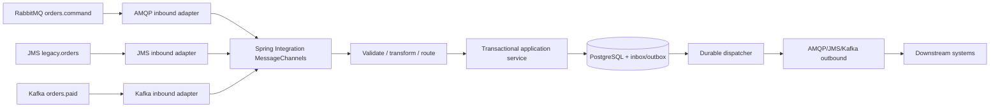
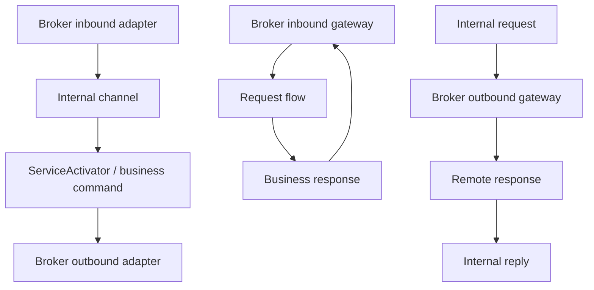
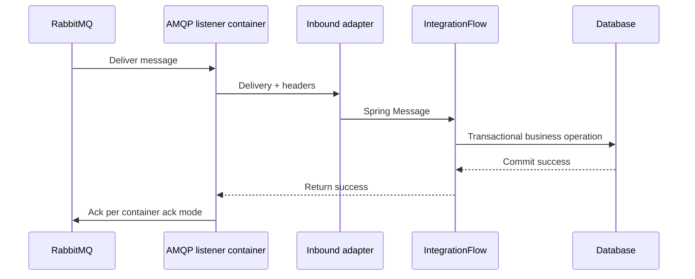
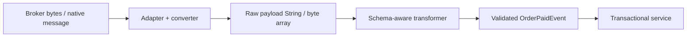
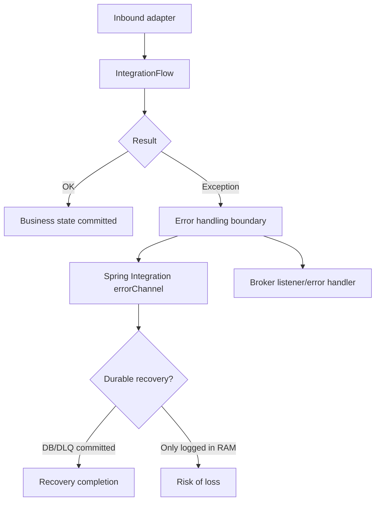
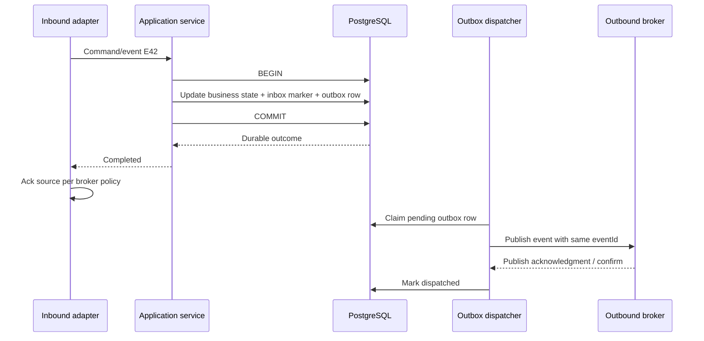

# AMQP, JMS, or Kafka adapters in `IntegrationFlow`

## 1. Problem: connecting brokers into an integration flow without breaking delivery semantics

A Spring Boot system receives orders over HTTP, writes to PostgreSQL, publishes an `OrderPaid` event to Kafka, and sends a shipping request to a partner over RabbitMQ. Meanwhile, a legacy accounting system exposes queues via JMS. You can use Spring Integration to turn all of these inputs and outputs into **`Message<?>` instances flowing through `IntegrationFlow`**, rather than scattering business logic across three completely separate listener styles.

However, "all being messages" does not make the three brokers identical. RabbitMQ uses exchanges, queues, bindings, and acknowledgments; JMS is an API built around destinations, sessions, and acknowledgment/transaction modes; Kafka is a partitioned log with consumer groups, offset commits, and retention. An adapter only bridges a **protocol boundary** into a Spring Integration message channel—**it does not create an atomic transaction spanning brokers, databases, and HTTP clients**.

Example flow:



This lesson **"AMQP, JMS, or Kafka adapters in IntegrationFlow"** belongs to the **"Integration Adapters"** chapter of the **SPRING_BOOT_INTEGRATION** module. The broader module covers organizing Spring Boot integrations across HTTP clients, databases, caches, brokers, and Spring Integration adapters—focusing on configuration, data contracts, transactions, error/duplicate handling, testing, and observability.

After this lesson, you will be able to:

- Choose the right inbound/outbound **channel adapter** or **gateway** for fire-and-forget vs. request-reply.
- Configure Java DSL `IntegrationFlow` using Spring Boot-managed AMQP, JMS, or Kafka infrastructure.
- Understand when broker ack/commits occur, especially when a flow switches threads or runs asynchronously.
- Design converters, header mappings, error channels, retries, dead-lettering, and idempotency per broker.
- Combine adapters with JDBC/jOOQ/JPA, Redis, HTTP/SOAP, and transactional outboxes.
- Test against real brokers and observe errors at the **right boundary**.

**Core principle:** adapters provide a consistent way to express flows, whereas reliability depends on broker-specific delivery semantics and real durability milestones.

## 2. Common vocabulary: `Message<?>`, channels, endpoints, and handlers

Spring Integration follows **Enterprise Integration Patterns**. A message has:

- **Payload**: business data, such as bytes, JSON strings, DTOs, records, or provider-specific objects.
- **Headers**: metadata such as correlation ID, content type, broker topic/queue, delivery metadata, or acknowledgment handles.
- **Channel**: connects endpoints; channel choice governs threading and error propagation.
- **Endpoint**: component receiving or sending messages—adapters, gateways, transformers, filters, routers, service activators.
- **`IntegrationFlow`**: declares a chain of endpoints via the Java DSL.

```java
import org.springframework.integration.dsl.IntegrationFlow;
import org.springframework.context.annotation.Bean;

@Bean
IntegrationFlow simpleFlow(OrderCommandService service) {
    return IntegrationFlow.from("validatedOrders")
        .filter((OrderCommand command) ->
                command.orderId() != null)
        .handle(service, "apply")
        .get();
}
```

`OrderCommand` and `OrderCommandService` are application types; `apply` must match the payload and signatures supported by Spring Integration. This snippet only demonstrates an internal channel—**no broker adapter is wired yet**.

### 2.1. Important channel types

| Channel | Behavior | Risk when placed after an inbound broker |
|---|---|---|
| `DirectChannel` | Invokes subscriber synchronously, usually on sender thread. | Slow handlers block poll/delivery threads; however, failures align naturally with the ack boundary. |
| `ExecutorChannel` | Offloads work to another executor. | Inbound adapter may return/ack before business work commits; thread-bound transactions/context do not auto-propagate. |
| `QueueChannel` | Buffers messages in a JVM queue (when in-memory). | No durability across process crashes; timeouts/pollers and acks must be designed carefully. |
| `PublishSubscribeChannel` | Fans out to multiple subscribers per configuration. | Partial success/error and reply semantics are harder; not equivalent to broker pub/sub. |
| Persistent channel store | Stores messages via a configured store. | Requires transactions, serialization, TTL, and recovery; not durable just by calling it "persistent". |

By default, `DirectChannel` is straightforward when an inbound adapter invokes a synchronous transactional service. When a service must call an ERP for tens of seconds, switch to a **durable handoff** before acknowledging the broker rather than pushing to an in-memory `ExecutorChannel`.

### 2.2. `MessageHeaders` are not a verbatim copy of broker headers

Spring Integration `MessageHeaders` are an in-JVM abstraction. AMQP `MessageProperties`, JMS message properties, and Kafka `Headers` have different types and constraints. Adapters/converters must **map headers selectively**; never dump internal headers like `replyChannel`, `errorChannel`, auth tokens, or non-serializable Java objects onto the wire.

## 3. Comparing AMQP, JMS, and Kafka before choosing an adapter

| Aspect | RabbitMQ via AMQP | JMS | Apache Kafka |
|---|---|---|---|
| Nature | Queue/exchange routing broker via AMQP 0-9-1 in typical Spring AMQP setups. | Java messaging API; actual behavior depends on the JMS provider (e.g., Artemis). | Distributed append-only log with partitions. |
| Consumption target | Queues bound to exchanges. | Queues or topic subscriptions (durable/shared per provider). | Topic + partitions + consumer group. |
| Distribution | Competing consumers on a queue; pub/sub via multiple queues/bindings. | Queue competing consumers or topic subscriptions. | Typically one partition assigned to one consumer per group; independent groups read separately. |
| Progress tracking | Messages acked/nacked/requeued per broker mechanism. | Session acknowledgments/transactions and redelivery. | Offsets committed by consumer groups. |
| Replay | Requires queue/DLX/retention/republish policies. | Depends on broker persistence/durable subscriptions. | Can replay offsets still within retention. |
| Ordering | Depends on queues, prefetch, concurrency, and requeues. | Depends on destination/provider and concurrent sessions/consumers. | Ordered **within a single partition**, not globally across a topic. |
| Identity | App message ID/correlation ID should be set explicitly. | Provider `JMSMessageID`, plus app correlation/operation IDs. | Topic-partition-offset is a log position, not a business event ID. |
| Failure retries | Nack/requeue, dead-letter exchanges, delayed mechanisms. | Session rollback/recover, provider redelivery/DLQs. | Seek/reprocess, error handlers, retry topics/DLTs. |
| Transactions | AMQP channel transactions/confirms scoped to broker, not atomic with DB. | JMS session transactions/JTA if genuinely configured. | Kafka producer transactions/consumer offsets scoped to Kafka, not atomic with DB. |

**Never pick a broker just because a DSL method looks cleaner.** Pick based on semantics, existing ecosystem, data retention, throughput, ordering, and reliability. If your task is simply connecting to an existing broker, the adapter keeps flows consistent without hiding broker-specific trade-offs you still must decide.

## 4. Adapter vs. gateway: one-way events or request-reply?

Spring Integration has two endpoint families often lumped together as "adapters":

- **Inbound channel adapter**: receives messages from outside and sends them into a Spring `MessageChannel`; **one-way**.
- **Outbound channel adapter**: takes a Spring message and sends it outward; **does not** return a business reply like a gateway.
- **Inbound gateway**: receives an external request, routes it through the flow, and awaits/returns a protocol reply.
- **Outbound gateway**: sends an external request and returns the reply back into the flow.



If producers simply emit `OrderPaid` without expecting a business reply, choose an **adapter**. If a JMS queue request expects a reply sent to `JMSReplyTo` per correlation contract, choose a **gateway** and design timeouts and reply ownership.

Do not build "RPC over Kafka topics" merely because a request-reply gateway exists: that requires request IDs, correlation, reply topics/partitions, TTLs, deadlines, and handling late responses arriving after timeout. Kafka suits event streaming far better than synchronous RPC in most cases.

## 5. Dependencies and Spring Boot-managed infrastructure

With Spring Boot 3.x/Spring Integration 6.x, a Gradle Kotlin DSL build might include:

```kotlin
dependencies {
    implementation("org.springframework.boot:spring-boot-starter-integration")

    // Add only adapters for brokers actually used:
    implementation("org.springframework.integration:spring-integration-amqp")
    implementation("org.springframework.integration:spring-integration-jms")
    implementation("org.springframework.integration:spring-integration-kafka")

    // Broker clients/starters as needed:
    implementation("org.springframework.boot:spring-boot-starter-amqp")
    implementation("org.springframework.boot:spring-boot-starter-activemq")
    implementation("org.springframework.kafka:spring-kafka")

    implementation("org.springframework.boot:spring-boot-starter-jdbc")

    testImplementation("org.springframework.boot:spring-boot-starter-test")
    testImplementation("org.springframework.integration:spring-integration-test")
}
```

**This is an illustrative catalog, not a requirement to install all three brokers at once.** For JMS, choose the starter/provider matching your deployment (Artemis or compatible ActiveMQ Classic); many Boot 3 projects use `jakarta.jms.*`—never mix `javax.jms` with `jakarta.jms`. Use the Spring Boot BOM so Spring Integration, Spring AMQP, Spring Kafka, and drivers stay aligned.

### 5.1. Who owns the connection beans?

| Broker | Beans to reuse | Avoid |
|---|---|---|
| RabbitMQ | Spring AMQP `ConnectionFactory`, `RabbitTemplate`, listener container factories when needed. | Creating ad-hoc connection factories without shared TLS/credentials/recovery settings. |
| JMS | `jakarta.jms.ConnectionFactory`, `JmsTemplate`, appropriate message listener container factories. | Opening sessions/clients per message and bypassing transactions/auth. |
| Kafka | `ConsumerFactory`, `ProducerFactory`, `KafkaTemplate`, listeners/containers. | Creating `KafkaConsumer` per record or custom factories that drop deserializers/security. |

Boot auto-configuration is conditional and backs off when custom beans appear. Before shipping to production, verify **which exact beans each adapter uses** rather than trusting `application.yml` blindly.

## 6. Java DSL: reading an `IntegrationFlow` from left to right

Model flow:

```java
@Bean
IntegrationFlow incomingOrdersFlow(OrderApplicationService service) {
    return IntegrationFlow.from("ordersInbound")
        .filter((String payload) -> !payload.isBlank())
        .transform(String.class, String::trim)
        .handle(service, "applyJson")
        .get();
}
```

Breakdown:

1. `from("ordersInbound")` creates/binds an input channel endpoint via DSL.
2. `filter(...)` drops messages failing the predicate; in business flows, configure an explicit **discard/error outcome** instead of silently dropping required messages.
3. `transform(...)` converts the payload; headers generally pass through per framework defaults, though each transformer/header mapper should be checked.
4. `handle(...)` invokes the service activator for business work; exception routing depends on **threads, channels, and error handling**.
5. `get()` finalizes flow construction (per API version).

A flow in Spring Integration does not create a Kafka consumer simply because its channel is named `ordersInbound`. You must attach a **broker inbound adapter** to that channel or start with `IntegrationFlow.from(adapterSpec)`.

## 7. AMQP inbound: RabbitMQ queue → `IntegrationFlow`

RabbitMQ integrates via **Spring AMQP**. An inbound adapter listens on a queue using a listener container and turns payloads and mapped headers into Spring messages.

Java DSL example using Spring Integration AMQP:

```java
import org.springframework.amqp.rabbit.connection.ConnectionFactory;
import org.springframework.context.annotation.Bean;
import org.springframework.integration.amqp.dsl.Amqp;
import org.springframework.integration.dsl.IntegrationFlow;

@Bean
IntegrationFlow rabbitOrdersInbound(
        ConnectionFactory rabbitConnectionFactory,
        OrderApplicationService orders) {

    return IntegrationFlow
        .from(Amqp.inboundAdapter(
                rabbitConnectionFactory, "orders.inbound"))
        .handle(orders, "applyJson")
        .get();
}
```

`OrderApplicationService.applyJson(...)` is an application-defined method accepting the payload produced by the AMQP converter. The example assumes `orders.inbound` exists with provisioned bindings/routing. If the converter returns `byte[]` instead of `String`, the method will not match without an appropriate transformer or converter.

**When to use:** receiving commands/events from a Rabbit queue, processing synchronously, and deciding ack/nack via listener container policy. Never attach a separate `@RabbitListener` to the same queue if every message must traverse one dedicated business handler: two consumers will compete and split deliveries unpredictably.

### 7.1. RabbitMQ receive path



The diagram shows **container auto acknowledgment** on the synchronous success path. If the flow switches to an in-memory `ExecutorChannel`/`QueueChannel` and returns early, the listener container treats handing off to the channel as success even though business work has not committed. If manual acknowledgments are enabled, the app must ack/nack explicitly per policy rather than assuming the diagram above.

### 7.2. Inbound adapters vs. AMQP gateways

AMQP inbound **adapters** suit one-way flows. AMQP inbound **gateways** apply when the broker sender expects a reply, requiring `replyTo`, correlation IDs, timeouts, and reply routing. Never hold a remote sender waiting on a gateway response while an ERP takes several minutes if you can switch to an async operation ID + result event.

## 8. AMQP outbound: Spring message → exchange/routing key

An outbound AMQP adapter uses `RabbitTemplate` to publish messages to a configured exchange/routing key.

```java
import org.springframework.amqp.rabbit.core.RabbitTemplate;
import org.springframework.context.annotation.Bean;
import org.springframework.integration.amqp.dsl.Amqp;
import org.springframework.integration.dsl.IntegrationFlow;

@Bean
IntegrationFlow rabbitShipmentOutbound(RabbitTemplate rabbitTemplate) {
    return IntegrationFlow
        .from("shipmentOutbound")
        .handle(Amqp.outboundAdapter(rabbitTemplate)
                .exchangeName("shipping.events")
                .routingKey("shipment.requested"))
        .get();
}
```

Other beans or flows send to `shipmentOutbound` via `MessageChannel`/`MessagingGateway`; avoid magic strings in business code by using typed gateway interfaces.

### 8.1. What does publish success mean?

`RabbitTemplate.convertAndSend(...)` returning normally **does not prove** the message reached the target queue. Configure publisher confirms, mandatory returns, and queue/exchange/binding topology per contract. RabbitMQ can accept a publish to an exchange yet drop or return an unroutable message if bindings are missing.

Depending on the Spring Integration AMQP endpoint/version, the outbound handler can wire confirm/return channels or async callbacks. Define **which milestone counts as a durable publish**, especially before marking `outbox.PUBLISHED`.

### 8.2. Dynamic routing keys and security

If routing keys come from message headers, allowlist values or map them from validated event types at a trust boundary. Never allow external callers to inject arbitrary exchanges or routing keys via HTTP headers using broad Rabbit credentials; that risks information disclosure or writing to unintended queues.

## 9. JMS inbound: message-driven over polling when fast reaction is needed

JMS is an **API**, not a specific broker. Spring Integration JMS supports inbound adapters and gateways, where a **message-driven channel adapter** typically uses a listener container instead of continually calling `receive()` in a poller.

Conceptual Java DSL example with Spring Integration JMS:

```java
import jakarta.jms.ConnectionFactory;
import org.springframework.context.annotation.Bean;
import org.springframework.integration.dsl.IntegrationFlow;
import org.springframework.integration.jms.dsl.Jms;

@Bean
IntegrationFlow jmsLegacyOrdersInbound(
        ConnectionFactory jmsConnectionFactory,
        LegacyOrderService service) {

    return IntegrationFlow
        .from(Jms.messageDrivenChannelAdapter(
                jmsConnectionFactory)
                .destination("legacy.orders.queue"))
        .handle(service, "apply")
        .get();
}
```

This assumes a provider/JMS connection factory exists, the queue destination is provisioned, and converter mapping yields the payload expected by `apply`. **Builder method names can vary across Spring Integration major releases**—check your API/BOM when implementing. Some versions offer overloads taking destinations or container factories; the example highlights the listener model clearly.

### 9.1. Polling JMS adapters vs. message-driven adapters

| Type | How it works | When to use |
|---|---|---|
| JMS **polling inbound adapter** | A poller calls receive at a configured cadence and timeout. | Batch windows/rate-controlled intake, shared poller orchestration. |
| JMS **message-driven inbound adapter** | A message listener container receives and pushes messages onto the channel. | Continuous processing with container concurrency/transaction/ack policies. |
| JMS **inbound gateway** | Receives a JMS request and sends a JMS reply. | Legacy request-reply using `JMSReplyTo`, correlation, and timeouts. |

When using polling, do not assume poller transactions behave like message-driven containers; specifically verify when JMS messages are acknowledged and how Spring Integration polling/error flows run.

### 9.2. JMS `queue` vs. `topic`

JMS queues typically use competing consumers; JMS topics use subscriptions. Durable/shared durable subscriptions and `clientId` follow provider-specific rules. Never switch from a queue to a topic merely by changing a destination string without confirming pub/sub semantics and subscription lifecycles.

## 10. JMS outbound and message conversion

A JMS outbound adapter can use `JmsTemplate` to send to a destination:

```java
import org.springframework.context.annotation.Bean;
import org.springframework.integration.dsl.IntegrationFlow;
import org.springframework.integration.jms.dsl.Jms;
import org.springframework.jms.core.JmsTemplate;

@Bean
IntegrationFlow legacyBillingOutbound(JmsTemplate jmsTemplate) {
    return IntegrationFlow
        .from("billingOutbound")
        .handle(Jms.outboundAdapter(jmsTemplate)
                .destination("legacy.billing.queue"))
        .get();
}
```

Never assume a Java record payload automatically serializes to the right XML/text contract. JMS converters produce `TextMessage`, `BytesMessage`, or other message types per `MessageConverter`. Across distinct JVMs or broker versions, agree on an explicit wire format such as UTF-8 JSON/XML/Avro with schema versions; avoid raw Java object serialization.

### 10.1. JMS request-reply: correlation and timeouts

For JMS gateways, design:

- `JMSReplyTo` destinations or authorized reply queues.
- Stable correlation IDs and accurate request/reply matching.
- Wait timeouts and cleanup for unmatched/late replies.
- Duplicate request handling when producers retry.
- Handling replies arriving after caller timeout when the operation already succeeded.
- Never holding JDBC transactions or synchronous HTTP threads open indefinitely.

Provider-generated `JMSMessageID`/correlation IDs are rarely business idempotency keys; carry an `operationId` or command ID in the contract payload/header.

## 11. Kafka inbound adapter: consumer group → `IntegrationFlow`

Kafka records carry topic, partition, offset, key, value, and headers. Spring Integration Kafka provides a message-driven inbound adapter connecting a `ConsumerFactory`/container to a flow.

Record listener example:

```java
import org.apache.kafka.common.serialization.StringDeserializer;
import org.springframework.context.annotation.Bean;
import org.springframework.integration.dsl.IntegrationFlow;
import org.springframework.integration.kafka.dsl.Kafka;
import org.springframework.integration.kafka.inbound.KafkaMessageDrivenChannelAdapter;
import org.springframework.kafka.core.ConsumerFactory;

@Bean
IntegrationFlow kafkaOrderPaidInbound(
        ConsumerFactory<String, String> consumerFactory,
        OrderProjectionService projections) {

    return IntegrationFlow
        .from(Kafka.messageDrivenChannelAdapter(
                consumerFactory,
                KafkaMessageDrivenChannelAdapter.ListenerMode.record,
                "orders.paid"))
        .handle(projections, "applyJson")
        .get();
}
```

Verify Kafka DSL imports and overloads for your Spring Integration version. This uses a **preconfigured `ConsumerFactory`** rather than instantiating Kafka consumers inside the flow. Bean names/types must match `StringDeserializer` payloads and the logical subscriber's consumer group ID.

### 11.1. Consumer groups need explicit identity

```yaml
spring:
  kafka:
    bootstrap-servers: ${KAFKA_BOOTSTRAP_SERVERS}
    consumer:
      group-id: order-projection
      enable-auto-commit: false
      auto-offset-reset: earliest
      key-deserializer: org.apache.kafka.common.serialization.StringDeserializer
      value-deserializer: org.apache.kafka.common.serialization.StringDeserializer
```

Here `order-projection` should belong to this logical subscriber. If multiple independent subscriptions share the same `group-id`, they **split partitions** instead of each receiving the full stream.

### 11.2. Adapters do not erase partitions and offsets

- A partition is normally assigned to at most one consumer within a group at a time.
- Raising `concurrency` only adds useful workers up to the partition count and downstream capacity.
- `auto-offset-reset=earliest` does not rewind already-committed offsets.
- Kafka preserves order **within a single partition**; retry topics and async channels can reorder processing.
- `topic/partition/offset` is a log position; business deduplication needs a durable `eventId`.

When a Spring Integration flow commits to the database and then offset commit fails, Kafka will redeliver. That failure window requires consumer idempotency—it cannot be fixed by "changing adapters".

## 12. Kafka outbound adapter: mapping payloads to keyed records on topics

```java
import org.springframework.context.annotation.Bean;
import org.springframework.integration.dsl.IntegrationFlow;
import org.springframework.integration.kafka.dsl.Kafka;
import org.springframework.kafka.core.KafkaTemplate;

@Bean
IntegrationFlow kafkaFulfillmentOutbound(
        KafkaTemplate<String, String> kafkaTemplate) {

    return IntegrationFlow
        .from("fulfillmentOutbound")
        .handle(Kafka.outboundChannelAdapter(kafkaTemplate)
                .topic("fulfillment.events"))
        .get();
}
```

Specify Kafka serialization and keys explicitly: when events for the same `orderId` need per-aggregate ordering, set the aggregate ID as the **record key** per policy. Without a key, partition routing will not preserve aggregate ordering. Spring Integration's Kafka outbound handler supports topic/key from configuration and headers, but check header names/mappings for your version rather than assuming a JSON field named `orderId` becomes the Kafka key automatically.

### 12.1. Async sends and completion milestones

In modern Spring Kafka, `KafkaTemplate.send(...)` typically returns a `CompletableFuture`; the outbound adapter can behave synchronously or asynchronously depending on endpoint configuration. Returning immediately after **enqueuing the send** does not prove broker acknowledgment. When feeding from an outbox, the dispatcher must observe producer acknowledgments/callbacks per contract before marking events delivered.

**A successful `IntegrationFlow` invocation does not automatically mean the downstream broker persisted the event and consumers finished processing it.**

## 13. Spring Integration DSL vs. `@KafkaListener`/`@RabbitListener`/`@JmsListener`

| Criterion | Broker-native annotation listener | Spring Integration DSL adapter |
|---|---|---|
| Starting a single handler | Clear, minimal boilerplate. | Requires defining flows/adapters. |
| Routing, filtering, split/aggregate, gateway composition | Must manually invoke services or wire flows. | Excels when flows combine multiple integration patterns. |
| Error channels and flow diagnostics | Relies on container-native error handlers. | Adds Spring Integration error flows while keeping container rules. |
| Conversion/header mapping | Broker/framework level. | Broker adapter + Spring Message transforms/mappings. |
| Ack/transactions | Still governed by container/broker. | **Does not alter** underlying ack/transaction guarantees. |
| Extensibility | Clear service-oriented listeners. | Fits multi-protocol orchestration pipelines. |

Do not rewrite every `@KafkaListener` into DSL just for uniformity. When a listener simply calls one service, native listeners are easier to operate. When pipelines combine validation, transforms, routers, durable handoffs, and multiple outbound adapters, DSL makes the business flow explicit.

**Avoid registering both a native listener and a Spring Integration inbound adapter for the same logical subscriber unless competing consumers are intentional.**

## 14. Message conversion: broker payloads do not arrive in your domain type automatically

A common mistake is writing an application service expecting `OrderPaidEvent` while the inbound adapter emits `byte[]` or `String`, breaking handler resolution/conversion.

Design an explicit three-stage pipeline:



Example JSON transformer inside a flow (keeping producer DTOs decoupled from driver internals):

```java
import com.fasterxml.jackson.databind.ObjectMapper;
import org.springframework.context.annotation.Bean;
import org.springframework.integration.dsl.IntegrationFlow;

@Bean
IntegrationFlow decodedOrderEvents(
        ObjectMapper mapper,
        OrderPaidApplicationService service) {
    return IntegrationFlow.from("orderJsonInbound")
        .transform(String.class, json -> {
            try {
                return mapper.readValue(
                        json, OrderPaidEvent.class);
            } catch (com.fasterxml.jackson.core.JsonProcessingException ex) {
                throw new InvalidOrderEventException(
                        "Invalid OrderPaidEvent payload", ex);
            }
        })
        .handle(service, "applyIdempotently")
        .get();
}
```

`OrderPaidEvent` and `InvalidOrderEventException` are application-defined types; production code must validate `eventId`, `schemaVersion`, `aggregateVersion`, tenant authorization, and payload size. This flow **consumes from an internal channel**, which must be connected to a broker inbound adapter via channel name or subflow.

### 14.1. Caution with trusted types and Java serialization

- In AMQP, converters can inspect content types and type headers; restrict allowed classes/packages when deserializing untrusted data.
- In JMS, `ObjectMessage` and Java serialization create compatibility, serdes, and security risks; prefer text/bytes with explicit schemas.
- In Kafka, `JsonDeserializer` uses trusted packages/type headers; never use wildcard trust on public/shared topics lacking strict contracts.
- With Schema Registry (Avro/Protobuf/JSON Schema), manage subjects, versions, and compatibility rather than deriving DTO types from sender-supplied Java class names.

### 14.2. Never turn deserialization failures into "valid empty" messages

On parse failure, never catch and return a default DTO or empty string that causes downstream to ack and drop data. Malformed records belong in error handlers/quarantine and durable failure logs—without logging raw payloads containing sensitive data.

## 15. Header mapping and correlation across AMQP/JMS/Kafka

A logical event envelope should carry:

```json
{
  "eventId": "9bb8720a-7fce-467c-b3d5-8c83fb89ef74",
  "eventType": "OrderPaid",
  "schemaVersion": 1,
  "aggregateId": "O-42",
  "aggregateVersion": 7,
  "correlationId": "order-workflow-821",
  "data": {
    "orderId": "O-42"
  }
}
```

Identifiers like `eventId`, `aggregateId`, and version belong in the **stable payload/envelope**; you may mirror them into broker headers for convenience, but never store them solely in provider metadata that can vanish across gateways or replays.

| Source | Common metadata | Do not assume |
|---|---|---|
| RabbitMQ | `AmqpHeaders.*`, delivery tag, routing key, received exchange, redelivered. | Delivery tag is a system-wide event ID. |
| JMS | `JMSCorrelationID`, `JMSMessageID`, `JMSRedelivered`, provider properties. | `JMSMessageID` is an idempotency key for republished logical commands. |
| Kafka | `KafkaHeaders.*`, key, topic, partition, offset, acknowledgment object. | Kafka offset is an event ID across topics/retries. |
| Spring Integration | `MessageHeaders.ID`, correlation/sequence, reply/error channels. | Spring Message ID survives broker serialization/restarts automatically. |

### 15.1. Header security and trust boundaries

Never blindly forward `Authorization`, `Cookie`, JMS internal objects, `Acknowledgment`, channel objects, or raw SOAP/HTTP headers to another broker. Map an explicit allowlist, supply scoped outbound credentials separately, and inspect wire-level headers in tests.

Tracing context (`traceparent`, B3) can be injected/extracted by instrumentation when supported and enabled; **a standalone `traceparent` header does not prove distributed traces are actually linked**.

## 16. Transaction boundaries: local database, broker sessions, and integration flows

Suppose an inbound AMQP/JMS/Kafka message updates PostgreSQL and then publishes an event to another broker.

```mermaid
sequenceDiagram
    participant B as Source broker
    participant IN as Inbound adapter/container
    participant F as IntegrationFlow
    participant DB as PostgreSQL
    participant OUT as Outbound broker
    B->>IN: Deliver event E42
    IN->>F: Message payload + headers
    F->>DB: BEGIN; update + inbox/outbox; COMMIT
    DB-->>F: Committed
    F->>OUT: Publish event
    OUT-->>F: Broker acknowledgment/confirm
    F-->>IN: Success
    IN->>B: Ack/commit source progress
```

If **DB commits and outbound publish fails**, business state and downstream events diverge. If outbound publish succeeds and source ack fails, the message redelivers. Writing DB updates and outbox rows in the same transaction makes downstream publishing a **separate workflow with durable retries**.

**Spring Integration `IntegrationFlow` does not create distributed transactions** across RabbitMQ, JMS, Kafka, PostgreSQL, and HTTP clients. `@Transactional` applies strictly to resources and transaction managers actually participating.

### 16.1. Polling endpoint transactions

Polling adapters can use transactional pollers when configured properly, yet a poller transaction does not wrap outbound HTTP/SOAP calls in ACID guarantees. Message-driven adapters have container-managed transaction/ack boundaries instead. Never confuse the two just because both live in an `IntegrationFlow`.

## 17. Acknowledgment: the line between losing and redelivering messages

**Common safe milestone:** the broker receives ack/source offset commit **after business work or a durable handoff commits**.

| Broker | Progress marker | What goes wrong if misplaced |
|---|---|---|
| RabbitMQ | Channel delivery ack/nack/reject. | Early auto-ack → lost work; unbounded nack/requeue → poison loops. |
| JMS | Transacted session commit or mode/provider ack. | Session/client ack before durable business state → lost work. |
| Kafka | Group offset commit per container ack mode. | Committing offsets before RAM async tasks → lost work. |

### 17.1. `DirectChannel` and synchronous error propagation

With inbound adapter → `DirectChannel` → transactional service, the listener container receives exceptions synchronously and applies its policy (requeue, rollback, retry, seek). That **still does not guarantee exactly-once**: if DB commits and a later step throws, the source redelivers.

### 17.2. `ExecutorChannel` or async gateways change "success" semantics

```text
Kafka/AMQP/JMS inbound
  -> send Message to in-memory ExecutorChannel
  -> adapter/listener returns
  -> source offset/ack commits
  -> process crashes before worker hits DB
  -> lost work
```

To decouple slow workers safely, write a **durable job/inbox/outbox** to the DB in a transaction before returning/acking, then let separate workers pick it up. An in-memory `QueueChannel` never replaces broker or database durability.

## 18. AMQP redelivery, nack/requeue, and DLX

With RabbitMQ:

- Listeners ack upon success per container mode.
- On failure, containers/recoverers reject/nack and choose requeue vs. dead-lettering.
- Dead-letter exchanges (DLX) route rejected/expired/overflowed messages per broker topology.
- `x-death` headers and redelivered flags aid diagnostics, **never replacing business `eventId`**.
- Prefetch and concurrency govern throughput, fairness, and in-flight memory.

### 18.1. Continuous requeue creates a retry storm

Corrupted JSON will not heal after 100 requeues. Classify errors:

| Error | Usually appropriate policy |
|---|---|
| Invalid payload/schema | Reject/quarantine/DLQ; fix producer/data. |
| Business validation rejection | Commit rejected outcome; do not hot-retry. |
| DB deadlock/transient error | Bounded retry/backoff when idempotent. |
| ERP timeout after write | Record `UNKNOWN`, reconcile; never requeue endlessly with new keys. |
| Bad auth/queue config | Alert and stop hot retries. |

DLXs must have provisioned queues, bindings, and TTL/retention; never call `reject` assuming a DLQ automatically catches messages without topology.

### 18.2. Thread/channel constraints on manual ack

AMQP delivery tags are scoped to a channel; holding an ack handle across arbitrary threads past container shutdown/recovery can ack the wrong channel or hit a closed channel. With manual ack, follow Spring AMQP's thread/lifecycle APIs and test cancellations, shutdowns, and channel reuse. Never serialize delivery tags into business DTOs to ack from another process.

## 19. JMS sessions, transacted mode, and redelivery

JMS acknowledgments include `AUTO_ACKNOWLEDGE`, `CLIENT_ACKNOWLEDGE`, `DUPS_OK_ACKNOWLEDGE`, and transacted sessions depending on provider and container. **`CLIENT_ACKNOWLEDGE`** can acknowledge multiple messages consumed on the session at once rather than one message like a RabbitMQ delivery tag.

| Mechanism | Caution |
|---|---|
| `AUTO_ACKNOWLEDGE` | Exact ack timing depends on JMS listener/provider/container semantics; test handler errors explicitly. |
| `CLIENT_ACKNOWLEDGE` | Session-scoped acks differ from per-message broker acks; do not generalize blindly. |
| Transacted session | Commits/rolls back the JMS session within JMS scope; does not automatically wrap DB transactions. |
| JTA/XA | Can coordinate multiple XA resources when genuinely configured; adds operational complexity, recovery logs, and constraints. |
| Provider redelivery/DLQ | Depends on Artemis/ActiveMQ/provider delay and `max-deliveries` policies. |

In Spring Boot, `JmsListenerContainerFactory` or `DefaultMessageListenerContainer` instances can differ in transaction/ack/recovery settings; wire Spring Integration JMS adapters to the intended container/factory. **Do not assume Boot YAML properties configure a manually constructed container that bypasses Boot configurers.**

### 19.1. Why not default to JMS XA everywhere?

Distributed XA carries heavy operational cost: transaction coordinators, durable logs, participant recovery, timeouts, and in-doubt states. External HTTP/SOAP endpoints still do not participate in XA in most integrations. For event-driven workflows, transactional outbox/inbox paired with compensation/reconciliation is usually far simpler to operate.

## 20. Kafka acks/offsets, error handlers, and batch semantics

Spring Integration Kafka's message-driven adapter builds on Spring Kafka's listener container. Settings like `AckMode.RECORD`, `AckMode.BATCH`, `AckMode.MANUAL`/`MANUAL_IMMEDIATE`, concurrency, and `DefaultErrorHandler` control redelivery, retries, and offset progression.

Reference configuration:

```yaml
spring:
  kafka:
    consumer:
      group-id: order-projection
      enable-auto-commit: false
      auto-offset-reset: earliest
      max-poll-records: 100
    listener:
      ack-mode: record
      concurrency: 3
```

**Important:** when you construct a custom Kafka adapter/`ConcurrentMessageListenerContainer` in Spring Integration DSL, **`spring.kafka.listener.*` may not apply automatically** as it does to Boot's `@KafkaListener` factory. Inspect actual container properties and configure ack/error handlers directly where the container is created.

### 20.1. Manual ack requires matching header/handler contracts

With manual ack enabled, the adapter can expose an `Acknowledgment` handle in Kafka headers depending on configuration and Spring Kafka version. Only invoke `acknowledge()` after durable work commits, obeying lifecycle/thread rules; never serialize the handle across Kafka/JMS/AMQP or pass it to uncontrolled async workers.

### 20.2. Batch listeners differ from record listeners

Batch mode delivers `List` payloads/records with different offset and error semantics. If one record in a batch fails, never commit the whole batch just because 99/100 succeeded. Pick a batch error policy/partial-failure strategy per Spring Kafka version; often record listeners + batched SQL in the application service are easier to maintain.

### 20.3. Kafka deserialization failures happen before the flow

A `SerializationException` in Kafka's `Deserializer` can happen **before Spring Integration ever creates a `Message<?>`**, so the flow's internal `errorChannel` never sees it. Use `ErrorHandlingDeserializer` and container error handling to route poison records to a DLT/quarantine. This is a critical boundary between **broker client**, **adapter**, **integration flow**, and **business handler**.

## 21. `errorChannel`: Spring Integration's error path, not a durable DLQ

Spring Integration provides `ErrorMessage`, `errorChannel`, and endpoint error handling. An error message carries the exception and failed message for routing, logging, or recovery.



This diagram shows **possible paths**; it does not mean every exception goes simultaneously to both `errorChannel` and the broker handler. Where errors go depends on the inbound endpoint, channel threads, pollers, error channel configuration, and exception propagation.

### 21.1. Synchronous vs. asynchronous

- **Synchronous `DirectChannel`**: exceptions normally propagate back to the inbound sender/container, which applies ack/requeue/error-handler rules.
- **Asynchronous `ExecutorChannel`/poller**: errors go to the task/poller error channel and **do not** return to the original broker delivery thread.
- **Recovery callbacks**: logging an error and returning normally tells the container the message succeeded, depending on the endpoint.

**An in-memory `errorChannel` is not a persistent queue.** Whenever failures must be recovered, write a durable record/job/outbox/quarantine row or publish to a broker DLQ with publisher confirms before ACKing the source.

### 21.2. Never swallow causes with catch-all handlers

Anti-pattern:

```java
try {
    service.apply(event);
} catch (Exception ex) {
    log.error("Integration failed", ex);
}
// Flow returns success without persisting failure state
```

Classify `TRANSIENT`, `PERMANENT_CONTRACT`, `BUSINESS_REJECTED`, and `UNKNOWN_OUTCOME`. Without durable recovery, rethrow the exception so the broker container can enforce its configured policy.

## 22. Where should retries live? Avoid multiplying layers of attempts

A flow may have retries in:

1. Kafka/RabbitMQ/JMS client, producer, or consumer container.
2. Spring Integration's `RequestHandlerRetryAdvice`.
3. Spring Retry on service methods.
4. HTTP client/ERP adapters.
5. Database transaction retries.
6. Broker redelivery/DLT/retry topics.
7. Durable outbox job workers.

If every layer retries three times, total attempts multiply dramatically—especially dangerous for remote mutating commands. Pick **one primary retry owner** at the right boundary, set a shared attempt budget, deadline, backoff/jitter, rate limit, and exhaustion behavior.

### 22.1. Retry matrix by failure source

| Error source | Hot-retry? | Rationale |
|---|---|---|
| Bad JSON/schema, unsupported event version | No. | Payloads do not fix themselves; quarantine/DLT. |
| Unauthorized/invalid TLS/WS-Security | No hot retry. | Fix permissions or config. |
| DB deadlock/serialization conflict | Conditionally. | Failed attempt rolled back and operation is idempotent. |
| Brief broker network blip | Bounded. | Recoverable; publish outcome may be `UNKNOWN`. |
| ERP HTTP 503/429 | Conditionally. | Respect backoff, quotas, and total deadline. |
| ERP write timeout after request sent | Never blind-replay. | Remote side effect may have committed. |
| Duplicate business event | Usually no. | Verify identical intent/outcome and ack safely. |
| Poison message triggering deterministic code bug | Never endlessly. | Fix code, DLQ, and replay after deploy. |

### 22.2. Retry advice does not roll back multiple resources

If `RequestHandlerRetryAdvice` wraps a handler that already committed to the DB and then failed on Kafka publish, retrying re-runs the DB update or HTTP call. Fix the boundary: write DB + outbox in one transaction, let a dispatcher retry publishing independently, and enforce inbox/idempotency on consumers.

## 23. Transactional outbox for outbound flows that must not drop events

A safe pattern when the **business database is the source of truth**:



Here the inbound adapter does not publish outbound events **inside the DB transaction**—it persists the intent to publish. If the outbound broker is down, the outbox preserves the event. The dispatcher can use AMQP/JMS/Kafka outbound adapters, provided it **verifies publisher acks/confirms** before marking `PUBLISHED`.

If publishing succeeds and the worker crashes before marking, the event replays with the **same `eventId`** and consumers deduplicate. Outboxes solve atomicity between domain state and publish intent; they do not create exactly-once delivery across brokers and consumers.

### 23.1. Compact inbox + outbox code model

```java
import org.springframework.jdbc.core.simple.JdbcClient;
import org.springframework.stereotype.Service;
import org.springframework.transaction.annotation.Transactional;

@Service
class OrderPaidService {

    private final JdbcClient jdbc;
    private final OutboxWriter outboxWriter;

    OrderPaidService(JdbcClient jdbc, OutboxWriter outboxWriter) {
        this.jdbc = jdbc;
        this.outboxWriter = outboxWriter;
    }

    @Transactional
    public void applyIdempotently(OrderPaidEvent event) {
        int inserted = jdbc.sql("""
            INSERT INTO inbox(consumer_name, event_id, payload_hash)
            VALUES ('order-projection', :eventId, :hash)
            ON CONFLICT (consumer_name, event_id) DO NOTHING
            """)
            .param("eventId", event.eventId())
            .param("hash", event.verifiedPayloadHash())
            .update();

        if (inserted == 0) {
            verifyPriorOutcome(event);
            return;
        }

        applyBusinessState(event);
        outboxWriter.insertEvent(
                event.derivedIntegrationEvent());
    }

    private void verifyPriorOutcome(OrderPaidEvent event) {
        // Read stored hash/outcome; do not treat every duplicate as success.
    }

    private void applyBusinessState(OrderPaidEvent event) {
        // JDBC/JPA/jOOQ business update in the same transaction.
    }
}
```

`OrderPaidEvent` and `OutboxWriter` are application abstractions you implement. `verifiedPayloadHash()` must be computed from a trusted canonical payload representation rather than trusting a caller-supplied hash. The placeholder methods require real implementations; **never copy this class as-is and treat it as complete idempotency**. `OutboxWriter` must share the same `DataSource`/transaction manager and must not use `REQUIRES_NEW`.

## 24. Request-reply gateways: timeouts do not prove the remote side skipped work

With AMQP/JMS request-reply, a gateway sends a command over the broker and awaits a response. When `replyTimeout` expires:

```text
Caller sends ReserveStock(operationId=R42)
  -> broker delivers and remote consumer succeeds
  -> response is lost or arrives too late
  -> gateway times out; caller does not know outcome
  -> retry with a new operationId => double reservation
```

You need:

- Stable `operationId`/idempotency keys in requests.
- Remote services supporting lookup by ID or safe idempotent commands.
- Reply correlation with explicit ownership for timeouts and late replies.
- Business state `UNKNOWN`/`PENDING_RECONCILIATION` when side effects are uncertain.
- Overall deadlines and throttling/backpressure.
- Avoid holding local DB transactions open for tens of seconds awaiting remote replies when async designs work.

One-way adapters and reply-awaiting gateways have **different failure windows**, and neither grants end-to-end exactly-once automatically.

## 25. Broker header propagation, tracing, and context across threads

Spring Boot supports Micrometer Observation/Tracing; Spring AMQP, Kafka, JMS, and Spring Integration provide version- and config-dependent instrumentation. In Spring Integration:

- **`DirectChannel`** keeps synchronous call stacks so active scopes naturally follow handlers.
- **`ExecutorChannel`** switches threads; `ThreadLocal`/MDC does not propagate automatically without task decorators or context propagation.
- **`QueueChannel`/pollers** may run after the inbound span has ended.
- **Broker wire headers** need propagators/header mappers to inject and extract trace context.
- **Outbox dispatchers** run post-commit and may start new traces; stable `eventId`/`correlationId` link long-running workflows.
- Never use `traceId` as an idempotency key or metric label.

### 25.1. Observations can drop if you bypass Boot beans

Manually instantiating `RabbitTemplate`, `KafkaTemplate`, `ConsumerFactory`, or JMS listener containers without applying `ObservationRegistry`, credentials, TLS, and shared customizers breaks traces. When defining custom adapters, verify actual wired beans and ensure instrumentation is active on **both producers and consumers**.

### 25.2. Metric labels must have low cardinality

Measure `flow=orders-paid-kafka`, `broker=kafka`, `outcome=success|retry|dlt`, `error.category=contract|transient`. Never tag `orderId`, `eventId`, `traceId`, or arbitrary user routing keys; keep those in access-controlled, retention-bounded logs and traces.

## 26. Backpressure and concurrency: tune to brokers and downstream, not flow bean counts

A working flow does not mean sufficient capacity. Common bottlenecks:

| Component | Signal | Adjustment |
|---|---|---|
| Rabbit inbound | Prefetch, active consumers, unacked count, queue depth. | Tune listener concurrency/prefetch and bounded worker capacity. |
| JMS inbound | Consumer sessions, pending messages, redeliveries, provider queue depth. | Tune container concurrency, session transactions, and redelivery policies. |
| Kafka inbound | Consumer lag, assigned partitions, poll interval, `max.poll.records`. | Keep concurrency ≤ partition count; reduce blocking. |
| Spring Integration channel | Executor queue depth, rejected tasks, handler latency. | Bounded queues, durable handoffs, downstream bulkheads. |
| PostgreSQL | Hikari active/pending, lock waits, query latency. | Reduce parallel writes/hot keys; shorten transactions. |
| ERP HTTP/SOAP | Pool limits, timeouts, 429/503s, in-flight commands. | Concurrency budgets, circuit breakers, reconciliation. |
| Outbox | Oldest pending age, dispatch attempts, publisher confirms. | Tune worker batch/lease/retries and broker capacity. |

**Do not blindly raise concurrency to cure every lag spike.** Scaling consumer threads against an ERP capped at 20 requests/sec triggers retry storms. In Kafka, handlers exceeding `max.poll.interval.ms` without polling trigger rebalances and duplicate deliveries.

### 26.1. Async channels are not backpressure

An `ExecutorChannel` with an unbounded queue merely moves backlog into JVM heap. Enforce bounded capacity, rejection policies, shutdown draining, and durability when tasks must not be lost. When unable to keep up, prefer pausing consumers or committing durable jobs before ACKing.

## 27. Security and trust boundaries across three brokers

An integration flow bridging Kafka events into JMS/AMQP messages can cross **multiple security domains**. Principles:

1. Never forward all inbound headers outbound by default.
2. Use per-broker credentials, TLS/mTLS, and least-privilege ACLs.
3. Never let untrusted users pick exchanges, topics, or destinations directly.
4. Data needing signatures or encryption requires end-to-end contracts; broker TLS protects transport only.
5. Never log raw payloads with payment/PII, tokens, secrets, or untrusted `ObjectMessage`s.
6. Cap payload sizes, schema versions, and accepted content types.
7. Enforce tenant authorization in application code rather than trusting message-supplied tenant IDs.
8. Restrict DLT/quarantine/replay operators; replays can trigger real side effects.
9. Keep audit trails for manual retries, DLT redrives, and routing config changes.
10. Use standard W3C propagation via proper instrumentation when needed; never copy bearer headers across brokers.

Spring Integration `HeaderEnricher`/`HeaderFilter` can enforce outbound allowlists, while keeping business IDs (`eventId`/`operationId`) in the envelope so they are never lost if a header mapper drops a header.

## 28. Unit testing: flow logic without real brokers

Unit tests work well for:

- JSON/XML transformers and schema validation.
- Routers keyed on `eventType` rather than raw untrusted destinations.
- Idempotency checks when seeing the same `eventId` with a different payload.
- Error classification (`TRANSIENT`/`PERMANENT`/`UNKNOWN`).
- Retry budgets and state transitions.
- Mapping business objects to outbound message headers/payload contracts.

Spring Integration's test module provides helpers like channel probes and test harnesses depending on version. You can exercise segments with an in-memory `QueueChannel`, though that **never** proves broker ack/rebalance, JMS session rollback, or Rabbit routing/confirms.

### 28.1. An in-memory channel unit test

```java
import org.junit.jupiter.api.Test;
import org.springframework.integration.channel.QueueChannel;
import org.springframework.messaging.support.MessageBuilder;

import static org.junit.jupiter.api.Assertions.assertNotNull;

class MessageFlowContractTest {

    @Test
    void channelCanCarryValidatedEnvelope() {
        QueueChannel channel = new QueueChannel();

        channel.send(MessageBuilder
                .withPayload("{\"eventId\":\"E42\"}")
                .setHeader("eventType", "OrderPaid")
                .build());

        assertNotNull(channel.receive(1000));
    }
}
```

This test merely proves a `Message<?>` with payload/headers traverses a channel—**it does not run production adapters or transformers**. To test real flows, boot the relevant Spring context and assert output channels or side effects rather than calling a standalone `QueueChannel` test an integration test.

## 29. Broker integration tests with Testcontainers

Use real brokers for broker-specific semantics:

| Broker | Suggested container | What to verify |
|---|---|---|
| RabbitMQ | `RabbitMQContainer`. | Exchange/queue/bindings, adapter routing, ack/nack, DLX, confirms/returns. |
| JMS (Artemis) | Artemis image via Testcontainers/provider setup. | Connection factory, queues/topics, session rollbacks, redelivery/DLQs. |
| Kafka | `KafkaContainer`/`ConfluentKafkaContainer` per Testcontainers version. | Topic/group assignment, offsets, retry/DLT, serialization, rebalances. |
| PostgreSQL | `PostgreSQLContainer`. | Atomic inbox + business + outbox commits, rollbacks, unique constraints. |

Spring Boot supports `@ServiceConnection` for several Testcontainers broker modules depending on version. Otherwise use `@DynamicPropertySource` with **mapped host/port/`bootstrapServers`**. Never hardcode `localhost:5672`, `localhost:9092`, or static JMS URLs, since CI and remote Docker expose dynamic ports.

### 29.1. Kafka + PostgreSQL failure window

1. Produce event `E42` to a test Kafka topic.
2. Listener/flow writes inbox, business state, and outbox in **one PostgreSQL transaction**.
3. Simulate a crash or offset-commit failure after DB commit.
4. Re-send the **same `eventId`** or replay the offset.
5. Assert business effects occurred once and the outbox holds one logical event.
6. Dispatcher publishes with the same event ID; downstream consumers deduplicate.
7. Never use fixed `Thread.sleep(...)` waits; poll the database with bounded deadlines.

### 29.2. RabbitMQ routing/confirm failure

1. Provision exchanges, queues, and bindings matching production.
2. Publish requests through the outbound adapter with test payloads.
3. Assert messages arrive in the expected queue with filtered headers.
4. Simulate an unmatched routing key / mandatory return.
5. Verify publisher return/confirm paths before marking the outbox published.
6. Test handler errors and DLX/DLQ routing per container ack mode.

### 29.3. JMS session rollback and poison messages

1. Test producer sends a schema-valid text message.
2. Listener/flow runs with the chosen transacted session policy.
3. Throw a simulated exception in the business handler; assert broker redelivery.
4. After configured max deliveries, assert routing to DLQ/quarantine per policy.
5. Test duplicate message ID/`operationId` and happy-path commits.
6. Never claim JMS is transactional with the DB unless JTA/XA is genuinely configured and tested.

## 30. Failure matrix to verify before production

| Failure window | What to prove |
|---|---|
| Broker delivers record, service validation fails. | Never acked as success; rejected/quarantined or business-rejected outcome recorded. |
| Database rollback. | Source redelivers or durable error path runs; never emits "committed" event. |
| Database commits, source ack fails. | Redelivery handled idempotently. |
| Outbound broker publish times out. | Publisher not marked successful; durable retry kept; duplicates possible. |
| Outbound broker acks, DB mark fails. | Replays with same `eventId`; no duplicate downstream side effects. |
| Kafka deserializer fails before adapter. | Container `ErrorHandlingDeserializer`/DLT handles it, not just flow `errorChannel`. |
| Rabbit queue unbound from exchange. | Publisher returns/topology catches undeliverable messages. |
| JMS session rolls back on handler exception. | Broker redelivery policy runs; no lost messages. |
| Flow switches to `ExecutorChannel`. | No ack before durable handoff; context propagation verified. |
| DLT publish fails. | Original message not falsely marked handled. |
| Retry topic reorders messages. | Aggregate version guards/reconciliation block stale state regressions. |
| HTTP ERP write times out. | `UNKNOWN` outcome recorded + lookup by key before retrying. |
| Duplicate with different payload hash. | Conflict/quarantine flagged; duplicate not treated as success. |
| Shutdown/rebalance mid-processing. | Work resumes safely via replay/durable state. |
| Broker reconnect changes thread/session. | No stale ack handles; no leaked credentials/MDC. |

## 31. Observability: monitor both the flow and the broker

A thorough dashboard tracks multiple layers:

| Signal | Question |
|---|---|
| `integration.flow.duration`/handler latency (custom if needed) | Which step is slowing down? |
| AMQP unacked/ready queue depth | Are messages piling up or consumers stuck? |
| JMS provider queue depth/redelivery count | Is there a poison/retry backlog? |
| Kafka consumer group lag/rebalances | Are subscriptions keeping up with ingress? |
| Spring Integration `errorChannel` counts | Are transformers/routers/handlers failing? |
| HTTP/SOAP timeouts and rate limits | Are downstream dependencies causing lag? |
| Hikari pending waits/DB lock contention | Is DB transaction duration the bottleneck? |
| Inbox duplicates/conflicts | Are redeliveries/producer duplicates handled safely? |
| Outbox oldest pending age/failed publishes | How long have committed events waited to publish? |
| DLT/quarantine oldest age | How long have unresolved incidents sat waiting for operators? |

Do not assume Spring Boot Actuator emits every metric above automatically. Many require custom Micrometer `Observation`/counters/timers or broker exporters, as well as enabling observation on adapters, templates, and containers.

### 31.1. Logs and correlation

Log `flowName`, `operation`, `broker`, `eventType`, `outcome`, exception class, and protected correlation IDs. Never log full broker bodies or authorization headers; never put `eventId`/`orderId`/`traceId` into high-cardinality metric labels.

## 32. Troubleshooting: adapter is enabled, yet misbehaving

| Symptom | Likely cause | Where to look |
|---|---|---|
| Flow bean exists, receives no AMQP messages. | Wrong queue name/binding or consumer not started. | Queue/exchange topology, `ConnectionFactory`, listener container logs. |
| JMS inbound idle despite messages in queue. | Wrong provider/destination/`clientId`/subscription. | JMS container, queue/topic semantics, auth. |
| Kafka inbound receives no events. | Wrong group ID/topic, committed offsets, ACLs, no assignment. | Consumer group, partitions, adapter container. |
| `spring.kafka.listener.ack-mode` has no effect. | Adapter built its own container bypassing Boot's listener factory. | Actual bean wiring and container properties. |
| Service expects `String`, receives `byte[]`. | `MessageConverter`/transformer mismatch. | Wire content type, inbound converter, handler signature. |
| Headers vanish across brokers. | Header mapper/filter strips them or format cannot serialize them. | Wire headers at input/output and allowlist. |
| Flow `errorChannel` misses malformed Kafka JSON. | Deserializer failed before adapter built a `Message`. | Kafka client/container `ErrorHandlingDeserializer`. |
| Rabbit handler throws, yet message disappears. | Auto-ack/swallowed exception, reject without requeue, or missing DLX. | Container ack mode, error handler, DLQ topology. |
| JMS message redelivers several times then vanishes. | Provider max-redeliveries/DLQ policy. | Broker provider config and session rollback. |
| Kafka offset committed even though DB did not update. | `ExecutorChannel`/RAM async handoff, or catch-and-return-success. | Timeline of ack vs. durable DB commit. |
| Duplicate event applies business effects twice. | Missing inbox or marker outside transaction. | Unique key, payload hash/outcome, ack gap. |
| Kafka outbound handler returns, broker lacks event. | Async send unawaited, callback failed, serialization error. | Producer ack/future, adapter sync mode. |
| Rabbit publish confirmed, queue lacks message. | Missing binding/routing or returns disabled. | Publisher returns, exchange topology. |
| Tracing breaks after Spring Integration poller. | Context not propagated across threads and missing adapter instrumentation. | Context propagation, broker headers, correlation. |
| Throughput flat despite raising concurrency. | Too few partitions, DB/ERP quotas, hot partitions. | Partition assignment, Hikari, HTTP pools, broker metrics. |
| Workflow holds HTTP callers too long. | Using request-reply gateway for long-running work. | Switch to async operation ID + durable job/result event. |
| Staging behaves differently from local. | TLS/SASL/JMS namespace/BOM and broker topology differences. | Connection beans, provider versions, Testcontainers contracts. |

### 32.1. Ordered investigation runbook

1. Identify broker, destination/topic/queue, group/subscription, and input/output flow IDs.
2. Inspect which connection factory, template, or consumer factory is actually injected.
3. Inspect converters/deserializers and wire-level payloads/headers.
4. Check `DirectChannel` vs. async/poller and which error handler owns exceptions.
5. Verify **actual** container ack, session commit, or Kafka offset mode.
6. Compare business DB transaction/outbox/inbox state with broker progress.
7. Verify retry budgets, DLT/DLQ routing, and publisher confirms.
8. Inspect concurrency, lag, pool saturation, and downstream HTTP/SOAP errors.
9. Add a regression test against the real broker rather than mocking DSL alone.
10. Replay or reset offsets only after verifying idempotency and side-effect safety.

## 33. Anti-patterns to avoid

1. Treating AMQP, JMS, and Kafka as three identical names for a `MessageChannel` with identical acks.
2. Using an inbound **adapter** when business rules need correlated request-reply with deadlines, or vice versa.
3. Enabling three adapters for the same logical command without explicit routing and deduplication.
4. Instantiating `RabbitTemplate`/Kafka `ConsumerFactory`/JMS `ConnectionFactory` manually while dropping Boot security/observability config.
5. Pushing inbound messages to an in-memory `ExecutorChannel` and immediately ACKing the broker.
6. Publishing outbound Kafka/RabbitMQ messages directly inside JDBC `@Transactional` and assuming dual-write atomicity.
7. Catching exceptions in a service activator and returning normally without saving durable failure state.
8. Treating Spring Integration's `errorChannel` as an automatic persistent DLT.
9. Retrying deserialization or schema-validation errors forever.
10. Assuming Kafka deserializer errors always enter the flow's `errorChannel`.
11. Using Kafka offsets, `JMSMessageID`, or Rabbit `deliveryTag` as business `eventId`s.
12. Assuming normal return from Rabbit publish proves a queue durably holds the message.
13. Ignoring async Kafka send futures/callbacks before marking an outbox row published.
14. Using a JMS transacted session and assuming HTTP/DB side effects roll back alongside it.
15. Deserializing untrusted messages using Java object serialization.
16. Copying every header across brokers, including bearer tokens, `replyChannel`, or ack handles.
17. Failing to verify the actual container factory ack mode used by an integration adapter.
18. Scaling concurrency beyond partition counts, database connections, or ERP quotas.
19. Using `traceId` as an idempotency key or sole correlation state.
20. Testing solely with `QueueChannel`/mock services and declaring ack/offset semantics verified.
21. Using static `Thread.sleep` waits in asynchronous integration tests.
22. Replaying DLT messages with brand-new `eventId`s so subscribers fail to deduplicate them.
23. Ignoring schema versions and failure paths when older consumers receive newer events.
24. Marking a business workflow complete just because the producer span finished.

## 34. Checklist for implementing AMQP/JMS/Kafka in `IntegrationFlow`

- [ ] Identified broker and delivery model (Rabbit queues/exchanges, JMS queues/topics, Kafka topics/groups).
- [ ] Selected inbound/outbound adapters vs. gateways matching one-way vs. request-reply semantics.
- [ ] Spring Integration modules, Spring Boot, Spring AMQP/Kafka, and JMS provider versions aligned.
- [ ] Adapters use Boot-managed connections/templates/factories or custom beans preserving shared config.
- [ ] TLS/SASL/credentials/ACLs and destination provisioning match the environment.
- [ ] Payload converters/deserializers, schemas/versions, and handler parameter types verified.
- [ ] Headers allowlisted; `eventId`/`operationId` live in the durable business envelope.
- [ ] Channel threading understood: `DirectChannel` vs. `ExecutorChannel`/pollers.
- [ ] Container ack/transaction/offset modes bound to durable business completion.
- [ ] Never ack after an in-memory handoff when delivery must be guaranteed.
- [ ] Unique business keys/inbox/idempotency handle source redeliveries and producer duplicates.
- [ ] Business state + outbox events persisted in the same local DB transaction when durable publishing is needed.
- [ ] Outbound publisher acknowledgments/confirms verified rather than relying on send invocation alone.
- [ ] Bounded retries/backoff/jitter/deadlines with one primary retry owner.
- [ ] Permanent failures route to quarantine/DLT/DLQ with retention, ownership, and replay policies.
- [ ] In-memory Spring Integration `errorChannel` never treated as durable storage.
- [ ] JMS session transactions and provider redelivery tested realistically.
- [ ] Rabbit prefetch/ack/DLX/routing/returns/confirms tested.
- [ ] Kafka groups/partitions/deserializers/error handlers/offset commits tested.
- [ ] Gateway reply timeouts, late responses, correlation, and `UNKNOWN` outcomes designed.
- [ ] Concurrency/bulkheads sized to broker and downstream limits.
- [ ] Trace propagation/observations verified across adapter and thread boundaries.
- [ ] Logs/metrics omit payload secrets/PII and high-cardinality tags.
- [ ] Unit tests for transforms/routing/validation plus broker Testcontainers integration tests.
- [ ] Tested crash-after-commit-before-ack, duplicates, DLT failures, outbound timeouts, and schema drift.
- [ ] Dashboards for lag/unacked/DLQ/outbox age and safe reset/replay runbooks ready.

## 35. Summary

**AMQP, JMS, and Kafka adapters bring brokers into Spring Integration `IntegrationFlow`s under a unified message/channel/endpoint model**, making transformers, filters, routers, service activators, and gateways clean to compose. Still, the three protocols differ fundamentally in destinations/routing, acknowledgments, ordering, redelivery, transactions, and replay. Thus, an adapter is not a layer that "uniformly equalizes all guarantees".

In **SPRING_BOOT_INTEGRATION**, every inbound adapter must define **when work becomes durable before ack**; every outbound adapter must define **when the broker confirmed the publish**; and every retry/error flow needs an owner, a budget, and durable failure tracking. For critical data, combine **local transactions + inbox/outbox, stable `eventId`s, schema contracts, bounded concurrency, Testcontainers, and observability** to withstand crashes, timeouts, replays, and downstream outages.

By distinguishing **adapters (one-way)** from **gateways (request-reply)**, reusing Spring Boot-managed infrastructure, and keeping business recovery state outside in-memory queues, an `IntegrationFlow` can bridge RabbitMQ, JMS, and Kafka reliably without dropping messages or triggering duplicate side effects from mismatched delivery semantics.
