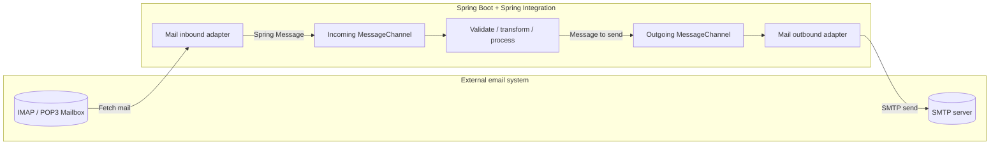
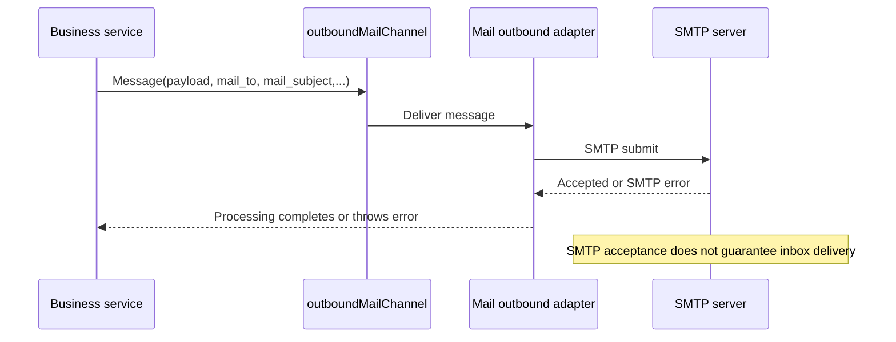
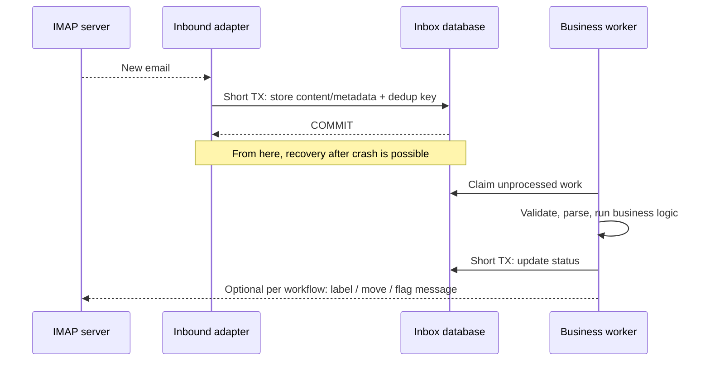
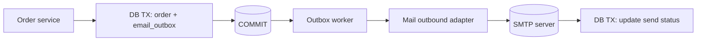

# Mail adapters and distinguishing receiving from sending email

## 1. Where do mail adapters fit in Spring Boot Integration?

In a Spring Boot system, email can be an **input** to a workflow (a customer support mailbox, incoming vendor invoices) or an **output** of a workflow (order notifications, reports, verification codes). Spring Integration provides **mail channel adapters** to connect email systems to Spring's `Message<?>`, `MessageChannel`, and `IntegrationFlow` model.

Key distinction upfront:

- **Receiving email (mail inbound adapter):** fetches messages from an external **mailbox**, creates a **Spring Message**, and sends it into the internal flow. Protocols are typically **IMAP/IMAPS** or **POP3/POP3S**.
- **Sending email (mail outbound adapter):** receives a **Spring Message** from an internal flow, converts it into an email, and hands it off to an **SMTP server** for delivery. The protocol is **SMTP**, optionally using STARTTLS or SMTPS depending on server configuration.

These two directions differ in protocol, trigger timing, acknowledgment semantics, and duplicate handling. You cannot configure inbound with SMTP details, nor use IMAP as a protocol to send email.



### Comparison by data direction

| Criterion | Receiving mail: inbound | Sending mail: outbound |
| --- | --- | --- |
| Data direction | Mail server → Spring application | Spring application → SMTP server |
| Trigger point | Poller or IMAP IDLE event | A message sent to the input channel |
| Protocol | IMAP/IMAPS; POP3/POP3S | SMTP with server-appropriate TLS |
| Typical components | `MailReceivingMessageSource`, `ImapMailReceiver`, `Pop3MailReceiver`, `ImapIdleChannelAdapter` | `MailSendingMessageHandler`, `JavaMailSender` |
| Spring Integration Java DSL | `Mail.imapInboundAdapter(...)`, `Mail.imapIdleAdapter(...)`, `Mail.pop3InboundAdapter(...)` | `Mail.outboundAdapter(...)` |
| Data handled | `MimeMessage` or mapped payload, plus mail headers | Body payload, mail headers, or a pre-built `MimeMessage` |
| Primary risks | Duplicate reads, lost mail from premature read marking, attachment errors | Duplicate sends, ambiguous timeouts where SMTP acceptance is unknown, post-send bounces |
| Meaning of success | Application **received/read** the email; business processing is still separate | SMTP server **accepted** the send request; does not guarantee recipient delivery or reading |

Both are **one-way channel adapters**: they do not form a direct request/reply model like gateways. An inbound adapter creates messages and sends them into a flow; an outbound adapter terminates a flow with the side effect of sending an email. If you need business outcomes, persist state and publish an event or use an application-level feedback channel.

## 2. Dependencies and configuration

For a Spring Boot application using Spring Integration Java DSL, you need the Spring Integration starter, Spring Integration Mail support, and Spring's mail starter. Maven example (using versions managed by the Spring Boot BOM where appropriate):

```xml
<dependencies>
    <dependency>
        <groupId>org.springframework.boot</groupId>
        <artifactId>spring-boot-starter-integration</artifactId>
    </dependency>
    <dependency>
        <groupId>org.springframework.integration</groupId>
        <artifactId>spring-integration-mail</artifactId>
    </dependency>
    <dependency>
        <groupId>org.springframework.boot</groupId>
        <artifactId>spring-boot-starter-mail</artifactId>
    </dependency>
</dependencies>
```

`spring-boot-starter-mail` provides `JavaMailSender` and SMTP configuration via `spring.mail.*`; `spring-integration-mail` provides the adapters that plug sending/receiving into an `IntegrationFlow`. If an application only sends an isolated email from a service, calling `JavaMailSender` directly is reasonable; use the adapter when email must participate in filters, transformers, routers, channels, retries, or unified flow observability.

```yaml
spring:
  mail:
    host: ${SMTP_HOST}
    port: ${SMTP_PORT:587}
    username: ${SMTP_USERNAME}
    password: ${SMTP_PASSWORD}
    properties:
      mail.smtp.auth: true
      mail.smtp.starttls.enable: true
      mail.smtp.connectiontimeout: 5000
      mail.smtp.timeout: 10000
      mail.smtp.writetimeout: 10000

app:
  integration:
    mail:
      # Value loaded from secret configuration; see the security section.
      store-uri: ${MAIL_STORE_URI}
```

An example `MAIL_STORE_URI` looks like `imaps://<user>:<password>@imap.example.com/INBOX` and is shown **solely to illustrate the format**—never embed real credentials in source code or logs. If the username is an email address, URL-encode special characters per URI rules (e.g., `@` as `%40`). Depending on the provider, OAuth2 or an app password may be required instead of a plain password. Use validated TLS connections and store secrets in a secret manager.

`spring.mail.*` above configures **SMTP outbound**. It **does not configure IMAP/POP3 inbound**; inbound requires a separate mailbox/store URI or `MailReceiver`. Timeouts for IMAP/POP3 must also be configured independently—`mail.smtp.*` values do not apply to receiving mail.

## 3. Sending email with an outbound mail adapter

### Data flow

When an order is paid, the application creates a Spring Message carrying the email body and headers specifying sender, recipient, and subject. The outbound adapter turns that message into an email and passes it to `JavaMailSender` and the SMTP server.



### Java DSL example

Once `spring.mail.*` is configured, Spring Boot can provide a `JavaMailSender` bean. Define the output channel and sending flow:

```java
import org.springframework.beans.factory.annotation.Qualifier;
import org.springframework.context.annotation.Bean;
import org.springframework.context.annotation.Configuration;
import org.springframework.integration.channel.DirectChannel;
import org.springframework.integration.dsl.IntegrationFlow;
import org.springframework.integration.mail.dsl.Mail;
import org.springframework.mail.javamail.JavaMailSender;
import org.springframework.messaging.MessageChannel;

@Configuration
public class MailOutboundConfiguration {

    @Bean
    public MessageChannel outboundMailChannel() {
        return new DirectChannel();
    }

    @Bean
    public IntegrationFlow mailOutboundFlow(
            @Qualifier("outboundMailChannel") MessageChannel outboundMailChannel,
            JavaMailSender mailSender) {
        return IntegrationFlow.from(outboundMailChannel)
                .handle(Mail.outboundAdapter(mailSender))
                .get();
    }
}
```

A service constructs the message and sends it to the channel:

```java
import org.springframework.beans.factory.annotation.Qualifier;
import org.springframework.integration.mail.MailHeaders;
import org.springframework.messaging.MessageChannel;
import org.springframework.messaging.support.MessageBuilder;
import org.springframework.stereotype.Service;

@Service
public class OrderEmailNotificationService {
    private final MessageChannel outboundMailChannel;

    public OrderEmailNotificationService(
            @Qualifier("outboundMailChannel") MessageChannel outboundMailChannel) {
        this.outboundMailChannel = outboundMailChannel;
    }

    public void sendPaidOrderNotice(String address, String orderCode) {
        var mailMessage = MessageBuilder.withPayload(
                    "Order " + orderCode + " has been confirmed as paid.")
                .setHeader(MailHeaders.FROM, "no-reply@shop.example")
                .setHeader(MailHeaders.TO, new String[] { address })
                .setHeader(MailHeaders.SUBJECT, "Order confirmation " + orderCode)
                .build();

        if (!outboundMailChannel.send(mailMessage)) {
            throw new IllegalStateException("Mail channel did not accept message");
        }
    }
}
```

In this `DirectChannel` example, the handler runs synchronously on the caller's thread; an SMTP failure can propagate back to the caller. If replaced with a `QueueChannel` or `ExecutorChannel`, when and where errors surface changes: `send()` returning `true` only means **the channel accepted the message**, not that SMTP received it or the recipient read it.

Headers such as `MailHeaders.TO`, `MailHeaders.CC`, `MailHeaders.BCC`, `MailHeaders.FROM`, `MailHeaders.REPLY_TO`, and `MailHeaders.SUBJECT` control addresses and subjects. For HTML emails, multipart messages, attachments, or complex templates, construct a `MimeMessage` with `MimeMessageHelper` or a dedicated transformer and pass it to the outbound adapter. **Do not concatenate raw MIME strings manually**; set content types/charsets and attachments properly.

### Be careful with the meaning of "sent"

When `MailSendingMessageHandler` completes without throwing an exception, the normal conclusion is that SMTP **accepted the submission**. An email can still bounce later, land in spam, or be blocked by quotas or recipient policies. Distinguish:

1. `READY`: the system created the send request.
2. `SUBMITTING`: the worker is calling SMTP/provider.
3. `ACCEPTED`: SMTP/provider API accepted it.
4. `DELIVERED`/`BOUNCED` (if available): status reported by the provider via webhook or bounce mailbox; cannot be inferred from the outbound adapter alone.

In addition, if a timeout happens mid-submission, SMTP may have accepted the message even though the client did not receive the final response. Uncontrolled retries will send duplicate emails. Standard SMTP has no end-to-end business idempotency key; for critical emails, maintain a request record, business key, and duplicate-prevention policy at the application layer, or use a provider with built-in deduplication. An email `Message-ID` **does not by itself guarantee** an email is sent only once.

## 4. Receiving email with an inbound mail adapter

### IMAP/POP3 connects to a mailbox

An inbound mail adapter connects to a mailbox, selects matching emails, and sends them into a channel. There are two main activation styles:

| Approach | Mechanism | When it fits | Things to watch |
| --- | --- | --- | --- |
| **Polling** | Periodically queries IMAP or POP3 for messages | Server lacks IDLE support; moderate volume; easy rate control | Latency depends on poll interval; cap messages per poll; avoid overlapping polls |
| **IMAP IDLE** | Holds an IMAP connection open waiting for mailbox change notifications | Near-real-time reaction needed and server supports `IDLE` | Must reconnect on network drops; IDLE only signals changes, still must fetch/check mail |

POP3 has more limited browsing/retrieval capabilities than IMAP and lacks IMAP folder/`\Seen` semantics. Without deleting messages on the server, a new POP3 session may re-read old emails. Thus POP3 requires explicit processed tracking, typically via `UIDL` (if supported) and durable storage.

### Inbound polling example using IMAP

Read emails from `INBOX` every 30 seconds, up to 10 messages per poll. `storeUri` is injected from secret configuration:

```java
import org.springframework.beans.factory.annotation.Value;
import org.springframework.context.annotation.Bean;
import org.springframework.context.annotation.Configuration;
import org.springframework.integration.dsl.IntegrationFlow;
import org.springframework.integration.dsl.Pollers;
import org.springframework.integration.mail.dsl.Mail;

@Configuration
public class MailInboundConfiguration {

    @Bean
    public IntegrationFlow imapPollingFlow(
            @Value("${app.integration.mail.store-uri}") String storeUri) {
        return IntegrationFlow.from(
                    Mail.imapInboundAdapter(storeUri)
                            .shouldDeleteMessages(false)
                            .shouldMarkMessagesAsRead(false)
                            .maxFetchSize(10),
                    endpoint -> endpoint.poller(
                            Pollers.fixedDelay(30000)
                                    .maxMessagesPerPoll(10)))
                .channel("receivedMailChannel")
                .get();
    }
}
```

`shouldDeleteMessages(false)` leaves emails in the mailbox, and `shouldMarkMessagesAsRead(false)` avoids eagerly marking `\Seen` during receipt. **This is not yet an exactly-once guarantee**: Spring Integration mail receivers may use other IMAP flags (`\Recent`, user flags, or `\Flagged`) to filter already-fetched messages depending on configuration and server capabilities. Do not assume a downstream exception will automatically cause the email to be redelivered.

A handler can accept `Message<?>` and inspect the `MimeMessage`:

```java
import jakarta.mail.MessagingException;
import jakarta.mail.internet.MimeMessage;
import org.springframework.integration.annotation.ServiceActivator;
import org.springframework.messaging.Message;
import org.springframework.stereotype.Component;

@Component
public class ReceivedMailHandler {

    @ServiceActivator(inputChannel = "receivedMailChannel")
    public void process(Message<?> integrationMessage) throws MessagingException {
        if (!(integrationMessage.getPayload() instanceof MimeMessage mime)) {
            throw new IllegalArgumentException("Payload is not a MimeMessage");
        }

        String messageId = mime.getMessageID();
        String subject = mime.getSubject();

        // Example: normalize sender, inspect MIME, persist into inbox table
        // with deduplication key; run business processing after durable receipt.
        persistInboxRecord(messageId, subject);
    }

    private void persistInboxRecord(String messageId, String subject) {
        // Repository/domain implementation is omitted to focus on the adapter.
    }
}
```

By default, the received payload is typically `jakarta.mail.internet.MimeMessage`. If message mapping is enabled, the framework may convert simple content to `String`/`byte[]` and place email metadata into mail headers. Handlers must match the **actual configuration**; do not unconditionally cast to `MimeMessage` if mapping or a transformer is configured.

For `MimeMessage` and multipart attachments, data may depend on an active `Folder`/`Store` lifecycle; read or copy content into durable DTOs/`byte[]` before closing the connection. Never pass raw `MimeMessage`/`Part` instances onto a distributed queue or async flow without considering content availability, serializability, and size.

### IMAP IDLE example instead of polling

If the mail server supports IMAP IDLE, use **only one** receiving mechanism per mailbox/folder to avoid racing against another poller:

```java
@Bean
public IntegrationFlow imapIdleFlow(
        @Value("${app.integration.mail.store-uri}") String storeUri) {
    return IntegrationFlow.from(
                Mail.imapIdleAdapter(storeUri)
                        .shouldDeleteMessages(false)
                        .shouldMarkMessagesAsRead(false)
                        .autoStartup(true)
                        .id("inboundImapIdle"))
            .channel("receivedMailChannel")
            .get();
}
```

This is an **alternative** to `imapPollingFlow`—do not enable both beans on the same mailbox without explicit coordination. `IMAP IDLE` does not require a `Poller`; the adapter emits messages when notified. Monitor disconnect events/errors (`ImapIdleExceptionEvent`), reconnects, unusual silence windows, and provider session limits.

## 5. Separating "email received" from "processed successfully"

A common bug is reading an email and marking it as read or deleting it on IMAP **before** updating the database, sending a reply, or publishing an event. If the app crashes in between, the mailbox considers the email handled while the business operation never finished.



Real-world designs should use an **inbox table** or durable queue: record the mailbox identifier, message identifier, sender info, subject, payload to process, and status in a short local transaction. After commit, a worker processes it externally and transitions status from `RECEIVED` to `PROCESSING`, `DONE`, `RETRY`, or `QUARANTINED`.

### Identification and deduplication

- For **IMAP**, the tuple `(account, mailbox, UIDVALIDITY, UID)` identifies a message in a folder during a valid UID epoch; UIDs alone can be reassigned if `UIDVALIDITY` changes. Store full context when available via `UIDFolder`.
- The **`Message-ID`** header helps with correlation and diagnostics, but it can be missing, duplicated, or forged by senders. If used for deduplication, understand its limits and pair it with corroborating keys/checks.
- For **POP3**, consider `UIDL` if the server supports it; never rely on message position or sequence numbers across sessions as stable IDs.
- Enforce a **unique constraint** in the DB on the chosen business key; treat duplicates as known events and do not trigger extra side effects.

Note: persisting content first does not put the mail server and DB in a distributed transaction. Gaps remain if the email was read before DB commit or if the DB committed before updating mailbox flags. Use deduplication, reconciliation, and controlled re-reads; specifically, never treat `\Seen` as a transactional application acknowledgment.

### Error classification for recovery

| Error type | Appropriate handling |
| --- | --- |
| Cannot connect to IMAP/POP3 | Retry with backoff, monitor connectivity, check credentials/TLS/quotas |
| Malformed MIME, invalid attachment | Move to `QUARANTINED`, store metadata for investigation, avoid infinite retries |
| Transient database failure | Do not mark as processed; retry or re-read via controlled recovery |
| Worker crash after inbox insert | Resume from incomplete DB state; deduplicate to prevent double processing |
| Email moved/deleted externally | Check `UIDVALIDITY`/UID and reconcile; do not rely on message position |

### When is transaction synchronization needed?

Spring Integration supports **transaction synchronization** for certain polling flows. It can coordinate actions tied to transaction outcomes, but do not assume mailbox flags and the database form a single ACID transaction. Check the exact limits of the adapter, receiver, mail server, and flag-update timing. For critical workflows, **a durable inbox + deduplication + retry/reconciliation** remains the foundation.

## 6. Reliable email sending: combining outbound adapter with an outbox

A common Spring Boot Integration scenario is saving an order in the database and then sending a confirmation email. Calling SMTP **directly inside** the `@Transactional` method that updates the order can hold DB transactions open during slow network calls; likewise, a successful SMTP send does not roll back if the DB commit later fails.

For critical emails:

1. In a **short DB transaction**, persist the order and an `email_outbox` record containing `notificationId`, email type, recipient, payload reference, and status `PENDING`.
2. Commit. A worker picks up the outbox record and sends a message to the **mail outbound adapter outside the DB transaction**.
3. In a new transaction, record `ACCEPTED` or `RETRY`/`UNKNOWN` with a reason; apply bounded retries and backoff.
4. Use a notification key (e.g., `orderId + notificationType + templateVersion`) to avoid creating duplicate **send requests**. When a timeout leaves SMTP acceptance uncertain, reconcile and accept that an email might be delivered twice if the provider lacks deduplication.



This aligns with how HTTP clients, DBs, caches, brokers, and adapters are structured in Spring Boot: external integration steps need explicit timeouts, state, and transaction boundaries. An outbox guarantees **the send intent is persisted durably** alongside business changes, though it does not turn SMTP into exactly-once delivery. For higher throughput, the worker can publish to a broker and a dedicated mailer consumer can send; both publisher and consumer must be idempotent.

## 7. Security and protecting email data

Email is untrusted input: senders can spoof display names, inject malicious headers, send HTML with phishing links, or attach oversized files. Mail adapters only transport data; business logic must validate inputs.

- **Secrets management:** keep usernames, passwords, OAuth tokens, and store URIs out of Git, exception messages, and access logs; restrict mailbox account permissions. Prefer a secret manager or controlled environment variables.
- **Transport encryption:** use IMAPS/POP3S or STARTTLS with certificate verification; configure SMTP TLS per server requirements. Never disable certificate validation as a "quick fix" for connection issues.
- **Input limits:** cap messages per poll, email/attachment size, attachment count, and processing time; scan for malware or isolate attachments per system policy.
- **HTML/MIME handling:** parse MIME safely, never execute email content, and sanitize HTML before rendering on web pages. Never trust attachments based solely on filename extensions.
- **Anti-spoofing:** `From` addresses and display names do not prove identity; enforce SPF/DKIM/DMARC checks from the receiving infrastructure and require separate verification for sensitive actions.
- **Personal data:** avoid logging email bodies, full addresses, attachments, or verification codes; define retention and access controls for inbox/outbox tables.

## 8. Testing mail adapters by integration direction

| Scenario | Checks to perform |
| --- | --- |
| **Valid outbound send** | SMTP test server receives expected `To`, `From`, `Subject`, charset, and body; never sends to real recipients |
| **Slow/timed-out outbound SMTP** | Flow enforces timeouts; status transitions to `RETRY`/`UNKNOWN` appropriately; no long DB transaction held |
| **Duplicate outbound send** | Two business events with the same key do not create two outbox requests; aware of SMTP-side dedup limits |
| **Inbound polling** | New emails enter the channel, `maxFetchSize`/poller limits apply; old/invalid emails follow policy |
| **Inbound IDLE** | New mail triggers flow; disconnects are reported and recovered; no duplicate poller on the same mailbox |
| **Inbound duplicate after restart** | Same email identifier does not run business logic twice; inbox state resumes after crash |
| **MIME multipart/attachments** | Decodes charsets, alternative bodies, and oversized/invalid attachments properly; resource limits hold |
| **DB error after reading email** | No lost business records; re-read/reconciliation path exists if mailbox flags changed |

You can use **GreenMail** or a mail test server supporting SMTP/IMAP/POP3 in integration tests; for outbound-only tests, an SMTP sink like Mailpit is also useful. Tests should inspect the test mailbox and DB records rather than merely mocking `send()` and assuming mail was delivered. For network errors, configure the test server to drop connections at various points to verify unknown-outcome handling.

In production, monitor emails received/sent per minute, age of unprocessed inbox/outbox items, authentication failures, IMAP reconnect counts, SMTP response times, MIME errors, duplicate counts, and quarantine volume. Trace IDs and business IDs help trace a message through adapter → channel → handler → database; keep bodies and sensitive fields out of spans and logs.

## 9. Checklist for choosing the right mail adapter

- Data flows from **mailbox into application**? Choose **inbound** over IMAP/POP3; use polling or IMAP IDLE if the server supports it.
- Data flows from **application to mail server**? Choose **outbound** over SMTP; use `JavaMailSender` and mail headers or `MimeMessage`.
- Only sending isolated emails without a flow? Calling `JavaMailSender` directly may be enough; use Spring Integration when shared channels/filters/transformers/retries/routing are needed.
- Receiving critical business emails? Persist a durable inbox, deduplicate on stable identifiers, support replay and reconciliation; never treat `\Seen` as business confirmation.
- Sending email tied to DB updates? Write an outbox row in a short transaction, call SMTP after commit, track `ACCEPTED`/`UNKNOWN`, and handle bounces where available.
- Avoiding production incidents? Configure timeouts, TLS, secrets, file size limits, retries/backoff, alerts, and network failure tests in both directions.

**Mnemonic example:** a new customer email arrives in `support@shop.example` → **IMAP inbound** fetches it and creates a ticket; once the ticket is saved, the system sends "We received your request" → **SMTP outbound** sends the confirmation email. Both adapters can coexist in one `IntegrationFlow` or separate flows, but reading and sending email always have distinct protocols, state models, and recovery strategies.

### References

- [Spring Integration Reference — Mail Support](https://docs.spring.io/spring-integration/reference/mail.html): outbound mail, IMAP/POP3 inbound, IMAP IDLE, mapping, flags, and connection errors.
- [Spring Integration Reference — Integration Endpoints](https://docs.spring.io/spring-integration/reference/endpoint-summary.html): distinguishing channel adapters from gateways.
- [Spring Boot Reference — Sending Email](https://docs.spring.io/spring-boot/reference/io/email.html): `JavaMailSender` auto-configuration and `spring.mail.*`.
