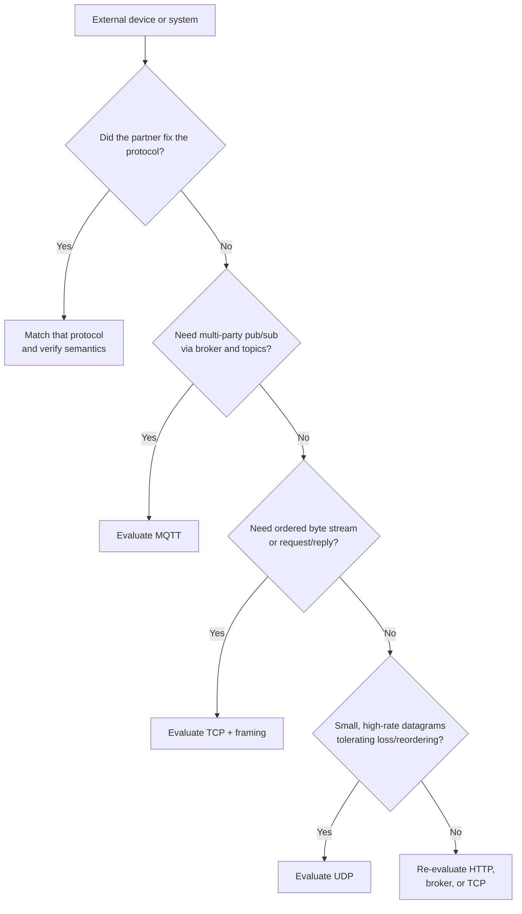
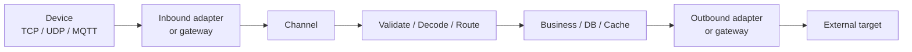
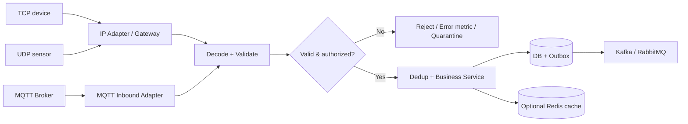

# Choosing TCP, UDP, or MQTT adapters by protocol requirements

## 1. Why choose adapters based on the protocol?

In a **Spring Boot Integration** system, HTTP APIs, databases, caches, and message brokers are not the only exchange paths. IoT devices, metering equipment, barcode scanners, industrial controllers, GPS trackers, or legacy software may only speak **TCP sockets**, **UDP datagrams**, or **MQTT topics**. Spring Integration provides adapters and gateways to turn network data into `Message<?>`, then process it with channels, transformers, filters, routers, service activators, or regular flows.

Suppose a warehouse platform ingests:

- Weigh scales sending binary frames over TCP and expecting an acknowledgment reply.
- Temperature sensors sending periodic UDP datagrams where newer readings supersede older ones.
- Sensor gateways publishing status over an MQTT broker subscribed to by multiple apps.

All three send "warehouse data", yet their requirements for **connectivity, message framing, reliability, routing, security, and deduplication** differ. Picking the wrong protocol or misconfiguring an adapter leads to corrupted frame parsing, duplicated side effects, silent packet loss on disconnects, or unbounded memory growth when downstream slows down.

After this lesson, you should be able to pick the right protocol; distinguish inbound/outbound adapters from gateways; configure Spring Boot for TCP, UDP, and MQTT; and design data contracts, timeouts, backpressure, idempotency, observability, and real integration tests.

## 2. Comparing TCP, UDP, and MQTT

| Characteristic | TCP | UDP | MQTT |
| --- | --- | --- | --- |
| Model | Connection-oriented byte stream between two peers | Connectionless datagram at the transport layer | Publish/subscribe via a broker; typically layered over TCP/TLS |
| Message boundaries | **None built in**: the application must define framing | One datagram equals one received unit | Broker/client manage MQTT packets and payloads |
| Ordering & network reliability | Bytes arrive in order on a live connection; drops still leave business outcomes uncertain | Can drop, duplicate, reorder, or arrive late | QoS 0/1/2 per hop; does not imply business exactly-once |
| Receiving side | Socket server/client | UDP socket receiving datagrams | Subscriber subscribed to broker topics |
| Communication style | Full-duplex, often request/reply per app protocol | One-way or two-way as designed by the app | Many producers/consumers per topic, with sessions/retained messages |
| Operational cost | Connection and codec management | Lightweight, but app must handle loss if required | Requires broker, sessions, topic ACLs, and reconnect management |
| Typical use cases | Devices with custom protocols needing ACK/commands | Fast telemetry, discovery, droppable events | IoT telemetry, commands, multi-consumer state notifications |

**MQTT is not a "UDP with QoS" variant.** MQTT is an application-level publish/subscribe protocol. In typical setups, MQTT runs over TCP and adds a broker, topics, sessions, and QoS acknowledgments. TCP itself only guarantees **byte** ordering within a connection; a single TCP `read()` may yield half a message or multiple concatenated messages.

### 2.1. Practical decision tree



If a device only supports one fixed protocol, the adapter must comply with that protocol. Data criticality primarily drives how you design **ACKs, durable storage, retries, deduplication, and downstream business logic**.

## 3. Spring Integration model: adapters, gateways, and flows

Spring Integration operates on `Message<T>` objects containing **payload** and **headers**. Each protocol component translates between the network and the messaging model:

- **Inbound channel adapter:** receives messages from the network/broker and pushes them into a channel; usually fits one-way streams.
- **Outbound channel adapter:** reads messages from a channel and sends them to an endpoint; does not define per-request business replies.
- **Inbound gateway:** accepts a request from an external endpoint and awaits the flow's reply to return over the same connection/context.
- **Outbound gateway:** takes an internal message, calls an external endpoint, and returns the reply to the flow with contract timeouts and correlation.



For example, a TCP client sending a command and waiting for a response needs a **TCP inbound gateway**; one-way telemetry arriving via a UDP inbound adapter only needs a service activator consuming messages. With MQTT, an inbound adapter subscribes to topics and an outbound message handler publishes events.

Never assume inbound messages are inherently trustworthy. Enforce size limits, validate schemas/encoding, authenticate devices, map metadata, and define failure states when downstream fails. A synchronous `DirectChannel` means slow handlers stall the receiver thread; switching to `ExecutorChannel` or queues requires bounded pools, bounded queues, and rejection policies.

## 4. Dependencies and Spring Boot configuration

The examples below illustrate **Spring Boot 3.x with Spring Integration 6.x**, Java 17+, and Spring Integration Java DSL. Exact APIs may vary across versions; verify against your project's BOM and documentation. Example dependencies assume TCP/UDP/MQTT as needed; a single service does not need to enable all three.

```kotlin
// build.gradle.kts: let Spring Boot manage compatible versions
implementation("org.springframework.boot:spring-boot-starter-integration")
implementation("org.springframework.integration:spring-integration-ip")
implementation("org.springframework.integration:spring-integration-mqtt")
implementation("org.springframework.boot:spring-boot-starter-actuator")
```

`spring-integration-ip` provides TCP/UDP; `spring-integration-mqtt` provides MQTT adapters/handlers. The MQTT Paho v3 examples below use Eclipse Paho MQTT v3 APIs; if your project uses MQTT v5, choose MQTT v5-compatible adapters and config rather than changing only the URI while keeping v3 classes.

```yaml
# application.yml — example environment-driven configuration
app:
  integration:
    tcp:
      listen-port: ${TCP_LISTEN_PORT:15100}
    udp:
      listen-port: ${UDP_LISTEN_PORT:15101}
    mqtt:
      broker-uri: ${MQTT_BROKER_URI:tcp://localhost:1883}
      subscriber-client-id: ${MQTT_SUB_CLIENT_ID:warehouse-ingest-local}
      publisher-client-id: ${MQTT_PUB_CLIENT_ID:warehouse-pub-local}
```

In production, supply credentials and TLS via protected configuration—never use public brokers or static client IDs across multiple replicas. With multiple deployment profiles, split config per service and activate only required adapters. In Docker/Kubernetes, also configure port mappings, firewalls, security groups, and health/readiness probes.

## 5. TCP adapter: a socket is a byte stream, not a sequence of messages

### 5.1. Framing is the first decision

Suppose a weigh scale sends two commands:

```text
WEIGHT|A01|1250
WEIGHT|A02|1275
```

TCP may split those across three reads or coalesce them into one read. Therefore, **never assume one `read()` equals one message**.

Common framing approaches:

| Framing type | Characteristics | Notes |
| --- | --- | --- |
| Delimiter, e.g., CRLF | Reads until a terminator sequence | Binary data or payloads containing the delimiter require escaping/encoding |
| Length prefix | Sends byte length ahead of payload | Both sides must agree on prefix width, byte order, and max size |
| Fixed length | Every frame has fixed byte size | Simple, but wastes bandwidth and needs padding |
| Custom protocol | Header, checksum, version, type, length | Must adhere strictly to the device protocol spec |

Spring Integration IP provides serializers/deserializers for common framing styles, such as `ByteArrayLengthHeaderSerializer` and `ByteArrayCrLfSerializer`. Client and server codecs **must match**. Set a maximum message size so a malicious or broken client cannot declare a huge length and tie up connections or memory indefinitely.

### 5.2. TCP inbound gateway request/reply

Example where a TCP client sends a UTF-8 frame with a 4-byte length prefix and the app returns a matching frame. Using a gateway preserves the reply association on the connection that received the request:

```java
import java.nio.charset.StandardCharsets;
import java.util.Map;

import org.springframework.beans.factory.annotation.Qualifier;
import org.springframework.beans.factory.annotation.Value;
import org.springframework.context.annotation.Bean;
import org.springframework.context.annotation.Configuration;
import org.springframework.integration.channel.DirectChannel;
import org.springframework.integration.dsl.IntegrationFlow;
import org.springframework.integration.ip.tcp.TcpInboundGateway;
import org.springframework.integration.ip.tcp.connection.TcpNetServerConnectionFactory;
import org.springframework.integration.ip.tcp.serializer.ByteArrayLengthHeaderSerializer;
import org.springframework.messaging.MessageChannel;

@Configuration
class TcpDeviceIntegration {

    @Bean
    TcpNetServerConnectionFactory deviceTcpServer(
            @Value("${app.integration.tcp.listen-port:15100}") int port) {
        var factory = new TcpNetServerConnectionFactory(port);
        var framing = new ByteArrayLengthHeaderSerializer();
        factory.setDeserializer(framing);
        factory.setSerializer(framing);
        return factory;
    }

    @Bean("deviceTcpRequests")
    MessageChannel deviceTcpRequests() {
        return new DirectChannel();
    }

    @Bean
    TcpInboundGateway deviceTcpInboundGateway(
            TcpNetServerConnectionFactory deviceTcpServer,
            @Qualifier("deviceTcpRequests") MessageChannel requests) {
        var gateway = new TcpInboundGateway();
        gateway.setConnectionFactory(deviceTcpServer);
        gateway.setRequestChannel(requests);
        gateway.setReplyTimeout(2_000);
        return gateway;
    }

    @Bean
    IntegrationFlow deviceTcpFlow() {
        return IntegrationFlow.from("deviceTcpRequests")
                .handle((byte[] payload, Map<String, Object> headers) -> {
                    String request = new String(payload, StandardCharsets.UTF_8);
                    // Echo example to illustrate the request/reply loop.
                    // Production: validate command, schema, and authorization.
                    String response = "ACK|" + request;
                    return response.getBytes(StandardCharsets.UTF_8);
                })
                .get();
    }
}
```

This flow only shows how to wire a TCP gateway into Spring Integration. Real scale handling needs frame parsing, device authentication, length/range checks, downstream timeouts/bulkheads, and an `ACK` with clear semantics. **Never** return a success `ACK` before mandatory persistence commits, unless the contract defines `ACK` strictly as "received".

When serving many clients, the connection factory manages multiple sockets. A request/reply gateway tracks which connection received each request; if you pair separate inbound/outbound adapters instead, preserve the connection ID header and route replies to the right connection. If a protocol multiplexes concurrent requests over one socket, you need application-level request IDs and correlation—connection ID alone cannot correlate individual requests.

### 5.3. TCP outbound: client and gateway

When Spring Boot must **actively call a TCP device** and wait for a response, consider a TCP outbound gateway with a client connection factory. For one-way commands, use an outbound channel adapter. Factors to configure and test:

1. Device host/port, authentication/TLS, idle timeout, and connect timeout.
2. Same framing as the server; explicit charset or binary schema.
3. Connection reuse and pool sizing; never spawn unbounded sockets per request.
4. Behavior when the device resets/closes the socket mid-processing, especially if the response is lost.
5. Request/sequence identifiers, idempotency, and ACK reliability before retrying.

If a TCP socket times out **after** a "open warehouse gate" command reached the device, the client cannot tell whether the device executed it. Blind retries can trigger the action twice. Use command IDs/sequence numbers and verify actual state before re-sending non-idempotent commands.

### 5.4. Common TCP pitfalls

- Server configured with CRLF deserializer while client sends length-prefixed frames, hanging or mis-framing indefinitely.
- Holding long-lived connections without heartbeat/idle policies; OS TCP keepalives do not detect failures instantaneously.
- Setting overly generous timeouts; hundreds of stalled connections exhaust memory, threads, or pools.
- Packing multiple business commands into one frame without versioning or a proper parser.
- Setting huge max frame sizes, leaving connection counts uncapped, or skipping client authentication.
- Treating `connectionId` as a business ID or treating transport-level ACK as a committed business transaction.

## 6. UDP adapter: receiving small datagrams and handling packet loss

UDP preserves **datagram** boundaries, so the app does not need length prefixes to delimit messages as with TCP. However, UDP **does not guarantee** delivery, ordering, or single delivery. Oversized datagrams risk IP fragmentation, where losing one fragment drops the whole datagram. Over the Internet or complex networks, keep payloads well within practical MTU limits rather than relying on UDP's theoretical maximum size.

UDP fits continuously refreshed state, such as sensors emitting temperature readings every few seconds. Missing one sample is tolerable because the next sample arrives soon. Conversely, if each datagram is a debit command or critical inventory event, raw UDP **is insufficient**: you must add application ACKs, sequence numbers, retries, deduplication, and security, or pick another protocol.

### 6.1. Inbound UDP with Spring Integration IP

```java
import java.nio.charset.StandardCharsets;

import org.springframework.beans.factory.annotation.Qualifier;
import org.springframework.beans.factory.annotation.Value;
import org.springframework.context.annotation.Bean;
import org.springframework.context.annotation.Configuration;
import org.springframework.integration.annotation.ServiceActivator;
import org.springframework.integration.channel.DirectChannel;
import org.springframework.integration.ip.udp.UnicastReceivingChannelAdapter;
import org.springframework.messaging.MessageChannel;
import org.springframework.messaging.MessageHandler;

@Configuration
class UdpTelemetryIntegration {

    @Bean("udpDatagrams")
    MessageChannel udpDatagrams() {
        return new DirectChannel();
    }

    @Bean
    UnicastReceivingChannelAdapter udpReceiver(
            @Value("${app.integration.udp.listen-port:15101}") int port,
            @Qualifier("udpDatagrams") MessageChannel output) {
        var adapter = new UnicastReceivingChannelAdapter(port);
        adapter.setOutputChannel(output);
        return adapter;
    }

    @Bean
    @ServiceActivator(inputChannel = "udpDatagrams")
    MessageHandler udpTelemetryHandler() {
        return message -> {
            byte[] bytes = (byte[]) message.getPayload();
            String packet = new String(bytes, StandardCharsets.UTF_8);
            // Demo: parse/validate packet and forward to a processing service.
            // Production: check size limits, deviceId,
            // timestamp, sequence, and whether the sender is trusted.
            System.out.println("Received telemetry: " + packet);
        };
    }
}
```

The demo only shows the receive flow; **never log arbitrary device payloads in production**. Replace with bounded parsers, per-device-type metrics, and a service writing contract-compliant records. In Spring Integration IP, messages may include source address/port metadata depending on adapter and version; that helps diagnostics or replying, but source IP **does not substitute for authentication**.

To send UDP, Spring Integration IP provides outbound UDP adapters/handlers such as `UnicastSendingMessageHandler`. When designing replies back to the sender, verify destination address/port policies and guard against UDP amplification—never accept an unauthenticated packet and emit a much larger response to a spoofable source IP.

### 6.2. Sequence numbers, lateness windows, and deduplication

A telemetry payload might carry:

```json
{
  "deviceId": "sensor-17",
  "sequence": 1042,
  "observedAt": "2026-11-21T05:00:00Z",
  "temperatureC": 24.7
}
```

The server can track `lastSequence` per `deviceId` and classify:

| Observation | Suggested handling |
| --- | --- |
| Increasing sequence, valid timestamp | Accept packet; update state |
| Duplicate sequence | Skip side effects or increment duplicate metric |
| Smaller sequence | Treat as out-of-order unless reboot/wrap-around policy applies |
| Large sequence gap | Record packet-loss metric; request resync if protocol supports it |
| Device reboot/sequence reset | Use boot/session ID or explicit reset rules |

A Redis cache can track sequence numbers quickly, provided you account for TTLs, failover loss, and concurrent updates across instances. When correctness matters, enforce atomic updates or unique constraints in a durable store. If only latest state matters, compare `(deviceId, observedAt, sequence)` rather than trusting device clocks alone.

### 6.3. UDP multicast and network constraints

UDP multicast helps when many receivers on the same LAN need identical data; Spring Integration IP offers multicast adapters for those cases. However, multicast is often blocked in clouds, Kubernetes, NATs, and routed networks. Verify IGMP, TTL/hop limits, network policies, and deployment topology. Across the Internet, an MQTT broker or routed protocol is usually much easier to operate.

## 7. MQTT adapter: publish/subscribe via a broker

MQTT lets devices **publish** payloads to topics while the broker routes them to subscribed consumers. One Spring Boot service can subscribe to telemetry topics while another publishes commands, without opening direct sockets to every device.

Example topics:

```text
devices/sensor-17/telemetry
devices/sensor-17/status
devices/sensor-17/commands
devices/+/telemetry         # topic filter used for subscribing
```

`+` matches one level and `#` matches multiple levels in **subscription topic filters**; wildcards must not be used in ordinary publish topic names. Topics should follow namespacing, versioning, and ACL rules. Never blindly publish to an unvalidated topic name supplied inside a payload.

### 7.1. QoS and what it does not guarantee

| QoS | Protocol-level MQTT guarantee | Suitable scenarios |
| --- | --- | --- |
| 0 – At most once | Fire without QoS ACK handshake | Fast sensor updates where occasional drops are fine |
| 1 – At least once | Acknowledged between peers; duplicates possible | Telemetry/events needing higher delivery odds with deduplication |
| 2 – Exactly once | Four-part handshake reducing protocol/session duplicates | Payloads needing QoS 2 semantics at higher network/state cost |

**QoS 2 does not mean "written to the database exactly once"**. A consumer can crash after committing to the DB and before finishing session acknowledgment; another bridge or app may also re-publish the same logical event. Keep `eventId` and consumer idempotency/deduplication for important side effects.

QoS is a per-hop contract. If a publisher uses QoS 1 but the subscriber subscribes at QoS 0, you do not get end-to-end QoS 1. Session expiry/persistence, clean sessions, retained messages, and broker durability also govern what survives client disconnects.

### 7.2. Subscribing with Spring Integration MQTT Paho v3

Example using the Paho MQTT v3.1.1 adapter and Spring Integration 6.x:

```java
import org.eclipse.paho.client.mqttv3.MqttConnectOptions;
import org.springframework.beans.factory.annotation.Qualifier;
import org.springframework.beans.factory.annotation.Value;
import org.springframework.context.annotation.Bean;
import org.springframework.context.annotation.Configuration;
import org.springframework.integration.annotation.ServiceActivator;
import org.springframework.integration.channel.DirectChannel;
import org.springframework.integration.mqtt.core.DefaultMqttPahoClientFactory;
import org.springframework.integration.mqtt.core.MqttPahoClientFactory;
import org.springframework.integration.mqtt.inbound.MqttPahoMessageDrivenChannelAdapter;
import org.springframework.integration.mqtt.support.DefaultPahoMessageConverter;
import org.springframework.messaging.MessageChannel;
import org.springframework.messaging.MessageHandler;

@Configuration
class MqttDeviceIntegration {

    @Bean
    MqttPahoClientFactory mqttClientFactory(
            @Value("${app.integration.mqtt.broker-uri}") String brokerUri) {
        var options = new MqttConnectOptions();
        options.setServerURIs(new String[] { brokerUri });
        // Production: configure TLS, ACL/credentials, and session
        // via a secret manager per MQTT broker policy.
        var factory = new DefaultMqttPahoClientFactory();
        factory.setConnectionOptions(options);
        return factory;
    }

    @Bean("mqttTelemetry")
    MessageChannel mqttTelemetry() {
        return new DirectChannel();
    }

    @Bean
    MqttPahoMessageDrivenChannelAdapter mqttTelemetryInbound(
            MqttPahoClientFactory mqttClientFactory,
            @Value("${app.integration.mqtt.subscriber-client-id}") String clientId,
            @Qualifier("mqttTelemetry") MessageChannel channel) {

        var adapter = new MqttPahoMessageDrivenChannelAdapter(
                clientId, mqttClientFactory, "devices/+/telemetry");
        adapter.setQos(1);

        var converter = new DefaultPahoMessageConverter();
        converter.setPayloadAsBytes(true);
        adapter.setConverter(converter);
        adapter.setOutputChannel(channel);
        return adapter;
    }

    @Bean
    @ServiceActivator(inputChannel = "mqttTelemetry")
    MessageHandler mqttTelemetryHandler() {
        return message -> {
            byte[] raw = (byte[]) message.getPayload();
            // Validate topic, device authorization, payload schema,
            // eventId/sequence, and persist state idempotently.
            if (raw.length == 0) {
                throw new IllegalArgumentException("Empty MQTT payload");
            }
        };
    }
}
```

To send commands over MQTT, use `MqttPahoMessageHandler` on an outbound channel; set topic, QoS, and retained flag via configuration or MQTT message headers. Handler example:

```java
import org.springframework.beans.factory.annotation.Value;
import org.springframework.context.annotation.Bean;
import org.springframework.integration.annotation.ServiceActivator;
import org.springframework.integration.mqtt.core.MqttPahoClientFactory;
import org.springframework.integration.mqtt.outbound.MqttPahoMessageHandler;
import org.springframework.messaging.MessageHandler;

@Bean
@ServiceActivator(inputChannel = "mqttCommands")
MessageHandler publishMqttCommands(
        MqttPahoClientFactory mqttClientFactory,
        @Value("${app.integration.mqtt.publisher-client-id}") String publisherId) {
    var handler = new MqttPahoMessageHandler(publisherId, mqttClientFactory);
    handler.setDefaultTopic("devices/commands");
    handler.setDefaultQos(1);
    return handler;
}
```

In this configuration, declare the `mqttCommands` channel (e.g., `@Bean("mqttCommands") MessageChannel mqttCommands()` returning `DirectChannel`) and attach destination topic/metadata per device as needed. This example only shows the outbound component: the business service must restrict publish permissions and define when a command is considered **executed** by the device. Broker acknowledgment of receipt does not mean the device executed the command. For hazardous or side-effecting commands, include a command ID, expiration deadline, application-level ACK/status, and bounded retries.

**MQTT v5:** Spring Integration provides dedicated Paho v5 adapter APIs in supported versions; session expiry, reason codes, and properties differ from MQTT v3. Do not mix v5 settings into v3 classes or assume the broker supports every option. When running MQTT over WebSocket/TLS, verify URIs, certificates, authorization, and traffic direction.

### 7.3. Sessions, retained messages, Last Will, and multiple replicas

- **Client IDs must be unique across concurrent connections.** Two replicas sharing one client ID typically kick each other off the broker in a reconnect loop.
- **Persistent sessions** can preserve subscriptions and eligible QoS messages while offline, depending on MQTT version, broker, and clean-session/session-expiry settings. They do not retain messages forever.
- **Retained messages** deliver the last message on a topic to new subscribers; it may be **stale**. Include timestamps, versions, and application-level TTL/staleness rules when needed.
- **Last Will and Testament** lets the broker publish a status when a client disconnects abnormally under protocol rules; do not treat it as absolute proof a device is dead.
- When multiple replicas subscribe to a standard topic, each receives **a copy** of every message. To load-balance across consumers, look into shared subscriptions and verify broker/client support; do not confuse pub/sub fan-out with consumer groups.
- If the broker enforces inflight, queue, or message-expiry limits, align them with downstream processing speed. Slow handlers can back up MQTT connections, ACKs, and backpressure.

## 8. Payload and metadata contracts across protocols

Integration data should have identities, schemas, and semantics independent of TCP/UDP/MQTT. Standard telemetry event example:

```json
{
  "eventId": "d625ead2-2756-42e0-bc2b-e60f6099867b",
  "eventType": "TemperatureObserved",
  "schemaVersion": 1,
  "deviceId": "sensor-17",
  "sequence": 1042,
  "observedAt": "2026-11-21T05:00:00Z",
  "data": {
    "celsius": 24.7
  }
}
```

| Aspect | TCP | UDP | MQTT | Post-adapter handling |
| --- | --- | --- | --- | --- |
| Device identity | In authenticated frame/session | In payload + external auth | Client identity/topic/ACL and payload | Verify mapping to a registered `deviceId` |
| Correlation | ID in frame; connection ID is just socket metadata | ID in payload if needed | ID in payload or headers/properties per MQTT | Log/trace and preserve when bridging |
| Deduplication | Command/event ID and sequence | Device + boot/session + sequence | Event ID or command ID; never rely solely on QoS | Unique constraint or durable idempotency store |
| Schema/version | Frame header or payload | Payload | Payload; properties where supported | Validate before running business logic |
| Reliability | Application reply/ACK per contract | App-level sequence, ACK/retry if required | QoS + app-level ACK for side effects | Commit/outbox/inbox per correctness needs |
| Routing | Command inside frame | Datagram type | Topic/filter | Router/transformer on validated data |

**Never use correlation ID as an idempotency key.** One workflow can emit multiple events sharing a correlation ID. Nor should an MQTT topic or TCP connection ID count as proof of authorization: verify permissions against the authenticated device/tenant.

When bridging to Kafka/RabbitMQ, preserve `eventId`, `correlationId`, `causationId`, `occurredAt`, and `schemaVersion` inside the envelope/outbox per contract. Map headers deliberately; Spring Integration headers like `ip_connectionId` or MQTT-specific headers may not exist or survive across another broker.

## 9. Bridge architecture: device → adapter → business → broker



Division of responsibilities:

1. **Adapter:** receives bytes/datagrams/MQTT packets, extracts protocol metadata, and performs initial technical checks.
2. **Transformer/parser:** decodes charset/binary schema, checks size, version, checksum, and structure.
3. **Authorization:** verifies device identity, tenant, certificates/credentials, and topic/command permissions.
4. **Business service:** enforces business validation, idempotency, and state transitions without relying on framework headers for critical decisions.
5. **Persistence/outbox:** writes business state and outgoing events consistently where needed. Redis caches only accelerate reads when durable truth lives in the DB.
6. **Publisher:** emits events to brokers and handles confirmations, errors, and retries per contract with traceable logs/traces.

For TCP gateways, reply ACK timing must match the promised state. UDP has no default transport ACK. MQTT QoS ACKs do not mean consumers committed business state. Document these distinctions in the **protocol and API contract** to avoid false success reporting.

## 10. Security per protocol

| Requirement | TCP | UDP | MQTT |
| --- | --- | --- | --- |
| Encryption & auth | TLS/mTLS or protocol-level security; IP allowlists are supplementary only | Plain UDP lacks TLS; use DTLS or appropriate network/app-layer security | MQTTS over TLS, mTLS, username/password or identity auth, and ACLs |
| Input bounds | Max frame size, idle timeout, rate/connection limits | Max datagram size, packet rate, sender checks; prevent amplification replies | Max payload/topic length, inflight/queue limits, session expiry, topic filters |
| Authorization | Device/command identity at application layer | Never treat source IP/port as identity | Publish/subscribe ACLs per client/tenant/topic |
| Secrets | Keys/certs via secret manager | Shared keys/certs via dedicated mechanism if used | Broker credentials/certs via secret manager |
| Audit | Command ID, connection/session, outcome | Device ID, sequence, drop/duplicate metrics | Client identity, topic, event/command ID, publish/consume outcome |

Never blindly forward `Authorization`, passwords, cookies, or all headers across protocols. Never build topic names, Redis keys, file paths, or SQL from unvalidated payloads. Never log raw binary frames or payloads with personal data; log structured metadata with masking and retention policies.

## 11. Fault tolerance, backpressure, and deduplication

### 11.1. When downstream is slower than ingestion

Devices might send 10,000 datagrams/sec while the DB writes 2,000 rows/sec. Dumping everything into an unbounded queue exhausts RAM. Design for:

- **Input caps:** max TCP connections, per-device rate limits, MQTT inflight/consumer throughput, UDP receive buffers, and dropped-packet metrics.
- **Bounded queues:** if async, use bounded executors/queues or a persistent broker with explicit reject/drop/pause policies.
- **Dependency bulkheads:** cap DB/HTTP/Redis concurrency so slow devices or brokers cannot starve all workers.
- **Bounded timeouts and retries:** backoff + jitter, deadlines, idempotency, and attempt caps; never blindly retry non-idempotent commands after unknown outcomes.
- **Intentional degradation:** telemetry can drop stale samples, whereas critical commands go to a DLQ/quarantine or return explicit errors per contract.

TCP flow control can slow down senders when receivers stop reading; that does **not** replace application-level queues and backpressure. UDP has no built-in flow control alerting senders to drops. MQTT brokers enforce quotas and policies, yet subscribers must still bound consumption rates and session queues.

### 11.2. Retries at protocol boundaries

| Situation | Possible outcome | Safe reaction |
| --- | --- | --- |
| TCP connection reset after sending command | Device may have executed it, reply lost | Query status or retry with an idempotent command ID |
| UDP no response seen | Request lost, reply lost, or device still processed it | App-level sequence/ACK window and deduplication if protocol requires |
| MQTT QoS 1 duplicate after reconnect | Same logical message redelivered | Deduplicate by event/command ID within consumer scope |
| MQTT broker outage | Temporary inability to publish/consume; depends on session config | Bounded retries, persistence/outbox, monitor backlog/session expiry |
| DB commit succeeded but Kafka publish failed | Source state and broker diverge | Transactional outbox and idempotent publisher retries |
| Redis restarted and dedup keys lost | Side effects could re-run | Use a durable dedup store or DB unique constraints |

No combination of TCP, UDP, or MQTT automatically guarantees **exactly-once business effects** across multiple systems. Correctness must be engineered in the application and database, even when the transport has acknowledgments.

## 12. Observability and incident diagnosis

Organize metrics and logs by **protocol, adapter, operation, and outcome**:

| Component | Metrics to collect | Signals to investigate |
| --- | --- | --- |
| TCP | Active/open/close connections, timeouts, bytes, frame decode errors, request latency | Socket resets, hung connections, framing mismatches, slow ACKs |
| UDP | Datagrams received/dropped, malformed, sequence gaps, processing latency | Oversized datagrams, packet loss, devices outpacing consumers |
| MQTT | Connect/reconnect counts, subscription health, inbound/outbound rates, publish/ack latency, redeliveries | Broker outages, duplicate client IDs, ACL rejections, session queue backlogs |
| Business service | Validation failures, dedup hits, DB/Redis/HTTP latency, outbox backlog | Bad data, retry storms, downstream bottlenecks |
| End-to-end | p95/p99 latency, error rate, dropped/rejected counts, queue depth | Unstable integration flow even while adapters appear connected |

Include `correlationId`, `deviceId`, or `eventId` in logs/traces where appropriate while protecting personal data. Never attach per-message IDs as **metric labels**, because high cardinality overloads metrics backends. In async pipelines, tracing context does not cross sockets/UDP/brokers automatically unless carried by the contract; generate correlation IDs at boundaries when absent and persist links in envelopes/outboxes.

A `health check` verifying only that adapter beans initialized is insufficient: verify broker connectivity, port binding/listening, decode error rates, backlogs, and business dependency readiness. Readiness probes should reflect real serving capability; a failure in an optional dependency should not cause every pod to crash-loop.

## 13. Integration testing and fault injection

| Test | How to execute | Acceptance criteria |
| --- | --- | --- |
| TCP split/coalesced frames | Split one frame across writes or send multiple frames together | Parser preserves exact message boundaries |
| TCP wrong framing/oversized | Send wrong length prefix, oversized frame, or idle connection | Rejects/closes cleanly without unbounded memory or thread retention |
| TCP socket reset | Drop socket before and after command execution | No false ACK; retries rely on command ID/status |
| UDP loss/dup/reorder | Network proxy/test injects drops, duplicates, reordering | Sequence and policies handle cleanly without duplicate side effects |
| UDP malformed/spoofed | Bad JSON/schema or untrusted source | Rejected and metered; command not executed |
| MQTT QoS 0/1/2 | Publish at each QoS against a test broker | Expected delivery/duplicate behavior; consumer deduplicates |
| MQTT reconnect/session | Restart client/broker and publish while offline | Session/retained/backlog matches broker contract |
| MQTT multiple replicas | Scale replicas with distinct client IDs | No disconnect fighting; fan-out/shared subscription semantics verified |
| MQTT ACL/TLS | Invalid cert, credentials, or unauthorized topic | Connection/publish denied; no secrets leaked in logs |
| Slow downstream | Inject DB/Redis/HTTP latency under load | Bounded queues/concurrency, timeouts, and metrics behave cleanly |
| Broker bridge redelivery | After DB save, replay/retry the same event ID | Event reconciled without duplicate side effects |

For MQTT, test against a real test broker like Mosquitto or EMQX matching your project setup; pure Java mocks cannot prove QoS, sessions, or ACLs. For TCP/UDP, open real sockets and send wire-level frames/datagrams to verify byte parsing, timeouts, and disconnects. Testcontainers or isolated integration environments help for broker dependencies; test against network topologies close to staging/production to catch DNS, firewall, and TLS misconfigurations.

### Example TCP length-prefix test data

For the UTF-8 frame `PING`, the payload is 4 bytes. With a 4-byte big-endian length header, the transmitted byte sequence is:

```text
00 00 00 04 50 49 4E 47
| length = 4 | P  I  N  G
```

Try sending byte-by-byte or sending two frames back-to-back on the same socket: the gateway must still split the two messages accurately. If a client sends raw ASCII `PING` without a length prefix, the server interprets the first four bytes as the frame length and may wait unreasonably long; hence max frame size limits and timeouts are essential.

## 14. Common design mistakes and checklist

Typical mistakes:

- Using TCP without defining framing or assuming one `read()` equals one message.
- Using UDP for events requiring exact delivery without designing sequences/ACKs/deduplication.
- Assuming MQTT QoS 2 makes database transactions automatically exactly-once.
- Deploying multiple MQTT subscriber replicas with the same client ID, causing continuous disconnects.
- Treating retained messages as real-time latest values without checking timestamps.
- Using unbounded queues to absorb adapter congestion; when downstream slows, the app runs out of RAM.
- Sending side-effecting commands and retrying after timeouts when prior outcome is unknown.
- Dropping business/event IDs across adapter bridges and relying only on connection headers or broker metadata.
- Treating IP addresses, MQTT topics, or self-asserted headers as authorization without authenticating tenant/device identity.
- Testing only happy paths in memory while skipping real sockets, real brokers, and network faults.

Pre-deployment checklist:

- [ ] Ordering, tolerable message loss, latency, throughput, and business ACK requirements are documented.
- [ ] TCP/UDP/MQTT chosen per device protocol and communication model; gateways distinguished from adapters.
- [ ] TCP framing, charset, max frame size, and connection/idle timeouts agreed on both sides.
- [ ] UDP datagram size, sequence/lateness/duplicate handling, and security/ACK policies defined.
- [ ] MQTT broker, TLS/ACLs, topic conventions, QoS, sessions, retained messages, Last Will, and per-replica client IDs configured.
- [ ] Message envelopes include schema version, device/business ID, event/command ID, and correlation metadata.
- [ ] Bounded concurrency/queues, retries with backoff, and business deduplication implemented.
- [ ] Logs/traces/metrics and alerts reflect backlog, packet loss, reconnects, timeouts, and downstream errors.
- [ ] Packet loss, reordering, duplicates, reconnects, crashes, broker outages, and downstream overload tested.

**Desired outcome:** adapters strictly move protocol data into and out of Spring Integration per contract; validation, authorization, idempotency, transactions, and observability live in their proper layers. When swapping devices or brokers, the system retains business semantics and can prove integration flows work even under slow networks, disconnects, or redelivered messages.
