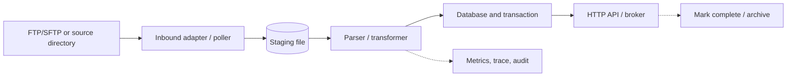
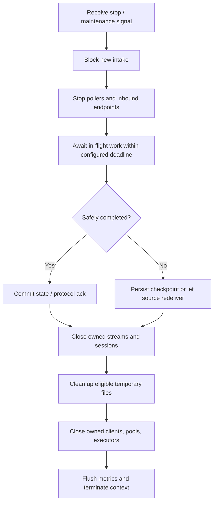

# Closing sessions, cleaning up files, and releasing resources when a flow stops in Spring Integration

## 1. When a flow stops, what actually has to finish?

In the **SPRING_BOOT_INTEGRATION** module, a Spring Boot integration flow may ingest files via local file adapters, FTP/SFTP, HTTP, or message brokers, transform payloads, write to databases, send messages, and invoke partner systems. When redeploying the application, tearing down a dynamic integration flow, or pausing an adapter for maintenance, the hard part is not calling `stop()`: **you must stop accepting new work, let in-flight work reach a safe state, close resources with clear ownership, and preserve enough state to recover**.

Distinguish four actions:

- **Stop/Quiesce:** halt the intake or polling source so no new work is actively admitted.
- **Drain:** allow already-accepted work to finish or checkpoint into a recoverable state within a bounded time window.
- **Close/Dispose:** release streams, FTP/SFTP sessions, sockets, channels, executors, and connection pools actually owned by that component.
- **Cleanup:** handle temporary files, locks, markers, and processing records according to verified state; never delete incomplete work.

Calling `stop()` on an endpoint **does not mean** every in-flight message has committed or every underlying resource has closed. Conversely, calling `close()` on a shared connection while other consumers are still active causes cascading disconnects.

### A realistic flow



A safe shutdown must know where each message currently sits, who holds each session/stream, which external calls have already executed, and what proof authorizes moving a file to `done` or deleting it. If a database transaction committed while an outbound HTTP call to a partner remains unconfirmed, blindly deleting the staging file destroys your ability to recover.

## 2. Lifecycle diagram and shutdown order

A recommended sequence for a polling flow:



This ordering is a **design model**, not a sequence the framework enforces automatically for every adapter type. Adapter-specific steps apply:

| Adapter/flow type | Block new intake | In-flight work | Preconditions before closing resources |
| --- | --- | --- | --- |
| File inbound poller | Stop polling endpoint | Files already emitted onto channels may still be processing | Confirm file/in-flight state; never delete files mid-read |
| FTP/SFTP inbound | Stop poller or streaming source | Downloads, open streams, and remote sessions may still be active | Finish/close streams, save checkpoints, return sessions |
| HTTP inbound gateway | Stop accepting new requests via web server/infra | Accepted requests continue within graceful shutdown budget | Return appropriate responses or persist recovery state |
| JMS/AMQP/Kafka inbound | Stop listener containers | Delivered/polled messages may lack acks or offset commits | Resolve ack/nack, commit/rollback, idempotency, and redelivery |
| TCP/UDP, WebSocket | Stop inbound adapter/acceptor | Active sessions/sockets and buffers | Flush frames, responses, timeouts, and reconnect policies |
| Outbound HTTP/SFTP/DB | Stop handlers from receiving new items | Outbound calls and transactions in progress | Wait or cancel cleanly, then return/close owned resources |
| Executor/QueueChannel | Stop upstream and producers | Queued in-memory messages may remain unprocessed | Drain or persist durably before shutting down executors |

**Key takeaway:** a `DirectChannel` normally invokes handlers synchronously on the sender's thread; an `ExecutorChannel` crosses an asynchronous boundary where tasks may still sit in the executor. A `QueueChannel` is an internal queue; unless configured with durable persistence, queued work is lost when the process exits. Therefore, checking only the return of `stop()` on an inbound adapter is never enough.

## 3. Spring and Spring Integration lifecycles

### 3.1. `Lifecycle`, `SmartLifecycle`, and `ApplicationContext` shutdown

Spring Integration manages many endpoints via Spring's lifecycle contracts:

- `Lifecycle.start()` and `Lifecycle.stop()` represent starting and stopping a component. Many Spring Integration inbound adapters, pollers, listener containers, and endpoints participate in this lifecycle.
- `SmartLifecycle` adds `isAutoStartup()`, phase ordering via `getPhase()`, and `stop(Runnable callback)` for coordinated shutdown. When implementing `SmartLifecycle` asynchronously, you must invoke the callback once stopping truly finishes.
- `DisposableBean.destroy()` or `@PreDestroy` release resources when **beans are destroyed**. They do not automatically run every time `stop()` is called.
- When **`ApplicationContext` closes**, Spring stops lifecycle beans in phase order before destroying beans. When you only **stop one endpoint**, the `ApplicationContext` stays alive and shared beans normally remain active.

With `SmartLifecycle`, higher phases typically **start later** and **stop earlier** than lower phases. However, effective order also depends on bean dependencies and auto-configuration; verify your actual topology instead of assigning arbitrary phases everywhere.

When pausing a flow to swap configuration, stopping the inbound endpoint alone may suffice. When the application shuts down completely, add draining, cleanup, and context resource destruction. For flows registered dynamically via `IntegrationFlowContext`, removing/destroying a registration tears down its registered beans; verify ownership carefully before doing so.

### 3.2. Spring Boot graceful shutdown

Spring Boot provides settings for web server shutdown and lifecycle phase timeouts:

```yaml
# application.yml (example)
server:
  shutdown: graceful

spring:
  lifecycle:
    timeout-per-shutdown-phase: 30s
```

These settings coordinate web and lifecycle shutdown according to your Spring Boot version. **They do not guarantee that every SFTP download, queued message, executor task, or partner side effect finishes automatically.** Non-HTTP flows need their own in-flight tracking and recovery mechanisms.

In containers or orchestrators, the platform's termination grace period must be **longer** than your lifecycle, drain, and resource-close budget; if the process receives `SIGKILL` upon expiry, cleanup callbacks will not run at all. Design to survive abrupt kills, not only clean shutdowns.

### 3.3. Stop the whole flow or stop the source first?

In a flow composed of inbound adapter → transformer → service activator → outbound adapter, pausing intake usually means **stopping the ingress endpoint first**, letting already-received messages finish or checkpoint. Killing every downstream component immediately aborts active work mid-flight.

Distinguish four phases:

1. **Pause intake:** stop pollers/listeners or reject new inbound requests.
2. **Drain:** track active handlers, async queues, transactions, and unacknowledged messages.
3. **Destroy flow:** tear down endpoints/registrations once safe and free of active dependents.
4. **Destroy shared infrastructure:** close connection factories, schedulers, or pools once no owner uses them anymore.

If multiple flows share a `TaskScheduler`, `ThreadPoolTaskExecutor`, `CachingConnectionFactory`, or `SessionFactory`, stopping one flow must never destroy that shared infrastructure.

## 4. Resource ownership rules

| Resource | Who usually owns it? | When to release? | Common mistake |
| --- | --- | --- | --- |
| `InputStream`/`OutputStream` opened in a handler | Handler opening the stream | As soon as the handler finishes reading/writing, even on error | Closing only in `@PreDestroy`, leaking per message |
| FTP/SFTP `Session<?>` borrowed from a factory | Borrowing code; factory/pool owns the physical connection | Call `session.close()` in `finally` to return/close per factory | Holding sessions across jobs or leaking on exceptions |
| `CachingSessionFactory` | Shared configuration bean | When context/owner shuts down or on intentional cache reset | Resetting/destroying the pool after each message, breaking sibling flows |
| AMQP/JMS connection factory | Infrastructure bean | When context or owner closes | Closing the shared connection inside a listener |
| Database `Connection` from a pool | Borrowing code; pool manages connections | Return within transaction scope | Closing the entire `DataSource` when one flow stops |
| HTTP client and connection pool | Shared client bean | When client bean/context is destroyed | Instantiating a new client per message without disposing |
| Scheduler/executor | Spring/context or flow-owned bean | After intake stops and tasks drain or cancel cleanly | Calling `shutdownNow()`, interrupting mid-file writes |
| Temp/staging files | Processing workflow / retention policy | Once outcome is durable and recovery no longer needs them | Deleting strictly by file age without checking in-flight state |
| File locks, metadata stores | Adapter or coordination layer | Scoped to lock/flow and tied to checkpoints | Deleting markers/checkpoints before completion |

A practical rule is that **whichever scope creates or borrows a resource returns it within that scope**, while the component owning the bean/pool handles final destruction. Never conflate "close session", "close connection factory", and "delete file" into a single operation.

## 5. File adapters: separating source files, staging, and processed files

For file integrations, model explicit file states rather than running a directory wipe during shutdown:

```text
/incoming/       new files, completely written by the publisher
/processing/     files claimed for active processing
/archive/        files confirmed as processed successfully, kept per retention
/quarantine/     permanently failed files or those needing manual intervention
/tmp/            in-progress writes, partial downloads, reproducible temp data
```

Use database checkpoints, metadata stores, or state tables like `NEW → CLAIMED → COMPLETED/FAILED` to coordinate multiple instances. Moving/renaming files on the **same filesystem** can use atomic moves where supported. Moving across mounts or object storage does not guarantee atomicity that way.

### 5.1. Ensure files are completely written before polling

For local file inbound adapters, if a producer writes directly to the final filename, pollers can pick up partial files. A simple convention:

1. Producer writes `invoice-123.csv.tmp` in the same directory/filesystem.
2. After writing and closing, renames it to `invoice-123.csv`.
3. Poller accepts only `.csv`, or producer writes a "ready" marker after completion.
4. Consumer claims the file and moves it to `processing` before handling.

If the filesystem does not support atomic renames, use a "ready marker" protocol, checksum verification, or an equivalent handoff mechanism; never assume "unchanged size for 1 second" is an absolute guarantee.

### 5.2. Do not delete files just because a handler started

Suppose a flow reads CSV, updates a database, and sends orders to a partner. When it is safe to delete staging files depends on semantics:

- Format validation only: success may permit archiving/deletion.
- Broker publishing required: require broker publish confirmation and handling for unroutable/timed-out publishes.
- Business completion required: require durable DB state or target acknowledgment per data contract.
- Retries possible: retain the file or persist a durable copy replayable under the same idempotency key.

A broker `ACK` rarely means a partner API committed; an adapter's HTTP 200 does not prove multiple external systems committed together. Pick the `COMPLETED` milestone according to the actual business contract.

### 5.3. Example: processing claimed files and archiving after success

The Java example below assumes the producer delivered complete files into `incoming`, partitioning or claiming prevents two instances from reading the same file, and `processor.process(stream)` is synchronous, returning only after reaching the defined completion milestone:

```java
@Component
public final class StagedFileProcessor {
    private final BusinessFileProcessor processor;
    private final Path processingDir;
    private final Path archiveDir;

    public StagedFileProcessor(
            BusinessFileProcessor processor,
            @Value("${app.files.processing-dir}") String processingDir,
            @Value("${app.files.archive-dir}") String archiveDir) {
        this.processor = processor;
        this.processingDir = Path.of(processingDir);
        this.archiveDir = Path.of(archiveDir);
    }

    public void handle(File incomingFile) throws IOException {
        Path source = incomingFile.toPath();
        Path working = processingDir.resolve(source.getFileName());
        Path archived = archiveDir.resolve(source.getFileName());

        // Same filesystem and no filename collisions.
        // If ATOMIC_MOVE is unsupported, fail and use
        // an alternative claim strategy instead of silently continuing.
        Files.move(source, working, StandardCopyOption.ATOMIC_MOVE);

        // Release the reader resource in both success and failure paths.
        try (InputStream in = Files.newInputStream(working)) {
            processor.process(in);
        }

        // Runs only after processing succeeds per business contract.
        Files.move(working, archived, StandardCopyOption.ATOMIC_MOVE);
    }
}
```

`BusinessFileProcessor` is an application-defined interface with `void process(InputStream in) throws IOException`; import `Files`, `Path`, `InputStream`, `StandardCopyOption`, and Spring annotations accordingly. Create directories and verify permissions at startup; avoid creating them ad hoc during shutdown.

**Production constraints you must still design:**

- Collisions in `archived` or `working` must be handled with unique file IDs/claim tokens rather than overwriting old files; checking existence before moving does **not** eliminate races across instances.
- If business side effects commit and the process crashes before moving `working` to `archive`, the file may be reprocessed. Use idempotency keys, inbox/outbox patterns, or durable business state to avoid double execution.
- Across multiple systems needing rollback, there is no automatic "atomic transaction" spanning local files, JDBC, RabbitMQ, and HTTP; design explicit consistency and recovery.
- If `ATOMIC_MOVE` is unsupported, claim via database/locks or a verified copy-plus-marker workflow. Never silently fall back to non-atomic renames ignoring race risks.
- Moving files **after closing `InputStream`** avoids OS lock failures on rename/delete; log and safely retry archive failures.

When shutdown hits mid-read or mid-partner-call, **keep** the file in `processing`, persist an appropriate checkpoint, and close the stream. On startup, inspect expired claims, reconcile business state, and either retry or quarantine. Never assume every leftover `processing` file failed and can be blindly re-run.

## 6. FTP/SFTP adapters and streaming sessions

### 6.1. Two ways to ingest remote files

**Synchronizing inbound adapters** download files from FTP/SFTP to the local filesystem and emit local `File` messages to the flow. You must therefore track **remote files**, **local copies**, and **business processing state**.

**Streaming inbound adapters** emit messages carrying an `InputStream` reading directly from the remote file; the session backing that stream may remain open until the consumer finishes reading. Stopping the poller alone does not mean sessions are no longer in use.

Comparison:

| Ingestion style | Easily forgotten step | Safe design |
| --- | --- | --- |
| Synchronize to local | Remote file downloaded, local file not yet processed | Keep local copy/markers for recovery; apply explicit remote-delete policy |
| Remote streaming | Stream still open when poller stops | Close both stream and delivery closeable resource/session in proper scope |
| Outbound transfer | Partial upload when flow stops | Write temp name, finish upload, then rename/commit per target protocol |
| Multi-file polling | Some files claimed, others untouched | Stop further polls; checkpoint in-flight files to prevent duplicates |

**Watch out for `deleteRemoteFiles`:** in inbound synchronizers supporting automatic remote deletion, deletion often runs upon **successful download**, without waiting for downstream DB commits or partner HTTP calls. If the contract requires "delete remote only after business commit", use a recoverable confirmation/archiving step or retain remote files until genuine completion.

### 6.2. Closing pooled sessions

Spring Integration provides the `SessionFactory`/`Session` abstraction for remote file protocols. Whenever your code borrows a session directly, return it in `finally`:

```java
Session<?> session = remoteSessionFactory.getSession();
try (OutputStream output = Files.newOutputStream(localTempPath)) {
    session.read(remotePath, output);
} finally {
    session.close();
}
```

When wrapped in `CachingSessionFactory`, `session.close()` normally **returns the session to the cache** as managed by the wrapper rather than immediately tearing down the physical socket. That reuse is expected under normal load.

This is distinct from destroying the whole pool: reset or destroy the factory only when no components remain using sessions, or as part of intentional cache invalidation. Borrowing sessions without returning them exhausts the cache even at low traffic.

### 6.3. Streaming adapters: closing both stream and closeable resource

For streaming inbound adapters that attach `IntegrationMessageHeaderAccessor.CLOSEABLE_RESOURCE`, messages carry a resource requiring closure after consuming the payload—typically tied to the remote session. Custom handlers must close it even if business logic throws:

```java
@ServiceActivator(inputChannel = "remoteFileInput")
public void consumeRemoteFile(Message<InputStream> message) throws IOException {
    Object resource = message.getHeaders().get(
            IntegrationMessageHeaderAccessor.CLOSEABLE_RESOURCE
    );

    try {
        try (InputStream stream = message.getPayload()) {
            remoteFileProcessor.process(stream);
        }
    } finally {
        if (resource != message.getPayload()
                && resource instanceof Closeable closeable) {
            closeable.close();
        }
    }
}
```

This skeleton uses Spring Integration's message header accessor and Java's `Closeable`; exact resource types vary by adapter and version. If endpoints, transformers, or splitters manage resources automatically, clarify ownership so they are not closed prematurely. If dispatching streams to another thread, never close on the receiving thread before the worker finishes reading; a safer pattern is **copying to controlled staging storage**, closing the remote stream, and processing asynchronously via the durable file/record reference.

Never place an open `InputStream` into a long-lived async queue or serializable message store: a stream is a live handle, not durable state across restarts.

## 7. Cleaning up temp files, locks, and metadata: what must not be deleted by mistake

Common auxiliary artifacts:

- **Partial downloads/uploads:** local temp suffixes, partial SFTP uploads, incomplete multipart objects.
- **Claimed files:** files in `processing` or guarded by markers/locks.
- **Filter metadata:** keys recording seen/accepted files to avoid duplicate reads.
- **Locks and leases:** prevent concurrent worker overlap; may need timeouts and fencing to stop stale owners from writing.
- **Retry/recovery state:** attempt counts, next retry timestamps, last errors, idempotency keys.

If an "accept once" filter stores state **in memory only**, restarts allow re-scanning old files. With durable metadata stores, marker deletion must align with processing progress, remote/local state, and retry design. Wiping all metadata on shutdown is a classic cause of duplicate processing.

### Classify before cleaning up

| Data | Safe to clean up immediately on stop? | Minimum preconditions |
| --- | --- | --- |
| Handler-opened streams and sessions | Yes, once handler finishes/cancels safely | Always close to avoid leaks; handle close errors explicitly |
| Orphaned `*.tmp` files with no owner | Yes | Verified not in-flight, past age threshold, reproducible from source |
| `processing/*` files | Not by default | Inspect checkpoints, leases, business outcomes, and replay needs |
| `archive/*` files | Per retention policy | Past retention period and reconciliation records intact |
| `quarantine/*` files | Never automatically on stop | Follow error triage or approved retention policy |
| Filter metadata and idempotency keys | Never wipe wholesale | Purge only per data lifecycle and retry retention rules |
| Original remote files | Not by default | Durable copy and/or verified business completion per requirements |

### Safety rules when running cleanup

1. Operate strictly inside an explicitly configured root path; normalize and verify paths before deleting to prevent path traversal and symlink escapes outside staging.
2. Make cleanup **idempotent**: repeated runs produce the same valid state; an already-deleted/moved file must not fail the sweep.
3. Support dry-run or detailed deletion logs for sensitive operations; bound batch sizes and runtime per sweep.
4. Never delete over open/claimed files; check locks/leases or explicit ownership rather than guessing by timestamp alone.
5. On cleanup failure, record failed counts and reasons; keep recovery artifacts and never swallow exceptions to report a "successful" shutdown.

On Windows, files held open by another process cause `Files.delete(...)` or renames to fail; on many Unix systems, unlinking an open file succeeds while contents linger until the final descriptor closes. Never rely on OS-specific file deletion quirks for business correctness.

## 8. Aligning shutdown with transactions and delivery semantics

Returning a resource to a pool after a method finishes is **not** the same as committing transactions across every target. Consider these cases:

### 8.1. Database commit before message ack

Suppose a handler writes `order_sync_state=COMPLETED` to the DB and the process dies before sending a broker `ACK`. The broker redelivers the message. The new listener must use idempotency keys/unique constraints to avoid re-applying unwanted side effects, while still ACKing the message after recognizing it was already processed.

### 8.2. Ack before external call completes

If a listener ACKs early and an HTTP request fails or gets severed during shutdown, the message is gone from the queue without redelivery. Align ack boundaries or persist work durably before ACKing.

### 8.3. File moved before transaction rollback

If a file moves to archive before the DB commits, a DB rollback leaves the file missing from where workers poll. Tie file/metadata state transitions to transaction outcomes or run reconciliation recovery.

### 8.4. In-flight task exceeds timeout

If graceful shutdown times out, stop waiting and let upstream redeliver or recover from checkpoints. Never force status to `COMPLETED` while a worker is still running. After restart, use status/outbox/inbox tables and idempotency to reconcile unconfirmed work.

The practical target is **at-least-once + idempotent handling + durable checkpoints**. Never promise "exactly once across files, DB, brokers, and HTTP" just because an adapter has a transaction manager.

## 9. Example polling flow and stop control point

A simple file inbound flow can assign an endpoint ID so operators can **stop the polling source itself**:

```java
@Configuration
class FileFlowConfiguration {

    @Bean
    IntegrationFlow importFileFlow(
            StagedFileProcessor processor,
            @Value("${app.files.inbox}") File inbox) {

        return IntegrationFlow
                .from(
                        Files.inboundAdapter(inbox),
                        endpoint -> endpoint
                                .id("fileIngressEndpoint")
                                .poller(Pollers.fixedDelay(Duration.ofSeconds(5))
                                        .maxMessagesPerPoll(10))
                )
                .handle(processor, "handle")
                .get();
    }
}
```

This example assumes Spring Integration Java DSL classes and a `StagedFileProcessor` bean are declared. To pause intake, control the lifecycle of the endpoint with ID `fileIngressEndpoint` via the Spring context or an application control endpoint; stopping it halts future polls while already-dispatched messages finish and drain per protocol.

**Never shut down a shared `TaskScheduler` when stopping only this flow.** The scheduler may serve other pollers. If the source feeds an `ExecutorChannel` or queued channel, track downstream backlog and in-flight work separately, because stopping the poller does not wait for async downstream jobs.

For dynamically registered flows, track registration IDs via `IntegrationFlowContext`; before removing/destroying a registration, stop intake, drain, save checkpoints, and only then tear down the flow. Ensure the processor is idempotent when messages replay after restarts.

### Illustrative path and timeout configuration

```yaml
app:
  files:
    inbox: /srv/integration/incoming
    processing-dir: /srv/integration/processing
    archive-dir: /srv/integration/archive
  shutdown:
    drain-timeout: 20s
    cleanup-enabled: true
```

`app.shutdown.*` are **custom properties**: Spring Boot does not understand or execute drain/cleanup automatically just because they appear in YAML. Bind them with `@ConfigurationProperties` and implement the coordinator logic. Point these paths at persistent storage volumes; ephemeral container filesystems lose in-progress files across restarts.

## 10. Designing a testable drain coordinator

A shutdown coordinator service should expose clear operations:

- **`stopIntake()`:** disable ingestion sources (pollers, listeners) and reject new requests as appropriate.
- **`awaitInFlight(deadline)`:** wait for active tasks and work queues to reach a safe state within a finite deadline; handle interrupts per contract.
- **`markRecoverable()`:** save checkpoints and release locks for tasks unable to finish before the deadline.
- **`closeOwnedResources()`:** close streams/sessions owned by the coordinator once handlers stop using them. Delegate shared pools to their owner's lifecycle.
- **`cleanupEligibleFiles()`:** clean up only eligible files; track failures and preserve replay capability.

Simple pseudocode representation:

```text
onGracefulStop(deadline):
    set accepting = false
    stop inbound endpoint(s)
    wait for in-flight and queued work until deadline
    if unfinished work remains:
        record recoverable state; do not delete its files
    close any streams/sessions owned by this component
    clean only completed or safely orphaned temporary files
    allow application context to destroy shared factories/pools
```

This is **pseudocode**, not a built-in Spring Integration API. Inside `stop(Runnable)` or an application lifecycle hook, guarantee the callback executes even if a timeout or failure occurred, otherwise Spring blocks until the phase timeout expires before continuing context shutdown.

If `@PreDestroy` simply runs "delete all temp files", it may fire while async tasks are still active, and will not run at all on abrupt kills. Pair shutdown cleanup with a **startup recovery job** and periodic ownership-aware retention sweeps independent of clean shutdown.

## 11. Observing shutdown and resource release

In Spring Boot Actuator/Micrometer, expose metrics and logs answering "has everything stopped cleanly?":

| Signal | Why it is needed? |
| --- | --- |
| `integration.flow.accepting` (gauge boolean/0-1) | Whether the source has stopped admitting new work |
| `integration.flow.inflight` | How many handlers are actively executing |
| `integration.flow.pending` | How many messages sit in queues/executors |
| `integration.flow.drain.duration` | How long draining took and how often deadlines hit |
| `integration.file.cleanup.deleted` / `failed` | How many files cleaned safely vs. failed |
| `integration.remote.session.borrowed` / `returned` | Detects unreturned sessions or pool exhaustion |
| `integration.flow.recovery.pending` | Incomplete work items awaiting startup reconciliation |

These are **suggested application metric names**, not necessarily built-in framework meters. Spring Integration, Micrometer, and adapters may emit their own timers/observations; inspect actual output to avoid double counting.

For logs, include `flow_id`, `adapter_type`, `shutdown_reason`, `drain_result`, remaining file count, and deadlines. Log job/file identifiers per security policy, but keep customer paths, secrets, and payloads out of high-cardinality metric tags.

A shutdown reporting `drain_timeout` can still be completely safe if remaining work was checkpointed for replay. Conversely, a "successful" shutdown that quietly deletes unprocessed staging files is a severe bug.

## 12. Testing shutdown and recovery

Using Spring Boot Test, Testcontainers, and stub servers, test both graceful stops and abrupt kills:

| Scenario | How to simulate | Expected outcome |
| --- | --- | --- |
| Stop while idle | Stop poller before next tick | No new files picked up; in-flight metric stays 0 |
| Stop mid-file-read | Block handler with a test latch, issue stop | File not deleted prematurely; stream closed when handler exits |
| Stop during slow outbound API | Stub HTTP waiting longer than drain timeout | Bounded timeout applies; state remains replayable |
| Remote session failure | Drop SFTP connection or throw from read | Session closed/returned; file/checkpoint intact |
| Queued executor backlog | Submit many messages then stop source | Backlog drained or preserved per design |
| Abrupt kill | Terminate process while file is in `processing` | Startup finds expired orphans/leases and reprocesses idempotently |
| Archive/cleanup failure | Simulate missing permissions or rename failure | Does not falsely mark business failed; logs/meters and retries cleanup |
| Two-instance claim race | Race two workers on one file | Only one valid claim; no overwrites or lost files |
| Remote downloaded, downstream fails | Download succeeds, handler throws | Local copy/checkpoint preserved; remote file not prematurely deleted |

In tests, do not assert only `endpoint.isRunning() == false`. Assert **final outcomes**: processed message counts, where files reside, sessions/pools returned, which temp files were legitimately deleted, which items replay, and zero duplicate business side effects. Use bounded timeouts in tests so they never hang indefinitely.

### Pre-production checklist

- [ ] Identified which inbound endpoints must stop before context destruction.
- [ ] Tracked in-flight counts, backlog, and drain deadlines across async channels too.
- [ ] Clear ownership of handler-held sessions/streams/clients vs. shared pools.
- [ ] All streams closed via `try-with-resources` or `finally` per adapter contract.
- [ ] Distinct rules for temp/`processing`/`archive`/`quarantine`; cleanup never deletes unfinished work.
- [ ] Claiming, idempotency, checkpoints, and crash-recovery exist for abrupt kills.
- [ ] Remote deletion and outbound uploads respect true business completion milestones.
- [ ] Alerts configured for unreturned sessions, drain timeouts, orphaned files, and cleanup failures.
- [ ] Tested stops mid-file, mid-transaction, mid-HTTP call, mid-broker delivery, and restarts.

## 13. Common mistakes and fixes

**"Calling `stop()` releases all resources."** False: stopping an ingress endpoint usually only halts intake. Separate lifecycles for endpoints, resource beans, and active tasks; wait to drain or checkpoint.

**"Delete all `tmp` and `processing` files in `@PreDestroy`."** False: uncommitted files or open handler streams may still exist. Clean up only items verified eligible by state, lease, and retention age.

**"Close the `SessionFactory` to return one session."** False: borrowing code must call `session.close()`; closing a shared factory cuts off sibling flows. Pools are destroyed by their owner lifecycle.

**"HTTP 200, broker ACK, and file archiving all mean business completed."** Not necessarily: each signal confirms a different step. Use idempotency and explicit business state to bridge uncertainty across systems.

**"Spring Boot graceful shutdown drains every queue automatically."** False: graceful web shutdown and lifecycle phases do not drain an `ExecutorChannel`, Kafka/AMQP deliveries, or local files by themselves. Add adapter-specific instrumentation and recovery.

**"No recovery needed because shutdown hooks always run."** False: power loss, OOMs, forced kills, and node failures bypass shutdown hooks. Add startup scan/reconciliation and test it.

## 14. Conclusion

In the **Integration Adapters** chapter, "closing sessions, cleaning up files, and releasing resources when a flow stops" is fundamentally about **resource ownership and processing-progress correctness** in Spring Boot. Across HTTP, database, cache, message broker, and Spring Integration adapters, the safe sequence is to stop new intake, drain or checkpoint active work, return streams and sessions in their proper scope, clean up only eligible files, and let owners destroy factories and pools. When shutdown is interrupted mid-flight, temporary artifacts and recovery state must still allow safe restarts without losing work or duplicating side effects.
