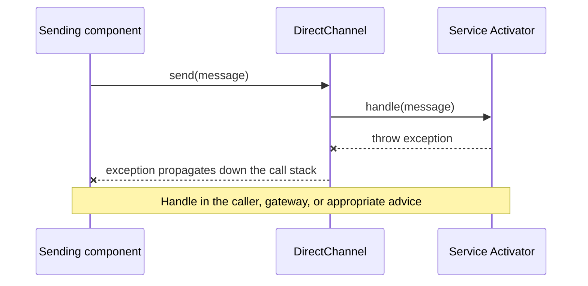
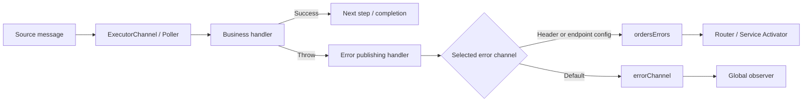
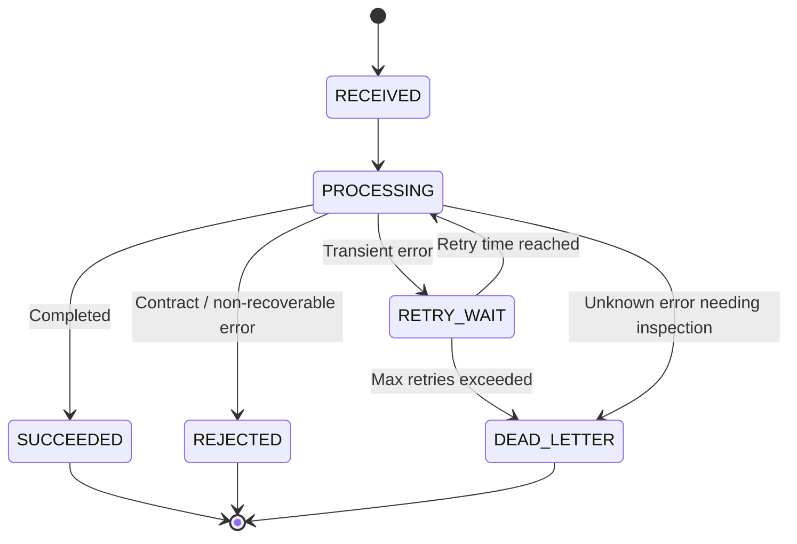
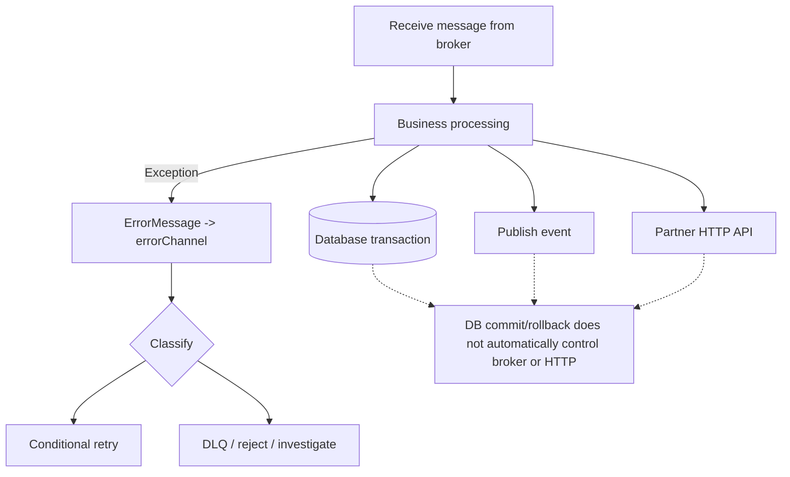

# errorChannel, ErrorMessage, and Error Processing Routing

> **Chapter:** Flow Errors and State  
> **Scope:** Within the **SPRING_BOOT_INTEGRATION** module, Spring Boot integration flows may pass through HTTP clients, databases, caches, message brokers, and Spring Integration adapters. This lesson focuses on how Spring Integration represents and forwards errors using `ErrorMessage` and `errorChannel`; how to classify errors for retry, rejection, or manual handling flows; and how to keep business state consistent when multiple systems are involved.

## 1. Why Do Errors in an Integration Flow Need a Separate Flow?

A flow that receives messages from a broker, calls a partner HTTP API, updates a database, and then publishes an event can fail at any step. If all errors are only logged, the system struggles to answer three questions: **which message failed, how far did processing get, and what needs to happen next?**

Spring Integration provides an **error flow** mechanism: instead of only seeing an exception on the Java call stack, certain execution points can **wrap the exception into a message** and send it to a dedicated `MessageChannel` for errors. This allows the application to use familiar Spring Integration components to observe, classify, and route errors to appropriate processing branches.

Three concepts to distinguish:

| Concept | Nature | Responsibility |
| --- | --- | --- |
| **Exception** | A `Throwable` object thrown during processing | Represents the cause of an operation's failure |
| **`ErrorMessage`** | A `Message<Throwable>` containing the exception, headers, and possibly the original message | Brings the error into the message flow mechanism |
| **`errorChannel`** | The global default error channel name in Spring Integration; also a common header to specify the target channel | Transports `ErrorMessage` to a handler/router |

**Key point:** `errorChannel` is not a message broker or a durable error store. It is an in-application message channel. To ensure recoverability after a restart, you need additional mechanisms such as state persistence, a retry store, a broker dead-letter queue (DLQ), or an appropriate outbox/inbox.

## 2. What Does ErrorMessage Contain?

Spring Integration uses the type `org.springframework.messaging.support.ErrorMessage`; this is a message whose **payload is a `Throwable`**, not an error message string.

Some error sources may wrap exceptions in `MessagingException` or variants such as `MessageHandlingException` and `MessageDeliveryException`, so the actual cause often lies in the `getCause()` chain.

| Location | Meaning | How to Use |
| --- | --- | --- |
| `errorMessage.getPayload()` | The exception forwarded to the error flow | Classify the error, record the exception type and cause |
| `errorMessage.getHeaders()` | Metadata of the error message itself | Correlate traces, track processing conditions |
| `errorMessage.getOriginalMessage()` | The original message if provided by the error-emitting component | Extract the business key, route, or data needed for reprocessing |
| `((MessagingException) cause).getFailedMessage()` | The message associated with the exception, if the exception is of the appropriate type | Fallback when the original message is missing |
| `errorChannel` on the original message | Commonly used to specify the error channel for a specific message | Route errors by partner, business domain, or inbound source |

Example error-reading handler:

```java
import org.springframework.integration.annotation.ServiceActivator;
import org.springframework.messaging.Message;
import org.springframework.messaging.MessagingException;
import org.springframework.messaging.support.ErrorMessage;
import org.springframework.stereotype.Component;

@Component
class GlobalErrorObserver {

    @ServiceActivator(inputChannel = "errorChannel")
    public void observe(ErrorMessage error) {
        Throwable failure = error.getPayload();
        Message<?> original = error.getOriginalMessage();

        if (original == null && failure instanceof MessagingException me) {
            original = me.getFailedMessage();
        }

        String sourceMessageId = original == null
                ? "unknown"
                : original.getHeaders().getId().toString();

        // Demo: record metadata; do not log full sensitive payloads.
        System.err.println(
                "Integration failed: messageId=" + sourceMessageId
                + ", exception=" + failure.getClass().getSimpleName()
        );
    }
}
```

The handler above subscribes to the default `errorChannel` provided by the Spring Integration infrastructure in standard configurations. When the system already has another global handler, you must clearly decide who observes and who is responsible for recovery; never let two subscribers simultaneously perform recovery side effects for the same event.

**Note:** `getOriginalMessage()` can return `null`. Do not assume every exception has a failed message, and do not log arbitrary exception contents or customer data without bounds.

## 3. Where Do Synchronous and Asynchronous Errors Go?

Not every exception is automatically sent to `errorChannel`. What determines this is **whether the execution point has an error publishing mechanism**.

### 3.1. DirectChannel: Errors Usually Return to the Caller

By default, `DirectChannel` dispatches the message to its subscriber **on the same calling thread**. If a service activator throws an exception, the error usually propagates back through `send()` or the gateway to the caller. Merely setting the `errorChannel` header on a message **does not guarantee** it automatically becomes an `ErrorMessage`.



For an HTTP inbound gateway, the final outcome also depends on the gateway configuration, reply/error channels, and how exceptions are mapped to HTTP responses. You cannot assume that simply having a channel named `errorChannel` means all REST errors flow through this channel.

### 3.2. ExecutorChannel, Pollers, and Listeners: Execution Boundaries Exist

With asynchronous execution points such as `ExecutorChannel`, or polling tasks configured with an error handler, exceptions cannot always be thrown back to the original caller. The infrastructure can use `MessagePublishingErrorHandler` to publish an `ErrorMessage` to the error channel.



The specific configuration of an inbound adapter (JMS, AMQP, Kafka, HTTP, etc.), poller, gateway, or reactive endpoint affects how errors are caught, forwarded, and how **acknowledgment/rollback** occurs at the source system. **Publishing an `ErrorMessage` does not mean the broker has retried, requeued, or rolled back.** You must check the ack/transaction policy of the source adapter.

### 3.3. Understanding Synchronous Boundaries

| Error Origin | Typical Behavior | What to Check |
| --- | --- | --- |
| Handler on `DirectChannel` | Throws exception to sender | Does the caller have catch/transaction/error advice? |
| Handler via `ExecutorChannel` | Exception occurs on worker thread; may be wrapped and sent to error channel | Error handler, `errorChannel` header, delivery of error branch |
| Polling endpoint | Poll task can forward errors to error channel | Poller error handler, poll transaction |
| Message-driven adapter | Follows container mechanism and endpoint configuration | Ack/nack, retry/redelivery, broker-side DLQ |
| Reactive chain | Reactor's `onError`/terminal signal plays the primary role | Is there a bridge publishing `ErrorMessage`? |

In particular, switching to asynchronous execution can make the caller see `send()` succeed even though the business handler fails later. "Sent to the channel" and "processing completed" are two different states.

## 4. Global Error Channel, Dedicated Channels, and the errorChannel Header

### 4.1. Global `errorChannel`

Spring Integration typically registers a bean named `errorChannel` as the default destination for error-emitting components that have no specific target. Default settings and behavior when there are no subscribers can vary by version; check your actual application configuration and logs. You can declare `@ServiceActivator(inputChannel = "errorChannel")` to observe global errors.

The default channel is suitable for alerting, metrics, and catching unrouted errors, but **you should not automatically retry every error from every flow** here: a validation error, a timeout error, and an uncommittable DB error require different decisions.

### 4.2. Error Channels per Flow or Inbound Source

Define channels such as `ordersErrors`, `customerSyncErrors`, or `partnerApiErrors` for workflows with different retry and state contracts. A message can carry the `errorChannel` header so the error publisher routes the error to the corresponding destination when supported by the endpoint.

```java
import org.springframework.messaging.Message;
import org.springframework.messaging.MessageChannel;
import org.springframework.messaging.support.MessageBuilder;

Message<OrderEvent> message = MessageBuilder
        .withPayload(new OrderEvent("order-1042", 3, true))
        .setErrorChannelName("ordersErrors")
        .build();

boolean accepted = ordersInput.send(message);
// accepted only indicates the message was sent to the channel;
// it does not confirm business completion on a worker thread.
```

This example assumes `ordersInput` is an injected channel and `OrderEvent` is an application DTO; the full configuration is in the next section. The channel name in the header must resolve via the Spring Integration resolver to a valid `MessageChannel` bean.

On some endpoints, the error channel can be configured directly on the adapter/gateway/poller. Channel selection precedence depends on where the error is caught and the endpoint type; **do not assume the header always takes precedence in every case**. Read the endpoint configuration and verify with an integration test.

## 5. Spring Boot Example: Classify and Route Errors

Suppose a service processes order creation commands from a partner. If the partner is temporarily unavailable, the error can be retried; if the quantity is negative or the input contract is invalid, it must be sent to a rejection branch. We use `ExecutorChannel` to illustrate an asynchronous boundary where errors are published as `ErrorMessage`.

Add the dependency (version is typically managed by Spring Boot):

```xml
<dependency>
    <groupId>org.springframework.boot</groupId>
    <artifactId>spring-boot-starter-integration</artifactId>
</dependency>
```

Example of a standalone configuration class:

```java
package com.example.integration.order;

import org.slf4j.Logger;
import org.slf4j.LoggerFactory;
import org.springframework.beans.factory.annotation.Qualifier;
import org.springframework.context.annotation.Bean;
import org.springframework.context.annotation.Configuration;
import org.springframework.integration.annotation.Router;
import org.springframework.integration.annotation.ServiceActivator;
import org.springframework.integration.channel.DirectChannel;
import org.springframework.integration.channel.ExecutorChannel;
import org.springframework.integration.config.EnableIntegration;
import org.springframework.messaging.MessageChannel;
import org.springframework.messaging.support.ErrorMessage;
import org.springframework.core.task.TaskExecutor;
import org.springframework.scheduling.concurrent.ThreadPoolTaskExecutor;

@Configuration
@EnableIntegration
public class OrderErrorFlowConfig {

    private static final Logger log =
            LoggerFactory.getLogger(OrderErrorFlowConfig.class);

    @Bean("ordersExecutor")
    public TaskExecutor ordersExecutor() {
        ThreadPoolTaskExecutor executor = new ThreadPoolTaskExecutor();
        executor.setCorePoolSize(2);
        executor.setMaxPoolSize(4);
        executor.setQueueCapacity(100);
        executor.setThreadNamePrefix("orders-");
        return executor;
    }

    @Bean("ordersInput")
    public MessageChannel ordersInput(
            @Qualifier("ordersExecutor") TaskExecutor executor) {
        return new ExecutorChannel(executor);
    }

    @Bean("ordersErrors")
    public MessageChannel ordersErrors() {
        return new DirectChannel();
    }

    @Bean("retryAlerts")
    public MessageChannel retryAlerts() {
        return new DirectChannel();
    }

    @Bean("rejectedAlerts")
    public MessageChannel rejectedAlerts() {
        return new DirectChannel();
    }

    @ServiceActivator(inputChannel = "ordersInput")
    public void process(OrderEvent order) {
        if (order.quantity() < 0) {
            throw new IllegalArgumentException("quantity must be >= 0");
        }
        if (order.partnerUnavailable()) {
            throw new PartnerTemporarilyUnavailableException(
                    "partner is unavailable"
            );
        }
        // Demo: processing succeeded; a real application calls a business service.
        log.info("Processed order {}", order.externalId());
    }

    @Router(inputChannel = "ordersErrors")
    public String routeError(ErrorMessage error) {
        Throwable root = rootCause(error.getPayload());
        return root instanceof PartnerTemporarilyUnavailableException
                ? "retryAlerts"
                : "rejectedAlerts";
    }

    @ServiceActivator(inputChannel = "retryAlerts")
    public void onRetryable(ErrorMessage error) {
        log.warn("Retryable order error: {}",
                error.getPayload().getClass().getSimpleName());
        // Production: persist a durable retry job and schedule a retry.
    }

    @ServiceActivator(inputChannel = "rejectedAlerts")
    public void onRejected(ErrorMessage error) {
        log.error("Rejected order error: {}",
                error.getPayload().getClass().getSimpleName());
        // Production: record REJECTED/DLQ status with a safe error code.
    }

    private Throwable rootCause(Throwable throwable) {
        Throwable current = throwable;
        while (current.getCause() != null
                && current.getCause() != current) {
            current = current.getCause();
        }
        return current;
    }

    public record OrderEvent(
            String externalId,
            int quantity,
            boolean partnerUnavailable) {}

    static class PartnerTemporarilyUnavailableException
            extends RuntimeException {
        PartnerTemporarilyUnavailableException(String message) {
            super(message);
        }
    }
}
```

**How it runs:** The adapter or producer sends an `OrderEvent` to `ordersInput` and sets the header `errorChannel=ordersErrors`. `ExecutorChannel` hands the task off to an executor thread; if `process()` throws an exception, the error publishing handler creates an `ErrorMessage` and forwards it to `ordersErrors`. The router classifies the cause and routes it to `retryAlerts` or `rejectedAlerts`, where the corresponding service activator handles it.

The example above **only logs in the two terminal branches** to illustrate routing. For production deployment, the two handlers must durably persist state, retry jobs, or DLQ entries with deduplication guards; logs should never be treated as a retry queue.

Because `@Router` returns a channel name, the `retryAlerts` and `rejectedAlerts` beans must exist and have subscribers. An error inside the error router or error handler itself can break the entire error processing path: you need a last-resort alerting path and a strategy to prevent infinite loops.

## 6. Classifying Errors to Decide Handling

Errors should be classified by **semantics and business contract**, not just by the exception message string.

| Error Category | Examples | Usually Appropriate Action |
| --- | --- | --- |
| **Transient / recoverable** | HTTP timeout, 503, intermittent DB connection, broker temporarily unavailable | Bounded retry with exponential backoff and jitter |
| **Invalid input data** | Missing required field, wrong schema, negative quantity | Reject, persist error, and notify sender to fix |
| **Conflict / duplicate** | Unique constraint violation for the same business key | Check idempotency; return previous result or flag conflict |
| **Unauthorized** | Missing permissions, expired credentials, policy rejection | Stop/route to security handling flow; do not continuously retry |
| **Programming or configuration error** | Wrong mapping, unexpected null, missing bean/channel, serialization error due to schema drift | Send to DLQ or incident, fix code/config before replay |
| **Unknown completion state** | DB committed but caller timed out; broker received but ack lost | Query outcome by idempotency key before deciding to resend |

Depending on the workflow, an HTTP 429 status may be retried after a specified delay, while 400 is a data error that should not be retried. Do not assume all 5xx errors can be retried indefinitely or that every `IllegalArgumentException` is a user error: it can also stem from a server-side bug.

Routing can be based on the exception class, cause chain, source headers, attempt count, business code, or partner ID. Spring Integration also offers specialized routers such as `ErrorMessageExceptionTypeRouter` if you want to route by exception type; the `@Router` approach in the example is easy to extend for business criteria.

## 7. Retry, Dead-Letter, and Processing State

### 7.1. ErrorMessage Is Only a Signal, Not Durable State

When an error enters `errorChannel`, **nothing guarantees the system automatically records "FAILED" in the database**. If end-to-end tracking is required, persist state keyed by a business key/idempotency key.

Example states of an integration job:



These states are an **application-defined business model**, not state automatically stored by Spring Integration. Depending on requirements, a job may have these fields:

| Field | Purpose |
| --- | --- |
| `messageId` / `businessKey` | Stable identifier of the integration operation; used to prevent duplicate processing |
| `sourceSystem`, `partnerId` | Identifies the source, retry rules, and owner |
| `status` | `RECEIVED`, `PROCESSING`, `RETRY_WAIT`, `SUCCEEDED`, `REJECTED`, `DEAD_LETTER` |
| `attemptCount`, `nextAttemptAt` | Caps the number of attempts and schedules the next attempt |
| `lastErrorCode`, `lastErrorAt` | Classification, diagnostics, and alerting |
| `correlationId`, `traceId` | Connects the message journey across HTTP, DB, and broker |
| `payloadReference` | Reference to securely stored data for replay when permitted |

**Protect idempotency at the data store**, for example with a unique constraint on `sourceSystem + businessKey`. If two workers pick up the same job concurrently, a claim/lease mechanism or optimistic locking is needed to avoid competing execution.

### 7.2. Retry in the Right Place

You can use retry advice on a suitable handler (for example `RequestHandlerRetryAdvice`) when you want to retry an operation within the same execution context. For long-term retries, persist a retry job and use a scheduler/broker to execute it later; do not hold a thread or DB transaction across a long delay.

Practical rules:

1. Set a **maximum attempt limit**, increasing intervals (*exponential backoff*), and jitter to avoid synchronized overload.
2. Retry a command with side effects only when there is an **idempotency key**, an idempotent operation, or the ability to query the outcome before resending.
3. Move non-recoverable or retry-exhausted errors to a DLQ/manual handling workflow, including the cause and sufficient metadata for tracing.
4. Persist retry reasons and state durably; do not rely on in-memory counters when multiple instances are running.
5. When replaying from a DLQ, verify the schema version, current state, and deduplication; never blindly bulk-replay.

### 7.3. Do Not Turn the Error Flow into an Infinite Loop

If `retryAlerts` immediately pushes the same message back into `ordersInput` without an attempt limit, the system can create a continuous loop. If the handler on `ordersErrors` itself throws an exception, the error branch can fail as well and leave no recovery path.

Design a circuit-closing stopgap: failures while handling errors must be alerted, written to a durable store when possible, and **stop retrying at a defined threshold**. In-JVM channels do not replace durable storage transactions.

## 8. Transactions, Broker Acknowledgment, and Multi-System Errors

An integration flow typically spans resources with separate transactions:



**Boundary notes:**

- An exception in a DB transaction only rolls back changes belonging to that transaction per transaction manager rules. It does not undo an HTTP request already processed by a partner.
- Sending an `ErrorMessage` does not automatically decide whether the source message is acked, nacked, or requeued by the broker. That depends on the listener container, transaction, and specific error policy of the JMS/AMQP/Kafka adapter.
- If a flow switches threads via `ExecutorChannel`, the upstream transaction/thread context **does not automatically propagate to the worker thread**. Place transactions on the actual service/handler performing DB writes.
- If you need reliable "write DB then publish event", consider a **transactional outbox**: save business data and the outbox record in the same transaction; a separate publisher sends the event. Consumers must still tolerate duplicate deliveries.
- If an error occurs after DB commit but before the response/ack reaches the source, the message may be redelivered. Idempotency and final-state lookups help prevent duplicate side effects.

An error flow can update `RETRY_WAIT` or `DEAD_LETTER`, but this state needs a **separate transaction** when the previous business transaction has already rolled back. Do not attempt to continue using a transaction marked rollback-only to record recovery state.

## 9. Observability and Security on the Error Flow

To debug flows spanning multiple systems, maintain a consistent correlation ID from message ingress through the HTTP client, DB, broker, and error flow. Record structured metadata instead of logging raw payloads.

Metrics worth tracking:

- **Error count by flow/route, exception type, partner, and contract version**.
- **Retry success rate, average retry count, age of jobs in `RETRY_WAIT`, and DLQ volume**.
- **Duration from `RECEIVED` to `SUCCEEDED`**, downstream timeouts, broker latency, and queued tasks in executors.
- **Failure rate of the error handler/router itself**, as this signals that the recovery path is broken.

With Micrometer/Actuator configured, appropriate metrics/traces can be collected; actual instrumentation depends on dependencies and versions. Limit metric tag cardinality: do not put `businessKey`, user IDs, or arbitrary exception messages in tags.

An `ErrorMessage` or failed message may contain personal data, credentials, tokens, or financial payloads. Filter logs, control DLQ read permissions, set retention limits, and enforce sensitive-data handling policies. A generic error handler should never print the entire `Throwable` and original message in production.

## 10. Testing the Error Paths Properly

| Test Scenario | Expected Outcome to Verify |
| --- | --- |
| Handler on `DirectChannel` throws exception | Caller receives exception; do not expect error channel to catch every error |
| Handler on `ExecutorChannel` fails with header set to `ordersErrors` | Receives `ErrorMessage` on the right channel, with trace metadata if provided |
| Simulated transient error | Router sends to retry branch, records attempt count and next attempt time |
| Invalid input error | Router sends to rejection/DLQ branch, no infinite retry |
| `ErrorMessage` missing original message or deeply wrapped exception | Handler does not NPE; root cause classification works reliably |
| Two duplicates with the same business key | DB/processing lock prevents duplicate side effects |
| Broker redelivery after DB commit | Final state and idempotency prevent erroneous reprocessing |
| Error handler or DLQ temporarily unavailable | Alert/fallback handling path triggers instead of silently dropping errors |

For integration tests, use a real Spring Boot application or Spring Integration test context, send messages through configured channels, and wait for asynchronous outcomes using a latch/queue with a timeout to avoid hanging tests. When verifying ack, rollback, delivery, unique constraints, or outbox behavior, use the actual test broker/database (for example via Testcontainers). Unit testing an isolated exception classification function **does not prove** that real messages are published, routed, and persisted correctly.

## 11. Common Misconceptions

1. **"Just setting `errorChannel` catches every exception."** False: synchronous errors can still throw straight back to the caller; the endpoint and error handler decide where exceptions are caught.
2. **"`ErrorMessage` has the original business message as its payload."** False: the payload is `Throwable`; the original/failed message is only present when provided by the infrastructure.
3. **"Receiving an `ErrorMessage` means the source message rolled back."** False: rollback and broker acknowledgment depend on the transaction and adapter.
4. **"Logging in the retry branch means the message was retried."** False: a real retry mechanism and durable state are required.
5. **"Every error should be retried."** False: validation, authentication, schema mismatches, and bugs may require rejection or fixing the system first.
6. **"Routing errors to a channel means you have a DLQ."** False: that is only an in-process channel; a DLQ requires durable storage.
7. **"Caller successfully sending to `ExecutorChannel` means business success."** False: processing may happen on another thread and fail afterward.

## 12. Self-Check Questions

1. Why do exceptions from `DirectChannel` not flow through `errorChannel` by default?
2. In an `ErrorMessage`, where should you look for the cause and the failed message? When might those be absent?
3. How do the `errorChannel` header, the global `errorChannel` bean, and an endpoint-configured error channel differ?
4. Why does a retry queue need to store `attemptCount`, `nextAttemptAt`, and a business key?
5. If a partner API call succeeded on the server but the response was lost, why is blind retrying dangerous?
6. What happens when an error-handling handler throws an exception itself? How do you design against loops?
7. Why does putting an exception onto `errorChannel` not mean a Kafka/AMQP message was nacked?

**Remember:** `ErrorMessage` turns an exception into a message that can travel through an integration flow; `errorChannel` is the default or contextual error destination; routers/handlers branch based on recoverability. System reliability still relies on clear transaction boundaries, idempotency, durable state, bounded retries, testing against proper infrastructure, and observability sufficient to trace a message end to end.
