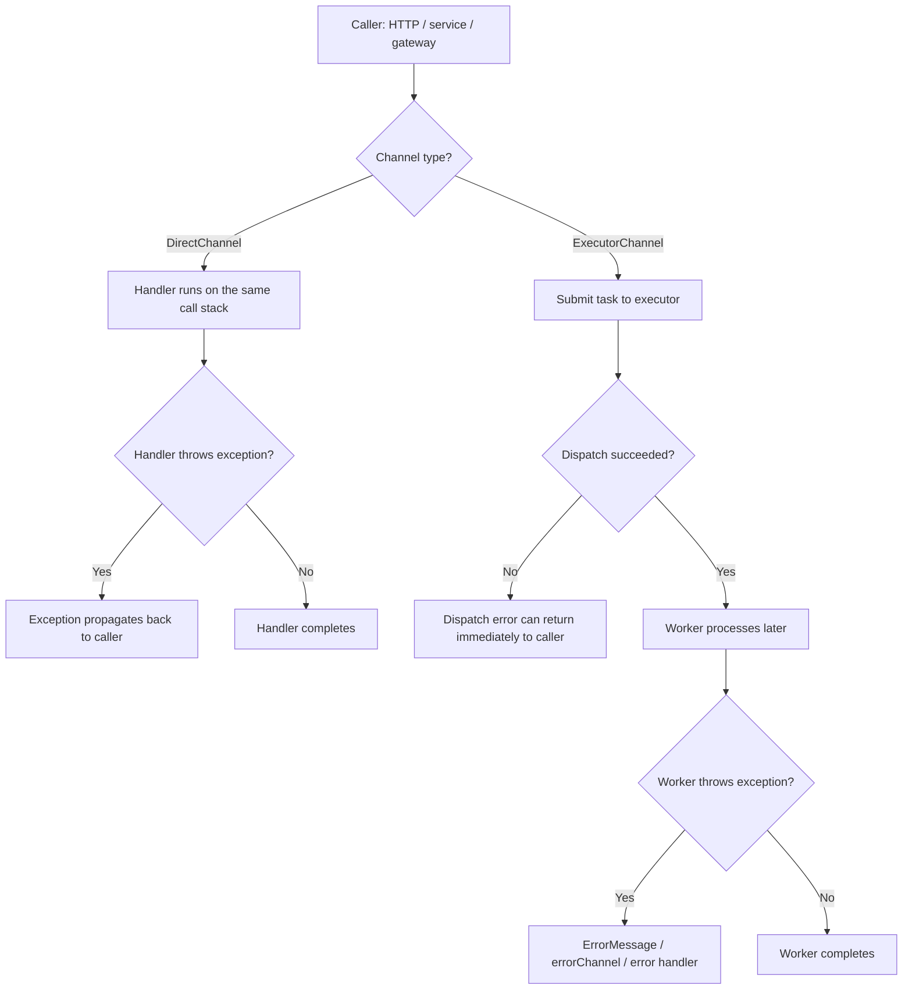
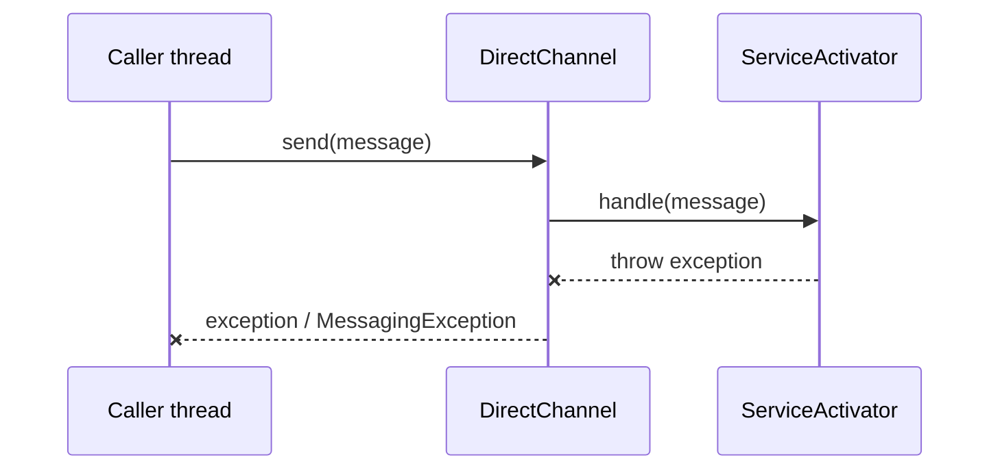
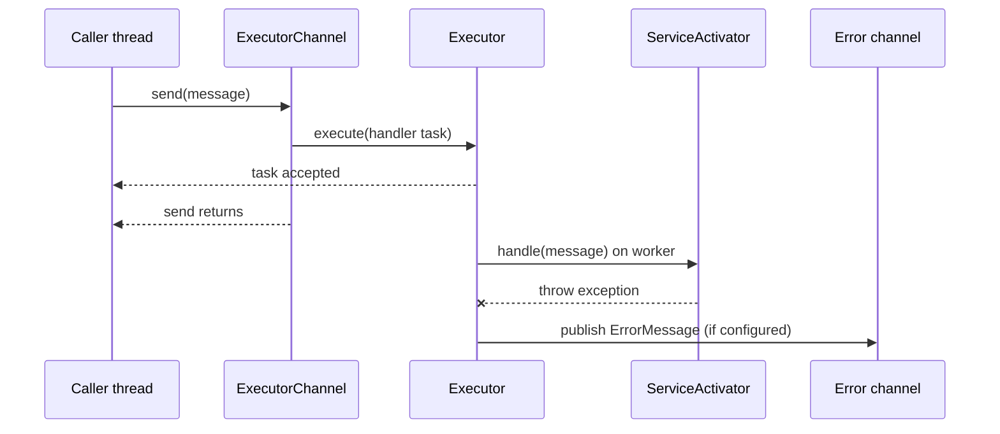
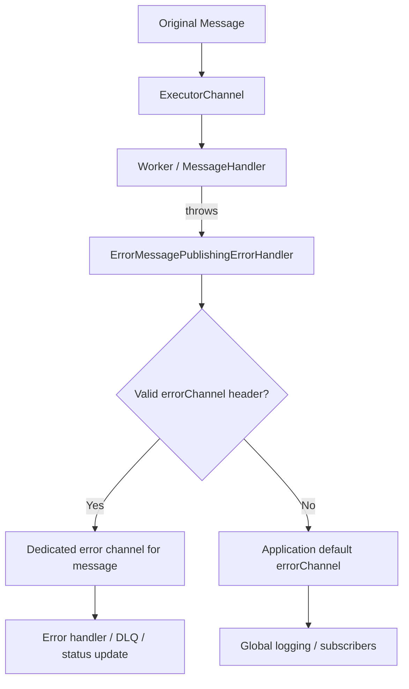
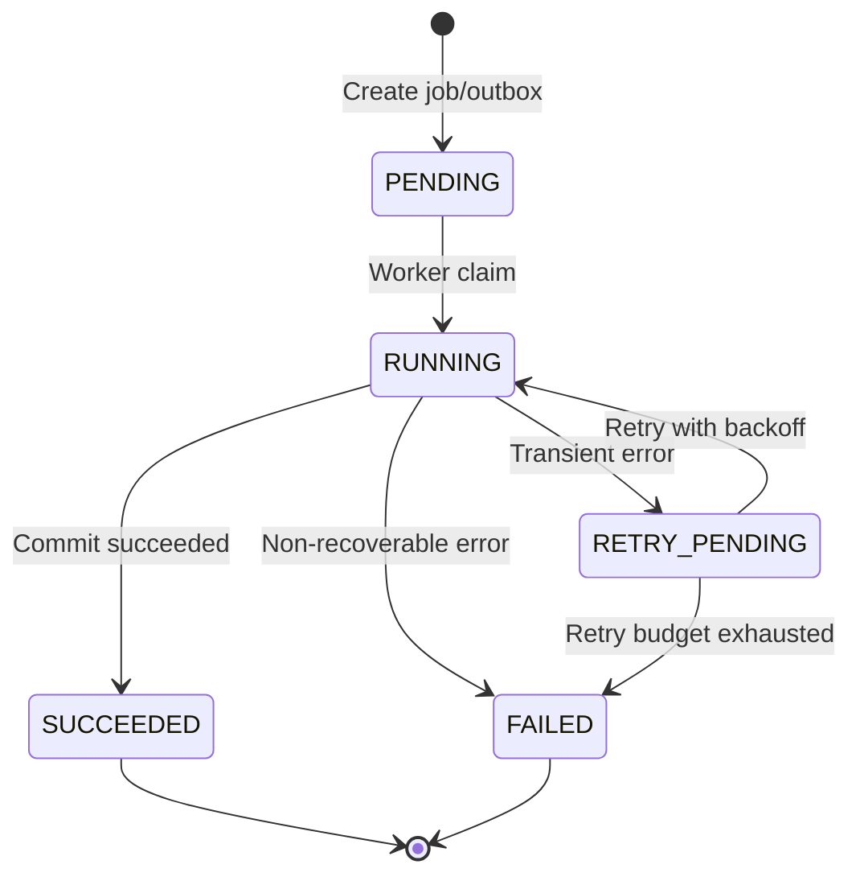
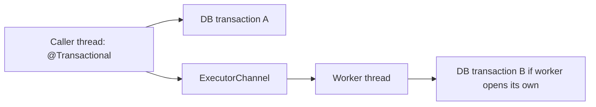
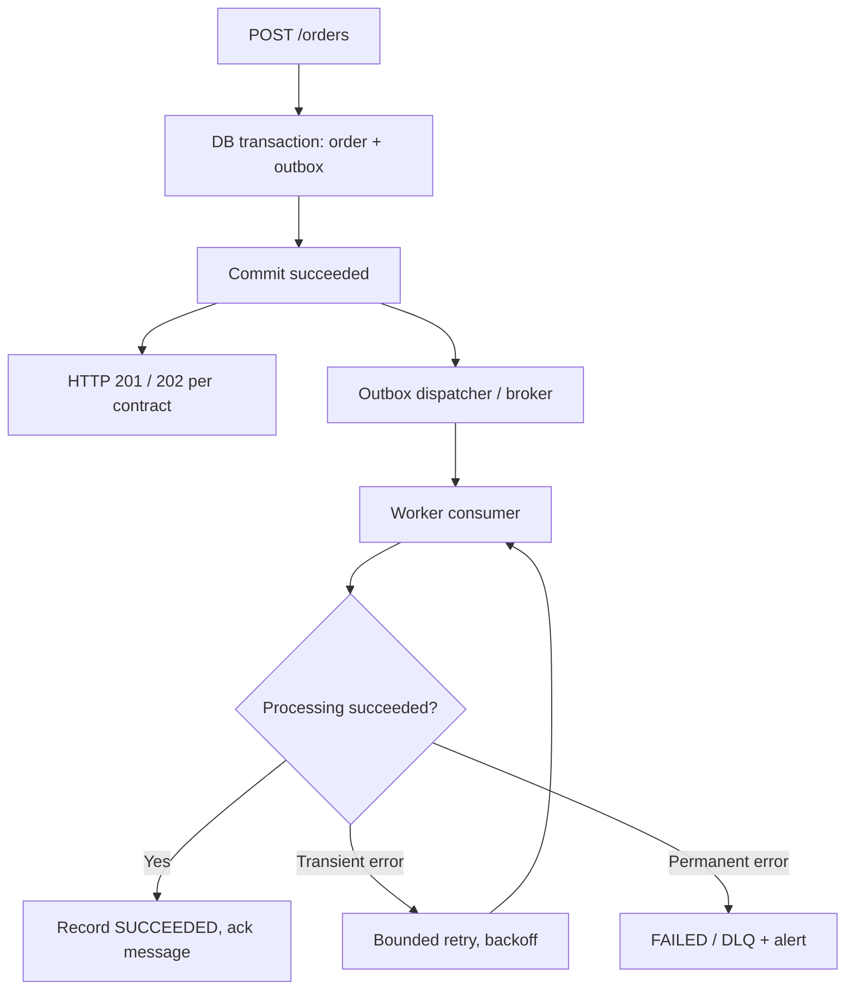

# Distinguishing Synchronous Caller Errors from Executor Errors

## 1. The Problem: The Same Exception Can Produce Different Outcomes for the Caller

In **SPRING_BOOT_INTEGRATION**, a Spring Boot application often coordinates multiple steps: receiving an HTTP request, calling a database, reading a cache, publishing a message to a broker, or transferring data through **Spring Integration** adapters. These steps may run directly on the request-receiving thread or be handed off to an executor to run on another thread. **The thread boundary determines whether an exception propagates directly back to the caller or must travel through an error channel.**

Suppose an Order Service receives an order creation request and sends a message into a processing flow:

- If the message goes through a **DirectChannel** and the handler throws an error immediately during the call, the exception usually returns to the code calling `send()` or the gateway on the **same call stack**.
- If the message goes through an **ExecutorChannel**, the `send()` call may return once the task is accepted for execution. The handler will run on an executor thread; if the handler throws an error **later**, the original caller is no longer on the same call stack to catch the exception. The error must be sent to `errorChannel` or another observation/recovery mechanism.
- If the executor rejects the task immediately at dispatch time because it is overloaded or shut down, that can surface as a **synchronous error right inside the `send()` call**, even though the channel is asynchronous.

This is the difference between **"whether the caller receives an exception"** and **"whether the work has been processed successfully"**. A `true` return value from `MessageChannel.send(...)` does not by itself guarantee that the database committed, the downstream HTTP service received the data, or the broker confirmed business processing.



This article focuses on **flow errors and state**: exception propagation paths, how Spring Integration creates and routes `ErrorMessage`, gateway behavior, transaction boundaries, retry/idempotency, executor limits, testing both error types, and production observability.

The examples illustrate Spring Boot 3.x, Spring Framework 6, and Spring Integration 6.x. For other versions, verify the corresponding auto-configuration conditions and APIs.

## 2. Four Concepts to Keep Separate

| Concept | Question | Example |
| --- | --- | --- |
| **Dispatch** | Did the channel accept and hand off the message to a handler or queue? | `MessageChannel.send(message)` returns `true` |
| **Execution** | Did the handler actually run and finish? | HTTP/DB calls inside the service activator |
| **Failure propagation** | To whom and how is an exception delivered? | `throw` to caller or `ErrorMessage` to error channel |
| **Business acknowledgment** | Has the business operation committed/completed? | Order record saved, event processed idempotently |

These four events are **not simultaneous** in an asynchronous flow. Even when a log reads "message accepted", downstream steps can still fail. If the caller needs to know the final outcome, you must design **reply/correlation**, job state tracking, or confirmation callbacks/events.

Relevant Spring Integration components:

- `Message<?>`: consists of `payload` and `headers`, carrying business context.
- `MessageChannel`: message transfer point between endpoints.
- `DirectChannel`: by default invokes the handler directly on the caller's thread.
- `ExecutorChannel`: delegates dispatch to an `Executor`; the handler runs on an executor thread.
- `QueueChannel`: places messages into a queue for a poller or consumer to retrieve later.
- `PublishSubscribeChannel`: can invoke subscribers synchronously if no executor is configured, or asynchronously if an executor is configured.
- `MessagingException`: Spring Messaging's exception family, which can carry `failedMessage`.
- `ErrorMessage`: a special message whose `payload` is a `Throwable`, typically sent via an error channel.

Do not label an entire flow "asynchronous" just because a channel is named `asyncOrders`. **Actual behavior depends on the channel implementation and the real location of executors/pollers in the path.**

## 3. DirectChannel: Exceptions Follow the Caller's Call Stack

With `DirectChannel`, the handler is invoked immediately on the message-sending thread. If a service activator throws an exception and no intermediate layer catches or transforms it, the exception propagates back up to the synchronous caller.



Channel configuration example:

```java
import org.springframework.context.annotation.Bean;
import org.springframework.context.annotation.Configuration;
import org.springframework.integration.config.EnableIntegration;
import org.springframework.integration.channel.DirectChannel;
import org.springframework.messaging.MessageChannel;

@Configuration
@EnableIntegration
public class SyncFlowConfiguration {

    @Bean("syncOrders")
    MessageChannel syncOrders() {
        return new DirectChannel();
    }
}
```

The handler can be a Spring Integration service activator:

```java
import org.springframework.integration.annotation.ServiceActivator;
import org.springframework.stereotype.Component;

@Component
public class SyncOrderHandler {

    @ServiceActivator(inputChannel = "syncOrders")
    public void handle(OrderCommand command) {
        if (command.quantity() <= 0) {
            throw new IllegalArgumentException(
                "Quantity must be greater than zero"
            );
        }

        // Invoke order-processing business logic on the same execution thread.
    }
}
```

Here `OrderCommand` is an application DTO, for example:

```java
public record OrderCommand(
    String orderId,
    String sku,
    int quantity
) {}
```

The caller sends the message and catches errors:

```java
import org.springframework.messaging.MessageChannel;
import org.springframework.messaging.support.MessageBuilder;

public void submitSync(
        MessageChannel syncOrders,
        OrderCommand command) {

    try {
        boolean dispatched = syncOrders.send(
            MessageBuilder.withPayload(command).build()
        );

        if (!dispatched) {
            throw new IllegalStateException(
                "Message was not dispatched"
            );
        }
    } catch (RuntimeException exception) {
        // Error received on the synchronous execution path.
        // MessagingException can be unwrapped for classification.
        throw exception;
    }
}
```

Spring Integration may wrap handler errors in `MessageHandlingException` or a `MessagingException` subtype before propagating them up the call stack. Therefore, tests and application logic should not assume they will always catch the raw `IllegalArgumentException` directly. Inspect the **cause chain** and the actual error type produced by the endpoint in use.

**What is guaranteed?** The caller can only observe the error when the handler is invoked on the same synchronous execution path and the exception is not swallowed by an intermediate endpoint, interceptor, or error handler. If the handler itself catches and logs the exception, the caller naturally never receives it.

## 4. ExecutorChannel: Shifting Execution to Another Thread

`ExecutorChannel` uses an `Executor` to dispatch messages asynchronously. The caller can finish `send()` once the task is accepted, while the worker has not yet started processing.



Example of configuring a bounded executor to prevent unbounded thread creation:

```java
import org.springframework.beans.factory.annotation.Qualifier;
import org.springframework.context.annotation.Bean;
import org.springframework.context.annotation.Configuration;
import org.springframework.integration.channel.ExecutorChannel;
import org.springframework.messaging.MessageChannel;
import org.springframework.scheduling.concurrent.ThreadPoolTaskExecutor;

@Configuration
public class AsyncFlowConfiguration {

    @Bean("orderFlowExecutor")
    ThreadPoolTaskExecutor orderFlowExecutor() {
        ThreadPoolTaskExecutor executor =
            new ThreadPoolTaskExecutor();

        executor.setCorePoolSize(2);
        executor.setMaxPoolSize(4);
        executor.setQueueCapacity(100);
        executor.setThreadNamePrefix("order-flow-");
        return executor;
    }

    @Bean("asyncOrders")
    MessageChannel asyncOrders(
            @Qualifier("orderFlowExecutor")
            ThreadPoolTaskExecutor executor) {
        return new ExecutorChannel(executor);
    }
}
```

`ThreadPoolTaskExecutor` has its lifecycle managed by Spring as a bean. The numbers 2/4/100 are illustrative; real choices depend on load, downstream latency, connection pool limits, backpressure capability, and queue-full handling requirements.

Handler:

```java
import org.springframework.integration.annotation.ServiceActivator;
import org.springframework.stereotype.Component;

@Component
public class AsyncOrderHandler {

    @ServiceActivator(inputChannel = "asyncOrders")
    public void handle(OrderCommand command) {
        // Typically runs on a thread prefixed with "order-flow-".
        if (command.quantity() <= 0) {
            throw new IllegalArgumentException(
                "Quantity must be greater than zero"
            );
        }

        // May call DB/HTTP/broker and fail at a later step.
    }
}
```

By the time `send()` returns, the caller **does not yet have the final outcome**. If the handler throws an error after being started by the executor, a `try/catch` around `send()` in the caller **cannot catch** that error because the caller and worker stacks are decoupled.

An easily overlooked point: **the executor can reject work immediately at dispatch time**. When the pool/queue is saturated, `execute(...)` may throw `RejectedExecutionException` or a corresponding exception. This error can propagate directly back to the caller during the `send()` call, before the task is accepted. Therefore, you must not conclude that "all `ExecutorChannel` errors only appear on `errorChannel`".

## 5. Comparing Behavior by Error Location and Channel

| Scenario | Where Error Occurs | Can `send()` Caller Catch Directly? | Reasonable Handling Path |
| --- | --- | --- | --- |
| Handler on `DirectChannel` throws exception | Caller thread | **Yes**, if not caught along the way | Propagate exception to service/controller/gateway |
| Handler after `ExecutorChannel` throws exception | Worker thread | **No**, if the error occurs after successful dispatch | `ErrorMessage` → error channel / async error handling |
| Executor rejects task upon submit | Caller thread | **Possibly yes** | Catch dispatch failure, return work-not-accepted result |
| `QueueChannel` accepted message, poller fails later | Poller thread | **No** via original `send()` call | Poller error handling, error channel, retry/DLQ |
| `PublishSubscribeChannel` without executor, subscriber throws | Caller thread | **Possibly yes** | Consider dispatch failure and subscriber configuration |
| `PublishSubscribeChannel` with executor, subscriber fails | Executor thread | Usually **no** via original `send()` | Async error via handler/error channel |
| HTTP/DB call inside worker times out | Worker thread | Not via original `send()` | Error classification, bounded retry, job state |
| Handler succeeded but async reply is lost | Reply/transport layer | Not necessarily | Correlation ID, timeout, reconciliation |

These columns describe **typical behavior**, not guarantees across every interceptor, transaction manager, gateway, or custom error handler configuration. When a gateway or bridge is present, identify which point preserves the request–reply connection and which point decouples into async execution.

## 6. How Do errorChannel and ErrorMessage Work?

In Spring Integration, asynchronous errors can be converted into an `ErrorMessage`. This is a `Message` whose `payload` is a `Throwable`, often containing a `MessagingException` or the underlying processing failure cause.

A typical flow:



**Note:** The diagram reflects standard Spring Integration behavior with Spring-managed endpoints/executors and an error handler that supports publishing errors. If you spawn raw threads, call `Executor.submit`, or manage Reactive streams outside this mechanism, Spring Integration does not automatically turn every `Throwable` into an `ErrorMessage`. You must intentionally configure a place to catch and forward errors.

### 6.1. The Original Message Can Specify a Dedicated Error Channel

Using `MessageHeaders.ERROR_CHANNEL`, a producer can specify the error destination for a message. In the following example, a **`MessageChannel` reference** is used as the header value to avoid relying on string-based channel name resolution:

```java
import org.springframework.beans.factory.annotation.Qualifier;
import org.springframework.messaging.MessageChannel;
import org.springframework.messaging.MessageHeaders;
import org.springframework.messaging.support.MessageBuilder;
import org.springframework.stereotype.Service;

@Service
public class AsyncOrderSubmitter {

    private final MessageChannel asyncOrders;
    private final MessageChannel orderErrors;

    public AsyncOrderSubmitter(
            @Qualifier("asyncOrders") MessageChannel asyncOrders,
            @Qualifier("orderErrors") MessageChannel orderErrors) {
        this.asyncOrders = asyncOrders;
        this.orderErrors = orderErrors;
    }

    public boolean submit(OrderCommand command) {
        return asyncOrders.send(
            MessageBuilder.withPayload(command)
                .setHeader(
                    MessageHeaders.ERROR_CHANNEL,
                    orderErrors
                )
                .setHeader("correlationId", command.orderId())
                .build()
        );
    }
}
```

Dedicated error channel configuration:

```java
import org.springframework.context.annotation.Bean;
import org.springframework.context.annotation.Configuration;
import org.springframework.integration.channel.DirectChannel;
import org.springframework.messaging.MessageChannel;

@Configuration
public class OrderErrorChannelConfiguration {

    @Bean("orderErrors")
    MessageChannel orderErrors() {
        return new DirectChannel();
    }
}
```

If the `asyncOrders` handler throws an exception on a worker thread and the endpoint has an error-publishing error handler, Spring Integration uses the appropriate `errorChannel` header for routing. With a dedicated `DirectChannel` like the one above, error handling may continue **on the same worker thread**; this is asynchronous relative to the original caller, though it does not necessarily create another thread for error handling.

### 6.2. Receiving ErrorMessage and Inspecting failedMessage

```java
import org.springframework.integration.annotation.ServiceActivator;
import org.springframework.messaging.Message;
import org.springframework.messaging.MessagingException;
import org.springframework.messaging.support.ErrorMessage;
import org.springframework.stereotype.Component;

@Component
public class OrderFlowErrorHandler {

    @ServiceActivator(inputChannel = "orderErrors")
    public void handle(ErrorMessage errorMessage) {
        Throwable failure = errorMessage.getPayload();

        Message<?> failedMessage = null;
        if (failure instanceof MessagingException messagingException) {
            failedMessage = messagingException.getFailedMessage();
        }

        // Can inspect correlationId, error code, and exception type.
        // Update status to FAILED / RETRY_PENDING per business rules.
        // Avoid logging passwords, tokens, or full sensitive payloads.
    }
}
```

Do not assume `getFailedMessage()` is always non-null or that every error payload is a `MessagingException`. In Spring Messaging versions that support it, `ErrorMessage.getOriginalMessage()` can also help trace the original message; always check those fields before reading them. Errors occurring before message construction or before the handler receives data will lack the expected context.

### 6.3. Global errorChannel

Spring Integration typically provides a default `errorChannel` with logging logic for unhandled errors. The global channel is useful for observability, but **you should not rely solely on default logging to guarantee that work is recovered**.

An important business error should be routed to a dedicated error flow or have an error handler explicit enough to:

- Distinguish transient from permanent exceptions.
- Record reconcilable job state.
- Forward the failed message to a broker queue/DLQ or appropriate retry store if durability is required.
- Attach correlation ID, operation, and attempt count.
- Emit metrics/alerts when failure counts exceed thresholds.

Avoid arbitrarily defining a new bean named `errorChannel` if the application already relies on the default global error channel. When customization is needed, understand the lifecycle, subscriber count, and framework defaults. For dedicated flows, a name like `orderErrors` keeps error scoping easier to manage.

## 7. Exceptions Sent to the Caller Differ from ErrorMessage Sent to errorChannel

The two error paths are often confused because both originate from a `throw`:

**Synchronous path**

```text
HTTP Controller
  -> MessageChannel.send()
      -> DirectChannel
          -> ServiceActivator
              -> throw exception
  <- exception propagates back up the call stack
```

**Executor path**

```text
HTTP Controller
  -> MessageChannel.send()
      -> ExecutorChannel -> submit task
  <- send() returns after dispatch

Worker thread, executing later:
  -> ServiceActivator
      -> throw exception
      -> ErrorMessagePublishingErrorHandler
      -> orderErrors / errorChannel
```

Therefore, a `try/catch` around `asyncOrders.send(message)` handles **dispatch** errors arising during that call, but is not a mechanism for capturing results of subsequent asynchronous processing.

**Nor should you reason in reverse:** receiving an `ErrorMessage` does not mean the error was propagated as an exception to the HTTP caller. You need an active reply/correlation path or status query mechanism if the caller requires the final outcome.

## 8. MessagingGateway: When Can Errors Still Return to the Caller?

Spring Integration's `@MessagingGateway` acts as a bridge between a Java method call and a messaging flow. With a request–reply gateway, the caller can wait for a reply, and the framework can supply temporary reply/error channels or gateway-linked routing according to configuration.

Example of a synchronous gateway interface:

```java
import org.springframework.integration.annotation.Gateway;
import org.springframework.integration.annotation.MessagingGateway;

@MessagingGateway
public interface OrderGateway {

    @Gateway(
        requestChannel = "ordersGatewayInput",
        replyTimeout = "3000"
    )
    OrderResult submit(OrderCommand command);
}
```

`OrderResult` is the application's business result DTO; `ordersGatewayInput` is the request channel provided by the flow. This snippet illustrates a gateway expecting **one reply**. Timeout values here are in milliseconds per the gateway API. In a real application, you must also consider request timeouts and situations where an endpoint produces no reply.

### 8.1. Gateway Over DirectChannel

When the gateway flows through a synchronous handler:

- Handler returns a reply → gateway can return the result to the caller.
- Handler throws an exception → gateway/caller can receive the exception per gateway mechanics, unless another error flow handles it.
- The call may run within the caller's transaction boundary and thread, depending on transaction configuration.

### 8.2. Gateway Over ExecutorChannel

When there is an executor behind the gateway:

- The gateway thread **may still wait** for a reply under the request–reply contract even though the handler moved to a worker thread.
- If the worker sends a reply to the valid reply channel before the deadline, the gateway can return the result to the caller.
- If an error is routed as an error reply through the error channel mechanism received/transformed by the gateway, the gateway can throw an exception to the caller.
- If no suitable reply or error reply arrives before the timeout, the gateway may time out, return `null`, or throw an error depending on the return type and specific configuration.

Thus, the statement "`ExecutorChannel` always prevents the caller from receiving errors" is **too broad** when the caller uses a request–reply gateway that actively awaits and wires an error-reply path. What is true is that **worker exceptions do not propagate directly up the `send()` stack**; the gateway can turn error information into a separate reply via channels.

### 8.3. Choose the API Contract Up Front

| HTTP API Requirement | Design Pattern | Error Reporting Method |
| --- | --- | --- |
| Must finish processing before returning 200/4xx/5xx | Synchronous flow or request–reply gateway with timeout | Exception/result on the same request |
| Only accept work for later execution | Async channel + durable queue/job store | HTTP 202 with job ID; status polling/callback/event |
| Processing time indeterminate, potentially long | Job state machine, event/callback | `PENDING`, `RUNNING`, `SUCCEEDED`, `FAILED` |
| Needs recovery policy on broker/DB errors | Outbox, bounded retry, DLQ/inbox | Separate ingestion errors from processing errors |

Returning HTTP `202 Accepted` should only be used when the system has truly **accepted the task under its published guarantees**. A task sitting only in an executor's in-memory queue can be lost on process crash; if durability is required, persist the job/outbox before acknowledging.

## 9. Job State: ACCEPTED Is Not SUCCEEDED

Common states of an asynchronous job:



**State machine transitions must be persisted in durable storage** if the SLA requires recovery after restart. For a flow doing fast enrichment or best-effort metrics, in-memory execution may be acceptable; however, this nature must be explicitly reflected in the contract.

Each job should have:

- A stable `jobId`/`eventId`, typically assigned at creation.
- `correlationId` and safe tracing metadata.
- `status` along with `createdAt`/`updatedAt`.
- `attemptCount` and `nextRetryAt` when retrying.
- Structured error code distinguishing retryable vs. permanent; avoid storing secrets/PII in error details.
- A claim/lease mechanism when multiple workers process concurrently.

A possible failure point: a worker completes a side effect and the process dies before updating `SUCCEEDED`. The system will retry and risk executing twice; safety requires **idempotency** at the system of record.

## 10. Transaction Boundaries Change When Moving to an Executor

In Spring, typical database transactions bind their context to the executing thread. `ExecutorChannel` switches to another thread, so a transaction started in the caller **does not automatically follow** onto the worker.



Consequences:

1. The caller may commit its DB transaction before—or after—the worker begins processing the message.
2. If the caller's transaction rolls back, the already-submitted task may still run against non-existent or stale data.
3. The worker can open its **own transaction** using `@Transactional` on a Spring bean invoked through its proxy; this is not the transaction opened on the caller.
4. A worker failure does not automatically roll back the caller's already-committed transaction.
5. Placing `@Transactional` on the method calling `send()` does not make the entire executor flow atomic.

### 10.1. Example Risk When Dispatching a Task Before Commit

```java
@Transactional
public void createOrder(CreateOrderRequest request) {
    orderRepository.save(toEntity(request));
    asyncOrders.send(
        MessageBuilder.withPayload(
            new OrderCommand(request.orderId(), request.sku(), 1)
        ).build()
    );
}
```

At the moment the worker reads the order from the DB, the caller's transaction may **not yet have committed**; the worker sees stale data or no order at all. If the caller rolls back after the task was submitted, the worker may still process an invalid event.

Solutions depend on required reliability:

- **After-commit hook** fits lightweight best-effort tasks, but does not guarantee durability if the process dies after commit and before dispatch.
- **Transactional outbox**: write the order and outbox event in the same DB transaction; a separate publisher reads committed outbox rows and dispatches them to a broker/worker with retry.
- **Durable broker + idempotent consumer**: handle redelivery and control acknowledgment.
- **Saga/compensation** if a business workflow spans multiple systems without distributed transactions.

**Do not use `ThreadLocal` propagation to "transfer" a database transaction across an executor.** Logging/security context may be propagated via supported mechanisms where appropriate, but thread-bound JDBC transaction resources must not be copied to worker threads.

## 11. Retries, Duplicates, and Failures After Side Effects

Executor errors are often detected **later** than when the caller accepted the work. On retry, a message send or HTTP call may already have completed downstream before a timeout returned to the worker. Therefore you must distinguish:

| Operation Type | Is Retry Safe? | Conditions |
| --- | --- | --- |
| Read-only data fetch | Usually safe | Proper deadline/retry budget, load limits |
| Cache `SET` with same key/value | Can be idempotent | TTL and secondary side effects properly understood |
| `INCR`, debit, order creation | Not by default | Idempotency key, unique constraint, or dedupe |
| Sending email/notification | Can send duplicates | Notification ID and state, provider idempotency if supported |
| Publishing broker event | Can emit duplicates after timeout | Stable `eventId` + consumer inbox |
| DB write then broker send | Risk of lost/duplicated events | Transactional outbox + consumer idempotency |

### 11.1. Do Not Retry Infinitely Inside errorChannel

If an error handler receives an `ErrorMessage` and immediately resends the original message back to the same `ExecutorChannel` without limits, permanent errors can cause a hot loop, clog the queue, and exhaust threads.

Pragmatic rules:

1. Classify transient vs. permanent errors.
2. Record attempt count, `nextRetryAt`, and a sanitized reason.
3. Retry with bounds plus backoff/jitter when the operation is safe.
4. Route to a DLQ/parking queue or `FAILED` once retry budget is exhausted.
5. Provide reconciliation and controlled reprocessing tools after fixing root causes.
6. Monitor retry queue depth, job age, and error rates by operation.

**`ErrorMessage` itself is not a durable retry queue.** If handled only in-JVM, error state can be lost on application crash. For critical work, persist state to a database or suitable broker.

## 12. Worker Error Handling Must Not Hide Failure Signals

An error handler that only logs and returns may suffice for best-effort telemetry. For critical business workflows, log-only is insufficient because the caller has no way to know the job failed.

Example handler receiving an error and requesting a state-management service to update:

```java
@Component
public class OrderErrorRecorder {

    private final OrderJobService jobs;

    public OrderErrorRecorder(OrderJobService jobs) {
        this.jobs = jobs;
    }

    @ServiceActivator(inputChannel = "orderErrors")
    public void onFailure(ErrorMessage error) {
        Throwable failure = error.getPayload();

        String jobId = findJobId(error);
        if (jobId == null) {
            // Log warning with safe error code and correlation context.
            // Route to investigation channel if error cannot be linked to a job.
            return;
        }

        jobs.recordFailure(jobId, classify(failure));
    }

    // findJobId(...) and classify(...) are application logic to implement.
}
```

This is a **design illustration**, not a copy-paste runnable class: `OrderJobService`, `findJobId`, and `classify` are implemented by the application. In real code, standardize extracting `jobId` from original/failed message headers or the business payload, handle `null`, and ensure state updates are idempotent.

If `recordFailure` itself fails (for example, the database is unavailable), the error handler can fail again. To avoid data loss, provide retry/persistence mechanisms at the error-handling layer and alerting; never let a secondary exception get buried in hard-to-find logs.

## 13. Observing Error Flows Across Multiple Threads

When a flow crosses an executor, logging by thread name is not enough to correlate events. Worker threads handle messages from many requests, and `MDC`/`ThreadLocal` context does not automatically travel with a message.

**Metadata that should travel with the message:**

- `correlationId`: links the HTTP request to the processing chain.
- `jobId` or `eventId`: stable business identifier for idempotency/reconciliation.
- `operation`/`flowName`: identifies the running step.
- `attempt` or retry count: tracks retries.
- `traceparent`/trace context: via an appropriate observability mechanism without exposing sensitive data.

You can use Spring Integration Micrometer/Observation instrumentation when dependencies and configuration support it. Useful metrics:

| Area | Metric / Log | Meaning |
| --- | --- | --- |
| Caller | Messages dispatched accepted/rejected | Measures incoming load acceptance |
| Executor | Active threads, queue depth, task rejections | Detects overload and saturation |
| Handler | Processing time, success/failure counts | Measures actual outcomes |
| Error channel | `ErrorMessage` rate by flow/exception | Categorizes post-dispatch failures |
| State store | Job age, pending/retry/failed counts | Measures unfinished backlog |
| Downstream | DB/HTTP/broker timeouts, latency, error rates | Pinpoints failure sources |
| End-to-end | Time from ACCEPTED to SUCCEEDED | Evaluates business SLA |

**A high send-success metric is not successful processing throughput.** When worker backlog grows, the caller may continue sending successfully while results fall behind. Pair acceptance rates with completion rates, job age, and error rates.

When logging, do not print raw payloads containing PII, tokens, passwords, or sensitive HTTP bodies. Use structured error codes and correlation IDs for investigation rather than dumping full unfiltered exception contexts.

## 14. Testing Synchronous Errors and Executor Errors

This section describes tests to have in Spring Boot 3.x / Spring Integration 6.x; examples assume the `syncOrders`, `asyncOrders`, and handler beans from earlier sections exist.

### 14.1. Synchronous: Assert Exception at the send Call

```java
import static org.assertj.core.api.Assertions.assertThatThrownBy;

import org.junit.jupiter.api.Test;
import org.springframework.beans.factory.annotation.Autowired;
import org.springframework.beans.factory.annotation.Qualifier;
import org.springframework.boot.test.context.SpringBootTest;
import org.springframework.messaging.MessageChannel;
import org.springframework.messaging.support.MessageBuilder;

@SpringBootTest
class SyncErrorPropagationTest {

    @Autowired
    @Qualifier("syncOrders")
    MessageChannel channel;

    @Test
    void propagatesFailureToCaller() {
        var invalid = new OrderCommand("ord-1", "sku-1", 0);

        assertThatThrownBy(() -> channel.send(
            MessageBuilder.withPayload(invalid).build()
        ))
            .isInstanceOf(RuntimeException.class);
    }
}
```

In a real test project, also assert the **cause chain** to verify the expected validation error instead of only asserting "any `RuntimeException`", because wiring errors like `NoSuchBeanDefinitionException` or misrouted messages could make the test pass falsely. Use dedicated handlers/fixtures to verify the exact error path.

### 14.2. Executor: Receive ErrorMessage via a Test QueueChannel

`QueueChannel` is a `PollableChannel` and is useful for capturing errors in tests because tests can wait with a bounded timeout instead of relying on `Thread.sleep(...)`.

```java
import static org.assertj.core.api.Assertions.assertThat;

import org.junit.jupiter.api.Test;
import org.springframework.beans.factory.annotation.Autowired;
import org.springframework.beans.factory.annotation.Qualifier;
import org.springframework.boot.test.context.SpringBootTest;
import org.springframework.integration.channel.QueueChannel;
import org.springframework.messaging.Message;
import org.springframework.messaging.MessageChannel;
import org.springframework.messaging.MessageHeaders;
import org.springframework.messaging.support.ErrorMessage;
import org.springframework.messaging.support.MessageBuilder;

@SpringBootTest
class AsyncErrorChannelTest {

    @Autowired
    @Qualifier("asyncOrders")
    MessageChannel asyncOrders;

    @Test
    void publishesFailureAfterDispatch() {
        QueueChannel errorReplies = new QueueChannel();

        Message<OrderCommand> request =
            MessageBuilder.withPayload(
                    new OrderCommand("ord-2", "sku-2", 0)
                )
                .setHeader(
                    MessageHeaders.ERROR_CHANNEL,
                    errorReplies
                )
                .build();

        boolean dispatched = asyncOrders.send(request);

        assertThat(dispatched).isTrue();

        Message<?> error = errorReplies.receive(3000);
        assertThat(error).isInstanceOf(ErrorMessage.class);
        assertThat(((ErrorMessage) error).getPayload())
            .isInstanceOf(Throwable.class);
    }
}
```

This test requires the executor to be configured to accept tasks, the handler to throw on quantity 0, and Spring Integration error publishing to be active. For sharper assertions, check that the cause chain contains the validation exception and the correlation ID of the failed/original message. **`receive(3000)` waits up to 3 seconds**; it does not assume the worker finishes in a fixed number of milliseconds.

**Why use `QueueChannel` in tests?** The test receives the error signal through the channel itself without assuming thread ordering or execution timing. For production error handlers, you still need separate tests for `FAILED`/retry store updates and broker DLQ delivery.

### 14.3. Executor Task Rejection Scenario

Add a test that forces a small-queue or shut-down executor and calls `send()`, verifying that the exception appears **directly on the submit path**. This test confirms the application does not confuse "unable to accept work" with "accepted and failed during processing".

Do not write unbounded load tests just to trigger saturation, as that causes flakiness; configure a bounded executor and control task execution with synchronization primitives in the test environment for reproducible state.

### 14.4. Gateway Reply Timeout and Processing Errors

For a request–reply gateway over `ExecutorChannel`, test at least four cases:

1. Worker returns reply before timeout → gateway returns the correct value.
2. Worker throws and the error reply is routed properly → gateway receives the corresponding error per configuration.
3. Worker returns no reply/error reply → gateway times out or returns per return contract.
4. Caller times out while worker completes late → system uses `jobId`/idempotency so retries do not create duplicate side effects.

A gateway timeout **does not prove the worker was cancelled or rolled back**. Tests must reconcile final state whenever business operations have side effects.

## 15. Common Misconceptions

| Misconception | Reality | Fix |
| --- | --- | --- |
| "`send()` returning `true` means processing finished" | With an executor, `true` may only mean dispatch accepted | Separate accepted vs. completed and persist job status |
| "Wrapping `send()` in `try/catch` catches all errors" | Does not catch worker exceptions thrown after dispatch | Configure `ErrorMessage`/error channel and job tracking |
| "All `ExecutorChannel` errors are async" | Pool rejection can occur synchronously on the caller thread | Handle dispatch failures directly |
| "Having an `errorChannel` means HTTP returns 500" | Error channel is message routing; it does not auto-generate HTTP responses | Design gateway replies or job status |
| "`@Transactional` on the caller protects the worker" | Transaction context is typically thread-bound | Open a separate transaction or use an outbox |
| "An in-memory queue guarantees no lost tasks" | Process crashes can lose queued tasks | Use a durable job store/broker when required |
| "Any error can be retried" | POST, payments, emails, and broker events can cause duplicate side effects | Design idempotency and retry budgets |
| "A failing callback only needs logging" | Jobs can fail silently | Record state, metrics, alerts, and DLQ entries |
| "Propagating MDC to the worker gives you a transaction" | Trace context is not a DB transaction | Propagate correlation, keep transaction boundaries explicit |
| "Gateway timeout means the backend did nothing" | The worker may still be running or may have committed | Query status/reconcile before retrying |

## 16. End-to-End Scenario: HTTP Order Creation and Downstream Flow

Order Service receives `POST /orders` and needs to save the order, publish a broker event, and call Notification Service. An initial design might only use `DirectChannel`:

```text
HTTP request
  -> @Transactional createOrder
  -> DirectChannel
  -> process event/HTTP/DB
  -> return 200 or exception
```

This makes errors immediately visible to the caller, but subjects the HTTP request to downstream latency. Switching to `ExecutorChannel` to return HTTP earlier without adjusting transactions and contracts can introduce issues:

- HTTP returns 200 before the notification is sent.
- The worker reads the order before the caller's transaction commits.
- Worker errors never reach the HTTP caller.
- Downstream SMTP/HTTP failures are logged without state for retrying.
- App restarts lose tasks waiting in the in-memory queue.

A tighter architecture:



**Separate the two responses clearly:**

- Synchronous HTTP response: confirms the order was created or the request was durably accepted per contract.
- Post-processing status: `PENDING`/`RUNNING`/`SUCCEEDED`/`FAILED`, queryable by `jobId` or notified via events.

When handlers run through an executor, `errorChannel` is an important point for recording failures, but durability still relies on the outbox/broker, worker transactions, and deduplication mechanisms.

### Checklist Before Deploying the Flow to Production

1. Identify the exact channel types: `DirectChannel`, `ExecutorChannel`, `QueueChannel`, poller, or pub/sub with executor.
2. Map thread boundaries and dispatch points; distinguish immediate caller errors from post-dispatch errors.
3. Define the caller contract: immediate result, request–reply with timeout, or job ID acknowledgment.
4. Configure error channel/`ErrorMessage` handling for asynchronous paths, with handlers that persist state and raise alerts.
5. Bound thread pools, queue capacities, task rejections, and backpressure; test under overload.
6. Define transaction boundaries on caller and worker; never assume transactions cross threads automatically.
7. Set retry budgets and idempotency; use outbox/inbox/broker when durability is required.
8. Test synchronous exceptions, async `ErrorMessage`, executor rejections, gateway timeouts, and crash/retry scenarios.
9. Track accepted dispatches, completed work, error rates, retry backlog, oldest job age, and correlation IDs.

**Conclusion:** Synchronous handler errors on `DirectChannel` typically propagate back to the caller on the call stack; errors occurring **after a successful `ExecutorChannel` dispatch** execute on another thread and require a dedicated error/reply path to be observed. Even with an executor, task-submission errors can still surface synchronously. When integrating Spring Boot with databases, HTTP clients, caches, or brokers, design job state, transaction boundaries, idempotency, retries, and observability together so "accepted for processing" is never mistaken for "processed successfully".
