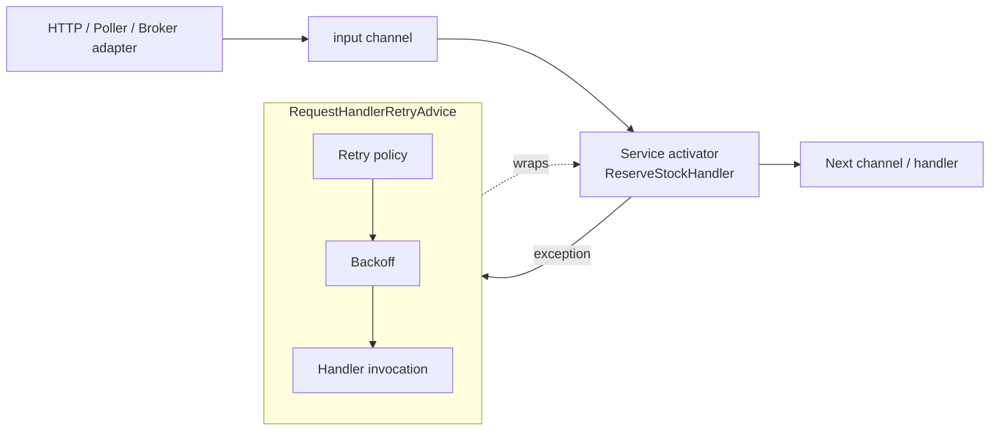
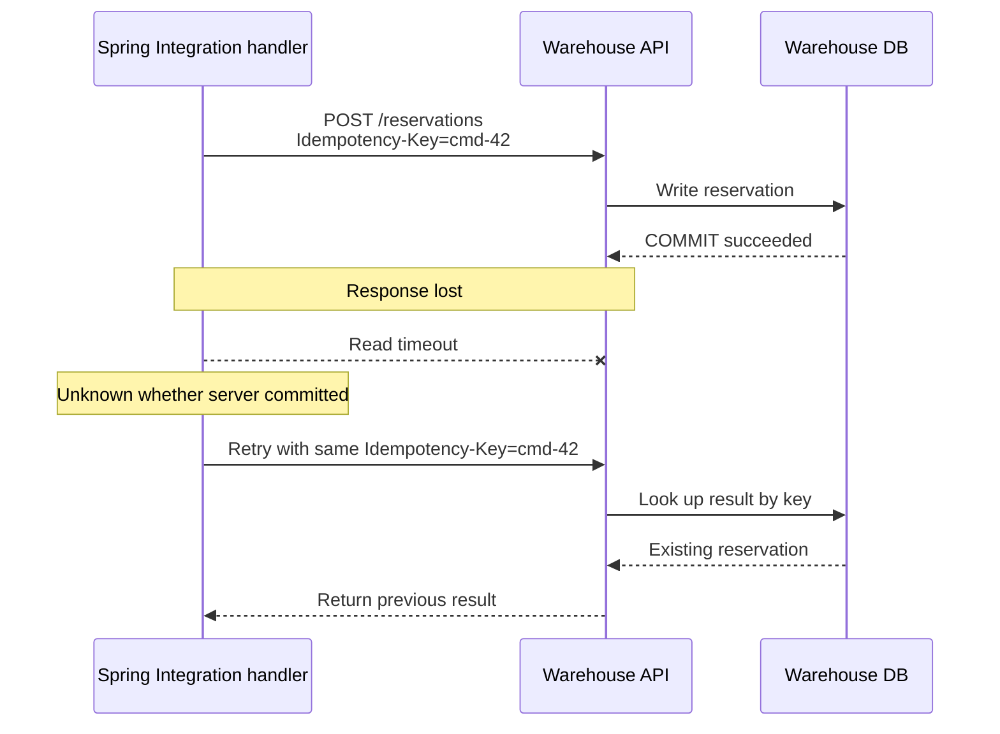
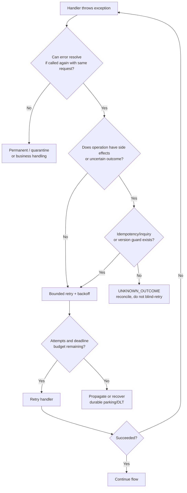

# `RequestHandlerRetryAdvice` and Classifying Retryable Errors

## 1. Context: Retrying Is Not Simply Calling a Method Again

Suppose `order-service` receives an order request, and a Spring Integration flow calls `warehouse-service` over HTTP to reserve inventory. When Warehouse returns `503 Service Unavailable`, the application can retry and succeed after a wait. But if Warehouse returns `400 Bad Request` because of a malformed SKU, resending the exact same request a hundred times will not fix the error.

Even harder: Warehouse may have already written the reservation to its database, but the `201 Created` response was lost on the wire. The client gets a **read timeout**, not knowing whether the command was executed or not. Retrying at this point is only safe if the Warehouse contract guarantees idempotency or provides a status reconciliation mechanism.

Spring Integration's **`RequestHandlerRetryAdvice`** lets you apply a retry policy **around a message handler** inside an `IntegrationFlow`. It uses Spring Retry to decide which exceptions are retryable, the number of attempts, backoff delays, and how to finish once attempts are exhausted.

This lesson belongs to the **Flow Errors and State** chapter of the **SPRING_BOOT_INTEGRATION** module. Beyond HTTP clients, Spring Integration adapters interact with databases, caches, files, Kafka, and RabbitMQ. Therefore, retries must be tied to transaction boundaries, duplicate protection, data contracts, error channels, testing, and production observability.

After this lesson, you will be able to:

1. Explain the placement and scope of `RequestHandlerRetryAdvice`.
2. Configure `RetryTemplate`, `SimpleRetryPolicy`, exponential backoff, and advice chains.
3. Classify transient, permanent, and **unknown outcome** errors before deciding to retry.
4. Attach advice to a service activator in Java DSL without creating stacked multi-layer retries.
5. Design recovery, error channels, parking/DLT, and acknowledgment policies after attempts are exhausted.
6. Protect transactions, idempotency, and message ordering when a handler is invoked multiple times.
7. Test attempt counts, exception handling, network errors, and recovery across restarts.

> **Version note:** Examples are based on Java 17+, Spring Boot 3.x, Spring Integration 6.x, and Spring Retry 2.x using the project's compatible dependency set. For Spring Boot 4.x / Spring Integration 7.x, check the APIs, configuration metadata, and dependency management before applying. This lesson focuses on synchronous retry around a **message handler**, not treating the advice as a durable retry scheduler.

## 2. Where Does `RequestHandlerRetryAdvice` Sit?

A flow typically has an input channel, transformer/filter, service activator, and output channel. `RequestHandlerRetryAdvice` is attached to the **handler being protected**; it does not automatically wrap the entire flow or all inbound source activities.



**Mental loop:**

1. A message arrives at the handler.
2. The advice invokes the handler for the first attempt.
3. Handler succeeds → flow continues; no retry needed.
4. Handler throws an exception → `RetryPolicy` evaluates **the exception, attempt history, and other conditions**.
5. If retry is permitted → waits according to `BackOffPolicy` and **invokes the same handler again**.
6. If attempts are exhausted or retry is disallowed → either the exception is thrown, or `RecoveryCallback` handles it per configuration.

A **retry** here is not necessarily another broker redelivery of the message. In a standard stateless setup, multiple handler invocations happen **on the same thread within the same delivery**. If a message has already been acked or placed into another queue, behavior is completely different; never infer delivery guarantees solely from retry counts.

### 2.1. Scope and What Is Not Guaranteed

| Component | What Advice Does | What It Does Not Do Automatically |
| --- | --- | --- |
| Service activator with advice | Retries the handler invocation when it throws a matching error. | Does not roll back side effects already committed in external services. |
| Handler calling HTTP | Can retry the HTTP call through the same method. | Does not know whether a prior POST already succeeded at the provider. |
| Handler writing to database | Can retry the processing if transaction boundaries allow. | Does not magically create a fresh transaction on its own. |
| `DirectChannel` | Usually invokes the handler synchronously; errors can return to sender. | Does not provide a durable retry queue. |
| `ExecutorChannel` | Advice runs around the handler on the worker thread. | Sender may not receive exceptions directly. |
| `@KafkaListener` / Rabbit listener | Advice can sit inside the flow invoked by the listener. | Does not replace broker retry/ack/DLT/rebalance behavior. |
| File/JDBC polling | Handler can be retried after the source emits the message. | Does not "undo" a filter having marked the file as seen. |
| Handler succeeds then next step fails | Next step handles its error per its own configuration. | Advice on the earlier handler does not replay the whole flow from the start. |

**Important:** If a handler returns a `CompletableFuture`/`Mono` and work inside it fails **after the handler has returned**, synchronous advice does not automatically retry that asynchronous failure. Handle errors at the boundary that actually owns the outcome and acknowledgment.

## 3. Three Outcome Categories to Classify Before Retrying

Do not just ask "did an exception happen?". Determine which category the error belongs to and whether the command can be re-executed without corrupting data.

### 3.1. Transient Errors

Examples:

- HTTP `429 Too Many Requests`, retryable when respecting quota/`Retry-After`.
- HTTP `502 Bad Gateway`, `503 Service Unavailable`, or `504 Gateway Timeout` when upstream is temporarily unavailable.
- DB deadlocks, lock acquisition failures, or exceptions classified as transient by the data access layer.
- Redis/Elasticsearch temporarily unavailable when the operation has proper idempotency.
- Short-lived connection errors on a **read-only operation**; still require timeouts and a retry budget.

A transient error means *a subsequent attempt may succeed*, **not** that every command is safe to retry.

### 3.2. Permanent Errors or Errors Requiring Input Changes

Examples:

- HTTP `400`/`422` due to invalid payload or schema violation.
- HTTP `401`/`403` due to invalid credentials or missing permissions (usually requires fixing config/tokens).
- HTTP `404` when the resource genuinely does not exist per contract.
- HTTP `409` due to business conflict or an idempotency key reused with a different payload.
- HTTP `412 Precondition Failed` due to stale ETag/version.
- JSON deserialization failures from breaking changes; missing required fields.
- Malformed CSV, invalid XML, or message missing a business key.

If an error will not resolve by retrying **the same input**, the right response is to fail fast, report a contract error, or move the message to manual handling—not tie up threads with backoff.

### 3.3. Unknown Outcomes

Example:



A network error after sending a write command is a situation where **it is unknown whether the change was applied**, not merely a transient failure. Auto-retry only if:

1. The operation is inherently idempotent by contract with no duplicate side effects; **or**
2. The provider supports an **idempotency key** and guarantees the same key/payload is processed once semantically; **or**
3. The client can query the outcome by command/business ID before resending and handle intermediate states.

Without these guarantees, emit an `UNKNOWN_OUTCOME` state for reconciliation; blind retries can reserve stock, charge money, or send emails multiple times.

### 3.4. Decision Matrix

| Error Type | Example | Retryable? | Mandatory Condition |
| --- | --- | --- | --- |
| HTTP GET timeout | Connection to catalog dropped. | Usually yes. | GET has no side effects; bounded retry. |
| HTTP POST returns 503 | Warehouse temporarily unavailable. | Conditionally. | POST has idempotency key/contract or status lookup. |
| HTTP POST read timeout | May have committed. | **Not by default.** | Idempotency/inquiry or parking for reconciliation. |
| HTTP 429 | Quota/rate limit. | Conditionally. | Respect `Retry-After`, time budget, and rate limit. |
| HTTP 500 | Server error with unknown completion state. | Depends on contract. | Safety of command and provider analyzed. |
| HTTP 400/422 | Invalid data. | No. | Fix payload/schema. |
| HTTP 401/403 | Authentication/authorization error. | Do not retry raw request. | Controlled token refresh or fix permissions then retry at a separate boundary. |
| HTTP 404 | SKU not found. | Usually no. | If eventual consistency is documented, use a dedicated policy. |
| HTTP 409/412 | Conflict/stale ETag. | Do not retry blindly. | Reload latest state, recompute command if business allows. |
| JDBC deadlock | Transaction chosen as rollback victim. | Possibly. | Retry **entire transaction**, ensure side effects are safe. |
| Unique constraint violation | Event/batch ID already exists. | Not as transient. | Distinguish valid duplicate from payload conflict. |
| Kafka publish timeout | Broker may have received record. | Conditionally. | Producer idempotency, key, and business dedup. |
| JSON schema mismatch | Sender changed fields. | No. | Upgrade contract/adapter or quarantine. |

**Strongest rule:** Retry decisions must be based on **exception + operation + idempotency guarantee + commit boundary**, not status code alone.

## 4. Technical Components of Spring Retry

| Component | Role |
| --- | --- |
| `RequestHandlerRetryAdvice` | Interceptor wrapping a Spring Integration message handler invocation. |
| `RetryTemplate` | Executes the retry loop; combines policy, backoff, and callbacks. |
| `RetryPolicy` | Decides whether an exception is retryable and how many attempts remain. |
| `SimpleRetryPolicy` | Policy based on max attempts and an exception classification map. |
| `ExponentialBackOffPolicy` | Waits progressively longer between attempts. |
| `RetryContext` | Holds session info, attempt count, and last exception. |
| `RecoveryCallback` | Handles exhaustion when retries fail or are no longer permitted. |
| `ErrorMessageSendingRecoverer` | Forwards retry-exhausted errors to a `MessageChannel`. |

**`maxAttempts` includes the initial attempt.** For example, `maxAttempts=3` means at most three handler executions (one initial call plus two retries), not one initial call plus three retries.

A basic `RetryTemplate` performs **stateless** retry within a single invocation. It does not persist attempt history across restarts; delaying for hours, surviving crashes, or recovering after broker redelivery requires durable state, a scheduler/queue, and a separate retry workflow.

## 5. Minimal Dependencies and Configuration

Maven example for Spring Boot 3.x:

```xml
<!-- pom.xml uses the corresponding Spring Boot parent/BOM -->
<dependency>
    <groupId>org.springframework.boot</groupId>
    <artifactId>spring-boot-starter-integration</artifactId>
</dependency>
<dependency>
    <groupId>org.springframework.retry</groupId>
    <artifactId>spring-retry</artifactId>
</dependency>
<dependency>
    <groupId>org.springframework.boot</groupId>
    <artifactId>spring-boot-starter-web</artifactId>
</dependency>
<dependency>
    <groupId>org.springframework.boot</groupId>
    <artifactId>spring-boot-starter-test</artifactId>
    <scope>test</scope>
</dependency>
<dependency>
    <groupId>org.springframework.integration</groupId>
    <artifactId>spring-integration-test</artifactId>
    <scope>test</scope>
</dependency>
```

Here `spring-retry` is declared explicitly so code clearly uses `RetryTemplate`, `RetryPolicy`, and `BackOffPolicy`. The Boot BOM manages compatible versions; do not mix an arbitrary Spring Retry version with Spring Integration in production.

Example upstream configuration:

```yaml
# application.yml
clients:
  warehouse:
    base-url: ${WAREHOUSE_BASE_URL:https://warehouse.example.internal}
    connect-timeout: 2s
    read-timeout: 5s

integration:
  warehouse:
    retry:
      attempts: 3
      initial-backoff: 250ms
      max-backoff: 2s
```

The `integration.warehouse.retry.*` properties are **application-specific configuration**, not properties automatically recognized by Spring Integration. The lesson first demonstrates hardcoded bean values, then explains how to externalize the policy.

## 6. Mapping HTTP Errors to Meaningful Exceptions

Good practice is for the HTTP gateway to classify errors according to the **operation's contract**, so `RequestHandlerRetryAdvice` only decides retries based on normalized exceptions. This avoids forcing one generic `SimpleRetryPolicy` to understand every HTTP, JDBC, and Kafka library.

### 6.1. Sample Commands and Exceptions

```java
// ReserveStockCommand.java
public record ReserveStockCommand(
    String commandId,
    String orderId,
    String sku,
    int quantity
) {}

// ReserveStockRequest.java
public record ReserveStockRequest(
    String orderId,
    String sku,
    int quantity
) {}

// RetryableWarehouseException.java
public final class RetryableWarehouseException extends RuntimeException {
    public RetryableWarehouseException(String message, Throwable cause) {
        super(message, cause);
    }
}

// NonRetryableWarehouseException.java
public final class NonRetryableWarehouseException extends RuntimeException {
    public NonRetryableWarehouseException(String message, Throwable cause) {
        super(message, cause);
    }
}
```

Each `public` type belongs in its **own matching Java file**. The name `RetryableWarehouseException` is a policy marker, not proof that every Warehouse command is safe to retry. Use it only when the operation is protected by agreed-upon idempotency/inquiry.

### 6.2. `WarehouseGateway` Using `RestClient`

Assume the Warehouse API supports `Idempotency-Key` and returns the same outcome for the same command/payload, even after a timeout. Each `ReserveStockCommand` already carries a stable `commandId` before its first attempt.

```java
// WarehouseGateway.java
import org.springframework.http.HttpStatus;
import org.springframework.http.MediaType;
import org.springframework.web.client.HttpClientErrorException;
import org.springframework.web.client.HttpServerErrorException;
import org.springframework.web.client.ResourceAccessException;
import org.springframework.web.client.RestClient;

public final class WarehouseGateway {
    private final RestClient client;

    public WarehouseGateway(RestClient client) {
        this.client = client;
    }

    public void reserve(ReserveStockCommand command) {
        if (command.commandId() == null
            || command.commandId().isBlank()
            || command.orderId() == null
            || command.quantity() <= 0) {
            throw new IllegalArgumentException("Invalid stock reservation command");
        }

        try {
            var response = client.post()
                .uri("/api/v1/reservations")
                .contentType(MediaType.APPLICATION_JSON)
                .header("Idempotency-Key", command.commandId())
                .body(new ReserveStockRequest(
                    command.orderId(),
                    command.sku(),
                    command.quantity()
                ))
                .retrieve()
                .toBodilessEntity();

            if (response.getStatusCode() != HttpStatus.CREATED) {
                throw new NonRetryableWarehouseException(
                    "Warehouse returned non-201 status", null
                );
            }
        } catch (HttpClientErrorException.TooManyRequests ex) {
            throw new RetryableWarehouseException(
                "Warehouse rate limit (HTTP 429)", ex
            );
        } catch (HttpClientErrorException ex) {
            throw new NonRetryableWarehouseException(
                "Warehouse rejected command (HTTP "
                    + ex.getStatusCode().value() + ")", ex
            );
        } catch (HttpServerErrorException ex) {
            int status = ex.getStatusCode().value();
            if (status == 502 || status == 503 || status == 504) {
                throw new RetryableWarehouseException(
                    "Warehouse temporarily unavailable (HTTP " + status + ")",
                    ex
                );
            }
            throw new NonRetryableWarehouseException(
                "Server error requiring analysis (HTTP " + status + ")", ex
            );
        } catch (ResourceAccessException ex) {
            // Only treated as retryable because this endpoint's contract
            // provides a durable idempotency key even when outcome is unknown.
            throw new RetryableWarehouseException(
                "Connection/timeout error: command outcome may be unknown", ex
            );
        }
    }
}
```

Explanation:

- `429` is separated from other 4xx statuses; it is often recoverable, though a **simple exponential backoff policy does not automatically read `Retry-After`**.
- `502/503/504` are treated as retryable **only for this operation** thanks to its idempotency contract. Other HTTP 500 errors need root-cause analysis and must not be retried by default.
- `400/401/403/404/409/412` do not retry the raw command. If 409 reflects an existing reservation, the gateway can query status and reconcile per contract instead of merely throwing; that belongs in the business layer.
- `ResourceAccessException` covers I/O/timeout errors that do not tell whether the provider committed. Any HTTP command **not** protected by idempotency must route such errors to a reconciliation state instead of blindly using this policy.
- Response parsing, serialization, or validation errors must not become `RetryableWarehouseException`, because retrying the same data usually will not fix a contract error.

If the provider returns `202 Accepted` for an asynchronous command, the code above would misinterpret the contract; replace it with a `PENDING` outcome and status inquiry/events instead of expecting 201. Base this choice on the actual API.

## 7. Creating `RequestHandlerRetryAdvice` with an Exception Whitelist

### 7.1. Configuring a Bounded `RetryTemplate`

```java
// WarehouseRetryConfiguration.java
import java.util.HashMap;
import java.util.Map;
import org.springframework.context.annotation.Bean;
import org.springframework.context.annotation.Configuration;
import org.springframework.integration.handler.advice.RequestHandlerRetryAdvice;
import org.springframework.retry.backoff.ExponentialBackOffPolicy;
import org.springframework.retry.policy.SimpleRetryPolicy;
import org.springframework.retry.support.RetryTemplate;

@Configuration(proxyBeanMethods = false)
public class WarehouseRetryConfiguration {

    @Bean
    RequestHandlerRetryAdvice warehouseRetryAdvice() {
        Map<Class<? extends Throwable>, Boolean> retryable =
            new HashMap<>();
        retryable.put(RetryableWarehouseException.class, true);

        // 3 attempts = initial attempt + up to two retries.
        SimpleRetryPolicy retryPolicy =
            new SimpleRetryPolicy(3, retryable, true);

        ExponentialBackOffPolicy backoff =
            new ExponentialBackOffPolicy();
        backoff.setInitialInterval(250L);
        backoff.setMultiplier(2.0);
        backoff.setMaxInterval(2_000L);

        RetryTemplate template = new RetryTemplate();
        template.setRetryPolicy(retryPolicy);
        template.setBackOffPolicy(backoff);

        RequestHandlerRetryAdvice advice =
            new RequestHandlerRetryAdvice();
        advice.setRetryTemplate(template);

        // No RecoveryCallback configured in this example:
        // when exhausted, the error propagates to the boundary calling the handler.
        return advice;
    }
}
```

Key points:

- **Whitelist:** only `RetryableWarehouseException` is allowed to retry. Do not add `Exception.class` or `RuntimeException.class` to the whitelist because that would cover validation, serialization, and business bugs.
- The `true` parameter in `SimpleRetryPolicy`'s constructor enables **traverse causes**; useful because exceptions can be wrapped by Spring Integration in `MessageHandlingException`. Still test actual exception wrapping on your specific endpoint.
- `maxAttempts=3` with exponential backoff 250 ms → 500 ms means two wait intervals when all three attempts fail. Do not treat the backoff sum as the total request deadline.
- If retries occur after a restart or broker redelivery, attempts restart in an **external mechanism outside memory**; this `RetryTemplate` configuration does not accumulate attempts system-wide.

### 7.2. Why Must You Avoid Overly Broad Default Retry Policies?

Some quickstart/default `RetryTemplate` configurations allow retrying broad `Exception` types. In production, that easily turns programming bugs into retry storms:

```text
NullPointerException -> retry -> retry -> retry
IllegalArgumentException (bad SKU) -> retry -> retry -> retry
HttpClientErrorException.Unauthorized -> retry -> retry -> retry
```

**Define explicit policies** per business operation. With multiple handlers, create separate advice or retry template instances rather than forcing every endpoint to share one whitelist.

### 7.3. Backoff and Jitter

If 100 pods simultaneously receive 503 and retry at exact 250 ms and 500 ms intervals, request waves can synchronize into a **thundering herd**. Jitter spreads retry timestamps out. Spring Retry offers randomized backoff policies such as `ExponentialRandomBackOffPolicy`; depending on your version/API you can replace the fixed policy after testing.

For HTTP 429, the `Retry-After` header can specify seconds or an HTTP date. The `ExponentialBackOffPolicy` in the example **does not automatically** read this header. If upstream requires long waits or per-minute rate limits, use a retry scheduler/queue with sufficient delay, or a custom backoff policy designed to honor `Retry-After`. Never sleep for minutes on a servlet or poller thread.

## 8. Attaching Advice to an `IntegrationFlow`

### 8.1. Declaring the Client and Handler

```java
// WarehouseFlowConfiguration.java
import java.net.http.HttpClient;
import java.time.Duration;
import org.springframework.beans.factory.annotation.Qualifier;
import org.springframework.beans.factory.annotation.Value;
import org.springframework.context.annotation.Bean;
import org.springframework.context.annotation.Configuration;
import org.springframework.http.client.JdkClientHttpRequestFactory;
import org.springframework.integration.dsl.IntegrationFlow;
import org.springframework.integration.handler.advice.RequestHandlerRetryAdvice;
import org.springframework.web.client.RestClient;

@Configuration(proxyBeanMethods = false)
public class WarehouseFlowConfiguration {

    @Bean("warehouseRestClient")
    RestClient warehouseRestClient(
        RestClient.Builder builder,
        @Value("${clients.warehouse.base-url}") String baseUrl
    ) {
        HttpClient http = HttpClient.newBuilder()
            .connectTimeout(Duration.ofSeconds(2))
            .build();
        JdkClientHttpRequestFactory factory =
            new JdkClientHttpRequestFactory(http);
        factory.setReadTimeout(Duration.ofSeconds(5));

        return builder.baseUrl(baseUrl)
            .requestFactory(factory)
            .build();
    }

    @Bean
    WarehouseGateway warehouseGateway(
        @Qualifier("warehouseRestClient") RestClient client
    ) {
        return new WarehouseGateway(client);
    }

    @Bean
    IntegrationFlow reserveStockFlow(
        WarehouseGateway gateway,
        RequestHandlerRetryAdvice warehouseRetryAdvice
    ) {
        return IntegrationFlow.from("reserveStockRequests")
            .handle(
                gateway,
                "reserve",
                endpoint -> endpoint.advice(warehouseRetryAdvice)
            )
            .get();
    }
}
```

`reserveStockRequests` is the input message channel registered by the Java DSL. In this simple flow, the handler is synchronous and exceptions can return to the sender; if you replace the channel with an executor/queue or a listener with its own adapter, you must revisit error routing and message acknowledgment.

**Note:** In this configuration HTTP timeouts are hardcoded to keep the focus on advice; in real deployments, bind `connect-timeout`/`read-timeout` from configuration to prevent YAML and Java values from diverging. Also bound the deadline of the entire flow, not just a single HTTP call.

### 8.2. Sending Messages into the Flow

```java
import org.springframework.beans.factory.annotation.Qualifier;
import org.springframework.messaging.MessageChannel;
import org.springframework.messaging.support.MessageBuilder;

public class ReservationFlowSender {
    private final MessageChannel channel;

    public ReservationFlowSender(
        @Qualifier("reserveStockRequests") MessageChannel channel
    ) {
        this.channel = channel;
    }

    public void submit(ReserveStockCommand command) {
        if (!channel.send(
            MessageBuilder.withPayload(command).build()
        )) {
            throw new IllegalStateException("Failed to send to flow");
        }
    }
}
```

This class illustrates how to invoke the channel and is not registered as a Spring bean in the snippet. When using a synchronous `DirectChannel` and a handler without a recovery callback, if the handler still throws after retries, `send(...)` itself will throw rather than return `false`. With an asynchronous channel, `send(...) == true` only tells you the channel accepted the message; **not** that Warehouse reserved stock successfully.

### 8.3. Advice Chain Scope

```text
Input -> Transformer -> [Retry Advice -> Warehouse Handler] -> Audit Handler
          ^                         ^                        ^
          |                         |                        |
   not auto-retried              retried              not auto-retried
```

If `Transformer` throws due to invalid JSON, the advice on the Warehouse handler does not run. If Warehouse succeeds but the subsequent Audit handler fails, the advice on the Warehouse handler does not rerun for that attempt. If upstream redelivers **the entire message** after an Audit error, Warehouse may be invoked again: that is why end-to-end idempotency is necessary.

## 9. Stateless Retry, Stateful Retry, and Delivery Boundaries

### 9.1. Stateless Retry

With the configuration above:

```text
Receive message #42
  Attempt 1 -> 503
  Backoff 250 ms
  Attempt 2 -> 503
  Backoff 500 ms
  Attempt 3 -> 201
Return success to current caller
```

Characteristics:

- Attempts belong to the same message-processing invocation in-process.
- Typically blocks the thread while sleeping for backoff.
- A crash on attempt 2 does not make `RetryTemplate` persist the attempt count to resume after restart.
- If the broker redelivers the message, a **new** cycle of up to three attempts can run.

### 9.2. Stateful Retry

Spring Retry has the concept of stateful retry: attempt state is associated with an operation's identifying key to support certain transaction/redelivery models. Spring Integration versions can configure stateful retry via corresponding components, but it is **not enabled by default** when creating `RequestHandlerRetryAdvice` as shown.

Stateful retry does not automatically mean durable persistence across every restart: durability and state sharing depend on `RetryContextCache`, key/state generators, and process scope. For retries controlled across crashes and multiple instances, prefer storing **attempt counter, `nextAttemptAt`, lease, and business state** in a database/queue or leveraging appropriate broker retry mechanisms.

**Do not use a message UUID regenerated on every delivery** as the business deduplication key. Use a `commandId`/`eventId` that remains stable across retries, redeliveries, and restarts.

### 9.3. Commonly Confused Retry Layers

| Type | What Repeats? | Who Controls It? |
| --- | --- | --- |
| Handler retry | The same message-handling method is called again. | `RequestHandlerRetryAdvice` + `RetryTemplate`. |
| Broker redelivery | Broker/adapter delivers the message again to listener/flow. | Kafka/RabbitMQ/ack/rebalance/DLT policy. |
| Scheduled delayed retry | Message is persisted and reprocessed at a future time. | Queue/scheduler/database state. |
| Caller HTTP retry | Caller of `POST /orders` resends the request. | API client, idempotency key, HTTP retry policy. |

A single message can pass through **all four layers**. If each layer retries three times on its own, maximum downstream requests multiply; assign one **retry owner** per boundary and define an overall budget.

## 10. Exhausted Attempts: Throw or Recover?

This decision directly affects delivery semantics. When `RetryTemplate` no longer permits retries:

1. **No recovery callback:** the remaining exception is thrown out of the handler invocation (possibly wrapped by Spring Integration messaging exceptions).
2. **With `RecoveryCallback`:** the callback is invoked; its result determines how the flow continues. If the callback handles the error and returns normally, callers may treat the invocation as recovered.

### 10.1. Propagate Exception When an Upper Boundary Owns Retry

Appropriate when `@KafkaListener` or a Rabbit listener manages redelivery/DLT, or when a synchronous caller must receive the failure:

```java
RequestHandlerRetryAdvice advice =
    new RequestHandlerRetryAdvice();
advice.setRetryTemplate(template);
// No setRecoveryCallback.
```

In a direct flow, the exception can propagate to the sender. In a flow started by a broker listener, the exception can flow through the adapter/container to its error handler **if the call/ack path does not swallow errors**. Verify actual adapter and executor behavior.

### 10.2. Using `ErrorMessageSendingRecoverer`

When you want exhausted failures forwarded to a dedicated channel, Spring Integration provides `ErrorMessageSendingRecoverer`. Example configuration **as an alternative** to the non-recovering advice above:

```java
import org.springframework.integration.channel.DirectChannel;
import org.springframework.integration.handler.advice.ErrorMessageSendingRecoverer;
import org.springframework.integration.handler.advice.RequestHandlerRetryAdvice;
import org.springframework.messaging.MessageChannel;
import org.springframework.context.annotation.Bean;
import org.springframework.beans.factory.annotation.Qualifier;

@Bean
MessageChannel exhaustedReservations() {
    return new DirectChannel();
}

@Bean
RequestHandlerRetryAdvice warehouseRetryAdviceWithRecovery(
    RetryTemplate warehouseRetryTemplate,
    @Qualifier("exhaustedReservations") MessageChannel errorChannel
) {
    RequestHandlerRetryAdvice advice =
        new RequestHandlerRetryAdvice();
    advice.setRetryTemplate(warehouseRetryTemplate);
    advice.setRecoveryCallback(
        new ErrorMessageSendingRecoverer(errorChannel)
    );
    return advice;
}
```

Here `warehouseRetryTemplate` is a `RetryTemplate` registered as a separate bean from the policy configuration. **Do not copy both advice beans into the same context and inject by type without qualifiers**; pick one approach and name beans accordingly.

The recoverer sends an `ErrorMessage` containing the exception and failed message context to the channel. Attach a handler that persists a **durable parking record** or routes to controlled retry/DLT, for example:

```text
Retry exhausted
  -> ErrorMessageSendingRecoverer
  -> exhaustedReservations channel
  -> Persist failed command (DB) / DLT
  -> Alert + operator replay
```

**Critical warning:** If the recovery callback **merely sends the error to a channel and returns normally**, upstream may treat the message as handled and **ack/commit the offset**. If the error channel is only an in-memory `DirectChannel`/`QueueChannel`, a crash can lose the command. Therefore decide clearly:

- Has the parking record/DLT been **durably persisted**?
- Should acknowledgment occur only after the parking record commits?
- If publishing to the DLT fails, how must the recovery callback raise an error?
- Who replays the message and by what key?
- Is a "recovered" failure being hidden by success KPIs?

Never use a recoverer just to "swallow exceptions to keep the system green" without a real recovery mechanism.

## 11. Transaction Boundaries: Where Is It Safe to Retry?

### 11.1. Retrying Inside a Transaction Can Be Wrong

Suppose:

```java
@Transactional
public void process(ReserveStockCommand command) {
    orderRepository.save(...);
    warehouseGateway.reserve(command);
}
```

If the outer transaction is already marked `rollback-only` after a DB error, retrying only the gateway part will not resolve the transaction state. Moreover, holding a DB transaction open while sleeping through HTTP backoff increases lock and connection hold time. If Warehouse committed while the Order DB rolled back, local retry/rollback does not undo Warehouse.

### 11.2. Retry the Entire Transactional Unit When Needed

For a **purely local** database operation:

```text
Retry Advice
  -> Transaction boundary (per attempt)
      -> Read data
      -> Apply business rule
      -> Write database
      -> Commit
```

If a transaction hits a deadlock, retrying must start with a **fresh transaction and read fresh state**. Never place a retry loop **inside** a transaction already marked `rollback-only`.

For flows spanning HTTP + DB + broker, commonly separate into:

1. Persist the command/pending state + outbox in a local DB transaction.
2. Worker/consumer picks up the command and calls Warehouse with a stable idempotency key.
3. Update state to succeeded/failed or needing reconciliation.
4. On events, use an inbox/version check to prevent duplicate processing.

The ordering of the advice chain, Spring transaction interceptor, and message handler proxy must be verified with real tests; never glance at `@Transactional` and assume each attempt gets a fresh transaction.

### 11.3. Side Effects Occurring Before the Error

```text
handler invocation:
  write DB SUCCESS
  send email SUCCESS
  call downstream FAILED (503)

RequestHandlerRetryAdvice retries handler:
  write DB AGAIN?
  send email AGAIN?
  call downstream AGAIN
```

Retrying **the entire handler** can repeat steps that already succeeded. Fix this by narrowing the handler to a single idempotent operation, splitting steps into a state machine, or using outbox/inbox and idempotency keys for each side effect.

## 12. Kafka, RabbitMQ, and File Adapters: Key Differences

### 12.1. Kafka Consumer

With Kafka:

- `@KafkaListener` / Spring Integration Kafka inbound adapters have their own acknowledgment, offset commit, and error handler policies.
- Handler advice retries within the same delivery, potentially blocking the consumer thread.
- After exhaustion, if the exception propagates, the container error handler can retry/reseek/send to a DLT depending on configuration.
- If a `RecoveryCallback` swallows the error, the container may consider processing successful and commit the offset. Ensure the command is durably stored before accepting that behavior.
- The same message can be redelivered if the process crashes after DB commit but before offset commit; the handler must still be idempotent.

Do not simultaneously configure 3 retries in `RequestHandlerRetryAdvice`, 10 in the Kafka error handler, and 20 in a retry topic without defining the total upstream request budget.

### 12.2. RabbitMQ Consumer

With RabbitMQ, acknowledgment/nack/requeue and the dead-letter exchange determine whether a message returns or is routed elsewhere. Handler retries do not create a DLT automatically. If a consumer requeues immediately upon exhaustion, a permanent error can turn into an infinitely looping **poison message**. For permanent errors, route to parking/DLT or reject without requeue per policy.

### 12.3. File Inbound Adapter

When a poller reads files via `FileReadingMessageSource` and `AcceptOnceFileListFilter`, emitting a file from the source can mark it as "already seen". Handler advice does not clear that marker when processing fails. If retry across restarts is required, design archiving/quarantine, persistent metadata, batch state, and DB idempotency. Do not treat `RequestHandlerRetryAdvice` as a substitute for a durable file ingestion pipeline.

### 12.4. HTTP Inbound Caller

If an API controller sends messages through `DirectChannel` to a handler:

- Retry advice makes the caller's HTTP request wait longer until success or exhaustion.
- Calculate the **total deadline** across controller, load balancer, and upstream so servers do not keep retrying after the client has timed out.
- For long workflows, the HTTP endpoint can return `202 Accepted` with a job ID and retry via queue/scheduler instead of blocking the request.

## 13. Designing Error Classification per Adapter

A single global whitelist quickly breaks down when integrating multiple source types. Define a taxonomy per business operation and gateway:

| Adapter | Retryable When... | Do Not Retry When... | Outside Advice Scope |
| --- | --- | --- | --- |
| HTTP `RestClient` GET | Connect/read timeout, 429, 502/503/504 per policy. | 400/401/403/404/422 or malformed JSON. | TLS, auth rotation, circuit breaker. |
| HTTP POST/PATCH | Idempotency/inquiry exists and error is genuinely recoverable. | Invalid input, duplicate conflict with different payload. | Unknown outcome reconciliation. |
| JDBC/jOOQ/JPA | Deadlock, transient DB connection/lock per isolation and transaction. | Unique conflict, validation/mapping error. | Transaction boundaries, schema migration. |
| MongoDB | Transient transaction error with a fresh transaction and idempotent op. | Unauthorized, schema validation, duplicate key. | Sessions, replica set topology. |
| Redis | Read-only cache query/reconnect; certain idempotent commands. | Invalid command, malformed key, counter increments without dedupe. | Fallbacks and cache consistency. |
| Kafka producer | Retryable broker failures with proper producer/idempotency. | Serialization/schema error, ACL denial. | Delivery acknowledgment and DLT. |
| File adapter | Transient permission/network-share issue if source is durable and replay-safe. | Bad CSV/XML schema, checksum mismatch. | Source file claims, archive/quarantine. |

**A permanent error can become recoverable after an operator fixes the system**, such as a 401 from an expired token; however, that does not mean the handler should immediately retry the same token within one second. Separate the **refresh/reconfigure** action from the appropriate retry timing.

## 14. Test Suite for Retry Advice

### 14.1. Unit Testing the Policy via `RetryTemplate`

Testing the policy in isolation verifies attempt counts and the exception whitelist before wiring into a flow:

```java
import static org.junit.jupiter.api.Assertions.assertEquals;
import static org.junit.jupiter.api.Assertions.assertThrows;

import java.util.HashMap;
import java.util.Map;
import java.util.concurrent.atomic.AtomicInteger;
import org.junit.jupiter.api.Test;
import org.springframework.retry.policy.SimpleRetryPolicy;
import org.springframework.retry.support.RetryTemplate;

class WarehouseRetryPolicyTest {

    private RetryTemplate retryTemplate() {
        Map<Class<? extends Throwable>, Boolean> retryable =
            new HashMap<>();
        retryable.put(RetryableWarehouseException.class, true);

        RetryTemplate template = new RetryTemplate();
        template.setRetryPolicy(
            new SimpleRetryPolicy(3, retryable, true)
        );
        // No backoff configured so unit tests run fast.
        return template;
    }

    @Test
    void transientExceptionIsRetriedUpToThreeAttempts() {
        AtomicInteger attempts = new AtomicInteger();

        String result = retryTemplate().execute(context -> {
            int attempt = attempts.incrementAndGet();
            if (attempt < 3) {
                throw new RetryableWarehouseException("503", null);
            }
            return "OK";
        });

        assertEquals("OK", result);
        assertEquals(3, attempts.get());
    }

    @Test
    void permanentExceptionIsNotRetried() {
        AtomicInteger attempts = new AtomicInteger();

        assertThrows(NonRetryableWarehouseException.class,
            () -> retryTemplate().execute(context -> {
                attempts.incrementAndGet();
                throw new NonRetryableWarehouseException("400", null);
            })
        );

        assertEquals(1, attempts.get());
    }
}
```

**This is only a `RetryTemplate` unit test**; it does not prove the advice is attached properly to the `IntegrationFlow` handler. Add an integration test for advice wiring.

### 14.2. Testing That Advice Actually Wraps the Handler

JUnit 5 / Spring Test example with a stub handler failing on the first two attempts:

```java
import static org.junit.jupiter.api.Assertions.assertEquals;
import static org.junit.jupiter.api.Assertions.assertTrue;

import java.util.HashMap;
import java.util.Map;
import java.util.concurrent.atomic.AtomicInteger;
import org.junit.jupiter.api.Test;
import org.springframework.beans.factory.annotation.Autowired;
import org.springframework.beans.factory.annotation.Qualifier;
import org.springframework.context.annotation.Bean;
import org.springframework.context.annotation.Configuration;
import org.springframework.integration.dsl.IntegrationFlow;
import org.springframework.integration.handler.advice.RequestHandlerRetryAdvice;
import org.springframework.messaging.MessageChannel;
import org.springframework.messaging.support.MessageBuilder;
import org.springframework.retry.policy.SimpleRetryPolicy;
import org.springframework.retry.support.RetryTemplate;
import org.springframework.test.context.junit.jupiter.SpringJUnitConfig;

@SpringJUnitConfig(RetryAdviceFlowTest.TestConfig.class)
class RetryAdviceFlowTest {

    @Autowired
    @Qualifier("retryCommands")
    MessageChannel input;

    @Autowired
    FlakyHandler handler;

    @Test
    void adviceRetriesTheActualMessageHandler() {
        assertTrue(input.send(
            MessageBuilder.withPayload("cmd-42").build()
        ));
        assertEquals(3, handler.attempts.get());
    }

    static class FlakyHandler {
        final AtomicInteger attempts = new AtomicInteger();

        public void process(String commandId) {
            if (attempts.incrementAndGet() < 3) {
                throw new RetryableWarehouseException("503", null);
            }
        }
    }

    @Configuration(proxyBeanMethods = false)
    static class TestConfig {
        @Bean
        FlakyHandler flakyHandler() {
            return new FlakyHandler();
        }

        @Bean
        RequestHandlerRetryAdvice testRetryAdvice() {
            Map<Class<? extends Throwable>, Boolean> retryable =
                new HashMap<>();
            retryable.put(RetryableWarehouseException.class, true);
            RetryTemplate template = new RetryTemplate();
            template.setRetryPolicy(
                new SimpleRetryPolicy(3, retryable, true)
            );

            RequestHandlerRetryAdvice advice =
                new RequestHandlerRetryAdvice();
            advice.setRetryTemplate(template);
            return advice;
        }

        @Bean
        IntegrationFlow testFlow(
            FlakyHandler handler,
            RequestHandlerRetryAdvice advice
        ) {
            return IntegrationFlow.from("retryCommands")
                .handle(handler, "process", e -> e.advice(advice))
                .get();
        }
    }
}
```

This test observes all three invocations within **one message delivery**. For permanent errors that throw immediately, add a test verifying only one call occurs and the exception propagates; when a recovery callback is used, the test must verify the parking record is actually persisted before completion.

### 14.3. Testing the HTTP Endpoint with a Mock Server

Use `MockRestServiceServer` or WireMock to verify `WarehouseGateway`:

- First call returns 503, second returns 201; assert identical URL, payload, and **identical `Idempotency-Key`**.
- Returns 400 → a single request, no retry.
- Returns 429 with `Retry-After` → policy must handle the wait or defer durably as designed.
- Connection error / read timeout after provider wrote data → simulate replay and verify only one reservation exists.
- Final attempt still 503 → exception or parking/DLT per configuration.

`MockRestServiceServer` does not fully simulate TCP resets, TLS, or connection pools; use WireMock/MockWebServer or real service tests for network behavior.

### 14.4. Error and Transaction Test Matrix

| Test | Expected |
| --- | --- |
| Handler succeeds immediately | One invocation, no backoff. |
| Handler returns 503 twice then succeeds | Up to three invocations, message continues. |
| Handler returns 400 | One invocation, fail fast. |
| Handler throws wrapped exception | `traverseCauses=true` recognizes retryable cause. |
| `maxAttempts` exhausted | No fourth attempt; clear exception/recovery. |
| Large `Retry-After` | Does not block thread past SLA; shifts to delayed retry if needed. |
| DB deadlock | Each attempt gets a clean transaction if required by policy. |
| DB committed, HTTP response lost | Same `commandId`, no duplicate side effects. |
| Kafka redelivery | Business inbox/idempotency prevents repetition across restarts. |
| Recovery callback | Durable parking/DLT before ack; parking failures are not swallowed. |
| Two instances retry same command | Unique key/version prevents duplicate state. |
| Poison message | No infinite loop, quarantined/DLT and replayable. |
| Retry storm | Throttling/jitter/metrics function under load. |

## 15. Observing and Governing Retries in Production

### 15.1. Metrics to Collect

| Metric / Signal | Purpose |
| --- | --- |
| `integration.handler.attempts` by handler/exception category | Spot endpoints frequently needing retries. |
| Success rate after attempt 2/3 | Evaluate the usefulness of short-term retries. |
| Retry exhausted count | Detect prolonged outages / poison messages. |
| Backoff wait time and handler latency | Measure impact on poller/consumer threads. |
| Parking/DLT backlog and oldest message age | Ensure failures are not forgotten. |
| HTTP 429/503, connect/read timeouts | Distinguish rate limits from outages. |
| Unknown-outcome count and reconciliation age | Track commands that may have committed upstream. |
| Kafka consumer lag / queue depth | Assess retry impact on throughput. |
| DB duplicate-key/conflict count | Detect replays and key/payload conflicts. |

Avoid using `orderId`, `commandId`, customer names, or URLs with query strings as **metric tags**; high cardinality risks overloading metrics and leaking data. Use handler name, exception category, status group, upstream alias, and outcome. Business IDs can appear in structured logs/traces with proper access controls and retention.

### 15.2. Logging per Attempt Without Flooding the System

For brief transient errors, you do not always need full stack traces on every attempt. A useful log event contains:

```json
{
  "flow": "reserveStockFlow",
  "handler": "warehouseGateway.reserve",
  "attempt": 2,
  "maxAttempts": 3,
  "errorCategory": "UPSTREAM_503",
  "retryable": true,
  "nextDelayMs": 500,
  "traceId": "trace-illustration"
}
```

This is an **example application log schema**, not a JSON event automatically emitted by `RequestHandlerRetryAdvice`. To log `RetryContext`, use retry listeners/interceptors or application instrumentation. Alert only when retries are exhausted or error rates breach thresholds—avoid paging on every individual retry.

### 15.3. Time Budgets

Example:

```text
3 attempts x 5 s readTimeout
  + 250 ms + 500 ms backoff
  + connect/serialization/queue overhead
  => can exceed 15 seconds
```

If the HTTP caller has a 3-second SLA or a Kafka poll loop must avoid long blocks, this policy is unsuitable. Compute deadlines from **message ingress to published outcome**, and consider async delayed retries, circuit breakers, bounded concurrency, and separating interactive traffic from background processing.

## 16. Common Mistakes

| Mistake | Consequence | Fix |
| --- | --- | --- |
| Retrying every `RuntimeException` | Repeats validation bugs, NPEs, schema mismatches. | Whitelist exceptions per operation. |
| Setting `maxAttempts=3` thinking it means 1 + 3 retries | Total requests exceed design. | Remember 3 includes the initial attempt. |
| Treating 503 as always safe for POST | Command may have committed and been resent. | Stable idempotency key / inquiry. |
| Treating read timeout as server did nothing | Duplicate reservations/emails/payments. | Handle unknown outcomes. |
| Ignoring 429 `Retry-After` | Continuous rate limiting and retry storms. | Respect header / scheduler / suitable backoff policy. |
| Holding DB locks while sleeping for HTTP backoff | Holds connections long, increases contention. | Separate transaction and retry boundaries. |
| Retrying inside a rollback-only transaction | Subsequent attempts cannot commit. | Retry outside a clean transaction, test advice ordering. |
| One handler with multiple side effects retried as a whole | Earlier side effects repeat. | Idempotent commands or split into a state machine. |
| Attaching advice to another step thinking whole flow is retried | Downstream transformer/handler failures are uncovered. | Attach advice to the right endpoint and test paths. |
| Swallowing errors via recovery callback | Broker ack/HTTP success while message is lost. | Durable parking before acknowledging. |
| Using `ErrorMessageSendingRecoverer` with only an in-memory channel | Crashes lose messages needing replay. | Persist/DLT and explicit ack policy. |
| Letting Spring Kafka and advice both retry across layers | Amplifies downstream request counts. | Single retry owner/budget across layers. |
| Assuming `RetryTemplate` persists attempts across restarts | Retry budget resets on crash/rebalance. | Durable retry state when required by business rules. |
| Using message ID instead of `commandId` for dedup | Redelivery generates new key, breaking idempotency. | Stable business `commandId`/`eventId`. |
| Testing only the policy, not the `IntegrationFlow` | Advice might not actually be wired to the handler. | Integration test with real channels and stubs. |
| Logging "retrying" without measuring exhausted | Data loss / DLT backlog goes unnoticed. | Metrics, alerts, and operator replay. |

## 17. Workflow for Choosing a Handler Retry Policy



**Production readiness checklist:**

1. Identify the exact handlers/operations needing retries; do not apply one policy to every adapter.
2. List status codes and exceptions from API/driver docs; classify transient/permanent/unknown outcome.
3. Verify idempotency keys, unique business IDs, version checks, or status inquiries for every command with side effects.
4. Configure `RetryTemplate` with a whitelist, attempt count, backoff, jitter, and total deadline.
5. Attach `RequestHandlerRetryAdvice` to the right handler; test exception wrapping.
6. Define terminal behavior: propagate to listener/caller or recover to durable parking/DLT.
7. Check ordering of retry and transaction advice; every DB retry must get an appropriate transaction.
8. Avoid stacked retries across HTTP client, `IntegrationFlow`, Kafka/RabbitMQ, and callers.
9. Test fail-fast, transient recovery, exhaustion, unknown-outcome timeouts, crash/replay, and concurrent duplicates.
10. Track attempts, exhausted counts, parking age, latency, consumer lag, and unknown-outcome reconciliation.

**Self-check questions**

1. Does `RequestHandlerRetryAdvice` wrap an entire `IntegrationFlow` or a single message handler?
2. How many maximum handler executions does `maxAttempts=3` allow?
3. Why should `SimpleRetryPolicy` whitelist exceptions instead of retrying every `RuntimeException`?
4. What condition is required before automatically retrying an HTTP POST that timed out after provider commit?
5. Does `ExponentialBackOffPolicy` automatically read `Retry-After`?
6. Why can retrying inside a `rollback-only` transaction be futile?
7. What is the difference between handler retry and Kafka redelivery?
8. How can a `RecoveryCallback` that sends an `ErrorMessage` to an in-memory channel and returns normally cause message loss?
9. Should 409 and 412 errors be retried with the exact same request? When should fresh state be read?
10. Why is unit testing `RetryTemplate` alone insufficient to prove advice works in a flow?

## 18. References

- [Spring Integration — Retry Advice](https://docs.spring.io/spring-integration/reference/handler-advice/classes.html#retry-advice): `RequestHandlerRetryAdvice`, retry, recovery, and advice chains.
- [Spring Integration — Message Handler Advice](https://docs.spring.io/spring-integration/reference/handler-advice.html): scope of advice applied to message handlers.
- [Spring Integration — Java DSL](https://docs.spring.io/spring-integration/reference/dsl.html): configuring `IntegrationFlow`, handlers, and endpoints.
- [Spring Retry — Reference Documentation](https://docs.spring.io/spring-retry/reference/): `RetryTemplate`, retry policies, backoff, and listeners.
- [Spring Retry — SimpleRetryPolicy Javadoc](https://docs.spring.io/spring-retry/docs/current/apidocs/org/springframework/retry/policy/SimpleRetryPolicy.html): attempt count, retryable exception map, and cause traversal.
- [Spring Retry — ExponentialBackOffPolicy Javadoc](https://docs.spring.io/spring-retry/docs/current/apidocs/org/springframework/retry/backoff/ExponentialBackOffPolicy.html): exponential backoff.
- [Spring Framework — REST Clients](https://docs.spring.io/spring-framework/reference/integration/rest-clients.html): status/error handling with `RestClient`.
- [Spring for Apache Kafka — Handling Exceptions](https://docs.spring.io/spring-kafka/reference/kafka/annotation-error-handling.html): listener error handlers, retries, and dead-letter topics.
- [Spring AMQP — Listener Exception Handling](https://docs.spring.io/spring-amqp/reference/amqp/exception-handling.html): listener errors, requeue, reject, and dead-lettering.
- [RFC 9110 — HTTP Semantics](https://www.rfc-editor.org/rfc/rfc9110.html): HTTP methods, status codes, and idempotency.
