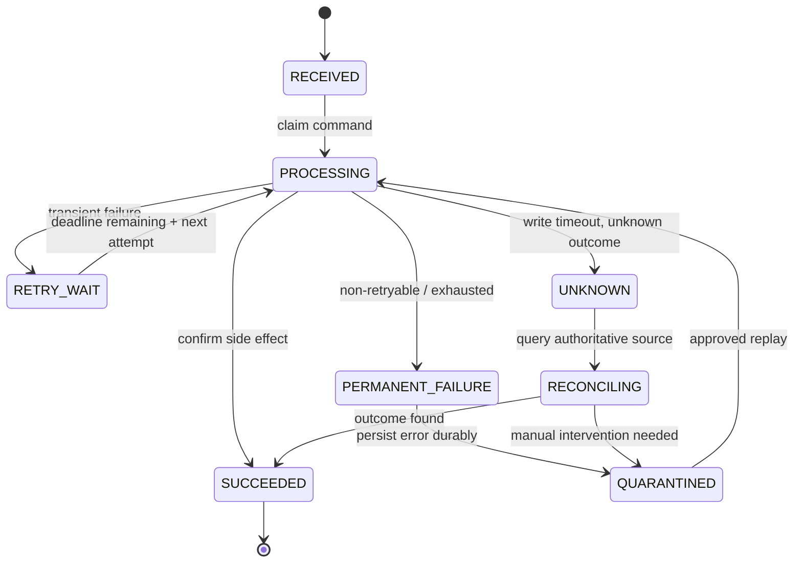
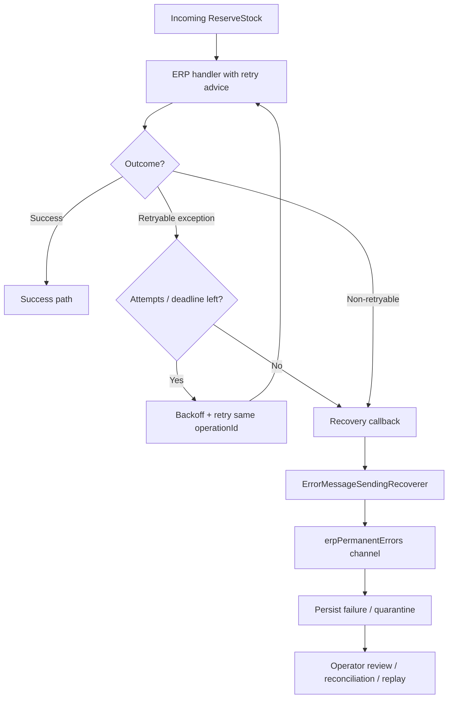
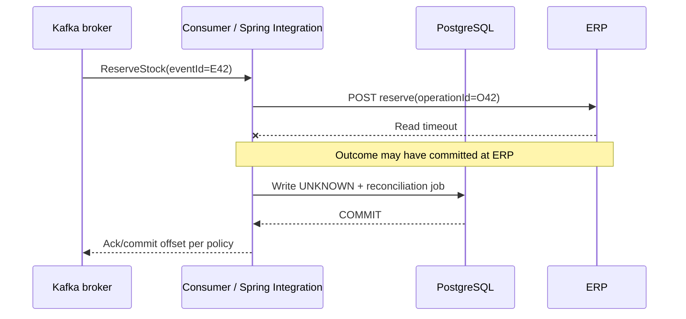
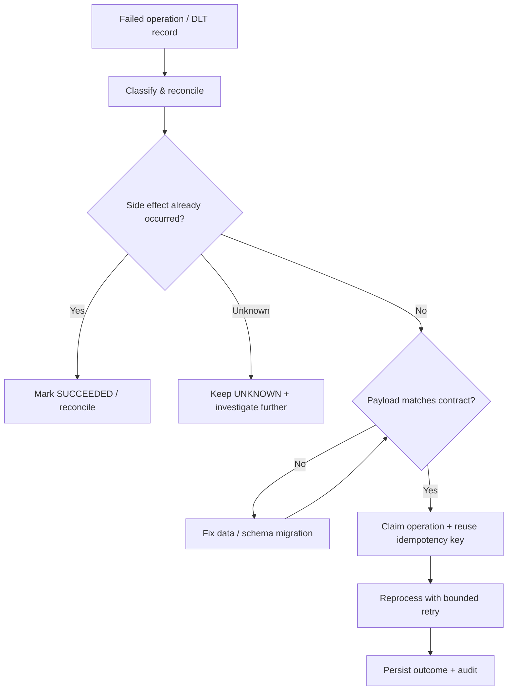

# Recovering After Retries and Forwarding Messages to Error Channels

## 1. Context: Errors in a Flow Do Not End with an Exception

A real-world Spring Boot integration system often crosses many boundaries: HTTP receives a request, PostgreSQL records processing intent, Redis caches state, Kafka or RabbitMQ delivers messages, Spring Integration orchestrates the steps, and then an HTTP/SOAP client calls an ERP. Any step can slow down, lose connectivity, return contract-breaking data, or complete partially before being interrupted.

In the **SPRING_BOOT_INTEGRATION** module, the **Flow Errors and State** chapter focuses on what must happen **after retries still fail**: who holds the message, where the error is forwarded, what business state is persisted, whether the broker is acknowledged, and whether the system can recover after a restart.

Running example:

1. A consumer receives an `OrderPaid` event with `eventId=E-42`.
2. The database records the intent to send `ReserveStock` with a stable `operationId`.
3. A Spring Integration flow reads the command and calls the ERP to reserve stock.
4. The ERP returns `503`, a timeout, or a SOAP Fault.
5. The flow retries transient failures within its budget.
6. If it still fails, the flow routes the error message to an **error channel**, persists durable state, and/or sends it to a dead-letter workflow.
7. A worker or operator can fix the root cause and perform a **controlled replay**, without creating duplicate orders.

Key point: **"Sent to error channel" does not mean "business recovered".** An in-memory error channel can lose data when the JVM stops; logging a stack trace does not replace processing state and a recovery plan.

After this lesson, you will be able to:

- Distinguish retries, recovery callbacks, error channels, dead-letter queues, and reconciliation workflows.
- Understand the difference between synchronous and asynchronous errors in Spring Integration.
- Set up `RequestHandlerRetryAdvice`, `RetryTemplate`, and `ErrorMessageSendingRecoverer` for a handler.
- Choose retryable error types, backoff, deadlines, and exhaustion behavior.
- Ensure messages are not lost between transactions, broker acknowledgments, and error state persistence.
- Design tests, metrics, logs/traces, and runbooks for integration failures.

## 2. Vocabulary to Distinguish Accurately

| Concept | Meaning | Does Not Guarantee by Itself |
|---|---|---|
| **Retry** | Re-invoking an operation after a recoverable error. | That the operation is safe to repeat or that the prior attempt had no effect. |
| **Backoff** | Waiting between attempts, optionally increasing with jitter. | That the overall deadline will not be exceeded. |
| **Recovery callback** | Action executed once the retry policy permits no more attempts. | That business processing succeeded. |
| **`ErrorMessage`** | A message whose payload is a `Throwable`, optionally carrying original message info. | That the original message always has all headers needed for replay. |
| **Error channel** | A `MessageChannel` receiving flow/handler error messages. | Durable storage, DLQ, or automatic alerting. |
| **Dead-letter destination** | A durable queue/topic/table holding messages unprocessable under policy. | That the message is fixed or safe to replay unconditionally. |
| **Acknowledgment** | Consumer or broker client confirming a processing milestone per configuration. | Atomic completion across database commit and remote side effects. |
| **Idempotency** | The same intent delivered/retried multiple times produces no extra business effect. | Automatic upstream support without an explicit contract. |
| **Reconciliation** | Querying/cross-checking an authoritative data source when the outcome is unknown. | Inferring the outcome solely from client-side exceptions. |

Do not collapse all of these into a single `success=false` flag: a message might be waiting to retry, retry-exhausted and saved to DLQ, already sent to the ERP with a lost response, or permanently failed due to an incompatible schema.

### 2.1. Three Distinct Outcomes After a Processing Attempt

- **SUCCEEDED:** the side effect was confirmed per contract and durable state was persisted.
- **FAILED_FINAL / DEAD_LETTERED:** the policy stopped automatic retries, requiring investigation or compensation; the message and cause must be durably preserved.
- **UNKNOWN / PENDING_RECONCILIATION:** a write command may have been sent externally without receiving a reliable response; **do not mark it definitively failed**, and do not retry with a new business key.

These state names are application suggestions, not a built-in Spring Integration enumeration.

## 3. Flow State Model: Recovery Must Have a Clear Destination

A reliable flow should model a state machine rather than relying solely on handler invocation counts:



Useful fields to persist alongside an operation:

| Field | Purpose |
|---|---|
| `operationId` | Identifies a business intent across multiple attempts and restarts. |
| `eventId`/`messageId` | Identifies the inbound message for deduplication. |
| `aggregateId` and `aggregateVersion` | Protects ordering and ensures updates target the right version. |
| `attemptCount` / `lastAttemptAt` | Governs retry budgets and prevents infinite loops. |
| `state` | `RETRY_WAIT`, `UNKNOWN`, `QUARANTINED`, etc. |
| `nextAttemptAt` | Schedules durable retries instead of long `Thread.sleep` calls. |
| `errorCode`/`errorCategory` | Normalized cause for alerting and replay decisions. |
| `correlationId` | Links logs/traces; do not put into metric labels. |
| `payloadSchemaVersion` | Ensures readability after application schema upgrades. |

State transitions must be bound to appropriate **transactions and side effects**. If a worker records `SUCCEEDED` before the ERP actually confirms, monitoring tools can report false greens.

## 4. How Spring Integration Handles Errors Differently Between Sync and Async

Before writing retry/recovery logic, know **which thread the error occurs on**. Spring Integration does not automatically route every exception to the same `errorChannel` in all scenarios.

| Component | Common Execution Path | Where Errors Usually Go |
|---|---|---|
| `DirectChannel` | Handler runs on the sender's thread. | Exception can **propagate directly** back to the `send()`/gateway caller. |
| `ExecutorChannel` | Handler is handed off to an executor. | Worker errors do not return on the original call stack; executor/integration error handling can publish `ErrorMessage`. |
| `QueueChannel` + poller | Message sits in queue; poller retrieves it. | Errors in the poll task are typically handled via the configured error handler/channel. |
| Inbound adapter with task scheduler | Messages are produced from external sources on an internal thread. | Endpoint/poller error handler decides publishing and can affect ack/rollback. |
| Kafka/Rabbit listener adapter | Container/broker manages delivery/ack. | Can route to the integration adapter's error channel or listener container error handler, depending on config. |

**Principle:** `errorChannel` is not a "global `catch`" for every Java method. In synchronous flows, exceptions can return to the HTTP/controller/gateway caller. In asynchronous flows, the sender has typically already returned, so errors must be **materialized as messages** for the infrastructure to handle.

### 4.1. Why Does Identifying the Boundary Matter?

Suppose an HTTP controller uses a `DirectChannel` and downstream `RestClient` throws a timeout. The HTTP thread can catch the exception and return 504 per policy. If switched to an `ExecutorChannel` to avoid blocking, the controller can return before the worker fails: the error callback must persist state and report via an event/status API. Switching channels without updating the HTTP contract can cause the app to return `200 OK` while the ERP was never called.

### 4.2. Global vs. Per-Message Error Channels

Spring Integration has a system channel named `errorChannel` used by convention across many endpoints. A message can carry an `errorChannel` header to route errors to a dedicated channel when supported by the underlying infrastructure; adapters/pollers also support explicit error channel settings.

However:

- Do not assume every path automatically reads the header or emits error messages.
- Do not assume the default `errorChannel` is durable storage.
- Do not accept an arbitrary `errorChannel` from user input and forward `Throwable` objects containing internal data to it.
- If multiple flows have different SLAs, data sensitivity, and access controls, **defining dedicated error channels** is easier to operate than routing every failure through one global channel.

## 5. `ErrorMessage` and Original Message Information

Spring Messaging provides `org.springframework.messaging.support.ErrorMessage` with a `Throwable` payload. Spring Integration commonly uses `MessagingException` or its subtypes to carry the failed message; `getFailedMessage()` can help link back to the original input.

Example error channel handler:

```java
import org.springframework.messaging.Message;
import org.springframework.messaging.MessagingException;
import org.springframework.messaging.support.ErrorMessage;
import org.springframework.integration.annotation.ServiceActivator;

@ServiceActivator(inputChannel = "erpPermanentErrors")
public void onFailure(ErrorMessage error) {
    Throwable throwable = error.getPayload();

    Message<?> failed = error.getOriginalMessage();
    if (failed == null && throwable instanceof MessagingException me) {
        failed = me.getFailedMessage();
    }

    if (failed == null) {
        throw new IllegalStateException(
                "Cannot recover without failed-message identity", throwable);
    }

    // Transform into a durable failure envelope/record.
    persistFailure(failed, throwable);
}
```

`persistFailure(...)` is defined by the application. This illustrative snippet **cannot run standalone** without the corresponding service beans, repositories, and imports. In practice, causes may be wrapped several layers deep (`MessageHandlingException`, transport exceptions, retry context). Never assume `error.getPayload()` is always the root exception or that every `ErrorMessage` contains `originalMessage`.

### 5.1. Never Publish Raw Exceptions to Public Brokers

A `Throwable` often contains stack traces, class names, message headers, URIs, and sometimes request contents. Never serialize a Java `Throwable` directly into a JSON DLQ payload shared across systems. Create a **schema-defined failure envelope**:

```json
{
  "operationId": "op-4201",
  "eventId": "evt-4201",
  "flow": "reserve-stock",
  "stage": "erp-outbound",
  "errorCategory": "UPSTREAM_UNAVAILABLE",
  "errorCode": "ERP_HTTP_503",
  "attemptCount": 3,
  "occurredAt": "2026-11-21T08:30:00Z",
  "payloadReference": "outbox:12467",
  "schemaVersion": 1
}
```

In this example, `payloadReference` is assumed to point to a protected record instead of copying customer info or tokens into the DLQ. If payloads must be stored for replay, apply proper encryption, retention, access controls, and versioning.

## 6. Retry Is a Bounded Policy, Not a Cure-All

A handler receiving `ReserveStock` can fail for many reasons:

| Error | Should You Retry? | Why |
|---|---|---|
| TCP connect failure before sending | Possibly, when upstream is briefly down and deadline remains. | Usually no side effect occurred yet, though connection state should be verified. |
| HTTP 503/429 | Possibly, per policy/backoff and `Retry-After` if present. | Transient/quota error; avoid retry storms. |
| DB deadlock or serialization conflict | Possibly, if transaction is idempotent and policy is sound. | Likely to succeed on the next attempt. |
| Validation 400, missing required field | No. | Retrying the exact same payload will fail again. |
| Incompatible JSON/XML schema | No hot retry. | Needs contract/codegen/data fix. |
| 401/403 credential failure | Do not continuously retry. | Needs permissions fix / secret rotation. |
| Business SOAP Fault | Per agreed Fault codes, usually no. | HTTP 500 alone does not prove a transient failure. |
| Timeout after ERP write command | **Do not retry blindly.** | ERP may have committed even though the response was lost. |
| `NullPointerException`/`ClassCastException` bug | No. | Fix the code rather than waiting. |

Consider both the exception **and the operation context**. A `ReadTimeoutException` on an idempotent GET differs from the same exception on a payment POST. Validate retry policies against the upstream contract.

### 6.1. Elements of a Retry Policy

- **Maximum attempts**, including the initial attempt.
- **Exception classification**: retryable, non-retryable, unknown outcome.
- **Backoff + jitter** to prevent multiple instances from retrying in lockstep.
- **Total deadline** and remaining budget from the inbound HTTP/broker message.
- **Concurrency/rate limit**: retries must count toward the ERP's quota.
- **Recovery behavior**: upon exhaustion, return error to caller, publish an error message, or persist a durable job?
- **Metrics**: attempt counts, exhausted counts, recovery failures, latency, and commands awaiting reconciliation.

Never stack retries across three layers at once—Spring Integration advice, HTTP client filter, and broker listener—where 3 attempts per layer turn into 27 remote calls.

## 7. `RequestHandlerRetryAdvice`: Retrying at a Spring Integration Handler

Spring Integration provides `RequestHandlerRetryAdvice` to apply Spring Retry around a **message handler invocation**. It is suitable when you want to retry an outbound adapter/service activator without re-running preceding steps.

Basic configuration example (Spring Integration and Spring Retry compatible with Spring Boot 3.x):

```java
import org.springframework.context.annotation.Bean;
import org.springframework.context.annotation.Configuration;
import org.springframework.beans.factory.annotation.Qualifier;
import org.springframework.integration.handler.advice.RequestHandlerRetryAdvice;
import org.springframework.integration.handler.advice.ErrorMessageSendingRecoverer;
import org.springframework.messaging.MessageChannel;
import org.springframework.retry.backoff.ExponentialBackOffPolicy;
import org.springframework.retry.policy.SimpleRetryPolicy;
import org.springframework.retry.support.RetryTemplate;

@Configuration(proxyBeanMethods = false)
class ErpRetryConfiguration {

    @Bean
    RequestHandlerRetryAdvice erpRetryAdvice(
            @Qualifier("erpPermanentErrors") MessageChannel erpPermanentErrors) {

        RetryTemplate template = new RetryTemplate();

        // Technical illustration: default may retry too broadly.
        template.setRetryPolicy(new SimpleRetryPolicy(3));

        ExponentialBackOffPolicy backoff = new ExponentialBackOffPolicy();
        backoff.setInitialInterval(200L);
        backoff.setMultiplier(2.0);
        backoff.setMaxInterval(2000L);
        template.setBackOffPolicy(backoff);

        RequestHandlerRetryAdvice advice = new RequestHandlerRetryAdvice();
        advice.setRetryTemplate(template);
        advice.setRecoveryCallback(
                new ErrorMessageSendingRecoverer(erpPermanentErrors));
        return advice;
    }
}
```

Spring Retry must be on the dependency graph, e.g. `org.springframework.retry:spring-retry` managed by the BOM; Spring Integration provides the core/DSL modules. **`new SimpleRetryPolicy(3)` here only illustrates the mechanism**, not a production policy: it can retry validation errors, mapping errors, or unsafe exceptions. Real implementations must narrow exception classes and guard side effects.

### 7.1. Attempt Counts and Wait Times

`SimpleRetryPolicy(3)` means a maximum of **three total attempts**, not one initial call plus three retries. With 200 ms initial backoff and multiplier 2, the system waits roughly 200 ms then 400 ms across three consecutive failures (excluding processing time). End-to-end deadlines must cover **attempts + backoff + queue wait**.

### 7.2. Placing Advice at the Right Point

Suppose the flow is:

```text
Inbound -> Validate -> Enrich -> Persist -> ERP outbound handler -> Map Result
```

Attaching retry advice to the **ERP outbound handler** retries just that handler. This helps when Validate/Enrich should not rerun. However, if the ERP handler calls a method that also performs DB writes, every side effect **inside that handler** will run again too. Separate idempotency and transaction boundaries carefully.

Do not wrap the whole flow in retries just to handle an HTTP 503 if that causes order insertion or outbox writing to repeat unsafely.

## 8. Configuring the Flow So Advice Actually Applies

Java DSL example for an outbound command:

```java
import org.springframework.context.annotation.Bean;
import org.springframework.context.annotation.Configuration;
import org.springframework.integration.dsl.IntegrationFlow;
import org.springframework.integration.handler.advice.RequestHandlerRetryAdvice;

@Configuration(proxyBeanMethods = false)
class OrderOutboundFlowConfiguration {

    @Bean
    IntegrationFlow reserveStockFlow(
            ErpCommandSender erpSender,
            RequestHandlerRetryAdvice erpRetryAdvice) {

        return IntegrationFlow.from("reserveStockInput")
                .handle(erpSender, "send",
                        endpoint -> endpoint.advice(erpRetryAdvice))
                .get();
    }
}
```

`ErpCommandSender` is an application-implemented bean, for instance with method `public void send(ReserveStockCommand command)`. The flow receives messages from `reserveStockInput`; in a real application, declare the channel or let the DSL resolve it per compatible config, and identify the inbound source and transaction/ack boundaries.

Runtime checks:

1. Messages pass through the handler wired with `erpRetryAdvice`, rather than calling `erpSender.send(...)` directly outside the flow.
2. Advice is attached to the **retryable handler**, not merely registered as a bean and forgotten on the endpoint.
3. The outbound method preserves **the same idempotency key** across attempts.
4. Appropriate exceptions are thrown so Spring Retry recognizes them rather than being caught and masked with a fake success return.
5. If the handler returns an async result, review advice scope: if the method returns before a Future completes, retry advice does not automatically wait to detect downstream failures.

### 8.1. Example Sender with a Business Boundary

```java
import org.springframework.stereotype.Component;

public record ReserveStockCommand(
        String operationId, String orderId,
        String sku, int quantity) {}

@Component
class ErpCommandSender {

    private final ErpStockClient client;

    ErpCommandSender(ErpStockClient client) {
        this.client = client;
    }

    public void send(ReserveStockCommand command) {
        client.reserve(
                command.orderId(),
                command.sku(),
                command.quantity(),
                command.operationId());
    }
}
```

`ErpStockClient` is an application-defined HTTP/SOAP adapter; the final parameter assumes the ERP supports an idempotency key. If not, you need a lookup/reconciliation mechanism or business key in the ERP. Retrying the same `operationId` **does not by itself guarantee** idempotency unless upstream enforces that key.

## 9. When Retries Are Exhausted: `ErrorMessageSendingRecoverer` Routes to an Error Channel

Configuring `setRecoveryCallback(new ErrorMessageSendingRecoverer(erpPermanentErrors))` executes an action **after `RetryTemplate` terminates with an error**: it builds and publishes an error message to the designated channel per the Spring Integration API.



**Potential data-loss trap:** the recovery callback **can handle the exception and return normally** after sending the `ErrorMessage`. Depending on endpoint/container config and response contracts, outer callers may view the invocation as "completed". If the error channel only logs and drops it, the system may ack the original message even though business work failed.

Therefore explicitly define **recovery completion rules**:

- If the error branch **durably persisted the failed job**, acknowledging the original message per contract may be acceptable.
- If the error handler fails to persist the error, **do not swallow the failure and ack success**. Let the failure propagate/roll back or fall back to another durable retry mechanism.
- If the ERP outcome is `UNKNOWN`, do not treat "forwarding the error succeeded" as a definitive business failure; mark it for reconciliation.
- If the flow caller expects a reply, the recovery callback must satisfy the reply/error contract; never treat a `void`/`null` return as business success.

Do not use `ErrorMessageSendingRecoverer` as "report and forget"; it is the handoff point from **hot retry** to **stateful failure management**.

## 10. Designing a Dedicated Flow Error Channel Instead of Relying on Defaults

A clear configuration uses a `DirectChannel` to route errors **immediately** to a state-persisting handler:

```java
import org.springframework.context.annotation.Bean;
import org.springframework.context.annotation.Configuration;
import org.springframework.integration.channel.DirectChannel;
import org.springframework.messaging.MessageChannel;

@Configuration(proxyBeanMethods = false)
class ErrorChannelConfiguration {

    @Bean("erpPermanentErrors")
    MessageChannel erpPermanentErrors() {
        return new DirectChannel();
    }
}
```

Handler:

```java
import org.springframework.integration.annotation.ServiceActivator;
import org.springframework.messaging.Message;
import org.springframework.messaging.MessagingException;
import org.springframework.messaging.support.ErrorMessage;
import org.springframework.stereotype.Component;

@Component
class ErpFailureRecorder {

    private final FailedOperationStore store;

    ErpFailureRecorder(FailedOperationStore store) {
        this.store = store;
    }

    @ServiceActivator(inputChannel = "erpPermanentErrors")
    public void record(ErrorMessage error) {
        Message<?> failed = error.getOriginalMessage();

        if (failed == null &&
                error.getPayload() instanceof MessagingException ex) {
            failed = ex.getFailedMessage();
        }

        if (failed == null ||
                !(failed.getPayload() instanceof ReserveStockCommand cmd)) {
            // Do not ack success if the work needing persistence cannot be identified.
            throw new IllegalStateException(
                    "Missing failed ReserveStockCommand",
                    error.getPayload());
        }

        store.recordForRecovery(
                cmd.operationId(),
                "ERP_OUTBOUND_FAILED",
                ErrorCategories.safeCode(error.getPayload()));
    }
}
```

`FailedOperationStore` and `ErrorCategories` are application abstractions to implement; failure records should contain a unique `operationId`, state, attempt count, and durable payload reference. Here, the save call must **commit per policy** before the original message is acked.

**Why use `DirectChannel` in this example?** It invokes the subscriber synchronously on the current thread; if `store.recordForRecovery(...)` fails and the exception propagates properly, recovery is not silently treated as complete. However, nested exception handling and rollback behavior still depend on outer retry/container layers. Test against a real DB and broker. Using an `ExecutorChannel` or in-memory `QueueChannel` for recovery without a durable handoff can let the caller finish **before** the error record is persisted.

### 10.1. Do Not Force One Error Channel onto All Flows

Different dependencies should have tailored policies:

| Channel | Error Source | Recovery Completion Condition |
|---|---|---|
| `erpPermanentErrors` | ERP call after retries exhausted. | Persist operation error/UNKNOWN state and payload reference. |
| `paymentSecurityErrors` | Auth, signature, permission errors. | Security alert, restrict retries, store controlled audit record. |
| `inventorySchemaErrors` | Unreadable payload. | Quarantine original message and safe schema metadata. |
| `cacheRefreshErrors` | Redis failure during cache refresh. | Fail-open/closed per business rules and cap fallback load. |

Do not send every `Throwable` to one global channel applying one identical retry policy. Classify where sufficient context exists so contract errors are never routed into endless retries.

## 11. `errorChannel` Is Not a Dead-Letter Queue

A `DirectChannel` is an in-JVM pass-through. A `QueueChannel` defaults to memory unless backed by a durable message store. A `PublishSubscribeChannel` broadcasts to subscribers without built-in replay history. **No in-memory channel survives a JVM restart on its own.**

To achieve durable recovery, an error handler can:

1. Persist a failure record and payload reference into PostgreSQL (`failed_operations`/job table).
2. Write an outbox row so a dispatcher publishes a failure event.
3. Send directly to a broker DLQ/DLT with publish confirms and proper ack rules.
4. Route into a manual review/reconciliation workflow before replay.

Comparison table:

| Recovery Destination | Survives Restarts? | When Appropriate? |
|---|---|---|
| `DirectChannel` + logger | No, if only logging. | Diagnostics/tests; insufficient for critical commands. |
| In-memory `QueueChannel` | Not guaranteed. | Best-effort internal handoff; must bound capacity. |
| Database failure store | Yes, if committed properly. | When lookup, state, conditional replay, and audit are needed. |
| Kafka dead-letter topic | Per broker retention/config. | Quarantine events, re-run consumers with updated schema/policy. |
| RabbitMQ DLQ | Per topology/durability and ack policy. | Dedicated failure queue, controlled requeue. |
| Transactional outbox | Yes after DB commit. | Publishing failures/events to broker even while broker is briefly down. |

**Successful recovery = reaching a durable milestone defined by contract**, not merely having `channel.send(...)` return `true` on an in-memory queue.

## 12. Classifying Errors Before Routing to Recovery Channels

A flow should distinguish **business states** from **technical exception categories**:

| Error Group | Example | Decision |
|---|---|---|
| Transient dependency | ERP `503`, DB connection temporarily unavailable. | Bounded retry; if still failing, defer/quarantine. |
| Rate limit/backpressure | HTTP 429, connection pool exhausted, executor rejected. | Backoff, reduce concurrency; prevent retry storms. |
| Permanent contract | Invalid JSON, JAXB mapping, schema mismatch. | Do not hot-retry; quarantine + fix contract. |
| Business rejection | Insufficient stock, missing order, invalid state. | Record `REJECTED` per contract; do not treat as infra error. |
| Authentication/authorization | `401/403`, expired certificate. | Stop hot retries, security alert/secret rotation. |
| Unknown remote outcome | Write timeout after sending request. | Mark `UNKNOWN`, query/reconcile before replay. |
| Local programming error | NPE, cast error, broken invariant. | Quarantine/alert, fix code; no infinite retries. |
| Poison message | Payload fails deserialization before handler. | Error handler at converter/adapter/container, not just handler advice. |

**Do not rely solely on HTTP status codes.** A business SOAP Fault sometimes arrives over HTTP 500; an HTTP 200 can contain a business error. Classify in the communication adapter that understands the contract, then normalize to standard exceptions/states for the flow to decide.

### 12.1. Watch Out for Errors Before Reaching the Handler

If JSON deserialization fails inside the Kafka/RabbitMQ adapter, `RequestHandlerRetryAdvice` attached to `erpSender.send` will **not run**. Configure error handling at the converter/container layer and route a failure envelope to quarantine using the appropriate mechanism. Similarly, errors in a router, splitter, aggregator, poller, or another outbound adapter fall outside a specific handler's advice scope.

## 13. In-Memory Retries and Broker Retries Are Two Different Layers

Two common retry models:

**Immediate/local retry** via `RetryTemplate`:

```text
Handler attempt 1 -> 503
  backoff 200ms
Handler attempt 2 -> 503
  backoff 400ms
Handler attempt 3 -> 503
  recovery callback
```

Pros: simple, fits short glitches. Cons: ties up worker/transaction if backoff is long, JVM crashes lose local context; does not create durable job state unless the app persists it.

**Deferred/broker retry**:

```text
Original message -> Handler fails
  -> record retry state (operationId, nextAttemptAt)
  -> durable retry queue/topic/job table
  -> scheduler/consumer receives later
  -> handler retries idempotently
  -> exhausted -> quarantine/DLQ
```

Pros: decouples retries from current thread, handles long outages and scale-out cleanly; cons: requires designing ordering, redelivery, and durable retry headers/state.

When combining both layers, define **total attempts**, deadlines, and ownership per layer. For example, "up to 3 handler attempts per broker delivery, up to 4 deliveries" can generate 12 HTTP requests; if the HTTP client also retries, actual calls multiply further. Never let each layer add retries without a shared budget.

## 14. Broker-Level DLQ/DLT Differs from Spring Integration Error Channels

Spring Integration error channels receive `ErrorMessage` inside Spring Messaging. Broker-level dead-letter destinations are handled by **Kafka/RabbitMQ/JMS container/broker configuration**.

### 14.1. RabbitMQ: DLX, DLQ, and Consumer Ack

In RabbitMQ, a queue can be configured with a dead-letter exchange to route messages rejected/nacked without requeue, expired by TTL, or exceeding limits per policy/broker version. Topology, routing keys, queue durability, and dead-letter strategy determine where messages go. Some deployments use operator-managed policies instead of hardcoding `x-dead-letter-exchange` in application code.

Illustrative command queue with DLX:

```java
@Bean
Queue reserveCommandQueue() {
    return QueueBuilder.durable("inventory.reserve.commands")
            .deadLetterExchange("inventory.dead")
            .deadLetterRoutingKey("inventory.reserve.failed")
            .build();
}
```

This snippet only illustrates queue arguments; production must declare exchanges, bindings, DLQs, and review cluster policies. If handler recovery **catches the error and returns normally**, the container may ack the message and **the broker DLX will not trigger**. For the broker to dead-letter a message, the container must receive a failure/nack/reject per its configured mechanism.

### 14.2. Spring Kafka: Error Handlers and DLT

Spring Kafka provides container error handling and recoverers, such as `DefaultErrorHandler` paired with `DeadLetterPublishingRecoverer` in corresponding versions, or retry topic configurations where appropriate. These mechanisms operate at the **Kafka listener/container layer**, distinct from `RequestHandlerRetryAdvice` on a Spring Integration handler.

Conceptual outline:

```java
// Mental sequence, not a full @Bean configuration:
// Kafka listener fails
//   -> DefaultErrorHandler checks backoff/exception type
//   -> DeadLetterPublishingRecoverer publishes to DLT
//   -> Ack/offset strategy per container config
```

If a listener invokes a Spring Integration flow internally, decide clearly:

- Does the Kafka container retry, or `RequestHandlerRetryAdvice`?
- Does a recovery callback swallow the exception before `DefaultErrorHandler` sees it?
- If publishing to the DLT fails, is the original message's offset committed?
- After moving to the DLT, is a DB failure record needed for reconciliation?

Never claim that simply configuring an error handler bean guarantees delivery semantics across all paths. Test with a real broker.

### 14.3. JMS: Provider Redelivery Policies and DLQs

In JMS, message brokers/providers have their own redelivery count, delayed delivery, and dead-letter handling policies. Transactional sessions, listener rollback/recovery, and redelivery counts govern when a message moves to the DLQ. Do not use `JMSCorrelationID` or an application retry counter as a substitute for provider ack/redelivery mechanisms; they serve different roles.

## 15. Ack and Failure Recovery Must Live in One Durable Contract

Consider a flow consuming Kafka commands:



Safe behavior requires **persisting `UNKNOWN` durably before acking**. If the DB write fails, the consumer should not treat the message as finished; let redelivery and idempotency handle it. If routed to an error channel that only logs and acks, there is no way to reconcile after a crash.

### 15.1. Three Failure Gaps to Test

| Failure Gap | Risk | Mitigation |
|---|---|---|
| DB update/outbox commits, broker ack fails. | Broker redelivers the message. | Inbox/unique business key; idempotent processing. |
| Broker DLT publish succeeds, offset/ack incomplete. | Original may redeliver and publish duplicate DLT record. | Stable `eventId`, DLT dedupe, and retry policy. |
| Error handler returns normally before failure record commits. | Original is acked with no durable work left. | Synchronous/transactional durable handoff before ack. |

You cannot rely on a single local `@Transactional` to make PostgreSQL, Kafka/RabbitMQ, and ERP HTTP atomic together. Across multiple resources, use outbox/inbox, sagas, or reconciliation according to required business consistency.

## 16. Idempotency and Unknown Outcomes After Timeouts

A major hazard is **retrying a command with side effects** after a `read timeout`. Sequence:

```text
Attempt 1: POST ERP ReserveStock(O42)
ERP: commits reservation O42
Client: times out before receiving response
Attempt 2: POST ERP ReserveStock(O42) with new key O43
ERP: creates a second reservation
```

To prevent this:

1. Assign `operationId`/`idempotencyKey` **before the first attempt** and keep it unchanged across retries/replays.
2. If the ERP supports keys, pass the same key on every attempt; test the ERP's dedupe contract.
3. If unsupported, use a business key / status lookup or reconciliation workflow before re-issuing.
4. Classify timeouts on write commands as `UNKNOWN`, not automatically `TRANSIENT_FAILURE`.
5. When reconciliation finds the command already completed in the ERP, update state to `SUCCEEDED` and avoid resending.
6. For broker redeliveries, check an inbox unique key before applying new side effects; never mark processed before the entire relevant business transaction commits.

**Idempotency is not just event ID deduplication inside one JVM.** It requires database constraints/transactions or authoritative upstream enforcement effective across restarts and multiple replicas.

## 17. How Should ERROR State Be Stored?

Illustrative PostgreSQL table:

```sql
CREATE TABLE integration_operations (
    operation_id VARCHAR(100) PRIMARY KEY,
    aggregate_id VARCHAR(100) NOT NULL,
    state VARCHAR(40) NOT NULL,
    attempt_count INT NOT NULL DEFAULT 0,
    next_attempt_at TIMESTAMPTZ,
    error_category VARCHAR(80),
    error_code VARCHAR(100),
    payload_ref VARCHAR(200),
    updated_at TIMESTAMPTZ NOT NULL DEFAULT now(),
    version BIGINT NOT NULL DEFAULT 0
);

CREATE INDEX idx_integration_operations_retry
    ON integration_operations(state, next_attempt_at)
    WHERE state IN ('RETRY_WAIT', 'UNKNOWN');
```

This is a reference schema, not a table created automatically by Spring Integration. With multiple workers, state updates should use optimistic locking or atomic claims to prevent two workers from replaying the same operation simultaneously.

Conditional versioned update example:

```sql
UPDATE integration_operations
SET state = 'QUARANTINED',
    error_category = :category,
    error_code = :code,
    version = version + 1,
    updated_at = now()
WHERE operation_id = :operation_id
  AND state = 'PROCESSING'
  AND version = :expected_version;
```

Always check the affected row count. If it is 0, the state changed or the version no longer matches: never force an old failure to overwrite `SUCCEEDED` just confirmed by another worker.

### 17.1. Payload References Beat Raw Payloads in Error Records

The table only keeps `payload_ref` pointing to an outbox/inbox object store or access-controlled table. That keeps error channels from broadcasting full PII/secrets across branches. For replay, ensure the original payload is retained long enough and its schema version remains supported.

## 18. Recovering After Fixes: Replay Is Its Own Business Operation

An operation moved to `QUARANTINED` typically needs recovery once:

- The ERP has recovered.
- JSON/XML mapping was fixed via deployment.
- Credentials/certificates were rotated.
- Input data was corrected or approved for reprocessing.
- Operators verified the authoritative data source.

Replay should not be an unconditional "resend verbatim" button. One workflow:



Key rules:

- Operators/users must have proper authorization, and every replay must be audited.
- Enforce an **operation-level lock/claim** so two workers never replay simultaneously.
- Keep the business `operationId` to avoid duplicate side effects.
- Verify schema version and consumer version, transforming payloads if needed.
- Never replay an event with an old aggregate version that regresses newer state.
- Rate-limit replays so they do not overwhelm the ERP/DB right after an outage.
- Set TTL/retention so expired payload references are not displayed as replayable.

## 19. Retry, Error Channel, and Transaction Advice: Order Determines Outcome

A Spring Integration handler can have multiple advices: transaction, retry, circuit breaker, or custom metrics. **The wrapping order around the invocation determines rollback scope and what state each attempt sees.**

Example scenarios:

- Retry **inside** a transaction: all attempts share one transaction/connection; after the first error, the transaction may already be `rollback-only`.
- Transaction opened **per attempt**: each attempt has its own boundary, making deadlock recovery easier, though side-effect idempotency is still required.
- Error channel handler persists the error record **inside a `rollback-only` transaction**: the failure record can roll back too.
- Recovery handler writes to DB **after source state committed**: if the process crashes between the two steps, the record can be lost; consider outbox/durable transactions.

There is no single advice order right for every flow. Map the `DB transaction`, `remote side effect`, and `ack` boundaries and test all failure windows. With JDBC, delegate to a separate `@Transactional` service bean when each attempt needs its own transaction; never assume retry callbacks switch threads or open fresh transactions automatically.

### 19.1. Never Hold a DB Transaction Open Across Backoff

If a handler holds a JDBC connection/lock while sleeping for 5 seconds of backoff, concurrent messages can exhaust the pool. For prolonged outages, **deferred retry** via broker/topic/job table is usually better than sleeping inside a worker transaction.

### 19.2. Do Not Swallow Errors in Lower Layers

If `ErpClient.reserve(...)` catches a timeout and returns `null`, advice may treat the attempt as successful. Convert errors into classified exceptions (or explicit typed outcomes such as `UNKNOWN`) and ensure the Spring Integration flow reflects that outcome. Nor should a `200 OK` carrying a business rejection count as success merely because transport threw no exception.

## 20. Error Channels and Request-Reply Gateways

A flow with a reply channel differs from a one-way flow. If a caller uses request-reply through a Spring Integration gateway and the handler exhausts retries and its recovery callback sends an `ErrorMessage` to another channel, the caller may:

- Receive a clearly mapped business error reply per contract.
- Receive an exception/timeout from the gateway depending on advice/error-handling configuration.
- Receive no reply if recovery swallows the exception without returning a valid response.

Example business requirement: an ERP status-lookup API must return `503 Service Unavailable`/`504 Gateway Timeout` when no reliable response exists; it must not return `200` with an empty object merely because the error was logged.

Clarify:

1. Is the caller still waiting when recovery runs?
2. Is the `ErrorMessage` mapped back into an error reply, or is it an out-of-band branch?
3. If a write request may have succeeded, does returning `PENDING_RECONCILIATION`/`202 Accepted` fit the contract?
4. Is there a total deadline covering send, queue, backoff, remote call, and reply?
5. If the caller disconnects, does the flow continue? If so, is state durable?

Do not reuse a single error channel for both immediate caller replies and multi-minute async recovery unless there is explicit mapping/routing.

## 21. Coordinating with Spring Batch, Schedulers, and Brokers

The same handler mechanism can be triggered from multiple sources, but **the owner of retry and completion differs**:

| Source | Completion Milestone to Decide | What Not to Do |
|---|---|---|
| HTTP API → synchronous flow | Contract response or durable accepted state. | Return success when the handler only sent an `ErrorMessage` in RAM. |
| Kafka listener → integration flow | Durable DB state/processing complete before offset commit. | Submit async and commit offset before the worker persists intent. |
| RabbitMQ listener → integration flow | Ack/nack/reject tied to transaction/handoff policy. | Swallow exceptions, ack, and lose the message. |
| Spring Batch step | Chunk/step transaction + skip/retry/restart semantics. | Assume Integration retry advice replaces `JobRepository` checkpoints. |
| Poller/Scheduler | Claim job, update `nextAttemptAt`/durable state. | Rely on in-memory timers for unlosable work. |
| Spring Integration `ExecutorChannel` | Async worker persists durable outcome/error. | Queue exception in RAM and treat sender as business-complete. |

If a message handler is invoked by a Kafka container that already has retries and also has `RequestHandlerRetryAdvice`, establish a **shared retry budget**. In Spring Batch, step skip/retry policies affect record counters and job restarts; pick one primary owner for business retries.

## 22. Testing Retry Exhaustion and Error Channels with a Real Spring Context

Unit tests on `RetryTemplate` verify attempt counts, but proving **endpoint advice, message metadata, and error routing** requires running the flow through real Spring Integration infrastructure.

An integration test skeleton can use a **test-only `QueueChannel`** as an error sink and assert:

```java
import java.util.concurrent.atomic.AtomicInteger;
import org.junit.jupiter.api.Test;
import org.springframework.beans.factory.annotation.Autowired;
import org.springframework.messaging.Message;
import org.springframework.messaging.support.ErrorMessage;
import org.springframework.messaging.support.MessageBuilder;
import org.springframework.integration.channel.QueueChannel;
import org.springframework.messaging.MessageChannel;

import static org.assertj.core.api.Assertions.assertThat;

class RetryToErrorChannelIT {

    @Autowired MessageChannel reserveStockInput;
    @Autowired QueueChannel testErrorSink;
    @Autowired AtomicInteger attemptCounter;

    @Test
    void exhaustedRetryProducesErrorMessage() {
        ReserveStockCommand command =
                new ReserveStockCommand("op-42", "o-42", "SKU-1", 1);

        reserveStockInput.send(
                MessageBuilder.withPayload(command).build());

        Message<?> msg = testErrorSink.receive(1500L);

        assertThat(msg).isInstanceOf(ErrorMessage.class);
        assertThat(attemptCounter.get()).isEqualTo(3);
    }
}
```

This is a **test skeleton**, not a standalone runnable class: it needs `@SpringBootTest` or `@SpringJUnitConfig`, a flow wired with retry advice, a test handler incrementing `attemptCounter` and failing on every call, `reserveStockInput` and `testErrorSink` beans, and short backoff config. For the test sink to receive the error, the advice must publish to that sink. If tests use a `DirectChannel` and the recovery handler throws after publishing, handle the expected exception accordingly.

In production, **never use an in-memory `QueueChannel` as the final error store**. Tests only use it to observe internal events in the context and write deterministic assertions.

### 22.1. Critical Assertions

| Test Case | What Must Be Proven |
|---|---|
| Transient failure twice, third attempt succeeds | Exact attempt count, no error message emitted. |
| Non-retryable error | No hot retries; classified/quarantined immediately. |
| Retry exhausted | `ErrorMessage` or failure record matches `operationId`. |
| Recovery handler DB write fails | Original message is not silently acked/committed. |
| `ErrorMessage` lacks failed message | Critical context is not lost; intentionally errors/falls back. |
| Backoff/deadline | Does not exceed budget or hold threads too long. |
| Handler wrote to ERP then response timed out | Marked `UNKNOWN`, never replayed with a new key. |
| Kafka/Rabbit ack fails after DB commit | Redelivery produces no duplicate effects. |
| Broker DLT publish fails | Offset/ack policy prevents false-positive completion. |
| Duplicate `operationId` replay | Outcome is idempotent across workers/restarts. |
| Old error event/schema version | Read/upgraded/quarantined per explicit contract. |
| Process crash after recording failure, before ack | Recoverable via durable data. |

### 22.2. Using Testcontainers for Failure Boundaries

With PostgreSQL and Kafka/RabbitMQ in Testcontainers, simulate at least:

1. Writing the business operation + outbox in a real PostgreSQL transaction.
2. Consumer receiving the command and stubbing ERP `503` for two attempts.
3. Letting the handler exhaust retries and verifying the failure record commits.
4. Simulating crash/redelivery via container/listener test controls and asserting no duplicate operation occurs.
5. Replaying after the ERP stub recovers and asserting state moves to `SUCCEEDED` and the outbox reflects it.
6. Injecting a broker error while publishing to the DLQ and verifying the original ack/offset is not wrongly committed.

Use HTTP/SOAP stubs to control upstream responses; you do not need a real ERP just to test network error classification. Avoid `Thread.sleep(...)` while waiting on brokers; use bounded polling and reset data/idempotency keys between tests.

## 23. Observing Retries, Recovery, and Error Channels in Production

Systems with only exception logs struggle to answer "which orders are still stuck?" or "did it actually recover?". You need metrics at the **attempt level**, **operation level**, **queue level**, and **business state level**.

| Metric | Description |
|---|---|
| `integration.handler.attempts` | Attempt count by flow/handler/error category. |
| `integration.retry.exhausted` | Commands exceeding retry budget, by dependency/operation. |
| `integration.recovery.persist.success/failure` | Whether the error handoff saved durably or failed. |
| `integration.flow.state.count` | Operations in `PROCESSING`, `RETRY_WAIT`, `UNKNOWN`, `QUARANTINED`. |
| `integration.reconciliation.age` | Age of operations awaiting reconciliation. |
| `integration.replay.success/failure` | Replay outcomes after fixes, separating automatic vs. manual. |
| Broker lag/queue depth/DLQ depth | Backlogs, poison messages, consumer saturation. |
| HTTP client attempts/timeouts | ERP/DB/HTTP backend issues and retry storms. |
| DB/HTTP pool saturation | Pending connections, worker exhaustion, queue wait times. |

The `integration.*` names above are **suggested application-defined metrics**, not metrics guaranteed to be auto-created by Spring Integration/Micrometer. Spring Integration may emit Micrometer observations/meters for channels/handlers depending on config and version; verify your actual registry, actuator endpoints, and exporters rather than assuming Actuator provides every business metric automatically.

### 23.1. Alert on State, Not Just Exception Counts

Examples:

- `UNKNOWN` persists longer than 10 minutes for an operation with a 5-minute reconciliation SLO.
- `QUARANTINED` spikes continuously after a new schema deployment.
- Messages sit in the DLQ with no owner or replay job.
- Recovery failure store errors occur while consumers continue acking.
- Retry attempts per operation rise alongside ERP latency and pending HTTP pool requests.

Thresholds are **illustrative** and must match real SLOs and traffic. Keep metric tags bounded: `flow=reserve-stock`, `stage=erp-outbound`, `outcome=exhausted`, `errorCategory=UPSTREAM_TIMEOUT`. Never put `orderId`, `eventId`, `operationId`, or correlation IDs directly into metric labels.

### 23.2. Traces and Logs Under Asynchronous Processing

Moving from `DirectChannel` to `ExecutorChannel`, pollers, or brokers introduces async boundaries where MDC/trace context may not propagate automatically. Configure context propagation per your Spring/Micrometer/transport version, while keeping `operationId` inside the business envelope to stitch workflows across restarts (trace spans do not live forever).

Logs should record state transitions, attempts, error categories, and masked payload references. Avoid logging raw exception bodies containing tokens, payment info, or customer PII. Restrict access and retention for logs containing stack traces.

## 24. Troubleshooting: "Sent to Error Channel" Yet Work Still Gets Lost

| Symptom | Typical Cause | Resolution |
|---|---|---|
| `errorChannel` receives no errors from sync flow. | `DirectChannel` propagates exception straight to sender. | Catch/route at the right boundary or use specific advice/recovery. |
| `@ServiceActivator` error handler does not run. | Wrong channel name, unsubscribed, message took another path. | Check bean names, endpoint subscriptions, and test the flow. |
| Retries run but no error message appears. | Handler succeeded, advice not attached, policy not exhausted, missing recoverer. | Inspect handler advice chain and exception propagation. |
| Handler retries too many times. | Stacked retries across HTTP, Integration, and broker. | Sum total attempts and designate one retry owner. |
| Failed message logged then lost. | In-memory channel / handler swallowed error, original was acked. | Persist to durable store/DLT before ack; test crashes. |
| One command creates two side effects. | Write timeout retried with a new key, missing idempotency. | Reuse key, query/reconcile ERP state. |
| Retries exhausted yet still retries after restart. | Broker redelivery or scheduler replay runs on its own policy. | Align attempt counts/state and deduplication. |
| Error handler writes to DB but record vanishes. | Written inside a `rollback-only` transaction. | Design a separate transaction boundary / durable outbox. |
| Kafka DLT has message yet original reprocesses. | Publish vs. offset commit gap. | Dedupe by ID and verify container error handler. |
| RabbitMQ message skips DLQ. | Listener returned normally or nack/requeue policy misconfigured. | Check ack/nack behavior and DLX bindings. |
| DLQ holds payload undeserializable after deploy. | Incompatible schema version or non-portable Java serializer. | Store versioned envelopes/references, provide migration path. |
| Replay regresses state. | Old event arrives after newer event, missing aggregate version guard. | Conditional updates / optimistic locking. |
| System slows down despite many workers. | Backoff ties up threads, pool/ERP quota too small, retry storm. | Deferred retry + bulkheads + queue limits. |
| Missing recovery metrics. | Only instrumented HTTP attempts, not business state. | Add state/handoff metrics and alerts. |

### 24.1. Structured Investigation Sequence

1. Confirm where the message entered: HTTP inbound, Kafka/Rabbit listener, poller, or gateway.
2. Identify channel types, thread boundaries, and where the exception actually occurred.
3. Check whether the handler has retry advice; inspect `maxAttempts`, backoff, and classifier.
4. Trace where exhaustion goes: propagate, `ErrorMessageSendingRecoverer`, container handler, or DLT.
5. Follow a single `operationId` across state transitions and verify the **durable milestone**.
6. Cross-check DB commits against broker ack/offsets and remote side effects; mark `UNKNOWN` when needed.
7. Inspect the DLQ/error table, replay jobs, retention, and operator permissions.
8. After fixing, write a regression test simulating the exact crash/failure window that caused the incident.

Never respond to every failure by "increasing retry counts". With schema bugs, retries just build backlog; during ERP overload, aggressive retries prolong the outage.

## 25. Anti-Patterns to Avoid

1. **`errorChannel` only has a logger while still acking the original message.**
2. **Mistaking `ErrorMessageSendingRecoverer` for business success**, when it merely forwards an exception elsewhere.
3. **Assuming `DirectChannel` sends all exceptions to the error channel** like a poller or executor.
4. **Retrying errors that waiting cannot fix**, such as validation, schema, or auth failures.
5. **Retrying side-effecting POSTs after read timeouts without idempotency or reconciliation.**
6. **Placing long backoffs inside transactions holding JDBC connections or locks.**
7. **Stacking retries across multiple layers without calculating total attempts and latency.**
8. **Using an in-memory `QueueChannel` as a DLQ**, losing data on JVM restart.
9. **Persisting only exception text without `operationId`, payload reference, or schema version.**
10. **Writing failure records inside a `rollback-only` transaction** and assuming they committed.
11. **Acking Kafka/Rabbit before processing or failure state is durably stored.**
12. **Replaying old events verbatim without checking aggregate versions** and already-applied results.
13. **Serializing `Throwable`/stack traces into public topics**, leaking internal structure or secrets.
14. **Failing to separate poison messages that fail deserialization before the handler** from in-handler failures.
15. **Treating a broker DLT as self-healing** without an owner, runbook, or alerts.
16. **Equating message delivery retries with business workflow completion** and losing `UNKNOWN` states.

## 26. Recovery Implementation Checklist for Integration Flows

- [ ] Documented the source of truth, side effects, outcome states, and operation owner.
- [ ] Stable `operationId`/`eventId`/`aggregateVersion` preserved across retries, redeliveries, and replays.
- [ ] Distinguished transient, permanent, business rejection, and `UNKNOWN` remote outcomes.
- [ ] Retries placed only at the right handler/boundary with max attempts, backoff, jitter, and deadlines.
- [ ] `RequestHandlerRetryAdvice` is actually attached to the endpoint, not just declared as a bean.
- [ ] When using `ErrorMessageSendingRecoverer`, defined the error channel and recovery completion rules.
- [ ] Verified where synchronous `DirectChannel` errors and async `ExecutorChannel`/poller errors go.
- [ ] Error handler reads the failed message or falls back safely to identify the operation.
- [ ] Never logs or serializes raw secrets, PII, or `Throwable` objects as public failure payloads.
- [ ] Recovery path persists state or DLQ **durably** prior to the contracted ack point.
- [ ] When failure record or DLT publishing fails, the original message is not silently acked.
- [ ] Unique keys/inbox/outbox are present where DB and broker must coordinate.
- [ ] Retrying write commands reuses the idempotency key and reconciles uncertain outcomes.
- [ ] Broker/container retries are distinguished from handler retries with a shared total budget.
- [ ] `ErrorMessage` from handler advice is not confused with container-level DLT routing.
- [ ] Schema/versioning/retention/payload references support post-deployment replay.
- [ ] Replay enforces claim/locking, audit trails, authorization, quotas, and aggregate version checks.
- [ ] Tests cover pre-handler errors (deserialization), in-handler errors, exhaustion, and recovery failures.
- [ ] Tests cover DB commit/ack gaps, crashes, redeliveries, and idempotent replays against real dependencies.
- [ ] Metrics track attempts, exhausted counts, recovery commits, `UNKNOWN` age, DLQ depth, and outcomes.
- [ ] Alerts and runbooks exist for quarantine, reconciliation, and replay backlogs.

## 27. Summary

**Retry** gives the system another chance past transient glitches; a **recovery callback** decides when to stop trying and what happens next; an **error channel** routes error messages to handling components. With Spring Integration, `RequestHandlerRetryAdvice` combined with `RetryTemplate` and `ErrorMessageSendingRecoverer` provides clean organization at handler boundaries. Still, **an error channel is not a durable DLQ**, and a recoverer does not guarantee upstream business completion.

In **SPRING_BOOT_INTEGRATION**, the ultimate goal is not "making exceptions disappear from logs", but ensuring **every operation succeeds, is rejected with a reason, or persists in a durable state for reconciliation/replay**. Proper error classification, persisting state before acking, preserving idempotency keys, controlling retry budgets, testing commit/ack gaps, and monitoring failure queues transform failing flows from unpredictable incidents into recoverable, operable workflows.
