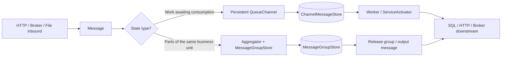
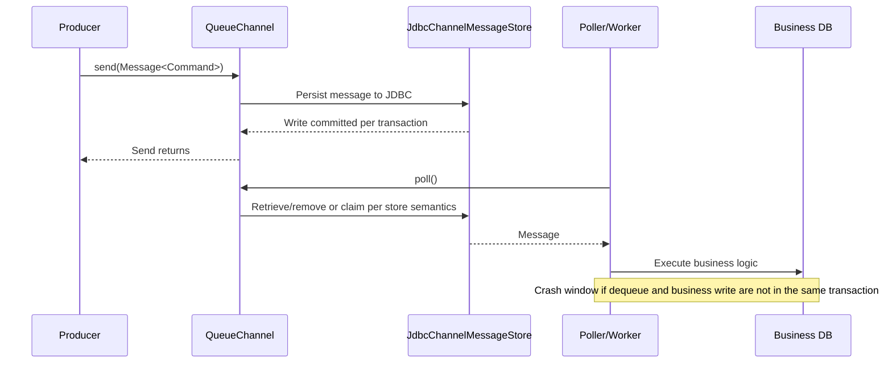
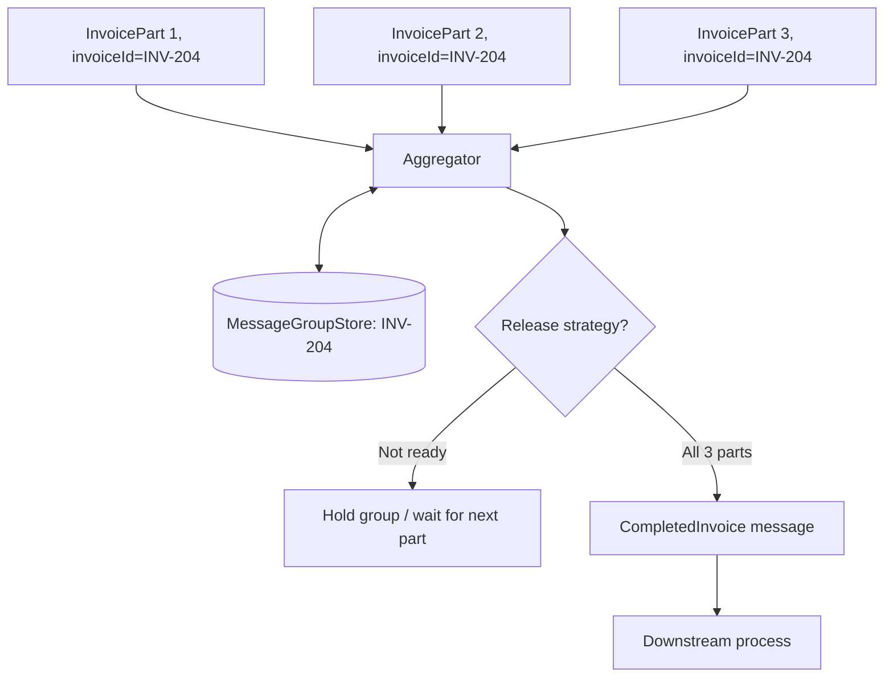
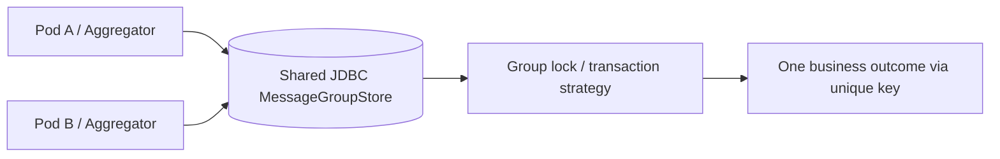
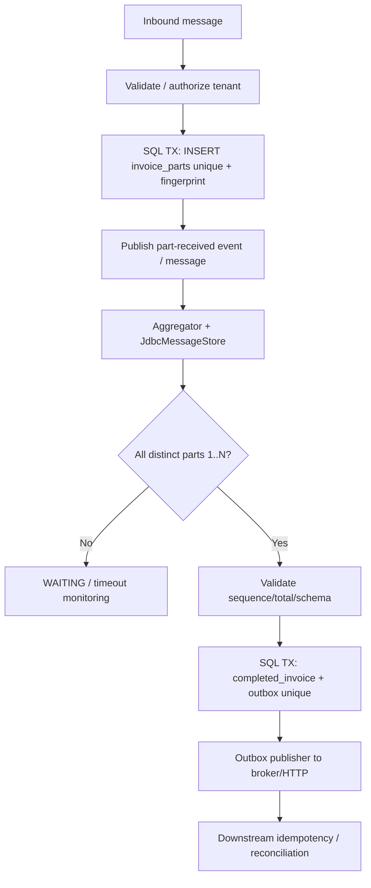

# MessageStore and Persisting Channel or Aggregator State

> **Chapter:** Flow Errors and State  
> **Scope:** Within the **SPRING_BOOT_INTEGRATION** module, Spring Boot connects systems using HTTP clients, databases, caches, message brokers, and Spring Integration adapters. This lesson focuses on **`MessageStore`**: why an integration flow needs to persist messages or message groups, how to use stores for **channels** and **aggregators**, differences between in-memory and persistent storage, plus transaction boundaries, duplicates, timeouts, crash recovery, security, testing, and observability.

## 1. Scenario: Process Dies Before the Flow Completes

Suppose an application receives parts of an invoice from multiple sources. Invoice `INV-204` has three parts:

```text
Source A sends (invoiceId=INV-204, part=1/3)
Source B sends (invoiceId=INV-204, part=2/3)
Source C sends (invoiceId=INV-204, part=3/3)
```

Spring Integration can collect the three parts in an **aggregator**, wait until all arrive, and emit a completed invoice. However, after receiving parts 1 and 2, the application restarts. If message groups only live in JVM heap memory, the accumulated parts vanish.

Another scenario: an inbound HTTP gateway accepts a job, puts it into a `QueueChannel`, and returns `202 Accepted` to the caller. If the queue is backed only by RAM and the pod restarts before a worker processes it, the job was accepted yet is gone.

**The issue is not `IntegrationFlow` syntax**, but deciding **where unprocessed state is stored** and **what happens on failure at each boundary**.



**Lesson goal:** distinguish a channel's message store from an aggregator's group store, avoid confusing **persisting a message** with **business completion**, and design recovery around durable facts rather than a single process flag.

## 2. Three Types of State Easily Confused in an Integration Flow

| State Type | Example | Appropriate Storage |
| --- | --- | --- |
| **Pending message** | Report-generation job accepted, waiting for worker | Persistent queue or broker; in Spring Integration, a persistent channel backed by a store |
| **Accumulating message group** | Received 2/3 invoice parts, waiting for the last part | `MessageGroupStore` for aggregator/resequencer |
| **Business outcome** | Invoice created, partner charged, event published | Business tables, ledger, outbox/inbox, durable state keyed by business key |

A `MessageStore` does not turn into a **business ledger** on its own. If a message is dequeued and an HTTP POST to a partner succeeds, but the process crashes before recording the outcome, whether the queue holds that message or not cannot tell you whether the partner processed it.

### 2.1. Flow State Differs from Transaction State

A message group may be in the state "waiting for part three", while the first two parts were saved in separate transactions. Conversely, a business SQL transaction can roll back while group metadata or an external HTTP call changed across another boundary.

Therefore keep these separate:

1. **Orchestration state:** which messages are pending and which group they belong to.
2. **Business outcome:** what work the system completed and under what ID.
3. **Outbound intent:** outbox for subsequent calls/events.
4. **Consumption record:** inbox/unique constraints for handling redelivered messages.

## 3. MessageStore Interfaces and Implementations

Spring Integration provides abstractions for persisting messages and message groups. Concrete interfaces may extend one another and vary in detail across Spring Integration versions; choose the **store type compatible with your endpoint**, not merely any class with "MessageStore" in its name.

| Abstraction / Implementation | Purpose | Notes |
| --- | --- | --- |
| **`MessageStore`** | Store and retrieve messages by ID | Does not inherently imply queue/polling semantics or group completion |
| **`BasicMessageGroupStore` / `MessageGroupStore`** | Store message groups by correlation key for aggregators/resequencers | Requires managing release, completion, expiry, and group cleanup |
| **`ChannelMessageStore`** | Contract for queue-style channels to persist messages | Specialized retrieve/remove semantics by channel/group |
| **`SimpleMessageStore`** | In-memory implementation, handy for tests or disposable state | Not durable across restarts |
| **`JdbcMessageStore`** | JDBC-backed store for SQL message/group persistence | Requires compatible schema, serializer, transactions, and cleanup |
| **`JdbcChannelMessageStore`** | JDBC store tailored for queue-style channels | Should not blindly replace an aggregator group store |
| **Redis-backed message store** | Option via Spring Integration Redis in supported versions | Persistence/expiry/failover/transactions depend on Redis and config |

The class names above reflect commonly used Spring Integration APIs. On Spring Boot 3.x projects, verify the **BOM-managed** Spring Integration API and version docs before copying bean configurations.

### 3.1. A Message Is More Than Its Payload

```text
Message<OrderPart>
  payload:
    invoiceId = "INV-204"
    partNumber = 2
    amountMinor = 250000
  headers:
    id = UUID(...)
    timestamp = ...
    correlationId = "INV-204"
    sequenceNumber = 2
    sequenceSize = 3
    tenantId = "tenant-a"
```

A Spring `Message` store may need to persist both **payload and headers** to restore routing/correlation/reply behavior accurately. However, not all headers are serializable or safe to persist long-term:

- Headers holding runtime objects like connections, principals, beans, or lambdas may fail serialization.
- Headers containing bearer tokens or PII pose security risks if persisted into databases or backups.
- An in-memory `replyChannel` reference becomes meaningless after a JVM restart.
- Spring's message ID identifies a message instance, **not always a business event ID**.

To persist messages reliably, keep payloads/headers in simple, versioned schemas without sensitive data and define a clear **post-restore contract**.

## 4. How Do In-Memory Stores Differ from Persistent Stores?

| Criterion | JVM In-Memory | JDBC / External Persistent Store |
| --- | --- | --- |
| Startup | Simple, usually no schema required | Needs database/service, schema, permissions, and migrations |
| Access speed | Usually lowest latency | Involves I/O, serialization, locks, connection pools |
| After process restart | State is usually lost | Recoverable if transaction committed and storage intact |
| Multiple replicas | Each instance has isolated state | Can be shared, **but requires concurrency/locking control** |
| TTL / cleanup | RAM freed on stop; must evict while running | Requires expiration policy and DB maintenance |
| Schema/version evolution | Minor concern for short-lived state | Must stay compatible with older serialized messages |
| Common failures | Queue loss on crash, heap growth | Lock contention, slow queries, full disk, wrong schema |
| Testing | Unit tests, basic behavior checks | Integration tests with real backend, restarts, and concurrency |

**Persistent does not mean exactly-once.** It only preserves certain state across crashes per transaction and configuration. Correctness still requires handling crash windows such as **after sending remotely but before recording DONE**.

### 4.1. When Is In-Memory Enough?

In-memory stores are fine when data **can be easily reconstructed** from a durable source, or when losing state is documented and acceptable—for example, temporary counters for a non-critical pipeline display.

Do not use an in-memory `QueueChannel` to back a durable job promise when HTTP already returned accepted and the client will not retry. Once you accept an obligation to process, you need a **durable commit before acknowledgment** or an explicit contract stating acceptance is volatile.

## 5. Setting Up Spring Integration JDBC and Preparing the Schema

The examples below target **Spring Boot 3.x, Java 17+, Spring Integration Java DSL, JDBC, and PostgreSQL**. Configurations are **illustrative for development**; Spring Integration JDBC table names and DDL must come from the **official scripts matching your exact version and dialect**, rather than guessing table names and missing indexes.

### 5.1. Maven Dependencies

```xml
<dependencies>
    <dependency>
        <groupId>org.springframework.boot</groupId>
        <artifactId>spring-boot-starter-integration</artifactId>
    </dependency>
    <dependency>
        <groupId>org.springframework.integration</groupId>
        <artifactId>spring-integration-jdbc</artifactId>
    </dependency>
    <dependency>
        <groupId>org.springframework.boot</groupId>
        <artifactId>spring-boot-starter-jdbc</artifactId>
    </dependency>
    <dependency>
        <groupId>org.postgresql</groupId>
        <artifactId>postgresql</artifactId>
        <scope>runtime</scope>
    </dependency>
</dependencies>
```

**Why is `spring-integration-jdbc` needed?** The Spring Boot JDBC starter provides `DataSource` and `JdbcTemplate`; Spring Integration's JDBC stores live in their own module. Adding only `spring-boot-starter-integration` does not bring in the JDBC store classes or SQL schemas.

### 5.2. Connecting to the State Database

```yaml
app:
  integration-store:
    jdbc-url: ${INTEGRATION_STORE_URL:jdbc:postgresql://localhost:5432/integration_dev}
    username: ${INTEGRATION_STORE_USER:integration_app}
    password: ${INTEGRATION_STORE_PASSWORD}

spring:
  datasource:
    url: ${INTEGRATION_STORE_URL:jdbc:postgresql://localhost:5432/integration_dev}
    username: ${INTEGRATION_STORE_USER:integration_app}
    password: ${INTEGRATION_STORE_PASSWORD}
    hikari:
      maximum-pool-size: 10
      connection-timeout: 3s
```

`app.integration-store` is only **illustrative application configuration metadata**; it does not automatically create a second `DataSource`. In this single-`DataSource` configuration, Spring Boot auto-configures the JDBC datasource from `spring.datasource.*`. If your app separates `businessDataSource` and `integrationDataSource`, wire them explicitly via beans/qualifiers and matching transaction managers; do not expect Boot to guess which store uses which database.

Never commit real passwords in YAML or logs. In production, use a secret manager or Kubernetes Secrets with TLS and least-privilege SQL permissions.

### 5.3. Initializing the Schema

Spring Integration JDBC ships **database-dialect-specific DDL scripts** for its message store, channel message store, and related JDBC components. Safe workflow:

1. Lock the Spring Integration version via the Spring Boot BOM.
2. Extract the exact SQL schema scripts packaged with that version/module for the PostgreSQL dialect.
3. Review and apply them via **Flyway/Liquibase** or a managed migration pipeline.
4. Ensure all indexes and constraints expected by the implementation remain intact.
5. Test reads, writes, restarts, and concurrency against the real store.

**Never rely on `spring.jpa.hibernate.ddl-auto=update` to "create MessageStore tables".** These are not business JPA entities. Likewise, never manually truncate Spring Integration tables just because rows accumulate: pending messages or incomplete groups can be destroyed.

### 5.4. Distinguishing Infrastructure Schema from Business Tables

```text
Spring Integration JDBC internal schema:
  Message payload/headers, message groups, channel queue state, metadata...
  (managed via official scripts for the exact version)

Application-owned business schema:
  orders, invoices, integration_inbox, integration_outbox,
  external_operation, import_batch...
  (managed by the application team)
```

**Do not query or mutate Spring Integration's internal tables directly instead of using the `MessageStore` API**, except in carefully controlled diagnostic or migration tools. Their format and invariants are internal implementation details and may change between versions.

## 6. Using MessageStore to Persist Channel State

### 6.1. The Default QueueChannel Is Not Durable

```java
@Bean
QueueChannel volatileOrdersChannel() {
    return new QueueChannel(500);
}
```

This is an **in-memory queue** with an illustrative capacity. If the process crashes, queued messages are normally lost. Setting a channel capacity does not give a queue durability.

### 6.2. QueueChannel Backed by a JDBC MessageGroupQueue

In Spring Integration versions supporting `JdbcChannelMessageStore` and `MessageGroupQueue`, you can create a JDBC-backed queue channel:

```java
package com.example.integration.state;

import javax.sql.DataSource;

import org.springframework.beans.factory.annotation.Qualifier;
import org.springframework.context.annotation.Bean;
import org.springframework.context.annotation.Configuration;
import org.springframework.integration.channel.QueueChannel;
import org.springframework.integration.jdbc.store.JdbcChannelMessageStore;
import org.springframework.integration.store.MessageGroupQueue;

@Configuration(proxyBeanMethods = false)
public class PersistentChannelConfiguration {

    @Bean("ordersChannelStore")
    JdbcChannelMessageStore ordersChannelStore(
            @Qualifier("integrationDataSource") DataSource dataSource) {
        JdbcChannelMessageStore store =
                new JdbcChannelMessageStore(dataSource);
        store.setRegion("orders-ingress");
        return store;
    }

    @Bean("ordersQueueChannel")
    QueueChannel ordersQueueChannel(
            @Qualifier("ordersChannelStore")
            JdbcChannelMessageStore store) {
        return new QueueChannel(
                new MessageGroupQueue(store, "orders.commands.v1"));
    }
}
```

**Prerequisites for this example to work:**

- An `integrationDataSource` bean and corresponding transaction manager must be **explicitly configured by the application** when not using the default `DataSource`.
- The Spring Integration JDBC schema must be migrated for the exact version.
- Exact packages and constructors must match the BOM-selected Spring Integration version; verify via compilation and integration tests.
- Region and group IDs must follow a stable naming convention across restarts; never rename them on deploy and orphan old rows.

**`region` is not a tenant isolation or security boundary.** It logically partitions keys/groups within the store per configuration; multi-tenancy still requires proper authorization checks, SQL ACLs, and business scoping.

### 6.3. Message Flow Path



This diagram shows the **conceptual queue backing store flow**, not an exact commit/locking order mandated across all JDBC store versions. To ensure **removing a message and updating business state** do not split, control the poller/handler transaction and underlying resources properly.

**Spotting a design flaw:** a producer sends to a durable queue and immediately logs "business complete". The store only proves **the job was accepted/saved under the send contract**, not that the handler, SQL write, HTTP call, or target broker completed.

## 7. Pollers, Transactions, and "Dequeued" Does Not Mean "Processed"

For a `PollableChannel` such as `QueueChannel`, a poller retrieves messages and invokes a handler. The poller's transaction boundary is a major architectural decision.

### 7.1. Example Job-Polling Flow

```java
package com.example.integration.state;

import java.time.Duration;

import org.springframework.beans.factory.annotation.Qualifier;
import org.springframework.context.annotation.Bean;
import org.springframework.context.annotation.Configuration;
import org.springframework.integration.channel.QueueChannel;
import org.springframework.integration.dsl.IntegrationFlow;
import org.springframework.integration.dsl.Pollers;

@Configuration
public class OrdersPollerConfiguration {

    @Bean
    IntegrationFlow processOrdersFromQueue(
            @Qualifier("ordersQueueChannel") QueueChannel channel,
            OrderCommandHandler handler) {
        return IntegrationFlow
                .from(channel,
                        endpoint -> endpoint.poller(
                                Pollers.fixedDelay(Duration.ofMillis(250))
                                        .maxMessagesPerPoll(10)))
                .handle(OrderCommand.class, (command, headers) -> {
                    handler.process(command);
                    return null; // One-way job, no reply.
                })
                .get();
    }
}

record OrderCommand(String operationId, String tenantId, String orderId) {}
```

`OrderCommandHandler` is an application service to implement. This configuration **does not yet attach transaction advice to the poller**; it illustrates polling and handling mechanics. In production, configure a **transactional poller** and verify whether the JDBC store and business writes actually share the same `DataSource`, transaction manager, and transaction.

### 7.2. Two Failure Windows

```text
A. Dequeue succeeds/commits in store
   → process crashes
   → business update never occurred
   → message may be lost if no durable/retry source remains

B. Business update commits
   → process crashes before confirming message handled
   → message may be redelivered
   → side effects may repeat without idempotency
```

A poller wrapped in the **same local JDBC transaction** covering both dequeue and business write **can** reduce these windows when both operations use the same `DataSource` and the implementation supports transactions properly. However:

- No standard JDBC transaction wraps a remote HTTP POST.
- Two separate databases do not automatically participate in one local transaction.
- A Redis store and a PostgreSQL business DB are not atomic together.
- Handlers dispatched via `ExecutorChannel` or `@Async` run on another thread and do not inherit thread-bound JDBC transactions.

**Never treat switching to a persistent `QueueChannel` as an exactly-once guarantee.** Durable storage reduces lost state, while deduplication and business correctness require dedicated mechanisms.

### 7.3. Durable Job Queue vs. Message Broker

A JDBC-backed channel can be suitable when:

- Traffic is moderate, PostgreSQL is already operated, and an integrated Spring Integration queue suffices.
- Workflows are compact, sharing one database and testable transaction boundaries.
- Simple state introspection without adding broker infrastructure is desired.

Brokers like RabbitMQ/Kafka/JMS are worth considering when you need:

- Broker-native fan-out or consumer groups.
- Log or queue retention and replay at scale.
- Multiple independent services, horizontal scaling, and dedicated messaging infrastructure.

**Do not decide based on theoretical throughput alone.** Evaluate durability, ordering, consumer acks, DLQs, network hops, schema evolution, and operational cost for your workload.

## 8. MessageGroupStore: State for Aggregators and Resequencers

An aggregator is a **stateful endpoint**: it receives individual messages, groups them by a **correlation key**, evaluates a **release strategy**, and emits an output message once the group qualifies.



A group comprises:

- **Correlation key:** ID representing the group.
- **Accumulated messages:** payload and headers of each part.
- **Group metadata:** count, timestamps, completion/expiry metadata per implementation.
- **Release policy:** matching `sequenceSize`, reaching a threshold, receiving an end marker, or timing out.
- **Output processor:** converts the released group into the downstream result message.

With an in-memory store, accumulated group state can vanish on restart. A **persistent `MessageGroupStore`** preserves saved parts across restarts when SQL commits succeed and schemas/serializers stay compatible.

### 8.1. Channel Queue vs. Aggregator Group State

| Channel Store | Aggregator Group Store |
| --- | --- |
| Holds **unconsumed work items** | Holds **parts of an incomplete group** |
| Poller takes one message to process | Correlator places messages into a group by key |
| Focuses on FIFO/priority/visibility/transactions | Focuses on release, completion, timeouts, duplicate parts |
| Example: `JdbcChannelMessageStore` | Example: `JdbcMessageStore` acting as `MessageGroupStore` |
| "Removed from queue" ≠ business done | "Group released" ≠ downstream side effect committed |

These are two different state models with distinct semantics. **Do not share the same group ID or store region across unrelated flows** without an explicit partitioning design.

## 9. Example: Configuring an Aggregator with JDBC Group Storage

### 9.1. Defining the MessageGroupStore

```java
package com.example.integration.invoice;

import javax.sql.DataSource;

import org.springframework.beans.factory.annotation.Qualifier;
import org.springframework.context.annotation.Bean;
import org.springframework.context.annotation.Configuration;
import org.springframework.integration.jdbc.store.JdbcMessageStore;
import org.springframework.integration.store.MessageGroupStore;

@Configuration(proxyBeanMethods = false)
public class InvoiceGroupStoreConfiguration {

    @Bean("invoiceGroupStore")
    MessageGroupStore invoiceGroupStore(
            @Qualifier("integrationDataSource") DataSource dataSource) {
        JdbcMessageStore store = new JdbcMessageStore(dataSource);
        store.setRegion("invoice-aggregation");
        return store;
    }
}
```

`JdbcMessageStore` is a SQL persistence option for messages and groups. It requires proper schema and privileges, and you must verify the serializer can read stored payloads/headers after restarts or version upgrades.

### 9.2. Invoice Part Data

```java
package com.example.integration.invoice;

public record InvoicePart(
        String invoiceId,
        int partNumber,
        int expectedParts,
        long amountMinor,
        String currency
) {}
```

A producer can construct a `Message<InvoicePart>` with headers:

```java
Message<InvoicePart> message = MessageBuilder
        .withPayload(new InvoicePart(
                "INV-204", 2, 3, 250000L, "VND"))
        .setHeader("invoiceGroupId", "tenant-a:INV-204")
        .setHeader("expectedParts", 3)
        .setHeader("partNumber", 2)
        .build();
```

`MessageBuilder` comes from Spring Messaging. This snippet illustrates constructing a message inside a service/producer before sending it to a channel. **The tenant must come from an authenticated identity**, never trusting an arbitrary string supplied by an untrusted caller.

### 9.3. Wiring the Store into IntegrationFlow

```java
package com.example.integration.invoice;

import org.springframework.beans.factory.annotation.Qualifier;
import org.springframework.context.annotation.Bean;
import org.springframework.context.annotation.Configuration;
import org.springframework.integration.dsl.IntegrationFlow;
import org.springframework.integration.store.MessageGroupStore;
import org.springframework.messaging.Message;

@Configuration
public class InvoiceAggregateFlowConfiguration {

    @Bean
    IntegrationFlow invoiceAggregateFlow(
            @Qualifier("invoiceGroupStore")
            MessageGroupStore groupStore,
            CompletedInvoiceHandler handler) {
        return IntegrationFlow.from("invoicePartsInput")
                .aggregate(spec -> spec
                        .correlationStrategy(message ->
                                message.getHeaders().get("invoiceGroupId"))
                        .releaseStrategy(group -> {
                            Message<?> first = group.getOne();
                            if (first == null) {
                                return false;
                            }
                            Object count = first.getHeaders()
                                    .get("expectedParts");
                            return count instanceof Integer expected
                                    && expected > 0
                                    && group.size() >= expected;
                        })
                        .messageStore(groupStore))
                .handle(handler, "handle")
                .get();
    }
}
```

`CompletedInvoiceHandler` is a business bean to define, accepting the released group output produced by the aggregator's output processor (by default typically a collection of payloads with the default group processor).

**Mandatory precondition before using this example:** an **upstream filter/validator** must ensure `invoiceGroupId` is present, `expectedParts` is positive and consistent across every part of the group, `partNumber` is in range, and each part has a unique business identity. Releasing purely via `group.size()` is only safe when **duplicate parts cannot be counted as new members**.

### 9.4. Reaching the Expected Count Does Not Guarantee Valid Data

Suppose `expectedParts=3`, and the flow receives:

```text
partNumber=1, messageId=m1
partNumber=1, messageId=m2  (redelivery, new Message ID)
partNumber=2, messageId=m3
```

Group size reaches 3 even though **part 3 never arrived**. Therefore you cannot rely solely on message count to confirm completeness when duplicates can occur:

- Enforce a unique key `(tenantId, invoiceId, partNumber)` in a durable inbox/staging table.
- Treat **same part / different payload** as a fingerprint conflict rather than silently overwriting.
- Verify the complete sequence set `1..N` and total checksums upon release.
- Ensure the output processor sorts by `partNumber` if required by contract.

If business logic is sensitive and needs exact calculations immediately after restarts, a **staging table with unique constraints** can be more appropriate than relying solely on `MessageGroupStore`.

## 10. Correlation, Sequences, and Release Strategies

### 10.1. Correlation Key

**Correlation ID** determines which messages belong together in a group. In multi-tenant systems, `invoiceId` alone can collide across tenants, so the key should include the **authenticated tenant** or a globally unique business ID. If keys become very long, use structured encoding or a digest with an explicit collision policy.

**Do not use a trace ID as the default business correlation key.** One trace can span multiple orders or retries; one invoice can be assembled across multiple separate traces.

### 10.2. Sequence Number and Sequence Size

When a splitter breaks a message into parts, Spring Integration can populate standard headers for **correlation, sequence number, and sequence size**. However, messages from external brokers or APIs **do not magically carry valid sequence headers** unless the producer supplies them.

If the part count is not known ahead of time (an unbounded stream without an end marker), fixed `sequenceSize` cannot be used as the release condition. Instead you can:

1. Define an explicit **completion marker** or terminal message.
2. Use watermarks/timeouts with a controlled partial-result policy.
3. Switch to streaming aggregation or a stateful database accumulating partial results.

Never turn "30 seconds passed without seeing the last part" into "the invoice is complete" without an explicit contract for partial/failed groups.

### 10.3. Release vs. Complete

An aggregator can release output once ready, while group metadata **may be retained or deleted depending on configuration**. Retaining completed-group markers helps detect late arrivals or duplicates for a time window; deleting immediately allows the same correlation key to open a brand-new group if a producer resends later.

**Decide explicitly:**

- After release, may the group accept new parts?
- How long should completed-group markers be retained?
- When a late message arrives, should it be ignored, errored, or open a new group?
- If a group is reaped/expired, can the same key be recreated?

Never rely on completed-group markers in the store as your sole deduplication layer when duplicates must be blocked beyond retention or across multi-day replays.

## 11. Timeouts, Group Expiry, and MessageGroupStoreReaper

An aggregator missing a part can retain state forever without a cleanup policy. Conversely, expiring too early discards valid in-flight parts.

| Mechanism | Meaning | Risk Without Policy |
| --- | --- | --- |
| **Group timeout** | Evaluates a group waiting too long within the aggregator | Partial results or premature expiry breaking completeness expectations |
| **`MessageGroupStoreReaper`** | Scans/expires groups in the store on a schedule and timeout | Expiring active state or multi-replica reaper contention |
| **Send partial result on expiry** | Emits an incomplete group when configured to allow it | Incomplete invoices treated downstream as complete |
| **Completed-group retention** | Keeps markers/metadata after release | Retaining too long bloats storage; deleting too soon permits duplicates |
| **Business deadline** | SLA like "all 3 parts before 18:00" | Should not be inferred purely from group row creation time |

### 11.1. Example Timeout Policy

```text
Invoice INV-204:
  expectedParts = 3
  inactivity timeout = 15 minutes
  expired with missing parts:
      business state = INCOMPLETE
      record missing part numbers + correlation ID
      send alert or DLQ/quarantine
      DO NOT emit CompletedInvoice

  when all parts arrive:
      validate total/checksum/currency
      persist completed invoice with business unique constraint
      emit InvoiceCompleted via outbox
```

A scheduled `MessageGroupStoreReaper` only manages **store state**; it does not automatically know which invoices are permitted to close, who to notify, or whether compensating actions are needed. Wire explicit expiry handlers/error flows and retention policies.

### 11.2. Avoid Deleting Unprocessed Business Data

Do not habitually set `sendPartialResultOnExpiry=true` just "to free memory". If a partial invoice is invalid, forwarding it downstream triggers erroneous side effects. Prefer **marking the group timed out → saving diagnostics → retrying/reconciling → cleaning up after deadline**.

With JDBC stores, cleanup must monitor table growth, SQL locks, and waiting group counts. Never delete rows directly from internal tables bypassing the aggregator lifecycle.

## 12. Transaction Boundaries When the Aggregator Releases Output

A flow:

```text
MessagePart 3
  → JdbcMessageStore adds part
  → Aggregator releases group
  → calls Billing API
  → updates SQL completed
```

does **not automatically become one atomic transaction committing everything**. Inspect these crash windows:

1. **Part addition committed, process dies before release:** group remains in store, requiring a restart/reconcile release trigger.
2. **Group release/cleanup committed, process dies before downstream receives output:** output can be lost if the reply/output channel is in-memory.
3. **Downstream HTTP succeeded, process dies before writing DONE:** retry risks duplicate side effects.
4. **Business DB rolled back while group store updated:** orchestration state and business state diverge.

**Safer pattern for important side effects:** When the group completes, write the business outcome record and an **outbox event** in the same SQL transaction keyed by a stable business key; a downstream worker drains the outbox to HTTP/broker. If the aggregator store shares the same database, you can consider coordinating store and business writes in one transaction, provided you test the exact release timing, locks, output channels, and transaction boundaries in your target version.

### 12.1. TransactionTemplate Does Not Replace Idempotency

```java
@Service
class InvoiceCompletionService {
    private final JdbcTemplate jdbc;

    InvoiceCompletionService(JdbcTemplate jdbc) {
        this.jdbc = jdbc;
    }

    @Transactional
    public void persistResult(
            String tenantId, String invoiceId, String summaryJson) {
        int inserted = jdbc.update("""
            INSERT INTO completed_invoices
                (tenant_id, invoice_id, summary_json)
            VALUES (?, ?, CAST(? AS jsonb))
            ON CONFLICT (tenant_id, invoice_id) DO NOTHING
            """, tenantId, invoiceId, summaryJson);
        if (inserted == 0) {
            // Check payload hash/version to distinguish valid replay
            // from conflict before deciding to return existing outcome.
            return;
        }
        // If publishing is needed, INSERT into outbox in the same SQL transaction here.
    }
}
```

This is a **PostgreSQL SQL illustration**. Add DDL, payload-fingerprint conflict checks, producer identity, input validation, and the proper transaction manager when using multiple `DataSource`s. `ON CONFLICT DO NOTHING` only blocks duplicate key inserts; **it does not prove duplicate payloads are identical**.

### 12.2. Business State Contract

```text
RECEIVING
   |
   +--> INCOMPLETE / EXPIRED
   |
   +--> VALIDATED
           |
           +--> PERSISTED + OUTBOX_COMMITTED
                       |
                       +--> PUBLISH_PENDING
                       +--> SENT
                       +--> UNKNOWN / RECONCILE
```

Aggregator state tracks **which parts have arrived**. Business table state tracks **which steps completed**. Recovery after a crash must consult both sources under deterministic rules.

## 13. Handling Duplicates, Out-of-Order Parts, and Late Messages

### 13.1. Message ID Differs from Business ID

Every Spring `Message<?>` can carry its own ID; the same broker event deserialized into a new `Message<?>` after retry **can have a different ID**. Relying only on Spring Message ID deduplication inside `MessageStore` allows duplicate business events to be counted twice.

A durable ledger should identify parts by:

```sql
CREATE TABLE invoice_parts (
    tenant_id VARCHAR(80) NOT NULL,
    invoice_id VARCHAR(120) NOT NULL,
    part_number INT NOT NULL CHECK (part_number > 0),
    payload_sha256 VARCHAR(64) NOT NULL,
    amount_minor BIGINT NOT NULL,
    currency VARCHAR(3) NOT NULL,
    created_at TIMESTAMPTZ NOT NULL DEFAULT CURRENT_TIMESTAMP,
    PRIMARY KEY (tenant_id, invoice_id, part_number)
);
```

When receiving a duplicate part:

- **Same primary key and same digest/content:** acknowledge idempotently per policy.
- **Same primary key with different digest/content:** conflict—quarantine and investigate; never overwrite silently.
- **Different part number:** add to group/staging and wait.
- **Late part after completion/expiry:** handle per contract; never re-open side-effecting business work without consulting the business ledger.

### 13.2. Ordering Before Output

An aggregator may receive parts in order `3,1,2` while business rules require assembling `1,2,3`. Never rely on the iteration order of `MessageGroup.getMessages()` as an ordering contract if output order must be deterministic.

The output processor must validate and sort by `partNumber`, sum totals, and validate currency/schema before emitting. `Resequencer` is a related endpoint whose primary job is **releasing messages in sequence**, whereas an aggregator typically **combines a group into one output**.

## 14. Multiple Instances Sharing a JDBC Store: Concurrency Coordination Needed

Two pods simultaneously receive parts of `INV-204`:



A shared database lets both pods see the same state, but **does not by itself guarantee** only one thread updates or releases a group at a time. Address:

- Locking by correlation key (local or distributed `LockRegistry` depending on topology).
- Store/DB transaction isolation and row-level locks.
- Producer/consumer concurrency and replica count.
- Whether concurrent release checks can emit duplicate output.
- Whether expiry/reaper runs on multiple instances and races with add/release.
- Whether partitioning messages by business key reduces contention.

Spring Integration supports lock registries for aggregator/group management; across multiple JVMs choose a **distributed lock implementation** when exclusivity across pods is needed. An in-memory `DefaultLockRegistry` in Pod A **does not lock** Pod B. JDBC/Redis locks also require timeouts, leases/fencing, and failure testing; never treat them as an exactly-once guarantee for remote HTTP calls.

### 14.1. The Transaction Manager Must Govern the Right DataSource

If `JdbcMessageStore` points to `integrationDataSource` while `@Transactional` uses `businessTransactionManager` on another database, business SQL writes and group updates **do not share a local transaction**. Misusing `@Primary`/`@Qualifier` can let tests boot cleanly while corrupting consistency.

When the SQL store and business tables live in the same database, sharing one `DataSource`/transaction manager can simplify atomic coordination within tested bounds. Across separate databases, brokers, or HTTP APIs, use outbox/inbox/reconciliation patterns.

## 15. Serialization, Schema Migration, and Reading Old State After Deploy

A persistent store does not store live Java object graphs; it writes bytes/schemas that **future application versions must deserialize**.

### 15.1. Risks with Payloads and Headers

| Risk | Example | Mitigation |
| --- | --- | --- |
| DTO class/package renamed | `InvoicePart` moved packages after deploy | Versioning, stable serializer schemas, and migrations |
| Non-serializable headers | `replyChannel` is a runtime object or header holds a resource | Minimize persisted headers; use correlation identifiers and durable reply design |
| Unsafe Java serialization | Deserializing untrusted bytes | Restrict data sources, allowlist classes, and use safe formats by design |
| Contract changes | `amountMinor` changes to decimal or new mandatory field added | Schema evolution/migration; test old/new versions |
| Sensitive data | Tokens/PII persisted in SQL state | Redaction, encryption/ACL, retention, separate secrets |
| Incompatible store schema | Spring Integration JDBC tables/indexes changed | Versioned migrations, test rolling deploys/rollbacks |

Do not blindly dump complex `java.io.Serializable` graphs holding Spring beans, connections, or streams into messages just because local flows work. For persistent state, prefer **immutable, versioned serializable DTOs** and minimal runtime headers.

### 15.2. Pre-Upgrade Checklist for Spring Boot / Spring Integration

1. Count pending messages and active groups; set an intake drain deadline if needed.
2. Compare the Spring Integration JDBC schema against the target version.
3. Verify serialization can read **data written by the old version** using real pre-upgrade fixtures.
4. Do not test only new messages created by the new version.
5. Assess rolling deployment compatibility: will both versions read/write the group tables simultaneously?
6. Prepare a rollback plan if old binaries cannot deserialize new message schemas.
7. Check indexes, cleanup, and SQL query plans with real pending volumes (not an empty database).
8. Never manually edit binary rows in store tables without understanding encoding and invariants.

## 16. Retention and Capacity Management

A persistent store can grow rapidly when flows fail, groups stop releasing, or consumers stop polling.

| Data | Retention / Cleanup Decision |
| --- | --- |
| Pending channel messages | Retain until processed/expired per business rules; alert on backlogs |
| Active aggregator groups | Retain through deadlines and expected delayed arrivals |
| Completed-group markers | Retain long enough to catch late/duplicate arrivals per policy |
| Expired groups | Transition state and save diagnostics before purging |
| Business inbox/idempotency | Match retry/replay SLAs, not local cache TTLs |
| Outbox SENT/FAILED | Match audit, reconciliation, and storage budgets |
| SQL logs/audits/backups | Match data retention, security, and organizational compliance |

**Do not apply a single TTL to every type of state.** Channel jobs may need to survive multi-day outages; aggregators may wait 30 minutes while idempotency ledgers span weeks; PII may require scheduled deletion.

### 16.1. Cleanup Can Race with Live Flows

If a reaper expires a group right as the final part arrives, determine who wins under lock/transaction semantics. If a DBA cron job deletes pending rows directly outside the store API, Spring Integration can encounter missing state or emit corrupted outputs.

Add metrics, dry runs, and dedicated retention policies for cleanup; test across multi-version fixtures before enabling automated purging.

## 17. Securing Persistent Message State

### 17.1. MessageStore Holds Real Data

Payloads and headers may contain:

- Customer/order/invoice IDs.
- Emails, shipping addresses, audit details.
- Credentials or tokens if forwarded accidentally by upstream.
- Correlation metadata linking tenants, partners, and requests.

Treat a JDBC store as a **sensitive data store**, enforcing least-privilege SQL permissions, TLS, storage/backup encryption where required, access auditing, and retention. Do not grant broad SQL access to unrelated services. When multiple tenants share a store, enforce isolation and authorization **before persisting messages**, never trusting an unverified `tenantId` from the caller.

### 17.2. Never Log Raw Serialized Messages

For debugging, you typically only need:

```text
flow=invoice-aggregate
region=invoice-aggregation
groupKeyHash=...
messageCount=2
expectedCount=3
ageSeconds=84
state=WAITING
errorClass=...
```

These fields are illustrative, not auto-generated Spring metrics. Hashing group keys also requires care if the input space is small and guessable; apply authorization, redaction, and sampling to logs and metrics.

## 18. Observing Channels and Aggregators

### 18.1. Suggested Metrics

| Metric | What It Detects |
| --- | --- |
| Pending queue depth per channel | Workers falling behind inbound rate |
| Oldest pending message age | Stuck work even when queue depth appears low |
| Group count per aggregator/region | Abnormal buildup of incomplete groups |
| Group age / last update age | Missing parts or stale groups |
| Group release rate and partial expiry rate | Data quality and completion health |
| Duplicate parts / business key conflicts | Redeliveries or producer contract violations |
| Store JDBC latency/errors | DB overload, lock contention, schema/serialization failures |
| Transaction rollbacks/retries | Side effect or group update failures |
| Outbox pending / reconciliation count | Released groups whose downstream steps haven't finished |
| JVM heap and DB storage size | In-memory pressure or persistent backlog growth |

Not all metrics are provided out-of-the-box by Spring Integration/Actuator. Add Micrometer instrumentation at adapters, handlers, stores/reapers, and business ledgers while monitoring HikariCP, SQL lock waits, and disk I/O.

**Avoid high-cardinality metric tags:** never use `invoiceId`, `orderId`, `messageId`, arbitrary `correlationId`, or raw payloads as tags. Region, endpoint name, outcome, and error category are far safer.

### 18.2. Distinguishing Process Health from Durable State

An instance reporting **healthy** does not prove its backlog is cleared. A channel depth of 0 does not prove business completion if a poller dequeued a message and crashed before committing. Track at least three signal layers:

1. **Infrastructure:** DB connectivity, broker availability, error rates.
2. **Flow state:** pending messages, active groups, expirations.
3. **Business state:** completed/failed/unknown operations, outbox/inbox/reconciliation.

## 19. Testing MessageStore Against Crash Consequences

### 19.1. Minimum Test Suite

| Test Case | Outcome to Prove |
| --- | --- |
| In-memory `QueueChannel` then restart | State is lost as expected (no false persistence promise) |
| JDBC-backed `QueueChannel` then restart | Committed pending messages remain retrievable |
| Aggregator receives 2/3 then restarts | Group state survives and part 3 completes it |
| Duplicate part with same business ID | Does not falsely push `group.size()` to expected count |
| Same part ID with different payload | Conflict/quarantine triggered by fingerprint check |
| All parts released, downstream fails | Business outcome is not lost without retry/reconciliation |
| Timeout with missing part | Does not emit an invalid "completed" invoice |
| Reaper races with final part | State is neither lost nor duplicated |
| Two replicas process same correlation key | Unique constraint ensures only one business completion |
| SQL store schema/serializer upgrade | Pre-upgrade pending messages/groups deserialize cleanly |
| Wrong transaction manager | Test exposes partial commit between store and business DB |
| Store DB timeout/down | Does not return accepted as if durable when persistence fails |
| Crash after remote side effect | Retry with same `operationId` creates no duplicates |
| Payload with sensitive metadata | Not leaked into unauthorized logs/metrics |

### 19.2. Test the Aggregator Through the Flow, Not Just the Strategy

Unit testing `releaseStrategy(group)` only proves arithmetic counting—it does not prove:

- Messages persist into the store inside transactions.
- The store restores groups after a restart.
- Correlation keys/headers serialize properly.
- Spring Integration releases exactly one output through the real flow.
- Groups clean up, complete, or expire as intended.

**An integration test with PostgreSQL Testcontainers** should apply official schemas, configure `JdbcMessageStore`, send two parts through the flow, close the context, start a fresh context against the same database, and send the final part. Assert **one** valid completed invoice and accurate business state. Watch out for Spring `TestContext` caching and container lifecycles so the new context actually connects to the same database holding pending state.

### 19.3. Testing Queues with Controlled Failures

A high-value test:

1. Send a message with a fixed `operationId` into the persistent queue.
2. Verify the producer returns accepted only after durable write per contract.
3. Shut down the application before the poller consumes it.
4. Restart with the same store/schema/region.
5. Verify the message is polled and processed by the business handler.
6. Simulate a crash **after business commit but before acknowledgment**.
7. Verify replay produces no duplicates thanks to ledger/unique constraints.

Add a test when the message store database is offline: if saving fails, the endpoint must error / refuse acceptance per contract instead of pretending durability because an object exists in RAM.

### 19.4. Do Not Mistake `@SpringBootTest` for Sufficient Durability Testing

`@SpringBootTest` merely starts a context and often uses H2/in-memory defaults. To prove JDBC store durability, use a **production-equivalent backend for transactions and schema**, testing across commits and restarts. For multi-replica safety, run at least two instances/contexts or equivalent concurrency tests to expose races.

## 20. Troubleshooting Common Failures

| Symptom | Common Cause | How to Investigate |
| --- | --- | --- |
| Messages vanish on restart | In-memory `QueueChannel` or uncommitted send | Check channel/store beans and acceptance boundaries |
| JDBC store fails to initialize | Missing `spring-integration-jdbc` or SQL schema | Dependencies, matching dialect, and migration version |
| Store exists yet aggregator loses groups | Flow points to wrong store/region, unreadable serializer, expired group | Bean wiring, region, SQL rows, lifecycle |
| Group never releases | Wrong correlation/`sequenceSize`, missing last part, bad release strategy | Safe diagnostic dump of group counts vs. expected |
| Group releases prematurely | Duplicate redelivery, relying solely on `group.size()` | Unique part ID, fingerprint, sequence validation |
| Group completed yet output lost | In-memory output channel, crash window | Durable output/outbox + transaction trace |
| Same invoice created twice | Multi-instance race, retries, or expired key reopened | Business unique constraints, distributed locks, ledger |
| CPU/DB spikes from reaper | Too many groups, missing cleanup indexes/bad interval | Indexes, group ages, reaper schedule, retention |
| PostgreSQL disk fills up | Pending messages / old groups never purged | Backlogs, expiry policies, archiving, and cleanup |
| `ClassCast`/deserialize error after deploy | DTO/header/serializer mismatch | Old-version fixtures, migrations, rollback plan |
| JDBC `@Transactional` fails to roll back store | Store uses different `DataSource`/manager | `@Qualifier`, transaction boundaries, actual connections |
| Duplicate processing after recovery | Deduplicating only by Message ID or missing inbox | Business `operationId` + unique constraints |
| Redis store loses state | Redis eviction/expiry/failover/persistence settings | Redis config and durability SLA |
| No errors logged yet output missing | Flow error channel, discarded messages, late replies | `ErrorMessage` routing, DLQ/quarantine, tracing |

**Never fix every issue by raising timeouts or truncating store tables.** Raising timeouts lets state pile up longer; wiping tables destroys in-flight business work or triggers erroneous replays. Always inspect correlation groups, transactions, and consumer outcomes first.

## 21. Practice Exercise: Multi-Part Invoice Recovery Across Restart

### Problem Statement

Design a flow receiving three invoice parts over HTTP, broker, or file:

```json
{
  "tenantId": "tenant-a",
  "invoiceId": "INV-204",
  "partNumber": 1,
  "expectedParts": 3,
  "amountMinor": 125000,
  "currency": "VND",
  "eventId": "evt-901"
}
```

Requirements:

1. For the same tenant/invoice/part, accept only one payload digest.
2. If two parts are sent and the app restarts, the final part still completes the group.
3. Never mark completed with missing parts, even after timeout.
4. Upon completion, write the completed invoice and outbox row in SQL.
5. When downstream broker/HTTP fails, do not lose the intent to send.
6. When events redeliver or two replicas run concurrently, never create the invoice twice.

### Suggested Design



**Note atomicity at step C→D:** if you insert the part into SQL and publish directly, the process can crash before publishing. When zero parts can be lost, store a **part-received outbox record in the same transaction C**, then have a publisher forward it to the aggregator. The group store tracks orchestration state, while `invoice_parts` serves as a durable recovery source if groups ever need rebuilding.

### Extensions

- Add `schemaVersion` and test a newer context reading a group persisted by an older version.
- Simulate part 2 arriving three times with three different Spring Message IDs.
- Send part 3 before part 1 and confirm output remains properly ordered.
- Run two instances sharing the JDBC store and correlation key to verify locking/unique completion.
- Change timeout from 10 minutes to 2 minutes during rollout without dropping valid in-flight groups.
- Test group release succeeding while downstream SQL temporarily fails.

## 22. Production Deployment Checklist

1. **Clarify state:** separate pending channel messages, active groups, and business outcomes.
2. **Match store to endpoint:** `JdbcChannelMessageStore` for queue-style channels, `JdbcMessageStore`/`MessageGroupStore` for aggregators where appropriate.
3. **Verify SQL schema:** exact dialect/version, indexes/constraints, migrations, and permissions.
4. **Lock down serialization:** versioned payload/header DTOs, no runtime resources or secrets persisted.
5. **Scope correlation:** authenticated tenant + business key, avoiding collisions and ad-hoc dynamic keys.
6. **Harden release:** validate distinct parts/checksums, never just group size when duplicates exist.
7. **Configure timeouts:** expiry, partial/quarantine handling, reaper ownership, and retention per SLA.
8. **Align transactions:** matching `DataSource`/manager for store and handlers; never assume atomicity across HTTP/brokers.
9. **Enforce deduplication:** unique constraints + inbox/outbox/stable idempotency keys independent of Spring Message ID.
10. **Coordinate replicas:** distributed lock registries/partition keys/DB constraints, reaper vs. aggregator races.
11. **Monitor:** queue depth/oldest age, group count/age, releases/expiries, store latency, SQL locks, and reconciliation.
12. **Test failures:** crashes before/after commit, restarts, duplicates, late parts, timeouts, schema upgrades, and production-like JDBC backends.

### Self-Check Questions

1. Why is an in-memory `QueueChannel` unsuitable for guaranteeing accepted jobs survive restarts?
2. How do `MessageStore`, `ChannelMessageStore`, and `MessageGroupStore` serve different types of state?
3. For which use cases do `JdbcChannelMessageStore` and `JdbcMessageStore` differ?
4. Does a persistent `MessageStore` automatically guarantee exactly-once business side effects?
5. If message dequeue commits and the worker dies before the SQL update, what can happen?
6. Why does an aggregator need both a correlation key and a release strategy?
7. Why can `group.size() >= expectedParts` fail when a broker redelivers the same part with a new Spring Message ID?
8. Is `sequenceSize` sufficient for a stream whose total part count is unknown beforehand?
9. After a group releases and sends output to an in-memory channel, what message-loss window remains?
10. Can a timeout/reaper replace the business decision of when an invoice is complete?
11. Why might multiple instances sharing one JDBC store still need distributed locks and unique keys?
12. What kinds of data in message headers should not be persisted long-term in an SQL store?
13. Why must Spring Integration JDBC upgrades test reading old persisted groups rather than only writing new ones?
14. When the group store and business DB sit on two separate `DataSource`s, is a single `@Transactional` enough?
15. What test proves a group completes accurately across restarts and duplicate replays?

## 23. References

- [Spring Integration — Message Store](https://docs.spring.io/spring-integration/reference/message-store.html): persisting messages, message groups, and store implementations.
- [Spring Integration — Aggregator](https://docs.spring.io/spring-integration/reference/aggregator.html): correlation, release, group timeouts, and lifecycle.
- [Spring Integration — Message Channels](https://docs.spring.io/spring-integration/reference/channel.html): `QueueChannel`, pollable channels, and delivery semantics.
- [Spring Integration — JDBC Support](https://docs.spring.io/spring-integration/reference/jdbc.html): JDBC message stores, schemas, and adapters.
- [Spring Framework — Transaction Management](https://docs.spring.io/spring-framework/reference/data-access/transaction.html): transaction boundaries, managers, and rollbacks.
- [Spring Boot — Integration](https://docs.spring.io/spring-boot/reference/messaging.html): organizing messaging integration per version.

**Remember:** **`MessageStore` persists integration flow state**, but you must choose **channel stores** vs. **aggregator/message-group stores** matching your endpoint semantics. JDBC-backed stores can preserve pending messages and groups across restarts; they **do not automatically create distributed transactions or business exactly-once semantics**. For flows spanning SQL, HTTP, Redis, or brokers, define **who owns state, where commits occur, when groups release/expire, which business keys detect duplicates, and whether outputs are durable**. A reliable production design combines `MessageStore`, aligned transactions, unique constraints/inbox/outbox, cleanup, observability, and real restart/crash/concurrency tests.
