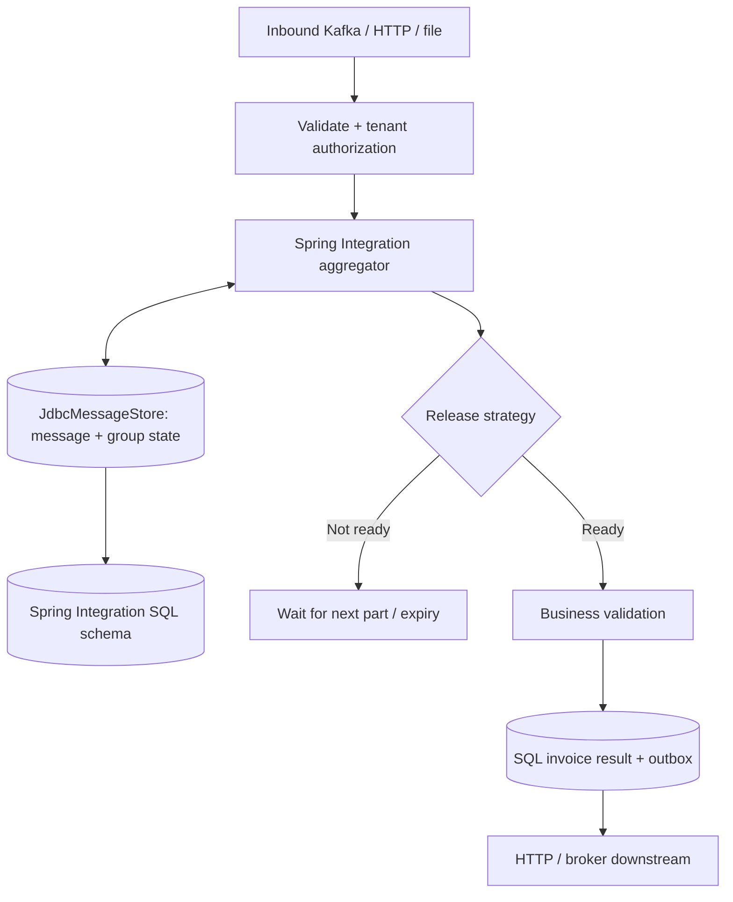
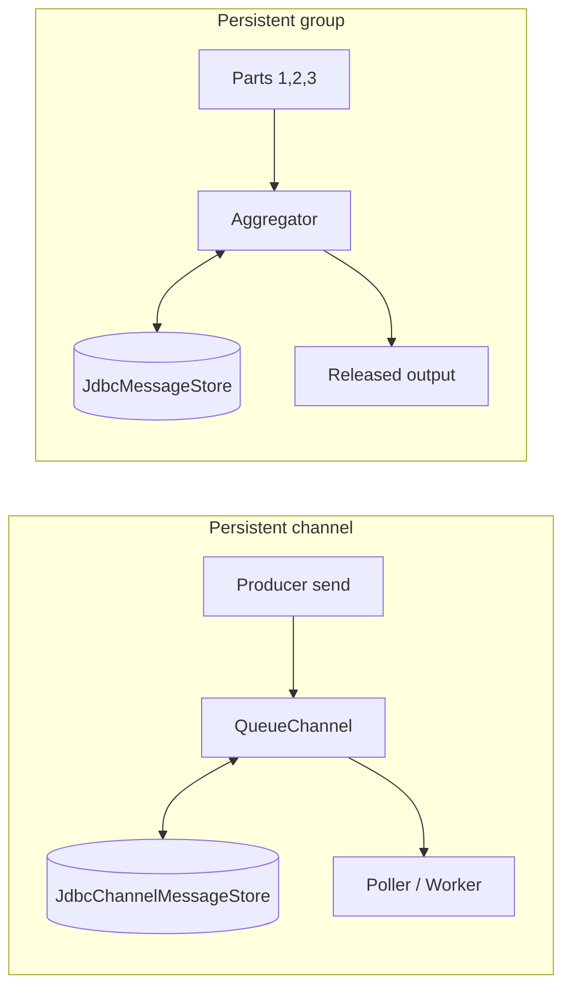
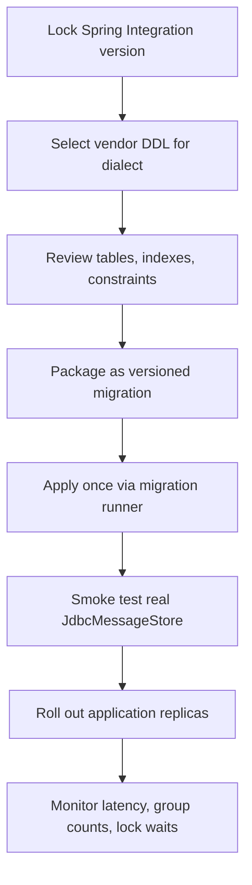
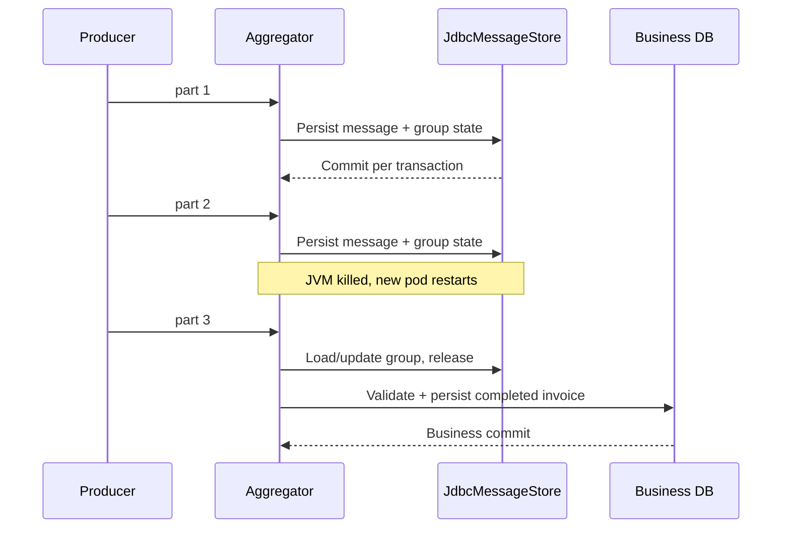
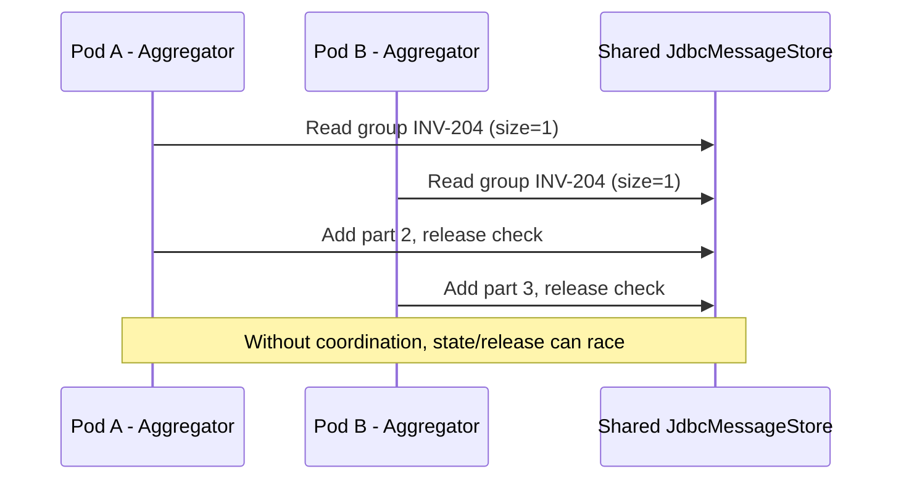
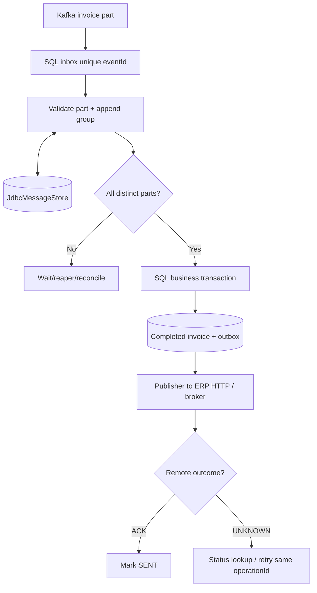
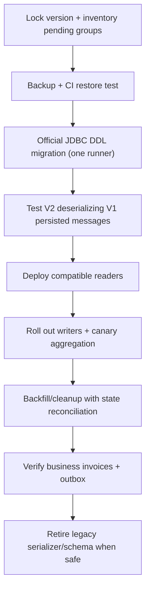

# JdbcMessageStore and Infrastructure Schema Management

> **Chapter:** Flow Errors and State  
> **Scope:** Within the **SPRING_BOOT_INTEGRATION** module, Spring Boot organizes integrations across HTTP clients, databases, caches, message brokers, and Spring Integration adapters. This lesson focuses on **`JdbcMessageStore`** for persisting messages and message groups, and how to govern the **Spring Integration JDBC infrastructure schema**: picking the right store, initializing tables, managing versioned DDL, running migrations, serialization, transactions, concurrency, cleanup, upgrades, and failure recovery.

## 1. The Problem: Recovering an Aggregator After a JVM Restart

A system receives three parts of invoice `INV-204` over Kafka:

```text
09:00:00  invoice-part-1 -> Spring Integration aggregator
09:00:02  invoice-part-2 -> aggregator
09:00:03  JVM killed during rolling deployment
09:00:10  new pod starts up
09:00:12  invoice-part-3 arrives
```

If the aggregator uses an in-memory message group store, parts 1 and 2 can vanish. With **`JdbcMessageStore`** and proper schema and transactions, successfully persisted parts **can survive restarts**. However, emitting a complete invoice still depends on correlation keys, release strategies, output durability, and deduplication.



**Key point:** `JdbcMessageStore` persists **orchestration state**. It **does not guarantee by itself** that the invoice result was written to business tables, events were published, or partners processed side effects.

### Learning Objectives

After this lesson, you will be able to:

1. Distinguish `JdbcMessageStore`, `JdbcChannelMessageStore`, and the `MessageStore`/`MessageGroupStore` interfaces.
2. Select official SQL schemas matching the exact **Spring Integration version** and **database dialect**.
3. Define conventions for `region`, table prefixes, and database/transaction managers to avoid collisions.
4. Configure `JdbcMessageStore` for a Spring Integration Java DSL aggregator.
5. Control serializers, headers, document/schema evolution, and rolling deployments.
6. Analyze transaction boundaries, deadlocks/locking, crash windows, duplicates, and timeouts.
7. Build a migrate → verify → deploy → cleanup → rollback workflow with clear ownership.
8. Test restarts, multi-instance concurrency, schema compatibility, and observability against a real database.

## 2. MessageStore Is Not a New Kind of Business Database

In Spring Integration, state spans at least three layers:

| Layer | Stored Data | Source of Truth For |
| --- | --- | --- |
| **Message store** | Spring `Message<?>`, payload, selected headers, metadata | Which messages remain held in the flow |
| **Message group store** | Message collections by correlation/group key, completion/expiry state | Which groups await release and which parts exist |
| **Business tables / inbox / outbox** | Created invoices, processed commands, partner sends, reconciliation state | Whether business work committed or needs retry/reconciliation |

If a message releases from an aggregator and travels over a `DirectChannel` to a handler making an HTTP POST:

```text
JDBC group state = COMPLETE
HTTP call = may have reached remote without receiving response
Business outcome = UNKNOWN
```

Reading group tables alone cannot tell whether you fulfilled your remote obligation. **Never repurpose Spring Integration's internal tables as an idempotency ledger instead of a business table with unique keys.**

### 2.1. Why Is an Infrastructure Schema Needed?

`JdbcMessageStore` needs tables, columns, indexes, and SQL queries **matching its implementation** to:

- Store serialized message bytes.
- Map messages to group/correlation keys.
- Track group state or release/expiry metadata.
- Look up messages by ID.
- Support transactions, concurrent updates, and cleanup.

This schema is **not like entity tables** generated by Spring Data JPA; it belongs to the `spring-integration-jdbc` library and can change across versions. Never guess DDL from class names or outdated tutorials.

## 3. Distinguishing JdbcMessageStore and JdbcChannelMessageStore

| Component | Role | Appropriate Use Case |
| --- | --- | --- |
| `MessageStore` | Abstraction for saving/retrieving messages | Storing messages by ID |
| `BasicMessageGroupStore` / `MessageGroupStore` | Abstraction for aggregator/resequencer groups | Group state, release/completion/expiry |
| **`JdbcMessageStore`** | JDBC-backed message and group store | **Aggregator/resequencer**, message-group persistence |
| **`JdbcChannelMessageStore`** | JDBC-backed store tailored for queue-style channels | **Persistent `QueueChannel`** / channel messages |
| `SimpleMessageStore` | In-memory message/group state | Tests or flows where state loss is acceptable |
| `QueueChannel` + `MessageGroupQueue` | Channel reading/writing through a backing store | Durable queues when paired with a compatible channel store |

**Do not substitute `JdbcMessageStore` for `JdbcChannelMessageStore` everywhere just because both contain "MessageStore".** Queue channels use specialized claim/dequeue/group-key semantics, whereas aggregators rely on correlation/release/expiry. Pick implementations by **endpoint contract and version API**.

### 3.1. Two Data Paths



This diagram distinguishes **two use cases**, not a promise that both stores use identical tables or transactions in every version.

## 4. Designing a Message Structure That Remains Readable When Persisted

```text
Message<InvoicePart>
  payload:
    tenantId = "tenant-a"
    invoiceId = "INV-204"
    partNumber = 2
    expectedParts = 3
    amountMinor = 250000
    currency = "VND"
  headers:
    id = UUID(...)
    timestamp = ...
    invoiceGroupKey = "tenant-a:INV-204"
    schemaVersion = 1
    eventId = "evt-502"
```

In a RAM-only flow, payloads can be arbitrary Java objects. With JDBC persistence, payloads and headers must **serialize into a readable format**:

- Header objects like `replyChannel`, `Principal`, `Connection`, file streams, or lambdas may not be serializable.
- Headers carrying bearer tokens, cookies, access secrets, or PII risk leaking sensitive data into DBs/backups/diagnostics.
- Changing a Java class's package, fields, or `serialVersionUID` can render previously serialized bytes unreadable after an upgrade.
- Spring's message ID identifies one message instance, not necessarily a stable business event ID across retries.
- `correlationId`/group keys must properly scope tenant, invoice, and schema/version per contract.

A **persistent message contract** should generally use immutable DTOs with an explicit schema/version, simple headers, and no runtime resource references. If durable replies are needed, store a **reply destination/correlation ID** in the message rather than persisting a channel object tied to the old JVM.

## 5. Spring Boot Dependencies and Reference Versions

Examples target **Spring Boot 3.x, Java 17+, Spring Integration 6.x**, and PostgreSQL. When using Boot 4.x, Spring Integration 7.x, or another SQL dialect, verify the **APIs, DDL, and serializers of your running version** before deploying.

### 5.1. Maven

```xml
<dependencies>
    <dependency>
        <groupId>org.springframework.boot</groupId>
        <artifactId>spring-boot-starter-integration</artifactId>
    </dependency>
    <dependency>
        <groupId>org.springframework.integration</groupId>
        <artifactId>spring-integration-jdbc</artifactId>
    </dependency>
    <dependency>
        <groupId>org.springframework.boot</groupId>
        <artifactId>spring-boot-starter-jdbc</artifactId>
    </dependency>
    <dependency>
        <groupId>org.postgresql</groupId>
        <artifactId>postgresql</artifactId>
        <scope>runtime</scope>
    </dependency>
</dependencies>
```

If using Kafka/Rabbit/JMS inbound adapters, add the matching broker/adapter dependencies; **`JdbcMessageStore` does not create Kafka listeners or Rabbit queues**. When using the Spring Boot BOM, let it manage Spring Integration/JDBC versions unless performing a fully tested upgrade.

### 5.2. Do Not Confuse Three Schema Families

| Schema | Who Owns It? | Used For |
| --- | --- | --- |
| **Spring Integration JDBC** | `spring-integration-jdbc` module / current version | Message/group/channel state and metadata required by JDBC components |
| **Spring Batch JobRepository** | `spring-batch-core` module / current version | `JobExecution`, `StepExecution`, `ExecutionContext` |
| **Business SQL schema** | Application team | `invoices`, `integration_inbox`, `integration_outbox`, reconciliation |

A Spring Batch schema script **does not replace** Spring Integration JDBC scripts. Nor should `spring.jpa.hibernate.ddl-auto=update` be used to create `MessageStore` tables.

## 6. Obtaining Official DDL Matching Your Exact Version and Dialect

**The most reliable DDL source** is the schema scripts **packaged inside the exact `spring-integration-jdbc` artifact you run**, along with that version's upgrade notes. They are typically located under the classpath `org/springframework/integration/jdbc/`; filenames, dialects, and contents must be **verified directly for your version** instead of blindly copying a script URL from the internet.

### 6.1. What to Verify

1. Exact Spring Integration version from dependency management.
2. Database dialect: PostgreSQL, MySQL, Oracle, SQL Server, H2, etc.
3. Schema scripts covering **message store**, **channel store**, and all JDBC components actually used.
4. Table names/prefixes, columns, types, primary/unique keys, foreign keys, and indexes.
5. Support for `BYTEA`/`BLOB`/`VARBINARY`, timestamps, identifier lengths, and collations.
6. Version upgrade notes: do DDL changes require extra data migrations?
7. Runtime SQL privileges: SELECT/INSERT/UPDATE/DELETE on the exact tables.
8. Migration runner privileges: CREATE/ALTER/DROP INDEX/TABLE within the approved scope.

**This lesson intentionally omits guessed DDL for Spring Integration's internal tables.** Internal tables are not a stable business API, and getting a single column or index wrong may surface only under restarts or high concurrency.

### 6.2. DDL Management Workflow



Schemas should only be altered by **one authorized runner** through a release process. Never let 10 new replicas race on startup to create tables still in use by older replicas.

## 7. Flyway/Liquibase: Migrations Belong in Pipelines, Not Request Paths

Suppose the team reviewed the official DDL and uses **Flyway**:

```text
db/migration/integration/
  V001__create_spring_integration_jdbc_store.sql
  V002__add_vendor_approved_indexes.sql
  V003__integration_store_upgrade_for_new_version.sql

Business schema (application-owned):
  db/migration/business/V101__create_invoice_inbox.sql
  db/migration/business/V102__create_invoice_outbox.sql
```

Filenames illustrate a convention. **The contents of `V001` must come from vendor- and version-verified DDL**, never blindly merging separate schema scripts without checking table collisions, indexes, or prefixes.

### 7.1. App Runtime Should Not Mutate Schema

```yaml
spring:
  datasource:
    url: ${INTEGRATION_DB_URL:jdbc:postgresql://localhost:5432/integration_dev}
    username: ${INTEGRATION_DB_USER:integration_app}
    password: ${INTEGRATION_DB_PASSWORD}
    hikari:
      maximum-pool-size: 10
      connection-timeout: 3s

  sql:
    init:
      mode: never
```

`spring.sql.init.mode=never` disables Boot's built-in `spring.sql.init` SQL initialization, **which does not automatically disable other migration/initializer libraries**. If Flyway/Liquibase runs on startup, define explicit ownership; if migrations run beforehand in CI/CD, app runtime only verifies schema and starts processing.

**Never store real secrets in YAML.** Use secret managers/environment injection with TLS, rotation policies, and least-privilege DB accounts. With multiple DBs, avoid configuring a default primary `DataSource` that lets a store silently connect to the wrong database.

### 7.2. Migrations Require History and Checksums

A Flyway/Liquibase migration ledger helps:

- Record migration ID, checksum, timestamp, and status.
- Detect tampering with previously executed scripts.
- Prevent concurrent runs via tool locking semantics.
- Audit which version ran in staging vs. production.

Never edit an already-applied migration script and redeploy; create the **next migration** with preconditions, actions, postconditions, and a rollback strategy.

## 8. Configuring DataSource and Transaction Manager Correctly

### 8.1. Single DataSource

When Spring Boot has only **one `DataSource`** and transaction manager, `JdbcMessageStore` can use them directly:

```java
package com.example.integration.state;

import javax.sql.DataSource;

import org.springframework.context.annotation.Bean;
import org.springframework.context.annotation.Configuration;
import org.springframework.integration.jdbc.store.JdbcMessageStore;
import org.springframework.integration.store.MessageGroupStore;

@Configuration(proxyBeanMethods = false)
public class MessageStoreConfiguration {

    @Bean("invoiceGroupStore")
    MessageGroupStore invoiceGroupStore(DataSource dataSource) {
        JdbcMessageStore store =
                new JdbcMessageStore(dataSource);
        store.setRegion("invoice-aggregation-v1");
        return store;
    }
}
```

`region` is a **logical namespace** used by the store to separate data. It is not a database schema or tenant security boundary. Region names must remain **stable across restarts**, follow a clear versioning policy, and avoid colliding with unrelated flows.

### 8.2. Two DataSources: Integration State vs. Business

```java
@Bean("invoiceGroupStore")
MessageGroupStore invoiceGroupStore(
        @Qualifier("integrationDataSource")
        DataSource integrationDataSource) {
    JdbcMessageStore store =
            new JdbcMessageStore(integrationDataSource);
    store.setRegion("invoice-aggregation-v1");
    return store;
}
```

This is a **method snippet** requiring `@Bean`, `@Qualifier`, and matching imports. The `integrationDataSource` bean **must be declared by the application** and point to the right database. Likewise, the endpoint/flow transaction manager must govern that same resource. If `JdbcMessageStore` uses DB A while `@Transactional` in the business service uses DB B, no local transaction spans both automatically.

### 8.3. Clarifying Where Transactions Live

```text
integrationDataSource (DB A)
  -> JdbcMessageStore add/remove group

businessDataSource (DB B)
  -> invoice INSERT + outbox INSERT

If the transaction manager only manages DB B:
  rolling back DB B does not roll back DB A.
```

If atomicity between the store and business SQL is required, using **the same database, same `DataSource`, and same transaction boundary** can be simpler, though you must test **aggregator release timing, output channels, and business handlers**. Once side effects hit HTTP/brokers, no standard JDBC transaction can roll back remote work.

## 9. Table Prefix, Region, and Data Scope

Three easily confused concepts:

| Concept | Meaning | When Used |
| --- | --- | --- |
| **SQL Database/Schema** | Namespace managed by PostgreSQL/DBMS | Permissions, isolation, migrations |
| **Table prefix** | Naming convention for internal store tables in SQL, when supported | Hosting multiple table sets, avoiding collisions |
| **Region** | Logical partition of message/group rows within the same store schema | Multiple flows sharing backing tables |

### 9.1. What Is Region Used For?

```text
JdbcMessageStore (same physical DB tables)
  region=invoice-aggregation-v1
    correlationGroup=tenant-a:INV-204
  region=shipment-aggregation-v1
    correlationGroup=tenant-a:SHIP-300
```

If two flows use the same group key string in **different regions**, the store separates their logical scopes by design. However, **region does not stop an application with broad SQL permissions from reading/modifying another region's rows**; access control belongs in the application/DB layer.

**Never change `region` per deployment hash or pod name:** prior versions' state stays in the old region and new pods cannot find groups they need to resume. Only change `region` with an explicit migration/drain/reconciliation plan.

### 9.2. Table Prefix Does Not Automatically Create DDL

Some JDBC stores allow configuring a custom table prefix in store SQL. If you pick a non-default prefix, **the database schema must contain tables named with that exact prefix**, and store queries must match them.

Never change the table prefix on a bean expecting the library to clone or create tables automatically in production. When multiple apps share a schema, review every store's config and migration script. Never rename tables by guesswork.

### 9.3. Multi-Tenancy

Correlation keys must include an authenticated tenant or a globally unique ID. Example:

```text
GOOD:  groupKey = tenant-a:invoice:INV-204
BAD:   groupKey = INV-204
BAD:   groupKey = userSuppliedTenant + ":" + invoice
       (when tenant is unauthenticated)
```

Region is a flow-level setting; it is **not** an authorization key. If one tenant could supply another tenant's `invoiceId`, validate and authorize before reading or writing the group store.

## 10. Configuring an Aggregator Using JdbcMessageStore

Suppose a producer emits invoice parts with metadata:

```java
package com.example.integration.invoice;

import java.io.Serializable;

public record InvoicePart(
        String tenantId,
        String invoiceId,
        int partNumber,
        int expectedParts,
        long amountMinor,
        String currency
) implements Serializable {}
```

`implements Serializable` satisfies **one Java serialization strategy**, yet **does not prove all headers and custom classes are serializable**. In production, check your version's actual serializer/deserializer, schema evolution, and deserialization security.

### 10.1. Message Headers with Correlation and Sequence

```java
import org.springframework.integration.IntegrationMessageHeaderAccessor;
import org.springframework.messaging.Message;
import org.springframework.messaging.support.MessageBuilder;

InvoicePart part = new InvoicePart(
        "tenant-a", "INV-204", 2, 3, 250000L, "VND");

String groupKey =
        part.tenantId() + ":invoice:" + part.invoiceId();

Message<InvoicePart> message = MessageBuilder
        .withPayload(part)
        .setHeader("invoiceGroupKey", groupKey)
        .setHeader("expectedParts", part.expectedParts())
        .setHeader(
                IntegrationMessageHeaderAccessor.SEQUENCE_NUMBER,
                part.partNumber())
        .setHeader(
                IntegrationMessageHeaderAccessor.SEQUENCE_SIZE,
                part.expectedParts())
        .build();
```

This snippet builds a message before sending it to a channel. Standard `sequenceNumber`/`sequenceSize` headers help splitters/aggregators when configured, yet **never guarantee an external producer supplied valid values**. Validate `expectedParts > 0`, `1 <= partNumber <= expectedParts`, currency/schema, and tenant identity.

### 10.2. Wiring the Store into IntegrationFlow

```java
package com.example.integration.invoice;

import org.springframework.beans.factory.annotation.Qualifier;
import org.springframework.context.annotation.Bean;
import org.springframework.context.annotation.Configuration;
import org.springframework.integration.dsl.IntegrationFlow;
import org.springframework.integration.store.MessageGroupStore;
import org.springframework.messaging.Message;

@Configuration(proxyBeanMethods = false)
public class InvoiceAggregationConfiguration {

    @Bean
    IntegrationFlow invoiceAggregationFlow(
            @Qualifier("invoiceGroupStore")
            MessageGroupStore store,
            InvoiceResultHandler handler) {

        return IntegrationFlow.from("invoicePartsInput")
                .aggregate(spec -> spec
                        .messageStore(store)
                        .correlationStrategy(message ->
                                message.getHeaders()
                                        .get("invoiceGroupKey"))
                        .releaseStrategy(group -> {
                            Message<?> first = group.getOne();
                            if (first == null) {
                                return false;
                            }
                            Object count = first.getHeaders()
                                    .get("expectedParts");
                            return count instanceof Integer expected
                                    && expected > 0
                                    && group.size() >= expected;
                        }))
                .handle(handler, "handle")
                .get();
    }
}
```

`InvoiceResultHandler` is an application business service accepting the output produced by the active message group processor, validating completeness across parts, and persisting the invoice/result/outbox durably. **This release strategy only illustrates count-based readiness; it does not guard against duplicate parts.**

**Critical condition:** the same part can be redelivered with a new Spring Message ID, pushing `group.size()` to the expected count while a `partNumber` is still missing. Before going to production, enforce a **durable inbox/staging unique key** and verify distinct part numbers, consistent expected counts, checksums, currency, and group isolation.

### 10.3. What Is the Aggregator's Default Output?

An aggregator builds output according to the endpoint's **message group processor**. Never assume the output payload is always `InvoicePart` or a custom `InvoiceCompleted`. If the handler expects a specific aggregated DTO, configure an **explicit output processor** and test input/output mapping for your Spring Integration version.

Never let a handler accept `Object` and cast blindly. Define the post-release contract and persist transaction outcomes under a stable business ID.

## 11. Persisting/Reading Groups Differs from Business Correctness



This diagram assumes **store writes committed successfully** and the new instance uses the same DB, region, serializer, and correlation logic. It does not guarantee the framework automatically scans and releases pre-existing ready groups upon startup if a release signal right before crash was lost.

### 11.1. Three Crash Windows

| Crash Window | Remaining State | Recovery Action Needed |
| --- | --- | --- |
| Before add-part commit | Part may not be saved | Source must redeliver/replay; do not ack early |
| After part commit, before release | Group holds partial/full parts per stored rows | Needs next message, timeout/reaper, or designed reconciliation/release trigger |
| After release, before business commit | Group may be completed/cleaned while output is lost | Business ledger/outbox, transactional integration, or replay/recovery |

**Persisting message groups reduces data loss**, but does not prove "runs once" or "always emits output exactly once".

## 12. Serialization and Version Upgrades

In an in-memory store, payloads only need to be valid Java objects inside one process. In `JdbcMessageStore`, state persists as bytes/data that a different process or newer version must deserialize.

### 12.1. Objects Never to Persist

- `InputStream`, `Socket`, `Connection`, `DataSource`.
- `Principal` objects carrying live security contexts or secrets.
- `replyChannel`/`errorChannel` runtime channel bean references tied to an ephemeral JVM.
- Lambdas, service beans, or live request callbacks.
- Mutable object graphs referencing JPA entities/proxies without explicit serialization contracts.

**Never "fix" serialization errors by stringifying arbitrary headers and parsing them back ad hoc.** Decide which headers are actually required for recovery; store IDs, route/destination tokens, and versioned metadata.

### 12.2. Durable DTOs Need Schema Versioning

```java
public record InvoicePartEnvelope(
        int schemaVersion,
        String tenantId,
        String invoiceId,
        int partNumber,
        int expectedParts,
        long amountMinor,
        String currency,
        String eventId,
        String payloadSha256
) implements java.io.Serializable {}
```

`schemaVersion` tracks your application's contract; it does not replace the **JDBC store schema version**. Manage both separately:

| Version | What Changes? | Who Owns It? |
| --- | --- | --- |
| **Business payload version** | `InvoicePartEnvelope` adds fields, changes currency units, updates enums | App / producer / consumer contract |
| **Spring Integration JDBC schema version** | Store tables/columns/indexes/SQL format | Spring Integration artifact + migrations |
| **Serialization format version** | Java binary/JSON/CBOR or custom mapper | Store serializer config + app compatibility |

Changing serializers or renaming a Java class package without migrating old bytes can cause deserialization errors when part 3 arrives after an upgrade. **Always test restoring real data written by the previous version**, not just round-tripping data created by the new version.

### 12.3. Caution with Java Native Deserialization

Deserializing Java object graphs carries security risks if an attacker controls bytes or classpath gadgets. Protect DB credentials/ACLs and allow only trusted producers to write to the store. For language-independent formats or long-lived storage, consider schema-based or custom serialization **supported by your Spring Integration version**, with class allowlists/type mapping and migrations.

Never invoke a serializer setter without verifying it exists in your exact version; consult official API docs before wiring custom serialization. Every format change needs a dual-read or data-migration plan.

## 13. Transaction Principles When Using JdbcMessageStore

An aggregator consuming parts from Kafka:

```text
Kafka poll part 2
  |
  v
JdbcMessageStore persist part 2
  |
  v
SQL commit store
  |
  v
Kafka offset ACK / commit
```

This **persist-before-ACK** model enables replay if the store commit fails. Yet:

- Kafka offset commits do not join standard JDBC transactions.
- The process can crash **after SQL commit but before offset commit**, causing redelivery.
- Kafka consumers may poll in batches, so ACK policy must account for the full batch/record and retries.
- A re-deserialized message can get a brand-new Spring Message ID despite representing the same business event.

**Therefore you need a durable inbox / unique event ID** so duplicates never inflate group counts.

### 13.1. Store and Business SQL in the Same Database

When both use the same `DataSource`/transaction manager, you can coordinate persisting the group and writing the business result in one transaction suited to the flow. Still verify:

1. Is the endpoint/handler invoked in the **same thread/transaction context**?
2. Is the output channel a `DirectChannel`, or an `ExecutorChannel`/`@Async` that switches threads?
3. Is group state completed/cleared **before or after the handler**?
4. Do downstream exceptions roll back store writes?
5. Do metadata or reaper operations execute outside that transaction boundary?

### 13.2. Store and Business SQL in Different Databases

```text
Store DB A: persist/release group
Business DB B: INSERT completed_invoice

TX A commits, TX B rolls back -> state divergence
TX B commits, TX A rolls back -> potential replay
```

Never assume one `@Transactional` tied to DB B's manager commits DB A and HTTP/broker calls together. Use outbox/idempotency/reconciliation; distributed transactions/XA are a conditional architectural choice, not default behavior.

### 13.3. Committing Before ACK Does Not Replace Retry Policies

If persisting to the store fails because the DB is down, the consumer **must not ACK success** as if the message were durably saved. Retry with backoff, pause the listener, or route to DLQ/quarantine per policy. If the store commits and ACK fails, accept replay and process idempotently.

## 14. Multiple Replicas Sharing a Group: Locking and Concurrency

Suppose two pods concurrently receive parts of `INV-204`:



**A shared database does not automatically guarantee single release** when multiple apps/threads update the same correlation key concurrently. Check:

- Endpoint locking by group/correlation key.
- Store/DB transaction isolation and row-level locking.
- Spring Integration `LockRegistry` scope (single JVM vs. multi-JVM).
- Risk of reaper expiration colliding with arrival of the last part.
- Business unique constraints blocking duplicate side effects even if a group releases twice.
- Partitioning broker sources by the same business key to reduce contention—though never treat partitioning as your last line of defense.

### 14.1. Local Locks Cannot Serve as Distributed Locks

`DefaultLockRegistry` or in-process locks work **within one JVM**, but cannot lock a second pod. If the aggregator requires cross-pod exclusivity, consider a framework-supported JDBC/Redis `LockRegistry` (such as `JdbcLockRegistry`), or partition traffic so each key has a single owner at a time.

**Caution:** DB locks/leases do not guarantee "exactly once" once a remote HTTP call starts. With expiring leases, use generation/fencing tokens or destination unique business keys to stop stale workers resuming after long pauses.

### 14.2. When Using a JDBC Lock Registry

A Spring Integration JDBC lock approach can require **its own lock repository schema** separate from `MessageStore` tables. When adopting it:

1. Check `JdbcLockRegistry`/`DefaultLockRepository` availability and config in your version.
2. Apply the **exact lock repository DDL** from that artifact/version.
3. Define owner/region/lock key scope and lease/renewal behavior.
4. Test two JVMs sharing the same database and group key.
5. Measure lock waits, deadlocks, and crash-while-holding-lock recovery.

**Do not assume `JdbcMessageStore` DDL includes JDBC lock tables**, or that any arbitrary transaction manager governs locks in another DB.

### 14.3. Never Hold Locks While Waiting on HTTP

An aggregator might complete a group and call a partner:

```text
Acquire group lock
  -> complete group
  -> call HTTP partner 60 seconds  [DO NOT hold lock here]
  -> release lock
```

Holding SQL/`LockRegistry` locks during slow partner HTTP calls causes head-of-line blocking, deadlocks, or lease expirations. Commit local state + outbox in a short transaction, then let a separate worker call the remote API using an idempotency key.

## 15. Group Lifecycle: Active, Released, Complete, and Expired

A message group moves through logical states that operations teams often confuse:

```text
NEW
  -> ACTIVE (>=1 part received)
       -> READY_TO_RELEASE (release condition met)
            -> RELEASED (output emitted to flow)
                 -> COMPLETED / CLEANED
       -> TIMED_OUT / EXPIRED
            -> RECONCILE / QUARANTINE
```

This is a **proposed business model**, not verbatim enums inside `JdbcMessageStore`. Map it onto your aggregator's real lifecycle and the flags/metadata persisted by your version.

### 15.1. Released Differs from Business Completed

Once a group has released:

- The output message might still sit in an in-memory channel.
- The downstream handler may not have committed the invoice yet.
- The HTTP partner may not have received the request yet.
- Group metadata may persist or be deleted depending on endpoint config.

**Do not immediately delete every group on release and assume output is durable.** For critical side effects, pair atomic local business persistence + outbox, or a verified durable downstream channel.

### 15.2. Completed-Group Retention

Keeping completed-group markers helps catch late arrivals and duplicates for a window. Still:

- Markers consume storage and can grow unbounded.
- Expiring markers too early lets old redelivered events reopen the same group key.
- Markers do not replace a business inbox ledger when replays happen beyond retention.

Set retention based on **message replay horizons, late-arrival SLAs, audit rules**, and source rebuildability—not 24 hours simply because cache TTLs happen to be 24 hours.

## 16. Timeouts and MessageGroupStoreReaper

If an invoice receives only 2/3 parts, the group could sit in SQL forever. One solution is **configuring group timeouts and cleanup policies** via the aggregator / `MessageGroupStoreReaper` for your version.

| Concept | Meaning | Decisions Required |
| --- | --- | --- |
| **Group timeout** | Evaluates an incomplete group past its deadline | Measured from creation time or last update time? |
| **`MessageGroupStoreReaper`** | Scheduled component scanning/expiring groups per policy | Who runs it, cadence, concurrency, and SQL load |
| **Partial result on expiry** | May emit an incomplete group if configured | Does business allow partial invoices? |
| **Completed marker** | Record indicating a group completed | How long to retain against late duplicates? |
| **Business deadline** | Wall-clock cutoff by which invoice must complete/fail/reconcile | Never infer solely from SQL row creation time |

### 16.1. Example Policy

```text
InvoicePart group:
  correlationKey = tenant-a:invoice:INV-204
  expectedParts = 3
  inactivityTimeout = 20 minutes

If 3 distinct parts arrive:
  -> validate amount/currency/total
  -> persist InvoiceCompleted + outbox
  -> mark group resolved

If expired with missing parts:
  -> status = INCOMPLETE
  -> write missingParts + diagnostics to business table
  -> alert/quarantine, DO NOT publish completed invoice
  -> clean up group after retention and reconciliation
```

**Do not enable `sendPartialResultOnExpiry` just to simplify table cleanup if partial invoices violate business rules.** Expired groups should transition into an explicit business workflow instead of being silently deleted and losing investigation context.

### 16.2. Reaper Racing Against Producers

Two events can overlap:

```text
T0: group INV-204 reaches timeout eligibility
T1: reaper begins expiring group
T2: part 3 message arrives
T3: aggregator attempts to add/release group
```

Without compatible locking/transactions, you risk lost parts, double completions, or cleanup races. When multiple replicas run reapers, define **ownership/leader election or distributed coordination**; never assume every pod scanning all groups simultaneously is safe.

## 17. Schema Capacity Management: Do Not Just Create Tables and Forget Them

A system processing 200,000 invoices/day with 4 parts per invoice and ~4 KB serialized messages:

```text
200,000 invoices/day × 4 parts/invoice = 800,000 parts/day
800,000 parts × 4 KB/part ≈ 3.2 GB raw payload/day (rough estimate)

Not yet counting:
  SQL row/index overhead
  serialized headers / metadata
  WAL/redo logs
  replication
  backups
  dead tuples / vacuum
```

**These are illustrative assumptions to gauge scale**, not measurements of any specific system. Even if groups usually complete in seconds, a release or cleanup bug can accumulate days of payloads and fill the database.

### 17.1. Capacity Metrics

| Metric | Question |
| --- | --- |
| Active group count by region | How many groups are currently waiting? |
| Group age P95/P99/max | Which groups are past deadline? |
| Stored message count/bytes | How much payload awaits cleanup? |
| SQL table/index size | Is the database growing abnormally? |
| WAL/transaction log volume | Are store writes overwhelming replication/backups? |
| PostgreSQL dead tuples / vacuum | Is cleanup causing bloat or lagging autovacuum? |
| Lock waits/deadlocks | Are concurrent aggregators/reapers contending? |
| Payload deserialize failures | Are old bytes failing to read after deploys? |

Do not assume all of these are **built-in Actuator metrics**. Combine Micrometer, JDBC/HikariCP metrics, PostgreSQL monitoring, and flow/store instrumentation.

### 17.2. Cleanup Must Not Delete Directly from Internal Tables

A DBA might be tempted to run:

```sql
-- ANTI-PATTERN (illustrative only, DO NOT run):
-- DELETE FROM internal_group_table WHERE created_date < NOW() - INTERVAL '7 days';
```

Without knowing every metadata link, relation, and invariant maintained by the store, this can leave orphan rows, wipe active groups, or break framework reads. **Use supported cleanup APIs/lifecycles or version-aware migrations**, always backed by backups and reconciliation policies.

### 17.3. Never Implement TTL with an Unconditional Cron Delete

SQL alone does not know whether an `ACTIVE` group has completed from a business perspective. Cleanup must evaluate:

- Group status and business outcome.
- Last activity, business deadline, and late-arrival SLA.
- Un-acked messages or pending outbox rows.
- Old-version readers/writers still running.
- Potential contention with active reapers/aggregators.

When deleting, execute in small batches with proper transactions, locks, and metrics; never run a single massive `DELETE` across tens of millions of rows during peak hours.

## 18. Internal Indexes and SQL Performance

Spring Integration JDBC schemas include indexes tailored to queries run by the implementation. Never drop "low-usage" indexes solely because a SQL dashboard shows rare scans:

- An index may serve nightly reaper/cleanup jobs.
- A unique/primary constraint may enforce an invariant rather than optimize frequent lookups.
- Query plans shift dramatically once group/message counts spike.
- Region/group key distributions differ across flows.

### 18.1. Investigating Slow SQL Queries

1. Identify the store operation: add message, get group, update status, remove, expire.
2. Capture SQL latency/lock waits **via database observability**; never log full serialized payloads.
3. Inspect indexes and query plans for the actual SQL emitted by your library version.
4. Measure connection pool saturation and transaction durations.
5. Check active group counts, group sizes, and payload byte sizes.
6. Check whether release strategies or cleanup create hot correlation keys.
7. If adding an index, deploy via **reviewed migration** after benchmarking write/storage costs before production.

Never patch library SQL or infrastructure tables with ad-hoc "quick fixes" without checking version alignment and testing restarts.

### 18.2. One Oversized Group Can Slow the Entire System

If a producer omits end markers or sends bad `expectedParts`, an aggregator can accumulate hundreds of thousands of messages in a single group. Reading one giant group spikes payload bytes, serialization cost, and lock duration regardless of indexes. Enforce:

- Maximum parts per group.
- Maximum payload size.
- Validation of `expectedParts` and part numbers at ingress.
- Quarantine for groups exceeding thresholds.
- Metrics and alerts on group size and age before disk fills.

Index tuning cannot substitute for ingress validation and lifecycle caps.

## 19. Infrastructure Schema Changes During Spring Integration Upgrades

A Spring Boot bump may bring a newer Spring Integration/JDBC version. Never treat the version bump as a pure Maven edit when old persisted groups exist in the database.

### 19.1. Four Compatibility Layers

| Layer | What Must Be Compatible? |
| --- | --- |
| **SQL DDL** | Tables, columns, keys, and indexes match the new version's SQL statements |
| **Serialized message bytes** | New version deserializes previously persisted payloads/headers |
| **Endpoint semantics** | Correlation/release/expiry/completion flags interpret old state properly |
| **Application contract** | Business DTOs, event IDs, and output handlers understand old data |

**Having all SQL tables in place is useless if a Java payload DTO moved packages**, and vice versa. Test both.

### 19.2. Rolling Deployments with Two Versions Sharing One Store

```text
Pod v1 ---\
           > Shared JdbcMessageStore tables
Pod v2 ---/

v1 may write message bytes that v2 cannot read
v2 may rely on new schema that v1 does not understand
v1/v2 may differ in release behavior
```

Ways to mitigate risk:

1. **Expand DDL first:** apply backward-compatible changes when supported by vendor/version.
2. **Read old data:** test fixtures written by v1 read by v2.
3. **Bidirectional during rolling:** while v1 still runs, ensure v1 can read v2-written state, or pause incompatible writers.
4. **Keep region/group keys stable:** do not rename them during a v2 rollout.
5. **Migrate serializers intentionally:** dual-read or drain old groups before switching formats.
6. **Contract DDL later:** drop old columns/indexes/legacy formats only after v1 is gone and rollback no longer needs them.

For breaking changes incompatible with dual operation, **drain/stop producers, finish/reconcile pending groups**, or introduce a separate store/region and migrate state explicitly rather than rolling over shared tables.

### 19.3. Do Not Treat Application Rollback as Database Rollback

If v2 executed DDL or wrote new byte formats, redeploying the v1 container image **does not automatically restore** the old schema or serializer. Maintain backward compatibility or plan forward-fixes and data migrations. Never drop tables during a rollback just "so it boots cleanly".

## 20. Safe Migration Release Workflow

A plan from dev to production:

| Phase | Actions | Exit Criteria |
| --- | --- | --- |
| **1. Inventory** | Lock version, dialect, tables/regions, active group count, pending messages | Baseline and owner identified |
| **2. Preflight** | Check DDL, privileges, data sizes, serializer compatibility | No unresolved blockers |
| **3. Backup/snapshot** | Establish restore/recovery point and retention | Database/data rollback procedure verified |
| **4. Expand migration** | Single runner applies additive/compatible DDL | Schema checksum/DDL verified |
| **5. Smoke test** | Test insert/get/group/release/cleanup in staging or canary | All operations PASS |
| **6. Rollout** | Canary new version; monitor regions/deserialization/locks | Zero new errors, stable latency |
| **7. Reconcile/backfill** | Process old state, late groups, serializer migration if needed | Counts and business checksums match |
| **8. Contract** | Clean stale groups, drop legacy schema/indexes once safe | No old readers/writers remain |

**A migration passing SQL syntax checks does not prove Spring Integration flows still work.** Smoke tests must exercise real `JdbcMessageStore` and aggregator operations, especially against legacy messages/headers and failed groups.

### 20.1. Environment Controls

- Local: auto-initializing DDL on disposable DBs is fine for learning.
- CI: spin up fresh databases via Testcontainers running the exact production migration pipeline.
- Staging: use production-like volumes/profiles; test v1/v2 rolling transitions.
- Production: execute migrations through a dedicated owner; runtime apps should not hold schema-admin rights.

**Never enable `always` initialization in production so multiple replicas race to create tables.** Never use H2 as final proof of PostgreSQL locking, indexing, or transaction behavior.

### 20.2. Deployment Order for Producers and Consumers

If a new producer emits `schemaVersion=2` payloads, old consumers may choke. Typically deploy **consumers able to read both v1 and v2 first**, then enable producers to send v2, and finally retire v1 after retention expires. With persistent stores, also verify **pending v1 bytes can be read by v2 consumers after restart**.

## 21. Securing Databases Storing Spring Messages

Payloads and headers may contain invoice/customer/order IDs, addresses, emails, or operational details. Persisted long-term, this is a **data store needing access control and retention**, not merely an ephemeral technical cache.

### 21.1. Separating Runtime and Migration Privileges

| Identity | Suggested Privileges |
| --- | --- |
| App runtime using `JdbcMessageStore` | Required DML on specific tables/schemas only |
| Migration runner | Approved DDL/schema privileges |
| Read-only diagnostics | Restricted SELECT/metadata without exposing sensitive bytes indiscriminately |
| DBA/backup | Operations, audit, backup security, and restore rights |

When multiple tenants share a schema, shared DB credentials **do not stop cross-tenant reads**. Enforce authorization and correlation-key scoping at ingress/handlers; consider schema/DB separation or row-level security per architecture needs.

### 21.2. Never Persist Live Credentials in Messages

```text
DON'T:
  header Authorization = "Bearer eyJ..."
  header partnerPassword = "..."

DO:
  header credentialRef = "partner-cred-v5"
  header tenantId = "tenant-a"   (authenticated)
  header correlationKey = "..."
```

After a restart, consumers can fetch current credentials from a secret manager within proper scope. Never persist raw bearer tokens or short-lived `Principal` objects.

### 21.3. Deserialization Is a Trust Boundary

Never let untrusted external actors write arbitrary bytes into internal store tables to be deserialized as trusted Java classes. Restrict DB write access, validate DTOs at inbound adapters, bound payload sizes, and configure safe serializers. Unrestricted plugin/custom classpaths heighten deserialization risk.

## 22. Business Consistency: Inbox, Outbox, and Reconciliation

A **completed group** should never be your sole proof that an invoice reached the ERP. Design:



### 22.1. Business Identity Differs from Spring Message ID

```sql
CREATE TABLE invoice_part_inbox (
    tenant_id VARCHAR(80) NOT NULL,
    invoice_id VARCHAR(120) NOT NULL,
    part_number INT NOT NULL CHECK (part_number > 0),
    event_id VARCHAR(120) NOT NULL,
    payload_sha256 VARCHAR(64) NOT NULL,
    received_at TIMESTAMPTZ NOT NULL DEFAULT CURRENT_TIMESTAMP,
    PRIMARY KEY (tenant_id, invoice_id, part_number),
    UNIQUE (tenant_id, event_id)
);
```

This is an **illustrative business-owned PostgreSQL schema**, **not a Spring Integration JDBC table**. It identifies each part by business key and event ID, enabling safe replay and conflict detection. Real systems also persist payloads/staging or durable references so groups can be reconstructed; this table focuses on uniqueness.

### 22.2. Replay Classification

| Scenario | Handling |
| --- | --- |
| Same `eventId`/part key and same fingerprint | Already received; return idempotent outcome without adding a second part |
| Same part key with different payload | Conflict/quarantine; prevent corrupt group completion |
| Valid new part, group incomplete | Persist state and wait for remaining parts |
| Final part completes group | Validate completeness, commit business outcome + outbox |
| Group completed yet broker redelivers | Business ledger confirms completion; ACK per policy |
| ERP timeout after POST | Status `UNKNOWN`; retry same `operationId` or reconcile |

**Deduplicating at the inbox before adding to the group** is essential: if a duplicate business part enters a group with a fresh Spring Message ID, `group.size()` increments falsely and triggers premature release.

### 22.3. When Business DB and Integration-Store DB Are Separate

Never treat "insert inbox → add group" as atomic across two separate databases. Design instead:

- A single durable source of parts (such as broker logs or SQL staging) to rebuild groups.
- An outbox event from inbox/staging to the aggregator once the write commits.
- A reconciliation scan for staged parts missing from groups.
- Idempotency when outbox events replay.

The goal is not necessarily one transaction across every system, but **never dropping obligations and always having a recovery path for partial execution**.

## 23. Testing JdbcMessageStore Against Real PostgreSQL

### 23.1. What Must the Test Suite Prove?

| Test | Outcome to Prove |
| --- | --- |
| Fresh DB + official migrations | Store initializes and executes operations cleanly against schema |
| Missing table/column/index | Fails loudly with clear diagnostics rather than silent errors |
| Add message and get group | Payloads + headers round-trip accurately |
| Receive parts 1 and 2, restart context | Group remains in DB, readable by new context |
| Receive part 3 after restart | Exactly one completed invoice with all distinct parts |
| Deserialize old-version DTO/headers | Pre-upgrade pending data remains readable |
| Redeliver one part with new Spring Message ID | Does not inflate distinct part count |
| Two concurrent pods on same group | No double release or duplicate business completion |
| Group timeout/reaper | Incomplete invoices are never emitted as complete |
| SQL rollback on add group | Never ACKs as if message were durably saved |
| Business commit succeeds, broker ACK lost | Idempotent replay produces no duplicate side effects |
| DB unavailable / pool exhausted | Flow fails/retries per policy without hanging indefinitely |
| High volume and cleanup | Orphan/pending groups do not accumulate forever |
| Payload size exceeds threshold | Rejected/quarantined instead of causing store OOM/disk full |
| Distinct regions | Identical group keys stay isolated in scope |
| Schema/DDL upgrade & rollback | Schema and serializer compatibility hold per plan |

### 23.2. Integration Test Setup

```text
PostgreSQL Testcontainers
   |
   +-- Apply official Spring Integration JDBC migrations
   +-- Apply business inbox/outbox migrations
   +-- Start Spring Boot context V1, same DataSource
   |     +-- send invoice parts 1,2
   |     +-- assert pending group persisted
   +-- Close context V1 (keep DB container running)
   +-- Start Spring Boot context V2, same DB + region
   |     +-- send part 3
   |     +-- assert InvoiceCompleted once + business outbox
   +-- Restart/replay parts and assert idempotency
```

Never rely on in-memory H2 or a mocked `MessageGroupStore` as final proof of PostgreSQL dialect, locking, transaction isolation, or crash persistence. These tests represent the **subsequent QA/test verification plan** for a project.

### 23.3. Test Skeleton Using a Spring Application Context

```java
@SpringBootTest(properties = {
        "spring.sql.init.mode=never",
        "spring.main.web-application-type=none"
})
class JdbcMessageStoreContractIT {

    @Autowired
    @Qualifier("invoiceGroupStore")
    MessageGroupStore groupStore;

    @Test
    void storeIsConfiguredAndCanBeUsed() {
        assertThat(groupStore)
                .isInstanceOf(JdbcMessageStore.class);

        // Test setup: migrated PostgreSQL Testcontainers.
        // Send Message<InvoicePart> through invoicePartsInput.
        // Assert store/group state via version-supported APIs.
        // Restart context and verify persistent group state.
    }
}
```

This is a **test skeleton** requiring full imports, test dependencies, fixtures, and Spring Boot context configuration. When multiple `MessageGroupStore` beans exist in the same context, apply the proper `@Qualifier` and test each region across flows.

### 23.4. Testing SQL Migrations Independently of Business Flows

A migration smoke test should:

1. Spin up an empty PostgreSQL database.
2. Apply versioned Flyway/Liquibase scripts.
3. Instantiate `JdbcMessageStore` against that `DataSource`.
4. Persist and read back messages with realistic headers and DTOs.
5. Create a group, add multiple parts, read the group, and release/clean up through the flow.
6. Re-run the migration pipeline on a second startup to confirm idempotency and no DDL conflicts.
7. If JDBC lock registries or channel stores are used, verify their schemas and startup individually.

**Running `SELECT 1` or checking one table exists is insufficient.** A missing index, serializer mismatch, or broken status-update SQL may surface only on a specific operation.

## 24. Testing Failures and Upgrades Across Commit Points

### 24.1. Crash Matrix

```text
T1: Broker delivers part 2
T2: SQL store transaction BEGIN
T3: JdbcMessageStore writes part
T4: SQL store COMMIT
T5: Kafka offset ACK
T6: Aggregator releases group
T7: Business invoice + outbox COMMIT
T8: ERP HTTP POST + response
T9: Outbox SENT COMMIT
```

These are **logical fault-injection points**; actual execution order can vary (e.g., release may happen inside the flow before ACK). Analyze every point:

- Crash before T4 → source must replay; never fake ACK.
- Crash between T4 and T5 → part may redeliver; inbox handles it.
- Crash between T6 and T7 → output may not be durable; reconciliation needed.
- Crash between T8 and T9 → remote outcome may be `UNKNOWN`; retry with the same key.

### 24.2. Upgrading Schemas Containing In-Flight Data

A truly informative test:

1. Use V1 to persist an incomplete group in the DB.
2. Snapshot/back up the test DB.
3. Run V2 DDL migrations.
4. Start V2 and read the V1 group bytes and headers.
5. Send the final part and verify accurate release and business outcome.
6. For rolling deployments, test V1 reading **V2-written state** or validate your drain/isolation plan.
7. Test rolling back to V1 after V2 if your runbook claims rollback is supported.

Testing V2 solely against an empty database **proves nothing** about migrating existing production data.

### 24.3. Comparing Behavior Across the Same Dataset

When changing serializers, do not just assert `payload.equals(...)`. Verify:

- Correlation keys and sequence/expected part counts.
- Which headers survived and which were stripped.
- Data types like `BigDecimal`, `Instant`, Java enums, and null/missing fields.
- Backward/forward compatibility across app versions.
- Security: no tokens/PII persisted against policy.
- Memory/CPU/byte footprint under large payloads.

## 25. Observability and Diagnostics

| Symptom | Possible Cause | Investigation |
| --- | --- | --- |
| Startup fails with `relation/table does not exist` | Missing vendor DDL or pointing to wrong DB/schema | Migration history, `DataSource` URI, schema search path |
| SQL error: unknown column | DDL/version mismatch with library | Dependency versions and migration checksums |
| Groups vanish on restart | Old store was in-memory, wrong region, uncommitted writes, wrong DB | Bean wiring, region, `DataSource`, and transactions |
| Deserialization exception after deploy | Incompatible DTO/header/serializer | V1/V2 fixtures, classpath, byte version |
| Same invoice completes twice | Duplicate part, concurrent release, late replay | Unique inbox, lock registry, business ledger |
| Store holds millions of rows | Unreleased groups, reaper stopped, broken cleanup | Group age/count/size, timeout policy |
| Deadlocks / lock waits spike | Concurrent pods on same group, reaper race, long TX | SQL lock diagnostics, endpoint concurrency |
| Kafka consumer lag rises | Slow store SQL, exhausted connection pool, huge serialized payloads | Hikari metrics, SQL latency, message byte sizes |
| Group completed yet ERP missing invoice | Non-durable output, missing outbox, unknown remote state | Business result/outbox/reconciliation |
| Runbook row deletion breaks app | Internal tables altered bypassing store API/invariants | Restore/forward-fix per version |
| `JdbcChannelMessageStore` still fails | Installed DDL only for `JdbcMessageStore` | Check each store type and vendor scripts |
| Migration passes yet new app fails | SQL schema matches, serializer or group semantics broke | Integration tests with legacy pending state |

### 25.1. Trace Failures Using Three IDs

```text
business operation ID  -> invoiceId, eventId
correlation/group key   -> tenant + invoiceId
framework message ID    -> Spring Message UUID
```

These three IDs serve different purposes. Logs/traces should connect them without exporting raw payloads as metric labels. For sensitive tenants, hash or canonicalize IDs in access-controlled logs. Never treat a new Spring Message ID after retry as a new business event.

### 25.2. Minimum Dashboard

- Pending/active group counts by **region**.
- Group age / last-update age, oldest active group.
- Group releases, expirations, and partial failures.
- JDBC store operation latency/errors, SQL lock waits/deadlocks.
- HikariCP active/idle/waiting connections.
- Table/index sizes, WAL/replication lag, vacuum/bloat.
- Post-deployment deserialization failures.
- Broker redelivery/lag, inbox duplicate/conflict counts.
- Outbox pending/`UNKNOWN` age, completed invoices, and ERP acknowledgments.

Do not assume a `JdbcMessageStore` bean exposes all these metrics automatically. Combine Spring Integration management, Micrometer/Actuator, PostgreSQL exporters, and business service instrumentation.

## 26. Runbook: Application Cannot Read Groups After Deployment

### Scenario A: SQL Schema Mismatch

1. **Pause new business message intake** if DB writes risk creating inconsistent state.
2. Record Spring Boot, Spring Integration JDBC versions, and deployment ID.
3. Inspect the migration ledger and live schema **read-only**.
4. Confirm the app points to the right database, SQL schema, and region.
5. Diff against the official DDL/vendor scripts for the running version.
6. If a migration was missed, apply it via controlled runner after preflight; **never guess columns from stack traces**.
7. Start a canary, verify pending groups restore, then gradually reopen consumers.

### Scenario B: Unreadable Serialized Messages

1. Never truncate/delete message rows just to turn app startup "green".
2. Take a snapshot/backup and identify affected bytes, message IDs, and `schemaVersion`.
3. Test against a copy of the data using V1 and V2 app binaries.
4. Decide between a dual-reader, custom serializer, data migration, or drain; never run untrusted deserializers over production data recklessly.
5. Reconcile unreadable groups from the durable inbox/event log.
6. Verify late messages and the completed invoice ledger after recovery.

### Scenario C: Group Exists Yet Will Not Release

1. Inspect `correlationKey`, region, expected count, and **distinct part numbers**.
2. Check for duplicate events or payload conflicts.
3. Check group timeouts, reaper state, and completion markers.
4. Check lock contention, transaction errors, and consumer backlogs.
5. If a group is genuinely complete yet missed its release trigger after a crash, run a **controlled version-aware reconciliation**, never updating internal SQL tables manually to "mark COMPLETE".
6. Check business results/outbox before re-emitting outputs to avoid duplicate side effects.

## 27. Practice Exercise: Upgrading JdbcMessageStore Without Losing Invoices

### Problem Statement

You operate 3 Spring Boot replicas running:

- A Spring Integration aggregator collecting 4 parts per invoice.
- `JdbcMessageStore` persisting state in PostgreSQL.
- Kafka delivering events with possible redeliveries.
- Tens of thousands of incomplete groups already persisted.
- A planned Spring Boot/Spring Integration upgrade plus changes to the `InvoicePart` DTO.
- A few groups already released whose outbox hasn't finished yet.

Requirements:

1. Do not delete pending groups during deployment.
2. Never accept and ACK events before durable state commits.
3. Never create duplicate completed invoices even under broker redeliveries.
4. Groups stored by the old version must be readable and completable by the new version.
5. Handle partial groups, late parts, and stale completed markers cleanly.
6. Migrations must not run independently from every pod on startup.
7. Operators must be able to diagnose schema, SQL locks, and serialized messages.

### Reference Design



### Acceptance Checklist

| Outcome | Evidence |
| --- | --- |
| Schema matches version | Migration checksum + store smoke test |
| Zero pending groups lost | Before/after group counts/IDs, V1→V2 fixture |
| Serialized data compatible | V2 deserializes legacy payloads/headers |
| No duplicate business results | Unique invoice ID + replay/concurrency tests |
| Late parts classified | Tests for expired/completed/duplicate groups |
| Multi-instance race-safe | Two-JVM same-key test, locks/unique constraints |
| Clear resource budget | Table bytes, SQL lock times, connection pool, reaper load |
| Validated rollback | Canary rollback test or forward-fix plan |
| No stored secrets | Header scanning/redaction/secret policy |

## 28. Common Anti-Patterns

1. **"Using `JdbcMessageStore` makes the flow exactly-once."** False: store persistence does not cover broker ACKs or HTTP side effects.
2. **"`JdbcMessageStore` can replace `JdbcChannelMessageStore` everywhere."** False: store contracts, SQL tables, and operations differ.
3. **"JPA `ddl-auto` creates the message store schema."** False: DDL belongs to Spring Integration JDBC.
4. **"Spring Batch's schema works for `JdbcMessageStore`."** False: the two modules maintain separate schemas.
5. **"Copying H2 DDL into production PostgreSQL works fine."** False: dialects, column types, and indexes differ.
6. **"Every pod should run `CREATE TABLE` on startup for convenience."** False: migrations need single ownership, locking, and separate privileges.
7. **"Simply picking a new `region` on deploy cleans up state."** False: pending messages become logically orphaned.
8. **"Changing the table prefix auto-creates the tables."** False: matching DDL must already exist.
9. **"All Java headers should be persisted."** False: exposes secrets, runtime references, and serialization breakage.
10. **"A DTO implementing `Serializable` will always deserialize after upgrades."** False: class, package, field, or UID changes still break reads.
11. **"Persisting parts 1–2 means the framework automatically releases complete groups after restart."** Not guaranteed without explicit triggers/lifecycle recovery.
12. **"Group release means the ERP created the invoice."** False: output channels and remote calls have separate boundaries.
13. **"Group size == expected means all distinct parts arrived."** False when duplicates arrive with new Message IDs.
14. **"`DefaultLockRegistry` locks across a Kubernetes cluster."** False: in-process locks are not distributed.
15. **"One `@Transactional` wraps two separate databases."** Not with standard local transaction managers.
16. **"The reaper can blindly wipe all old groups."** False: incomplete/cross-version state and business retention matter.
17. **"Deleting internal table rows fixes deserialization errors safely."** False: destroys data and obscures business outcomes.
18. **"Migrating DDL finishes the upgrade."** False: you must test deserialization, old bytes, and release semantics.
19. **"Rolling back the app image rolls back schema and written bytes."** False: requires compatibility plans or forward-fixes.
20. **"Testing with a mocked `MessageGroupStore` proves persistence."** False: requires real DBs and restarts.
21. **"Zero group count means zero remaining work."** False: pending outbox rows or remote `UNKNOWN`s may remain.
22. **"Region isolates tenants securely."** False: explicit authorization and SQL permissions remain necessary.

## 29. Production Readiness Checklist

1. **Lock versions:** exact Spring Boot, Spring Integration JDBC, and PostgreSQL dialect.
2. **Pick the right store:** `JdbcMessageStore` for groups/aggregators, `JdbcChannelMessageStore` for queue channels where appropriate.
3. **Verify vendor DDL:** exact SQL scripts matching your artifact/version; review indexes and metadata.
4. **Migration ownership:** single runner, checksums/ledger, separate privileged account, no pod auto-DDL.
5. **Explicit wiring:** verify `DataSource`, schema, table prefix, region, and transaction manager.
6. **Serialization contract:** versioned DTOs/headers, never persist runtime resources or secrets.
7. **Multi-tenancy:** authenticated tenant-scoped group keys; never treat `region` as an ACL.
8. **Release strategy:** validate distinct parts, sequences, checksums, and consistency—never count alone.
9. **Deduplication:** business event ID/fingerprint + unique inbox keys independent of Spring Message IDs.
10. **Transactions:** commit store before ACK; decouple business outbox from remote side effects.
11. **Multi-instance:** lock registry / partition keys / DB constraints, handling reaper vs. aggregator races.
12. **Group lifecycle:** active/released/completed/expired retention and reconciliation policies.
13. **Capacity:** monitor group age/count/bytes, DB disk/WAL, connection pools, and cleanup budgets.
14. **Backward compatibility:** test old bytes with new code and two-way rolling compatibility.
15. **Release strategy:** expand → migrate/verify → canary → backfill → contract.
16. **Security:** schema privileges, TLS, secret handling, serialized payload retention.
17. **Observability:** store SQL latency, errors, locks, deserialization, broker lag, and outbox `UNKNOWN`s.
18. **Testing:** real PostgreSQL backend, restarts, crash injection, duplicates, concurrency, migration rollbacks.
19. **Runbooks:** schema mismatches, unrecoverable groups, missing release triggers, safe restore and reconcile.

### Self-Check Questions

1. Which kinds of state belong in `JdbcMessageStore`, and what belongs in a business ledger?
2. Why isn't `JdbcChannelMessageStore` just an alias for `JdbcMessageStore`?
3. Why cannot the Spring Batch schema substitute for the Spring Integration JDBC schema?
4. What version and dialect details determine which DDL scripts to select?
5. Why should migration runners stay separate from multiple Spring Boot pods starting up?
6. How does `region` differ from an SQL schema or table prefix?
7. What happens if a new app version switches `region` before old state is drained?
8. Why can a payload or header serialize cleanly in an older version yet fail deserialization in a newer version?
9. Why does `implements Serializable` not replace schema migration planning?
10. If a Kafka ACK is lost after `JdbcMessageStore` commits, why can duplicates arrive?
11. Does deduplicating solely by Spring Message ID protect against duplicate business events?
12. When can a group reach its expected count while still missing a part?
13. Why does a released group not prove the ERP received the event?
14. What happens if two pods update/release the same group using only local locks?
15. How must `MessageGroupStoreReaper` coordinate with timeouts and business retention?
16. Why should you avoid deleting rows from `MessageStore` tables with ad-hoc SQL?
17. When a persisted group survives restart yet fails to release, what factors must you check?
18. Why do V2 tests on an empty database fail to prove rolling upgrade compatibility?
19. If the integration-store DB and business DB differ, can one local `@Transactional` roll back both?
20. Which metrics uncover stale groups, SQL lock contention, and serialization errors?
21. If the runtime DB user has DML but not DDL privileges, how are migrations executed?
22. How do you prove no work is lost across crashes between Kafka commit, JDBC store write, and business outbox?

## 30. References

- [Spring Integration — Message Store](https://docs.spring.io/spring-integration/reference/message-store.html): message/group stores, persistence, and JDBC-backed implementations.
- [Spring Integration — JDBC Support](https://docs.spring.io/spring-integration/reference/jdbc.html): JDBC schema scripts, message/channel stores, and SQL adapters.
- [Spring Integration — Aggregator](https://docs.spring.io/spring-integration/reference/aggregator.html): correlation, release, group lifecycle, timeouts, and cleanup.
- [Spring Integration — Message Channels](https://docs.spring.io/spring-integration/reference/channel.html): `PollableChannel`/`QueueChannel` and semantics.
- [Spring Integration — Distributed Locks](https://docs.spring.io/spring-integration/reference/distributed-locks.html): `LockRegistry` and choosing locks by topology.
- [Spring Framework — Transaction Management](https://docs.spring.io/spring-framework/reference/data-access/transaction.html): transaction managers and boundaries.
- [Spring Boot — SQL Databases](https://docs.spring.io/spring-boot/reference/data/sql.html): datasources, SQL initialization, and Flyway/Liquibase integration.
- [PostgreSQL Documentation — Explicit Locking](https://www.postgresql.org/docs/current/explicit-locking.html): database transaction and row locks.

**Remember:** **`JdbcMessageStore`** persists Spring Integration message and group state in SQL so it can survive restarts, provided **the infrastructure schema matches version and dialect, serializers stay compatible, transactions commit, regions stay consistent, and the flow implements proper release and recovery**. Manage tables and indexes via a **migration runner** rather than creating them on every pod startup; keep `JdbcMessageStore` distinct from `JdbcChannelMessageStore`; and protect concurrency and business side effects using **proper locks, unique inboxes/outboxes, idempotency, policy-driven TTL/reapers, observability, and restart/multi-instance tests against real PostgreSQL**. A durably persisted message group still never proves on its own that an invoice was emitted or recorded by the ERP.
