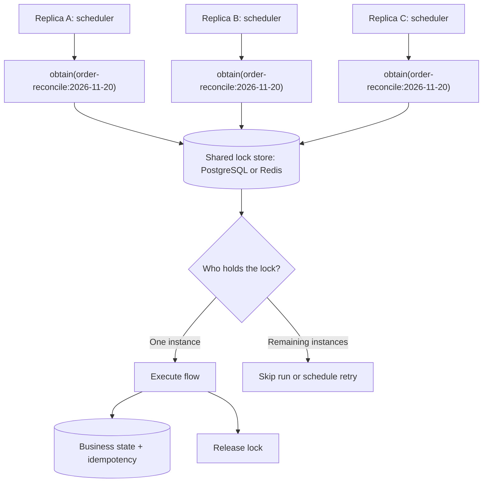
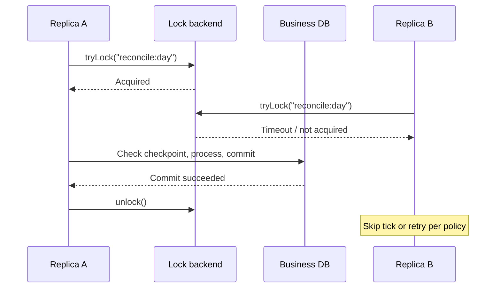

# LockRegistry and Coordinating Flows Across Multiple Application Replicas

When a Spring Boot application runs across multiple replicas, every replica usually shares the same schedulers, HTTP endpoints, consumers, or Spring Integration flows. That can trigger the same work multiple times: two pods reconcile orders simultaneously, two instances scan the same folder together, or two consumers concurrently update the same business entity's state. Without coordination, data can be written twice, external requests sent twice, or flow state left inconsistent.

In Spring Integration, `LockRegistry` provides a way to **acquire a lock by business identifier** via `java.util.concurrent.locks.Lock`. Depending on the implementation, locks may exist only inside one JVM or be coordinated across replicas through a shared database or Redis. This lesson belongs to the **Flow Errors and State** section of the `SPRING_BOOT_INTEGRATION` module: structuring system integrations in Spring Boot across HTTP clients, databases, caches, message brokers, and Spring Integration adapters while governing configuration, transactions, retries, deduplication, testing, and observability.

The goal is to design flow coordination around what locks actually guarantee: **locks serialize concurrent entry into a critical section**, while long-term correctness still requires durable state, idempotency, and failure recovery.

## 1. Scenario: The Same Job Runs on Three Replicas

Suppose `order-integration-service` runs three instances A, B, and C. All three have:

- `@Scheduled` running at 02:00 to reconcile the previous day's orders.
- An integration flow reading from the database, calling a partner over HTTP, and saving results.
- Retry handling for HTTP timeouts or mid-flight worker crashes.

If all three instances fire on the same scheduler tick, three reconciliations run concurrently. Java `synchronized` only serializes threads **inside a single instance** and does not protect across three separate processes.



A shared lock can ensure only one replica enters the same critical section at a time, **as long as lock ownership remains valid and the lock store operates properly**. Locks do not turn a schedule, HTTP call, or message handler into "exactly once".

### What Needs Coordination

| Need | Suggested Lock Key | Notes |
| --- | --- | --- |
| Only one replica reconciles a given date | `reconcile:orders:2026-11-20` | All replicas must compute the same key for the same date. |
| Avoid concurrent processing of the same order | `order:12345` | Allows different orders to run in parallel. |
| Only one instance polls an external source | `poll:partner-x:invoices` | Pair with checkpoints to avoid re-reading after crashes. |
| Only one instance manages a per-tenant job | `tenant:acme:export:2026-11-20` | Clear namespaces avoid key collisions. |
| One replica acts as coordinator (leader) | `leader:order-service` | Must detect lost leadership and stop stale leaders from writing. |

Never include `instanceId`, pod names, or random UUIDs in cluster-wide coordination keys: each instance would acquire a distinct key and defeat the lock. Conversely, one global lock like `lock:all` needlessly destroys parallelism.

## 2. How Does LockRegistry Work?

The core contract of `org.springframework.integration.support.locks.LockRegistry` obtains a `Lock` by key:

```java
Lock lock = lockRegistry.obtain("reconcile:orders:2026-11-20");

boolean acquired = false;
try {
    acquired = lock.tryLock(2, TimeUnit.SECONDS);
    if (acquired) {
        // Coordinated critical section
    }
} catch (InterruptedException interrupted) {
    Thread.currentThread().interrupt();
    throw new IllegalStateException("Interrupted while waiting for lock", interrupted);
} finally {
    if (acquired) {
        lock.unlock();
    }
}
```

Calling `obtain(key)` does not acquire the lock; `lock()`, `tryLock()`, or `lockInterruptibly()` actually acquires it. `tryLock(timeout, unit)` suits flows that must cap wait times to avoid exhausting threads. Only call `unlock()` if acquisition succeeded, on the owning thread required by the implementation.

Some implementations offer lease management or unused-lock eviction. Those features **are not part of the general `LockRegistry` contract**; check how your specific backend handles expiration, recovery, and ownership.

### Implementations to Distinguish

| Implementation | Coordination Scope | When to Use | Main Risks |
| --- | --- | --- | --- |
| `DefaultLockRegistry` | Single JVM | Demos, single-instance tests, synchronizing threads in one process | Does not lock across separate JVM replicas. |
| `JdbcLockRegistry` + `DefaultLockRepository` | Multiple instances accessing a shared lock DB | Already running shared PostgreSQL/MySQL/SQL Server with clear DDL/history/permissions | Lock tables, transactions, lock TTL, and DB outages. |
| `RedisLockRegistry` | Multiple instances accessing shared Redis | Stable Redis infra needing short, low-latency locks | Lease/TTL expiring while work still runs, Redis outages, failovers. |

When each pod only wires a `DefaultLockRegistry`, three replicas have **three independent registries**, even if the bean names match. To coordinate across pods, pick a distributed implementation and configure every replica to share the same backend, namespace, and lock policy.

`LockRegistry` also differs from `MessageStore`: locks guard runtime concurrency, whereas message stores/checkpoints persist state across restarts. Aggregators, resequencers, or pollers needing durable state do not become scale-safe merely by adding a lock.

## 3. Lifecycle of a Distributed Lock

A well-structured execution follows six steps:

1. Derive the key from a **stable resource or job identifier**, prefixed with environment/service namespaces when needed.
2. Call `obtain(key)` and attempt acquisition with a bounded timeout.
3. On acquisition failure, apply an explicit policy: skip the scheduler tick, return a conflict, queue for retry, or wait briefly.
4. On acquisition success, check **durable state** to see if the task already completed, then run the protected work.
5. Persist checkpoints, outcomes, or idempotent state; confirm commit succeeded before considering work done.
6. Release the lock in `finally` and emit observability metrics.



**Do not** hold locks around work that does not need serialization; for example, if you only need to claim a checkpoint, check whether an atomic `UPDATE ... WHERE status = 'PENDING'` suffices without long locks. Holding locks over slow HTTP calls or hour-long batches increases lease expiration risk and starves other replicas.

## 4. Configuring JdbcLockRegistry with Spring Boot

If the system already uses a relational database, JDBC locks are easy to manage via the same schema migration tooling. Spring Integration JDBC uses `DefaultLockRepository` to persist lock records and `JdbcLockRegistry` to expose `LockRegistry`.

Illustrative Maven dependency (version managed by the Spring Boot BOM):

```xml
<dependency>
    <groupId>org.springframework.integration</groupId>
    <artifactId>spring-integration-jdbc</artifactId>
</dependency>
```

Before starting replicas, create the **`INT_LOCK` table** in the shared database using the official DDL for your database vendor and Spring Integration version. Include this DDL in Flyway/Liquibase so the table exists before flows start. If you customize the table prefix on the repository, DDL and configuration must match.

Configuration example assuming `ordersDataSource` is declared by Spring Boot/JDBC:

```java
import javax.sql.DataSource;

import org.springframework.beans.factory.annotation.Qualifier;
import org.springframework.context.annotation.Bean;
import org.springframework.context.annotation.Configuration;
import org.springframework.integration.jdbc.lock.DefaultLockRepository;
import org.springframework.integration.jdbc.lock.JdbcLockRegistry;
import org.springframework.integration.support.locks.LockRegistry;

@Configuration(proxyBeanMethods = false)
public class CoordinationJdbcLockConfig {

    @Bean
    DefaultLockRepository coordinationLockRepository(
            @Qualifier("ordersDataSource") DataSource dataSource) {
        DefaultLockRepository repository = new DefaultLockRepository(dataSource);
        repository.setRegion("order-service");
        return repository;
    }

    @Bean("coordinationLockRegistry")
    LockRegistry coordinationLockRegistry(
            DefaultLockRepository coordinationLockRepository) {
        return new JdbcLockRegistry(coordinationLockRepository);
    }
}
```

In a deployment, A, B, and C must all point `ordersDataSource` to **the exact same lock database**. `region` namespaces lock keys, so if replicas set different regions, they will not contend on the same lock rows. Separating regions makes sense across distinct apps or environments, but coordinating instances must match.

The runtime database user needs DML permissions on the lock table per `DefaultLockRepository` requirements (plus connect/schema privileges), while schema creation/changes belong to the migration account. With multiple `DataSource`s, always use `@Qualifier` so locks never silently land in a local or mismatched database across replicas.

### Things to Verify with JDBC Locks

- **Lock table and migrations:** Flyway/Liquibase history must track the lock table and related schema changes on the right database when multiple `DataSource`s exist.
- **Transactions and connection pools:** lock calls issue extra DB queries; a saturated pool spikes lock wait times even with zero business contention.
- **Record time-to-live:** `DefaultLockRepository` uses a TTL policy to expire stale locks after crashes. TTL must fit max lock hold duration and recovery behavior; never treat TTL expiration as proof the old worker stopped.
- **Availability:** if the lock database is unreachable, fail lock acquisition and refuse exclusive work. Never silently fall back to local locks in production.

JDBC locks do not create distributed transactions spanning the lock DB, business DB, and HTTP APIs. When durable data itself can arbitrate ownership, an atomic claim directly on the business table can be simpler.

## 5. Configuring RedisLockRegistry

If replicas share Redis, you can configure `RedisLockRegistry`:

```xml
<dependency>
    <groupId>org.springframework.integration</groupId>
    <artifactId>spring-integration-redis</artifactId>
</dependency>
```

```java
import org.springframework.context.annotation.Bean;
import org.springframework.context.annotation.Configuration;
import org.springframework.data.redis.connection.RedisConnectionFactory;
import org.springframework.integration.redis.util.RedisLockRegistry;
import org.springframework.integration.support.locks.LockRegistry;

@Configuration(proxyBeanMethods = false)
public class CoordinationRedisLockConfig {

    @Bean("coordinationLockRegistry")
    LockRegistry coordinationLockRegistry(
            RedisConnectionFactory connectionFactory) {
        return new RedisLockRegistry(
                connectionFactory,
                "prod:order-service:coordination");
    }
}
```

Configure **only one of JDBC or Redis** for the `coordinationLockRegistry` bean name according to deployment profile. Every replica in the cluster must share the same Redis and registry key/namespace. Separate `dev`, `staging`, and `prod` namespaces so environments never block one another.

Redis locks carry a **lease/TTL**. If a worker runs longer than the lease without renewing via mechanisms supported in your version, another replica can acquire the lock while the first worker is still executing. Later, the first worker's `unlock()` may throw because ownership expired. Never catch that error and silently assume business success.

Verify these configuration decisions against your **actual Spring Integration version**:

| Decision | Questions |
| --- | --- |
| TTL/lease | What is max runtime? Could GC pauses, network latency, or oversized batches exceed expectations? |
| Lease renewal | Does your backend version support renewal? Who monitors renewal failures? |
| Acquire timeout | How long can pollers/HTTP requests wait before returning or retrying? |
| Redis failover | Can locks be lost during master promotion or network partitions? What guards data if two workers run? |
| Stale locks | Do you check ownership, handle unlock exceptions, and alert on expired locks? |

When strong guarantees are needed for writes outside Redis, do not rely on TTL alone. Enforce version checks, **fencing tokens** issued by a durable store, or conditional atomic updates at the destination system. A basic `LockRegistry` does not automatically provide monotonically increasing fencing tokens that target systems reject.

## 6. Wrapping a Business Flow with LockRegistry

Suppose a scheduler fires on all three replicas, yet only one replica may reconcile a given date. Place lock coordination in the service layer so schedulers, HTTP endpoints, and integration flows obey one rule.

```java
import java.time.LocalDate;
import java.util.concurrent.TimeUnit;
import java.util.concurrent.locks.Lock;

import org.springframework.beans.factory.annotation.Qualifier;
import org.springframework.integration.support.locks.LockRegistry;
import org.springframework.stereotype.Service;

@Service
public class DailyReconciliationCoordinator {

    private final LockRegistry lockRegistry;
    private final OrderReconciliationService worker;

    public DailyReconciliationCoordinator(
            @Qualifier("coordinationLockRegistry") LockRegistry lockRegistry,
            OrderReconciliationService worker) {
        this.lockRegistry = lockRegistry;
        this.worker = worker;
    }

    public boolean runFor(LocalDate businessDate) {
        String key = "reconcile:orders:" + businessDate;
        Lock lock = lockRegistry.obtain(key);
        boolean acquired = false;

        try {
            acquired = lock.tryLock(2, TimeUnit.SECONDS);
            if (!acquired) {
                return false; // Another instance is running; scheduler will try next cycle.
            }

            // Worker must check whether data is already processed/closed.
            worker.reconcile(businessDate);
            return true;
        } catch (InterruptedException interrupted) {
            Thread.currentThread().interrupt();
            throw new IllegalStateException(
                    "Interrupted waiting for lock for date " + businessDate, interrupted);
        } finally {
            if (acquired) {
                lock.unlock();
            }
        }
    }
}
```

A scheduler using the coordinator:

```java
import java.time.LocalDate;
import java.time.ZoneId;

import org.springframework.scheduling.annotation.Scheduled;
import org.springframework.stereotype.Component;

@Component
public class ReconciliationSchedule {

    private static final ZoneId ZONE = ZoneId.of("Asia/Ho_Chi_Minh");
    private final DailyReconciliationCoordinator coordinator;

    public ReconciliationSchedule(DailyReconciliationCoordinator coordinator) {
        this.coordinator = coordinator;
    }

    @Scheduled(cron = "0 0 2 * * *", zone = "Asia/Ho_Chi_Minh")
    public void run() {
        LocalDate yesterday = LocalDate.now(ZONE).minusDays(1);
        coordinator.runFor(yesterday);
    }
}
```

To enable scheduling, application configuration requires `@EnableScheduling`. `OrderReconciliationService` is a separate business bean responsible for checking idempotency, processing data, and writing checkpoints; this example assumes it is implemented.

**Transaction note:** `worker.reconcile(...)` invokes a separate bean, allowing `@Transactional` to wrap it per the configured transaction manager. Self-invoking a `@Transactional` method inside the same bean bypasses standard Spring proxies and skips opening the expected transaction. For jobs making thousands of HTTP calls, avoid one huge database transaction; use short batched transactions with durable checkpoints, and ensure lock hold duration stays within the real lease.

Returning `false` only means **the lock could not be acquired within the timeout**, not that the other instance finished the job. If every run is mandatory, back it with a retry/backfill queue or sweep incomplete checkpoints. Never treat `false` as a successful ACK for an unprocessed message.

### Integrating into a Spring Integration Flow

An `IntegrationFlow` can receive `ReconciliationRequest` and invoke the coordinator via a service activator. This wiring leaves locking principles unchanged:

```java
@Bean
IntegrationFlow reconciliationFlow(
        DailyReconciliationCoordinator coordinator) {
    return IntegrationFlow.from("reconciliationRequests")
            .handle(ReconciliationRequest.class, (request, headers) -> {
                boolean accepted = coordinator.runFor(request.businessDate());
                if (!accepted) {
                    throw new IllegalStateException(
                            "Could not acquire reconciliation lock: " + request.businessDate());
                }
                return request.businessDate();
            })
            .get();
}

public record ReconciliationRequest(LocalDate businessDate) {}
```

This DSL snippet requires Spring Integration Java DSL and matching imports; when connecting to HTTP gateways, broker adapters, or schedulers, decide where `IllegalStateException` routes. HTTP may map it to a busy/conflict response; broker consumers need retry/backoff and adapter-appropriate acknowledgment instead of sharing one generic policy across all sources.

Flows handling distinct keys execute in parallel: `reconcile:orders:2026-11-20` does not block `reconcile:orders:2026-11-21`, provided underlying data is genuinely independent. If two distinct keys mutate the same shared resource, your key granularity does not reflect the real contended resource.

## 7. Locks Do Not Replace Idempotency and Durable State

A classic failure sequence:

1. Replica A acquires the lock and sends a payment-creation request to a partner.
2. The partner creates the payment, but A times out before receiving the response.
3. A is killed or its lease expires; B subsequently acquires the lock.
4. B resends the payment command because it sees no completion checkpoint.

Even when locks work properly, **two external side effects can still happen**. That is why integration flows require deduplication policies, idempotency keys, outbox/inbox tables, or durable processing state.

### Complementary Protection Layers

| Protection | What It Prevents | What It Cannot Prevent |
| --- | --- | --- |
| Distributed lock | Multiple workers entering the critical section while the lock is valid | Re-execution after crash/TTL, stale worker continuing after lease loss |
| Unique constraint / inbox | Applying the same event twice in the same DB when checked and updated in one transaction | Duplicate external HTTP side effects lacking idempotency |
| Partner API idempotency key | Repeating HTTP requests with the same key creates no duplicate effect if partner enforces contract | Partner internal bugs or unstable key generation |
| Transactional outbox | Writing business changes and event-publishing intent atomically in one TX | Broker delivering the same event multiple times |
| Fencing/version check at target | Stale worker with lower token cannot overwrite newer state when target checks | Targets that do not enforce token/version checks |

Example PostgreSQL inbox schema:

```sql
CREATE TABLE processed_event (
    consumer_name VARCHAR(80) NOT NULL,
    event_id      VARCHAR(120) NOT NULL,
    processed_at  TIMESTAMPTZ NOT NULL DEFAULT CURRENT_TIMESTAMP,
    PRIMARY KEY (consumer_name, event_id)
);
```

Inside the **same transaction** as business updates:

```sql
INSERT INTO processed_event (consumer_name, event_id)
VALUES (:consumerName, :eventId)
ON CONFLICT DO NOTHING;
-- If affected rows = 0: event already processed, skip business update.
-- If affected rows = 1: apply business update and COMMIT.
```

If the transaction rolls back, both the inbox marker and business writes roll back together. If the marker and business writes hit **two different databases**, single-transaction atomicity no longer holds; design event synchronization or sagas accordingly.

### Fencing When Leases Expire

Suppose A holds a 30-second TTL lock and pauses for 40 seconds due to GC. B sees the expired TTL, acquires the lock, and updates data. Once A resumes, it could overwrite B's result. `finally { unlock(); }` cannot stop this because A already executed the write before unlocking.

One safeguard issues an atomically incremented **generation** (`generation`) from the database on each job claim; writing the result only succeeds if the generation/owner still matches:

```sql
UPDATE reconciliation_job
SET status = 'DONE', completed_at = CURRENT_TIMESTAMP
WHERE job_key = :jobKey
  AND generation = :myGeneration
  AND status = 'RUNNING';
```

Verify affected rows equal `1`; `0` means this execution lost ownership. This assumes `generation` is incremented/claimed atomically in the database, **not returned natively by `LockRegistry.obtain()`**. For HTTP APIs without fencing support, use stable partner idempotency keys or agreed compensation strategies.

## 8. Coordinating Leaders, Pollers, Consumers, and Stateful Flows

Not every scaling need calls for adding `LockRegistry` at the message level.

### 8.1. Schedulers and Pollers

A regular `@Scheduled` runs on **every** replica with scheduling enabled. You can lock by `(job, logical window)` so only one execution runs; for sequential source polling, lock by source. To avoid skipping data if a replica dies after acquiring the lock, store durable cursors/checkpoints and make polling safe to re-read.

Spring Integration has adapters/pollers supporting metadata stores or deduplication mechanisms. Across multiple replicas, metadata stores must also be shared if cluster-wide coordination is required. Locks guard critical sections; they do not remember which files or messages were already read.

### 8.2. Kafka, RabbitMQ, and JMS

Brokers provide their own consumer competition: Kafka assigns partitions across consumer groups, while queue brokers distribute messages across consumers. Do not wrap every consumer in one global lock that destroys concurrency without adding new guarantees.

When two independent messages must not mutate the same `orderId` concurrently, consider:

- Partitioning/keying Kafka by `orderId` to keep ordering per partition and consumer group.
- Conditional atomic updates / optimistic locking in the database.
- Per-`orderId` distributed locks only when real contention spans multiple threads or adapters.

If locking fails, never unconditionally ACK/commit offsets and drop critical work. Apply retry with backoff, dead-lettering, or adapter-supported deferral. When a worker commits data and crashes before ACK, the broker can redeliver: idempotency remains mandatory.

### 8.3. Leader Election

When only one instance should coordinate background work, Spring Integration supports leader coordination backed by `LockRegistry`, such as `LockRegistryLeaderInitiator` in versions providing it. Leader election works well for enabling/disabling tasks on one replica, but you must handle **granted/revoked leadership** events and protect against stale leaders.

Leadership does not grant permanent exclusive ownership over data. If a leader loses connectivity to the lock store without halting immediately, a new leader can start while the old one still writes. For critical writes, add fencing, checkpoints, and idempotency at the target store.

### 8.4. Aggregators, Resequencers, and Message State

An aggregator tracks messages by correlation key; a resequencer tracks sequences. That state must live in an appropriate `MessageStore` with timeouts, late-arrival policies, and cleanup. Wrapping an external distributed `LockRegistry` around an aggregator does not automatically guarantee store synchronization, consistency, or recovery. When Spring Integration components provide built-in lock/store coordination, prefer configuring per the component's contract instead of adding ad-hoc outer locks that risk deadlocks.

## 9. Handling Contention and Failures Deliberately

Behavior when lock acquisition fails should match the work type:

| Trigger Source | When Lock Is Busy | When Lock Backend Fails | When Processing Fails After Lock |
| --- | --- | --- | --- |
| Periodic scheduler | Skip tick **if** backfill/checkpoint exists; else reschedule | Mark job incomplete, alert | Persist failure/retry state, do not mark DONE |
| HTTP request | Return in-progress or conflict per API contract | Return retryable service error | Do not return success before transaction commits |
| Broker message | Retry/backoff, avoid hot nack-requeue loops | Route to retry/DLQ per policy | Preserve idempotency and ACK only after durable processing |
| Data poller | Skip poll cycle, do not advance cursor | Do not mark data read | Recover from checkpoint |
| Coordinator leader | Defer as follower | Lost ability to confirm leadership; halt exclusive work | Stop/recover on leadership events, guard stale writes |

Errors from `tryLock` or `worker.reconcile` follow different paths in Spring Integration depending on sync/async channels and inbound adapters. For instance, errors on `DirectChannel` normally propagate back to callers if unhandled, while tasks on `ExecutorChannel` or inbound adapters may emit `ErrorMessage` to an error channel. Never assume all exceptions automatically appear on global `errorChannel`.

Error handlers must distinguish:

- **Lock not acquired:** normal contention—retry or skip deliberately.
- **Lock backend unreachable:** cannot guarantee exclusivity—halt critical work and alert.
- **Business error while holding lock:** roll back transactions as appropriate, persist failure state, then unlock.
- **Lease expired or unlock failed:** verify outcome from DB/partner; concurrent execution may have occurred.
- **Too many retries:** apply backoff/circuit breakers matching the trigger to avoid cascading failures onto Redis/DB.

Never hold a distributed lock across long retry sleeps when work can be paused, and never endlessly auto-retry data logic or configuration bugs.

## 10. Observability, Deployment, and Security

To catch contention and lost locks in production, emit structured metrics and logs:

| Data | Purpose |
| --- | --- |
| `lock.acquire.attempts`, `lock.acquire.success`, `lock.acquire.timeout` | Track contention levels and acquisition rates. |
| Lock wait time and hold duration | Detect oversized critical sections, slow pools, or approaching lease limits. |
| Backend error rate and unlock error rate | Detect disconnects, lost ownership, or unstable lock stores. |
| `job_key`, `job_run_id`, `instance_id`, `trace_id` in logs | Trace which process executed; sanitize keys safely. |
| Checkpoint, `last_success`, `retry_count`, `last_error` | Separate "lock busy" from "already completed". |

Do not attach high-cardinality `orderId` or `tenantId` values as Prometheus labels per lock; place them in structured logs/traces subject to data governance. Never log Redis/database passwords or sensitive payloads.

During deployment:

1. All replicas must share consistent backends, namespaces, regions, and settings.
2. Readiness/startup probes should reflect mandatory backend dependencies; if the lock store is down, never "self-heal" by falling back to local locks for exclusive work.
3. Bound concurrency and pool sizes so replicas do not queue indefinitely.
4. Base acquisition timeouts, TTL/leases, and runtimes on real measurements (including GC pauses and network blips), not arbitrary guesses.
5. Design graceful shutdown / rolling deploys to stop intake and finish or checkpoint active work before leases expire.
6. Separate lock store operational privileges from schema-migration privileges; use dedicated credentials and per-environment key scopes.
7. Across multiple DCs/regions, evaluate backend consistency, failover, and split-brain behavior; never assume a simple lock store provides absolute guarantees across network partitions.

## 11. Testing Multiple Replicas

Testing one JVM with `DefaultLockRegistry` proves nothing about multi-replica scaling. Use Testcontainers or integration tests booting two application contexts/processes sharing PostgreSQL or Redis.

| Scenario | What to Verify |
| --- | --- |
| A and B both `tryLock` the same key | At most one enters the critical section while valid; the other times out/waits per policy. |
| A and B handle independent keys | Both execute in parallel; no needless global serialization. |
| A finishes and unlocks | B can acquire on a later run; completed work does not rerun thanks to checkpoints. |
| Kill A mid-processing | B retries only after lock recovery and resumes from durable state. |
| Simulate TTL shorter than runtime | Two workers may run at overlapping/shifted times; fencing/idempotency blocks corrupt/duplicate writes. |
| Disconnect Redis/database | Flow refuses to run unlocked; failure is reported and observed. |
| HTTP succeeds yet ACK/checkpoint fails | Retry produces no duplicate business side effects. |
| Same key from two replicas with mismatched region/namespace | Test must catch misconfiguration where both acquire locks. |
| Multiple instances during rolling deployment | No lost checkpoints, no dual leaders writing duplicates. |

For contention tests, use barriers to force two workers to attempt locking simultaneously, add a controlled delay inside the critical section, and log entry/exit timestamps. Count **overlapping critical-section entries** rather than only checking final DB row counts—unique constraints might mask the fact that two workers executed simultaneously.

Failure recovery tests should resume from **the same data/checkpoint** after a crash and verify completion without duplicate side effects. Verify recovery, not just mutual exclusion.

## 12. Common Pitfalls and Diagnostics

| Symptom | Typical Cause | Resolution |
| --- | --- | --- |
| Every pod thinks it holds the lock | Using `DefaultLockRegistry`, or pods point to different backends/regions | Switch to distributed registry; unify namespace and backend. |
| Job stops running after one failure | Skip logic lacks retry; checkpoint stuck in `RUNNING` forever | Design retry/lease recovery states and backfill. |
| Two workers run despite Redis lock | TTL expired, Redis failover, or stale worker | Inspect lease/renewal; add fencing and idempotency. |
| `unlock` throws not-owned error | Lease expired or unlocked from wrong thread / unacquired lock | Unlock only when acquired; review TTL, runtime, ownership. |
| JDBC lock fails with missing table | `INT_LOCK` not migrated or wrong `DataSource` | Apply Flyway/Liquibase DDL to the exact lock database. |
| Lock stays stuck long after crash | Misconfigured TTL/eviction or lost backend connection | Inspect backend state, TTL, and cleanup; never manually delete locks before confirming old worker stopped. |
| Consumer backlog grows large | Lock too coarse, hot retries, threads blocked waiting on locks | Narrow key granularity per resource, add backoff, consider partitioning. |
| Payment/message sent twice | Timeout after side effect succeeded, lost ACK | Use idempotency keys/inbox/outbox; reconcile partner outcome. |
| JPA/JDBC overwrites newer state | Stale worker keeps writing after lease loss | Enforce DB version checks/fencing and verify affected row counts. |
| Errors missing from `errorChannel` | Thrown synchronously to caller or adapter uses a separate error channel | Trace channel topology, task executors, retry advice, and error handlers. |

## 13. Checklist and Practice Exercise

Before scaling up replicas for a flow, confirm:

- [ ] Identified the **resource requiring mutual exclusion** and chose keys consistent across all replicas.
- [ ] Selected the right distributed `LockRegistry` backend (JDBC/Redis) for cluster coordination rather than a local lock.
- [ ] All replicas share the same backend/region/namespace with tested timeouts and TTL/leases.
- [ ] No unlocked fallback path exists on backend errors; explicit policies govern busy/unacquirable locks.
- [ ] Checkpoints and crash retries exist; `false` from `tryLock` is never treated as completion.
- [ ] Idempotency protects databases and external APIs; stale-worker risks are guarded by fencing/version checks.
- [ ] Transaction boundaries, ACK/offsets, and HTTP calls align with data contracts.
- [ ] Metrics record lock contention, wait/hold durations, lease/unlock errors, and last-success state.
- [ ] Tested concurrency, process kills, TTL expiration, backend outages, post-commit retries, and rolling deployments.

**Practice exercise:** Launch two Spring Boot instances connected to one PostgreSQL instance with the lock table or a shared Redis. Write a daily reconciliation scheduler keyed by `reconcile:orders:<date>`, deliberately delay the worker for 5 seconds, and watch the second instance stay out of the critical section. Next, kill the lock-holding instance mid-run and test checkpoint-based recovery. Finally, configure a lease shorter than runtime and verify how unique constraints, idempotency, and version checks block duplicate records or side effects.

In a multi-replica integration system, `LockRegistry` coordinates **execution timing**. Correctness across retries, network drops, crashes, and scaling depends on durable state design and target system behavior. When these layers align within their proper scopes, flows scale out cleanly while avoiding race corruption and recovering predictably from failures.
