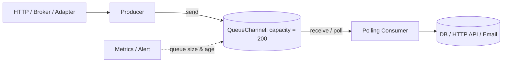
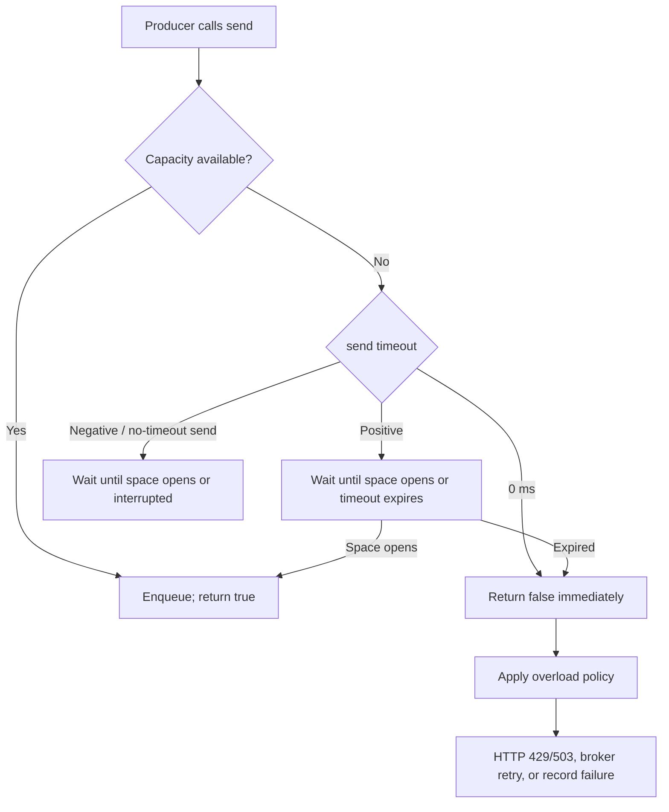
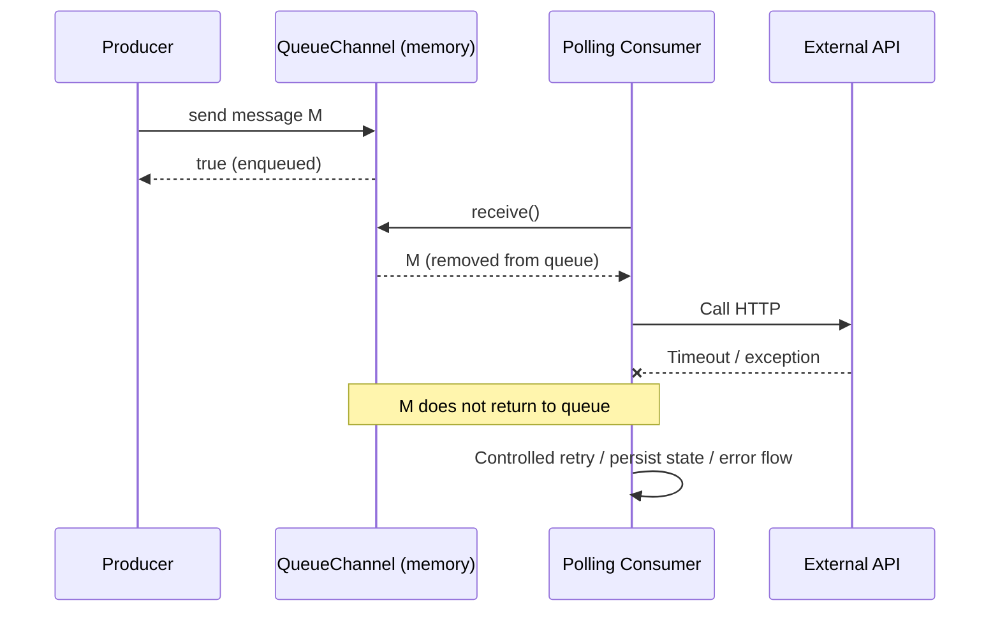
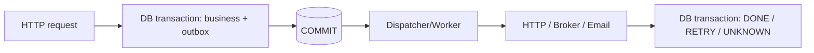

# QueueChannel Capacity Limits and Overload Behavior

## 1. Why Must QueueChannel Have a Capacity Limit?

In a **SPRING_BOOT_INTEGRATION** system, a Spring Boot flow may ingest HTTP requests, Kafka/RabbitMQ messages, or data from Spring Integration adapters, and hand them off to slower downstream steps: database writes, partner REST APIs, cache updates, or email delivery. One way to decouple production pace from processing pace is placing a `QueueChannel` in between.

`QueueChannel` is Spring Integration's **pollable, point-to-point message channel** implementation. Producers send `Message<?>` items into the queue; one or more consumers pull messages via `receive()` or a polling endpoint. While space remains in the queue, producers can return quickly without waiting for handlers to finish.



If producers continuously receive **100 messages/second** while consumers only complete **60 messages/second**, the backlog grows by roughly **40 messages/second**. An empty queue of capacity 200 fills in about 5 seconds if those rates hold. Without a capacity limit, the backlog keeps growing, holding objects and payloads in heap memory and causing elevated GC, latency spikes, or `OutOfMemoryError`.

Bounding capacity answers a critical question: **when the system falls behind, how long must producers wait and what happens once the queue is full?** That belongs to flow error contracts and state management, not merely performance tuning.

### Distinguishing Channel Types

| Component | How Messages Reach Consumers | Under Overload |
| --- | --- | --- |
| `DirectChannel` | Invokes handler synchronously on sender thread, no intermediate buffer queue | Producer slows down with handler; errors can propagate directly |
| `ExecutorChannel` | Hands work to a `TaskExecutor` so handler runs on another thread | Depends on executor pool/queue size and rejection policy |
| **`QueueChannel`** | Places messages into a queue; consumer polls/receives later | When full, `send` can block or fail per timeout |
| `PublishSubscribeChannel` | Broadcasts to multiple subscribers | Depends on subscribers and configured executor, not a default point-to-point queue |
| Kafka/RabbitMQ broker | Out-of-process log/queue per broker semantics | Backpressure, retention, quotas, acknowledgments, and broker retries |

`QueueChannel` is **not** a durable broker merely because it buffers messages. By default it uses an in-JVM memory queue whose unprocessed messages are lost if the process stops abruptly.

## 2. Capacity and Send/Receive Semantics

Spring Integration provides a constructor accepting a positive capacity:

```java
import org.springframework.context.annotation.Bean;
import org.springframework.context.annotation.Configuration;
import org.springframework.integration.channel.QueueChannel;
import org.springframework.messaging.PollableChannel;

@Configuration(proxyBeanMethods = false)
public class IntegrationQueueConfiguration {

    @Bean("integrationJobs")
    public PollableChannel integrationJobs() {
        return new QueueChannel(200);
    }
}
```

With `new QueueChannel(200)`, the queue holds up to 200 messages **waiting to be consumed**, not counting messages already dequeued and actively executing in workers. Capacity must be positive; for direct handoff with a zero-capacity queue, Spring Integration offers `RendezvousChannel`.

The default constructor `new QueueChannel()` creates a virtually unbounded queue backed by a theoretical limit of `Integer.MAX_VALUE`. In practice, JVM heap exhausts long before reaching that count. Spring Integration documentation recommends setting explicit capacities on in-memory queues.

### Three Send Styles and Timeout Semantics

```java
Message<?> message = MessageBuilder.withPayload(job).build();

boolean queuedNow = channel.send(message, 0);      // Do not wait.
boolean queuedSoon = channel.send(message, 250);   // Wait up to 250 ms.
boolean queuedEventually = channel.send(message);  // Can wait indefinitely.
```

Here `channel` is a `MessageChannel`/`QueueChannel`; import `Message<?>` from `org.springframework.messaging` and `MessageBuilder` from `org.springframework.messaging.support`. The timeout parameter in `send(message, timeout)` is measured in **milliseconds**, not `Duration`.

| Call | When Space Is Available | When Queue Is Full |
| --- | --- | --- |
| `send(message, 0)` | Enqueues message and returns `true` | Returns `false` immediately if not accepted |
| `send(message, 250)` | Enqueues message and returns `true` | Waits up to ~250 ms; returns `false` if still full upon expiry |
| `send(message)` | Enqueues message and returns `true` | Can wait indefinitely until space opens or thread is interrupted |
| `send(message, -1)` | Enqueues message and returns `true` | Per negative-timeout convention, can wait indefinitely |

This is standard bounded `QueueChannel` behavior. Custom channels, interceptors, or environment failures can still make `send` throw exceptions; never rely on the `boolean` return as the only failure mechanism.

**Important:** `send(...) == true` only means the message **was accepted by the queue**. It **does not** mean the handler finished, the database committed, emails were sent, or partner HTTP calls succeeded.

### Receive Behavior

`QueueChannel` implements `PollableChannel`. Consumers actively pull messages:

```java
Message<?> available = integrationJobs.receive(0);   // Do not wait.
Message<?> waited = integrationJobs.receive(1000);   // Wait up to 1 second.
Message<?> next = integrationJobs.receive();         // Can wait indefinitely.
```

If no message arrives before the timeout, `receive(...)` returns `null`. Once a message is dequeued, it no longer counts against queue capacity: `getQueueSize()` decreases and producers can enqueue another item, **even though processing of the dequeued message has not finished**.

This creates a crucial distinction between **queue backlog** and **in-flight work**:

```text
Total unfinished work
  = waiting in queue
  + dequeued and currently executing
  + retrying / reconciling elsewhere
```

Never conclude a flow has finished all messages simply because `queueSize == 0`.

## 3. Full-Queue Behavior: Block, Timeout, Reject



Three common production mistakes when hitting capacity limits:

1. **Calling `send(message)` without a timeout on an HTTP request thread.** When full, requests hang indefinitely, tying up platform or virtual threads, exhausting resources, and spiking tail latency. As requests pile up, overload cascades into the web tier.
2. **Ignoring the `boolean` return value.** `channel.send(message, 100)` returns `false`, yet the app returns HTTP `202 Accepted`; callers assume work was accepted when the message was dropped.
3. **Catching every exception, logging, and moving on.** Full queues, rejected executors, store failures, and business failures carry different consequences and must be reflected accurately in job states and upstream protocols.

Define an explicit *admission policy* up front:

| Message Source | If `send` Fails Because Full | Conditions for Safety |
| --- | --- | --- |
| Synchronous HTTP API | Return `429 Too Many Requests` or `503 Service Unavailable`; optionally include `Retry-After` | Callers apply bounded retries; side-effecting ops use stable operation/idempotency IDs |
| Kafka consumer | Do not commit offsets for unpersisted messages; pause/throttle consumption | Matches consumer ack/offset semantics and ordering rules |
| RabbitMQ listener | Do not ack before durable persistence/processing; use controlled nack/requeue/DLX | Avoid hot requeue loops spinning continuously |
| Scheduled DB poller | Stop/retry next cycle or leave task pending | Do not mark `DONE` when enqueue fails |
| HTTP inbound adapter | Shed/throttle intake and return contextual error | Never block request threads indefinitely |
| Strictly best-effort internal event | Optionally count drops under an approved policy | Only when business explicitly tolerates event loss |

Actions like Kafka pause/resume, offset commits, or RabbitMQ nack/ack belong to specific adapters/containers. `QueueChannel` does not perform broker operations itself.

## 4. Spring Boot Example: Enqueue with Deadline and Accurate Response

Example HTTP endpoint accepting order status sync requests. The server only confirms **local queue admission** and returns overload when full.

```java
import java.util.UUID;

import org.springframework.beans.factory.annotation.Qualifier;
import org.springframework.http.HttpStatus;
import org.springframework.http.ResponseEntity;
import org.springframework.messaging.MessageChannel;
import org.springframework.messaging.support.MessageBuilder;
import org.springframework.web.bind.annotation.*;

@RestController
@RequestMapping("/integration/jobs")
public class IntegrationJobController {

    private final MessageChannel integrationJobs;

    public IntegrationJobController(
            @Qualifier("integrationJobs") MessageChannel integrationJobs) {
        this.integrationJobs = integrationJobs;
    }

    @PostMapping
    public ResponseEntity<JobReceipt> submit(@RequestBody SubmitJob request) {
        String jobId = UUID.randomUUID().toString();

        var message = MessageBuilder
                .withPayload(new IntegrationJob(jobId, request.orderId()))
                .setHeader("operationId", request.operationId())
                .build();

        boolean accepted = integrationJobs.send(message, 150);

        if (!accepted) {
            return ResponseEntity.status(HttpStatus.SERVICE_UNAVAILABLE)
                    .header("Retry-After", "1")
                    .body(new JobReceipt(jobId, "OVERLOADED"));
        }

        return ResponseEntity.accepted()
                .body(new JobReceipt(jobId, "QUEUED"));
    }

    public record SubmitJob(String orderId, String operationId) {}
    public record IntegrationJob(String jobId, String orderId) {}
    public record JobReceipt(String jobId, String state) {}
}
```

This code explains the `send(message, 150)` API and `false` branch, **not a production-ready drop-in implementation**:

- `IntegrationJob`, DTOs, and the `operationId` header need validation, authentication, and authorization.
- The job record **only lives in JVM memory**; if the process crashes after returning `202`, unprocessed jobs are lost. If the `202` contract guarantees tracking/recovery, **persist the job durably before returning**.
- Generating a fresh `jobId` on each retry can duplicate side effects. Persist a caller-supplied idempotency key with a unique constraint in the authoritative datastore when required.
- `Retry-After: 1` is illustrative; real values must fit load policies without making unfounded recovery promises.
- If `send` is interrupted or throws another exception, map errors properly instead of collapsing everything into `OVERLOADED`.

**Remember:** bounded queues let a system **say "not accepted"**. They do not make accepted work survive restarts.

## 5. QueueChannel Consumers Must Configure Polling

`QueueChannel` is **pollable**. Sending a message does not automatically trigger a `@ServiceActivator` the way `DirectChannel` dispatches directly. A polling consumer or explicit `receive()` loop must pull messages.

In Spring Integration, declare a poller on the endpoint:

```java
import org.springframework.integration.annotation.Poller;
import org.springframework.integration.annotation.ServiceActivator;
import org.springframework.messaging.Message;
import org.springframework.stereotype.Component;

@Component
public class IntegrationJobHandler {

    private final PartnerGateway partnerGateway;

    public IntegrationJobHandler(PartnerGateway partnerGateway) {
        this.partnerGateway = partnerGateway;
    }

    @ServiceActivator(
            inputChannel = "integrationJobs",
            poller = @Poller(
                    fixedDelay = "100",
                    maxMessagesPerPoll = "10"))
    public void handle(Message<IntegrationJobController.IntegrationJob> message) {
        var job = message.getPayload();
        partnerGateway.execute(job.orderId());
    }
}
```

`PartnerGateway` is an assumed business adapter. When the poller fires, it pulls messages from the queue and invokes the handler. If the handler calls a slow HTTP API, handler duration directly caps poller throughput. `maxMessagesPerPoll = 10` only caps messages per poll trigger; **it does not run 10 messages in parallel** or guarantee 10 messages finish every 100 ms.

### Pollers Can Become the Bottleneck

If each external API call takes 200 ms, a single-threaded poller runs sequentially on that thread. Maximum throughput is governed by handler execution time, not `fixedDelay = 100`. As intake rises, the queue fills and producers start blocking.

Adding poller threads, assigning a `TaskExecutor` to the poller, or scaling consumers increases throughput, provided you account for:

- Downstream concurrency limits.
- HTTP, database, and broker connection pool sizes.
- **Duplicate messages**, ordering, and concurrent updates.
- Transactions and ack/commit timing.
- Each dequeued message may execute on its own thread, shrinking `queue size` while significant work remains unfinished.

A standard point-to-point `QueueChannel` guarantees **each dequeued message goes to one consumer**, never broadcast to all consumers. In-memory queue FIFO describes **dequeue order**, whereas parallel consumers eliminate **completion order** guarantees.

### What Happens Without a Poller?

Without a poller or consumer, the queue accepts messages until full. Thereafter `send` blocks or returns `false` per timeout. This is a common misconfiguration: producers work briefly after startup, then every request starts timing out once the queue fills.

## 6. Estimating Capacity from Arrival Rate and Wait Budget

Capacity is a **backlog budget**, not an arbitrary guess based on heap size.

Let:

- `λ`: arrival rate (messages/second).
- `μ`: completion rate (messages/second).
- `C`: queue capacity.
- `B₀`: initial backlog.
- `T`: burst duration to absorb.

Over a steady window where `λ > μ`, backlog grows approximately as:

```text
backlog(t) ≈ B₀ + (λ - μ) × t

Time until full ≈ (C - B₀) / (λ - μ)
```

Example with `C=200`, `B₀=0`, `λ=100/s`, `μ=60/s`:

```text
Backlog growth: 100 - 60 = 40 messages/second
Time to fill: 200 / 40 = 5 seconds
```

If a burst lasts 20 seconds, a 200-message queue **cannot** absorb it without pushing back on producers; throttle intake, **safely** scale throughput, or move to durable queueing.

### Converting Capacity to Memory Cost

Each queued message retains:

- Spring `Message<?>` headers and metadata.
- Payload DTOs, JSON bytes, or object graphs.
- References to large payloads/attachments.
- Queue node and JVM object overhead.

As a rough estimate, **200 messages × 200 KiB payload ≈ 39 MiB of raw payload**, excluding headers, object headers, and referenced structures. A 10,000-item queue of the same payloads reaches ~1.9 GiB of raw payloads alone, adding substantial GC pressure in the JVM.

Therefore enqueue **IDs or compact DTOs**, keeping large blobs in databases or object storage with lifecycle controls. Never let large multipart uploads or email attachments exhaust heap because capacity was sized purely by **message count**.

### Three Layers of Load Control

1. **Before the queue:** API rate limits, broker consumer concurrency limits, max concurrent requests, or traffic shaping.
2. **At the queue:** positive capacity, short send timeouts, explicit overload policies.
3. **After the queue:** bounded worker pools, downstream timeouts, circuit breakers/bulkheads, and backoff retries.

If any layer stays unbounded, backpressure simply shifts the backlog from `QueueChannel` into executor queues, HTTP connection pools, or pending DB connections while total load still exceeds capacity.

## 7. Failure After Dequeue Does Not Requeue Messages

A dangerous misconception is: "If the consumer throws an exception, `QueueChannel` keeps the message for another worker."

With a **standard in-memory queue**, a message is **removed upon successful `poll`/`receive`**, before the handler completes. If the handler fails or the process crashes after dequeue, the queue has no durable ack/requeue mechanism like a broker.



If the poller has an error channel, the framework can emit an `ErrorMessage` or exception per error handling configuration. **That does not automatically replay the message from the queue.** Design explicit failure handling:

| Failure | Appropriate Action |
| --- | --- |
| Bad input data, schema mismatch | Record rejected/quarantined state; do not retry forever |
| HTTP `429`, `503`, or transient network failure | Bounded retry with backoff; prefer durable state |
| Side effect timed out with unknown outcome | Reconcile by operation ID; do not send a new POST with a fresh key |
| Consumer process crash | Recover from durable job/outbox/broker; in-memory queues cannot survive |
| Concurrent runs causing duplicate processing | Conditional updates, deduplication, and idempotency at side-effect owner |
| Handler failures spinning poller in a hot loop | Circuit breakers, delays, isolate failing messages, alert |

Depending on polling consumer and advice settings, errors route to `errorChannel`, loggers, or exception handlers. The producer that earlier saw `send == true` **does not automatically receive asynchronous exceptions** when a consumer fails. Failures must surface through job state or observable events/error flows.

## 8. Persistent QueueChannel Differs from Bounded In-Memory Queues

Spring Integration allows configuring a `QueueChannel` backed by a durable `MessageGroupStore`/`ChannelMessageStore`, such as `JdbcChannelMessageStore`, to survive restarts and participate in transactional receives.

However, this is a **different design** from `new QueueChannel(200)` in memory:

- In XML configuration `<queue message-store="..."/>`, the `capacity` attribute **cannot be declared alongside** `message-store`. Adding a durable store **does not enforce a 200-item limit**.
- With a transactional store and transactional poller, message retrieval can join the transaction; if the transaction rolls back, the message need not be permanently removed from the store.
- With JDBC stores, evaluate schema, payload/header serialization, SQL throughput, contention, and connection pools. Never persist temporary `replyChannel` objects or non-serializable objects expecting clean DB recovery.
- Rolling back the poller transaction **does not** roll back external HTTP API side effects. Idempotency and reconciliation remain essential.
- Even when durable, unbounded backlogs can fill database disks; maintain admission control, quotas, monitoring, retention/retries, and full-store policies.

Illustrative XML concept (requires configured `channelStore`, `DataSource`, and vendor schema):

```xml
<int:channel id="durableJobs">
    <int:queue message-store="channelStore"/>
</int:channel>

<bean id="channelStore"
      class="org.springframework.integration.jdbc.store.JdbcChannelMessageStore">
    <property name="dataSource" ref="dataSource"/>
    <!-- Configure query provider if required by DB. -->
</bean>
```

Do not add `capacity="200"` onto `<int:queue>` here. To cap total durable jobs, enforce limits at the **intake gate**—such as a DB `PENDING` quota, rate limiter, or broker quota—and test atomicity of admission.

### Compared to Transactional Outbox

A common pattern when business truth lives in a database:



An outbox stores **the work intent and business data in one local transaction**. If the app crashes right after commit, the dispatcher picks it up again. Workers must tolerate duplicate execution because crashing after a side effect but before marking completion triggers redelivery.

Use bounded in-memory `QueueChannel` for **short-term best-effort load smoothing** where loss is acceptable. Use durable stores, job tables, outboxes, or brokers when work **must not be lost**. Never equate "bounded" with "durable": they answer two different requirements.

## 9. Observing Queue State and Catching Overload Early

`QueueChannel` exposes runtime inspection methods:

```java
QueueChannel queue = new QueueChannel(200);

int queuedMessages = queue.getQueueSize();
int remainingSlots = queue.getRemainingCapacity();
```

These values are **point-in-time snapshots** that other producers/consumers can change immediately. Never use `getRemainingCapacity() > 0` to "reserve a slot" before `send`, as that introduces races. Admission decisions must rely on the **actual outcome of `send(message, timeout)`**.

Metrics to track alongside `traceId`/`operationId`:

| Metric | Meaning |
| --- | --- |
| `queue.size` / `queue.remainingCapacity` | Backlog depth and remaining buffer |
| `queue.utilization = size / capacity` | Saturation ratio for early warning |
| `enqueue.accepted`, `enqueue.rejected` | Accepted vs. shed tasks |
| `enqueue.wait.duration` | How long producers block as queue nears full |
| `dequeue.rate` / `process.success.rate` | Rate of pulled vs. truly completed items |
| `message.age` / oldest pending age | Oldest waiting item; catches stalled queues |
| `process.failure`, retry count, dead-letter count | Separates execution failures from admission rejections |
| HTTP/DB pool active/pending, downstream latency | Diagnoses why consumers slowed down |
| Heap usage, GC pause | Detects backlog consuming RAM and stalling the JVM |

Micrometer and Spring Integration management/observation can export some metrics depending on version. For custom queue metrics, export a gauge for `getQueueSize()` and counters for accept/reject paths while keeping `jobId`/`messageId` out of high-cardinality tags. Use bounded labels like channel, adapter, or partner name.

A practical initial alert threshold is sustained utilization above **70–80%** paired with rising `oldest message age`. Adjust for scheduled traffic bursts, and alert before the queue hits 100% rather than waiting for HTTP 503 errors.

## 10. Testing Full-Queue Behavior with JUnit

A small unit test proves `send` returns `false` when a bounded queue is full and recovers after `receive`—with no server, database, or `Thread.sleep`.

```java
import static org.assertj.core.api.Assertions.assertThat;

import org.junit.jupiter.api.Test;
import org.springframework.integration.channel.QueueChannel;
import org.springframework.messaging.Message;
import org.springframework.messaging.support.MessageBuilder;

class QueueChannelCapacityTest {

    @Test
    void fullQueueRejectsImmediateSendAndRecoversAfterReceive() {
        QueueChannel queue = new QueueChannel(2);

        Message<String> first =
                MessageBuilder.withPayload("first").build();
        Message<String> second =
                MessageBuilder.withPayload("second").build();
        Message<String> third =
                MessageBuilder.withPayload("third").build();

        assertThat(queue.send(first, 0)).isTrue();
        assertThat(queue.send(second, 0)).isTrue();
        assertThat(queue.getQueueSize()).isEqualTo(2);
        assertThat(queue.getRemainingCapacity()).isZero();

        // Do not wait indefinitely when queue is full.
        assertThat(queue.send(third, 0)).isFalse();

        Message<?> received = queue.receive(0);
        assertThat(received).isNotNull();
        assertThat(received.getPayload()).isEqualTo("first");
        assertThat(queue.getQueueSize()).isEqualTo(1);

        assertThat(queue.send(third, 0)).isTrue();
        assertThat(queue.getQueueSize()).isEqualTo(2);
    }
}
```

This case tests **capacity 2** and simple in-memory FIFO behavior. With concurrent consumers, never assert handler completion order as proof of FIFO.

### Testing Positive Timeouts Without Infinite Blocking

Add another test with capacity 1, pre-fill one message, and call `send(second, 100)` while full, verifying it returns `false` after a bounded wait. Avoid tight millisecond assertions that flake on slow CI; enforce an overall test timeout so hangs fail fast.

To test waiting until space frees up, synchronize sender and receiver threads with a `CountDownLatch`, call `receive(0)` to free a slot, and assert `send` returns `true`. Avoid `Thread.sleep` as your synchronization mechanism.

### End-to-End Overload Testing

In Spring Boot with queue capacity 1 and a fake downstream holding the consumer via a latch:

1. Send message 1; let the worker dequeue it and pause at the latch.
2. Send message 2; confirm it sits in the queue.
3. Send message 3 with timeout 0 or short deadline; assert rejection and the expected HTTP status.
4. Release the worker; wait for completion and confirm queue capacity frees up.
5. Resend with the same `operationId` per contract; verify zero duplicate side effects.
6. Throw an exception in the handler to verify error routing, retry, or quarantine behavior.
7. If using a persistent store, restart the context/process to prove pending messages recover.

At step (1), because message 1 was already dequeued, it **no longer occupies queue capacity**. Tests assuming the queue is full merely because the handler is busy will misbehave. Control exact queue state via latches, metrics, or controlled pollers.

For HTTP endpoints, verify `202` is never returned when `send` fails, and no DB transaction stays open while `send` waits for queue space. For brokers, test ack/nack or offset commits per adapter.

## 11. Overload Strategies Matched to Business Requirements

No single full-queue strategy fits every flow. Choose based on loss tolerance, retryability, and side effects.

| Business Requirement | Appropriate Design | What to Accept / Control |
| --- | --- | --- |
| Best-effort speedup, loss tolerable | Bounded `QueueChannel` + timeout + metered drop/reject | Intentional drops, never fake ACK |
| Fast-responding HTTP intake | Bounded queue + return 429/503 when full | Callers implement retry policies and idempotency |
| Post-commit notifications that cannot be lost | Outbox/job table + worker/broker | At-least-once, deduplication, replay |
| Persistence inside Spring Integration itself | Persistent `QueueChannel` with `MessageStore` and transactional poller | Serialization, DB/disk quotas, explicit backpressure |
| High volume, multi-instance, replayable | Kafka/RabbitMQ or suitable broker | Offsets/acks, partitions, ordering, DLQs, and quotas |
| Slow or unstable partner | Bulkheads, circuit breakers, backoff retries, durable queues when needed | Cascading failure if intake isn't throttled |

Increasing capacity absorbs short bursts, yet if **average arrival rate exceeds sustained completion rate**, no finite queue size solves overload. Reduce intake, increase real downstream capacity, or redesign work distribution.

## 12. Common Implementation Mistakes

| Practice | Consequence | Fix |
| --- | --- | --- |
| Using `new QueueChannel()` for heavy traffic | Backlog grows until heap exhausts | Set positive capacity, track queue age, cap intake |
| Calling `send(message)` on request threads with no timeout | Requests hang forever when full | Use `send(message, timeout)` and return overload responses |
| Ignoring `false` return from `send` | Drops messages while returning "accepted" | ACK only when truly enqueued or durably persisted |
| Treating `send == true` as business done | Inaccurate business status, silent later failures | Distinguish `QUEUED`, `PROCESSING`, `DONE`, `FAILED`/`UNKNOWN` |
| Defining a queue without a poller | Queue fills up with no consumer | Wire polling endpoint and monitor dequeue rates |
| Raising `maxMessagesPerPoll` to fix load | Slow handlers still bottleneck and tie up pollers | Tune concurrency and downstream capacity deliberately |
| Using parallel consumers while expecting strict completion order | Out-of-order results | Partition/serialize by key where order matters |
| Assuming exceptions auto-requeue into in-memory `QueueChannel` | Messages vanish after dequeue | Durable retries/outbox or proper `MessageStore` transactions |
| Using persistent `MessageStore` assuming `capacity` still applies | Database grows unbounded | Enforce admission quotas and storage alerts |
| Enqueuing massive payloads | Bloats heap, GC pauses, OOM risk | Enqueue IDs/small DTOs; keep large payloads in storage |
| Retrying overloaded upstreams immediately without backoff | Thundering herd, extended outages | Retry budgets, backoff/jitter, circuit breakers |
| Retrying side effects with a new `operationId` | Duplicate payments/reservations/emails | Stable idempotency keys, deduplication, reconciliation |
| Looking only at low queue sizes | Messages stuck mid-flight or stalled | Track in-flight work, oldest age, completion rates |

## 13. Pre-Production Checklist for QueueChannel

- Declare **positive capacity** for in-memory `QueueChannel` beans; avoid unbounded constructors under variable load.
- Set finite send timeouts wherever blocking stalls HTTP threads or consumers.
- Check both `send == false` and exceptions; translate accurately into HTTP overload, broker retries, or failure state.
- Ensure active polling consumers exist with worker counts and pools sized to downstream limits.
- Size capacity from arrival/completion rates and burst durations rather than inflating capacity to hide bottlenecks.
- Monitor queue size, remaining capacity, age, enqueue wait/reject counts, process success/error, in-flight counts, and JVM metrics.
- Separate **accepted by channel**, **dequeued**, **processed successfully**, and **persisted durably**.
- Design error flows, retries, dead-letter/quarantine, and idempotency whenever handlers can fail.
- If work cannot be lost on restart, use an outbox, persistent `MessageStore`, or durable broker with proper ack/replay.
- Never hold DB transactions open while `send` waits on queue slots or downstream HTTP calls.
- Test full queues and slot recovery deterministically with `send(..., 0)`, `receive(0)`, and latches rather than `sleep`.
- Define shutdown/drain and resume/replay procedures for remaining backlog when high reliability is required.

**Key takeaway:** `QueueChannel` is a **bounded buffer** between producers and consumers. When full, it applies **synchronous backpressure** by blocking or rejecting `send` according to timeout; your application must turn that outcome into an explicit admission policy. Bounded queues protect memory and surface overload, while durability, retries, and business completion require dedicated mechanisms across the Spring Boot Integration flow.

### References

- [Spring Integration Reference — Message Channel Implementations](https://docs.spring.io/spring-integration/reference/channel/implementations.html): `QueueChannel`, point-to-point semantics, capacity, and `send/receive` timeouts.
- [Spring Integration Reference — Configuring Message Channels](https://docs.spring.io/spring-integration/reference/channel/configuration.html): `<queue/>`, capacity limits, and persistent message-store queues.
- [Spring Integration Reference — Message Store](https://docs.spring.io/spring-integration/reference/message-store.html): durability, serialization, and queue backing stores.
- [Spring Integration Reference — Message Endpoints](https://docs.spring.io/spring-integration/reference/endpoint.html): polling consumers, `maxMessagesPerPoll`, and transaction support.
- [Spring Integration API — QueueChannel](https://docs.spring.io/spring-integration/api/org/springframework/integration/channel/QueueChannel.html): constructors, `getQueueSize()`, and `getRemainingCapacity()`.
