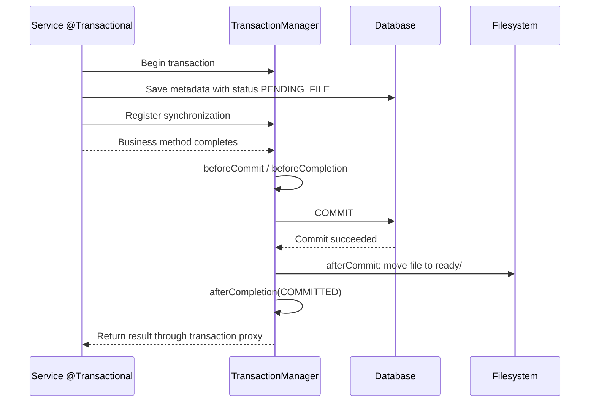
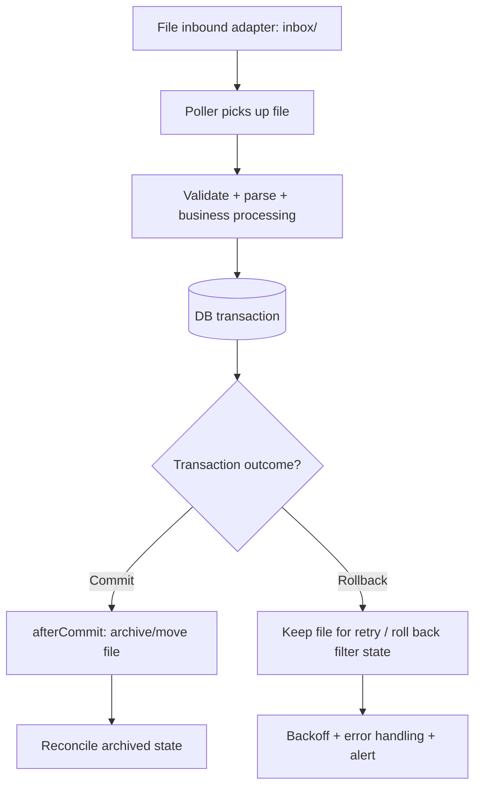

# Transaction Synchronization and Post-Commit File Operations

A Spring Boot integration flow often executes both **transactional operations**, such as updating PostgreSQL or MongoDB, and **non-transactional operations**, such as moving files, renaming files, writing to object storage, or calling an external system. Execution order matters greatly: if a file moves to a processed folder before the database commits and the commit fails, the application can lose the ability to reprocess it. Conversely, if the commit succeeds and the file operation fails, database records and files temporarily drift out of sync.

**Transaction synchronization** lets you attach callbacks to lifecycle milestones of a Spring transaction, especially **after commit** (`afterCommit`) and **after rollback** (`afterCompletion` with rolled-back status). This mechanism coordinates operation timing, yet **does not turn the filesystem and database into a single atomic transaction**.

This lesson focuses on applying transaction synchronization in Spring Boot and Spring Integration, designing recoverable state, testing post-commit errors, safe file handling, and observing real-world integration flows.

## 1. Learning Objectives and Opening Scenario

After this lesson, you will be able to:

- Distinguish database transactions from file, broker, cache, or HTTP operations outside the transaction.
- Understand the `TransactionSynchronization` lifecycle and the semantics of `beforeCommit`, `afterCommit`, and `afterCompletion`.
- Choose between registering `TransactionSynchronization` directly and using `@TransactionalEventListener`.
- Design the workflow **stage file → save state → DB commit → publish/move file → update state**.
- Handle rollbacks, I/O errors, crashes between commit and callback, duplicates, and retries.
- Apply Spring Integration poller/transaction synchronization when ingesting or emitting files.
- Build integration tests that genuinely prove commit order, rollbacks, idempotency, and recovery.

### Running Example

A service receives order data files from an `incoming/` directory or via HTTP upload:

1. Write the received content into a `staging/` directory.
2. Persist metadata and file processing state to the database.
3. Once the database transaction **commits successfully**, move the file from `staging/` to `ready/`.
4. Mark the database record `READY`; a downstream Spring Integration adapter or worker then processes only ready files.

If step 3 ran before commit, another worker could pick up the file in `ready/` before the database record exists. If the post-commit callback fails, the record must retain enough information for the system to retry.

## 2. Why Cannot `@Transactional` Roll Back File Operations?

In Spring, `@Transactional` typically drives a `PlatformTransactionManager` and transactional resources such as JDBC connections. Calls like `Files.move(...)`, `Files.delete(...)`, or `Files.copy(...)` do not join JDBC transactions.

Unsafe example:

```java
@Transactional
public void process(Path incoming, Path ready) throws IOException {
    orderRepository.save(new OrderRecord(...));
    Files.move(incoming, ready);
    // An error at the end of the method can roll back the DB.
    // The moved file stays in ready/.
    validateFinalState();
}
```

Here, the database transaction can roll back while the filesystem change remains. The reverse failure can happen too: the database commits, then the JVM dies before moving the file.

| Event | Database | Filesystem | Risk |
|---|---|---|---|
| Move file first, DB rolls back | No committed metadata | File already in `ready/` | Orphaned file or premature processing |
| DB commits first, move succeeds | Metadata committed | File in `ready/` | Workflow can proceed |
| DB commits first, move fails | Metadata committed | File still in `staging/` | Requires retry and reconciliation |
| DB commits, JVM dies before callback | Metadata committed | File still in `staging/` | Callback never ran; needs recovery mechanism |
| Move succeeds, status update fails | Metadata still `PENDING_FILE` | File already in `ready/` | Retries must recognize the move already happened |

**Principle:** transaction synchronization governs **when** an action runs relative to a transaction. To survive crashes, applications need **durable state, idempotent operations, and a sweep/retry mechanism**.

## 3. The `TransactionSynchronization` Lifecycle

Spring provides `org.springframework.transaction.support.TransactionSynchronization`. While transaction synchronization is active, you can register callbacks via `TransactionSynchronizationManager.registerSynchronization(...)`.

Key callbacks:

| Callback | When It Runs | Suitable Use | What to Avoid |
|---|---|---|---|
| `beforeCommit(boolean readOnly)` | Before transaction commit, while commit can still fail | Validate/flush transaction-linked resources | Do not treat as proof of successful commit |
| `beforeCompletion()` | Before transaction finishes, including some rollback paths | Clean up transaction-bound resources | Do not run actions allowed only after commit |
| `afterCommit()` | After commit succeeded | Trigger file move, send internal signal, record outcome | Do not assume post-commit tasks are part of the committed transaction |
| `afterCompletion(int status)` | After transaction finishes; status is `COMMITTED`, `ROLLED_BACK`, or `UNKNOWN` | Clean staging on rollback, release resources, metrics | Do not assume `UNKNOWN` always equals rollback |

Typical sequence of a successful transaction:



If the DB rolls back, `afterCommit()` **does not run**, and `afterCompletion(ROLLED_BACK)` is where you can attempt to clean up the staging file. Even so, callbacks are not a durable queue: if the process dies, in-memory callbacks vanish.

### Lifecycle Caveats

- `TransactionSynchronizationManager` binds synchronizations to **the current executing thread's transaction context** for imperative Spring transactions. Never assume this context automatically crosses `ExecutorChannel`, `@Async`, or another thread pool.
- `isSynchronizationActive()` only checks if synchronization is enabled. When business logic strictly requires an active database transaction, also check `isActualTransactionActive()` and proper transaction manager configuration.
- Callbacks execute only when the **actual transaction completes**, typically at the outermost boundary. Registering a callback inside a method joining an existing transaction does not fire it when that inner method returns.
- Calling a `@Transactional` method inside the same bean (self-invocation) normally bypasses the Spring proxy, so the expected transaction may not start.
- Multiple synchronizations may be active. If ordering between them matters, implement `Ordered`/`getOrder()` or restructure the flow instead of relying on incidental registration order.

## 4. Defining Durable State Rules for Files

A recoverable design treats database state as the **intent record** and the filesystem as a **resource to reconcile**.

| State | Meaning | Next Action |
|---|---|---|
| `PENDING_FILE` | Metadata committed; file is staged, not yet guaranteed published to `ready/` | Worker attempts move or verifies target |
| `READY` | Target file verified and eligible for processing | Proceed to downstream processing |
| `RETRY_REQUIRED` (optional) | Latest move failed, still recoverable | Retry with backoff, increment attempt count |
| `FAILED_PERMANENT` (optional) | Cannot recover automatically; needs intervention | Alert and route to manual remediation |
| `PROCESSED` | File consumed successfully by downstream step | Retain audit/archive per policy |

Not every project needs every state. The core rule is that **`PENDING_FILE` must commit before file promotion counts as done**, retaining staging path, target path, checksum/size, business ID, attempt count, and timestamps needed for retry.

A unique file job ID helps deduplicate retries. Never use raw user-supplied filenames directly as target paths: name collisions and path traversal can overwrite or misroute data.

### Path Conventions

```text
data/
  staging/
    <file-id>.part
  ready/
    <file-id>.dat
  quarantine/
    <file-id>.dat
```

`staging/` and `ready/` should reside on the **same filesystem** if the design relies on atomic renames. Files must be fully written and closed in `staging/` before inserting the publish-pending record. Across multiple app nodes, staging must live on appropriate shared storage or durable object storage; a file on one pod's local disk is inaccessible to another pod during retry.

## 5. Approach 1: Registering `TransactionSynchronization` Directly

This approach fits when a service wants to bind callbacks right at the transaction site. The example below is an **implementation skeleton**: `FileJobRepository`, `FileJob`, `FilePromotionService`, and `StagingCleanup` represent application components.

```java
import java.nio.file.Path;
import java.util.UUID;

import org.springframework.stereotype.Service;
import org.springframework.transaction.annotation.Transactional;
import org.springframework.transaction.support.TransactionSynchronization;
import org.springframework.transaction.support.TransactionSynchronizationManager;

@Service
public class FileRegistrationService {

    private final FileJobRepository repository;
    private final FilePromotionService promotionService;
    private final StagingCleanup stagingCleanup;

    public FileRegistrationService(
            FileJobRepository repository,
            FilePromotionService promotionService,
            StagingCleanup stagingCleanup) {
        this.repository = repository;
        this.promotionService = promotionService;
        this.stagingCleanup = stagingCleanup;
    }

    @Transactional
    public UUID register(Path stagedFile, String checksum) {
        if (!TransactionSynchronizationManager.isSynchronizationActive()
                || !TransactionSynchronizationManager.isActualTransactionActive()) {
            throw new IllegalStateException("An active DB transaction is required");
        }

        UUID id = UUID.randomUUID();
        repository.save(FileJob.pending(id, stagedFile, checksum));

        TransactionSynchronizationManager.registerSynchronization(
                new TransactionSynchronization() {
                    @Override
                    public void afterCommit() {
                        // Best-effort execution; errors cannot roll back the DB.
                        promotionService.tryPromote(id);
                    }

                    @Override
                    public void afterCompletion(int status) {
                        if (status == STATUS_ROLLED_BACK) {
                            stagingCleanup.tryDelete(stagedFile);
                        }
                    }
                });

        return id;
    }
}
```

In this example:

1. `@Transactional` wraps persisting `FileJob` in state `PENDING_FILE`.
2. `afterCommit` runs once the transaction commits. `tryPromote` must log/meter errors, keep state for retries, and **never throw errors as if the database could still roll back**.
3. `afterCompletion(STATUS_ROLLED_BACK)` attempts to delete the staged file if data rolled back. If cleanup fails, an orphan-file sweeper cleans it later.
4. `STATUS_UNKNOWN` must go to reconciliation; never hastily delete input data simply because commit status is uncertain.

**Warning about accessing the database inside `afterCommit`:** Spring may keep transaction resources bound to the thread until cleanup ends. A DB statement inside `afterCommit` could join the already-committed transaction's resource with **no subsequent commit**. When reading/writing state after commit, call a separate service annotated with `@Transactional(propagation = Propagation.REQUIRES_NEW)` or use an independent transaction mechanism. Avoid calling a `REQUIRES_NEW` method on the same bean, as self-invocation bypasses the proxy.

Furthermore, if `afterCommit` throws an unchecked exception, it can propagate to callers *after* the database committed; the API may return an error and cause clients to retry. Therefore, make file promotion **idempotent** with dedicated error handling and state sufficient to verify the true outcome.

## 6. Approach 2: `@TransactionalEventListener` with `AFTER_COMMIT`

A cleaner option publishes a domain event inside the transaction and handles it via a phase-bound listener. This keeps filesystem logic out of persistence services.

Example in Spring Boot using imperative transactions:

```java
import java.util.UUID;

public record FilePromotionRequested(UUID fileId) {}
```

```java
import java.nio.file.Path;
import java.util.UUID;

import org.springframework.context.ApplicationEventPublisher;
import org.springframework.stereotype.Service;
import org.springframework.transaction.annotation.Transactional;

@Service
public class UploadService {

    private final FileJobRepository jobs;
    private final ApplicationEventPublisher events;

    public UploadService(FileJobRepository jobs, ApplicationEventPublisher events) {
        this.jobs = jobs;
        this.events = events;
    }

    @Transactional
    public UUID accept(Path stagedPath, String sha256) {
        UUID id = UUID.randomUUID();
        jobs.save(FileJob.pending(id, stagedPath, sha256));
        events.publishEvent(new FilePromotionRequested(id));
        return id;
    }
}
```

```java
import org.springframework.stereotype.Component;
import org.springframework.transaction.event.TransactionPhase;
import org.springframework.transaction.event.TransactionalEventListener;

@Component
public class FilePromotionListener {

    private final FilePromotionService promotionService;

    public FilePromotionListener(FilePromotionService promotionService) {
        this.promotionService = promotionService;
    }

    @TransactionalEventListener(phase = TransactionPhase.AFTER_COMMIT)
    public void afterCommit(FilePromotionRequested event) {
        promotionService.tryPromote(event.fileId());
    }
}
```

By default, `@TransactionalEventListener` only handles events published inside an active transaction. Without a transaction, events are ignored unless `fallbackExecution = true` is explicitly set. For "promote only after commit" rules, **do not enable `fallbackExecution` casually**.

You can add an `AFTER_ROLLBACK` listener to clean staging, though the event above only carries `fileId`. If the transaction rolled back, the DB row will not exist; to clean staging in a rollback listener, include the **validated** staging path on the event or maintain a separate cleanup tracker. Also clean up files staged when a request fails before publishing the event.

Available phases are `BEFORE_COMMIT`, `AFTER_COMMIT`, `AFTER_ROLLBACK`, and `AFTER_COMPLETION`. Technical note: with `@TransactionalEventListener`, `AFTER_COMMIT` executes during transaction completion of the listener; do not assume identical exception propagation to overriding `TransactionSynchronization.afterCommit()`. In both cases, database commit has finished, so listener errors **cannot undo committed data**.

### Choosing Between the Two

| Criterion | `TransactionSynchronization` | `@TransactionalEventListener` |
|---|---|---|
| Coupling logic close to transaction and cleanup | Convenient, direct callback control | Requires creating event and listener classes |
| Decoupling business logic from post-commit side effects | Tends to create direct dependencies | Cleaner separation via domain events |
| Behavior without an active transaction | Must check explicitly; cannot register blindly | Skips listener by default when no transaction exists |
| Guarantees callback runs after JVM crash | **No** | **No** |
| Durable retry mechanism | Needs persisted job/outbox and reconciler | Also needs persisted job/outbox and reconciler |

In-process domain events are only **fast trigger signals**. They are not equivalent to a durable message broker or transactional outbox.

## 7. Implementing Idempotent File Operations

A retryable system must tolerate repeated calls to `promote(fileId)`. Before each move, determine current state from both database and filesystem:

```text
If DB = READY and target file is valid:
    Do nothing (idempotent success).

If DB = PENDING_FILE and staging file exists, target does not exist:
    Validate path, size/checksum.
    Move file from staging -> ready using chosen mechanism.
    Verify target; update DB = READY in a fresh transaction.

If DB = PENDING_FILE, staging missing, yet target already exists:
    Verify target belongs to fileId and matches checksum.
    If valid: update DB = READY in a fresh transaction.
    If invalid: route to conflict/quarantine handling.

If both staging and target are missing:
    Record failure trail; attempt recovery from original source if still retained.
    Alert when unrecoverable.
```

### 7.1. Atomic Rename and Its Limits

Java NIO supports requesting an atomic move:

```java
import java.io.IOException;
import java.nio.file.AtomicMoveNotSupportedException;
import java.nio.file.Files;
import java.nio.file.Path;
import java.nio.file.StandardCopyOption;

public void moveAtomically(Path staging, Path target) throws IOException {
    try {
        Files.move(staging, target, StandardCopyOption.ATOMIC_MOVE);
    } catch (AtomicMoveNotSupportedException ex) {
        // Do not silently fall back to non-atomic copy/move pretending it is atomic.
        throw new IOException("Storage does not support atomic rename", ex);
    }
}
```

`ATOMIC_MOVE` makes the file rename appear atomic when supported by the filesystem/provider, usually requiring source and target to be on the same filesystem. It **does not** join a transaction with the database, does not prove power-loss durability on its own, and overwrite behavior when target exists varies by implementation. Therefore:

- Derive unique target filenames from `fileId` so requests never overwrite one another.
- Normalize and restrict paths to allowed directories; reject `../` traversal from user input.
- Verify size/checksum to distinguish valid retries from colliding filenames with wrong contents.
- Where strict hardware durability is required, inspect flush/fsync and storage semantics rather than assuming `Files.move` returning guarantees disk persistence.
- Across two separate filesystems, design a protocol: **copy to temp name at target → verify → publish/rename at target → clean source**. Such multi-step moves are not atomic end-to-end and need intermediate recovery states.

### 7.2. Updating State in a New Transaction

Extract this into a separate bean invoked through a Spring proxy:

```java
import java.util.UUID;

import org.springframework.stereotype.Service;
import org.springframework.transaction.annotation.Propagation;
import org.springframework.transaction.annotation.Transactional;

@Service
public class FileJobStateService {

    private final FileJobRepository jobs;

    public FileJobStateService(FileJobRepository jobs) {
        this.jobs = jobs;
    }

    @Transactional(propagation = Propagation.REQUIRES_NEW)
    public void markReady(UUID id) {
        FileJob job = jobs.findById(id).orElseThrow();
        job.markReady();
        jobs.save(job);
    }
}
```

`FilePromotionService` performs file I/O and calls `fileJobStateService.markReady(id)` after verifying the target file. These two steps cannot commit atomically together: if updating `READY` fails, the next retry must recognize the file already moved. That explains why **idempotency and a reconciler** remain necessary even with `REQUIRES_NEW`.

Never stretch a database transaction across a large file copy just to "keep everything in one place". Keep transactions short—persist intent first, then move files separately—to minimize connection and lock duration.

## 8. Handling Rollbacks, Errors, and Crashes at Every Boundary

Scenarios to distinguish:

| When Failure Occurs | Observable State | Recovery Action |
|---|---|---|
| Upload fails before finishing staging | No metadata, or only partial `.part` file in staging | Delete incomplete `.part` file; never create `READY` |
| DB rolls back before commit | No committed `FileJob` | Clean staging post-rollback; orphan sweeper catches missed callbacks |
| DB commits, JVM dies before `afterCommit` | `PENDING_FILE` in DB; staging file remains | Reconciler scans `PENDING_FILE` and invokes `promote` |
| `Files.move` throws exception | `PENDING_FILE`; inspect source/target | Emit metrics/logs; backoff retry; investigate storage error |
| Move succeeds, `markReady` fails | DB still `PENDING_FILE`, target exists | Verify `fileId`/checksum and `markReady` in fresh transaction |
| Callback runs twice or two nodes retry concurrently | Risk of two workers touching the same file | Claim job via optimistic locking/leases or locks; idempotent file ops |
| File reaches target yet downstream fails | `READY` or later state incomplete | Retry downstream by idempotency key; do not assume file promotion rolls back |

**A post-commit callback succeeding once is not proof of exactly-once execution.** Retries, crash recovery, multi-node deployments, and redeliveries require operations to be safely repeatable.

### Bounded Retries

- Store `attemptCount`, `lastError` (sanitized of sensitive info), `nextRetryAt`, and `updatedAt`.
- Use exponential backoff with jitter and caps; classify permission/invalid-path errors differently from transient network/storage faults.
- Cap attempt counts; transition exhausted jobs to manual intervention.
- Sweeper tasks must use job ownership or CAS/optimistic locking so two workers never move the same file simultaneously.
- When purging failed files, alert on staging file age; never delete files belonging to active transactions/jobs.

## 9. Applying This in a Spring Integration Flow

Spring Integration provides file reading/writing adapters, pollers, channels, and message orchestration. With inbound file polling, a typical requirement is: **move the file to `archive/` only after the business transaction commits**.

Conceptual flow:



Spring Integration supports **transaction synchronization on pollers** (such as post-commit/post-rollback callbacks via `TransactionSynchronizationFactory` in versions supporting it). Consult the Java DSL/XML API for your exact Spring Integration version when configuring. They follow the same transaction-lifecycle goals, and callback registration timing/context must match your poller and transaction manager.

Three critical details:

1. **Transaction boundaries.** A transactional poller does not automatically put every downstream channel and service inside the same transaction. If the flow crosses an `ExecutorChannel`, the new thread will not inherit the prior transaction context. For asynchronous processing, persist durable state and promote/archive files via an independent worker.
2. **File inbound filters.** "Accept once" filters can mark a file as already seen even when downstream processing rolls back. Use an appropriate filter/state store with rollback/retry support or controlled rescanning; never assume leaving the file in `inbox/` makes the adapter re-read it automatically.
3. **Error channels and transactions.** Catching an exception and forwarding an `ErrorMessage` without propagating failure to the transaction boundary can let the transaction commit. Explicitly define which errors trigger rollback, which record failure states, and which route to DLQ/quarantine.

File-writing adapters or custom outbound handlers can also leak premature side effects before commit. When a target file signals an external system to begin work, write to staging first and publish after commit so external consumers never read half-written files or uncommitted DB states.

### Synchronizing with Brokers or HTTP

The same principles apply to message brokers and HTTP clients:

- Sending to JMS/Kafka/RabbitMQ after commit is not atomic with the database; sending can fail after commit.
- When publish intent must never be lost, persist an **outbox record** in the same database transaction and let a reliable publisher dispatch it post-commit. Callbacks should only "nudge" the publisher for low latency.
- HTTP calls after commit can time out even though the receiver succeeded; enforce idempotency keys or status lookups.
- Never try to "roll back a file" as a substitute for handling broker or cache failures; clearly define which system owns authoritative state.

## 10. When Transaction Synchronization Alone Is Not Enough

Transaction synchronization works well to **cut activation latency** for brief steps backed by independent recovery. Relying solely on callbacks is unsafe when:

- The JVM/pod can crash right after DB commit.
- File operations are large, slow, or must run on dedicated workers.
- Files sit on object storage/network shares prone to timeouts or ambiguous outcomes.
- Multiple instances run and retries must be distributed.
- Business contracts forbid losing publish/move requests even across prolonged outages.

In those cases, use a **durable file-job table / outbox + worker + reconciliation**. Example schema:

```text
file_jobs
  file_id              UUID PRIMARY KEY
  source_ref           TEXT
  staging_key          TEXT
  target_key           TEXT
  sha256               TEXT
  state                PENDING_FILE | READY | RETRY_REQUIRED | ...
  attempt_count        INTEGER
  next_retry_at        TIMESTAMP
  lease_owner          TEXT
  lease_until          TIMESTAMP
  created_at           TIMESTAMP
  updated_at           TIMESTAMP
```

Workers periodically claim eligible jobs safely via locks or optimistic locking, perform checksum-verified I/O, and commit updated state in a fresh transaction. The `afterCommit` callback wakes workers quickly, while the **reconciliation scan** guarantees recovery if callbacks are lost.

With object storage, replace "filesystem paths" with object keys/versions/ETags and match the storage service's actual semantics. Never assume object-store "move/rename" is atomic like a local filesystem rename.

## 11. Testing Commit Order and Recoverability

Unit tests verify branching logic, while integration tests with a **real transaction manager and database** are required to prove callback timing.

### 11.1. Minimum Test Suite

| Test | Setup | Key Assertions |
|---|---|---|
| Successful commit | Stage file, call `@Transactional` service via proxy | Metadata committed, file moved to `ready/`, state `READY` |
| Rollback before commit | Throw unchecked exception inside service | Zero committed metadata; file never promoted |
| I/O failure after commit | Make `ready/` read-only or inject failing file operator | `PENDING_FILE` metadata remains; callback preserves trail |
| Crash before callback | Persist `PENDING_FILE` with staged file, skip callback | Reconciler finds job and promotes file cleanly |
| Crash after move, before `markReady` | File at target, metadata still pending | Reconciler verifies checksum and finishes state |
| Double `promote` invocation | Job already `READY`, valid target exists | No overwrite of other files; idempotent result |
| Two workers claim same job | Race two runners for lease/claim | Only one runs main work; consistent final outcome |
| Async channel | Flow switches threads after poller | Callback binds to right transaction or flow uses durable job |
| File filter marked seen | Downstream processing fails after inbound poll | File can still retry per designed policy |

### 11.2. The `@Transactional` Test Pitfall

Annotating a **test method** with `@Transactional` in Spring Test normally rolls back the transaction when the test ends, so `afterCommit` never executes. Therefore, a test verifying post-commit file promotion should:

- Leave the test method itself **without** `@Transactional`, invoke the `@Transactional` service through its Spring proxy, and assert once that call finishes.
- Or use `TestTransaction` to explicitly flag and end the transaction with commit inside a Spring-managed test transaction.
- Never mock out the entire transaction manager when the goal is verifying commit callbacks.
- For synchronous listeners/events, assert right after service commit; for async workers, poll with a bounded timeout.

Illustrative test skeleton:

```java
@SpringBootTest
class FilePromotionIT {

    @Autowired UploadService uploadService;
    @Autowired FileJobRepository jobs;
    @Autowired FilePromotionService promotionService;

    @Test
    void publishesAfterCommittedMetadata() throws Exception {
        Path staged = createStagedFileForTest();
        UUID id = uploadService.accept(staged, sha256Of(staged));

        // Do NOT place @Transactional on this test method:
        // the transaction in uploadService.accept() has already finished.
        assertThat(jobs.findById(id)).isPresent();
        assertThat(promotionService.targetExistsAndMatches(id)).isTrue();
    }
}
```

`createStagedFileForTest`, `sha256Of`, and `targetExistsAndMatches` are fixture/application helpers; this skeleton shows the testing pattern rather than a standalone class. Use temporary directories and isolated test databases, cleaning up afterward. If listeners or jobs run asynchronously, wait for the final condition with an explicit timeout.

## 12. Observing and Operating Post-Commit Flows

To diagnose issues, connect database transactions and file operations via a **correlation ID / job ID**.

Record:

- `fileId`, `requestId`, or `messageId`, and before/after states; omit sensitive filenames or contents when unnecessary.
- Count of `PENDING_FILE` jobs, oldest job age, retry counts, and duration from DB commit to `READY`.
- Classified failures: `AtomicMoveNotSupportedException`, permission denied, missing source, target conflict, checksum mismatch, storage timeout.
- Callbacks triggered, jobs recovered by reconciler, jobs quarantined, and duplicates deduplicated.
- Alerts when pending counts spike, jobs breach SLAs, or orphaned staging files exceed thresholds.
- Step-by-step logs with specific outcomes: `db_committed`, `promotion_attempted`, `file_verified`, `status_ready`—never generic "processed" messages.

**Distinguish API outcomes:** when the DB commits yet the post-commit step fails, do not report as if the entire operation rolled back. Depending on contract, return the job ID and `PENDING_FILE`/`202 Accepted` so clients poll progress. If a synchronous API must return "ready", handle post-commit callback failures carefully—especially on client retries.

## 13. Checklist for Spring Boot Integration Systems

- [ ] Identified the real transaction manager and commit boundaries; never confuse file I/O with JDBC/JPA transactions.
- [ ] Files are written completely into staging before publishing and never appear prematurely in `ready/`.
- [ ] `PENDING_FILE` metadata/state commits durably before after-commit callbacks run.
- [ ] `afterCommit` only triggers retry-safe actions; callback errors are never mistaken for DB rollback.
- [ ] Post-rollback cleanup is best-effort, backed by an orphaned-staging sweeper.
- [ ] Verified `TransactionSynchronizationManager` or `@TransactionalEventListener` lifecycles on the exact transaction/thread.
- [ ] Post-commit DB updates run in a **fresh** transaction via a Spring proxy or separate worker.
- [ ] Move/copy operations enforce path safety, collision protection, checksums, and storage durability guarantees.
- [ ] Idempotency keys, job claims, and reconciliation cover crashes between steps.
- [ ] Spring Integration pollers, filters, and error channels preserve retryability when downstream fails.
- [ ] Integration tests cover commits, rollbacks, I/O errors, retries, and crash gaps without accidentally rolling back the test transaction.
- [ ] Metrics, log correlation, backlog alerts, and remediation runbooks are in place.

**Remember:** `TransactionSynchronization` and `@TransactionalEventListener(AFTER_COMMIT)` let Spring Boot run file operations **right after commit**, yet do not guarantee those operations always run or run only once. Reliable designs combine **durable state, idempotent file operations, fresh transactions for status updates, and a reconciliation/recovery worker**.
