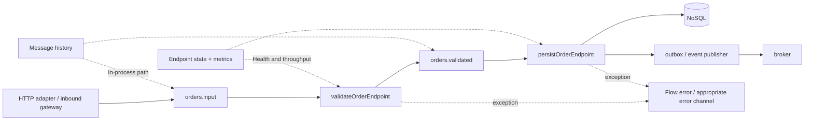

# Tracking Message History, Endpoints, and Processing Metrics

## 1. Why Does a Flow Need Three Layers of Observability?

In a **Spring Boot** application, an order may pass through an HTTP controller, data transformers, internal channels, database persistence handlers, caches, brokers, and Spring Integration adapters. When a customer reports "submitted yet no result", the question is not just whether the app logged an exception, but also:

- Which channels and endpoints did the message traverse?
- Are endpoints running, stopped, or blocked by a slow downstream?
- How are inbound/outbound message counts, processing durations, errors, queue depths, and retries changing?
- Was a message processed once, retried, replayed, or duplicated?

This lesson belongs to the **Flow Errors and State** chapter of the **SPRING_BOOT_INTEGRATION** module: integrating HTTP clients, databases, caches, brokers, and Spring Integration adapters while governing configuration, data contracts, transactions, errors, deduplication, testing, and production observability.

Three complementary observability layers:

| Layer | Primary Question | Typical Mechanism | Limitations |
|---|---|---|---|
| **Message history** | "Where did this message travel?" | History header recorded by Spring Integration when enabled. | Not a durable audit log or cross-service distributed trace. |
| **Endpoint/channel state** | "Which components exist, are running, and are sending/receiving?" | Endpoint IDs, Spring context, lifecycle, integration graph, channel/poller stats. | `running` status does not guarantee downstream health or successful processing. |
| **Processing metrics and tracing** | "How many, how fast, where are failures, what is backed up?" | Micrometer, Actuator, Observation/tracing, correlation-ID logs, business metrics. | Aggregated numbers alone do not trace a specific message's path. |

The goal is connecting **an individual message's path** with **component health** and **business outcomes** without blowing up storage costs or leaking sensitive data.

## 2. Illustrative Flow Model

Suppose a system receives order-creation events from a partner, validates data, writes a read model to NoSQL, and emits a processed event to a broker:



Good tracking answers "at which step was event `evt-42` accepted and processed?". Still, **message headers**, **Spring Integration endpoints**, **transactions**, and **business records** do not share the same lifecycle: succeeding at NoSQL write and publishing to a broker are two separate actions that do not automatically form one distributed transaction simply by sitting in the same `IntegrationFlow`.

## 3. What Is Message History?

Spring Integration supports **message history**: when enabled, participating components append path entries into a header on `Message<?>`. Each entry typically carries metadata like **component name** and **component type**, accumulating across traversed hops.

Illustrative history snapshot (not a mandatory log format):

```text
messageId=9b43...
history=[
  {name="orders.input",      type="channel"},
  {name="validateOrderEndpoint", type="endpoint"},
  {name="orders.validated",  type="channel"},
  {name="persistOrderEndpoint", type="endpoint"}
]
```

In Java configuration, enable it with `@EnableMessageHistory`:

```java
import org.springframework.context.annotation.Configuration;
import org.springframework.integration.config.EnableIntegration;
import org.springframework.integration.config.EnableMessageHistory;

@Configuration(proxyBeanMethods = false)
@EnableIntegration
@EnableMessageHistory
class FlowHistoryConfiguration {
}
```

With Spring Integration 6.x in the Spring Boot 3.x ecosystem, read history from a message as follows:

```java
import org.springframework.integration.history.MessageHistory;
import org.springframework.messaging.Message;

void logMessageHistory(Message<?> message) {
    MessageHistory history = MessageHistory.read(message);
    if (history != null) {
        log.debug("messageId={} history={}",
                message.getHeaders().getId(), history);
    }
}
```

If `history == null`, the feature may be disabled, the message may not have crossed an instrumented component, components may not record history, or headers may have been dropped when constructing a new message. **Do not infer "no history" means "never entered the flow".**

### Limitations to Understand

1. **Lives in headers, not persisted durably by default.** Once the message leaves memory, history disappears unless explicitly persisted.
2. **Scoped mostly to a single Spring Integration runtime.** Crossing HTTP, Kafka, or another process typically creates a new message; old in-process history does not automatically span systems.
3. **Depends on header preservation.** When transforming messages with builders, preserve necessary headers. Constructing a raw `GenericMessage` from payload alone or stripping headers drops history and correlation data.
4. **History grows with hop count.** In long flows, loops, split/aggregate paths, or high traffic, tracking history on every message adds memory, serialization, and log overhead.
5. **History is a clue, not final proof of success.** A handler can execute and then throw, or finish right before a transaction rolls back; a history entry never proves a business commit succeeded.

In production, scope tracking selectively and pick appropriate logging strategies, keeping payloads/credentials out of logs and never forwarding internal headers blindly to external systems.

## 4. Naming Endpoints and Channels So History Is Readable

Stable names turn cryptic auto-generated IDs into actionable diagnostic clues. Example Spring Integration DSL flow:

```java
import org.springframework.context.annotation.Bean;
import org.springframework.context.annotation.Configuration;
import org.springframework.integration.dsl.IntegrationFlow;

@Configuration(proxyBeanMethods = false)
class OrderFlowConfiguration {

    @Bean
    IntegrationFlow orderFlow(OrderSteps steps) {
        return IntegrationFlow.from("orders.input")
                .handle(steps, "validate",
                        endpoint -> endpoint.id("validateOrderEndpoint"))
                .channel("orders.validated")
                .handle(steps, "persist",
                        endpoint -> endpoint.id("persistOrderEndpoint"))
                .get();
    }
}
```

Assume the business class provides these two methods:

```java
import org.springframework.integration.history.MessageHistory;
import org.springframework.messaging.Message;
import org.springframework.stereotype.Component;

@Component
class OrderSteps {

    public OrderEvent validate(OrderEvent event) {
        if (event.eventId() == null || event.eventId().isBlank()) {
            throw new IllegalArgumentException("Missing eventId");
        }
        return event;
    }

    public void persist(Message<OrderEvent> message) {
        OrderEvent event = message.getPayload();
        MessageHistory history = MessageHistory.read(message);
        log.debug("eventId={} messageId={} history={}",
                event.eventId(), message.getHeaders().getId(), history);

        // Call repository or adapter to persist data safely
        // with idempotency, transaction, and timeout controls.
    }
}

record OrderEvent(String eventId, String orderId) {
}
```

This structural example illustrates naming and reading history. In real implementations, persistence uses proper repositories/SDKs and `OrderSteps` injects required services. Depending on Spring Integration version, auto-generated bean names and recorded entries vary; verify real history output via integration tests.

**Naming guidelines:**

- Use business-meaningful names such as `validateOrderEndpoint`, `persistOrderEndpoint`, `orders.validated`.
- Keep IDs stable across refactors so dashboards, alerts, and runbooks never break.
- Distinguish **channels** (message transport) from **consumer endpoints/handlers** (processing); a single message can pass through many endpoints.
- Adding an extra subscriber solely to observe messages on a `DirectChannel` causes it to **compete for messages** with the primary handler. Use logging interceptors, `wireTap`, or proper instrumentation instead of creating an unintended competing consumer.

## 5. Message ID, Correlation ID, Business Key, and Trace ID

These IDs serve distinct purposes:

| ID | Origin / Meaning | Safe for Deduplication? |
|---|---|---|
| **Message ID** (`MessageHeaders.ID`) | Identifies one message instance in memory; changes when a new message is built. | **Insufficient.** A redelivered business event normally gets a new message ID. |
| **Correlation ID** | Links related messages within a flow—especially across split, scatter-gather, aggregate, or async hops. | Not by default; requires an explicit contract and stable key generation. |
| **Business event ID / idempotency key** | Identifies a business event or request across retries, rebuilt messages, and broker redeliveries. | **Yes**, when paired with constraints/conditional writes and payload-conflict checks. |
| **Trace ID / Span ID** | Traces request paths and latencies across services via distributed tracing. | **No.** A retry or separate processing attempt creates a new trace. |

For example, upon receiving `POST /order-events`, an application can:

1. Validate and normalize `eventId` per partner contract.
2. Put `eventId` and `correlationId` into message headers consistently.
3. Propagate trace context per HTTP/broker instrumentation standards.
4. Persist processed state keyed by `eventId` via unique constraints or conditional writes.
5. Emit metrics by **outcome category**, placing specific IDs into structured logs/traces subject to data protection policies.

Never put `messageId`, `eventId`, `orderId`, or `traceId` into **metric tags**: unbounded cardinality explodes time-series storage. Those IDs belong in retention-governed logs, traces, or business records.

## 6. Endpoint Lifecycle: Running Does Not Mean Processing Healthily

Spring Integration includes **message-driven** endpoints (e.g., service activators or subscribers on `SubscribableChannel`) and **polling** endpoints (e.g., inbound channel adapters or consumers on `PollableChannel`). Monitoring must match the execution model:

| Component Type | What to Inspect | Common Misconceptions |
|---|---|---|
| `DirectChannel` and sync handler | Is handler invoked, processing latency, error counts, blocking caller threads? | Channel has no internal queue; do not expect queue-depth metrics on `DirectChannel`. |
| `ExecutorChannel` or async dispatch | Executor health, active threads, queue depth, task rejections, worker errors. | Caller returning from `send` does not mean downstream finished. |
| `QueueChannel` or pollable channel | Queue depth, enqueue/dequeue rates, message age, capacity, active consumer/poller. | Empty queue does not always mean healthy; producers may have stopped or failed upstream. |
| Inbound/outbound adapters and pollers | `isRunning()` when lifecycle-aware, poll schedule, last run timestamp, errors/timeouts. | `running=true` does not guarantee pollers pull data or remote endpoints are up. |
| Broker listeners / HTTP gateways | Listener container status, lag, retries, DLQs, timeouts, delivery counts. | Broker ack or HTTP 2xx does not always mean end-to-end business completion. |

Some endpoints implement Spring `Lifecycle` or `SmartLifecycle`, exposing `start()`, `stop()`, and `isRunning()`. Never assume every handler or channel exposes the same lifecycle interface.

For endpoints with stable bean names, inspect lifecycle state when supported:

```java
import org.springframework.beans.factory.ListableBeanFactory;
import org.springframework.context.Lifecycle;

void inspectLifecycle(ListableBeanFactory beanFactory, String beanName) {
    Object bean = beanFactory.getBean(beanName);
    if (bean instanceof Lifecycle lifecycle) {
        log.info("endpoint={} running={}", beanName, lifecycle.isRunning());
    } else {
        log.info("component={} hasNoLifecycleState", beanName);
    }
}
```

Never rely on `isRunning()` as your sole health check. A poller can be running while failing auth every cycle, a handler can be running yet deadlocked on an HTTP connection pool, or a broker consumer can lag far behind.

### Integration Graph and Structural Inspection

In apps with Spring Integration and compatible Actuator support, the `integrationgraph` endpoint (when available, enabled, and exposed) lets you inspect nodes, channels, handlers, and links in the flow—typically at `/actuator/integrationgraph` under default paths.

The graph shows **which components exist and how they connect**. It does not provide per-request message history, replace distributed tracing, or guarantee all nodes are succeeding. Verify Actuator configuration, version, endpoint exposure, and security rules before enabling; restrict management endpoints strictly to authorized roles.

## 7. Processing Metrics: Measurements That Actually Help

In Spring Boot, combine **Actuator + Micrometer** with metrics emitted by Spring Integration, HTTP clients, brokers, and datastores. Built-in meter names and tag sets vary by version, management settings, and component type; inspect your live `MeterRegistry` or `/actuator/metrics`.

Essential metric groups:

| Group | Metrics / Signals to Have | Question Answered |
|---|---|---|
| **Throughput** | Inbound/outbound message counts by flow/endpoint and outcome; completion rate. | How much work enters and finishes per second? |
| **Latency** | Handler duration, HTTP/DB/broker hops, end-to-end duration; p50/p95/p99. | Which stage drives latency increases? |
| **Errors** | Errors by category (validation, timeout, downstream 4xx/5xx, deserialization, conflict), retry rate, dead-letter count. | Are errors caused by data, infrastructure, or business rules? |
| **Queues / backlog** | Queue depth, oldest message age, consumer lag, poller failures. | Is unfinished work piling up? |
| **Resources** | Threads, executor queues, JDBC/HTTP connection pools, CPU/memory, rate limits. | Which resource is saturated? |
| **Correctness** | Valid duplicates skipped, idempotency conflicts, compensations, failed transactions. | Are steps completing accurately without duplicate side effects? |

Do not count only "messages sent to channel". With an `ExecutorChannel` or broker, send success may mean only **accepted into queue**, while final processing still fails. Record completion metrics at the business confirmation boundary alongside intake metrics.

### Example: Timing and Measuring Outcomes in a Handler

With Micrometer, a business handler can record explicit metrics without relying on auto-generated meter names:

```java
import io.micrometer.core.instrument.MeterRegistry;
import io.micrometer.core.instrument.Timer;
import org.springframework.stereotype.Component;

@Component
class ObservedOrderWriter {
    private final MeterRegistry registry;
    private final OrderRepository repository;

    ObservedOrderWriter(MeterRegistry registry, OrderRepository repository) {
        this.registry = registry;
        this.repository = repository;
    }

    public void persist(OrderEvent event) {
        Timer.Sample sample = Timer.start(registry);
        String outcome = "success";
        try {
            repository.save(event);
        } catch (RuntimeException ex) {
            outcome = "failure";
            throw ex; // Preserve error semantics for the processing flow.
        } finally {
            sample.stop(Timer.builder("integration.order.persist.duration")
                    .description("Duration of order persistence in seconds")
                    .tag("flow", "order")
                    .tag("outcome", outcome)
                    .register(registry));
        }
    }
}
```

`OrderRepository` is an application business abstraction; substitute your actual JPA/NoSQL adapter. This times errors as well as successes, yet **`save` returning does not guarantee transaction commit** when commit occurs after the method returns. Emit "completed" metrics at the actual business confirmation boundary.

For outcome counts, add a `Counter` at the final outcome point; avoid counting once inside the handler and again in an adapter, which causes double counting. Keep tag value sets small, e.g., `flow=order`, `stage=persist`, `outcome=success|failure`, `error_kind=timeout|validation|conflict|other`.

## 8. Distinguishing Sync vs. Async Flows on Error

There is no single "automatic error channel" catching all exceptions across all invocation styles:

| Scenario | Typical Behavior | Where to Observe |
|---|---|---|
| `DirectChannel` synchronous handler | Exception propagates back on sender thread, possibly wrapped in `MessagingException`. | Caller/gateway, failed message, error mapping, and HTTP request trace. |
| Polling inbound adapter | Poll-cycle errors go to the scheduler/poller error handler per config; may emit `ErrorMessage` to an error channel. | Poll failures, error channel, last poll time, backlog latency/depth. |
| `ExecutorChannel` or async component | Exception occurs on worker thread; original caller may already have returned. Routing to error channel depends on component and config. | Dedicated error flow, executor rejections, retries, DLQ, and correlation ID. |
| Message via Kafka/RabbitMQ | Ack/retry/redelivery/DLQ governed by listener container, broker, converter, and ops config. | Offsets/acks, consumer lag, retry attempts, duplicates, and DLQ. |
| External HTTP call | Timeouts, error statuses, or uncertain outcome on disconnect. | Client metrics, request IDs, commit status, reconciliation mechanism. |

In Spring Integration, `ErrorMessage` carries a `Throwable` payload. When wrapped in `MessagingException`, extract the failed message for investigation:

```java
import org.springframework.integration.annotation.ServiceActivator;
import org.springframework.messaging.Message;
import org.springframework.messaging.MessagingException;
import org.springframework.messaging.support.ErrorMessage;
import org.springframework.stereotype.Component;

@Component
class FlowErrorObserver {

    @ServiceActivator(inputChannel = "orders.errors")
    public void onError(ErrorMessage errorMessage) {
        Throwable error = errorMessage.getPayload();
        Message<?> failedMessage =
                error instanceof MessagingException messagingException
                        ? messagingException.getFailedMessage() : null;

        log.warn("flow=order errorType={} failedMessageId={}",
                error.getClass().getSimpleName(),
                failedMessage == null
                        ? "unknown" : failedMessage.getHeaders().getId());

        // Classify and emit metrics; decide retry/DLQ based on
        // system rules rather than swallowing every failure.
    }
}
```

This assumes `orders.errors` is wired and components publish `ErrorMessage` to it; this annotation alone **does not route exceptions from arbitrary handlers into `orders.errors`**. In synchronous flows, decide whether to return errors to the caller, forward errors, or recover—never carelessly configure both and double-report failures.

In error logs and metrics, classify causes via cause chains, downstream status, and business context; never lump timeouts, duplicates, validation failures, and permission denials into one "integration error" bucket.

## 9. Combining Message History, Logs, and Distributed Tracing

Clear division of responsibilities:

```mermaid
sequenceDiagram
    participant H as HTTP ingress
    participant C as Spring Integration channel
    participant V as Validation handler
    participant P as Persistence adapter
    participant B as Broker publisher
    H->>C: Message (eventId, correlationId, trace context)
    Note over C,V: Message history records observed hops
    C->>V: validate
    V->>P: persist
    P-->>V: persisted / exception
    V->>B: publish (when design permits)
    Note over H,B: Tracing records spans, latency, errors across instrumented hops
    Note over H,B: Metrics aggregate volume/latency/errors; logs carry IDs to locate events
```

| What You Need to Find | Best Tool | Action |
|---|---|---|
| "Which channels did this message traverse?" | In-process message history, selective logs. | Search by event/correlation ID and inspect available history entries. |
| "How long did HTTP from service A to B take?" | Distributed tracing/Observation, HTTP client metrics. | Inspect trace, spans, and per-hop latency. |
| "Why did consumers slow down over the last 5 minutes?" | Backlog, throughput, latency, and infra metrics. | Compare queue age/lag with handler duration and downstream errors. |
| "Was this event processed twice?" | Idempotency store, DB constraints, business logs. | Check event ID, outcome records, and retry/redelivery policies. |
| "Is this endpoint currently running?" | Context/lifecycle, integration graph, active health signals. | Check `isRunning()`, pollers, listeners, and recent processing metrics. |

With Micrometer Tracing/OpenTelemetry, ensure context propagates across supported boundaries and instrument custom adapters/SDKs. A trace breaks at HTTP/broker hops if context headers are not forwarded. **Message history does not replace W3C `traceparent`**, and trace IDs do not replace business event IDs.

### What Should Structured Logs Capture?

An investigative log entry might look like:

```json
{
  "event": "integration.order.persist",
  "flow": "order",
  "endpoint": "persistOrderEndpoint",
  "eventId": "evt-42",
  "correlationId": "corr-91",
  "traceId": "trace-from-observation-context",
  "outcome": "success",
  "elapsedMs": 37
}
```

This is an illustrative log schema with sample values. Obtain `traceId` from your tracing library's context rather than synthesizing fake trace strings. Enforce anonymization, masking, retention, and access controls for customer data; avoid writing full payloads, tokens, or sensitive fields into message history or debug logs.

## 10. Observing Multi-Stage Business State

Message history shows the **runtime** path, yet cannot prove outcomes across databases, caches, and brokers. For critical integrations, maintain durable **business processing state** keyed by `eventId`:

| Illustrative State | Meaning | Signals to Monitor |
|---|---|---|
| `RECEIVED` | Input accepted per contract, durably recorded if promised. | New event count, validation failures. |
| `VALIDATED` | Data valid and ready to process. | Validation time, schema/version failures. |
| `PERSISTED` | Storage effect confirmed per actual transaction semantics. | Write successes, conflicts, DB latency. |
| `PUBLISH_PENDING` | Stored result exists, awaiting broker emission. | Outbox backlog, oldest pending age. |
| `PUBLISHED` | Broker confirmed per producer durability level. | Publish retries, broker errors, downstream lag. |
| `FAILED_RETRYABLE` / `FAILED_TERMINAL` | Classified for retry or manual handling. | Retry attempts, DLQ depth, alerts on aging cases. |

This is an **application-defined state machine**, not a built-in Spring Integration enum. Names and transitions depend on contracts and implementation. Not every system needs every state, yet you must distinguish "accepted into flow", "written to storage", "published to broker", and "handled by consumer".

### Example: Why Healthy Endpoints Can Still Produce Wrong Outcomes

The system receives `evt-42`, saves to NoSQL, then calls the Kafka producer and times out. After a restart, the partner resends `evt-42`:

- Message history for **both deliveries** looks nearly identical, each with a different message ID.
- Endpoints still report `running=true` and received message counts rise.
- Without idempotency, the system may write or publish effects twice.
- With an `eventId` state record and proper outbox/streaming, the app sees which effect already committed, which stays pending, and how to retry safely.

That is why dashboards require **business correctness metrics** alongside Spring Integration technical metrics.

## 11. Integration Test Scenarios for Flow Observability

Testing only the happy path is insufficient. A solid test suite proves signals accurately reflect real paths and errors:

| Scenario | Stimulus | What to Assert |
|---|---|---|
| **Happy path** | Send valid `OrderEvent` to input channel. | Handler completes; history includes tracked components; success metric increments once. |
| **Validation error** | Missing `eventId` or contract violation. | Error reaches caller/error flow per design; zero DB writes; validation failure metric rises. |
| **Downstream timeout** | Slow or disconnected DB/HTTP adapter. | Classified as timeout; latency/error metrics reflect it; retries occur only if safe. |
| **Async worker failure** | Handler inside executor throws exception. | Caller is not falsely treated as business-complete; error channel/DLQ or recovery observes it. |
| **Duplicate delivery** | Resend the same business event ID. | No duplicate side effects; duplicate or conflict metric increments per rule. |
| **Restart or stopped poller** | Stop poller/listener then restart. | Lifecycle reflects state; backlog/lag rises while stopped and drains upon resume. |
| **Header transformation** | Transform payload via message builder or custom transformer. | Correlation ID and essential headers survive; history stays intact or header loss is caught. |
| **Multi-instance** | Two instances receive the same event or split partitions. | Traces/logs stitch hops; idempotency uses shared storage, not single-instance RAM. |

### Tips for Testing Message History

1. Enable `@EnableMessageHistory` in the test context of the flow under observation.
2. Assign stable input channel and endpoint IDs; attach a stub handler capturing received `Message<?>`.
3. Send messages through the real flow input and inspect `MessageHistory.read(capturedMessage)`.
4. Assert expected components appear along the configured path; avoid asserting a rigid fixed entry count in case the framework inserts bridges or implicit channels.
5. Repeat across custom transformers, splitters, aggregators, and async boundaries to spot where headers get dropped.

To test metrics, inject a test `MeterRegistry` (such as `SimpleMeterRegistry`), assert counters/timers at **completion boundaries**, and verify exact side-effect counts. When flows cross real brokers or NoSQL stores, run integration tests against isolated environments or Testcontainers; pure mocks rarely expose redelivery or transaction boundary flaws.

## 12. Investigation Workflow When a Flow "Stops Moving"

Suppose a partner reports sending 5,000 events while reporting shows only 4,600:

1. **Verify the ingress contract:** did HTTP/broker ingress really accept all 5,000 events? Check timestamps, event IDs, and ack logs.
2. **Locate where messages stop:** inspect the integration graph/endpoint names, history of sample events, correlation-ID logs, and traces if available.
3. **Measure throughput and backlog:** compare inbound/outbound rates per hop, queue age/consumer lag, and retry/DLQ counts. If messages wait long, inspect workers and downstream capacity.
4. **Reconcile errors:** classify validation errors, transport timeouts, constraint conflicts, parse errors, and broker publish failures; check error channels and handlers.
5. **Check lifecycle:** confirm pollers/listeners are running, recently polled/consumed, and executors are not saturated or rejecting tasks.
6. **Verify business state:** inspect the `eventId`s of the 400 "missing" events—separate rejected, pending, valid duplicates, persisted-but-unpublished, and genuinely lost events.
7. **Remediate and prove:** fix the root cause, replay idempotently, watch backlog drain, error rates stabilize, and final record counts match contract.

Never conclude "400 messages were lost" merely by subtracting two counters: valid events, duplicates, rejections, and sampling windows differ. Align on **one definition of completion** and identical time windows before comparing.

## 13. Common Mistakes

| Mistake | Consequence | Improvement |
|---|---|---|
| Turning on debug payload logging without event/correlation IDs. | Noisy logs unable to stitch hops; leaks sensitive data. | Structured logging by ID and outcome category; minimize payloads. |
| Treating message history as a durable audit log. | Cannot trace events after restarts or across processes. | Use durable state/event stores, traces, and retained logs; use history for runtime path debugging. |
| Using technical message IDs for deduplication. | Redeliveries get fresh IDs and repeat side effects. | Business event IDs + unique constraints/conditional writes + conflict handling. |
| Treating `isRunning()` as proof the flow is healthy. | Pollers/listeners can be running yet failing to read or finish. | Combine last-success age, lag, throughput, errors, and business checks. |
| Subscribing an observer directly onto a `DirectChannel`. | Observer steals messages from the primary handler. | Use `wireTap`, interceptors, or metrics safely while watching overhead. |
| Putting order IDs or message IDs into metric tags. | Cardinality explodes, overloading dashboards and TSDBs. | Keep tags low-cardinality; keep granular IDs in logs/traces. |
| Treating async failures as synchronous caller errors. | API returns success while worker fails silently. | Define ack boundaries and async error/retry/DLQ flows. |
| Counting `channel.send()` as business success. | Dashboards hide downstream pipeline failures. | Record completion metrics at commits/confirmations and per-event state. |
| Enabling full message history permanently without measuring overhead. | Inflated headers/logs, heavy memory and serialization costs. | Scope intentionally, sample/filter logs, and load-test. |

## 14. Operations Checklist

- [ ] Channels, handlers, endpoints, and flows carry stable, searchable IDs.
- [ ] Plan exists to enable message history, read `MessageHistory.read(...)`, and verify headers survive transform/split/aggregate steps.
- [ ] Business event IDs/idempotency keys, correlation IDs, and trace contexts are distinct and never conflated.
- [ ] Operators know which endpoints expose lifecycle, which pollers/listeners to monitor, and how to inspect the integration graph.
- [ ] Metrics cover throughput, latency, errors, backlog/lag, retries/DLQ, and deduplication across key stages.
- [ ] Accepted/sent is separated from completed/committed, backed by durable processing state where required.
- [ ] Synchronous errors, async error flows, and broker redeliveries are configured and tested individually.
- [ ] Logs, traces, and metrics share consistent correlation, avoid high-cardinality tags, and protect sensitive data.
- [ ] Integration tests verify real message paths, endpoint states, and behavior under slowness, failures, duplicates, and restarts.
- [ ] Dashboards, alerts, and runbooks tie to actionable signals such as aging queues, rising DLQs, or SLO-breaching completion latency.

**Remember:** Message history shows **where a message traveled**; endpoint state shows **whether components are active per lifecycle**; metrics and tracing reveal **how fast, slow, or error-prone the system is**. To prove an integration flow completed accurately, combine them with data contracts, durable business state, idempotency, and sound transaction and error handling.
