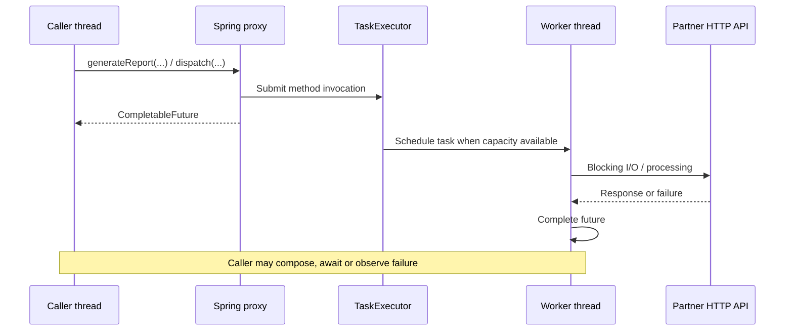
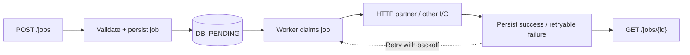

# @Async, @EnableAsync, and Offloading Work from the Calling Thread

> **Chapter:** Async Tasks  
> **Module:** `SPRING_BOOT_INTEGRATION` — system integration via HTTP clients, databases, caches, message brokers, and Spring Integration adapters. This lesson focuses on configuration, contracts, transactions, errors, deduplication, testing, and observability.

## 1. The problem: offloading work from the calling thread

Suppose a Spring Boot API receives a request to send a shipment status to a partner system. The outbound HTTP call may take several seconds. If the controller uses a synchronous HTTP client and waits for the result, the servlet thread serving the request will be held for the entire I/O wait time. When many requests arrive concurrently, the number of available threads can drop sharply.

`@Async` is Spring's way of executing a method on an **executor** instead of immediately on the calling thread. It is suited for work that needs to be decoupled from the current thread within the **same application process**: calling a blocking API, sending auxiliary notifications, building short reports, preparing data, or processing part of an integration flow.

Two goals are often collectively referred to as "asynchronous processing" but need to be separated:

- **Not holding the calling thread:** the method runs on a worker thread, and the caller continues working or holds a future to receive the result. `@Async` solves this need when configured properly.
- **Durable request persistence:** the system commits to processing the work even after an application restart or crash. `@Async` **does not guarantee this by itself** because its queue and in-flight work usually reside in process memory.

Lesson objectives:

1. Understand how `@EnableAsync`, `@Async`, Spring proxies, and `TaskExecutor` work together.
2. Configure a bounded executor so a slow partner does not exhaust system threads.
3. Use `CompletableFuture` to receive results, handle errors, and compose tasks.
4. Recognize self-invocation, transaction boundaries, thread-local data, and timeouts.
5. Choose between `@Async` and a job queue/broker/outbox based on the reliability requirements of each integration flow.
6. Test and monitor tasks by **business outcome**, rather than treating a successful submission as completion.

## 2. How @EnableAsync and @Async work

### 2.1. Enabling async support with @EnableAsync

`@EnableAsync` enables the infrastructure that intercepts calls to methods annotated with `@Async`. In common configurations, Spring uses a **proxy** around a container-managed bean. The proxy receives calls from other beans and dispatches execution to an executor.

```java
import org.springframework.boot.SpringApplication;
import org.springframework.boot.autoconfigure.SpringBootApplication;
import org.springframework.scheduling.annotation.EnableAsync;

@SpringBootApplication
@EnableAsync
public class IntegrationApplication {

    public static void main(String[] args) {
        SpringApplication.run(IntegrationApplication.class, args);
    }
}
```

You can also place `@EnableAsync` on a `@Configuration` class. If async support is not enabled, merely adding `@Async` to a method is not enough to move the method onto a worker thread.

### 2.2. @Async marks work to run on an executor

```java
import java.util.concurrent.CompletableFuture;
import org.springframework.scheduling.annotation.Async;
import org.springframework.stereotype.Service;

@Service
public class ReportTaskService {

    @Async("integrationExecutor")
    public CompletableFuture<String> generateReport(String reportId) {
        String location = buildReport(reportId);
        return CompletableFuture.completedFuture(location);
    }

    private String buildReport(String reportId) {
        // Illustration: replace with actual computation or I/O work.
        return "/reports/" + reportId + ".csv";
    }
}
```

When another bean calls `reportTaskService.generateReport("r-42")` **through the Spring proxy**, the caller receives a `CompletableFuture<String>`. The body of `buildReport` runs on a worker thread from `integrationExecutor`. The call on the caller thread does not need to wait for the task to finish unless it explicitly waits using `get()`, `join()`, or an equivalent mechanism.

There is an easily misunderstood detail: the `@Async`-annotated method still declares `return CompletableFuture.completedFuture(location)`. This already-completed future represents the result that **the worker has just finished computing inside the method**; the Spring proxy provides the asynchronous future to the caller. There is no need to additionally call `CompletableFuture.supplyAsync(...)` inside a method already using `@Async`, as doing so usually creates an unnecessary extra layer of scheduling.

### 2.3. How a call is executed



`@Async` only offloads work to another thread. It **does not automatically turn** blocking JDBC or HTTP clients into non-blocking I/O. The worker may still have to wait on the database or partner API. If the executor runs out of capacity to accept more tasks, the submission may be rejected before the method runs.

| Component | Responsibility |
|---|---|
| `@EnableAsync` | Enables asynchronous method invocation support in the Spring context. |
| `@Async` | Indicates the method to intercept and can specify the executor bean name. |
| Spring proxy | Intercepts calls from outside the bean and dispatches them to the executor. |
| `TaskExecutor` / `Executor` | Manages threads, the queue, scheduling, and overload behavior. |
| `CompletableFuture<T>` | Represents the deferred result or failure of an asynchronous call. |

## 3. Configuring a bounded ThreadPoolTaskExecutor

For integration flows, you should explicitly name and bound your executors. A slow HTTP partner can hold many workers; if all tasks share an uncontrolled pool, other work can be impacted.

```java
import java.util.concurrent.ThreadPoolExecutor;
import org.springframework.context.annotation.Bean;
import org.springframework.context.annotation.Configuration;
import org.springframework.scheduling.concurrent.ThreadPoolTaskExecutor;

@Configuration
public class IntegrationAsyncConfig {

    @Bean("integrationExecutor")
    public ThreadPoolTaskExecutor integrationExecutor() {
        ThreadPoolTaskExecutor executor = new ThreadPoolTaskExecutor();

        executor.setCorePoolSize(4);
        executor.setMaxPoolSize(12);
        executor.setQueueCapacity(100);
        executor.setKeepAliveSeconds(60);
        executor.setThreadNamePrefix("integration-task-");
        executor.setRejectedExecutionHandler(
            new ThreadPoolExecutor.AbortPolicy()
        );

        executor.setWaitForTasksToCompleteOnShutdown(true);
        executor.setAwaitTerminationSeconds(30);
        executor.initialize();
        return executor;
    }
}
```

Meaning of the settings:

- `corePoolSize = 4`: number of core threads the pool maintains when there is work.
- `maxPoolSize = 12`: maximum number of threads allowed in the pool.
- `queueCapacity = 100`: limit on tasks queued while waiting.
- `AbortPolicy`: rejects tasks when capacity is exhausted. The caller must handle this situation properly.
- `threadNamePrefix`: helps identify workers in logs and thread dumps.
- `setWaitForTasksToCompleteOnShutdown` and `setAwaitTerminationSeconds`: support controlled shutdown; they do **not** guarantee work survives a crash or abrupt kill.

With `ThreadPoolExecutor`'s mechanics, once core threads are occupied, new work is typically placed in the queue before the pool grows beyond core (when the queue is full and room remains up to max). Therefore, an overly large queue can leave many tasks waiting even if `maxPoolSize` has been raised. Conversely, an overly large pool/queue can overload the database, HTTP client, or partner.

The values `4 / 12 / 100` are for illustration only. Actual numbers must be determined from traffic rate, I/O wait times, connection limits, and the number of deployed instances.

### 3.1. Selecting an executor by qualifier

```java
@Async("integrationExecutor")
public CompletableFuture<String> exportAsync(String exportId) {
    // ...
}
```

The string `integrationExecutor` must resolve to an executor bean in the context. Relying on a default executor makes bean selection and default capacity dependent on configuration/Spring version. For systems requiring explicit load management, using a named executor bean makes investigation and monitoring much easier.

### 3.2. Rough concurrency calculation

In a steady-state system, Little's Law gives an initial estimate:

```text
Concurrent tasks ≈ task arrival rate/second × average processing time (seconds)
```

For example, receiving 20 tasks per second with each task taking an average of 0.5 seconds yields around 10 concurrent tasks on average. If the partner slows down to 5 seconds, the same arrival rate corresponds to about 100 concurrent tasks. A pool with a lower bound will build a queue and eventually reject tasks.

This is only an estimate to start capacity planning, not a guarantee. You must measure latency distributions, traffic spikes, timeouts, retries, and total instance count. If there are 8 instances with 12 workers each, the cluster can generate up to about 96 concurrent operations, exceeding a partner's quota even while each instance appears healthy.

## 4. Example: partner HTTP integration with @Async

Suppose the system uses **Spring MVC + synchronous RestClient** to send shipment statuses. The goal of `@Async` is to move the blocking HTTP call off the servlet thread.

### 4.1. Defining DTOs and the HTTP client

```java
public record PartnerRequest(
    String deliveryId,
    String orderId,
    String status
) {}

public record PartnerReceipt(
    String partnerReference,
    String acceptedStatus
) {}
```

Configure the client via a Spring Bean:

```java
import org.springframework.beans.factory.annotation.Value;
import org.springframework.context.annotation.Bean;
import org.springframework.context.annotation.Configuration;
import org.springframework.web.client.RestClient;

@Configuration
public class PartnerHttpConfig {

    @Bean
    public RestClient partnerRestClient(
            RestClient.Builder builder,
            @Value("${partner.base-url}") String baseUrl) {

        return builder.baseUrl(baseUrl).build();
    }
}
```

```yaml
partner:
  base-url: https://partner.example.test
```

The address above is an example only. In a real system, you need to configure connect and read timeouts on the request factory/HTTP client, authentication mechanisms, connection limits, and credential management via secrets. Do not log tokens or sensitive payloads.

### 4.2. Service running the HTTP call on a worker thread

```java
import java.util.concurrent.CompletableFuture;
import org.springframework.scheduling.annotation.Async;
import org.springframework.stereotype.Service;
import org.springframework.web.client.RestClient;

@Service
public class PartnerDispatchService {

    private final RestClient partnerRestClient;

    public PartnerDispatchService(RestClient partnerRestClient) {
        this.partnerRestClient = partnerRestClient;
    }

    @Async("integrationExecutor")
    public CompletableFuture<PartnerReceipt> dispatch(PartnerRequest request) {
        PartnerReceipt receipt = partnerRestClient.post()
            .uri("/deliveries")
            .body(request)
            .retrieve()
            .body(PartnerReceipt.class);

        if (receipt == null) {
            throw new IllegalStateException("Partner returned an empty receipt");
        }

        return CompletableFuture.completedFuture(receipt);
    }
}
```

The `RestClient` call is blocking; it occupies the worker thread while waiting for the partner. The Spring proxy returns a future to the caller. If the HTTP call or response handling fails, the future completes exceptionally.

### 4.3. Spring MVC controller returning a response after completion

```java
import java.util.concurrent.CompletableFuture;
import org.springframework.http.ResponseEntity;
import org.springframework.web.bind.annotation.PostMapping;
import org.springframework.web.bind.annotation.RequestBody;
import org.springframework.web.bind.annotation.RequestMapping;
import org.springframework.web.bind.annotation.RestController;

@RestController
@RequestMapping("/partner-sync")
public class PartnerSyncController {

    private final PartnerDispatchService dispatchService;

    public PartnerSyncController(PartnerDispatchService dispatchService) {
        this.dispatchService = dispatchService;
    }

    @PostMapping
    public CompletableFuture<ResponseEntity<PartnerReceipt>> send(
            @RequestBody PartnerRequest request) {

        return dispatchService.dispatch(request)
            .thenApply(ResponseEntity::ok);
    }
}
```

Spring MVC can use `CompletableFuture` to process request results asynchronously: the initial servlet thread is released while waiting, but **the HTTP client still does not receive the final response** until the task finishes. If the future fails, you must configure HTTP error mapping and logging according to your API contract (for example, via `@ControllerAdvice`).

This differs from an endpoint that immediately returns `202 Accepted`. A reliable `202` API typically must persist the job into a database/queue before acknowledging and return a `jobId` for status querying. Calling `dispatch(...)` and immediately returning `202` without durable persistence only means "attempted in-process scheduling"; a crash can cause the work to be lost completely.

### 4.4. WebFlux and WebClient

If the flow uses Spring WebFlux and non-blocking `WebClient`, in most cases you should compose `Mono`/`Flux` rather than adding `@Async`:

```java
public Mono<PartnerReceipt> dispatchReactive(PartnerRequest request) {
    return webClient.post()
        .uri("/deliveries")
        .bodyValue(request)
        .retrieve()
        .bodyToMono(PartnerReceipt.class);
}
```

When a blocking library must exist inside a Reactor pipeline, isolate it on an appropriate scheduler such as `Schedulers.boundedElastic()`, while bounding concurrency. `@Async` does not turn a JDBC driver reactive, does not guarantee higher throughput, and does not replace backpressure mechanisms.

## 5. Return types, errors, and timeouts

Common return types supported by `@Async` are `void`, `Future<T>`, and `CompletableFuture<T>`. For tasks where you need to inspect results and handle errors, `CompletableFuture<T>` is usually the clearest choice.

### 5.1. Observing the outcome of a CompletableFuture

```java
CompletableFuture<PartnerReceipt> future =
    partnerDispatchService.dispatch(request);

future.whenComplete((receipt, failure) -> {
    if (failure != null) {
        recordFailure(request.deliveryId(), failure);
    } else {
        recordSuccess(request.deliveryId(), receipt);
    }
});
```

`recordFailure`/`recordSuccess` are custom business operations; in production systems, status updates must account for idempotency and the durability of the result-recording step itself.

| API | Purpose | Notes |
|---|---|---|
| `thenApply(fn)` | Transforms the value on success | Does not create a separate thread by itself |
| `thenCompose(fn)` | Chains a step returning `CompletionStage` | Avoids nested futures |
| `handle((value, error) -> ...)` | Handles both success and failure | Can convert an error into a value |
| `exceptionally(fn)` | Produces a fallback for an error | Misuse can mask real errors |
| `whenComplete(fn)` | Observes success/failure | Does not convert an error into success by default |
| `get()` / `join()` | Waits for the result | Blocks the calling thread |

If an `@Async` method throws an exception, the future completes exceptionally. `get()` typically wraps it in `ExecutionException`, and `join()` can wrap it in `CompletionException`; you need to unwrap the root cause to classify network errors, validation errors, timeouts, or business rejections.

### 5.2. Why think carefully about @Async void?

```java
@Async("integrationExecutor")
public void refreshCache(String cacheKey) {
    refreshCacheEntry(cacheKey);
}
```

With a `void` return type, the caller has no future to know whether the task succeeded or failed. Errors occurring in the worker do not unwind to the caller's stack. Spring provides `AsyncUncaughtExceptionHandler` to handle such errors.

```java
import java.lang.reflect.Method;
import org.slf4j.Logger;
import org.slf4j.LoggerFactory;
import org.springframework.aop.interceptor.AsyncUncaughtExceptionHandler;
import org.springframework.context.annotation.Configuration;
import org.springframework.scheduling.annotation.AsyncConfigurer;

@Configuration
public class AsyncErrorConfig implements AsyncConfigurer {

    private static final Logger log =
        LoggerFactory.getLogger(AsyncErrorConfig.class);

    @Override
    public AsyncUncaughtExceptionHandler getAsyncUncaughtExceptionHandler() {
        return (Throwable error, Method method, Object... params) ->
            log.error("Async method {} failed", method.getName(), error);
    }
}
```

This handler logs errors for `void` async methods, but **it does not provide retries, durable state, or broker ACKs**. Do not log all parameters if they contain private data or secrets.

### 5.3. Future timeouts do not cancel side effects

```java
CompletableFuture<PartnerReceipt> result =
    partnerDispatchService.dispatch(request)
        .orTimeout(5, java.util.concurrent.TimeUnit.SECONDS);
```

`orTimeout` causes the future to complete exceptionally when the deadline expires; it **does not guarantee** interrupting an in-flight HTTP call, rolling back a partner transaction, or reversing actions already performed. You need HTTP/database timeouts and a status-inquiry mechanism when it is unknown whether the request was executed.

## 6. Common proxy pitfalls

### 6.1. Self-invocation does not trigger @Async

In common proxy mode, only calls **passing through the Spring proxy** are intercepted.

```java
import org.springframework.scheduling.annotation.Async;
import org.springframework.stereotype.Service;

@Service
public class BadImportService {

    public void startImport(String fileId) {
        importInBackground(fileId); // this.importInBackground(fileId)
    }

    @Async("integrationExecutor")
    public void importInBackground(String fileId) {
        // Runs directly when called from startImport within the same bean.
    }
}
```

The internal call `this.importInBackground(...)` does not pass through the proxy. A simple and testable fix is to extract the task into **another bean**:

```java
@Service
public class ImportTaskService {

    @Async("integrationExecutor")
    public CompletableFuture<Void> importFile(String fileId) {
        performImport(fileId);
        return CompletableFuture.completedFuture(null);
    }

    private void performImport(String fileId) {
        // Perform the import.
    }
}

@Service
public class ImportCoordinator {

    private final ImportTaskService taskService;

    public ImportCoordinator(ImportTaskService taskService) {
        this.taskService = taskService;
    }

    public CompletableFuture<Void> startImport(String fileId) {
        return taskService.importFile(fileId); // Called through the Spring bean proxy
    }
}
```

Avoid relying on self-injecting a bean into itself just to route through the proxy; separating responsibilities clearly improves maintainability.

### 6.2. Other conditions

| Symptom | Common cause | How to fix |
|---|---|---|
| Method runs on the caller thread | Missing `@EnableAsync`, self-invocation, or object created with `new` | Enable async, call through a Spring-managed bean |
| `@Async` on a private method has no effect | Proxy cannot intercept as expected | Place a public method on another bean |
| Executor not found | Wrong qualifier or bean does not exist | Declare the executor bean with the matching name |
| Incompatible return type | `@Async` only supports allowed return types | Use `void`, `Future`, or `CompletableFuture` |
| Sometimes async, sometimes not | One code path calls via proxy, another calls `this` | Audit callers and write an integration test |
| Errors go unseen | Future is ignored, or method returns `void` | Handle errors, log, record metrics, and persist state |
| Task rejected | Executor queue/pool is full | Throttle intake, return errors, and retry appropriately |

Some `final` methods or classes/methods that cannot be proxy-intercepted can also introduce limitations depending on the proxy mechanism used. Spring supports AspectJ mode with different weaving capabilities, but it requires dedicated configuration; do not assume an application uses AspectJ by default.

## 7. Transactions do not automatically propagate across worker threads

With JDBC and Spring's standard synchronous transaction management, the transaction context is bound to the thread via `ThreadLocal`. Offloading work to an executor does not automatically transfer the caller's transaction to the worker.

Error-prone example:

```java
@Transactional
public void createOrder(Order order) {
    orderRepository.save(order);
    partnerDispatchService.dispatch(toPartnerRequest(order));
    // Here the transaction may not have committed yet.
}
```

The worker might invoke the partner HTTP API before the order data is committed. If the order-creation transaction subsequently rolls back, the partner may already have received the command; the database and the partner become inconsistent. If the worker queries the database, it may not see uncommitted data.

### 7.1. Creating a transaction at the business step running on the worker

```java
@Service
public class OrderStatusWriter {

    @Transactional
    public void markDispatched(String orderId, String partnerReference) {
        // Persist shipment status and reference code to the database.
    }
}

@Service
public class DispatchWorker {

    private final PartnerGateway gateway;
    private final OrderStatusWriter statusWriter;

    public DispatchWorker(PartnerGateway gateway,
                          OrderStatusWriter statusWriter) {
        this.gateway = gateway;
        this.statusWriter = statusWriter;
    }

    @Async("integrationExecutor")
    public CompletableFuture<Void> dispatch(String orderId) {
        PartnerReceipt receipt = gateway.send(orderId);
        statusWriter.markDispatched(orderId, receipt.partnerReference());
        return CompletableFuture.completedFuture(null);
    }
}
```

`PartnerGateway` is an HTTP adapter defined by the application. `markDispatched` is called through a Spring bean proxy, so it can start **its own transaction** on the worker thread. This is still not an atomic transaction across the partner HTTP API and the database.

Do not assume combining `@Transactional` and `@Async` on a single method inherits the caller's transaction; behavior also depends on advice ordering and the transaction manager. Separating async and transaction boundaries across distinct, single-responsibility beans is generally easier to test.

### 7.2. Triggering after commit

If you only need to prevent execution before data is committed, you can publish a Spring application event inside the transaction and use an `AFTER_COMMIT` listener:

```java
import org.springframework.stereotype.Component;
import org.springframework.transaction.event.TransactionPhase;
import org.springframework.transaction.event.TransactionalEventListener;

public record OrderCommitted(String orderId) {}

@Component
public class OrderCommittedListener {

    private final DispatchWorker worker;

    public OrderCommittedListener(DispatchWorker worker) {
        this.worker = worker;
    }

    @TransactionalEventListener(phase = TransactionPhase.AFTER_COMMIT)
    public void afterCommit(OrderCommitted event) {
        worker.dispatch(event.orderId());
    }
}
```

The `OrderCommitted` event must be published inside the transaction using `ApplicationEventPublisher`. The listener calls the worker through the injected bean, so `@Async` takes effect via the proxy mechanism. In this example, there is no need to add `@Async` to the listener itself.

**Important limitation:** `AFTER_COMMIT` solves ordering relative to commit, but events and tasks can still be lost if the process dies between the DB commit and worker execution. When guaranteed processing is required, use a job table or transactional outbox.

## 8. Does @Async replace a broker, job queue, or scheduler?

No. These mechanisms serve overlapping needs with different delivery guarantees.

| Solution | Strengths | Limitations |
|---|---|---|
| Synchronous call | Simple, immediate error visibility | Holds the caller thread while waiting |
| `@Async` + executor | Easy to offload work to another thread in the same process | Not durable across crashes, no built-in retry/load distribution across instances |
| `CompletableFuture.supplyAsync` | Explicit control over composition | Must manage executor/context/exceptions manually |
| WebClient + Reactor | Non-blocking I/O suited for WebFlux | Requires proper reactive pipeline and supporting drivers |
| Job table + worker | Persisted status, retries, crash recovery | Needs job claiming/locking and deadline management |
| Broker (Kafka/RabbitMQ/JMS) | Decouples producer–consumer, queuing/routing/delivery per config | Still needs idempotency, DLQ/DLT, and observability |
| Transactional outbox | Writes business state and publish intent in one DB transaction | Relay may redeliver; consumer must deduplicate |

`@Async` and a broker can work together, but never ACK a message before critical work has completed or been durably persisted. If a listener receives a Kafka record, immediately hands it to an executor, and ACKs, a process crash can lose the task even though the offset was committed.

### 8.1. Designing a 202 API with a durable job



The API should only confirm acceptance per contract after the job has been successfully persisted. Workers need safe claiming across multiple instances, lease timeouts/stuck-job recovery, bounded retries, and statuses for reconciliation.

When updating business state and emitting events to a broker, a **transactional outbox** lets you store the business state alongside an intent-to-publish record in a single DB transaction; a relay publishes it afterward. Because the relay may send duplicates, consumers must handle idempotency.

## 9. Retries, deduplication, and uncertain failures

`@Async` only provides asynchronous execution; **it does not automatically retry** on HTTP 503, database timeouts, or temporary broker unavailability.

A useful retry policy should distinguish:

- **Transient errors:** connection drops, 503, timeouts, rate limits; usually retryable with exponential backoff and jitter.
- **Permanent errors:** invalid data, unauthorized, contract violations; should not be retried indefinitely.
- **Uncertain outcomes:** the partner may have received and processed the request, but the response was lost. You must check status or retry with an idempotency key.

For example, a shipment-creation command has `deliveryId = "del-42"`. If the partner's API supports an idempotency key, send **the same key** when retrying the same business intent. Otherwise, look up the shipment status before resending. Never generate a new key on each transport retry.

For broker consumers, deduplication keys are usually a business-stable `commandId` or `eventId`. `correlationId` is used for end-to-end flow tracing, not as a dedup key for every event in a workflow.

### 9.1. Cancellation and shutdown

Canceling a `CompletableFuture` or an aborted HTTP request **does not automatically** stop an in-flight HTTP request on a worker, roll back the DB, or undo effects already applied at the partner. Shutdown with a wait period also does not prove that all work in RAM finished. Tasks that must complete need persisted state for recovery or reconciliation.

## 10. Context, security, and tracing across threads

Certain data bound to the caller thread does not automatically appear on the worker:

| Context | Risk | Mitigation |
|---|---|---|
| JDBC transaction | Worker is not in the caller's transaction | Separate transaction; start after commit or use outbox |
| Custom `ThreadLocal` | Missing data, stale data from previous task | Pass explicit parameters; use a decorator with cleanup |
| SLF4J MDC | Worker logs lack correlation ID | Context propagation or `TaskDecorator` |
| Spring Security `SecurityContext` | Worker lacks request user context | Pass minimal info or use appropriate integration |
| Request-scoped bean | Request already ended when worker accesses it | Copy needed data into a DTO before submission |
| Tracing span | Broken link between request and worker | Verify application instrumentation/propagation |

### 10.1. Controlled MDC copying with TaskDecorator

```java
import java.util.Map;
import org.slf4j.MDC;
import org.springframework.core.task.TaskDecorator;

public class MdcCopyTaskDecorator implements TaskDecorator {

    @Override
    public Runnable decorate(Runnable runnable) {
        Map<String, String> captured = MDC.getCopyOfContextMap();

        return () -> {
            Map<String, String> previous = MDC.getCopyOfContextMap();
            try {
                if (captured == null) {
                    MDC.clear();
                } else {
                    MDC.setContextMap(captured);
                }
                runnable.run();
            } finally {
                if (previous == null) {
                    MDC.clear();
                } else {
                    MDC.setContextMap(previous);
                }
            }
        };
    }
}
```

If using this decorator, add `executor.setTaskDecorator(new MdcCopyTaskDecorator())` in the executor configuration. It only handles MDC and **does not propagate transactions or security contexts**. For tracing and Spring Security, prefer the official propagation mechanisms appropriate for your version; avoid forwarding credentials or full HTTP headers to long-lived jobs.

## 11. Observing pools and handling overload

At a minimum, you should measure:

- `active thread count`, `pool size`, `queue depth`, and submitted/completed/rejected task counts;
- time a task spends **waiting in the queue** and **execution** time;
- partner HTTP latency, timeouts, and error rates categorized by cause;
- counts of `PENDING`, `RETRYING`, `FAILED` jobs and oldest job age when using a job queue;
- retry/dedup counts, rate limits, and final business outcomes;
- `jobId`, `correlationId`, trace/span, and executor name in logs.

Spring Boot Actuator and Micrometer can expose executor and HTTP client metrics depending on beans, instrumentation, and versions. Do not assume queue wait time or rejected counts are exported out of the box in every setup; verify actual metrics and add instrumentation if missing.

**Overload policies must be designed upfront.** When the pool and queue are full, `AbortPolicy` rejects submissions. The application can throttle intake, return an error matching its API contract, or persist the task into a durable job queue for later processing. `CallerRunsPolicy` can force the submitting thread to run the task, but that blocks the HTTP thread, defeating the goal of isolating blocking I/O from requests.

Do not try to solve every error by increasing pool size. A larger pool can saturate connections to the database, partner HTTP API, or broker; always account for total threads/connections across the **entire cluster**.

## 12. Testing @Async and integration flows

Tests must run through a real Spring context to ensure calls go through the proxy. Unit tests that simply call the method and check the return value do not prove the method actually ran on another thread.

```java
import static org.assertj.core.api.Assertions.assertThat;

import java.util.concurrent.TimeUnit;
import org.junit.jupiter.api.Test;
import org.springframework.beans.factory.annotation.Autowired;
import org.springframework.boot.test.context.SpringBootTest;

@SpringBootTest
class ReportTaskServiceTest {

    @Autowired
    private ReportTaskService reportTaskService;

    @Test
    void generatesReport() throws Exception {
        String result = reportTaskService
            .generateReport("r-42")
            .get(5, TimeUnit.SECONDS);

        assertThat(result).isEqualTo("/reports/r-42.csv");
    }
}
```

The snippet above verifies the result through a real bean; to verify **execution on a separate thread**, use a test fixture that records `Thread.currentThread()` into the result or a probe and compare it against the caller thread, rather than relying on `Thread.sleep(...)`. Also test failure and overload paths.

| Test case | What to verify |
|---|---|
| Calling an `@Async` bean | Method executes via the specified executor |
| Self-invocation | Calls within the same bean are not proxy-intercepted in default mode |
| Partner HTTP error/timeout | Future completes exceptionally; errors are classified and observed |
| Executor full | Rejections are handled without silently marking work as done |
| Caller transaction rollback | Worker does not depend on uncommitted state |
| Crash after DB commit | Job/outbox recovers if business requires durability |
| Retry with same command ID | Does not duplicate shipment/payment side effects |
| Multiple workers/instances | Job claiming/dedup and load limits work properly |
| Shutdown with backlog | Unprocessed tasks are not reported as completed |
| Cross-thread trace/logs | Correlation ID and job ID attach accurately to outcomes |

Use an HTTP mock server for partner failures and an appropriate database/broker (e.g., via Testcontainers) to verify retries, deduplication, transactions, and real consistency. STEP 4 focuses on authoring the knowledge content, and has not yet performed a specialized Content QA pass or run project tests.

## 13. Common misconceptions that cause bugs

| Misconception | Reality |
|---|---|
| "Adding `@Async` guarantees the method always runs on another thread." | Requires `@EnableAsync`, a bean proxy, and calls routed through the proxy. |
| "Calling the method from the same class is still async." | Self-invocation usually bypasses the proxy. |
| "`@Async` speeds up every call." | It shifts where I/O waits happen; databases and partners still have limits. |
| "`@Async void` propagates errors back to the caller." | The caller has no future; requires a separate handler or persisted state. |
| "Calling `get()` right after submit is still non-blocking." | `get()` and `join()` wait for the result and can block the current thread. |
| "`@Transactional` on the caller is inherited." | Worker threads have their own transaction context. |
| "Adding `@Async` to a listener guarantees events won't be lost." | In-memory events and tasks can be lost on crash. |
| "Returning `202` means the work is guaranteed to be processed." | Requires a clear contract and durable persistence for guaranteed processing. |
| "Future timeout cancels work at the partner." | Side effects may already have occurred; needs idempotency/reconciliation. |
| "An executor queue is like a broker queue." | An executor queue is an in-RAM structure, not durable storage. |

## 14. Design checklist

When building an async task in `SPRING_BOOT_INTEGRATION`, answer these questions:

1. **Can work be lost if the process dies?** If not, use a job table/outbox/broker before acknowledging.
2. **Does the caller need the result or just a job ID?** Choose `CompletableFuture` returning after completion or `202` with durable state.
3. **Does the method go through the Spring proxy?** Check `@EnableAsync`, Spring bean wiring, executor name, and self-invocation.
4. **Is the executor bounded?** Are core/max threads, queue, rejection, and total multi-instance load bounded?
5. **Where are the transactions?** Could a worker run before commit or succeed over HTTP before a DB rollback?
6. **Are retries safe?** Do you have error classification, real client timeouts, idempotency keys, and uncertain-status reconciliation?
7. **What context is needed?** Pass IDs and minimal data, ensure proper MDC/tracing, and avoid leaking security contexts.
8. **Are real outcomes observed?** Do you have metrics, logs, callbacks, job states, and tests for errors/crashes/retries?

### Takeaways

- `@EnableAsync` enables the mechanism, `@Async` marks the method, and the **executor** controls where and how much can run.
- `CompletableFuture` lets you receive results or errors; `void` is only appropriate when another error-observation path exists.
- Worker threads do not automatically inherit the caller's transaction, request scope, or every thread-bound context.
- `@Async` is an **in-process off-thread execution mechanism**, not a durable job queue.
- For integrations involving HTTP, databases, caches, brokers, and Spring Integration adapters, reliability also depends on **data contracts, idempotency, timeouts, retries, transactions, state, and observability**.

The essence of `@Async` is decoupling work from the calling thread; choose it when it fits your architecture and business guarantees. Cross-system workflows that must never be lost need durable persistence, distribution mechanisms, and explicit error control.
