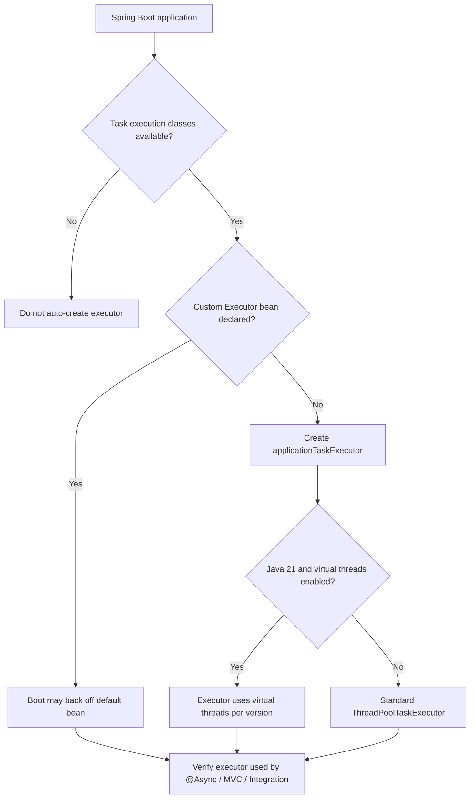
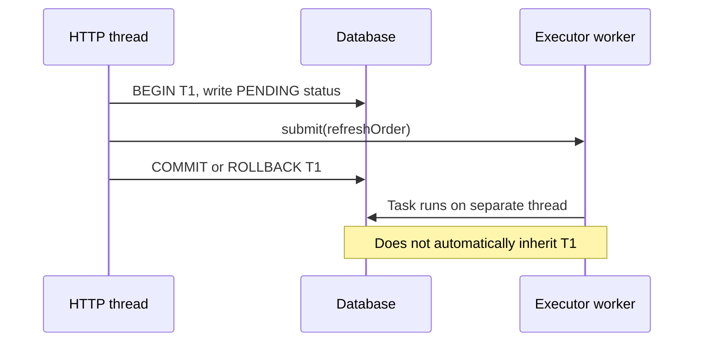
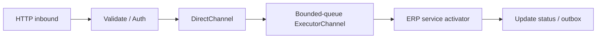

# TaskExecutor, AsyncTaskExecutor, and Spring Boot Auto-Configuration

## 1. Why integration flows need async task management

A Spring Boot application can receive HTTP requests, query databases, call ERPs via REST/SOAP, publish events to Kafka or RabbitMQ, and update Redis caches. Some work does not need to hold the caller's thread: preparing reports, syncing secondary data, sending notifications, or processing a set of independent tasks. Offloading them to another thread lets the application release the caller earlier and dedicate bounded resources to slow operations.

However, **going asynchronous does not automatically make a task faster, more durable, or safer**. If every request spawns a thread, waiting tasks can grow without bound. If a payment-creation command is pushed to an in-RAM executor and the API returns HTTP 202, the application can crash before the task runs and lose the command. If a database transaction is open on the originating thread, work running on another thread does not automatically join that transaction.

In the **`SPRING_BOOT_INTEGRATION`** module, organizing integrations across HTTP clients, databases, caches, message brokers, and Spring Integration adapters always involves managing configuration, data contracts, transactions, errors, duplicates, testing, and observability. `TaskExecutor` and `AsyncTaskExecutor` are the execution primitives that help **establish in-process async boundaries**, while job durability and cross-system consistency still require dedicated design.

**Running scenario:** the `order-integration` service receives requests to look up and enrich ERP statuses. We want to cap concurrent ERP calls at 12 per instance, prevent a slow ERP from exhausting HTTP request threads, measure queue depth, and reject excess tasks under an explicit policy.

After this lesson, you will be able to:

- Distinguish Java `Executor`, Spring `TaskExecutor`, `AsyncTaskExecutor`, `ThreadPoolTaskExecutor`, and `SimpleAsyncTaskExecutor`.
- Understand when Spring Boot creates a default executor bean and when application-declared configurations cause Boot to back off.
- Configure thread pools, queues, rejection policies, shutdown, `@Async`, and executor selection per dependency.
- Handle results, exceptions, timeouts, transactions, and contexts when tasks run on another thread.
- Choose among an in-RAM executor, a broker, an outbox, and Spring Batch based on durability and recovery requirements.
- Test and observe saturation, rejected tasks, throughput, and actual latency.

## 2. From Java `Executor` to Spring `AsyncTaskExecutor`

Java's foundational API is `java.util.concurrent.Executor`:

```java
public interface Executor {
    void execute(Runnable command);
}
```

Calling `execute` means **handing off a task for an executor to run**; it does not implicitly guarantee the task runs on a new thread or is durably stored. An executor may run immediately on the caller thread, enqueue into a pool, or reject due to overload.

Spring provides two related abstractions:

| API | Relationship & role | Typical usage |
|---|---|---|
| JDK `Executor` | Contract for submitting a `Runnable`. | `execute(task)`. |
| `TaskExecutor` | Spring abstraction extending `Executor`, integrating with the Spring ecosystem. | `execute(task)`. |
| `AsyncTaskExecutor` | Extends `TaskExecutor` to support task submission and returning `Future`/`CompletableFuture` depending on Spring version. | `submit(Callable<T>)`, `submitCompletable(...)` where supported by the API. |
| JDK `ExecutorService` | Executor with lifecycle, submit, shutdown, and future management. | `submit(...)`, `shutdown()`. |
| `ThreadPoolTaskExecutor` | Spring implementation backed by `ThreadPoolExecutor`; supports pool, queue, decorator, and lifecycle configuration. | Suited for blocking tasks requiring a finite pool. |
| `SimpleAsyncTaskExecutor` | Spawns a thread per task; can use virtual threads in supported environments. | Does not pool/reuse threads; must cap concurrency when needed. |

`TaskExecutor` is not synonymous with `@Async`. You can inject and invoke an executor directly without enabling `@EnableAsync`:

```java
import org.springframework.core.task.TaskExecutor;
import org.springframework.beans.factory.annotation.Qualifier;
import org.springframework.stereotype.Service;

@Service
public class OrderRefreshDispatcher {
    private final TaskExecutor erpExecutor;
    private final OrderRefreshWorker worker;

    public OrderRefreshDispatcher(
            @Qualifier("erpExecutor") TaskExecutor erpExecutor,
            OrderRefreshWorker worker) {
        this.erpExecutor = erpExecutor;
        this.worker = worker;
    }

    public void dispatch(String orderId) {
        erpExecutor.execute(() -> worker.refresh(orderId));
    }
}
```

`OrderRefreshWorker` is an application-defined service. The `dispatch` call above provides no durable persistence or Future for the caller to observe success or failure; if `execute` rejects, an exception may be thrown directly at submission time. For work that must never be lost, this design needs a **durable job record** or an appropriate broker/queue.

### `execute`, `submit`, and results

`Runnable` has no return value; `Callable<T>` returns a value or throws an exception. With implementations supporting `AsyncTaskExecutor`, you can call:

```java
Future<String> future = asyncTaskExecutor.submit(() -> {
    return partnerClient.fetchStatus("order-42");
});

String status = future.get(); // Blocks the caller thread until the result arrives.
```

Calling `get()` immediately turns an asynchronous flow back into synchronous waiting. Use a Future when coordinating results, but avoid queuing tasks that all block waiting on other Futures from the same thread pool.

## 3. Common implementations and trade-offs

| Implementation | Execution model | Best suited for | Risks to manage |
|---|---|---|---|
| `SyncTaskExecutor` | Runs the task immediately on the caller thread. | Synchronous tests, small tasks needing ordering. | Does not create an async boundary. |
| `SimpleAsyncTaskExecutor` | Creates a new thread per task instead of pooling. | Dedicated thread per task, virtual threads, or low task volume. | Unbounded task/thread growth under incoming traffic if concurrency isn't limited. |
| `ThreadPoolTaskExecutor` | Reuses platform threads with queue and core/max sizing. | Blocking JDBC, HTTP/SOAP, concurrency-bounded tasks. | Unbounded queues, thread starvation, rejection when full. |
| `ConcurrentTaskExecutor` | Adapter wrapping an existing `Executor`. | Integrating a JDK or externally managed executor. | Queue/shutdown policy depends on the wrapped executor. |
| `VirtualThreadTaskExecutor` (where version supports) | Creates a virtual thread per task. | Many blocking I/O operations under thread-per-task model. | Does not replace connection quotas, CPU limits, or upstream caps. |

Note that `ThreadPoolTaskExecutor` is a lifecycle-managed Spring bean and is usually the direct choice when you need integration-specific pool configuration. Never create `new Thread(...)` or a new pool per HTTP request, as that loses pooling, metrics, and controlled shutdown.

## 4. When does Spring Boot auto-configure an executor?

In common Spring Boot 3.x versions, **`TaskExecutionAutoConfiguration`** configures task execution infrastructure when the required classes are on the classpath and matching bean conditions hold. The default application bean is typically named **`applicationTaskExecutor`**, of type `ThreadPoolTaskExecutor` under standard platform-thread configurations.

Conditions and exceptions to understand:

1. **Classpath:** Spring's executor APIs must be available. Spring Boot and related starters typically include `spring-core`; web/JDBC async infrastructure depends on dependencies.
2. **User-defined beans:** if the application already declares an `Executor`, many Boot versions **back off** on the default executor. Newer versions may offer options to force configuration; always check the condition report and docs for your exact version.
3. **Bean name and type:** having an `Executor` bean does not guarantee every component's requirements are met. For example, some Spring MVC async integrations expect an `AsyncTaskExecutor` and an `applicationTaskExecutor` bean of the right name/type.
4. **Virtual threads:** with Spring Boot 3.2+ on Java 21, setting `spring.threads.virtual.enabled=true` may cause the auto-configured executor to use `SimpleAsyncTaskExecutor` with virtual threads instead of a platform thread pool; exact behavior depends on version and configuration.
5. **`@Async`:** having an executor **does not automatically enable** `@Async` method interception. Async processing must be enabled via `@EnableAsync` or equivalent configuration.

Decision diagram:



This is a **conceptual guide**. To see which conditions actually matched or missed, inspect the `Condition Evaluation Report` of the running version, especially when using custom executors, virtual threads, or multiple auto-configurations.

### 4.1. Auto-configuration does not automatically make calls async

A controller calling `erpClient.getStatus()` still executes according to how the client and controller are written. Adding a starter or having `applicationTaskExecutor` does not make blocking JDBC/HTTP calls non-blocking, nor does it push them to the background. Code must explicitly **submit work to an executor**, call through an `@Async` proxy, or use the async mechanisms of the relevant stack to establish a different execution boundary.

### 4.2. Integration with MVC, WebFlux, GraphQL, and other components

Various components may look up an application executor, and lookup rules differ across frameworks/versions. When adding `@Bean("erpExecutor")`, check whether the application still needs a dedicated `applicationTaskExecutor` for framework tasks. A pool dedicated to ERP calls should not be accidentally reused by the framework for unrelated work.

In a system with multiple executors, **name them clearly and use `@Qualifier`/`@Async("...")`**, rather than relying on a default bean that shifts based on bean count.

## 5. Defaults and `spring.task.execution` properties

Common Boot properties for **thread-pool task execution**:

```yaml
spring:
  task:
    execution:
      thread-name-prefix: app-task-
      pool:
        core-size: 8
        max-size: 16
        queue-capacity: 64
        keep-alive: 60s
        allow-core-thread-timeout: true
      shutdown:
        await-termination: true
        await-termination-period: 20s
```

These properties illustrate Spring Boot 3.x and should be verified against your version's configuration metadata. They configure the **auto-configured executor via its corresponding mechanism**; they do not automatically apply to a `ThreadPoolTaskExecutor` you instantiate and configure independently.

Meaning:

| Property | Controls | Common pitfall |
|---|---|---|
| `core-size` | Number of core platform threads kept in the pool. | Not the maximum number of accepted tasks. |
| `max-size` | Maximum platform threads when scaling up. | With a huge queue, the pool may never scale past core for a long time. |
| `queue-capacity` | Number of tasks queued when core threads are busy. | Unbounded queues can drive up latency/RAM without triggering rejection. |
| `keep-alive` | Idle wait time before excess threads terminate. | Not a timeout for HTTP/JDBC calls inside a task. |
| `allow-core-thread-timeout` | Allows idle core threads to terminate. | Affects thread recreation behavior during traffic bursts. |
| `thread-name-prefix` | Makes threads easy to spot in logs/thread dumps. | Does not carry correlation IDs or security context. |
| `shutdown.await-termination` | Waits for tasks on application shutdown per the mechanism. | Does not guarantee tasks survive abrupt container kills. |

**Key `ThreadPoolExecutor` relationship:** once core threads are full, new tasks are typically queued first; only when the queue fills does the pool grow up to `max-size`. When both the queue and max threads are full, the executor rejects tasks. If `queue-capacity` is effectively infinite, `max-size` may rarely be reached. Never raise `max-size` while ignoring the queue.

## 6. Creating a dedicated executor for ERP

When an application runs both background DB reads and relatively slow ERP calls, **separate pools by dependency or workload** so a slow ERP cannot starve workers for other tasks.

Example creating a bounded-queue executor:

```java
import java.util.concurrent.ThreadPoolExecutor;
import org.springframework.context.annotation.Bean;
import org.springframework.context.annotation.Configuration;
import org.springframework.scheduling.annotation.EnableAsync;
import org.springframework.scheduling.concurrent.ThreadPoolTaskExecutor;

@Configuration
@EnableAsync
public class IntegrationAsyncConfiguration {

    @Bean("erpExecutor")
    public ThreadPoolTaskExecutor erpExecutor() {
        ThreadPoolTaskExecutor executor = new ThreadPoolTaskExecutor();
        executor.setThreadNamePrefix("erp-async-");
        executor.setCorePoolSize(6);
        executor.setMaxPoolSize(12);
        executor.setQueueCapacity(24);
        executor.setKeepAliveSeconds(60);
        executor.setRejectedExecutionHandler(
                new ThreadPoolExecutor.AbortPolicy());
        executor.setWaitForTasksToCompleteOnShutdown(true);
        executor.setAwaitTerminationSeconds(20);
        return executor;
    }
}
```

Spring manages the lifecycle of a `ThreadPoolTaskExecutor` created via `@Bean`, including initialization and shutdown with the context. Do not manually call `initialize()` again when Spring manages the bean lifecycle normally. The numbers `6/12/24` only illustrate resource bounding; measure load, ERP speed, global quotas, and replica count before deploying to production.

### 6.1. Actual load also depends on other limits

With 12 worker threads, the executor can hold **12 running tasks** and **24 queued tasks**; afterward, new tasks are rejected per configuration. However, if each task spawns additional async calls, outbound calls can exceed 12. To enforce a strict cap of 12 HTTP requests to ERP, add a **semaphore bulkhead** or an in-flight limiter directly at the client adapter.

A 12-thread executor also does not mean upstream ERP can handle 12 concurrent calls *per replica*. With 5 replicas, potential load is **60 concurrent calls** from this pool alone. ERP quotas must be budgeted across the whole deployment and other services sharing the ERP.

### 6.2. What happens when the queue is full?

With `AbortPolicy`, tasks are rejected; `ThreadPoolTaskExecutor` can translate this into Spring's `TaskRejectedException`. The caller must handle it explicitly:

- For skippable reads or deferrable refreshes, return a valid overload error or fallback.
- For commands that must execute reliably, persist to a **durable queue/outbox** before treating the request as accepted.
- `CallerRunsPolicy` lets the caller run the task itself when the pool is full in certain scenarios, applying backpressure; however, it can block HTTP/consumer threads for a long time and alter latency. Never use it without measuring the consequences.
- Never use silent drop policies like `DiscardPolicy` for business operations requiring guaranteed execution.

## 7. Using `@Async` across the Spring proxy boundary

`@Async` declares that a method should run through Spring's asynchronous interceptor. Once `@EnableAsync` is active, Spring typically creates a proxy for beans with eligible methods.

Example:

```java
import java.util.concurrent.CompletableFuture;
import org.springframework.scheduling.annotation.Async;
import org.springframework.stereotype.Service;

@Service
public class ErpStatusWorker {

    private final ErpStatusClient erpClient;

    public ErpStatusWorker(ErpStatusClient erpClient) {
        this.erpClient = erpClient;
    }

    @Async("erpExecutor")
    public CompletableFuture<ErpStatus> fetchStatus(String orderId) {
        ErpStatus status = erpClient.fetchStatus(orderId);
        return CompletableFuture.completedFuture(status);
    }
}
```

`ErpStatusClient` and `ErpStatus` are application-defined types. Once the proxied call is dispatched to `erpExecutor`, the method body runs on a worker thread; `completedFuture` is the return value from the target method that Spring bridges to the caller's Future.

In the calling service:

```java
@Service
public class OrderStatusService {

    private final ErpStatusWorker worker;

    public OrderStatusService(ErpStatusWorker worker) {
        this.worker = worker;
    }

    public CompletableFuture<ErpStatus> fetchAsync(String orderId) {
        return worker.fetchStatus(orderId);
    }
}
```

If the caller immediately invokes `join()`/`get()` after `fetchAsync`, the caller still blocks until completion. To reduce end-to-end latency, only fan out in parallel when steps are **truly independent**, bound concurrency, and aggregate errors cleanly. Offloading a single blocking task to another thread only to wait immediately adds overhead with no clear benefit.

### 7.1. Self-invocation disables `@Async`

```java
@Service
class MisleadingService {

    public void handle() {
        refresh(); // Call via `this`, typically bypasses @Async proxy.
    }

    @Async("erpExecutor")
    public void refresh() {
        // May execute synchronously on the thread calling handle().
    }
}
```

Simple fix: move `refresh()` to another bean and inject it into the caller, or invoke an executor intentionally. `@Async` on non-intercepted methods, calls from constructors, or instances created via `new` will not behave asynchronously. For proxy-based setups, public methods on a Spring bean called from another bean are easiest to reason about.

### 7.2. Valid return values and errors

Common return types for `@Async` are `void`, `Future<T>`, or `CompletableFuture<T>`. A method returning `CompletableFuture<T>` can surface success or exceptions for the caller to observe.

```java
worker.fetchStatus(orderId)
    .orTimeout(700, TimeUnit.MILLISECONDS)
    .whenComplete((status, failure) -> {
        if (failure != null) {
            log.warn("ERP status refresh failed: orderId={}", orderId, failure);
            return;
        }
        consumeStatus(status);
    });
```

`orTimeout` completes the Future exceptionally if the wait exceeds the limit; it **does not guarantee** the underlying JDBC query, HTTP request, or remote side effect was stopped. You need HTTP client timeouts, business deadlines, and a per-operation cancellation strategy.

With `@Async void`, exceptions have no Future for the caller to inspect. You can configure `AsyncUncaughtExceptionHandler` via `AsyncConfigurer` to log or emit alerts; avoid `void` for critical work unless you have persisted status tracking and retries. In particular, **unobserved exceptions must never silently look like "task succeeded" in business logic**.

## 8. Coexistence of Boot auto-configuration and custom executors

When you add a `ThreadPoolTaskExecutor` bean named `erpExecutor`, Boot may back off its default executor because it finds an `Executor` bean. If Spring MVC async, GraphQL, WebSocket, or another framework needs `applicationTaskExecutor`, check each component's requirements and declare an appropriate bean.

A clear way to organize them:

```text
applicationTaskExecutor  -> framework/common async workloads
erpExecutor              -> ERP outbound calls
reportExecutor           -> background reporting
eventExecutor            -> short internal event coordination
```

If you want Boot to keep creating `applicationTaskExecutor` alongside custom executors, some versions support a dedicated configuration mode; exact property names and behavior must be verified against your Boot version. Another option is to **explicitly declare an `applicationTaskExecutor` bean of the expected type** with a clearly managed pool and lifecycle.

Do not create numerous executors just to split names without load data: each pool consumes threads, memory, and indirectly connections; extra pools also complicate operations. The goal of separation is to **isolate workloads with different latencies and quotas**.

### Enabling debug to inspect auto-configuration results

In development, you can run:

```bash
java -jar integration-app.jar --debug
```

Look for `TaskExecutionAutoConfiguration` in the `Condition Evaluation Report`. Check the `applicationTaskExecutor` bean, custom executor names, `@EnableAsync`, and framework selection decisions. Never assume that because a task runs on thread `task-1`, the pool is bounded; inspect the actual bean and metrics.

## 9. Sizing thread pools, queues, and deadlines per dependency

Steady-state concurrency can be estimated using Little's Law:

```text
Average in-flight concurrency ≈ throughput (task/s) × average service time (s)
```

For example, if ERP receives 25 queries/second with an average processing time of 0.24 seconds, average in-flight requests are roughly **6**. If latency spikes to 1.2 seconds while intake remains 25/s, average in-flight demand reaches **30**. With constant arrival rate, queues grow if workers/bulkheads are capped below this; that can be intentional to protect ERP, provided callers receive clear overload feedback.

**Never size pools solely on averages.** Account for bursts, p95/p99 latency, CPU, DB/HTTP wait times, fan-out, retries, and downstream quotas. For CPU-bound tasks, adding threads far beyond CPU core count can lower throughput due to context switching. For blocking I/O, more threads can help until you hit connection or quota limits.

**Illustrative** budget table:

| Workload | Max workers/instance | Queue | Per-attempt deadline | Protection approach |
|---|---:|---:|---|---|
| ERP query (blocking HTTP) | 12 | 24 | 500 ms | Outbound bulkhead, bounded retries. |
| Sync orders from DB | 4 | 100 | Per chunk and transaction | Fixed paging, checkpoints/idempotency. |
| Report computation | 2 | 8 | Per job | Job ID and status tracking. |
| Non-urgent notifications | Do not decide via thread pool alone | Durable broker/outbox | Per delivery contract | Retries, DLQ, reconciliation. |

All figures are examples, not Spring Boot defaults. Short queues surface overload quickly, while longer queues absorb bursts at the cost of higher **wait times**; pick values grounded in SLOs and real load.

### 9.1. Queue wait time must count toward the deadline

Suppose an API has an 800 ms budget, a task waits 650 ms in the queue, and the HTTP client timeout is configured for 500 ms from call start: even if the call honors its own timeout, the request can breach the overall deadline.

A worker should check remaining time **before executing side effects**. For requests with caller-supplied deadlines, track elapsed time using a monotonic clock within the process and pass the deadline/context safely to the worker. If the task is already expired, skip useless remote calls.

Queued tasks in RAM may still run after the client closes the connection. Decide whether to cancel cancellable read-only tasks or continue durably persisted workflows. Never equate Future cancellation with rolling back an already-dispatched remote request.

### 9.2. Do not multiply pool load with layered retries

If a failed task is retried three times at the caller, HTTP client, and worker, total attempts multiply across layers. Design **a single retry owner** with backoff, jitter, max attempts, and total timeout, and only retry idempotent operations or those carrying a deduplication request ID. For write commands with ambiguous timeouts, query/reconcile before resending.

## 10. Async does not automatically propagate transactions or ThreadLocals

In standard imperative Spring transactions, `@Transactional` binds JDBC resources to the executing thread/context. Offloading to an executor switches threads: **the caller's transaction does not follow automatically**.



If the worker needs transactional DB changes, define a **new transaction boundary inside the worker**, typically by invoking a `@Transactional` method on another Spring bean:

```java
@Service
class OrderWriteService {
    @Transactional
    public void markRefreshCompleted(String orderId) {
        // JDBC/JPA update with its own transaction for this invocation.
    }
}

@Service
class OrderRefreshWorker {
    private final OrderWriteService orderWriteService;

    public OrderRefreshWorker(OrderWriteService orderWriteService) {
        this.orderWriteService = orderWriteService;
    }

    @Async("erpExecutor")
    public CompletableFuture<Void> finish(String orderId) {
        orderWriteService.markRefreshCompleted(orderId);
        return CompletableFuture.completedFuture(null);
    }
}
```

This is a technical example. For critical work, avoid writing `PENDING` and enqueueing in memory as two separate steps and treating acceptance as permanent: if the app crashes between the two steps, the task is lost. Use a **transactional outbox / DB job record** and a restartable dispatcher when durability is required.

### 10.1. MDC, trace, security, and request context

Data stored in `ThreadLocal` such as logging MDC, `SecurityContextHolder`, or request-scoped state **does not automatically appear on worker threads**. Worse, ThreadLocals on pooled threads risk leaking context from an earlier task if not cleared.

You can use a `TaskDecorator` to capture and restore **only the contexts truly needed** upon task submission, such as correlation IDs or observation contexts. With Spring Framework 6.1+, `ContextPropagatingTaskDecorator` can integrate context propagation when corresponding dependencies are configured. For Spring Security, consider `DelegatingSecurityContextAsyncTaskExecutor` or pass minimal identity parameters and re-authorize at the business boundary.

Never copy the entire HTTP request, session, tokens, or security credentials to background workers out of convenience. **Passing explicit business IDs and correlation IDs** is easier to audit and far less risky.

## 11. Virtual threads and `spring.threads.virtual.enabled`

Java 21 virtual threads allow running many blocking tasks in a thread-per-task style with lower thread overhead than platform threads in many I/O scenarios. In supporting Spring Boot versions:

```yaml
spring:
  threads:
    virtual:
      enabled: true
```

When enabled with a compatible JDK, some Boot-auto-configured executor/scheduler beans may switch to implementations using virtual threads. Always check **your Java version, Spring Boot version, and actual beans**, especially since custom application-created executors are not automatically switched to virtual threads by this property.

**Virtual threads do not remove external resource limits**: 10,000 concurrent virtual threads hitting a database still require JDBC connections, CPU, network, downstream quotas, and heap memory for results. If upstream only tolerates 30 concurrent requests, you still need **bulkheads, connection pools, rate limits, and timeouts**. Virtual threads also do not help long-running CPU-bound work by raising concurrency indefinitely.

Operational checks to perform:

- Do any drivers or libraries perform blocking operations or locking that pins virtual threads in certain cases?
- Do tasks/thread-local states consume excessive memory when scaled to thousands of tasks?
- Are concurrency bounds enforced at dependencies instead of relying on thread count as a quota?
- Does the app lifecycle need to keep the JVM alive when only daemon virtual threads remain? For background schedulers/workers, verify keep-alive settings for your Boot version.

Never conclude that enabling virtual threads makes a JDBC/WebClient pipeline **reactive/non-blocking**; those are two distinct models.

## 12. Spring Integration: executors change flow boundaries

Spring Integration connects HTTP, JDBC, JMS, AMQP, Kafka adapters, channels, and service activators into flows. Choosing synchronous vs. asynchronous channels directly affects threads, transactions, exceptions, and acknowledgments.

| Component | Typical behavior | What to control |
|---|---|---|
| `DirectChannel` | Calls subscribers on the sender's thread. | Slow downstreams hold the caller; errors unwind directly up the call stack. |
| `ExecutorChannel` | Dispatches message handling to a `TaskExecutor`. | Queue/rejection, thread switch, loss of caller's transaction/thread-local state. |
| `QueueChannel` | Buffers messages in a queue that can block/bound per config. | Send bounds/timeouts, durability, and consumers/pollers. |
| Poller with `TaskExecutor` | Dispatches polling/handler work per configuration. | `maxMessagesPerPoll`, scheduling, concurrency, message redelivery. |
| HTTP outbound adapter | May perform synchronous I/O inside the handler. | Pool, timeouts, bulkhead, and per-operation idempotency. |

A typical flow:



When `DirectChannel` hands off to `ExecutorChannel`, the sender call can return before the final handler finishes. Therefore, an HTTP endpoint should not return "processed successfully" when it has only enqueued an in-process task. For flows requiring acknowledgment after commit, persist work to durable storage first, then hand off to workers; when using a broker, define ACK timing and redelivery handling clearly.

**`ExecutorChannel` does not make an in-memory queue durable.** If the application restarts while messages sit in RAM, those messages can be lost. Messages requiring guaranteed processing must be durably stored in a broker, outbox, or appropriate repository.

## 13. Kafka, RabbitMQ, and `@Async`: avoiding uncontrolled concurrency multiplication

A Kafka listener already has threads/concurrency managed by its listener container. If the listener calls `@Async` and **commits the offset before the task actually completes**, the message may be treated as processed while the DB/ERP operation has not succeeded. If the app stops mid-flight, the task is lost and the broker will not redeliver it as expected.

With RabbitMQ, ACKing before the worker completes creates the same gap. When tasks fail, you need recording, retries/DLQ, and event IDs linked to processing status.

Design rules:

1. Define the **business completion point**: DB committed, broker published, or ERP confirmed?
2. Never ACK/commit merely because `executor.execute(...)` accepted the task; that only confirms acceptance into an internal executor.
3. Bound in-flight tasks, especially if one consumer thread submits multiple tasks to an executor.
4. Use idempotency keys/unique constraints when the broker redelivers the same event.
5. When higher throughput and independent recovery are needed, prefer broker consumer concurrency or durable workers over spawning in-RAM tasks.

If emitting async events from an open transaction, pay attention to when handlers run relative to database commit and the risk of message loss on process crash. Events requiring reliable delivery should rely on an outbox or durable broker.

## 14. How in-RAM executors, schedulers, brokers, and Spring Batch differ

| Need | Option to consider | Notes |
|---|---|---|
| Short in-app function, acceptable to lose on process death | `TaskExecutor`/`@Async`. | Needs a bounded queue and error observation. |
| Task running at specific times or intervals | `@Scheduled` + appropriate scheduler. | Scheduler decides when to run; executor decides where/how concurrently. |
| Work surviving restarts across multiple workers | Broker/durable queue or job table. | ACKs, retries, DLQ, idempotency, checkpoints. |
| High-volume batch processing with checkpoints/restarts | Spring Batch. | `JobRepository`, `JobParameters`, and chunk transactions. |
| DB update followed by guaranteed event emission | Transactional outbox. | Dispatcher may redeliver; consumers need idempotency. |
| Low-latency sync flow with no reason to switch threads | Direct call. | Less overhead; clear timeouts and transaction boundaries. |

`@Async` is not a scheduler. `@Scheduled` can trigger a background method, but schedules and parallel execution are configured separately on the scheduler. When a scheduler launches long work, prevent a new run from overlapping an old one if business rules forbid it; across multiple replicas, global coordination is also needed.

## 15. Application shutdown and handling in-flight tasks

When Spring Boot stops for a deployment or scale-in, the executor can be told to stop accepting tasks, complete, or wait for running tasks per configuration. `waitForTasksToCompleteOnShutdown` and `awaitTerminationSeconds` provide **bounded graceful shutdown**, but do not guarantee completion if the container receives `SIGKILL`, exceeds its termination grace period, or loses the host.

Categorize tasks:

- **Droppable tasks:** can be canceled on shutdown; callers retry if needed.
- **In-flight tasks with external side effects:** must track state on stop, enforce timeouts/cancellation, and support reconciliation.
- **Tasks requiring guaranteed completion:** store the request in DB/broker so workers only hold an ephemeral execution copy; after restart, work can be re-claimed.
- **Checkpointed tasks:** persist small enough progress/checkpoints and never mark complete before side effects are confirmed per contract.

Clean executor shutdown is only part of correct operations. For order-creation commands, a timeout or process stop can still leave the state "ERP created it, app never got the response"; this is an idempotency and reconciliation problem, not solved by raising shutdown timeouts.

## 16. Testing `@Async` and executors

Do not only unit-test an annotated method by calling it directly on an object created with `new`. That bypasses the Spring proxy and does not prove asynchronous interception works.

Valuable test cases:

| Test | What to prove |
|---|---|
| Context contains named executor bean | `@Async("erpExecutor")` uses the intended bean, not an accidental default executor. |
| Call through Spring proxy | Method actually runs on the expected executor; no self-invocation. |
| Exception in `CompletableFuture` | Caller observes failure and does not treat task as successful. |
| Queue and pool full | Task is rejected/handled by fallback per policy; work is not silently lost. |
| Wait time | Deadline accounts for both queue and call; expired tasks emit no side effects. |
| Transaction boundary | Worker uses its own transaction when needed; DB commits/rolls back per contract. |
| Context | Correlation ID propagates accurately, and MDC is cleared/restored after task. |
| Shutdown/restart | Durable work recovers; in-RAM task loss matches contract. |
| Broker consumer offloading async work | Does not ACK before commit if message requires guaranteed processing. |

For concurrency tests, use `CountDownLatch` or barriers with timeouts to create **deterministic** contention scenarios. Never rely on `Thread.sleep(...)` hoping tasks interleave in order. If swapping in `SyncTaskExecutor` in unit tests, remember it changes semantics—no thread switch occurs—so you still need separate integration tests for real async behavior.

Load tests should use a slow ERP stub or fault injection to verify queue bounds, actual in-flight counts, and end-to-end duration from submission to outcome. Simply asserting "calling `@Async` returns fast" does not prove the app handles load.

## 17. Observing and troubleshooting executors

In production, observe **each executor and dependency** rather than looking only at total CPU or JVM threads:

| Signal | Meaning | Warning signs to investigate |
|---|---|---|
| Active threads | Workers actively running tasks. | Stuck at max for long while throughput plateaus. |
| Pool size/core/max | Current and configured pool width. | Pool never expands because queue is too large. |
| Queue depth/capacity | Tasks waiting for execution. | Queue grows steadily, jobs breach deadlines. |
| Rejected submissions | Tasks refused due to overload/shutdown. | Rising reject rate; may be protecting downstream. |
| Time in queue | Time from submit to execution start. | Many tasks expire SLA before even starting. |
| Execution duration | Actual processing time. | ERP/DB latency rising or lock contention. |
| Future completion outcomes | Success, error, timeout, cancellation. | Many unhandled exceptions. |
| HTTP/JDBC pools | Active/pending connections, acquisition timeouts. | Raising workers starves connections, prolonging waits. |
| Broker/outbox backlog | Volume of durable work remaining. | Workers are slow or ACKing incorrectly. |

Spring Boot Actuator/Micrometer and proper instrumentation can expose metrics for certain executors; exact metric names, auto-binding, and detail depend on version and executor type. You can instrument `ThreadPoolTaskExecutor` or the underlying executor to track queue depth and active counts, and add application-level metrics for **queue wait** and **task outcomes**. Avoid using `orderId` or `correlationId` as metric tags due to high cardinality; use stable operation/dependency names like `erp.status.refresh`.

Traces/logs can record `operation`, `executorName`, `submittedAt`, `startedAt`, `finishedAt`, `attempt`, `correlationId`, and normalized error category. Never log tokens, sensitive HTTP payloads, entire broker messages, or customer PII just to trace a task.

### Runbook when the queue grows rapidly

1. Check which executor's queue is growing and whether active threads have hit max.
2. Separate **queue wait time** from **execution time** to see if upstream HTTP/DB/broker is slow.
3. Identify task submission rates from HTTP, schedulers, brokers, Spring Integration, and retries.
4. If downstream is overloaded, throttle concurrency at producers/batches; preserve controlled rejection/backpressure.
5. If it is just a brief burst and upstream has headroom, re-evaluate queue/pool sizes using real metrics rather than raising limits indefinitely.
6. Verify timed-out/rejected tasks record proper states, callers receive proper errors, and durable tasks can be retried.
7. During recovery, watch backlog drain, retry storms, external side effects, and tasks with uncertain outcomes.

## 18. Common design mistakes

| Mistake | Consequence | Fix |
|---|---|---|
| Expecting `@Async` to run when calling a method in the same bean | Method may run synchronously. | Call through another bean's Spring proxy or inject an executor. |
| Adding a custom executor and assuming Boot still creates `applicationTaskExecutor` | Other frameworks may lack the expected executor. | Inspect condition report; declare a bean with the right name/type if needed. |
| Setting `max-size=100` with an unbounded queue | Pool usually runs only core threads while queue grows endlessly. | Bound the queue and size based on demand. |
| Enqueueing a task in RAM and returning HTTP 202 for mandatory work | Crash loses the task. | Persist a DB job/outbox or durable broker message before acknowledging. |
| ACKing Kafka/Rabbit right after `execute()` | Broker considers message processed before side effects occur. | ACK based on durable outcomes, idempotency, and retries. |
| Calling `future.get()` immediately on every task | Caller still blocks, gaining no latency benefit. | Use async only when fan-out, backgrounding, or isolation is genuinely needed. |
| Ignoring exceptions from `void` tasks | Failures happen off-request and go unhandled. | Use Futures, async exception handlers, or status stores. |
| Assuming caller's `@Transactional` follows the worker thread | DB writes happen outside the intended transaction. | Define a separate boundary in the worker via a bean proxy. |
| Copying ThreadLocals carelessly across pools | Identity/MDC leaks across unrelated tasks. | Use a `TaskDecorator` with restore/clear and minimal context. |
| Enabling virtual threads and removing connection/bulkhead limits | Downstream saturates, pending requests pile up. | Keep quotas, timeouts, and in-flight bounds. |
| Retrying every timeout on ERP write commands | Causes duplicate side effects or uncertain states. | Use idempotency keys, status checks, and reconciliation. |
| Raising thread pool size when DB is slow due to locks | Increases concurrent lock waits, worsening the incident. | Fix transactions/queries/locks and throttle intake. |

## 19. Checklist for deploying `TaskExecutor` in Spring Boot

- [ ] Verify the Boot/Spring version and actual executor implementation in the application context.
- [ ] Decide whether you need `@EnableAsync` + `@Async` or direct `TaskExecutor.execute(...)` calls.
- [ ] Use explicit names and `@Qualifier` when multiple executors exist; verify `applicationTaskExecutor` for framework needs.
- [ ] Set core/max bounds, a bounded queue, a rejection handler, and a clear overload policy.
- [ ] Calculate worker counts across **all replicas** against each ERP, database, and cache/broker quota.
- [ ] Configure HTTP/JDBC timeouts, overall deadlines including queue wait and retries, and never confuse cancellation with rollback.
- [ ] Use `Future`/`CompletableFuture` or persisted status tracking so exceptions are never lost.
- [ ] Call `@Async` via proxies; avoid self-invocation and `new`-instantiated beans.
- [ ] Define separate transactions in workers; do not rely on the caller's transaction or ThreadLocals.
- [ ] Propagate correlation IDs and minimal trace/security context with proper restore/clear cleanup.
- [ ] Separate tasks acceptable to lose in RAM from tasks that must be durable.
- [ ] If consuming from a broker, design ACK, retries, DLQ, and idempotency before adding an executor.
- [ ] Configure graceful shutdown appropriately while still ensuring crash-recovery mechanisms.
- [ ] Test rejection, timeouts, async exceptions, concurrency, and restarts with realistic data.
- [ ] Monitor active workers, queue wait, rejections, task outcomes, pending connections, and outbox backlog.

## 20. Summary

**`TaskExecutor` is the abstraction for submitting execution; `AsyncTaskExecutor` adds Future-returning submission methods; `ThreadPoolTaskExecutor` is the standard choice when you need a platform-thread pool with bounded queues and limits.** Spring Boot can auto-configure `applicationTaskExecutor` when classpath and bean conditions match; adding custom executors, enabling virtual threads, or using `@EnableAsync` alters executor selection and must be verified for your exact version.

In **SPRING_BOOT_INTEGRATION**, proper executor configuration always goes hand-in-hand with deadlines, connection pools, dependency isolation, transaction boundaries, error handling, idempotency, testing, and observability. In-process async helps distribute resources and isolate slow calls; for workflows that must never be lost, pair it with a DB/outbox, durable broker, or Spring Batch so work can recover after restarts or redeliveries.
