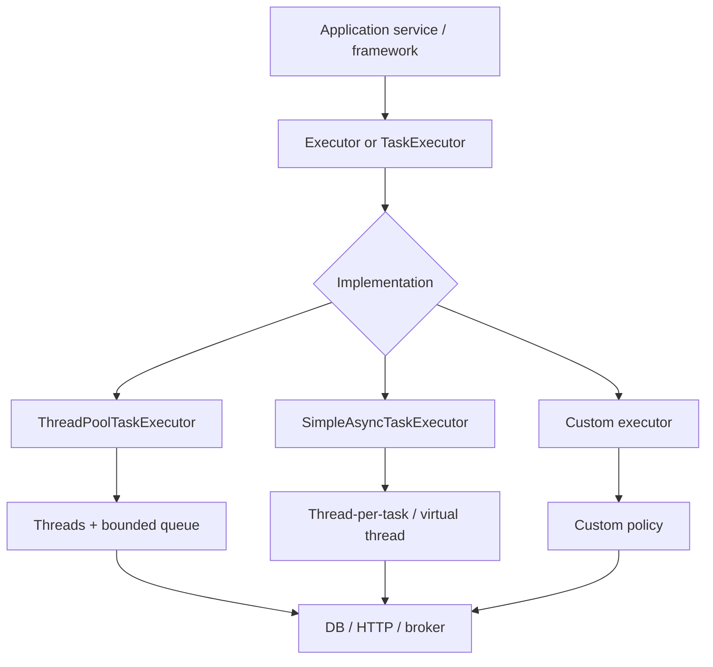
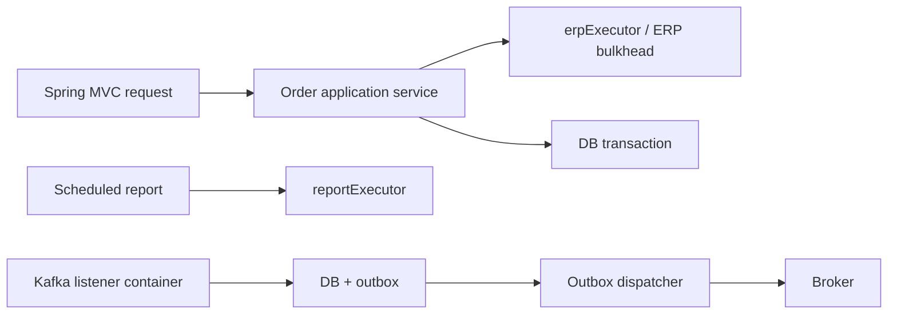
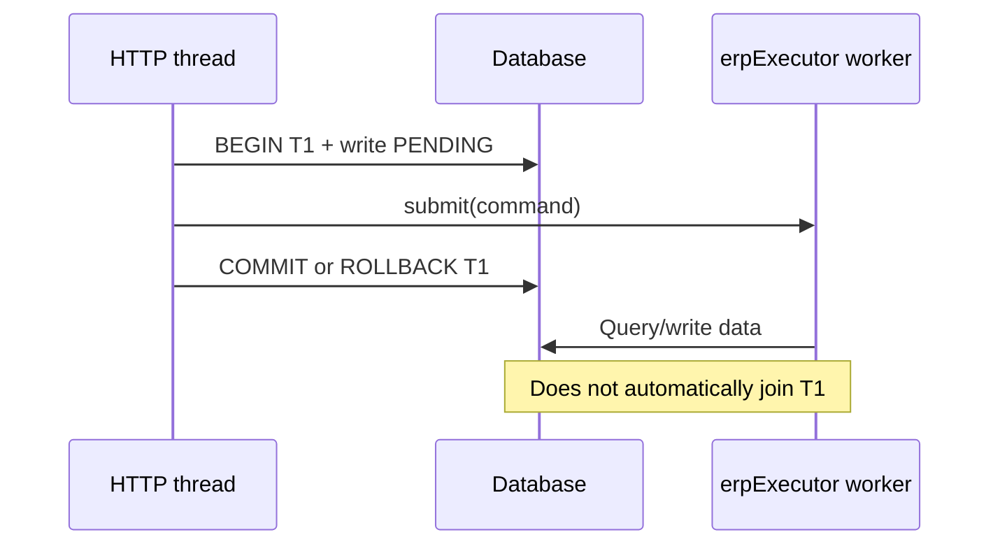

# `spring.task.execution.*` and Executor Selection

## 1. The problem: async configuration is not just increasing thread counts

A Spring Boot integration application typically handles HTTP requests, queries databases, calls ERPs over HTTP/SOAP, accesses Redis, processes Kafka/RabbitMQ messages, or routes messages through Spring Integration. Some tasks can run after the caller receives a response; others must execute within the main flow and return results immediately. Without proper controls, slow tasks can monopolize threads, exhaust connection pools, or grow queues without bound.

In the **`SPRING_BOOT_INTEGRATION`** module, the **`spring.task.execution.*`** configuration group controls the executor auto-configured by Spring Boot; executor choices determine **which thread runs a task, whether a queue exists, how overload is handled, and which frameworks use that pool**. These decisions directly affect connection configuration, data contracts, transactions, errors, deduplication, testing, and observability.

Running example: the `order-integration` service handles three kinds of work:

- HTTP MVC requests that need to check order status from an ERP within latency limits.
- `@Async` tasks generating reports or refreshing aggregated data.
- Kafka listeners syncing ERP results back to the database with a requirement of **zero message loss**.

Should all three share the single default `task-` executor? Perhaps in a tiny demo, but when the ERP slows down, reports run long, and Kafka traffic spikes, sharing load causes cross-workload interference. Knowing how to **choose executors by workload and business boundary** matters far more than merely knowing how to set `core-size`.

Lesson objectives:

1. Understand `spring.task.execution.*` properties accurately, especially those tuning the thread pool, queue, and shutdown.
2. Understand when Boot creates `applicationTaskExecutor`, how custom executor beans affect it, and differences across framework integrations.
3. Choose executors for `@Async`, Spring MVC async, Spring Integration, blocking tasks, CPU-bound work, and Java virtual threads.
4. Design bounded queues, rejection/backpressure, timeouts, transactions, context propagation, and crash recovery across restarts.
5. Test executor selection, saturation metrics, and overload behavior in practice.

## 2. From Java `Executor` to Spring executors

APIs to distinguish:

| Component | Primary role | Operational note |
|---|---|---|
| `java.util.concurrent.Executor` | `execute(Runnable)` contract; submits a task for execution. | Does not necessarily imply a queue or spawning a new thread. |
| `ExecutorService` | Java executor with submit, Future, and shutdown. | Lifecycle is owned by whoever creates/manages it. |
| `TaskExecutor` | Spring abstraction extending `Executor`. | Shared across Spring's task and integration infrastructure. |
| `AsyncTaskExecutor` | Spring extension supporting submit and corresponding Future APIs. | Required contract for several async framework integrations. |
| `ThreadPoolTaskExecutor` | Spring bean backed by `ThreadPoolExecutor`, with core/max/queue/lifecycle. | Suited for many concurrency-bounded blocking tasks. |
| `SimpleAsyncTaskExecutor` | Spawns a dedicated thread per task without pool reuse. | Can use virtual threads; requires concurrency limits. |
| `SyncTaskExecutor` | Runs on the caller thread. | Useful for testing, not truly async. |

Typical execution paths:



**An executor is not a message broker.** `execute(...)` only hands a `Runnable` to an in-JVM execution mechanism; if tasks exist only in RAM and the process dies, the application has no guarantee they will re-run. `@Async` does not add durability, idempotency, or distributed transactions either.

## 3. How does Boot manage the default executor?

In many Spring Boot 3.x releases, **Task Execution Auto-Configuration** creates a default executor bean named **`applicationTaskExecutor`** when the required classpath and bean conditions are satisfied. In standard platform-thread mode, this bean is typically a `ThreadPoolTaskExecutor`; when virtual threads are enabled on a supported Java/Boot version, the auto-created executor type may differ.

There are three separate layers to verify:

1. **Bean auto-configuration:** Did Boot actually create `applicationTaskExecutor`?
2. **Executor selection:** Do `@Async`, Spring MVC, or an integration framework pick that exact bean?
3. **Property binding:** Do `spring.task.execution.*` properties apply to **the bean actually executing tasks**, or only to a different builder/bean?

If the application declares its own `Executor` bean, Boot may back off configuring the default executor depending on version and mode. If multiple beans exist, frameworks may fail to find a unique candidate. Conversely, having an `applicationTaskExecutor` **does not automatically make synchronous calls async**; you still need `@Async` enabled, explicit `TaskExecutor.execute(...)` calls, or an actual async mechanism.

### 3.1. How to verify in a real application

In development, enable the Condition Evaluation Report:

```bash
java -jar order-integration.jar --debug
```

Inspect the task execution auto-configuration conditions and the following beans:

- Does `applicationTaskExecutor` exist? What is its concrete type?
- Are there `taskExecutor`, `erpExecutor`, `reportExecutor`, or other `Executor` beans?
- Is `@EnableAsync` or an `AsyncConfigurer` configured?
- Which executors do Spring MVC, WebFlux/GraphQL, Spring Integration, and listener containers use?
- Did properties bind to the right executor, or were they superseded by a custom bean?

**Version note:** bean names, auto-configuration conditions, and configuration modes can vary across Spring Boot 3.2, 3.3, 3.4, 3.5, and later releases. Always check the configuration metadata of **your running version** rather than copying a snippet from another project.

## 4. Common `spring.task.execution.*` properties

Example `application.yml` for **Boot's auto-configured platform-thread executor**:

```yaml
spring:
  task:
    execution:
      thread-name-prefix: integration-task-
      pool:
        core-size: 6
        max-size: 12
        queue-capacity: 40
        keep-alive: 45s
        allow-core-thread-timeout: true
      shutdown:
        await-termination: true
        await-termination-period: 20s
```

These numbers are **illustrative examples only**, not production recommendations. Meaning:

| Property | Intended effect | Do not misinterpret as |
|---|---|---|
| `spring.task.execution.thread-name-prefix` | Thread name prefix for thread dumps/logs. | Carrying trace IDs or business context. |
| `spring.task.execution.pool.core-size` | Number of core platform threads in the pool. | Total task capacity across the system. |
| `spring.task.execution.pool.max-size` | Maximum worker threads when the pool scales up. | Always fully utilized as soon as load rises. |
| `spring.task.execution.pool.queue-capacity` | Number of tasks allowed to wait in the queue when using a bounded-queue pool. | A queue wait timeout or cross-replica quota. |
| `spring.task.execution.pool.keep-alive` | Idle wait before reclaiming excess workers. | Timeout for HTTP/JDBC calls running inside a worker. |
| `spring.task.execution.pool.allow-core-thread-timeout` | Allows idle core workers to terminate when appropriate. | Automatically resolving stuck tasks or hung threads. |
| `spring.task.execution.shutdown.await-termination` | Whether to wait within a limit for completion on context shutdown. | Guaranteeing tasks survive crashes or `SIGKILL`. |
| `spring.task.execution.shutdown.await-termination-period` | Shutdown wait budget. | A business request deadline. |

Boot uses these properties to configure **the auto-configured executor for that mechanism**. They **do not automatically apply** to a `@Bean ThreadPoolTaskExecutor erpExecutor()` that you manually instantiate and configure. If the system only uses a custom `erpExecutor`, editing `spring.task.execution.pool.max-size` without updating that bean may **have no effect**.

### 4.1. Check defaults rather than copying numbers across versions

Boot versions have defaults for core size, queue capacity, timeouts, and shutdown; never assume they are always bounded or match example values. A very large queue capacity makes the pool prefer queuing over scaling threads to max. Therefore, production configs should **explicitly set `queue-capacity` and `max-size`** based on load calculations and SLOs.

### 4.2. Configuration in properties format

```properties
spring.task.execution.thread-name-prefix=integration-task-
spring.task.execution.pool.core-size=6
spring.task.execution.pool.max-size=12
spring.task.execution.pool.queue-capacity=40
spring.task.execution.pool.keep-alive=45s
spring.task.execution.pool.allow-core-thread-timeout=true
spring.task.execution.shutdown.await-termination=true
spring.task.execution.shutdown.await-termination-period=20s
```

Avoid setting the same property in multiple places while forgetting property source precedence (profiles, environment variables, config servers, command-line args). If production unexpectedly shows 200 workers, inspect the actual bound config and bean rather than reading only `application.yml` in source control.

## 5. Often overlooked: how core, max, and queue interact

`ThreadPoolTaskExecutor` typically follows `ThreadPoolExecutor` mechanics:

1. When current workers are below **core-size**, the executor can create new workers for incoming tasks.
2. Once core is reached, new tasks are typically placed into the **queue**.
3. When the queue is full and the pool is below **max-size**, the executor scales workers up to max.
4. When both the queue and max workers are full, new submissions are **rejected** by the handler.

Example with `core=4`, `max=10`, `queue=20`, assuming all tasks are slow and none finish yet:

| Submitted tasks (approx.) | State |
|---|---|
| 1–4 | Pool can grow to 4 workers. |
| 5–24 | 4 workers running, up to 20 tasks queued. |
| 25–30 | Queue full; pool can scale from 5 up to 10 workers. |
| 31 onward | If no task has finished yet, tasks are rejected. |

This table illustrates typical logic; exact outcomes depend on task completion timing, queue type, and rejection handler. **If the queue is unbounded, `max-size` rarely increases concurrency beyond core** because the executor keeps pushing tasks into the queue.

### 5.1. When `queue-capacity = 0`

A pool with capacity 0 can use a direct handoff mechanism like `SynchronousQueue`: there is no waiting room, so the executor tends to scale workers up to max and reject early once saturated. This suits workloads needing **immediate backpressure**, but not workloads needing to absorb brief bursts where callers might easily retry into a storm.

### 5.2. A bounded queue does not imply a bounded deadline

A task might wait 900 ms in the queue before starting. If the HTTP client only starts its 500 ms timeout upon execution, total elapsed time since submission can exceed 1.4 seconds. Measure **queue wait** and **execution time** separately, and check **remaining deadline before starting the task**.

## 6. Sizing executors by workload and dependency

An initial estimate comes from Little's Law:

```text
Average concurrency ≈ Throughput (tasks/sec) × Service time (sec)
```

For example, if ERP requests arrive at 20 tasks/sec and each call takes 0.30 seconds, average in-flight ERP requests are roughly 6. If ERP slows down to 1.2 seconds at the same 20/sec rate, in-flight demand grows to 24. If ERP only allows 12 concurrent requests, do **not** raise the pool to 24 expecting it to run faster; apply bulkheads/rejection/bounded queues or throttle intake.

An example workload-separation diagram:



Distinguish three workload types:

| Workload | Primary constraint | Typical choice |
|---|---|---|
| CPU-bound: large JSON processing, encryption, number crunching | CPU core count, context switching, and memory. | Small pool bounded by CPU count; never scale arbitrarily. |
| Blocking I/O: JDBC, traditional HTTP/SOAP | Threads held while waiting; connection/remote quotas. | Bounded pool or virtual threads with a bulkhead. |
| Long-running/durable: order sync, outbox publishing, batch | Restarts, retries, ACKs, checkpoints, ordering. | Broker/DB job/Spring Batch; executor is only the worker execution resource. |

### 6.1. Total capacity must be calculated across replicas

With 5 replicas and `erpExecutor.maxPoolSize=12`, the system can run **up to roughly 60 concurrent tasks** at that executor layer alone, excluding other clients. If ERP only grants a quota of 30 concurrent requests for the entire application, per-replica pools cannot be chosen in isolation. Bound **actual in-flight HTTP calls** and account for rolling deployments when extra replicas temporarily exist.

### 6.2. Executors do not replace connection pools

Suppose there are 12 workers and Hikari has only 8 connections: if each worker holds a transaction across a slow HTTP call, threads will queue waiting for DB connections. Conversely, if the HTTP client pool has 5 connections, 12 workers will mostly wait to acquire sockets. Size executors against **dependency connection budgets, timeouts, and concurrency limits**, not CPU alone.

## 7. Custom `Executor` beans: does Boot still create the default?

An application might define:

```java
@Bean("erpExecutor")
ThreadPoolTaskExecutor erpExecutor() {
    ThreadPoolTaskExecutor executor = new ThreadPoolTaskExecutor();
    executor.setThreadNamePrefix("erp-");
    executor.setCorePoolSize(4);
    executor.setMaxPoolSize(12);
    executor.setQueueCapacity(24);
    return executor;
}
```

In several common Boot 3.x setups, declaring an application `Executor` bean causes auto-configuration to **back off** and skip creating `applicationTaskExecutor` as you might expect. Consequences can include:

- Default `@Async` shifts to an unexpected pool or fails to resolve a unique candidate.
- Frameworks like Spring MVC async can no longer find an application executor with the expected name/type.
- `spring.task.execution.pool.*` does not control the custom `erpExecutor`.
- Unrelated tasks accidentally share the ERP pool even when they never call ERP.

**Never guess** from Java source files alone. Inspect the running context, bean names/types, and the Condition Evaluation Report.

### 7.1. `spring.task.execution.mode` in supported versions

Some newer Spring Boot generations provide a way to specify the task execution mode, such as **`spring.task.execution.mode=force`**, instructing Boot to keep configuring the application task executor even when custom `Executor` beans are present, under version-supported conditions.

```yaml
spring:
  task:
    execution:
      mode: force
```

**Compatibility warning:** do not assume the `mode` property exists across all Boot 3.x or all generations. Confirm your exact version supports that value and inspect how it affects framework executor selection; if your version lacks this property, declare explicit beans rather than relying on an unrecognized property.

### 7.2. Explicit approach: declare all required executors clearly

If the application needs both an application executor and an ERP pool, declare **two clearly named beans**:

```java
import java.util.concurrent.ThreadPoolExecutor;
import org.springframework.context.annotation.Bean;
import org.springframework.context.annotation.Configuration;
import org.springframework.scheduling.concurrent.ThreadPoolTaskExecutor;

@Configuration
public class AsyncExecutorConfiguration {

    @Bean("applicationTaskExecutor")
    ThreadPoolTaskExecutor applicationTaskExecutor() {
        ThreadPoolTaskExecutor executor = new ThreadPoolTaskExecutor();
        executor.setThreadNamePrefix("app-");
        executor.setCorePoolSize(8);
        executor.setMaxPoolSize(16);
        executor.setQueueCapacity(64);
        executor.setRejectedExecutionHandler(
                new ThreadPoolExecutor.AbortPolicy());
        return executor;
    }

    @Bean("erpExecutor")
    ThreadPoolTaskExecutor erpExecutor() {
        ThreadPoolTaskExecutor executor = new ThreadPoolTaskExecutor();
        executor.setThreadNamePrefix("erp-");
        executor.setCorePoolSize(4);
        executor.setMaxPoolSize(12);
        executor.setQueueCapacity(24);
        executor.setRejectedExecutionHandler(
                new ThreadPoolExecutor.AbortPolicy());
        return executor;
    }
}
```

When executors are Spring beans, Spring typically manages initialization and shutdown lifecycles. **Do not manually call `initialize()` on the same bean when Spring manages it as shown.**

Because two `TaskExecutor` beans exist, unqualified `@Async` methods may become ambiguous. Explicitly specify `@Async("erpExecutor")` for ERP tasks and `@Async("applicationTaskExecutor")` for general tasks, or configure an intentional `AsyncConfigurer`.

## 8. Choosing an executor for `@Async`

`@Async` only takes effect when Spring is configured to process asynchronous methods—typically with `@EnableAsync`—and the call passes through a Spring proxy.

```java
import org.springframework.context.annotation.Configuration;
import org.springframework.scheduling.annotation.EnableAsync;

@Configuration
@EnableAsync
public class AsyncSupportConfiguration {
}
```

Example selecting an executor by name:

```java
import java.util.concurrent.CompletableFuture;
import org.springframework.scheduling.annotation.Async;
import org.springframework.stereotype.Service;

@Service
public class ErpStatusWorker {
    private final ErpClient erpClient;

    public ErpStatusWorker(ErpClient erpClient) {
        this.erpClient = erpClient;
    }

    @Async("erpExecutor")
    public CompletableFuture<OrderStatus> fetchStatus(String orderId) {
        OrderStatus response = erpClient.fetchStatus(orderId);
        return CompletableFuture.completedFuture(response);
    }
}
```

`ErpClient` and `OrderStatus` are application-defined types. The method body executes on `erpExecutor` when the annotation is properly intercepted; returning `completedFuture` from the target method is how Spring connects the outcome to the caller's Future.

When `@Async` **does not specify a name**, Spring typically prioritizes the executor supplied by `AsyncConfigurer#getAsyncExecutor()`, or looks for an eligible unique `TaskExecutor`, or an `Executor` named `taskExecutor` per framework rules. Fallback rules and uniqueness conditions depend on Spring configuration. An `applicationTaskExecutor` bean **is not automatically the sole choice** when multiple executors exist.

**Recommendation:** for workloads with distinct SLAs/quotas, declare explicit qualifiers on `@Async`; for an app-wide default, define an explicit policy and verify it with an integration test.

### 8.1. `AsyncConfigurer` for an intentional default

```java
import java.util.concurrent.Executor;
import org.springframework.beans.factory.annotation.Qualifier;
import org.springframework.context.annotation.Configuration;
import org.springframework.scheduling.annotation.AsyncConfigurer;
import org.springframework.scheduling.annotation.EnableAsync;

@Configuration
@EnableAsync
public class AsyncDefaultConfiguration implements AsyncConfigurer {

    private final Executor defaultExecutor;

    public AsyncDefaultConfiguration(
            @Qualifier("applicationTaskExecutor") Executor defaultExecutor) {
        this.defaultExecutor = defaultExecutor;
    }

    @Override
    public Executor getAsyncExecutor() {
        return defaultExecutor;
    }
}
```

This is **an option**, not mandatory if `@Async("beanName")` is already specified everywhere. Avoid creating multiple `AsyncConfigurer` beans without clear ordering. When applying this example, ensure `applicationTaskExecutor` actually exists and no conflicting `@EnableAsync` configurations exist.

### 8.2. Self-invocation: annotated methods still run synchronously

```java
@Service
class ReportService {

    public void generate() {
        runInBackground(); // this.runInBackground(), bypasses @Async proxy.
    }

    @Async("applicationTaskExecutor")
    public void runInBackground() {
        // May run synchronously on the caller thread.
    }
}
```

In common proxy mode, `runInBackground()` must be called through a **bean proxy from the Spring context**; the simplest fix is moving the worker to another bean and injecting it into the caller. Calling methods from constructors or on `new`-created instances also fails to guarantee interception.

`@Async void` gives the caller no Future to receive exceptions. For important work, use `CompletableFuture<T>`, persisted job state, or configure `AsyncUncaughtExceptionHandler`. Even a thorough logging handler cannot replace durable retries if tasks are lost when the JVM stops.

## 9. Spring MVC async, WebFlux, and infrastructure executors

Not all frameworks follow the same executor selection rules as `@Async`:

| System | What to check |
|---|---|
| **`@Async`** | `@EnableAsync`, qualifiers, `AsyncConfigurer`, `taskExecutor` bean / unique `TaskExecutor`. |
| **Spring MVC async** | Executor for async request processing, especially when controllers return `Callable` or equivalent; many Boot generations expect `applicationTaskExecutor` of type `AsyncTaskExecutor`. |
| **Spring WebFlux** | Reactor event loop is a different model; blocking execution where framework-supported has its own executor expectations. |
| **Spring GraphQL** | Execution/handling may look up an appropriate executor depending on config and version. |
| **Spring Integration** | `ExecutorChannel`/pollers usually use **explicitly configured** executors, rather than picking any arbitrary bean just because it exists. |
| **Kafka/RabbitMQ listeners** | Listener containers manage their own concurrency and threads; they are not derived from `spring.task.execution.pool.*`. |

Therefore, an `Executor` bean named `erpExecutor` does not guarantee Spring MVC will pick it, and `spring.task.execution.pool.max-size` does not configure Kafka listener concurrency.

### 9.1. Why the name `applicationTaskExecutor` matters

Framework components may look up a bean by **exact name and type** when configuring their executor. Thus, if you replace the default executor, keeping an `applicationTaskExecutor` bean of type `AsyncTaskExecutor` may be necessary. Do not name an ERP-dedicated pool `applicationTaskExecutor` if MVC async or framework workloads must not have their threads starved by ERP calls.

### 9.2. Avoid blocking the Reactor event loop

`WebClient` is a reactive HTTP client; Spring JDBC and synchronous `RestClient` are blocking. Never place a blocking JDBC call directly on a Netty event loop. If you must call a blocking API from a reactive flow, offload it to an appropriate scheduler/executor such as `Schedulers.boundedElastic()` or an adapter with bounded concurrency—do not assume Boot's `TaskExecutor` automatically fixes blocking.

Likewise, **never** call `.block()` on an event loop just to await a `WebClient` result. `@Async` concurrency and reactive execution are distinct models; mixing them without understanding threads and contexts makes tracing and transactions hard to control.

## 10. Choosing `ThreadPoolTaskExecutor` vs. virtual threads

From Java 21 with supporting Spring Boot versions, you can enable:

```yaml
spring:
  threads:
    virtual:
      enabled: true
```

On compatible Boot 3.2+ versions, the Boot-auto-configured application executor may use `SimpleAsyncTaskExecutor` with **virtual threads** instead of a traditional platform-thread `ThreadPoolTaskExecutor`. Verify the actual bean and version. When virtual threads are used, **`spring.task.execution.pool.core-size/max-size/queue-capacity` should not be assumed to cap virtual threads**, because a thread-per-task model is not a thread pool.

| Criterion | Bounded platform thread pool | Virtual-thread-per-task |
|---|---|---|
| Thread reuse | Reuses worker platform threads. | New virtual thread per task; low thread cost for many blocking scenarios. |
| Concurrency bound | Pool and bounded queue enforce direct limits. | Must explicitly use semaphores/bulkheads/quotas to cap in-flight calls. |
| Blocking I/O | Holds a platform thread while waiting. | Virtual threads generally save OS resources for well-supported blocking operations. |
| CPU-bound | Bounding by CPU cores makes sense. | Does not increase CPU cores or speed up CPU-bound tasks. |
| External resources | Must still bound JDBC/HTTP connections. | **Must also bound** JDBC/HTTP connections and partner quotas. |
| Lifecycle | Pool queue/shutdown per config. | Do not apply Boot `pool.*` pool assumptions to a poolless model. |

Virtual threads do not give PostgreSQL infinite connections or let an ERP survive infinite concurrent calls. If 10,000 virtual threads simultaneously wait for Hikari connections, the system still saturates; apply backpressure at ingress.

Specific aspects to test: pinning behavior for your JDK/library versions, ThreadLocal/MDC memory footprint, blocking APIs compatible with virtual threads, shutdown, and JVM liveness when only daemon virtual threads remain. If background work must survive restarts, use a durable queue/outbox rather than relying on virtual thread lifecycles.

## 11. From thread pools to bulkheads and admission control

A bounded executor is not always the right limit for a partner API. One ERP task might fan out into three HTTP calls; 12 workers could create 36 concurrent calls if each task runs calls in parallel. To cap ERP at 12 in-flight HTTP calls, apply a **bulkhead directly at the client adapter**, not just pool size.

Simple semaphore example that holds the permit only for the call:

```java
import java.util.concurrent.Semaphore;
import java.util.concurrent.TimeUnit;

public final class ErpBulkhead {
    private final Semaphore permits = new Semaphore(12);

    public <T> T call(java.util.concurrent.Callable<T> action)
            throws Exception {
        if (!permits.tryAcquire(100, TimeUnit.MILLISECONDS)) {
            throw new IllegalStateException("ERP concurrency exhausted");
        }
        try {
            return action.call();
        } finally {
            permits.release();
        }
    }
}
```

This is a **per-instance local example**, not a distributed quota. In production, permit exhaustion errors should be categorized as overload/rejection; if using Resilience4j Bulkhead or a rate limiter, align metrics, timeouts, and retry placement. Never instantiate a new `Semaphore` per call, as that nullifies the limit.

### 11.1. Rejection policies

When `ThreadPoolTaskExecutor` saturates, Spring can throw `TaskRejectedException`. Common handlers:

| Handler | Response | Risk |
|---|---|---|
| `AbortPolicy` | Rejects the task with an exception. | Caller must return proper error/backpressure without losing committed commands. |
| `CallerRunsPolicy` | Caller executes the task under overload in normal running states. | Blocks HTTP/Kafka threads, altering latency and transaction context. |
| `DiscardPolicy` | Drops the task without throwing directly. | Dangerous for any business command that must execute. |
| `DiscardOldestPolicy` | Drops the head of the queue and retries submission. | Can lose/reorder work without reconciliation. |

For `order-integration`, usually choose **explicit rejection** and upstream backpressure; for tasks requiring durability, persist the request to DB/broker **first** before workers pull it. `CallerRunsPolicy` can help throttle producers, but must be tested carefully because the caller could be a listener thread holding acknowledgments or transactions.

## 12. Timeouts, queue wait, and retry budgets must accompany executors

A task can pass through several phases:

```text
HTTP inbound
  -> validate/request deadline
  -> submit to executor
  -> queue wait
  -> acquire bulkhead
  -> acquire HTTP connection
  -> connect/TLS
  -> receive/parse ERP response
  -> update DB/outbox
  -> complete Future / respond
```

Setting an 800 ms `RestClient` timeout while allowing tasks to sit 2 seconds in a queue will breach a 1-second SLO before the request is even sent. Therefore:

1. Record submission timestamp and remaining deadline.
2. When the task starts, check remaining deadline before performing new side effects.
3. Bound queue wait, bulkhead acquisition, HTTP connect/read, and transactions appropriately.
4. Retry **within the remaining budget** with explicit max attempts and backoff.
5. For write commands, read timeouts can occur **after the ERP already committed**; never auto-retry without an idempotency key or reconciliation.

`CompletableFuture.orTimeout(...)` or `get(timeout, unit)` can limit how long **the caller waits**; they do not guarantee the remote request, JDBC transaction, or side effect was canceled. `cancel(true)` also cannot roll back a payment already created in the ERP.

### 12.1. Avoiding nested Future deadlocks and starvation

If all workers in a pool submit subtasks to **that same pool** and call `get()` waiting for results, thread starvation can occur: every worker waits on queued subtasks while no free worker remains to execute them. Use non-blocking compositional async, separate pools when genuinely needed, or restructure the workflow to eliminate circular dependencies within the same executor.

## 13. Exceptions and how callers receive results

`@Async` supports common return types such as `void`, `Future<T>`, and `CompletableFuture<T>`. Example:

```java
CompletableFuture<OrderStatus> result = worker.fetchStatus("O-42");

result.whenComplete((value, failure) -> {
    if (failure != null) {
        recordFailure("erp-status", failure);
    } else {
        consumeStatus(value);
    }
});
```

`recordFailure` and `consumeStatus` are illustrative business methods. `whenComplete` may run on the thread that completes the Future, so slow or blocking callbacks can hold workers; if offloading is needed, consider `whenCompleteAsync(..., executor)` with its own load policy.

With `@Async void`, exceptions do not surface in a caller return value; configure `AsyncUncaughtExceptionHandler` if needed, backed by metrics/alerts and a recovery policy. Never assume logging a stack trace means the business work succeeded.

If submitting directly via `TaskExecutor.execute(...)`, the caller also gets no Future; catch exceptions inside the task or use `AsyncTaskExecutor.submit(...)`/`CompletableFuture` as appropriate. Under any model, define **who owns failures and retries**.

## 14. Transactions do not follow the executor

For standard imperative Spring JDBC/JPA, `@Transactional` binds transaction resources to the current thread. Dispatching a task to an executor switches threads: **the HTTP thread's transaction does not transfer to the worker thread**.



If the worker needs atomic DB operations, start a new transaction inside the worker via a proxy-intercepted Spring bean:

```java
@Service
class OrderWriteService {

    private final OrderRepository repository;

    OrderWriteService(OrderRepository repository) {
        this.repository = repository;
    }

    @Transactional
    public void markSynchronized(String orderId) {
        repository.markSynchronized(orderId);
    }
}

@Service
class SyncWorker {

    private final OrderWriteService writes;

    SyncWorker(OrderWriteService writes) {
        this.writes = writes;
    }

    @Async("erpExecutor")
    public CompletableFuture<Void> complete(String orderId) {
        writes.markSynchronized(orderId);
        return CompletableFuture.completedFuture(null);
    }
}
```

This example assumes corresponding imports and a domain repository. `OrderWriteService` is a separate bean, so `markSynchronized` goes through a normal proxy. Calling `this.markSynchronized()` within the same bean may bypass `@Transactional`. Never wrap slow remote HTTP calls inside a long DB transaction: holding Hikari connections and database locks destroys capacity when ERP slows down.

## 15. ThreadLocal, MDC, tracing, and security context

When offloading tasks to worker threads, data stored in `ThreadLocal` such as MDC, request context, Spring Security context, or transaction state does not travel safely by itself. Thread pools reuse threads, so retaining the previous request's context is even more dangerous than missing context.

Choose handling by data type:

| Context | Appropriate handling |
|---|---|
| Business ID, request ID | Pass explicitly via method arguments or event payloads. |
| Trace/observation context | Use framework-compatible context propagation/`TaskDecorator`. |
| MDC | Capture/restore with `try/finally` so nothing leaks to subsequent tasks. |
| Security identity | Pass only minimal info; use Spring Security's delegating executor when warranted. |
| JDBC transaction | Never copy ThreadLocals; open transactions at the proper worker boundary. |
| HTTP request/session | Do not retain references in background workers after the request completes. |

Spring Framework provides `TaskDecorator` and context-propagation mechanisms where dependencies and versions support them. Avoid copying entire `SecurityContext` objects or credentials into every task if business logic only needs `tenantId` and `correlationId`. Forwarding security contexts requires security review and cleanup on completion.

## 16. Spring Integration and dispatching messages via executors

In Spring Integration, channel choice alters execution semantics:

| Component | Typical behavior | Boundary to watch |
|---|---|---|
| `DirectChannel` | Handler runs on the sender's thread. | Can share caller transactions; slow downstreams block the caller. |
| `ExecutorChannel` | Offloads message handling to a configured executor. | Changes thread/transaction context; introduces queuing/rejection. |
| `QueueChannel` | Enqueues messages for a poller to pick up later. | Capacity bounds, persistence/durability, and timeouts. |
| Poller with executor | Runs polling/handling work per configuration. | Must control concurrency and `maxMessagesPerPoll`. |
| HTTP outbound adapter/service activator | Calls dependencies via sync or async client. | HTTP timeouts, bulkheads, retries, and idempotency. |

For example, an `ExecutorChannel` with an in-RAM queue **is not a durable broker**. If the sender returns after enqueueing and the JVM dies before the handler runs, the task can be lost. Therefore, commands that must execute reliably should first be stored durably (DB outbox/job table or broker), with the executor serving only as the execution tier.

`spring.task.execution.pool.max-size` does not automatically configure every `ExecutorChannel`; wire an explicit `erpExecutor` bean to the channel or poller and define a rejection policy. If a channel previously relied on a sender's transaction context, switching to `ExecutorChannel` can alter commit/ACK timing; test the entire flow.

## 17. Kafka/RabbitMQ and acknowledgment boundaries

Kafka and RabbitMQ listener containers have their own concurrency, acknowledgment, prefetch, and lifecycle settings. They **do not pull thread counts** from `spring.task.execution.pool.core-size`.

A dangerous mistake:

```java
@KafkaListener(topics = "order-paid")
void consume(OrderPaidEvent event) {
    erpExecutor.execute(() -> processAndSave(event));
    // Listener returns before the task actually processes/commits.
}
```

If the container commits offsets or ACKs upon listener return, the message may be marked processed **before** the worker updates the DB, causing a crash to lose work. This is an anti-pattern example; actual ACK/commit depends on container configuration. Design guidelines:

- Define what **completion** means: DB committed, durable job stored, or ERP confirmed?
- If returning early is needed, persist a DB/outbox record **before** ACKing and let a restartable worker handle the rest.
- If ACKing after processing, coordinate completion and error handling properly with the listener framework rather than assuming it waits on a Future.
- Use unique business keys/idempotency to survive redelivery when DB commits succeed but ACKs fail.
- Bound in-flight messages so the task queue cannot grow indefinitely when ERP slows down.

Increasing `erpExecutor.max-size` will not fix bottlenecks if Kafka partition count, database pools, ERP quotas, or checkpoints are the true constraint.

## 18. In-RAM tasks, durable queues, outbox, and Spring Batch

| Need | Option to consider | Why |
|---|---|---|
| Short computation, acceptable to lose if JVM dies | `@Async`/`TaskExecutor`. | Fast, simple, resource-bounded. |
| Scheduled work | `@Scheduled`/appropriate `TaskScheduler`. | Separates **when to run** from **where/which executor runs it**. |
| Work surviving restarts and scale-out | Broker/durable queue or job table. | Provides ACKs, retries, ownership, checkpoints. |
| DB commit followed by guaranteed event emission | Transactional outbox. | Never loses publish intent when the broker is briefly down. |
| Large batch jobs with chunk restart/skip/retry | Spring Batch. | `JobRepository` and chunked transactions. |
| Multi-step workflows across ERP/broker | Saga/state machine + idempotency/reconciliation. | Local executors do not provide distributed transactions. |

If an HTTP API returns **202 Accepted** merely after `executor.execute(task)` succeeds in memory, document explicitly that the contract accepts task-loss risk. For payment or order operations that must execute, return an accepted status only after an appropriate durable record exists.

### 18.1. Graceful shutdown does not replace crash recovery

`spring.task.execution.shutdown.await-termination=true` helps the process wait for tasks on normal shutdown, but orchestration can exhaust its termination grace period or issue `SIGKILL`. An in-flight ERP call may have applied a side effect before the client disconnected; support status lookup by request ID. Never rely on extending shutdown timeouts as a substitute for recovery.

## 19. Testing: proving the right executor is selected

A unit test invoking an `@Async` method directly on a `new`-created object bypasses the Spring proxy and proves nothing about executor wiring. Test inside a real context and separate two goals:

1. **Wiring:** which beans exist and does `@Async` actually use the intended executor?
2. **Behavior:** do queue bounds, rejection, deadlines, transactions, contexts, and shutdown hold under load?

Intentional integration test checking thread names, assuming an `erpExecutor` bean with prefix `erp-` and `@EnableAsync`:

```java
import java.util.concurrent.CompletableFuture;
import java.util.concurrent.TimeUnit;
import org.junit.jupiter.api.Test;
import org.springframework.beans.factory.annotation.Autowired;
import org.springframework.boot.test.context.SpringBootTest;
import org.springframework.scheduling.annotation.Async;
import org.springframework.stereotype.Service;
import static org.assertj.core.api.Assertions.assertThat;

@Service
class ExecutorProbe {
    @Async("erpExecutor")
    public CompletableFuture<String> captureThreadName() {
        return CompletableFuture.completedFuture(
                Thread.currentThread().getName());
    }
}

@SpringBootTest
class ExecutorWiringTest {

    @Autowired ExecutorProbe probe;

    @Test
    void asyncMethodRunsOnErpExecutor() throws Exception {
        String name = probe.captureThreadName()
                .get(2, TimeUnit.SECONDS);
        assertThat(name).startsWith("erp-");
    }
}
```

This example requires the test dependencies and configurations declared earlier. If virtual threads are enabled, actual thread names may differ depending on the executor; assert expectations matching **the tested bean**, not a generic default prefix.

### 19.1. Test matrix for configuration changes

| Test | What to prove |
|---|---|
| Context using only Boot-managed executor | `applicationTaskExecutor` exists and receives `spring.task.execution.*` as designed. |
| Custom `erpExecutor` present | Does not break framework executors; `@Async` resolves the intended bean. |
| Small core/max/queue pool | Scaling workers, queuing, and rejection obey expected rules. |
| Missing `@EnableAsync` or self-invocation | Catches methods running synchronously contrary to assumptions. |
| Exception from `CompletableFuture` | Caller/metrics observe the failure; task is not treated as successful. |
| Slow/timed-out ERP | Queue does not grow unbounded; unrelated workloads continue normally. |
| Hikari/HTTP pool smaller than executor | Observe acquisition pending waits and actual in-flight cap. |
| Async transaction | Worker commits/rolls back within its own appropriate transaction. |
| ThreadLocal/tracing | Context is accurate; no identity/MDC leaks into subsequent tasks. |
| Broker consumer | Does not ACK early if business work isn't durably persisted yet. |
| Virtual threads enabled | Pool properties aren't misinterpreted; bulkheads/quotas still enforce bounds. |
| Restart mid-task | Durable tasks recover; in-RAM tasks follow loss contract. |

For concurrency tests, use `CountDownLatch` or barriers with timeouts instead of `Thread.sleep` to force races deterministically. When verifying executor selection, invoke through a Spring proxy on a real context bean rather than asserting bean names alone.

## 20. Metrics and operating executors

Signals to collect for **every executor** and **every dependency**:

| Signal | Question answered |
|---|---|
| `active threads`, `pool size`, `core/max` | Are workers saturated? |
| `queue depth/capacity` | How long is work waiting, and is it breaching deadlines? |
| `rejected tasks` | Are we overloading and signaling upstream properly? |
| `submit-to-start delay` | Is queue wait exceeding execution time? |
| `execution duration` | Is the task slow due to ERP/JDBC or CPU? |
| `success/failure/timeout/cancel` | Are tasks actually completing per contract? |
| HTTP pool pending/active, Hikari pool pending | Are workers stalled waiting on underlying connections? |
| Kafka lag/Rabbit unacked/outbox backlog | Is durable work piling up? |
| Retry attempts and circuit-breaker/bulkhead state | Are retries helping or creating a load storm on dependencies? |

Spring Boot Actuator/Micrometer can instrument certain executors when bean types and meter binders match; **metric names and auto-binding depend on version**. If telemetry lacks `queue wait` or business outcomes, add custom metrics in adapters/workers instead of assuming everything is included.

Never use `orderId`, `customerId`, or `requestId` as metric tags due to high cardinality. Use stable executor/operation/dependency names such as `executor=erp`, `operation=erp-status`, `outcome=success|timeout|rejected`. Correlation IDs belong in access-controlled traces and logs.

### 20.1. Runbook for sudden queue spikes

1. Identify which executor's queue is growing and whether active workers are at max.
2. Separate **queue wait time** from **task execution time**.
3. Check downstream ERP/DB, connection pools, lock waits, and rate limiters.
4. Check for traffic shifts, bursts, replica counts, retries, and fan-out.
5. If downstream is overloaded, throttle producers/concurrency and preserve explicit rejection instead of blindly enlarging the pool.
6. Confirm rejected tasks return errors or remain durably saved; never silently drop business work.
7. After recovery, inspect backlog drain, expired tasks, uncertain write outcomes, and reconciliation.

## 21. Common misconceptions

| Misconception | Reality |
|---|---|
| "`spring.task.execution.pool.max-size=100` means 100 workers run immediately." | The queue may absorb tasks before the pool scales past core. |
| "Once I define `erpExecutor`, `spring.task.execution.*` automatically configures it." | Boot auto-config properties do not automatically bind to arbitrary custom beans. |
| "Having `applicationTaskExecutor` means `@Async` works." | Requires `@EnableAsync` and calls routed through proxies. |
| "One `Executor` bean serves every framework." | MVC async, WebFlux, Integration, and Kafka listeners have separate selection rules. |
| "`@Async` always defaults to `applicationTaskExecutor`." | `AsyncConfigurer`, unique/named fallbacks, and multiple beans can introduce ambiguity. |
| "Enabling virtual threads makes `pool.*` cap task count." | Virtual-thread-per-task does not share platform-thread pool semantics. |
| "Timing out a `Future` cancels the HTTP call and rolls back ERP." | The caller stops waiting while the remote side effect may already have occurred. |
| "A bounded queue guarantees no lost work." | In-RAM queues are still lost when the process dies. |
| "The HTTP thread's transaction follows `ExecutorChannel`." | Transactions do not automatically propagate across worker threads. |
| "A Kafka listener can ACK right after submitting async work." | ACKs must rest on durable acceptance per contract, not an in-process queue. |
| "Adding threads fixes DB locks or a slow ERP." | It can worsen contention and overload upstreams. |
| "Calling `@Async` keeps tracing seamless automatically." | Context propagation is required across async boundaries. |

## 22. Checklist for choosing and configuring executors in integration apps

- [ ] Confirm the Spring Boot/Spring Framework/JDK versions and actual executor beans in the context.
- [ ] Know whether Boot creates `applicationTaskExecutor` or custom `Executor` beans caused auto-config to back off.
- [ ] If using `spring.task.execution.mode`, verify the property and value are supported in your deployment version.
- [ ] Classify workloads: CPU-bound, blocking I/O, best-effort background, or durable workflow.
- [ ] Use explicit names and `@Qualifier`/`@Async("...")` across distinct executors.
- [ ] Ensure Spring MVC/frameworks have the expected bean name/type; don't let an ERP pool become an accidental default.
- [ ] Enable `@EnableAsync` when using `@Async`; test proxy invocation and self-invocation.
- [ ] Configure core/max, finite queue capacity, keep-alive, and shutdown per SLOs.
- [ ] Define rejected-submission handling and backpressure; never silently drop commands.
- [ ] Calculate concurrency across all replicas against real DB/ERP/Redis/broker quotas.
- [ ] Configure HTTP/JDBC timeouts, queue wait timeouts, end-to-end deadlines, and retry budgets.
- [ ] With virtual threads, bound in-flight calls via bulkheads/semaphores, not pool properties alone.
- [ ] Never block the Reactor event loop with JDBC/`RestClient` or `WebClient.block()`.
- [ ] Ensure workers manage their own transaction boundaries; do not pass transaction ThreadLocals.
- [ ] Propagate/clear tracing, MDC, and minimal security context safely.
- [ ] For Kafka/RabbitMQ, ACK only after durable steps per contract, with idempotent redelivery.
- [ ] For work that must never be lost, use a durable queue, outbox, or Spring Batch rather than `@Async` alone.
- [ ] Test queue saturation, failures, retries, restarts, graceful shutdown, context propagation, and transactions.
- [ ] Maintain metrics for active/queued/rejected/latency and a runbook separating overload from downstream failures.

## 23. Conclusion

**`spring.task.execution.*` configures Spring Boot's managed executor, not a global setting binding every `Executor` or every integration framework.** `core-size`, `max-size`, and `queue-capacity` govern how a bounded platform-thread pool admits load; custom beans, `@Async` executor resolution, and framework integrations dictate where work actually runs. With virtual threads, `pool.*` cannot be interpreted as the traditional concurrency cap.

In **SPRING_BOOT_INTEGRATION**, choosing the right executor starts from **dependency quotas, deadlines, transaction boundaries, task-loss tolerance, message acknowledgments, and observability**. Use isolated pools when workloads need isolation, keep queues and rejections transparent, and anchor critical work in durable infrastructure so tasks recover after failures. Only then does async execution become part of a reliable architecture rather than just `@Async` syntax.
