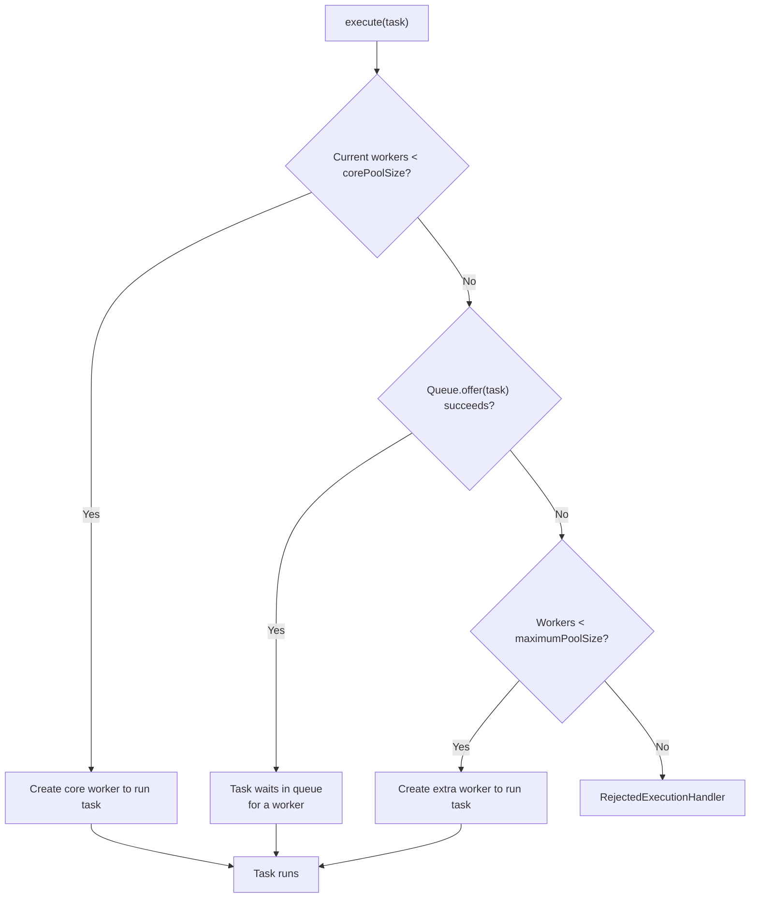
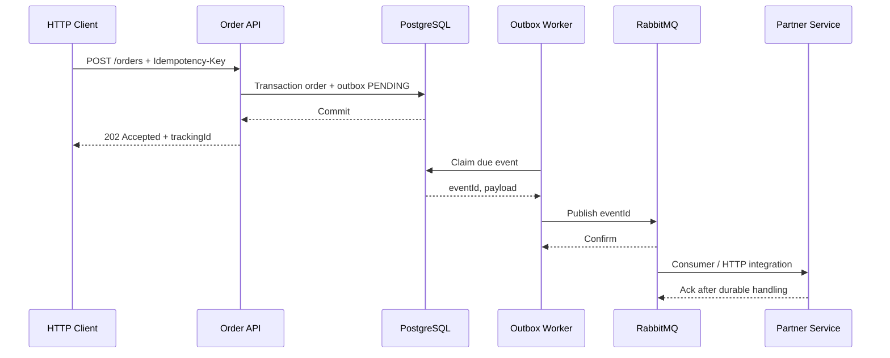
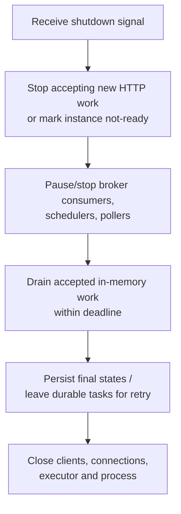
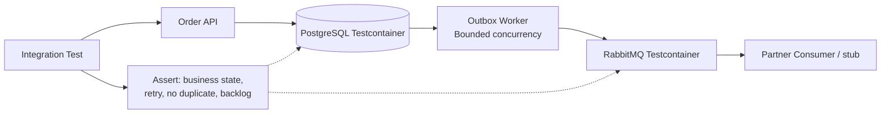

# Thread Limits, Queues, and Rejection Strategies

## 1. The real-world problem: async tasks do not mean infinite resources

In the **SPRING_BOOT_INTEGRATION** module, a Spring Boot service routinely receives HTTP requests, calls partner REST APIs, writes to PostgreSQL, reads Redis caches, or processes RabbitMQ/Kafka events. Slow operations can be offloaded to an executor so the request-handling thread does not wait for the entire operation.

Consider a service handling `order.paid` events:

1. Receive the payment webhook/message.
2. Validate the data contract and deduplicate `eventId`.
3. Persist the order and the intent to call the shipping carrier.
4. Submit an HTTP-call task to a worker pool.
5. Update status/reconciliation when the partner responds.

The naive approach is calling an `@Async` method. Yet if tasks arrive **faster than they finish**, threads and queued items can grow until they exhaust memory, connection pools, file descriptors, or saturate downstream systems.

**Key mindset:** an executor is an **in-process execution scheduler**, not a durable work store. A production worker pool must explicitly define:

- **Active threads**: how many operations can run concurrently?
- **Queue**: how many tasks may wait, and for how long at most?
- **Rejection strategy**: what happens when all threads and the queue are full?
- **Backpressure/admission control**: how do we signal producers so they stop pushing work beyond capacity?
- **Durability**: does accepted work survive a restart or crash?
- **Observability**: can we measure active threads, queue depth, rejected tasks, and queue wait latency?

This lesson focuses on **thread limits, queues, and rejection strategies** in Java `ThreadPoolExecutor`, Spring `ThreadPoolTaskExecutor`, and Spring Boot `@Async`, then extends them to brokers, databases, HTTP clients, timeouts, and idempotency.

### Objectives

After this lesson, you will be able to:

- Explain accurately how `corePoolSize`, `maxPoolSize`, `queueCapacity`, and `keepAliveSeconds` interact.
- Configure a bounded `ThreadPoolTaskExecutor` explicitly used by `@Async`.
- Compare `AbortPolicy`, `CallerRunsPolicy`, `DiscardPolicy`, `DiscardOldestPolicy`, and custom rejection handlers.
- Design overload responses without silently losing business operations.
- Test saturation, rejection, shutdown, timeouts, and task durability.
- Avoid confusing `@Async` with broker/outbox work handoff in integration systems.

> Examples target Java 17+, Spring Boot 3.x, Spring Framework 6.x, and Java concurrency APIs. Property names, bean selection, and virtual thread behavior may vary in newer Spring Boot versions; verify against the docs for your running version. Numeric settings are illustrative, **not** universal defaults for every application.

## 2. Synchronous, asynchronous, and durable handoff are three different things

Consider a shipping carrier call that takes 500 ms.

**Synchronous approach:**

```text
HTTP request thread
    |
    +-- validate --> DB --> call carrier API (500 ms) --> response
    |
    +-- thread stays busy until everything finishes
```

**`@Async` with an in-JVM pool:**

```text
HTTP request thread
    |
    +-- validate --> executor.submit(task) --> response
                            |
                            +-- queue (memory) --> worker --> call carrier
```

**Durable handoff via database/broker:**

```text
HTTP request
    |
    +-- transaction: persist order + outbox
    |                  |
    +-- 202 / tracking id
                       |
                outbox publisher
                       |
                   RabbitMQ
                       |
                consumer (bounded concurrency)
                       |
                call carrier / update state
```

Both of the latter approaches execute asynchronously, yet their reliability differs fundamentally:

| Property | In-JVM Executor | Durable Broker / Outbox |
| --- | --- | --- |
| Where does pending work live? | In application memory | Database or broker configured for durability |
| Survives process kill/crash? | Not guaranteed | Recoverable via storage and acknowledgment mechanisms |
| Overload rejection signal? | Yes, from executor | Yes, via producer/consumer capacity and quotas |
| Guarantees exactly-once effect? | No | Not automatically; requires idempotency |
| Concurrency control? | Worker thread count | Consumer concurrency, prefetch, worker pool, rate limits |
| Suited for | Short tasks / tolerable loss on crash, or backed by a durable source | Critical business tasks that must not be lost |

**Never return HTTP 202 "accepted for processing" solely because `@Async` did not throw** if your contract promises the work will survive a crash. Persist the intent and tracking state before returning 202.

## 3. Load model: arrival rate, service rate, and backlog

Suppose on average \(\lambda\) tasks/second arrive and each worker processes \(\mu\) tasks/second. With \(N\) effective workers, processing capacity is roughly \(N\mu\) tasks/second when not constrained by other resources.

- When **arrival rate is below service rate** and traffic is reasonably steady, backlogs can drain down.
- When **arrival rate exceeds service rate**, waiting tasks accumulate. An unbounded queue masks overload behind growing latency.
- A **bounded** queue forces the system to surface saturation promptly so callers, backpressure, or retry policies can react.
- A huge pool helps little if the real bottleneck is a partner API allowing only 20 concurrent requests or PostgreSQL having 10 JDBC connections.

Illustrative example: 8 workers, each blocking HTTP call taking 200 ms → ideal capacity is about 40 tasks/second. If intake sustains 60 tasks/second, the backlog grows by ~20 tasks/second, **assuming processing time, concurrency, and network stay constant**. This is an intuition builder, not a benchmark; pool/thread blocking contention can reduce throughput even further.

### Why latency degrades before errors appear?

A task might execute cleanly after sitting 30 seconds in a queue, long after the request's 5-second business deadline expired. When queues grow too deep:

- HTTP callers time out and retry, piling on more load.
- Delayed events make graphs or caches stale.
- Tokens, sessions, or delivery windows expire before a worker runs.
- Queues consume memory, especially when lambdas capture large DTOs or payloads.
- Shutdown struggles to drain tasks, increasing the chance of lost work.

**Queue capacity is a latency and memory policy**, not merely a buffer to avoid exceptions.

## 4. ThreadPoolExecutor: how Java chooses between threads and the queue

`java.util.concurrent.ThreadPoolExecutor` implements a fundamental admission flow. For an executor in `RUNNING` state receiving a new `execute()`:



This diagram illustrates the **core principle** and omits race/shutdown re-checks that `ThreadPoolExecutor` performs after offering to the queue.

**Common misconception:** once `corePoolSize` workers exist, the executor **tries to enqueue tasks before scaling up to `maximumPoolSize`**. As long as the queue has room, the pool stays at core size even if max is large.

Queue choices dramatically change behavior:

- **Very large / unbounded** queue: the pool rarely scales past core while latency accumulates.
- **Bounded** queue: once full, the executor spawns extra threads up to max.
- `SynchronousQueue` (direct handoff, zero buffering): if no worker is idle, the executor immediately scales threads or rejects early.

Never read `maxPoolSize = 100` as "it will run 100 tasks concurrently right away" when `queueCapacity = 100000`.

## 5. Exact meaning of core, max, queue, and keep-alive

| Setting | Effect | Practical reality |
| --- | --- | --- |
| `corePoolSize` | Target number of core workers when tasks arrive | Not necessarily pre-started at startup |
| `maxPoolSize` | Maximum worker threads allowed | With a deep queue, may rarely be reached |
| `queueCapacity` | Maximum tasks permitted to wait in the queue | Excludes currently running tasks |
| `keepAliveSeconds` | Idle time before workers above core are reclaimed | Core threads do not time out unless configured |
| `allowCoreThreadTimeOut` | Allows idle core workers to terminate | Reduces idle footprint; measure warm-up impact |
| `RejectedExecutionHandler` | Action when the executor refuses a task | Can throw, run on caller, discard, or apply custom policy |
| `threadNamePrefix` | Worker thread naming prefix | Essential for logs, thread dumps, and diagnostics |

Basic invariants: `corePoolSize >= 0`, `maximumPoolSize > 0`, and `maximumPoolSize >= corePoolSize`. Queue capacity and keep-alive must follow API constraints.

In `ThreadPoolTaskExecutor`, `queueCapacity > 0` normally uses a bounded `LinkedBlockingQueue`, whereas `queueCapacity <= 0` uses a `SynchronousQueue` for direct handoff. This is Spring's executor behavior, not a universal property of every `Executor` implementation.

### Worker count does not equal downstream capacity

A single task can hold:

- An HTTP connection from a pool.
- A JDBC connection.
- A Redis connection or multiple RPCs.
- A partner semaphore slot.
- A lease on an outbox record.

If `maxPoolSize=64` while a partner API allows only 10 concurrent requests, 64 workers turn into 64 rate-limited requests plus a retry backlog. Align worker limits with **underlying resource quotas**.

## 6. Numerical example: core=4, max=8, queue=10

Assume all tasks block long enough to observe and none finish during submission:

| Submitted tasks | Typical outcome |
| --- | --- |
| #1–#4 | Spawns 4 core workers; tasks run |
| #5–#14 | Places 10 tasks into the queue |
| #15–#18 | Queue full; spawns 4 more workers, 8 running total |
| #19 onward | Pool at max and queue full → rejection policy |

At saturation, the executor holds **8 running tasks + 10 queued tasks**. This is a static observational model, not a strict ordering guarantee when tasks complete or multiple submitters run concurrently.

**The 18-task ceiling covers only this executor's relative in-flight work**, not all business work in the app. HTTP requests queued at the servlet connector, unacked RabbitMQ messages, tasks on other schedulers, and outbox rows in the database all exist outside this queue.

### A configuration that looks strong but is weak

```text
corePoolSize=4
maxPoolSize=64
queueCapacity=100000
```

As tasks arrive, the executor fills the queue first. Most of the time you run only 4 workers while 50,000 tasks sit waiting because the queue hasn't filled enough to trigger extra workers. Tuning latency and throughput requires considering **core, max, queue, and demand together**, not just raising max.

## 7. Boot auto-configuration: `spring.task.execution.*`

Spring Boot provides task execution properties when its auto-configuration applies. Example `application.yml`:

```yaml
spring:
  task:
    execution:
      thread-name-prefix: integration-
      pool:
        core-size: 8
        max-size: 16
        queue-capacity: 100
        keep-alive: 30s
        allow-core-thread-timeout: false
      shutdown:
        await-termination: true
        await-termination-period: 30s
```

Meaning:

- `core-size`, `max-size`, `queue-capacity` configure the pool executor auto-configured by Boot when conditions match.
- `thread-name-prefix` separates integration threads from HTTP server or DB pool threads.
- Shutdown wait gives running tasks a window to finish, **not a guarantee tasks survive a process kill**.
- On Spring Boot 3.2+ with Java 21 and virtual threads enabled, the auto-configured executor type may change; several pool properties **no longer control** the executor as they do for a platform-thread pool.
- If you define custom `Executor`/`TaskExecutor` beans, bean selection and auto-configuration may differ; never assume this YAML configures custom executors.

**Important:** these properties do not replace HTTP/JDBC timeouts, RabbitMQ listener concurrency, or downstream rate limits. A service may also contain separate executors created by libraries.

### When not to rely solely on the default executor?

When a module mixes workloads with different SLAs—such as email sending, carrier API calls, CPU computation, and cache refreshes—consider **named executors** with separate queues, rejection handlers, and metrics. One shared pool can be filled by stalled carrier calls, starving emails and even recovery jobs.

## 8. Declaring an explicitly bounded ThreadPoolTaskExecutor

An isolated configuration for calling a partner API:

```java
import java.util.concurrent.ThreadPoolExecutor;

import org.springframework.context.annotation.Bean;
import org.springframework.context.annotation.Configuration;
import org.springframework.scheduling.annotation.EnableAsync;
import org.springframework.scheduling.concurrent.ThreadPoolTaskExecutor;

@Configuration(proxyBeanMethods = false)
@EnableAsync
public class IntegrationAsyncConfiguration {

    @Bean("integrationTaskExecutor")
    ThreadPoolTaskExecutor integrationTaskExecutor() {
        ThreadPoolTaskExecutor executor = new ThreadPoolTaskExecutor();

        executor.setCorePoolSize(8);
        executor.setMaxPoolSize(16);
        executor.setQueueCapacity(64);
        executor.setKeepAliveSeconds(30);
        executor.setThreadNamePrefix("integration-worker-");
        executor.setAllowCoreThreadTimeOut(false);

        // Fail fast: do not silently drop business work.
        executor.setRejectedExecutionHandler(
            new ThreadPoolExecutor.AbortPolicy()
        );

        executor.setWaitForTasksToCompleteOnShutdown(true);
        executor.setAwaitTerminationSeconds(30);
        executor.initialize();
        return executor;
    }
}
```

**This is a custom bean**, so values inside this method govern its configuration; **`spring.task.execution.pool.*` keys do not apply to it by default**. If you want to externalize them, bind custom `@ConfigurationProperties` or construct via Boot's configured builder/factory; always verify the effective configuration.

`@EnableAsync` activates Spring's async annotation infrastructure. `ThreadPoolTaskExecutor` implements Spring's `AsyncTaskExecutor` and delegates execution to a Java `ThreadPoolExecutor`.

When production has multiple pools, give them **stable bean names** and reference them via `@Async("integrationTaskExecutor")`. Defining an executor bean alone **does not automatically make every `@Async` method use it**.

### Why use AbortPolicy in the example?

Because an integration task like "call shipping carrier" must not be silently dropped. `AbortPolicy` throws when admission fails, allowing the caller to return 503, leave an outbox row `PENDING`, or throttle consumption.

Other strategies may fit different workloads, but must be chosen deliberately and tested.

## 9. Using the executor with @Async and CompletableFuture

Example business adapter dispatching requests to a partner:

```java
public record CarrierResult(
    String orderId,
    String partnerReference
) {}
```

```java
import java.util.concurrent.CompletableFuture;

import org.springframework.scheduling.annotation.Async;
import org.springframework.stereotype.Service;

@Service
public class CarrierDispatchService {

    private final CarrierHttpGateway carrierGateway;

    public CarrierDispatchService(CarrierHttpGateway carrierGateway) {
        this.carrierGateway = carrierGateway;
    }

    @Async("integrationTaskExecutor")
    public CompletableFuture<CarrierResult> dispatch(String orderId) {
        // Gateway is assumed to be a blocking HTTP adapter
        // with bounded connect/read timeouts.
        CarrierResult result = carrierGateway.createShipment(orderId);
        return CompletableFuture.completedFuture(result);
    }
}
```

`CarrierHttpGateway` is a project-defined adapter, not a built-in Spring Boot class. The example assumes it uses a synchronous HTTP client like `RestClient` or controlled blocking. If the gateway is already a non-blocking `WebClient` returning `Mono<T>`, do not wrap `.block()` in a pool just to simulate async.

With `@Async`, Spring's proxy submits the method invocation to the executor. The method running on the worker returns `CompletableFuture.completedFuture(result)`; the proxy returns a future representing the async operation to the caller.

A caller can handle the outcome:

```java
CompletableFuture<CarrierResult> future =
    carrierDispatchService.dispatch("ORD-501");

future.whenComplete((result, error) -> {
    if (error != null) {
        // Record failure/reconciliation; never hide it.
    } else {
        // Record successful outcome.
    }
});
```

**Caution:** this `whenComplete` callback also lives in process memory. If the application is killed, the callback will not re-run. For tasks that must survive crashes, persist workflow/outbox state and run an independent recovery worker.

### Where does rejection happen?

With an `@Async` proxy, if the executor rejects before accepting the task, the caller may receive `TaskRejectedException`/`RejectedExecutionException` **synchronously at the method call site**, rather than as an exception wrapped inside the future. Exact behavior depends on the interceptor/executor. Never assume adding `future.exceptionally(...)` covers admission rejections.

## 10. Requirements for @Async to actually run asynchronously

Several misconfigurations have nothing to do with pool sizing:

1. `@EnableAsync` is missing or async infrastructure wasn't initialized.
2. The `@Async` method is called **internally on the same bean** via `this.method()`; in common proxy mode, the call bypasses the proxy and isn't intercepted.
3. The bean isn't Spring-managed (manually instantiated via `new`), leaving the annotation inactive.
4. Wrong executor qualifier—bean `integrationTaskExecutor` doesn't exist.
5. The `@Async` method returns an unsupported type, or exceptions are swallowed.
6. Thread affinity or transaction contexts are assumed to "auto-copy" from caller to worker.

Incorrect example:

```java
@Service
class WrongAsyncService {

    public void doWork() {
        this.sendLater(); // self-invocation: bypasses Spring async proxy
    }

    @Async("integrationTaskExecutor")
    public void sendLater() {
        // May run synchronously when called through this.sendLater().
    }
}
```

The standard fix is moving `sendLater()` to another bean and injecting it via Spring, or cleanly separating business logic from dispatch. Do not spawn `new Thread(...)` to work around annotations when you need pool management, lifecycle, and metrics.

## 11. Queues: sizing based on acceptable latency

A queue absorbs **short bursts**, but if producers steadily outpace consumers, the queue only delays overload detection.

Suppose downstream processes 40 tasks/second on average, and a burst of 100 tasks arrives at once with no other load. A queue of 60 can absorb the burst given enough workers and no prior backlog. However, if the system sustains 60 tasks/second, the queue eventually fills; you need **admission control** or real capacity expansion, not merely a bigger queue.

Factors for sizing a queue:

| Factor | Question |
| --- | --- |
| SLA | Is a task still useful after waiting 5 seconds, 30 seconds, or 10 minutes? |
| Arrival burst | What is the largest burst observed over a few seconds? |
| Service time | Is there wide variance between p50, p95, and p99 task durations? |
| Memory | How much data/closures/resources does each queued task retain? |
| Work priority | Must alert/urgent tasks bypass routine tasks? |
| Retries | Are retries factored into capacity and deadlines? |
| Durability | Can you afford to lose every queued task if the process crashes? |

In an internal executor, the queue usually **holds references to `Runnable/Callable` instances** and whatever objects their closures capture. A task holding a huge object graph consumes far more memory than queue length suggests.

**Never use a massive `queueCapacity` to mask missing backpressure**, especially when partner APIs impose rate limits or PostgreSQL connections are bounded.

## 12. Common queue types

| Java Queue | Characteristics | Effect on pool |
| --- | --- | --- |
| Bounded `LinkedBlockingQueue` | Standard FIFO with capacity limit | Queues after core workers; scales to max only when full |
| Near-unbounded `LinkedBlockingQueue` | Easily accumulates huge waiting backlogs | `maxPoolSize` rarely activates |
| Bounded `ArrayBlockingQueue` | Fixed array, predictable memory footprint | Clear backpressure when full; use custom executor if needed |
| `SynchronousQueue` | Buffers zero tasks; direct handoff to workers | Scales workers or rejects immediately when none are idle |
| `PriorityBlockingQueue` | Orders by priority; normally unbounded on `offer` | Risk of starvation; requires explicit bounded design |
| Broker queue | Persisted out-of-process with ACK/redelivery | Paired with consumer concurrency and prefetch, not a Java task queue |

In `ThreadPoolTaskExecutor` by default, positive capacity uses `LinkedBlockingQueue`, and zero capacity uses `SynchronousQueue`. If an app genuinely needs `ArrayBlockingQueue` for memory footprint or ordering guarantees, you may need custom queue creation or a direct `ThreadPoolExecutor`, mindful of Spring lifecycle integration.

### SynchronousQueue does not mean an "unbounded pool"

Example:

```text
core=4, max=8, queueCapacity=0
```

When the 4 core workers are busy, new tasks push the executor to scale up to 8 workers; any additional concurrent tasks that cannot be handed off are rejected. This **caps concurrency strictly by thread count** with no waiting queue; it fits short-deadline tasks whose callers handle retries.

## 13. Rejection strategies: Java's four built-in policies

When the pool and queue refuse tasks—or during shutdown—`ThreadPoolExecutor` invokes `RejectedExecutionHandler`. Java provides four standard policies:

| Policy | Behavior on rejection | Best for | Risk |
| --- | --- | --- | --- |
| `AbortPolicy` | Throws `RejectedExecutionException` | Business work requiring explicit overload signals | Caller must handle it; retry storms if mishandled |
| `CallerRunsPolicy` | Runs task on the thread calling `execute()` while executor is running | Natural backpressure for suitable callers | Can block HTTP event loops/consumers, stretch transactions; may drop tasks during shutdown |
| `DiscardPolicy` | Drops task silently without error | Strictly disposable data | Silently loses business tasks |
| `DiscardOldestPolicy` | Drops the head of the queue and retries submission | Controlled "newer wins" workloads | Loses older tasks; breaks ordering or behaves unexpectedly with priority queues |

**No policy creates durability.** On process death, queued and in-flight tasks are still lost. Choosing a policy is **admission control**, not delivery guarantee.

### AbortPolicy is the safe default to expose overload

For payments, orders, inventory, or shipments, surfacing a rejection to the caller lets you:

- Return 503 with an appropriate `Retry-After` when an endpoint is overloaded.
- Leave an outbox row `PENDING` for another worker later.
- Nack/requeue a broker message under bounded policies, or reduce consumer concurrency.
- Alert on `rejected_task_count` and queue depth.

Explicit rejection beats silently accepting work that never executes.

## 14. AbortPolicy: mapping overload at the HTTP boundary

Suppose an endpoint coordinates non-durable background work. If the pool is full, `@Async` fails immediately. At the HTTP boundary, map rejection to a safe response:

```java
import org.springframework.core.task.TaskRejectedException;
import org.springframework.http.HttpStatus;
import org.springframework.http.ProblemDetail;
import org.springframework.web.bind.annotation.ExceptionHandler;
import org.springframework.web.bind.annotation.RestControllerAdvice;

@RestControllerAdvice
class AsyncOverloadAdvice {

    @ExceptionHandler(TaskRejectedException.class)
    ProblemDetail taskRejected(TaskRejectedException ex) {
        ProblemDetail problem =
            ProblemDetail.forStatus(HttpStatus.SERVICE_UNAVAILABLE);
        problem.setTitle("Service temporarily overloaded");
        problem.setDetail("Unable to accept additional tasks right now.");
        return problem;
    }
}
```

`TaskRejectedException` is thrown by Spring's `TaskExecutor`; submitting directly to a Java executor or another adapter may throw `RejectedExecutionException`. Map the exact API exception in use. Some APIs use **429** for client rate/quota limits and **503** for service capacity overload; that is an **API contract decision**, not a mandatory mapping.

**Important:** if the request already committed a durable transaction, an executor rejection **does not necessarily mean the task is lost**; the record may remain `PENDING`. Whether returning 503, 202, or an error, responses must reflect actual commit status and idempotency contracts so client retries do not create duplicate orders.

### Track overload in metrics

Catching the exception and returning 503 is not enough; measure why the pool filled, rejection rate, queue wait, downstream latency, incoming request rate, and retry ratio. Otherwise the system can stay overloaded while dashboards only show "503s up."

## 15. CallerRunsPolicy: backpressure via the calling thread

When `CallerRunsPolicy` cannot enqueue while the executor **is still running**, it invokes `run()` directly on **the submitting thread**. Intuitively, this slows the producer down and curbs task generation.

```java
executor.setRejectedExecutionHandler(
    new ThreadPoolExecutor.CallerRunsPolicy()
);
```

This can fit when:

- The producer is a **background worker** designed to tolerate blocking.
- A batch importer reads records and feeds a pool.
- Caller and worker belong to the same workload without strict HTTP SLAs.
- Tasks are small and do not break transaction semantics if run on the caller thread.

However, it is **unsafe as a universal default**:

1. On a **Reactor Netty/WebFlux event loop**, `CallerRuns` can run blocking HTTP/JDBC directly on the event-loop thread, stalling many connections.
2. On a **Servlet HTTP request thread**, requests can suddenly stall for seconds instead of returning fast, causing timeouts and client retries.
3. On a **RabbitMQ listener thread**, it can stall ACKs and consumer throughput, affecting prefetch/unacked counts.
4. Inside a **`@Transactional`** method, running synchronously on the caller thread exposes a different transaction/thread context than when pooled, causing inconsistent behavior.
5. Once the executor **has shut down**, standard `CallerRunsPolicy` **does not run the task** and can drop it without throwing.

Notably, an `@Async` method can end up executing synchronously on the caller thread when `CallerRunsPolicy` fires, violating "non-blocking" expectations. Use this policy only when **the caller is allowed to block** and overload/shutdown paths are thoroughly tested.

## 16. DiscardPolicy: silently losing work

`DiscardPolicy` drops rejected tasks and **does not** notify the caller.

```java
executor.setRejectedExecutionHandler(
    new ThreadPoolExecutor.DiscardPolicy()
);
```

In integration systems, this is usually the most hazardous choice:

- HTTP controllers can return Accepted even though the task never ran.
- A `CompletableFuture` may never complete if its submission was dropped without signaling.
- No exception triggers retries or outbox recovery.
- Business data vanishes while metrics barely register unprocessed requests, if at all.

The rare valid case is **strictly best-effort, unconditionally droppable** tasks such as non-critical telemetry samples already covered elsewhere. Even then, track a discarded-task counter and document acceptable data loss.

**Never use DiscardPolicy for payments, shipments, transactional emails, mandatory cache syncs, or events requiring ACKs.**

## 17. DiscardOldestPolicy: dropping old tasks is not automatically safe

`DiscardOldestPolicy` tries to evict the task at the **head of the queue** and re-submit the incoming task:

```java
executor.setRejectedExecutionHandler(
    new ThreadPoolExecutor.DiscardOldestPolicy()
);
```

Risks:

- An unprocessed older business event is deleted to make room for a newer one.
- If events require **ordering**, dropping the head corrupts workflow state.
- With a priority queue, the head may be the highest-priority task rather than the "oldest."
- If the queue has zero capacity or saturation persists, re-submission can fail repeatedly; check behavior per implementation and version.
- During executor shutdown, tasks can be dropped without clear signals.

**Never apply "newer wins" to business events** unless an explicit contract defines supersession. Even for UI thumbnail updates where newer overwrites older, design **key/version coalescing** explicitly instead of arbitrarily evicting queue heads.

If business logic requires ordered command processing, use broker partitions/keys, database sequences, or actor/serial executors with durable state and retries.

## 18. Custom rejection handlers: counting, classifying, and controlled responses

A custom policy can emit coded errors, increment metrics, and signal throttling. Example using the Java interface:

```java
import java.util.concurrent.RejectedExecutionException;
import java.util.concurrent.RejectedExecutionHandler;
import java.util.concurrent.ThreadPoolExecutor;
import java.util.concurrent.atomic.LongAdder;

public final class CountingRejectHandler
        implements RejectedExecutionHandler {

    private final LongAdder rejected = new LongAdder();

    @Override
    public void rejectedExecution(
            Runnable task, ThreadPoolExecutor executor) {
        rejected.increment();
        throw new RejectedExecutionException(
            "integration executor saturated or shutting down"
        );
    }

    public long rejectionCount() {
        return rejected.sum();
    }
}
```

`rejectedExecution` receives the `Runnable` and the rejecting executor. This snippet uses `LongAdder` to minimize contention across submitters. Production should export low-cardinality metrics rather than only keeping an in-memory counter.

**Handler design rules:**

1. Never recursively call `executor.execute(task)` infinitely while the pool remains full.
2. Never block for long inside a rejection callback on an HTTP event loop.
3. Never attempt to serialize/persist an arbitrary `Runnable` to the database: runnables may capture secrets, live references, and cannot replay cleanly after a crash.
4. Never swallow exceptions for mandatory business tasks.
5. Distinguish **overload** from **shutdown** if callers react differently.
6. If durable buffering is needed, persist a **schema-defined command/event** to an outbox/broker and let another worker submit later.

A custom handler is a **signaling mechanism**, not the place to execute full recovery workflows.

## 19. Why a full queue is a useful signal

When a bounded queue and pool run out of room, you gain a clear signal that **current capacity cannot match arrival rate**. This is your cue to:

- Throttle HTTP producers or broker consumers.
- Return retryable errors with backoff; expose clear SLAs.
- Leave events in durable sources instead of pulling them into JVM memory.
- Lower consumer prefetch or parallel consumer count.
- Increase capacity if load tests show CPU/network/DB headroom.
- Scale out workers based on backlog/lag where supported.
- Shed low-priority workloads to protect high-SLA tasks.

**Distinguish admission rejection from execution failure.** An accepted task can still suffer HTTP 503, timeouts, or transaction rollbacks once running. Track stages separately:

```text
submitted -> rejected
          \
           accepted -> queued -> running -> succeeded
                                     \-----> failed/retry
                                     \-----> cancelled/unknown
```

Never infer success just because `execute()` didn't throw or a `Future` was returned.

## 20. Backpressure in the right place: HTTP, brokers, and Reactor

Each task source has its own throttling controls:

| Source | Backpressure mechanism | Notes |
| --- | --- | --- |
| HTTP API | 429/503, concurrency limits, rate limiters, admission policies | Callers need idempotency and bounded retries |
| RabbitMQ listener | Consumer concurrency, prefetch, manual ACK, requeue/DLQ policy | Do not ACK before work is persisted/completed per contract |
| Kafka consumer | Poll/processing concurrency, pause/resume, offset commit and partition ownership | Never treat an executor queue as durable so you commit offsets early |
| Scheduled job | Overlap policy, locks/leader election, chunking, checkpoints | Do not let every tick spawn unbounded tasks |
| Reactor `Flux` | Demand, `flatMap(..., concurrency)`, bounded buffers | Do not call `subscribe()` and ignore lifecycle/errors |
| Batch importer | Bounded executor/queue, batching, semaphores | `CallerRuns` only when producer thread is allowed to block |

### Reactor example capping concurrent HTTP calls

```java
Flux<CarrierResult> results = Flux.fromIterable(commands)
    .flatMap(
        command -> carrierWebClient.dispatch(command),
        8 // maximum number of subscribed inner publishers
    );
```

`commands` and `carrierWebClient` are application-defined abstractions; this example uses non-blocking `WebClient`. Parameter `8` caps **concurrent inner publishers in `flatMap`**, and does not replace connection-pool limits, HTTP timeouts, or total workload backlogs. Nor does it ensure results are persisted or replayed after a crash.

When upstream is a broker, coordinate Reactive demand with ACKs/consumer flows; never assume a `Flux` propagates backpressure to every broker/client when adapters maintain internal buffers.

## 21. Aligning concurrency limits with connection pools and downstream quotas

A baseline reference for tuning:

| Resource | Example | Consequence if executor is oversized |
| --- | --- | --- |
| HikariCP | 10 JDBC connections | Workers queue for DB connections, spiking latency/timeouts |
| HTTP pool | 20 outbound connections | Threads stall waiting to acquire sockets |
| Carrier API | 15 concurrent requests/tenant | 429/503 responses, retry storms, possible throttling |
| Redis | Connection/throughput limits | Cache lookup latency rises, impacting other APIs |
| RabbitMQ listener | 20 unacked prefetch/consumer | Too many events pulled from broker ahead of processing capacity |
| CPU | 8 effective cores | Excessive platform threads on CPU-bound tasks cause context-switching overhead |

**A dedicated executor is not a per-dependency semaphore.** If one pool of concurrency 16 calls 3 different downstreams, all 16 threads can pile onto a partner that tolerates only 5. In that case consider:

- Separate pools per workload or partner.
- Per-downstream rate limiters and bulkheads/semaphores.
- Dedicated HTTP/JDBC connection pool and timeout policies.
- Durable queues with independently scaled consumer workers.
- Priority separation so batch jobs cannot starve urgent tasks.

Never spin up a giant thread pool just because the database connection pool is large. Measure throughput, latency, queue wait, and real failures before adjusting.

## 22. @Async and transactions: different threads mean different transaction contexts

Spring transactions typically bind to the **thread** via the transaction manager. When a `@Transactional` method calls `@Async` through a proxy, the async task runs on another thread and **does not automatically inherit the caller's transaction**.

Dangerous example:

```java
@Transactional
public void completeOrder(Order order) {
    orderRepository.save(order);
    carrierDispatchService.dispatch(order.getId());
    // Transaction may not have committed yet.
}
```

If the worker runs immediately, it may:

- Query the database before `orderRepository.save` commits.
- Call the partner successfully while the DB transaction later rolls back.
- Lose the task if the app crashes after commit but before the async handler runs.
- Run in a separate transaction or no transaction, depending on annotations and worker services.

An `@Async` method **can open its own transaction** if invoked properly through a Spring proxy with appropriate transaction advice, yet that is still a **different** transaction from the caller's.

### Why is `@TransactionalEventListener(AFTER_COMMIT)` not enough?

`@TransactionalEventListener(phase = TransactionPhase.AFTER_COMMIT)` can defer a callback until after commit, partially solving premature reads. However, the event and listener still live in **JVM memory**; if the process crashes after commit before the event is durably handled, work can still be lost. Do not treat it as an outbox replacement for operations requiring guaranteed delivery.

## 23. Transactional outbox: accepting work durably before dispatch

When a request must guarantee the task survives restarts, persist **business state + outbox intent** in the same database transaction:



An outbox table can store:

```sql
CREATE TABLE outbox_event (
    event_id VARCHAR(120) PRIMARY KEY,
    event_type VARCHAR(80) NOT NULL,
    payload_json TEXT NOT NULL,
    status VARCHAR(24) NOT NULL,
    attempt_count INTEGER NOT NULL DEFAULT 0,
    next_attempt_at TIMESTAMPTZ,
    created_at TIMESTAMPTZ NOT NULL DEFAULT CURRENT_TIMESTAMP
);

CREATE INDEX idx_outbox_due
  ON outbox_event(status, next_attempt_at, created_at);
```

This is an illustrative schema; add leases/claims, retention, constraints, indexes, and migrations for your production environment. Workers should pull only **capacity-appropriate** batches; if the pool rejects, keep `PENDING/RETRY` rather than marking `SENT`. If publishing succeeds but the confirm is lost, workers may resend, so consumers **must be idempotent** by event ID.

**An executor can be used inside an outbox worker**, but it is not the source of truth for the work. When the JVM dies, the durable outbox/broker still holds the record for another worker to recover.

## 24. Ack/nack with RabbitMQ and the risk of handing off and losing work

An anti-pattern:

```text
RabbitMQ delivers message
    -> listener submits @Async task
    -> listener returns / ack message
    -> JVM crashes before async task runs
    -> message already acknowledged -> business work lost
```

When a consumer receives an event that must be processed, do not ACK merely because the task was placed into an in-memory executor. Several design paths exist:

1. **Process directly inside the listener** with bounded concurrency; ACK after the business transaction commits.
2. **Hand off into a durable inbox/outbox** within an appropriate transaction and ACK once the intent commits; workers process later.
3. **Use the broker as the primary queue**, bounding prefetch/concurrency without creating another deep JVM queue behind the listener.
4. If processing async and ACKing later, manage listener/channel thread affinity, manual ACK APIs, and ordering per broker/adapter rules; never ACK from arbitrary threads without understanding client constraints.

For Kafka, committing offsets before an async task finishes carries a similar risk. Handling depends on partition ordering, consumer poll loops, and commit policies; never mechanically apply RabbitMQ ACK rules to Kafka.

## 25. Execution errors: void @Async, Future, and ExceptionHandler

There are three distinct failure points:

- **Submission rejected**: the task was never accepted by the executor.
- **Execution failed**: the worker started and threw an exception.
- **Cancellation/timeout**: the caller stopped waiting, while the worker or remote side effect may still be running.

For `@Async` methods returning `CompletableFuture<T>`, worker errors are normally surfaced via the future. The caller must **observe** the future and update business state rather than letting errors sit only in logs.

For `@Async` methods returning `void`, the caller has no future; Spring provides `AsyncUncaughtExceptionHandler` to receive uncaught exceptions. It **does not automatically retry or persist durable work**.

Example handler configuration:

```java
import java.lang.reflect.Method;
import java.util.concurrent.Executor;

import org.springframework.context.annotation.Configuration;
import org.springframework.scheduling.annotation.AsyncConfigurer;
import org.springframework.aop.interceptor.AsyncUncaughtExceptionHandler;

@Configuration(proxyBeanMethods = false)
class AsyncErrorConfiguration implements AsyncConfigurer {

    private final Executor integrationTaskExecutor;

    AsyncErrorConfiguration(
            @org.springframework.beans.factory.annotation.Qualifier(
                "integrationTaskExecutor"
            ) Executor integrationTaskExecutor) {
        this.integrationTaskExecutor = integrationTaskExecutor;
    }

    @Override
    public Executor getAsyncExecutor() {
        return integrationTaskExecutor;
    }

    @Override
    public AsyncUncaughtExceptionHandler
            getAsyncUncaughtExceptionHandler() {
        return (ex, method, params) -> {
            // Emit safe metrics/logging; do not log PII/raw params.
            // For durable tasks, update persisted attempt/result state.
        };
    }
}
```

`AsyncConfigurer` specifies the default executor and the handler for async `void` methods. If `@Async("integrationTaskExecutor")` specifies a qualifier, it uses that bean; `getAsyncExecutor()` covers the default choice. This handler illustrates an observability hook, **not a complete retry or durability system**.

Never let an exception handler blindly re-invoke the failing method indefinitely when downstream is down. Retries require deadlines, max attempts, backoff, and idempotency keys.

## 26. Timeouts and cancellation: stopping your wait does not stop the task

Example:

```java
CompletableFuture<CarrierResult> future =
    carrierDispatchService.dispatch(orderId);

CarrierResult result = future
    .orTimeout(5, TimeUnit.SECONDS)
    .join();
```

Here `orderId`, `carrierDispatchService`, and the `TimeUnit` import are provided by the application. `orTimeout` completes the future exceptionally on timeout, but **does not guarantee** the underlying task was interrupted or the real HTTP request/DB operation was canceled. Likewise, `cancel(true)` does not guarantee external I/O rolls back.

In Spring Boot Integration, distinguish:

| Timeout | Where to configure | Purpose |
| --- | --- | --- |
| Queue wait timeout | Admission/deadline policy | Expired tasks should not wastefully run |
| Executor submission timeout | Caller/admission | Avoid blocking indefinitely when the pool is full |
| HTTP connect/read timeout | HTTP client | Prevent workers from hanging indefinitely on network I/O |
| JDBC connection timeout | DataSource pool | Avoid waiting beyond budget for connections |
| Future wait timeout | Caller `CompletableFuture` | Prevent the caller from waiting too long |
| Workflow deadline | Business/application | Encompasses retries, backoff, and durable state |

Never put a timeout only on `CompletableFuture.join()` and assume internal HTTP calls have deadlines. If a worker runs a blocking `RestClient` without a read timeout, the thread stays pinned long after the caller stops waiting.

For side-effecting commands, timeouts create **uncertain outcomes**. Record idempotency keys and reconciliation states; never blindly retry with a new command ID.

## 27. Shutdown and graceful drain

When an application receives `SIGTERM` during a rolling deployment, an executor may hold running and queued tasks. `ThreadPoolTaskExecutor` provides shutdown options such as:

```java
executor.setWaitForTasksToCompleteOnShutdown(true);
executor.setAwaitTerminationSeconds(30);
```

The aim is letting already-accepted tasks finish before the process exits. However:

- Kubernetes/systemd/container runtimes can **kill** the process once the grace period expires.
- A task hung on HTTP I/O may not finish within 30 seconds.
- Other ingress sources (HTTP, broker listeners, scheduled pollers) must stop accepting new work in the right order.
- A running task may apply a partner side effect before dying without recording the result.
- `CallerRunsPolicy` or `DiscardPolicy` have special behavior once shutdown starts; do not rely on them to preserve work.
- Exact shutdown/rejection details can vary across Spring Framework versions; test shutdown signals and production lifecycles.

### Safer rollout sequence



You cannot always enforce strict ordering across every framework and container; the design goal is that **any unfinished work can be replayed from a durable source** if needed. Graceful drain reduces disruptions, but never replaces durability.

## 28. Virtual threads: no platform-thread pool does not mean no limits

From Java 21 with supporting Spring Boot versions, you can enable virtual threads:

```yaml
spring:
  threads:
    virtual:
      enabled: true
```

Virtual threads reduce per-task overhead for many **blocking I/O** workloads compared to one platform thread per task. Yet that **does not make** downstreams infinite:

- Databases still have connection pools and transaction limits.
- Carrier APIs still enforce quotas and concurrency limits.
- CPU remains finite.
- Memory, payloads, sockets, and networks remain finite.
- Some libraries or blocking operations can pin carriers or behave unexpectedly.
- Queuing, bulkheads, and backpressure must still be designed around **resources and business workloads**.

When using virtual threads, Spring Boot may auto-configure an executor other than a platform-thread `ThreadPoolTaskExecutor`, so `spring.task.execution.pool.core-size/max-size` may not bound virtual tasks as expected.

Another tool is a `Semaphore` or bulkhead to cap concurrent calls to a partner:

```java
import java.util.concurrent.Semaphore;
import java.util.concurrent.TimeUnit;

public final class CarrierBulkhead {

    private final Semaphore slots = new Semaphore(12);

    public <T> T call(Callable<T> action) throws Exception {
        if (!slots.tryAcquire(200, TimeUnit.MILLISECONDS)) {
            throw new IllegalStateException(
                "Carrier concurrency limit reached"
            );
        }
        try {
            return action.call();
        } finally {
            slots.release();
        }
    }
}
```

This snippet requires importing `java.util.concurrent.Callable`. `Semaphore` limits **12 concurrent calls** through this wrapper without creating a durable queue. The 200 ms wait is illustrative; production must tune it to SLOs, interrupt handling, and exception policies. Across multiple service instances, an in-JVM semaphore limits **per instance**, not cluster-wide quotas.

## 29. Measuring the Executor: active, pool, queue, rejections

Spring's `ThreadPoolTaskExecutor` exposes runtime metrics such as pool size, active count, and queue size—for example, via a **read-only** diagnostic component:

```java
import org.springframework.beans.factory.annotation.Qualifier;
import org.springframework.scheduling.concurrent.ThreadPoolTaskExecutor;
import org.springframework.stereotype.Component;

@Component
class IntegrationPoolSnapshot {

    private final ThreadPoolTaskExecutor executor;

    IntegrationPoolSnapshot(
            @Qualifier("integrationTaskExecutor")
            ThreadPoolTaskExecutor executor) {
        this.executor = executor;
    }

    public PoolState current() {
        return new PoolState(
            executor.getPoolSize(),
            executor.getActiveCount(),
            executor.getThreadPoolExecutor().getQueue().size(),
            executor.getThreadPoolExecutor()
                    .getQueue().remainingCapacity()
        );
    }

    record PoolState(
        int poolSize,
        int activeCount,
        int queued,
        int remainingCapacity
    ) {}
}
```

These numbers are read **at slightly different instants**, not as an atomic snapshot. `getThreadPoolExecutor()` requires the executor to be initialized. Real applications typically export metrics via Micrometer/Actuator using `ExecutorServiceMetrics` or an appropriate binder/integration, depending on Spring Boot version and bean setup.

Key charts to watch:

| Metric | Reflects | Alert-worthy signs |
| --- | --- | --- |
| Active thread count | Busy workers | Sustained near max |
| Pool size | Created workers | Stuck below max despite long queue |
| Queue depth/capacity | Internal backlog size | Sustained near capacity |
| Rejected tasks | Refused submissions | Any spike on mandatory business work |
| Queue wait time | Time from submit to start | p95/p99 breaching deadlines |
| Task execution time | Worker processing duration | Slow downstream, locks, timeouts |
| Success/failure/timeout | Task outcomes | Retries climbing while successes stagnate |
| HTTP/JDBC pool wait | Dependency saturation | Executor isn't the only bottleneck |
| Durable backlog age | Age of outbox/message items | Business SLA violations |

**Metric labels should have low cardinality** such as executor name, operation type, and outcome; never attach `eventId`, `orderId`, or URLs containing user IDs as metric labels. IDs belong in controlled traces and logs.

## 30. Thread names, MDC, and context propagation

Because `@Async` tasks run on different threads, values in the caller's `ThreadLocal` **do not automatically exist on the worker**: MDC, request-scoped data, security context, and transaction context.

A `TaskDecorator` helps propagate observability context—for example, SLF4J MDC:

```java
import java.util.Map;

import org.slf4j.MDC;
import org.springframework.core.task.TaskDecorator;

public class MdcCopyTaskDecorator implements TaskDecorator {

    @Override
    public Runnable decorate(Runnable task) {
        Map<String, String> captured = MDC.getCopyOfContextMap();

        return () -> {
            Map<String, String> previous =
                MDC.getCopyOfContextMap();
            try {
                if (captured == null) {
                    MDC.clear();
                } else {
                    MDC.setContextMap(captured);
                }
                task.run();
            } finally {
                if (previous == null) {
                    MDC.clear();
                } else {
                    MDC.setContextMap(previous);
                }
            }
        };
    }
}
```

Attach it to the executor when appropriate dependencies exist:

```java
executor.setTaskDecorator(new MdcCopyTaskDecorator());
```

**Note:** this decorator copies only MDC; it **does not copy Spring transactions** and does not guarantee propagation of Spring Security `SecurityContext`, Reactor Context, or distributed traces. For security/tracing, use compatible Spring/Micrometer propagation or `DelegatingSecurityContextAsyncTaskExecutor` where appropriate.

Never copy entire request objects, authorization headers, or secrets into executor queues just to "keep context." Pass **business correlation IDs** and required fields explicitly.

## 31. Deterministic testing of saturation and AbortPolicy

An executor integration/component test should **deterministically fill the pool and queue**, then assert rejection—never rely on arbitrary timing.

Example using JUnit Jupiter and AssertJ:

```java
import static org.assertj.core.api.Assertions.assertThat;
import static org.assertj.core.api.Assertions.assertThatThrownBy;

import java.util.concurrent.CountDownLatch;
import java.util.concurrent.TimeUnit;

import org.junit.jupiter.api.Test;
import org.springframework.core.task.TaskRejectedException;
import org.springframework.scheduling.concurrent.ThreadPoolTaskExecutor;

class ThreadPoolTaskExecutorTest {

    @Test
    void rejectsWhenWorkerAndQueueAreFull() throws Exception {
        ThreadPoolTaskExecutor executor =
            new ThreadPoolTaskExecutor();
        executor.setCorePoolSize(1);
        executor.setMaxPoolSize(1);
        executor.setQueueCapacity(1);
        executor.setThreadNamePrefix("test-integration-");
        executor.initialize();

        CountDownLatch workerStarted = new CountDownLatch(1);
        CountDownLatch releaseWorker = new CountDownLatch(1);

        try {
            executor.execute(() -> {
                workerStarted.countDown();
                try {
                    releaseWorker.await(5, TimeUnit.SECONDS);
                } catch (InterruptedException ex) {
                    Thread.currentThread().interrupt();
                }
            });

            assertThat(workerStarted.await(2, TimeUnit.SECONDS))
                .isTrue();

            executor.execute(() -> {
                // Occupies the single queued slot until worker releases.
            });

            assertThat(executor.getThreadPoolExecutor()
                    .getQueue().size())
                .isEqualTo(1);

            assertThatThrownBy(() ->
                executor.execute(() -> {
                    // Must not be accepted.
                })
            ).isInstanceOf(TaskRejectedException.class);
        } finally {
            releaseWorker.countDown();
            executor.shutdown();
        }
    }
}
```

**What this test proves:** with core=max=1 and queue=1, when the sole worker is busy and the queue is full, subsequent submissions are rejected under `ThreadPoolTaskExecutor`'s default `AbortPolicy`.

**What this test does not prove:** HTTP controller mapping, transactions, task durability, idempotency, or RabbitMQ ACKs. Those require separate integration tests.

Notice `CountDownLatch` and `try/finally` ensure the worker is released even if assertions fail. Never use `Thread.sleep(5000)` hoping a worker picks up a task. If CI runners are slow, adjust test timeouts without depending on arbitrary environmental timing.

## 32. Testing CallerRunsPolicy and shutdown behavior

Another test should pin the worker thread and fill the queue, then submit a third task under `CallerRunsPolicy`. Assert that:

- The third task runs on the **submitting thread** while the executor is active and saturated.
- The submitting thread blocks for the duration of that task.
- The initial/queued tasks still release cleanly once the test completes.
- After `shutdown`, do **not** assume `CallerRuns` accepts new tasks.

Use latches and timeouts instead of arbitrary sleeps. In WebFlux environments, explicitly verify the policy never accidentally runs blocking I/O on the event loop.

For `DiscardPolicy` or `DiscardOldestPolicy`, key tests verify **which tasks are dropped**, whether the caller is notified, whether futures complete, and whether the business contract tolerates losing work. For mandatory events, the right test typically proves **those policies are not used**.

## 33. Integration test: HTTP → database → outbox → broker

A thorough integration test checks **overload paths** as well as happy paths:



Scenarios:

1. **Normal:** request writes order + outbox; worker publishes; consumer processes; state reaches completion.
2. **Pool full:** generate excess load; executor rejects, yet outbox keeps `PENDING`/`RETRY` without losing records.
3. **Broker unavailable:** worker does not mark `SENT` before confirmation; event retries with backoff.
4. **Consumer crash:** redelivering the same `eventId` does not produce two business effects.
5. **Downstream HTTP timeout:** worker persists `UNKNOWN/RECONCILE` instead of sending a new command with a different idempotency key.
6. **Graceful shutdown:** ingress stops, running tasks drain, unfinished work remains durable.
7. **Forced kill:** restart still sees pending outbox rows and resumes processing.
8. **Burst:** queue depth, rejections, and latency stay within design bounds; callers/consumers receive proper overload signals.
9. **Multi-replica:** claiming/leases or optimistic locking prevent redundant processing; replays remain idempotent.
10. **Version change:** older outbox records are read cleanly under the contract by new workers or quarantined.

Use Testcontainers or isolated brokers/databases to test real boundaries. Unit tests mocking repositories and `RabbitTemplate` **do not verify** unique constraints, transaction commits, or publisher confirms.

For async systems, use bounded eventual assertions (such as Awaitility) instead of asserting immediately after submit or lengthening sleeps until flakiness disappears.

## 34. Tuning configuration by workload type

No single pool size fits every problem.

### CPU-bound

Examples: hashing, compression, huge JSON parsing, or optimization algorithms:

- Adding threads beyond effective cores causes context-switching overhead.
- Short queues and fast rejection/throttling protect latency better.
- Batch sizing and work partitioning often matter more than adding threads.
- Keep CPU-bound work isolated from pools mostly waiting on HTTP/DB.

### Blocking I/O-bound

Examples: partner HTTP calls, JDBC operations, or file I/O:

- Since tasks wait on network/disk, concurrency can exceed CPU core count.
- Must be bounded by HTTP connection pools, DB connections, remote quotas, and memory.
- Requires connect/read timeouts and end-to-end deadlines.
- Retries add traffic and worker hold time; never allow unbounded retries.

### Scheduled/periodic tasks

Examples: polling an outbox every second:

- Do not let each scheduled tick submit a new batch while the prior batch is still running.
- Use checkpoints/claims/leases so multiple pods do not double-send data.
- Track backlog age and job overlaps/misfires.
- If backlog grows, consider a broker/worker pipeline or throttling claimed batch size.

### Mixed workloads

If slow emails fill the entire pool, urgent order reconciliation can starve. Separating executors by **SLA and downstream** often beats one giant global pool. However, too many pools add configuration and operational overhead; evaluate against actual architecture.

## 35. Common pitfalls and fixes

| Anti-pattern | Consequence | Fix |
| --- | --- | --- |
| Unbounded queue + raised `maxPoolSize` thinking it scales | Max rarely reached, queue wait grows | Bounded queue + load tests across core/max |
| `@Async` everywhere without tracking results | Worker failures vanish | `CompletableFuture`/handlers + durable workflow state |
| Returning HTTP 202 right after in-memory submit | Process crash loses promised work | Persist intent/outbox before responding |
| `CallerRunsPolicy` on WebFlux event loop | Blocks the event loop | Abort/admission, bulkhead, or non-blocking flow |
| `DiscardPolicy` for orders/transactional emails | Tasks vanish silently | Abort + retry/durable source |
| `DiscardOldestPolicy` for broker events | Drops older messages, breaks ordering | Broker/outbox + explicit supersession policy |
| Listener ACKs right when `@Async` submits | Crash before execution loses events | ACK only after durable acceptance/business completion |
| Retrying every exception after rejection | Retry storms, DB/partner overload | Backoff, jitter, circuit breaker, rate limits |
| Raising pool size while Hikari stays at 10 connections | Threads wait on DB, latency climbs | Tune to real underlying resources |
| Missing HTTP read timeout | Workers hang indefinitely | Per-attempt timeout + overall deadline |
| Assuming timeout rolled back HTTP side effects | Remote action may have committed | Idempotency keys + reconciliation |
| Calling `@Async` via `this.method()` | Proxy skips annotation | Call via another Spring bean |
| Assuming caller's transaction propagates to workers | Reads uncommitted/stale data | Explicit transactions/outbox |
| Enabling virtual threads and dropping concurrency limits | Saturation shifts to DB/HTTP | Semaphores/bulkheads + rate limits |
| Metric labels with `orderId` | Cardinality explosion | Low-cardinality tags + tracing for IDs |
| Testing only context startup | Misses saturation and rejections | Deterministic latch tests + integration scenarios |

## 36. Synthesis scenario: slow shipping partner and chronically full pool

A Spring Boot service receives `POST /shipments`, writes the request to PostgreSQL, and calls `Carrier API`. The team initially configured:

```yaml
spring:
  task:
    execution:
      pool:
        core-size: 8
        max-size: 100
        queue-capacity: 50000
```

Peak hour hits 2,000 requests in 30 seconds. Carrier API normally takes 2 seconds with a quota of 10 concurrent requests. The team observes active workers staying near core, the queue growing, latency breaching deadlines, and restarts losing requests for which callers already received 202.

### Step-by-step analysis

**Step 1 — Diagnose queue-first behavior.** With `queueCapacity=50000`, the executor queues tasks before scaling workers to 100. Thus `max-size=100` does not behave as the team assumed. Raising max while keeping a huge queue does not fix the root cause.

**Step 2 — Check real quotas.** Carrier allows only 10 concurrent calls. Running 100 concurrent HTTP workers triggers 429/503s and retry storms. You need bounded concurrency and rate limiting matched to Carrier, not just executor tuning.

**Step 3 — Choose a bounded queue.** For an internal worker, you might start with `core=8`, `max=12`, `queue=32` and benchmark p95/p99 latency. **Do not** lock these numbers in without measuring and aligning with the 10-call quota.

**Step 4 — Stop returning fake 202s.** The HTTP service must commit the request + outbox `PENDING` record before returning a tracking ID. Workers process asynchronously afterward; a full executor will not lose persisted jobs.

**Step 5 — Abort and shed load.** Use `AbortPolicy` on the pool; if worker submission is rejected, keep the outbox row pending and reschedule with backoff. Never Discard. Without durable intent, return a transparent overload response instead of promising success.

**Step 6 — Preserve correctness on timeouts.** Each shipment command carries a stable idempotency key. After a timeout, query Carrier status or wait for reconciliation rather than blindly issuing a new command ID.

**Step 7 — Isolate workloads.** Notification emails and CPU work use separate executors/queues so they cannot stall shipments.

**Step 8 — Test overload.** Use latches to saturate the executor; integration-test Postgres/RabbitMQ for durable recovery; mock HTTP 429/503/timeouts.

**Step 9 — Observe.** Track queue depth, queue wait, active threads, rejections, HTTP p99, Carrier rate limits, outbox age, and confirmed shipments.

**Conclusion:** the issue is not solved by a `max-size` tweak. It requires **bounded concurrency + bounded queue + rejection policy + durable business acceptance + retry/idempotency + metrics**.

## 37. Pre-release checklist

- [ ] Decided whether work can be lost on JVM crash; if not, backed by a durable broker/outbox/inbox.
- [ ] Documented arrival rates, service times, SLAs, and quotas for every downstream.
- [ ] Chosen `corePoolSize`, `maxPoolSize`, `queueCapacity`, and `keepAliveSeconds` from measurements, not guesses.
- [ ] Configured bounded queue capacity or alternative admission control; no reliance on unbounded queues.
- [ ] Selected an intentional rejection policy; business work is never silently discarded.
- [ ] Used `CallerRunsPolicy` only where callers may block and shutdown behavior is tested.
- [ ] Verified `@Async` goes through the Spring proxy, uses the right executor qualifier, and errors are observed.
- [ ] Never assumed `@Async` automatically inherits DB transactions, security contexts, or traces.
- [ ] Configured HTTP/JDBC timeouts, semaphores/bulkheads, retry/backoff/jitter, and overall deadlines.
- [ ] Distinguished submission rejection, execution failure, timeout, cancellation, and uncertain outcomes.
- [ ] For RabbitMQ/Kafka, ensured no ACK/commit before durable acceptance or business completion.
- [ ] Added idempotency keys on events and deduplication against duplicate side effects on redelivery.
- [ ] Configured shutdown to stop ingress and drain within deadline, with unfinished durable work replayable.
- [ ] Ensured virtual threads (if enabled) do not bypass downstream concurrency limits.
- [ ] Exported metrics for pool size, active workers, queue depth, rejected count, p95/p99 queue wait, and durable backlog age.
- [ ] Written deterministic saturation/rejection tests and integration tests for recovery/crash/duplicates/overload.
- [ ] Cross-checked `spring.task.execution.*` and custom bean names against the actual Spring Boot version.

**Key takeaway:** `ThreadPoolTaskExecutor` does not immediately scale to `maxPoolSize` while the queue still has space: after core threads, it typically **queues first and only then spawns additional workers**. A reliable integration system requires **explicit thread limits, bounded queues, and transparent rejection**, while anchoring critical work in a **durable broker/outbox** instead of relying on `@Async` memory. Transactions, retries, idempotency, monitoring, and overload testing are core parts of the design—not afterthoughts added after an outage.

## References

- [Spring Framework Reference – Task Execution and Scheduling](https://docs.spring.io/spring-framework/reference/integration/scheduling.html): task execution, `@Async`, `@EnableAsync`, `ThreadPoolTaskExecutor`, and scheduling.
- [Spring Framework Javadoc – ThreadPoolTaskExecutor](https://docs.spring.io/spring-framework/docs/current/javadoc-api/org/springframework/scheduling/concurrent/ThreadPoolTaskExecutor.html): pool/queue mechanics, rejection, and lifecycle.
- [Spring Boot Reference – Task Execution and Scheduling](https://docs.spring.io/spring-boot/reference/features/task-execution-and-scheduling.html): executor auto-configuration, pool properties, and virtual threads by version.
- [Java SE Javadoc – ThreadPoolExecutor](https://docs.oracle.com/en/java/javase/21/docs/api/java.base/java/util/concurrent/ThreadPoolExecutor.html): thread creation/queue/rejection rules and the four rejection policies.
- [Java SE Javadoc – CompletableFuture](https://docs.oracle.com/en/java/javase/21/docs/api/java.base/java/util/concurrent/CompletableFuture.html): completion, exceptions, cancellation, and timeouts.
- [Spring AMQP Reference](https://docs.spring.io/spring-amqp/reference/): listener concurrency, acknowledgments, and redelivery in RabbitMQ integrations.
- [Project Reactor Reference – Backpressure](https://projectreactor.io/docs/core/release/reference/coreFeatures/flux.html): reactive streams, concurrency, and demand regulation.

Current documentation may reflect newer Spring releases than your project. Before deploying, verify your exact Spring Boot, Spring Framework, and Java versions (especially with virtual threads), test shutdown/rejection behavior, and load-test against real downstream limits.
