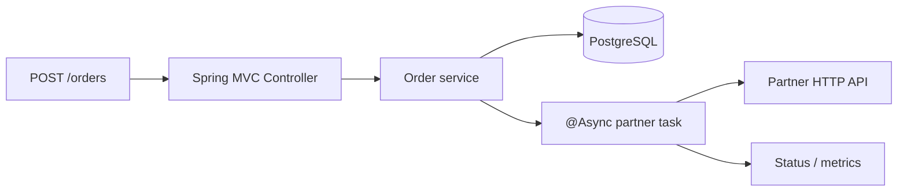
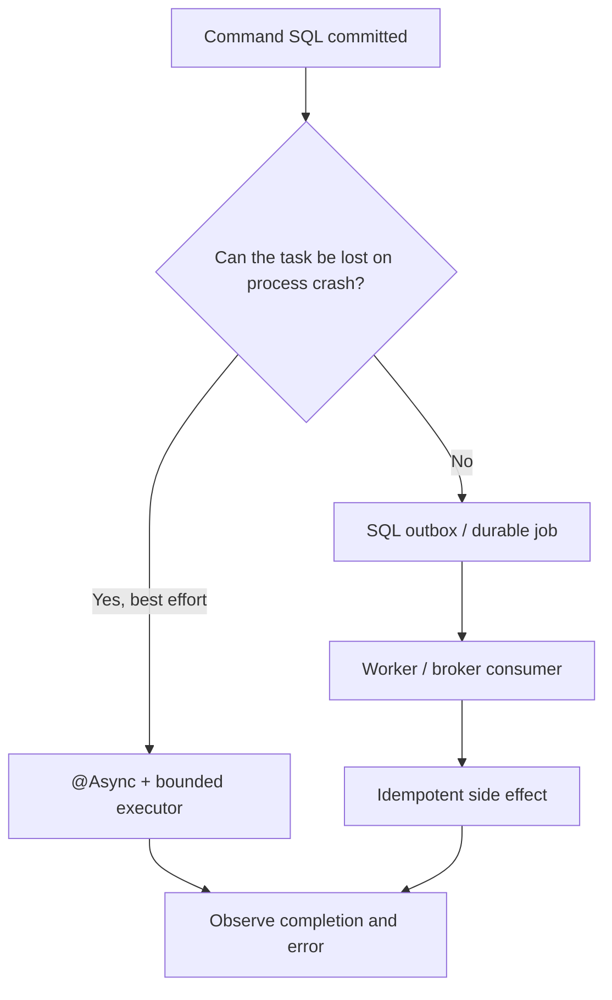
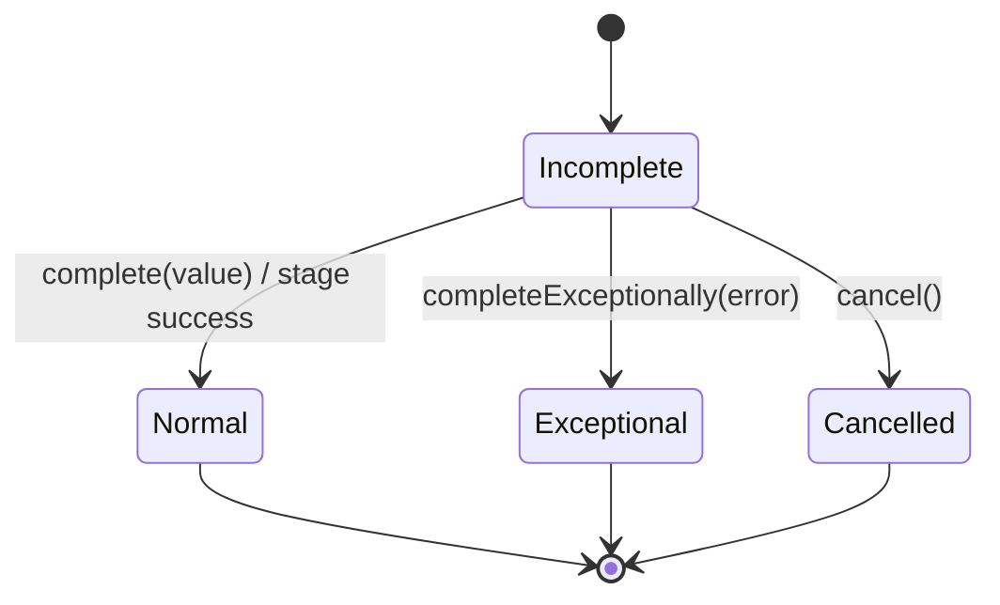
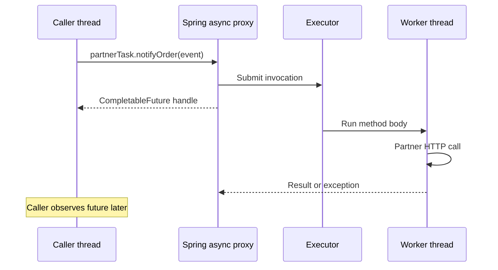
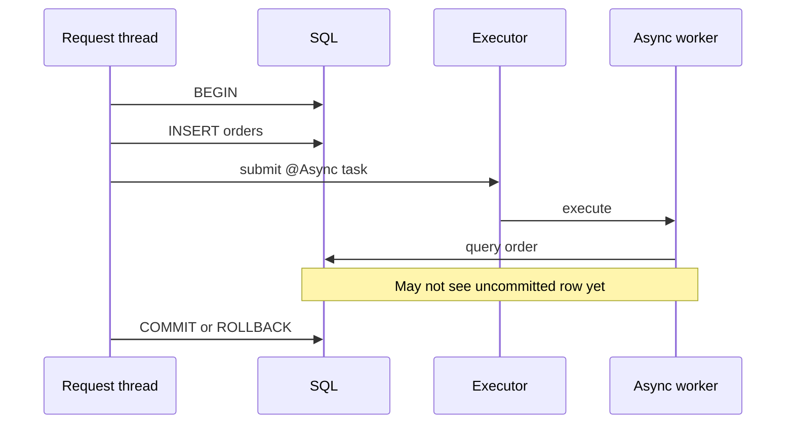

# CompletableFuture, Exceptions, and AsyncUncaughtExceptionHandler

In a Spring Boot application integrating multiple systems, an HTTP request can trigger work taking several seconds: calling an inventory service, writing results to SQL, updating a cache, or publishing events to a message broker. To avoid holding the request-handling thread until the work finishes, teams commonly add `@Async` and change the return type to `CompletableFuture<T>`.

That seemingly simple change raises three critical questions:

1. **Who actually executes the task?** Spring's thread pool, `ForkJoinPool.commonPool()`, or the calling thread?
2. **Where do exceptions surface?** Right at task submission, inside the `CompletableFuture`, in a callback, or in `AsyncUncaughtExceptionHandler`?
3. **What is guaranteed after the HTTP request returns?** A `CompletableFuture` can complete in memory, yet it is not a durable job queue; if the JVM dies, unpersisted work can vanish.

This lesson belongs to the **Async Tasks** chapter of the **SPRING_BOOT_INTEGRATION** module. The module organizes Spring Boot integrations across HTTP clients, databases, caches, message brokers, and Spring Integration adapters, focusing on **configuration, data contracts, transactions, errors, deduplication, testing, and observability**. Accordingly, we will analyze `CompletableFuture` as an in-process coordination tool while drawing its boundaries against SQL transactions, outboxes, message acknowledgments, and idempotency.

> **Scope:** Primary examples use Java 17+, Spring Framework 6.x, and Spring Boot 3.x with `@EnableAsync`, `ThreadPoolTaskExecutor`, and `CompletableFuture`. Boot task executor details, Java 21+ virtual threads, and auto-configuration behavior may differ across Boot 3.2, 3.5, and 4.x. Pool sizes, timeouts, and retries shown here are illustrative figures, not universal production defaults.

## 1. Learning objectives

After this lesson, you will be able to:

1. Distinguish **async tasks**, **non-blocking I/O**, **concurrency**, and **durable background processing**.
2. Explain how a `CompletableFuture` completes normally, completes exceptionally, or gets canceled.
3. Use `@Async` properly with `void`, `Future<T>`, and `CompletableFuture<T>`.
4. Understand why `AsyncUncaughtExceptionHandler` handles **`@Async void`** errors, but is not a central sink for every `CompletableFuture` failure.
5. Apply `thenApply`, `thenCompose`, `thenCombine`, `allOf`, `handle`, `exceptionally`, and `whenComplete` intentionally.
6. Distinguish `CompletionException`, `ExecutionException`, `CancellationException`, `TimeoutException`, and submission-time `TaskRejectedException`.
7. Configure an executor with bounded queues, concurrency caps, rejection policies, and graceful shutdown.
8. Identify Spring proxy boundaries, thread-local contexts, and `@Transactional` behavior across thread switches.
9. Design timeouts, retries, circuit breakers, idempotency, and error reporting when calling HTTP/SQL/brokers.
10. Test success, failure, timeout, and rejection without relying primarily on `Thread.sleep`.

## 2. Scenario: receiving an order and calling a partner

An order is created via HTTP; after writing to SQL, the application wants to send a status-sync request to a partner:



Suppose the HTTP client can be slow or return 429/503. If every request waits synchronously for 15 seconds, in-flight requests pile up and thread/connection pools easily run dry.

One approach:

```java
CompletableFuture<PartnerReceipt> future =
        partnerTask.notifyOrder(orderEvent);
```

This call returns a **handle to a future outcome**, not necessarily a `PartnerReceipt` immediately. Yet if the app ignores `future` and returns `201 Created`, nobody may know the sync failed.

### 2.1. Distinguishing three contracts

| What occurred | What you can assert | What you must not infer |
| --- | --- | --- |
| HTTP command received | Server parsed/validated the request up to that point | Database has committed |
| SQL transaction committed | Business state is durably persisted | Async HTTP task is guaranteed to run |
| `CompletableFuture` completed normally | That code path returned a success result | Partner committed a durable side effect if the API doesn't guarantee it |
| `CompletableFuture` completed exceptionally | Task or callback reported an error | External side effect definitely did not happen |
| Client received HTTP `202 Accepted` | Operation was accepted per API contract | A durable queue exists if using `@Async` alone |

Critical systems must record an **operation ID + durable state** or use an outbox/broker so work remains recoverable across restarts.

## 3. Asynchronous does not automatically mean non-blocking

### 3.1. Blocking work on a worker thread

Example:

```java
@Async("integrationExecutor")
public CompletableFuture<String> fetchPartner() {
    String response = blockingRestClientCall(); // Worker thread waits on I/O.
    return CompletableFuture.completedFuture(response);
}
```

From the caller's perspective, the method returns without waiting for I/O. Yet **the worker thread is still blocked** during the blocking HTTP call. That is **asynchronous execution via a thread pool**, not end-to-end non-blocking I/O.

### 3.2. Non-blocking I/O

`WebClient` uses a reactive stack that can represent results via `Mono<T>` with a different thread model:

```java
Mono<PartnerReceipt> response =
        webClient.post()
                .uri("/orders")
                .bodyValue(event)
                .retrieve()
                .bodyToMono(PartnerReceipt.class);
```

This does not mean every surrounding step is non-blocking: calling `block()`, traditional JDBC, or blocking serializers inside a reactive chain can still block threads.

### 3.3. Durable job processing

`@Async`/`CompletableFuture` usually coordinates **work inside the current JVM only**. For work that must never be lost, use a job table/outbox, broker, or appropriate workflow engine.



## 4. What is CompletableFuture?

`CompletableFuture<T>` fulfills two roles:

- `Future<T>`: represents an as-yet-unavailable result that can be awaited with `get()`.
- `CompletionStage<T>`: attaches transformation, combination, or error-handling steps once the outcome is ready.

A `CompletableFuture` logically resides in one of these states:



At the API level, `Cancelled` is a form of **exceptional completion** with `CancellationException`. Once completed, a future cannot normally have its outcome overwritten by calling `complete` again.

### 4.1. Creating simple futures

```java
CompletableFuture<String> success =
        CompletableFuture.completedFuture("ACCEPTED");

CompletableFuture<String> failure =
        CompletableFuture.failedFuture(
                new IllegalStateException("Partner unavailable"));

CompletableFuture<String> pending =
        new CompletableFuture<>();

pending.complete("READY");
```

`completedFuture` and `failedFuture` produce **already-completed** results; they do not spawn a task on another thread.

### 4.2. Running a supplier on an executor

```java
CompletableFuture<PartnerReceipt> future =
        CompletableFuture.supplyAsync(
                () -> gateway.send(orderEvent),
                integrationExecutor);
```

Here the supplier is submitted to `integrationExecutor`, and any exception thrown inside the supplier completes the future exceptionally. The caller must **observe the future** to learn the outcome.

### 4.3. If no executor is passed

```java
CompletableFuture<PartnerReceipt> future =
        CompletableFuture.supplyAsync(
                () -> gateway.send(orderEvent));
```

Typically, async methods without an explicit executor use `ForkJoinPool.commonPool()` or the JDK-specified default facility. **They do not automatically use Spring Boot's `applicationTaskExecutor` or a dedicated integration executor.**

Risks:

- No dedicated concurrency budget for the partner.
- Hard to tell which pool is saturating.
- Thread naming, tracing, and MDC may differ from Spring-managed executors.
- Code accidentally runs blocking JDBC/HTTP on the common pool, impacting unrelated tasks.

In integration flows with explicit downstream limits, pass an **application-managed executor**.

## 5. What does Spring's @Async actually do?

`@Async` is interception/AOP managed by Spring. When a bean method is called **through the Spring proxy**, the interceptor submits method execution to the selected executor and returns an instance matching the declared return type.



Requirements:

1. `@EnableAsync` or an appropriate mechanism enabling async method execution is active.
2. The method lives on a **Spring-managed bean**.
3. The call goes through the **proxy**, not `this.method()` within the same bean.
4. The method's return type is supported.
5. The named executor or a default executor exists.
6. Not blocked by proxy limitations such as `private` or `final` methods.

### 5.1. Enabling @EnableAsync

```java
package com.example.integration.async;

import org.springframework.context.annotation.Configuration;
import org.springframework.scheduling.annotation.EnableAsync;

@Configuration
@EnableAsync
public class AsyncEnablement {
}
```

Enabling `@EnableAsync` does not automatically turn every method async. Only properly annotated methods invoked via the proxy are intercepted.

### 5.2. Self-invocation bypasses the proxy

Wrong:

```java
@Service
public class OrderService {

    public void createOrder(OrderEvent event) {
        persist(event);
        notifyPartnerAsync(event); // Called via `this`, bypasses proxy.
    }

    @Async("integrationExecutor")
    public void notifyPartnerAsync(OrderEvent event) {
        callPartner(event);
    }
}
```

Calling `notifyPartnerAsync` from within the same class typically executes as a direct Java method call; in **proxy mode**, the annotation does not take effect.

Better:

```java
@Service
public class OrderService {

    private final PartnerAsyncTask partnerAsyncTask;

    public OrderService(PartnerAsyncTask partnerAsyncTask) {
        this.partnerAsyncTask = partnerAsyncTask;
    }

    public void submit(OrderEvent event) {
        partnerAsyncTask.notifyOrder(event); // Called through a Spring bean.
    }
}
```

With this design, `PartnerAsyncTask` is a separate bean with `@Async` on an eligible public method. **Failing to hold onto the returned future** remains a separate issue that must still be addressed.

### 5.3. Private, final, and instantiating objects with `new`

Do not expect `@Async` to work when:

- Using `private` methods that cannot be proxy-overridden/intercepted in standard mode.
- Using `final` methods or final classes with proxy mechanisms that cannot intercept them.
- Instantiating via `new PartnerAsyncTask()`, outside the Spring container.
- Calling an annotated method from `@PostConstruct` expecting interception before proxy/lifecycle readiness.
- Calling within the same object via `this`.

While Spring offers AOP/AspectJ alternatives to change interception, do not adopt them merely to work around self-calls when splitting beans is cleaner.

## 6. Choosing an Executor: configuring a bounded ThreadPoolTaskExecutor

### 6.1. A dedicated executor for HTTP integration

```java
package com.example.integration.async;

import java.util.concurrent.ThreadPoolExecutor;

import org.springframework.context.annotation.Bean;
import org.springframework.context.annotation.Configuration;
import org.springframework.scheduling.concurrent.ThreadPoolTaskExecutor;

@Configuration(proxyBeanMethods = false)
public class IntegrationExecutorConfiguration {

    @Bean("integrationExecutor")
    ThreadPoolTaskExecutor integrationExecutor() {
        ThreadPoolTaskExecutor executor = new ThreadPoolTaskExecutor();

        executor.setThreadNamePrefix("partner-async-");
        executor.setCorePoolSize(4);
        executor.setMaxPoolSize(12);
        executor.setQueueCapacity(100);
        executor.setKeepAliveSeconds(60);

        executor.setRejectedExecutionHandler(
                new ThreadPoolExecutor.AbortPolicy());

        executor.setWaitForTasksToCompleteOnShutdown(true);
        executor.setAwaitTerminationSeconds(30);

        return executor;
    }
}
```

This configuration is **illustrative**. Values 4/12/100/30 must be tuned to throughput, processing times, HTTP/SQL connection pools, and partner quotas.

### 6.2. How core, max, and queue interact

With `ThreadPoolTaskExecutor` backed by `ThreadPoolExecutor`, the typical model is:

1. When workers < `corePoolSize`, spawn a core worker.
2. When core workers are busy, place tasks into the queue.
3. When the queue is full, scale workers up to `maxPoolSize`.
4. When at max and the queue is full, tasks are **rejected** per policy.

```text
corePoolSize = 4
maxPoolSize  = 12
queueCapacity = 100

New task
  -> core slot free? run
  -> queue has room? enqueue
  -> queue full & worker slots free? scale thread
  -> queue full & at max? reject
```

**Trap:** if the queue is effectively unbounded, `maxPoolSize` may rarely be used; raising `maxPoolSize` won't necessarily raise throughput. Yet raising the pool isn't always good either: 100 threads doing blocking HTTP can trigger partner 429s, exhaust DB pools, and increase latency.

### 6.3. Do not silently drop tasks when the queue is full

`AbortPolicy` surfaces submission failures instead of silently losing work. In Spring, rejections can be wrapped into `TaskRejectedException` or related exceptions depending on the adapter/executor.

**Important:** submission failure happens **before the async method body runs**, so it does not normally enter `AsyncUncaughtExceptionHandler`.

If you must accept every request even when the pool is full, use a **durable queue/job table** or HTTP backpressure rather than an unbounded JVM queue.

### 6.4. Be careful with CallerRunsPolicy

`CallerRunsPolicy` can run the task on the **calling thread** when the pool saturates. That changes:

- HTTP request latency.
- Thread-local contexts.
- Transaction boundaries.
- Message acknowledgment timing in Kafka/JMS/Rabbit/Pulsar listeners.
- Code deadlock/reentrancy risks.

Do not adopt this policy merely "so tasks aren't lost" without analyzing its effects; it **does not create durability**.

## 7. Spring Boot's default executor and common surprises

When appropriate conditions hold, Spring Boot may auto-create an `AsyncTaskExecutor` for task execution, typically named `applicationTaskExecutor` and backed by `ThreadPoolTaskExecutor` in platform-thread mode. However, adding another `Executor` bean can cause auto-configuration to **back off** or alter executor resolution.

In Spring Boot 3.5 and newer versions, documentation also describes property-driven ways to force/prioritize task execution; **do not assume every Boot 3.x has identical properties**. With Java 21+ and virtual threads enabled on compatible Boot versions, the default executor type may also change.

### 7.1. Selecting an executor via `@Async` qualifier

```java
@Async("integrationExecutor")
public CompletableFuture<PartnerReceipt> notifyOrder(OrderEvent event) {
    PartnerReceipt receipt = gateway.send(event);
    return CompletableFuture.completedFuture(receipt);
}
```

This is much clearer than hoping the right `Executor` gets picked automatically when an app defines multiple pools for HTTP, batch, and messaging.

### 7.2. When does `spring.task.execution.*` take effect?

Example for a **Boot-managed executor** where supported:

```yaml
spring:
  task:
    execution:
      thread-name-prefix: "app-async-"
      pool:
        core-size: 4
        max-size: 12
        queue-capacity: 100
        keep-alive: 60s
```

These properties control **the executor Boot auto-configures**; they do not automatically bind to the `@Bean("integrationExecutor") new ThreadPoolTaskExecutor()` created manually in section 6.

Do not mentally add the YAML and Java configurations expecting Spring to apply both. If you define a custom bean and want property binding, use a builder or `@ConfigurationProperties` matching your version and test the effective configuration.

### 7.3. Virtual threads do not remove concurrency limits

Java 21+ virtual threads lower thread-holding overhead for suitable blocking I/O workloads, yet **they do not give HTTP partners, Redis, PostgreSQL, or Kafka brokers infinite capacity**. You still need semaphores/rate limiters, HTTP connection pool limits, backpressure, and retry budgets.

In particular, never copy platform thread pool core/max/queue numbers and assume they apply identically to `SimpleAsyncTaskExecutor`/virtual-thread strategies.

## 8. Three key return types of @Async

| Return type | What the caller receives | Where exceptions inside the method go |
| --- | --- | --- |
| `void` | No result handle | `AsyncUncaughtExceptionHandler` when uncaught |
| `Future<T>` | Future for calling `get` or checking status | Future holds the exception; `get` typically throws `ExecutionException` |
| `CompletableFuture<T>` | Future and `CompletionStage` chaining | Exceptional completion, handled via `handle`/`exceptionally`/`whenComplete` |
| Raw `CompletionStage<T>` | Not uniformly supported as an `@Async` signature across Spring versions | Prefer explicit `CompletableFuture<T>` when using Spring `@Async` |

### 8.1. `@Async void`

```java
@Async("integrationExecutor")
public void refreshBestEffortCache(String key) {
    cacheRefresher.refresh(key); // May throw RuntimeException.
}
```

If `refresh` throws an uncaught exception, Spring passes it to the configured `AsyncUncaughtExceptionHandler`. The caller has no future to await or determine success/failure.

**Use this pattern strictly for truly best-effort work**, such as refreshing a cache with a TTL/rebuild path. Never use it for payment status updates, mandatory event publishing, or un-losable audits.

### 8.2. `@Async Future<T>`

```java
@Async("integrationExecutor")
public Future<PartnerReceipt> sendLegacy(OrderEvent event) {
    PartnerReceipt receipt = gateway.send(event);
    return CompletableFuture.completedFuture(receipt);
}
```

In Spring's `@Async` model, the method implementation returns a `Future` holding the execution result, while the proxy supplies a handle to the caller. With plain `Future`, the caller relies on `get` or status polling; it is far less flexible than `CompletableFuture`.

### 8.3. `@Async CompletableFuture<T>`

```java
@Async("integrationExecutor")
public CompletableFuture<PartnerReceipt> send(OrderEvent event) {
    PartnerReceipt receipt = gateway.send(event);
    return CompletableFuture.completedFuture(receipt);
}
```

**Why return `completedFuture` inside an async method?** The Spring proxy already submitted the invocation to the executor. The method body executes on the worker; once business logic completes, it returns a completed future so the interceptor transfers that outcome to the future held by the caller.

Do not double-wrap like this:

```java
@Async("integrationExecutor")
public CompletableFuture<PartnerReceipt> sendBadly(OrderEvent event) {
    return CompletableFuture.supplyAsync(
            () -> gateway.send(event)); // Dispatches again onto commonPool.
}
```

That is unnecessary **double scheduling**: the task already entered Spring's executor, only to immediately hop onto an uncontrolled pool. There are cases where you compose independent async sub-tasks, but executor and boundary choices must be intentional.

## 9. Spring Boot example: service returning CompletableFuture

### 9.1. Contract and gateway

Suppose we define the event and receipt:

```java
package com.example.integration.partner;

public record OrderEvent(
        String eventId,
        String orderId,
        long amountMinor,
        String currency
) {}

public record PartnerReceipt(
        String operationId,
        String status
) {}
```

Gateway for blocking HTTP:

```java
package com.example.integration.partner;

import org.springframework.beans.factory.annotation.Value;
import org.springframework.stereotype.Component;
import org.springframework.web.client.RestClient;

@Component
public class PartnerGateway {

    private final RestClient restClient;

    public PartnerGateway(
            RestClient.Builder builder,
            @Value("${integration.partner.base-url}") String baseUrl) {
        this.restClient = builder.baseUrl(baseUrl).build();
    }

    public PartnerReceipt send(OrderEvent event) {
        return restClient.post()
                .uri("/orders")
                .header("Idempotency-Key", event.eventId())
                .body(event)
                .retrieve()
                .body(PartnerReceipt.class);
    }
}
```

This snippet uses `RestClient` (Spring Framework 6.1+/Boot 3.2+) for blocking HTTP. `RestClient.Builder` is provided by Spring Boot when appropriate auto-configuration is active. Production requires timeouts, TLS, auth, response validation, and partner-appropriate retry policies.

### 9.2. `@Async` worker

```java
package com.example.integration.partner;

import java.util.concurrent.CompletableFuture;

import org.springframework.scheduling.annotation.Async;
import org.springframework.stereotype.Service;

@Service
public class PartnerAsyncTask {

    private final PartnerGateway gateway;

    public PartnerAsyncTask(PartnerGateway gateway) {
        this.gateway = gateway;
    }

    @Async("integrationExecutor")
    public CompletableFuture<PartnerReceipt> notifyOrder(
            OrderEvent event) {

        PartnerReceipt receipt = gateway.send(event);

        if (receipt == null || receipt.operationId() == null) {
            throw new IllegalStateException(
                    "Partner response missing operationId");
        }

        return CompletableFuture.completedFuture(receipt);
    }
}
```

If `gateway.send` or validation throws an exception, the caller receives an **exceptional `CompletableFuture`** via the Spring interceptor, not `AsyncUncaughtExceptionHandler` (which is for `void`).

### 9.3. Caller must decide how to observe

```java
CompletableFuture<PartnerReceipt> future =
        partnerAsyncTask.notifyOrder(event);

future.whenComplete((receipt, error) -> {
    if (error != null) {
        logger.error("Partner operation failed, eventId={}",
                event.eventId(), error);
    } else {
        logger.info("Partner accepted, operationId={}",
                receipt.operationId());
    }
});
```

`logger` is an SLF4J logger on the calling component; this snippet sits inside a method with `event` and `partnerAsyncTask`. **Logging does not make a task durable**: if results are needed for reconciliation, persist operation state to SQL or a durable workflow with its own exception handling and transactions.

## 10. Behavior of `thenApply`, `thenCompose`, and `thenCombine`

### 10.1. `thenApply`: transforming a single result

```java
CompletableFuture<String> status =
        partnerAsyncTask.notifyOrder(event)
                .thenApply(PartnerReceipt::status);
```

`thenApply` runs when upstream succeeds; the callback may execute on the thread that completed upstream or on the registering thread if upstream already completed. **It promises no fixed thread** unless you use an `*Async` variant with an explicit executor.

### 10.2. `thenCompose`: chaining another async task

Suppose `auditTask.recordAsync(...)` returns `CompletableFuture<AuditResult>`:

```java
CompletableFuture<AuditResult> workflow =
        partnerAsyncTask.notifyOrder(event)
                .thenCompose(receipt ->
                        auditTask.recordAsync(
                                event.eventId(), receipt.operationId()));
```

`thenCompose` flattens the result:

```text
CompletableFuture<CompletableFuture<AuditResult>>
              ↓ thenCompose
CompletableFuture<AuditResult>
```

If the callback returns a failed future, the whole chain fails. **It does not put both tasks in one transaction**: each task can run on an independent thread, datasource, or external system.

### 10.3. `thenCombine`: combining two independent results

```java
CompletableFuture<PartnerReceipt> partner =
        partnerAsyncTask.notifyOrder(event);

CompletableFuture<InventoryStatus> inventory =
        inventoryTask.checkAsync(event.orderId());

CompletableFuture<OrderCheck> combined =
        partner.thenCombine(inventory,
                (receipt, stock) -> new OrderCheck(
                        receipt.status(), stock.available()));
```

Here `InventoryStatus` and `OrderCheck` are application-defined DTOs. Use `thenCombine` only when the two tasks are truly independent and both outcomes are needed.

If one branch fails, the combined future completes exceptionally per `CompletableFuture` semantics; the other branch **is not automatically canceled** or rolled back.

## 11. `allOf`, `anyOf`, and common misconceptions

### 11.1. `allOf` does not automatically return a list of results

```java
List<CompletableFuture<PartnerReceipt>> futures =
        events.stream()
                .map(partnerAsyncTask::notifyOrder)
                .toList();

CompletableFuture<Void> all =
        CompletableFuture.allOf(
                futures.toArray(CompletableFuture[]::new));

CompletableFuture<List<PartnerReceipt>> results =
        all.thenApply(ignored ->
                futures.stream()
                        .map(CompletableFuture::join)
                        .toList());
```

`allOf` completes once all component futures finish; if one or more fail, the combined future also completes exceptionally. It does not produce a list of per-item successes/failures: to aggregate **per-item outcomes**, map each future to an explicit status-bearing result type before calling `allOf`.

**Risk in this snippet:** creating a future for every item in a huge collection can explode queues and task counts. Use batching, semaphores, or a durable worker queue with backpressure.

### 11.2. `anyOf` does not cancel remaining branches

```java
CompletableFuture<Object> firstCompleted =
        CompletableFuture.anyOf(futureA, futureB);
```

`anyOf` completes with **whichever future finishes first**, whether success **or failure**. It does not mean "take the first success," nor does it cancel the remaining tasks.

If both call external APIs with side effects, `anyOf` can cause **both side effects to occur**, even though the caller inspects only one result.

### 11.3. `allOf` is not a distributed transaction

`allOf` only coordinates results inside the JVM. It does not commit or roll back SQL, JMS, Kafka, RabbitMQ, or HTTP transactions together. For cross-resource consistency, use an outbox, idempotency, sagas, or an appropriate transaction coordinator.

## 12. Normal completion, exceptional completion, and cancellation

### 12.1. Normal completion

```java
CompletableFuture<String> future =
        CompletableFuture.completedFuture("OK");

String value = future.join(); // "OK"
```

### 12.2. Exceptional completion

```java
CompletableFuture<String> future =
        CompletableFuture.failedFuture(
                new IllegalArgumentException("Invalid event"));

boolean failed = future.isCompletedExceptionally(); // true
```

`isCompletedExceptionally()` only reports that the future failed or was canceled per contract; it **does not tell you why**, whether it is retryable, and does not log anything.

### 12.3. Canceling a future

```java
CompletableFuture<String> future = new CompletableFuture<>();
future.cancel(true);
```

In standard `CompletableFuture`, the `mayInterruptIfRunning` flag does not guarantee interrupting the executing task; per Java API docs, cancellation completes the future exceptionally with `CancellationException` and **does not use interrupts to control work** the way many developers expect from `FutureTask`.

**Consequence:** after an HTTP POST is sent, calling `cancel(true)` does not prove the partner did not receive the request. Retrying is safe only with business operation IDs/idempotency or reconciliation.

## 13. `get()` and `join()`: how exceptions are wrapped

### 13.1. `get()` is the Future API

```java
try {
    PartnerReceipt receipt =
            future.get(3, TimeUnit.SECONDS);
} catch (TimeoutException ex) {
    // Caller stops waiting; underlying task may still be running.
} catch (ExecutionException ex) {
    Throwable root = ex.getCause();
    // Error from task or callback.
} catch (InterruptedException ex) {
    Thread.currentThread().interrupt();
    // Stop waiting per policy; does not automatically cancel external side effects.
}
```

`get` declares checked exceptions, and `get(timeout, unit)` adds `TimeoutException`. Timing out the **wait call** does not cancel the underlying future.

### 13.2. `join()` is the convenience API

```java
try {
    PartnerReceipt receipt = future.join();
} catch (CompletionException ex) {
    Throwable root = ex.getCause();
    // Classify error.
} catch (CancellationException ex) {
    // Future was canceled.
}
```

`join` avoids checked `ExecutionException`, typically wrapping errors in `CompletionException`. Never call unbounded `join()` on an HTTP request thread or event-loop thread without clear deadlines and capacity limits.

### 13.3. Exception table

| Exception | Where it typically originates | Meaning |
| --- | --- | --- |
| `CompletionException` | `join()` or stage chains | Wrapper for completion stage failures |
| `ExecutionException` | `Future.get()` | Checked wrapper for failed tasks |
| `CancellationException` | Canceled future; `join`/`get` or callbacks | Future no longer holds a success result |
| `TimeoutException` | `get(timeout)` or `orTimeout`-driven completion | Wait/deadline expired per respective API |
| `InterruptedException` | Thread interrupted during `get`/`sleep`/blocking wait | Restore interrupt flag when appropriate |
| `TaskRejectedException` | Spring executor rejects submission | Task may never have entered executor; error can throw directly at caller |
| `RestClientResponseException` | HTTP client receives 4xx/5xx | Classify by status code and operation |
| `DataAccessException` | Spring JDBC/SQL | Does not imply broker/HTTP also rolled back |

## 14. Distinguishing root exceptions from wrappers

When deciding retries, do not check:

```java
if (error instanceof CompletionException) {
    // retry everything?
}
```

`CompletionException` is just a wrapper. A typical helper:

```java
static Throwable unwrapCompletion(Throwable error) {
    Throwable current = error;

    while ((current instanceof CompletionException
            || current instanceof ExecutionException)
            && current.getCause() != null) {
        current = current.getCause();
    }

    return current;
}
```

Imports:

```java
import java.util.concurrent.CompletionException;
import java.util.concurrent.ExecutionException;
```

**Note:** do not unwrap `getCause()` infinitely across every exception type; some exception wrappers carry domain semantics. In logs, retain the wrapper stacktrace when debugging chains, but classify retries based on the properly understood root cause. Policies for `CancellationException`, `TimeoutException`, or `TaskRejectedException` can differ significantly.

## 15. `exceptionally`: recovering an error into a value

`exceptionally` receives an exception and returns a **replacement value** if upstream failed:

```java
CompletableFuture<PartnerReceipt> recovered =
        partnerAsyncTask.notifyOrder(event)
                .exceptionally(error -> {
                    Throwable cause = unwrapCompletion(error);
                    logger.warn("Partner failed, eventId={}, type={}",
                            event.eventId(),
                            cause.getClass().getSimpleName());

                    return new PartnerReceipt(
                            event.eventId(), "UNKNOWN");
                });
```

This uses variables and a logger from the caller. `recovered` can **complete normally** with `UNKNOWN` even though the partner was actually unavailable.

### 15.1. Trap: "swallowing" errors with fake values

If `UNKNOWN` is interpreted as `ACCEPTED`, the system can corrupt business state. Design an explicit outcome type instead:

```java
sealed interface PartnerOutcome
        permits PartnerSucceeded, PartnerFailed {}

record PartnerSucceeded(PartnerReceipt receipt)
        implements PartnerOutcome {}

record PartnerFailed(String category, boolean retryable)
        implements PartnerOutcome {}
```

Now callers must handle both states explicitly rather than mistaking a fallback for success.

### 15.2. `exceptionally` is not a retry

`exceptionally` normally **converts an error into a value**, rather than re-running upstream. If the callback calls the external service again, that is a custom-coded retry and requires backoff, deadlines, idempotency, and attempt limits.

## 16. `handle`: mapping both success and failure

`handle` receives both result and error; one of the two is normally populated depending on completion:

```java
CompletableFuture<PartnerOutcome> outcome =
        partnerAsyncTask.notifyOrder(event)
                .handle((receipt, error) -> {
                    if (error == null) {
                        return new PartnerSucceeded(receipt);
                    }

                    Throwable cause = unwrapCompletion(error);
                    return new PartnerFailed(
                            classify(cause),
                            isRetryable(cause));
                });
```

`classify(...)` and `isRetryable(...)` are **application-implemented policy functions**; no universal default fits every partner.

**Important point:** the Future returned by `handle` is considered successful if the callback returns normally—even when returning a `PartnerFailed`. That works if downstream reads the outcome type, but breaks if downstream only checks `future.isCompletedExceptionally()`.

### 16.1. Validating success responses

```java
CompletableFuture<PartnerOutcome> outcome =
        partnerAsyncTask.notifyOrder(event)
                .handle((receipt, error) -> {
                    if (error != null) {
                        return new PartnerFailed("REMOTE_FAILURE", true);
                    }
                    if (receipt == null || receipt.status() == null) {
                        return new PartnerFailed(
                                "INVALID_RESPONSE", false);
                    }
                    return new PartnerSucceeded(receipt);
                });
```

An HTTP 200 with a broken response contract is also an **integration failure**, even though the upstream `CompletableFuture` completed normally.

## 17. `whenComplete`: observing without intentionally altering the outcome

`whenComplete` fits logging, metrics, and tracing when a stage finishes:

```java
CompletableFuture<PartnerReceipt> observed =
        partnerAsyncTask.notifyOrder(event)
                .whenComplete((receipt, error) -> {
                    if (error != null) {
                        logger.error(
                                "Partner call failed eventId={}",
                                event.eventId(), error);
                    } else {
                        logger.info(
                                "Partner call OK eventId={}",
                                event.eventId());
                    }
                });
```

Unlike `exceptionally`/`handle`, a `whenComplete` callback **does not return a replacement value**; the stage preserves the original result or error per Java semantics.

However, if the `whenComplete` callback **itself throws an exception**, the stage's outcome depends on upstream state and `CompletableFuture` rules; a callback exception can turn a successful upstream stage into a failed stage.

### 17.1. Do not use `whenComplete` as an automatic durable status updater

Calling `repository.updateStatus(...)` inside `whenComplete` introduces a **new SQL side effect** that can itself fail. Without controlling transactions and exceptions, the app may consider the task done without knowing whether the SQL status committed.

For critical operations, use an explicit job state machine (`PENDING`/`RUNNING`/`RETRY`/`DONE`/`FAILED`) with proper transactions and leases rather than just a logging callback.

### 17.2. Comparing the APIs

| API | Receives success? | Receives failure? | Produces new result? | Typical use |
| --- | --- | --- | --- | --- |
| `exceptionally` | No (standard form) | Yes | Yes, same type as upstream | Fallback or mapping exception to a value |
| `handle` | Yes | Yes | Yes, can change type | Outcome classification |
| `whenComplete` | Yes | Yes | Not intended to replace result | Logging, metrics, tracing |
| `thenApply` | Yes | No | Yes | Transform success value |
| `thenCompose` | Yes | No | Yes, via another future | Chaining async stages |
| `exceptionallyCompose` | Not on success path | Yes | Yes, via fallback future | Asynchronous recovery |

## 18. `exceptionallyCompose`: asynchronous fallback

Available in modern Java releases (including Java 17), `exceptionallyCompose` transitions a failure into **another future**—such as querying status instead of blindly retrying:

```java
CompletableFuture<PartnerReceipt> safe =
        partnerAsyncTask.notifyOrder(event)
                .exceptionallyCompose(error -> {
                    Throwable cause = unwrapCompletion(error);

                    if (cause instanceof PartnerTimeoutException) {
                        return partnerStatusTask
                                .lookupByOperationId(event.eventId());
                    }

                    return CompletableFuture.failedFuture(cause);
                });
```

`PartnerTimeoutException` and `partnerStatusTask.lookupByOperationId` are application-defined examples. The key idea: when a side-effecting request **times out**, you often must **query the status of the original operation ID** before deciding to resend.

Never use a fallback to switch from one failing partner to another if business rules disallow duplicate side effects or lack reconciliation.

## 19. Which thread runs async continuations?

### 19.1. Without the `Async` suffix

```java
future.thenApply(receipt -> enrich(receipt));
```

The callback may run on the thread that **completes the future**, or on the thread registering the callback if upstream already finished, per implementation semantics. There is no guarantee it is the HTTP request thread or an integration worker thread.

### 19.2. With the `Async` suffix but no executor

```java
future.thenApplyAsync(receipt -> enrich(receipt));
```

Typically the callback uses `CompletableFuture`'s default async execution facility, **not Spring's `@Async` executor automatically**.

### 19.3. With the `Async` suffix and an explicit executor

```java
future.thenApplyAsync(
        receipt -> enrich(receipt),
        integrationExecutor);
```

This explicitly controls where the continuation runs. Keep in mind:

- The new callback can throw `TaskRejectedException` when the pool is saturated.
- A callback exception fails the dependent stage.
- Switching threads drops thread-local contexts without explicit propagation.
- If a pool has one thread and a task calls `join` waiting on another task scheduled onto the same pool, **thread starvation/deadlock** can occur.

### 19.4. Avoid blocking inside callbacks unnecessarily

An anti-pattern:

```java
future.thenApply(receipt ->
        anotherAsyncTask.run(receipt).join());
```

The callback thread blocks waiting for another task; on a small bounded pool, this can create a dependency cycle. Use `thenCompose` when the next step already returns a `CompletableFuture`.

## 20. AsyncUncaughtExceptionHandler: right role, right scope

### 20.1. What does this handler do?

`AsyncUncaughtExceptionHandler` is Spring's strategy for **uncaught** exceptions thrown by `@Async` methods that **have no Future return type**, typically `void`.

In Spring, the interface defines:

```java
void handleUncaughtException(
        Throwable ex,
        Method method,
        Object... params);
```

The handler receives:

- `ex`: the thrown exception.
- `method`: the failing async method.
- `params`: arguments passed to the invocation.

**The handler does not turn a `void` method into a Future**, provides no return channel to the caller, and does not automatically retry or roll back a distributed workflow.

### 20.2. Configuring with AsyncConfigurer

```java
package com.example.integration.async;

import org.slf4j.Logger;
import org.slf4j.LoggerFactory;

import org.springframework.aop.interceptor.AsyncUncaughtExceptionHandler;
import org.springframework.context.annotation.Configuration;
import org.springframework.scheduling.annotation.AsyncConfigurer;
import org.springframework.scheduling.annotation.EnableAsync;

@Configuration
@EnableAsync
public class AsyncExceptionConfiguration implements AsyncConfigurer {

    private static final Logger log =
            LoggerFactory.getLogger(AsyncExceptionConfiguration.class);

    @Override
    public AsyncUncaughtExceptionHandler
            getAsyncUncaughtExceptionHandler() {

        return (exception, method, params) -> {
            log.error(
                    "Unhandled @Async void exception method={} type={}",
                    method.getName(),
                    exception.getClass().getSimpleName(),
                    exception);
        };
    }
}
```

This configuration only sets the uncaught exception handler. Methods with `@Async("integrationExecutor")` still select their executor by bean name; if your app also has unqualified `@Async` methods, verify the expected **default executor** is resolved via Spring Boot/`AsyncConfigurer`.

**Never log raw `params` indiscriminately**: they can contain bearer tokens, customer records, payment payloads, or PII.

### 20.3. Failing `void` method

```java
@Service
public class BestEffortCacheRefreshTask {

    private final CacheRefreshGateway gateway;

    public BestEffortCacheRefreshTask(CacheRefreshGateway gateway) {
        this.gateway = gateway;
    }

    @Async("integrationExecutor")
    public void refresh(String cacheKey) {
        gateway.refresh(cacheKey);
    }
}
```

`CacheRefreshGateway` is application-implemented. If `gateway.refresh` throws an uncaught runtime exception, the configured handler can log it. Because the caller received `void`, it cannot detect failure via a return value.

### 20.4. No automatic retry

Retries must be designed explicitly—for example, as a **durable retry job**:

```text
cache-refresh requested
    |
    v
persist task (if durability is required)
    |
    v
worker attempts / records failure category
    |
    +-- transient: backoff + retry
    +-- permanent: BLOCKED / alarm
```

Never write `while(true)` inside `AsyncUncaughtExceptionHandler` to re-run arbitrary failed calls; the handler lacks contracts, deadlines, operation IDs, and business retry authority.

## 21. What errors does AsyncUncaughtExceptionHandler NOT catch?

| Case | Handled by this handler? | Proper handling |
| --- | --- | --- |
| `@Async void` throws an uncaught exception | **Yes**, when properly intercepted | Log/alert in handler, or transition a durable failure workflow |
| `@Async CompletableFuture<T>` throws an exception | **No** | Observe the exceptional future |
| `@Async Future<T>` throws an exception | **No** | `Future.get`/result monitoring |
| `CompletableFuture.supplyAsync(...)` fails | **No**, not via `@Async void` | Future exceptional completion |
| `thenApply`/`thenCompose` callback throws | **No** | Observe the dependent future |
| Executor rejects task before method runs | **Not guaranteed** | Catch/report `TaskRejectedException` at the submit boundary |
| HTTP/SQL exception caught and swallowed inside method | **No** | Do not swallow errors; return a status-bearing outcome |
| Exception thrown by a `@Scheduled` method | **Not by default** | Dedicated scheduler/`ErrorHandler` |
| Error in a Kafka/JMS/Pulsar listener | **Not by default** | Broker/container error handling and ACK/DLQ |
| Error sent to Spring Integration `errorChannel` | **Not by default** | Message handling/error flow |
| Exception in controller before calling `@Async` | **No** | MVC/global exception handling |
| JVM process killed before task runs | **No** | Durable outbox/job persistence |

**Most important lesson:** do not register an `AsyncUncaughtExceptionHandler` and assume you now have a "global async exception handler" covering the entire Spring application.

## 22. Why using `@Async void` for critical business work is dangerous

Consider:

```java
@Async("integrationExecutor")
public void chargePayment(PaymentCommand command) {
    paymentClient.charge(command);
}
```

Risks:

- The caller never learns success or failure.
- Submission rejection may have no business fallback.
- Process death while queued leaves no durable record for replay.
- A timeout leaves it unknown whether the external payment charged.
- The handler only logs and cannot reliably update operation state.
- Unconditional retries can double-charge.

For payments, inventory reservations, shipments, or mandatory integration events, prefer:

1. Persisting a stable **operationId / idempotency key**.
2. Writing the business intent in SQL inside the same transaction when needed.
3. Using an outbox or durable queue.
4. Having workers process and persist status.
5. Querying/reconciling external state on timeouts.
6. Using budgeted retries and manual recovery paths.

`CompletableFuture` remains useful for **coordinating a single worker attempt**, not for creating workflow durability.

## 23. Timeouts: `get(timeout)` vs. `orTimeout` vs. HTTP client timeouts

### 23.1. `get(timeout)` only bounds how long the caller waits

```java
try {
    PartnerReceipt receipt =
            future.get(2, TimeUnit.SECONDS);
} catch (TimeoutException ex) {
    // Caller stops waiting.
    // The underlying task/HTTP call may still be running.
}
```

`future` can still complete normally afterward. This timeout does not close sockets, abort SQL statements, or undo external actions.

### 23.2. `orTimeout` completes the future exceptionally

```java
CompletableFuture<PartnerReceipt> timed =
        partnerAsyncTask.notifyOrder(event)
                .orTimeout(4, TimeUnit.SECONDS);
```

If expired, the future can complete exceptionally with `TimeoutException`. **`orTimeout` returns the same `CompletableFuture` instance it was called on** and mutates its outcome; it is not an independent "wait-only wrapper copy."

Nor does it guarantee interrupting blocking work running inside an HTTP client.

### 23.3. `completeOnTimeout` supplies a fallback value

```java
CompletableFuture<PartnerOutcome> timed =
        longRunningOutcome
                .completeOnTimeout(
                        new PartnerFailed("TIMEOUT", true),
                        4, TimeUnit.SECONDS);
```

Similarly, `completeOnTimeout` mutates the original future to complete **normally with the fallback** on timeout. If callers only check `isCompletedExceptionally()`, they may miss that a timeout occurred.

### 23.4. Timeouts must be configured from the outside in

A coherent strategy:

| Layer | Goal |
| --- | --- |
| HTTP connect timeout | Avoid hanging indefinitely when unable to connect |
| HTTP response/read timeout | Bound waiting on the partner |
| Connection-pool acquisition timeout | Avoid waiting forever for a socket from the pool |
| SQL statement/transaction timeout | Bound JDBC operations |
| Async stage deadline | Avoid waiting longer than caller SLA |
| Retry budget | Bound total time spent across attempts |
| HTTP request deadline | Respond within published SLA |
| Durable job TTL | Decide when an operation requires manual review |

**Example:** if an async stage deadline is 3 seconds while the HTTP client read timeout is 60 seconds, the future times out while the worker still holds a connection for 57 more seconds. Align timeouts and capacities together.

## 24. Cancellation, interrupts, and unknown outcomes

A client clicks "Cancel," and the caller runs:

```java
future.cancel(true);
```

Often that only transitions the `CompletableFuture`'s state. It does not reliably abort an already-sent HTTP POST, a SQL transaction running on the DB, or a broker message send.

For side-effecting operations, distinguish:

- **Cancel waiting:** the caller no longer cares about the result.
- **Cancel computation:** the worker actually stops before emitting a side effect.
- **Compensate business effect:** the system executes a business cancellation or reversal.
- **Unknown outcome:** it may already have executed; query or reconcile.

### 24.1. Example of duplication risk

```text
T0: send POST /reservations with operationId=R-100
T1: future times out at T0+3s
T2: caller retries POST with operationId=R-101
T3: partner creates both reservations
```

Retrying with the same **R-100** against a reliable partner idempotency contract greatly lowers duplicate risk. If the partner lacks idempotency support, use status lookups, dedup ledgers, or reconciliation; `CompletableFuture` does not solve this.

## 25. Retries: classify errors before repeating

### 25.1. Decision table

| Error | Should retry? | Reason |
| --- | --- | --- |
| HTTP 503/429 | Usually yes, respecting rate limits and deadlines | Transient/downstream throttling |
| HTTP 400 schema invalid | Usually no | Permanent contract failure |
| HTTP 401/403 | Do not retry-storm | Auth/authorization must be fixed |
| Network timeout | Possible, **if idempotent or paired with reconciliation** | Outcome may be unknown |
| SQL deadlock/lock timeout | Possible with proper transaction boundaries | May require retrying the whole transaction |
| Unique constraint duplicate key | Usually check idempotency rather than retrying | Business key may already be processed |
| Executor rejected | Needs backpressure/durable retry | Pool or queue saturated |
| Cancellation | Do not assume broker didn't receive it | External outcome may be uncertain |
| Schema decode error | Usually do not retry unchanged | Requires quarantine/correction |

### 25.2. Never retry infinitely inside an `@Async` method

Wrong:

```java
@Async("integrationExecutor")
public CompletableFuture<String> publish() {
    while (true) {
        try {
            return CompletableFuture.completedFuture(sendEvent());
        } catch (RuntimeException ignored) {
            // Infinite loop hogging a worker thread.
        }
    }
}
```

This task can pin a worker forever, trigger retry storms, and fail to ensure idempotency.

### 25.3. Bounded retries with backoff

Production solutions can use Spring Retry, Resilience4j, or a durable job scheduler. Minimum policy:

- Cap attempt count, elapsed time, and overall deadline.
- Exponential backoff + jitter.
- Honor `Retry-After` on 429 when appropriate.
- Avoid long `Thread.sleep` calls on small pools when retries can be scheduled separately.
- Keep `eventId`/`operationId` constant across retries.
- Track retry counts, success-after-retry, and permanent failures.
- Provide a DLQ/manual repair path for unrecoverable tasks.

**Never publish a broker message and retry at the async API level without accounting for broker producer acknowledgments**: an earlier send may already have been accepted despite a caller timeout.

## 26. Transaction boundaries: `@Transactional` does not cross threads

### 26.1. A transaction normally binds to a thread

Spring transactions for JDBC/JPA typically rely on thread-bound transaction contexts. If a controller or service inside `@Transactional` calls `@Async`, the worker thread **does not automatically inherit the caller's transaction**.



If the worker executes before SQL commits, it may miss the order or see stale state depending on isolation. If SQL rolls back after the worker already sent an HTTP/broker call, you create a **phantom event**.

### 26.2. `@Transactional` on the worker opens a separate transaction

```java
@Service
public class ProjectionWorker {

    @Async("integrationExecutor")
    @Transactional
    public CompletableFuture<Void> updateProjection(OrderEvent event) {
        jdbc.update(
                "UPDATE order_projection SET state = ? WHERE order_id = ?",
                "CREATED", event.orderId());

        return CompletableFuture.completedFuture(null);
    }
}
```

This can open a **new SQL transaction on the worker thread** when both interceptors apply properly, yet it does not merge the caller and worker into one atomic transaction. Whenever multiple annotations, proxies, or advices combine, write an integration test to confirm transaction boundaries.

### 26.3. Do after-commit callbacks solve durability?

`@TransactionalEventListener(phase = AFTER_COMMIT)` prevents launching side effects prior to commit when triggered in the right phase. Still, if the process dies **after SQL commit and before the task is submitted/published**, the in-memory event is lost.

When the rule is **SQL commit ⇒ event must eventually be sent**, use a **Transactional Outbox**:

```text
@Transactional command:
  INSERT orders
  INSERT outbox(eventId, JSON, READY)
COMMIT

Reliable worker:
  read/claim outbox
  publish broker
  mark PUBLISHED after confirmation
  retry idempotently
```

Do not treat `@Async` as a substitute for an outbox.

## 27. SQL–HTTP–broker: async errors must respect system boundaries

### 27.1. SQL committed, HTTP failed

The `CompletableFuture` surfaces the failed HTTP attempt. The SQL transaction **does not automatically roll back** just because a subsequent async future fails. Store `PENDING_PARTNER`/`RETRY` status, `operationId`, and reconcile.

### 27.2. Broker accepted, future timed out

Kafka/Rabbit/Pulsar/JMS producer APIs have distinct semantics. If the broker accepted an event while the stage timed out due to network issues, retrying can resend the same business event.

Use a stable `eventId` and a **consumer inbox/idempotent handler** rather than assuming "each future sends only once."

### 27.3. Consumer ACKs before task completion

Wrong:

```java
@KafkaListener(topics = "orders")
public void onMessage(OrderEvent event) {
    partnerAsyncTask.notifyOrder(event);
    // Listener returns immediately; container may ACK/commit offset.
}
```

If the container auto-ACKs or commits the offset when the listener method returns, the async HTTP task may still be unfinished. If the task later fails, Kafka will not automatically redeliver the event.

To stay safe:

- Process synchronously up to a durable handoff point **before ACKing**.
- Or persist a **durable job/outbox** and ACK the message after the SQL commit.
- Or use official async acknowledgment support in your broker listener/container when supported and thoroughly tested, rather than firing and forgetting a future.

### 27.4. Spring Integration async channels also create handoff boundaries

`ExecutorChannel` and other async channels decouple handlers from the inbound receiving thread. Errors may route to `errorChannel` or flow-specific handlers. **Do not expect Spring `@Async`'s `AsyncUncaughtExceptionHandler` to handle them.**

When using Spring Integration, understand message acknowledgment, `errorChannel`, transaction propagation, and where execution crosses into async channels.

## 28. Executor rejection is a distinct error, not a normal future exception

### 28.1. When are tasks rejected?

When the executor receives excess tasks:

```text
4 core threads busy
100 queued tasks
12 max threads busy
next task -> rejected
```

With an `@Async` proxy, submission failure can occur **synchronously at the method invocation site**. Code that only attaches `future.exceptionally(...)` afterward may never receive a future to attach handlers to.

### 28.2. Guarding the submission boundary

```java
CompletableFuture<PartnerReceipt> future;

try {
    future = partnerAsyncTask.notifyOrder(event);
} catch (TaskRejectedException ex) {
    // Task never entered the executor successfully.
    // Route to durable retry, 503/429, or configured policy.
    throw new IntegrationOverloadedException(
            "Partner executor is full", ex);
}

future.whenComplete((receipt, error) -> {
    if (error != null) {
        recordFailure(event.eventId(), unwrapCompletion(error));
    }
});
```

`IntegrationOverloadedException` and `recordFailure` are application-defined. `TaskRejectedException` lives in `org.springframework.core.task`. Never return success if a task was rejected without an alternative durable acceptance path.

### 28.3. Never use an unbounded queue to avoid rejections

Overly large queues merely turn overload errors into huge wait latencies, ballooning memory and risking application-wide out-of-memory failures. Use bounded concurrency, backpressure, rate limiting, and durable job queues when work cannot be dropped.

## 29. Graceful shutdown: where do in-flight tasks go?

### 29.1. Configuring shutdown

In `ThreadPoolTaskExecutor`, you can set:

```java
executor.setWaitForTasksToCompleteOnShutdown(true);
executor.setAwaitTerminationSeconds(30);
```

This helps shutdown wait within a limit or drain tasks per policy. Still, it does not guarantee every task completes before Kubernetes/the VM issues a force-kill or during an abrupt crash.

### 29.2. Shutdown does not replace durable queues

If the JVM holds 100 tasks in an in-memory queue when killed:

- No Java futures remain to recover after restart.
- Handlers will not run for unstarted tasks.
- There is no automatic replay.
- If external operations ran without persisted outcomes, state may be ambiguous.

Use a SQL job table/outbox or broker when work must be retained. Graceful shutdown only **improves completion odds**, not a hard guarantee.

### 29.3. For integration listeners

Before shutting down:

1. Stop accepting new traffic/consumers via readiness and consumer lifecycles.
2. Wait within bounds for already-accepted work items.
3. Ensure unfinished tasks have durable job state.
4. Commit/ACK the broker only after required durability milestones.
5. Ensure retries can resume after restart.

Never shut down a Spring-managed executor directly from a business method while other callers still use it.

## 30. ThreadLocal, MDC, SecurityContext, and tracing

### 30.1. Thread-bound context does not cross `@Async` automatically

Commonly affected contexts:

- SLF4J MDC `traceId`/`correlationId`.
- Thread-bound Spring Security `SecurityContextHolder`.
- JDBC/JPA transaction resources.
- Request attributes/locale.
- Micrometer tracing/observation context.

Because `@Async` switches threads, **never assume those contexts exist on the worker**.

### 30.2. TaskDecorator for MDC

Self-contained example:

```java
import java.util.Map;

import org.slf4j.MDC;
import org.springframework.core.task.TaskDecorator;

@Bean
TaskDecorator mdcTaskDecorator() {
    return task -> {
        Map<String, String> captured = MDC.getCopyOfContextMap();

        return () -> {
            Map<String, String> before = MDC.getCopyOfContextMap();

            try {
                if (captured == null) {
                    MDC.clear();
                } else {
                    MDC.setContextMap(captured);
                }

                task.run();
            } finally {
                if (before == null) {
                    MDC.clear();
                } else {
                    MDC.setContextMap(before);
                }
            }
        };
    };
}
```

Attach to `ThreadPoolTaskExecutor`:

```java
@Bean("integrationExecutor")
ThreadPoolTaskExecutor integrationExecutor(
        TaskDecorator mdcTaskDecorator) {
    ThreadPoolTaskExecutor executor = new ThreadPoolTaskExecutor();
    executor.setCorePoolSize(4);
    executor.setMaxPoolSize(12);
    executor.setQueueCapacity(100);
    executor.setTaskDecorator(mdcTaskDecorator);
    return executor;
}
```

This is an **MDC-only** example; place it in an appropriate Spring `@Configuration`. Never blindly copy `SecurityContext` or transaction contexts with the same technique.

### 30.3. `SecurityContext` needs its own policy

You may consider Spring Security's `DelegatingSecurityContextAsyncTaskExecutor` or official context propagation, but verify:

- Who is authorized to run the job after the HTTP request ends?
- Should execution use end-user, service principal, or delegated authorization?
- Could user A's identity linger on a pooled thread reused for user B?
- Are JWTs/credentials stored or cached longer than permitted?
- Should the job proceed if an access token has already expired?

Many background jobs should run under a **least-privilege service identity** and store tenant/actor identifiers for auditing instead of relying on request-local `SecurityContext`.

### 30.4. Tracing context

Use framework-supported Micrometer Observation/Tracing and context propagation instead of manually copying arbitrary thread-locals. Test traces from HTTP ingress through HTTP egress, SQL, and brokers—especially across `thenApplyAsync` callbacks on other executors.

## 31. Observability for `CompletableFuture` and `@Async`

| Metric/signal | What to watch |
| --- | --- |
| Active threads | Is the executor saturating? |
| Pool size / maximum | Is it scaling up to limits? |
| Queue depth / remaining capacity | How many tasks are waiting? |
| Rejection count | Are submissions being refused? |
| Submitted / completed / failed counts | Completion ratios |
| Task queue wait duration | How long do tasks wait before starting? |
| Task execution duration | How long do workers take? |
| Timeout count by operation | Which partner breaches deadlines? |
| Exception category | HTTP 503, validation, SQL timeout, auth... |
| Retry count / DLQ count | Are workloads failing to finish? |
| Oldest durable pending job age | Are jobs stuck for too long? |
| Broker redelivery / inbox duplicates | Are retries/ACKs causing duplicate delivery? |

Spring Boot Actuator/Micrometer can expose certain executor metrics when beans are properly instrumented. Never assume **every `CompletableFuture` chain or callback** is measured automatically. For custom executors, verify meter binders/observations exist and metrics actually emit.

### 31.1. Structured logging

```text
operation=partner-notify-order
eventId=evt-1009
orderId=ord-177
executor=integrationExecutor
attempt=2
phase=CALL_REMOTE
outcome=FAILED
errorCategory=HTTP_503
elapsedMs=2140
correlationId=trace-9db1
```

Never log raw tokens, passwords, or full payloads containing PII. Put `eventId` in access-controlled logs/traces, **not** in unbounded-cardinality metric labels.

### 31.2. Every important future needs an observation owner

A helpful code review rule:

> If a method returns `CompletableFuture<T>`, identify explicitly which layer is the **owner** responsible for observing completion, classifying failures, and updating status/retries.

Never leave a `sendAsync(...);` call orphaned with nobody observing it. When background state matters, the owner should be a durable worker workflow rather than just a controller.

## 32. Testing plain Java `CompletableFuture`

### 32.1. Testing exceptional completion

```java
import static org.junit.jupiter.api.Assertions.*;

import java.util.concurrent.CompletableFuture;
import java.util.concurrent.CompletionException;

import org.junit.jupiter.api.Test;

class CompletableFutureErrorTest {

    @Test
    void joinWrapsFailure() {
        CompletableFuture<String> future =
                CompletableFuture.failedFuture(
                        new IllegalArgumentException("bad event"));

        CompletionException thrown = assertThrows(
                CompletionException.class,
                future::join);

        assertInstanceOf(
                IllegalArgumentException.class,
                thrown.getCause());
    }

    @Test
    void exceptionallyConvertsFailureToResult() {
        CompletableFuture<String> recovered =
                CompletableFuture.<String>failedFuture(
                        new IllegalStateException("remote down"))
                        .exceptionally(ex -> "UNKNOWN");

        assertEquals("UNKNOWN", recovered.join());
        assertFalse(recovered.isCompletedExceptionally());
    }
}
```

**What the second test proves:** recovering into a success value clears the exceptional completion flag on the recovered stage. If business logic needs to distinguish failures, the return type should carry an explicit status.

### 32.2. Testing `handle` and `whenComplete`

```java
@Test
void whenCompleteObservesWithoutRecovering() {
    AtomicBoolean observed = new AtomicBoolean(false);

    CompletableFuture<String> future =
            CompletableFuture.<String>failedFuture(
                    new IllegalStateException("boom"))
                    .whenComplete((value, error) ->
                            observed.set(error != null));

    assertTrue(observed.get());
    assertThrows(CompletionException.class, future::join);
}
```

Import `java.util.concurrent.atomic.AtomicBoolean`. If a `whenComplete` callback throws its own exception, test that behavior separately.

### 32.3. Testing timeouts without long waits

```java
@Test
void timeoutCompletesFutureExceptionally() {
    CompletableFuture<String> neverCompletes =
            new CompletableFuture<>();

    neverCompletes.orTimeout(30, TimeUnit.MILLISECONDS);

    assertThrows(
            ExecutionException.class,
            () -> neverCompletes.get(2, TimeUnit.SECONDS));
}
```

Import `TimeUnit` and `ExecutionException`. A 30 ms timeout is quite short and can be sensitive on heavily loaded CI runners; production test suites should use safe margins and assert the root cause is `TimeoutException`. Never rely on long `Thread.sleep` calls as the primary basis for correctness.

## 33. Testing real Spring `@Async`

### 33.1. Do not instantiate with `new` when testing proxies

Wrong if testing `@Async`:

```java
PartnerAsyncTask task = new PartnerAsyncTask(gateway);
task.notifyOrder(event); // Not a Spring proxy.
```

Right: obtain the bean from the Spring application context and invoke through the container-wrapped bean.

```java
@SpringBootTest
class PartnerAsyncTaskIT {

    @Autowired
    PartnerAsyncTask task;

    @Test
    void failureIsVisibleOnFuture() throws Exception {
        // Gateway in test profile is configured to return an error.
        CompletableFuture<PartnerReceipt> future =
                task.notifyOrder(testEvent());

        ExecutionException thrown = assertThrows(
                ExecutionException.class,
                () -> future.get(3, TimeUnit.SECONDS));

        assertNotNull(thrown.getCause());
    }
}
```

`testEvent()` and the gateway stub are project-defined test fixtures. This example demonstrates **the observation point**, not a standalone complete test without stub configuration.

### 33.2. Testing `AsyncUncaughtExceptionHandler` on `@Async void`

Use a `void` task that intentionally throws:

```java
@Service
public class FailingVoidTask {

    @Async("integrationExecutor")
    public void runAndFail() {
        throw new IllegalStateException("test-async-void");
    }
}
```

In the test context, provide an `AsyncConfigurer` whose `getAsyncUncaughtExceptionHandler()` pushes exceptions into a thread-safe `BlockingQueue<Throwable>` managed by the test. Call the injected `FailingVoidTask` bean and `poll(timeout)`:

```java
task.runAndFail();

Throwable caught =
        capturedErrors.poll(3, TimeUnit.SECONDS);

assertNotNull(caught);
assertEquals("test-async-void", caught.getMessage());
```

`capturedErrors` is a test-injected/configured queue, not a default Spring bean. This beats `Thread.sleep(100)` hoping the handler ran. Also test that a failing **future-returning method** does **not** invoke the `void` handler and instead completes the future exceptionally.

### 33.3. Testing task rejection

A small executor test can use `CountDownLatch`:

```java
ThreadPoolTaskExecutor pool = new ThreadPoolTaskExecutor();
pool.setCorePoolSize(1);
pool.setMaxPoolSize(1);
pool.setQueueCapacity(1);
pool.setRejectedExecutionHandler(
        new ThreadPoolExecutor.AbortPolicy());
pool.initialize();

CountDownLatch release = new CountDownLatch(1);

try {
    pool.execute(() -> await(release)); // Worker is busy.
    pool.execute(() -> {});             // Queue is full.

    assertThrows(TaskRejectedException.class,
            () -> pool.execute(() -> {}));
} finally {
    release.countDown();
    pool.shutdown();
}
```

`await(release)` is a test helper catching `InterruptedException` and restoring the interrupt flag; it is not a built-in API. For deterministic tests, use a latch confirming the worker started before submitting further tasks rather than relying on scheduling luck. This test only covers executor rejection, not `@Async` bean selection; add a separate Spring integration test if wiring changes.

### 33.4. Testing transaction and context boundaries

Against PostgreSQL Testcontainers:

1. Caller opens a transaction and INSERTs an uncommitted row.
2. Caller invokes the async worker via proxy; the worker uses a separate datasource connection.
3. Assert the worker cannot rely on uncommitted rows (per configured isolation level).
4. Have the caller roll back; verify async side effects did not roll back automatically.
5. Refactor to an outbox/after-commit/durable job design and test failure windows.

Never use in-memory H2 as proof of production PostgreSQL transaction isolation.

## 34. End-to-end testing of HTTP/SQL/broker failures

A critical test matrix for Orders → Partner flows:

| Scenario | Expectation |
| --- | --- |
| Partner 200 + valid response | Future succeeds; valid status |
| Partner 200 but missing `operationId` | Exceptional future or typed failure |
| Partner 429 + `Retry-After` | Backoff/rate limiting; no infinite retries |
| Partner 400 invalid contract | No automatic retry |
| Connect timeout | Classified transient; stable operation ID preserved |
| Response timeout after POST | Unknown outcome; query/reconcile |
| Executor queue full | Rejection surfaced clearly; never falsely reported accepted |
| Caller cancels future | External side effects are not assumed stopped |
| SQL commit then crash before `@Async` | Durable outbox preserves intent if mandatory |
| Broker ACK then relay crash | Consumer deduplicates by `eventId` |
| Consumer calls `@Async` then auto-ACKs | Test proves work can be lost; switch to durable handoff |
| Retry with same `eventId` | No duplicate SQL/HTTP side effects |
| Two callbacks fail differently | Distinct failures observed without masking root cause |
| MDC tracing across thread switch | Correlation ID propagated and cleared properly |
| Spring context shutdown with queued tasks | Durable tasks can resume |

### 34.1. Helpful testing tools

- **JUnit 5**: assert exceptional completions and timeouts.
- **Mockito / mock HTTP server**: simulate status codes, bodies, and timeouts without calling real partners.
- **Testcontainers PostgreSQL**: commits/rollbacks, unique constraints, outbox/inbox.
- **Testcontainers broker**: producer acknowledgments, redelivery, DLQ.
- **CountDownLatch / BlockingQueue**: deterministic test synchronization instead of random sleeps.
- **Micrometer Test / Observation assertions** where framework/version supports: verify metrics and traces.
- **Integration fault injection**: crash after SQL commit or after broker send before status update.

Never run destructive fault-injection tests against production.

## 35. Common troubleshooting table

| Symptom | Likely cause | How to verify |
| --- | --- | --- |
| `@Async` runs synchronously | Self-invocation, missing `@EnableAsync`, `new`-created object | Assert thread name / proxy call |
| `AsyncUncaughtExceptionHandler` not called | Method returns `CompletableFuture`/`Future` or catches errors | Observe future; check return type |
| Future-returning method fails yet controller returns OK | Caller ignored the future | Assign completion/status owner |
| `CompletionException` hides root error | `join` wrapped the exception | Inspect `getCause`/unwrap helper |
| `ExecutionException` on `get` | Upstream stage failed | Classify root cause |
| Task rejected | Executor pool/queue saturated | Check queue depth, rejection metrics |
| Raising `maxPoolSize` doesn't increase throughput | Unbounded queue or downstream bottleneck | Check queue capacity, HTTP/SQL pools |
| Future times out yet HTTP created a reservation | Timeout did not cancel external side effect | Operation ID, reconciliation |
| Callback runs on `commonPool` | `thenApplyAsync` lacked explicit executor | Pass explicit executor + trace threads |
| Deadlock/thread starvation | Worker calls `join` on another task in same small pool | Use `thenCompose`; review pool sizing |
| Caller transaction rolls back yet HTTP was sent | Async worker uses an independent thread | Outbox/transaction boundaries |
| Consumer ACKs before async work finishes | Listener returned before work completed | Durable handoff before ACK |
| Tracing ID missing | `ThreadLocal` not propagated | `TaskDecorator`/context propagation |
| User A's `SecurityContext` appears on user B | Context not cleared or copied improperly | Delegating security executor, tests |
| Shutdown loses tasks | In-memory queue isn't durable | SQL job/outbox/broker |
| Logs show exception yet no retry occurs | Handler only observes | Job state machine and retry policy |
| Retries cause duplicate payments | Missing idempotency key | Keep operation ID constant |
| Future succeeds yet response contract is bad | Missing result validation | Add contract validation stage |

### 35.1. Step-by-step debugging order

1. Was the method called **through the Spring proxy**?
2. Is `@EnableAsync` active and is the executor qualifier right?
3. Was the task rejected before running?
4. Does the method return `void` or `Future`/`CompletableFuture`?
5. Did the exception occur inside the method body or a callback stage?
6. Is the caller observing the final future in the chain?
7. Was the exception converted to a fallback by `exceptionally`/`handle`?
8. Did the timeout only stop waiting, or are real network deadlines configured?
9. Does the worker have a different transaction/context than the caller?
10. Did HTTP/SQL/broker side effects already happen before the error was reported?
11. Are operation IDs/idempotency and durable retry states in place?
12. Do metrics/logs/traces show saturation, backlog, or contract failures?

## 36. Production readiness checklist for `@Async`

- [ ] Clearly classify each task as **best effort** or **durable**.
- [ ] Never use `@Async void` for mandatory side effects without another durable workflow.
- [ ] Verify `@EnableAsync` is active and calls go through Spring-managed proxies.
- [ ] Methods are `public` with supported `@Async` return types.
- [ ] Specify executor explicitly via `@Async("integrationExecutor")` when multiple pools exist.
- [ ] Configure bounded core/max/queue sizes and an explicit rejection policy.
- [ ] Never assume `spring.task.execution.*` properties bind to custom executors.
- [ ] Every important `CompletableFuture` has an owner observing completion.
- [ ] Distinguish `exceptionally` (recover), `handle` (map), and `whenComplete` (observe).
- [ ] Never forget to observe the **dependent future** after chaining callbacks.
- [ ] `@Async void` errors have an `AsyncUncaughtExceptionHandler` that avoids logging secrets/PII.
- [ ] Task rejections are handled at the submission boundary.
- [ ] Future timeouts, HTTP client timeouts, SQL timeouts, and retry budgets are aligned.
- [ ] Never treat cancellation or timeouts as proof an external operation did not run.
- [ ] Retries have budgets, jitter, idempotency keys, and reconciliation.
- [ ] `@Transactional` is not misread as spanning threads.
- [ ] SQL commit → mandatory side effect flows use an outbox/job table.
- [ ] Broker messages are ACKed only after durable handoff.
- [ ] Avoid `commonPool` for blocking integrations without a capacity budget.
- [ ] Protect and clean up MDC/tracing/`SecurityContext` properly.
- [ ] Graceful shutdown and durable recovery plans are in place.
- [ ] Metrics cover pool/queue/rejections/errors/timeouts/backlogs.
- [ ] Tests cover future errors, `void` handlers, rejections, and integration flows.
- [ ] Fault-injection tests cover crashes, duplicates, and unknown outcomes.
- [ ] Runbooks exist for pool saturation, external API outages, and unknown side-effect outcomes.

## 37. Self-check questions

1. Why is `CompletableFuture` not a durable queue?
2. Does `completedFuture(...)` run a task on another thread?
3. Where does `supplyAsync(...)` without an executor normally run?
4. What conditions are required for `@Async` interception to take place?
5. Why can self-invocation via `this.method()` cause `@Async` to run synchronously?
6. Which return types are consistently supported by Spring `@Async`?
7. Why does an `@Async` method running blocking code still return `completedFuture(...)`?
8. Which return types does `AsyncUncaughtExceptionHandler` handle?
9. If an `@Async CompletableFuture` method throws `IllegalStateException`, how does the caller observe it?
10. Is `TaskRejectedException` guaranteed to be routed to `AsyncUncaughtExceptionHandler`?
11. How do `get` and `join` wrap exceptions differently?
12. When is `CompletionException` just a wrapper?
13. How does `exceptionally` differ from `whenComplete`?
14. Can `handle` turn an exceptional future into a successful stage?
15. How does `thenApply` differ from `thenCompose` when a callback returns a future?
16. Does `thenApplyAsync` without an executor use Boot's `integrationExecutor`?
17. Does `allOf` return a list of results and automatically cancel remaining tasks when one fails?
18. Does `anyOf` wait for the first success and cancel losing branches?
19. Why can calling `join` inside a callback on the same bounded pool lead to starvation?
20. Does `get(timeout)` stop an underlying network operation?
21. Do `orTimeout` and `completeOnTimeout` mutate the original future?
22. Does `cancel(true)` on a `CompletableFuture` always interrupt the worker thread?
23. When a partner POST times out, why is a stable operation ID required?
24. When is retrying HTTP 503 reasonable, and why should 400 not be retried?
25. Why might increasing `maxPoolSize` fail to help when queue capacity is huge?
26. How can `CallerRunsPolicy` disrupt transaction or ACK timing?
27. Does `@Transactional` on a caller automatically apply inside a worker thread?
28. Does `@TransactionalEventListener(AFTER_COMMIT)` eliminate the crash window between SQL and broker?
29. Why shouldn't a Kafka/JMS/Pulsar listener fire-and-forget `@Async` and then ACK?
30. How are MDC, `SecurityContext`, and tracing propagated to async threads?
31. How does testing `@Async` on a `new`-created object differ from testing an injected Spring bean?
32. Why does logging an error in a handler not prove a task was retried or recovered?

### Hands-on exercises

Design a Spring Boot service that accepts `CreateOrder`, persists to PostgreSQL, syncs with an HTTP partner, and publishes `OrderCreated` to a broker:

1. Create `OrderEvent` with stable `eventId` and `orderId`.
2. Configure a `ThreadPoolTaskExecutor` named `integrationExecutor` with a bounded queue.
3. Implement `PartnerAsyncTask.notifyOrder(...)` returning `CompletableFuture<PartnerReceipt>`.
4. Implement an `@Async void` best-effort cache refresh, configure `AsyncUncaughtExceptionHandler`, and verify error logs/metrics.
5. Write a test proving a failing `CompletableFuture` method does **not** trigger the `void` handler and instead completes the future exceptionally.
6. Experiment with `whenComplete`, `handle`, and `exceptionally`; observe differences in downstream stage outcomes.
7. Use `thenCompose` to invoke a status lookup after timeout without blocking workers.
8. Use a mock HTTP server returning 200, 400, 429, 503, invalid body, and response timeout.
9. Send an idempotency key on POST and test that retries with the same operation ID do not duplicate side effects.
10. Write a test with a 1-thread pool and 1-slot queue; verify rejection is reported accurately.
11. Compare self-invocation versus calling through the Spring proxy.
12. Inside an uncommitted SQL transaction, invoke an async worker and roll back; verify external side effects do not roll back automatically.
13. Replace with a SQL outbox + reliable relay for mandatory events.
14. Write a broker consumer that commits inbox/operation state before ACKing.
15. Simulate broker ACK followed by process crash before marking published; replay the same `eventId` and verify consumer deduplication.
16. Test `orTimeout` and verify the external request may still finish after the future times out.
17. Propagate MDC `correlationId` across the executor and test thread reuse for zero data leakage.
18. Test shutdown with queued tasks; demonstrate how graceful shutdown differs from durable recovery.
19. Measure executor active/queued/rejected counts, future failures, HTTP timeouts, and oldest pending outbox/job age.
20. Write a runbook for pool saturation, external API outages, and unknown side-effect outcomes.

**Completion criteria:** All critical futures are observed; `@Async void` errors are captured by the handler without conflating them with future exceptions; the executor enforces backpressure; timeouts and retries never duplicate side effects; SQL transactions and broker acknowledgments have crisp boundaries; and mandatory work survives service restarts.

## 38. Key takeaways

- **`CompletableFuture` is an in-JVM result handle and composition tool**, not a durable job queue.
- **Spring `@Async` executes through proxies**, requiring `@EnableAsync`, eligible beans/methods, and explicit executor selection.
- **`@Async void`: uncaught exceptions route to `AsyncUncaughtExceptionHandler`; `@Async Future/CompletableFuture`: failures flow into the future**, which callers must observe.
- **`exceptionally` recovers to a value, `handle` maps both success and failure, and `whenComplete` mainly observes**—none retries automatically.
- **`get` and `join` wrap errors differently**; unwrap and classify the root cause instead of retrying every `CompletionException`.
- **`orTimeout`, `completeOnTimeout`, and `cancel` do not guarantee external operations are aborted**.
- **Bounded executors + rejection handling + backpressure** matter far more than infinitely enlarging pools and queues.
- **Async callbacks, thread-local contexts, and transactions do not cross thread boundaries automatically**; design them explicitly.
- **Async HTTP, SQL, and brokers are separate resources**; `@Transactional` does not create an atomic distributed transaction.
- **Outboxes/inboxes, operation IDs, retry budgets, and reconciliation** are essential for durable integrations.
- **Testing failures, timeouts, saturation, restarts, and observability**—not just happy paths—proves the flow is safe.

### Official references

1. [Spring Framework 6.2 — Task Execution and Scheduling](https://docs.spring.io/spring-framework/reference/6.2/integration/scheduling.html)
2. [Spring Framework — @Async](https://docs.spring.io/spring-framework/reference/integration/scheduling.html#scheduling-annotation-support-async)
3. [Spring Framework — AsyncUncaughtExceptionHandler API](https://docs.spring.io/spring-framework/docs/6.2.12/javadoc-api/org/springframework/aop/interceptor/AsyncUncaughtExceptionHandler.html)
4. [Spring Framework — AsyncConfigurer API](https://docs.spring.io/spring-framework/docs/current/javadoc-api/org/springframework/scheduling/annotation/AsyncConfigurer.html)
5. [Spring Boot 3.5 — Task Execution and Scheduling](https://docs.spring.io/spring-boot/3.5/reference/features/task-execution-and-scheduling.html)
6. [Spring Boot — Task Execution and Scheduling](https://docs.spring.io/spring-boot/reference/features/task-execution-and-scheduling.html)
7. [Java 17 — CompletableFuture API](https://docs.oracle.com/en/java/javase/17/docs/api/java.base/java/util/concurrent/CompletableFuture.html)
8. [Java 17 — CompletionStage API](https://docs.oracle.com/en/java/javase/17/docs/api/java.base/java/util/concurrent/CompletionStage.html)
9. [Spring Framework — Declarative Transaction Management](https://docs.spring.io/spring-framework/reference/data-access/transaction/declarative.html)
10. [Spring Boot — Actuator Metrics](https://docs.spring.io/spring-boot/reference/actuator/metrics.html)
11. [Spring Boot — Testcontainers](https://docs.spring.io/spring-boot/reference/testing/testcontainers.html)
12. [Spring Integration — Error Handling](https://docs.spring.io/spring-integration/reference/error-handling.html)

**Conclusion:** `CompletableFuture` and Spring `@Async` decouple invocation time from result time, which demands **an explicit owner to observe completion and handle errors**. `AsyncUncaughtExceptionHandler` covers only uncaught exceptions from non-Future `@Async` methods—typically `void`—and never replaces `handle`/`exceptionally`/`whenComplete`. To make Spring Boot integrations across HTTP, SQL, and brokers trustworthy, combine bounded executors, idempotent timeouts/retries, clear transaction boundaries, outboxes/inboxes for durable work, and tests for every failure window instead of assuming "runs async" equals "handled safely."
