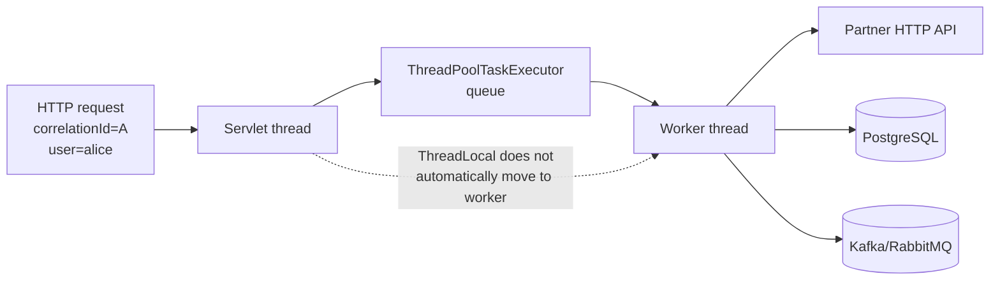
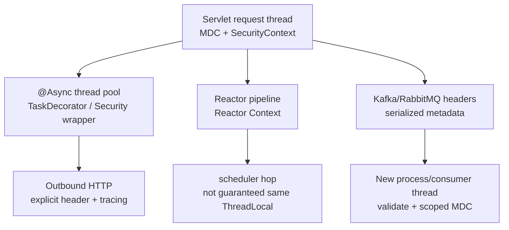
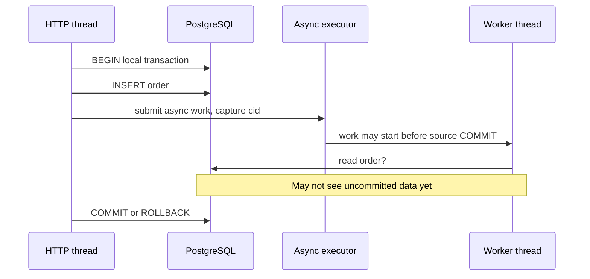
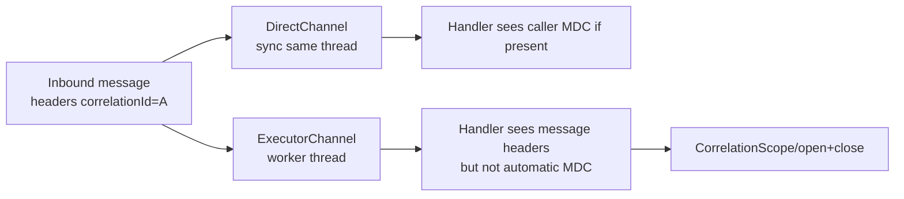
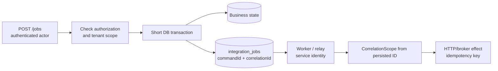

# Propagating Correlation IDs, MDC, or SecurityContext When Needed

## 1. The problem: tasks still run, yet you no longer know which request they belong to

A Spring Boot application receives `POST /orders`, writes an order to PostgreSQL, sends an HTTP notification to a partner, and publishes an event to Kafka. To reduce latency, a developer moves the HTTP call to `@Async`. After deployment, controller logs contain `correlationId=req-8e5a`, yet the async task logs no longer have this ID. When investigating partner call failures, operators cannot stitch together logs across the request, worker, HTTP client, and broker.

A more dangerous variant occurs if an async method reads:

```java
Authentication auth =
    SecurityContextHolder.getContext().getAuthentication();
```

On the request thread, `auth` typically holds the authenticated user; on another thread pool, it may be `null` or an unintended context. If a developer enables `MODE_INHERITABLETHREADLOCAL` or sets a context manually and forgets to clear it, reused worker threads can carry **data from an earlier request**, causing wrong logs or broken authorization.



**Core point:** context propagation is not simply copying every `ThreadLocal`. You must determine which data is meaningful at which boundary, how long it remains valid, who is allowed to trust it, and who owns **restoring/clearing context after every task**.

This lesson belongs to the **Async Tasks** chapter of the **SPRING_BOOT_INTEGRATION** module. This module organizes Spring Boot system integrations across HTTP clients, databases, caches, message brokers, and Spring Integration adapters; its focus includes configuration, data contracts, transactions, errors, deduplication, testing, and observing real flows. Here, correlation and security context propagation serve **both traceability and security across integration boundaries**.

**Learning objectives:**

1. Distinguish correlation ID, trace ID/span ID, message/event ID, and business command ID.
2. Understand `ThreadLocal`, SLF4J MDC, and Spring Security `SecurityContextHolder` across servlet threads, `@Async`, worker pools, and Reactor.
3. Configure a `TaskDecorator` to capture/restore MDC safely when using `ThreadPoolTaskExecutor`.
4. Use `DelegatingSecurityContextAsyncTaskExecutor` when you *genuinely* must delegate security identity to a short-lived task.
5. Distinguish propagating context **into a task** from propagating it **across HTTP/Kafka/RabbitMQ headers**.
6. Understand why Micrometer Context Propagation, tracing/observation, and Reactor `Context` are not equivalent to a global `ThreadLocal`.
7. Maintain proper transaction boundaries, ACK/offset commits, and retries/idempotency when work runs off the request thread.
8. Avoid leaking access tokens, credentials, PII, or elevated privileges via MDC, logs, or broker headers.
9. Test against cross-request context leakage when worker threads are reused.
10. Design logging, metrics, alerts, and runbooks when traces break or auth context is wrong.

> **Version scope:** Java examples use Java 17+, Spring Boot 3.x, Spring Framework 6.x, Spring Security 6.x, SLF4J 2.x, Logback, and BOM-compatible Spring Kafka/RabbitMQ. `ContextPropagatingTaskDecorator` requires Spring Framework 6.1+ and compatible Micrometer Context Propagation integration. On Spring Boot 4.x/Spring Framework 7.x or Java 21 virtual threads, verify the exact contracts and dependencies in use. `@Async` examples illustrate servlet/imperative apps; WebFlux/Reactor uses its own context mechanism.

## 2. Which identifier is for what?

Never use a single "traceId" string to replace every kind of identity. Each identifier has a distinct lifecycle and meaning:

| Type | Purpose | Lifecycle / source of truth | Is it an authorization credential? |
| --- | --- | --- | --- |
| **Correlation ID** | Links logs/actions of the same logical request or workflow. | Assigned by gateway, application, or message source; crosses controlled boundaries. | **No**. |
| **Trace ID** | Connects spans in a distributed trace. | Tracing system (OpenTelemetry/Micrometer Tracing); managed by trace propagators. | **No**. |
| **Span ID** | One unit of work within a trace. | Created per span; changes across client/server/broker boundaries. | **No**. |
| **Request ID** | Identifies one specific HTTP request. | Server/gateway. | **No**. |
| **Message/event ID** | Identifies one logical event for deduplication. | Producer/business outbox; must stay stable across republishes. | **No**. |
| **Command/idempotency key** | Identifies one logical business intent across retries. | Business command/provider contract. | **No**. |
| **User/tenant ID** | Subject and business scope. | Verified authentication/authorization. | Authoritative only after **authentication and policy checks**. |
| **SecurityContext** | Runtime authentication and related security details. | Spring Security, tied to request/session/token and propagation strategy. | **Can affect authorization**; handle with care. |

### 2.1. Correlation ID is not trace ID

A logical command `reserve-order-42` might be retried 10 minutes later via a new HTTP request and a new distributed trace. You can keep a **stable correlation ID / command ID** to link those attempts, while a fresh `traceId` is generated for the new trace. Never manually overwrite `traceId`/`spanId` in MDC to "force" separate retries into one trace.

```text
commandId = confirm-order-42-7
correlationId = corr-A42

HTTP attempt #1: traceId = T1, spanId = S1 -> 504
Kafka message:   eventId = E42, traceId = T2 (tracing policy)
HTTP attempt #2: traceId = T3, spanId = S3 -> 200

Business identity/correlation can stay together;
trace topology and span identifiers must follow the tracer.
```

Some systems equate correlation ID with request ID when there are no long-running workflows; that is fine **if documented in the contract**. Once Kafka retries, outboxes, and batch reconciliations enter, define clearly which IDs stay constant across replays.

### 2.2. Why never use correlation ID for authorization?

An `X-Correlation-ID: admin-user-1` header can be forged by an external caller. It is purely observability metadata. **Never** derive `Authentication`, `tenantId`, `ROLE_ADMIN`, billing accounts, or caller identity from it. Conversely, claims from JWTs/sessions should not all be dumped automatically into MDC, as that can expose sensitive data.

## 3. `ThreadLocal`, MDC, and `SecurityContextHolder`: visible only on the same thread

### 3.1. What does MDC actually store?

SLF4J MDC (Mapped Diagnostic Context) lets log appenders access a key/value map bound to the **current execution thread** when supported by the logging backend:

```java
import org.slf4j.MDC;

MDC.put("correlationId", "corr-123456");
try {
    log.info("Calling warehouse");
} finally {
    MDC.remove("correlationId");
}
```

With Logback configured for JSON or a log pattern, `correlationId` appears on each log record on that thread. However, MDC is **neither** a distributed context store nor a business database. A `CompletableFuture` running on another thread will not see this map without an explicit propagation mechanism.

### 3.2. `SecurityContextHolder` is thread-bound by default

In Spring Security's servlet stack, `SecurityContextHolder` normally uses a `ThreadLocal`-backed strategy. Spring Security web filters populate, store, and clear the context along the request lifecycle. On an authenticated thread:

```java
import org.springframework.security.core.Authentication;
import org.springframework.security.core.context.SecurityContextHolder;

Authentication authentication =
    SecurityContextHolder.getContext().getAuthentication();
```

When execution moves to a worker thread:

```text
Servlet-thread-1:
  MDC.correlationId = corr-A
  SecurityContext = alice

worker-pool-7:
  MDC.correlationId = ?          // usually absent
  SecurityContext = ?            // usually absent
```

**Do not** assume an "anonymous" worker is a security bug to fix by forwarding user contexts everywhere. Many background jobs **ought to run under a dedicated service identity**, not impersonating the HTTP caller.

### 3.3. Why not enable `MODE_INHERITABLETHREADLOCAL` as a blanket fix?

```java
// NOT recommended as a default solution for pooled workers.
SecurityContextHolder.setStrategyName(
    SecurityContextHolder.MODE_INHERITABLETHREADLOCAL
);
```

`InheritableThreadLocal` copies/inherits values when a **child thread is created**, not on every task submission. Worker pool threads live long and get reused across many requests, so an identity inherited at pool thread creation can mismatch later tasks. It also makes clearing/revoking contexts error-prone and invites cross-request security leakage.

Even when Java 21 virtual threads are created per task, implicit inheritance should not replace explicit capture/restore policies; forwarding sensitive tokens/`Authentication` still requires trust-boundary review.

### 3.4. Each boundary changes context semantics



**Rule of thumb:** `ThreadLocal` propagation bridges boundaries **within the same JVM** under controlled task scheduling; HTTP/message headers bridge boundaries **across services/processes**; tracing propagation carries distributed trace context; and authorization must still be verified at every trust boundary.

## 4. Context propagation contracts need an allowlist

Before configuring any decorator, decide explicitly:

| Field | Propagate to `@Async` task? | Propagate over HTTP/message headers? | Store in logs? |
| --- | --- | --- | --- |
| `correlationId` | Yes, when linking worker logs to requests. | Yes, after validation per contract. | Yes, bounded format. |
| `traceparent`/trace state | Via tracing instrumentation; do not fake via MDC copy. | Via standard propagators if enabled. | Tracer-managed; avoid logging raw baggage blindly. |
| `eventId`/`commandId` | Yes, if task belongs to a logical event/command. | Yes, in defined event schema/headers. | Yes, when policy allows. |
| `tenantId` | Only from authenticated context when needed for work. | Only over trusted contracts; downstream **must verify**. | Sanitized ID per privacy policy. |
| `Authentication`/`SecurityContext` | **Only when genuinely needed** for short delegated tasks. | Never serialize raw Spring objects; use proper tokens/service auth. | Never log credentials/access tokens. |
| HTTP `Authorization`/`Cookie` | Never auto-copy to workers. | Only per explicit downstream auth design; never blanket-forward. | **No**. |
| Request body/PII | Never stuff into MDC. | Only per business contract with data minimization. | Do not log by default. |

**Two principles:** (1) Capture only fields necessary for valid purposes; (2) every context must have a **lifecycle owner** to restore/clear it, especially on reused threads.

## 5. HTTP ingress: issuing a correlation ID and clearing MDC in `finally`

In Spring MVC/Servlet, you can assign a correlation ID per inbound HTTP request using a `OncePerRequestFilter`. This example accepts an incoming header if syntactically valid; otherwise it generates a fresh ID.

```java
// CorrelationIdFilter.java
package com.example.integration.async;

import java.io.IOException;
import java.util.Map;
import java.util.UUID;
import jakarta.servlet.FilterChain;
import jakarta.servlet.ServletException;
import jakarta.servlet.http.HttpServletRequest;
import jakarta.servlet.http.HttpServletResponse;
import org.slf4j.MDC;
import org.springframework.stereotype.Component;
import org.springframework.web.filter.OncePerRequestFilter;

@Component
public class CorrelationIdFilter extends OncePerRequestFilter {
    public static final String HEADER = "X-Correlation-ID";
    public static final String MDC_KEY = "correlationId";

    @Override
    protected void doFilterInternal(
        HttpServletRequest request,
        HttpServletResponse response,
        FilterChain chain
    ) throws ServletException, IOException {
        String incoming = request.getHeader(HEADER);
        String correlationId = valid(incoming)
            ? incoming
            : UUID.randomUUID().toString();

        Map<String, String> previous =
            MDC.getCopyOfContextMap();
        try {
            MDC.put(MDC_KEY, correlationId);
            response.setHeader(HEADER, correlationId);
            chain.doFilter(request, response);
        } finally {
            MDC.clear();
            if (previous != null) {
                MDC.setContextMap(previous);
            }
        }
    }

    private static boolean valid(String candidate) {
        return candidate != null
            && candidate.matches("[A-Za-z0-9_-]{8,64}");
    }
}
```

**What this example gets right:**

- The header enforces length and character limits, mitigating log injection and oversized values.
- If no valid ID is supplied, the server generates a UUID; raw headers with CR/LF are never used.
- `finally` restores the prior map so `correlationId` never bleeds into other HTTP requests on the servlet thread pool.
- The app can echo the ID back to clients for support; **the ID is not proof of authentication**.

**Important caveat:** even a well-formed incoming header is caller-supplied and could collide intentionally with another request's ID. Where unforgeable internal IDs are required, always mint a fresh `internalRequestId` at the trusted edge and store the incoming correlation as secondary metadata after validation. Never use `X-Correlation-ID` to look up another request's data.

### 5.1. Example logging pattern

If using Logback in a project's logging configuration:

```text
%d{ISO8601} %-5level [%thread] [cid=%X{correlationId}] %logger - %msg%n
```

This is a **conceptual pattern**, not Boot's default configuration. In production, prefer structured JSON logging where supported, and keep secrets, PII, and raw request bodies out of MDC. With Micrometer Tracing, `traceId`/`spanId` may be managed separately by tracing integration; never overwrite them in your filter.

### 5.2. Servlet async dispatch has its own lifecycle

`OncePerRequestFilter` and asynchronous servlet dispatches (`Callable`, `DeferredResult`, streaming) require care: a single request can span multiple dispatch threads. The filter above covers the **dispatch where the filter runs**; it does not automatically propagate MDC to `@Async`, servlet worker callbacks, or WebFlux. If endpoints use Servlet async processing, inspect `shouldNotFilterAsyncDispatch()`, filter mappings, and MVC async interceptors/tracing integration. Never leave MDC set on a thread waiting for an async result to complete.

## 6. Propagating MDC across `ThreadPoolTaskExecutor` via `TaskDecorator`

`TaskDecorator` is a Spring Core interface that wraps an executor's `Runnable`. When a task is submitted, the decorator snapshots the submitting thread's MDC and applies it on the worker when `run()` starts.

**The key:** snapshot at **submission time**, not inside the worker when the task starts. Always restore the **worker's previous MDC**, because that thread can run the next task right after this one finishes.

### 6.1. Configuring a safe `MdcTaskDecorator`

```java
// MdcTaskDecorator.java
package com.example.integration.async;

import java.util.Map;
import org.slf4j.MDC;
import org.springframework.core.task.TaskDecorator;

public final class MdcTaskDecorator implements TaskDecorator {

    @Override
    public Runnable decorate(Runnable task) {
        // Capture on the submitting thread.
        Map<String, String> captured =
            MDC.getCopyOfContextMap();

        return () -> {
            // Worker thread may already hold infrastructure MDC.
            Map<String, String> previous =
                MDC.getCopyOfContextMap();
            try {
                MDC.clear();
                if (captured != null) {
                    MDC.setContextMap(captured);
                }
                task.run();
            } finally {
                // Always restore, even on exception or cancellation.
                MDC.clear();
                if (previous != null) {
                    MDC.setContextMap(previous);
                }
            }
        };
    }
}
```

**Why not just call `MDC.put("correlationId", value)`?** Because the request thread may also carry `traceId`, `spanId`, `operation`, and other allowlisted fields. Tasks need controlled snapshotting; however, copying the **entire MDC** is safe only if the application guarantees MDC holds solely logging-safe fields. In multi-team systems, consider capturing **only specific allowlisted keys** instead of copying the whole map to keep PII and secrets out of workers.

**Why restore `previous` instead of simply calling `MDC.clear()`?** An executor may run nested tasks or infrastructure may set worker MDC before user code executes. Restoring the prior snapshot avoids breaking outer scopes. Conversely, failing to restore lets task A's context leak into task B.

### 6.2. Warning: `TaskDecorator` is not an exception handler

With `submit(Callable)` or `CompletableFuture`, executors may wrap tasks in `FutureTask` or another runnable; exceptions are captured inside the future rather than thrown straight out of the wrapper. Never use `TaskDecorator` as a substitute for `AsyncUncaughtExceptionHandler`, `CompletionException` handling, or business error channels.

### 6.3. Queue waits and stale contexts

```text
t=0: Alice's request submits task (MDC cid=A)
t=1: HTTP request ends, servlet MDC cleared
t=5: worker finally runs task with snapshot cid=A
```

This is normal capture/restore behavior: the task retains the correlation ID of the work that spawned it. However, a `SecurityContext` holding user permissions at `t=0` may **no longer be valid** at `t=5` if the session or token was revoked. Hence **MDC can travel more broadly than `SecurityContext`**, while authorization-sensitive actions must re-verify rights.

## 7. Creating a dedicated executor, bounded queue, and enabling `@EnableAsync`

Spring `@Async` dispatches calls to a configured executor. A system may define several executors: one for notification I/O, one for CPU computation, and one for short tasks needing user context. Never rely on a single unbounded global executor for everything.

### 7.1. Executor propagating logging context only

```java
// AsyncTaskConfiguration.java
package com.example.integration.async;

import java.util.concurrent.ThreadPoolExecutor;
import org.springframework.context.annotation.Bean;
import org.springframework.context.annotation.Configuration;
import org.springframework.scheduling.annotation.EnableAsync;
import org.springframework.scheduling.concurrent.ThreadPoolTaskExecutor;

@Configuration(proxyBeanMethods = false)
@EnableAsync
public class AsyncTaskConfiguration {

    @Bean(name = "notificationExecutor")
    public ThreadPoolTaskExecutor notificationExecutor() {
        ThreadPoolTaskExecutor executor =
            new ThreadPoolTaskExecutor();

        executor.setCorePoolSize(4);
        executor.setMaxPoolSize(8);
        executor.setQueueCapacity(100);
        executor.setThreadNamePrefix("notify-");
        executor.setTaskDecorator(new MdcTaskDecorator());
        executor.setRejectedExecutionHandler(
            new ThreadPoolExecutor.AbortPolicy()
        );
        executor.setWaitForTasksToCompleteOnShutdown(false);
        // Spring calls afterPropertiesSet()/destroy() when managing the bean.
        return executor;
    }
}
```

The numbers `4/8/100` are illustrative, not standard defaults. Size them for workload, upstream latency, JDBC/HTTP pool capacity, and replica count. With `ThreadPoolTaskExecutor`, a large queue capacity can keep the pool from expanding past core threads until the queue fills; understand `ThreadPoolExecutor` mechanics and load-test if `max > core` is an explicit goal.

**On lifecycle:** Spring typically manages shutdown for `ThreadPoolTaskExecutor` beans. Explicitly invoking `initialize()` and `destroyMethod="shutdown"` emphasizes resource ownership; when using Spring bean lifecycle defaults or Boot task execution auto-configuration, verify you don't register duplicate destroy callbacks or shut down shared executors prematurely.

### 7.2. `@Async` method calling another service

```java
// NotificationAsyncService.java
package com.example.integration.async;

import java.util.concurrent.CompletableFuture;
import org.slf4j.Logger;
import org.slf4j.LoggerFactory;
import org.slf4j.MDC;
import org.springframework.scheduling.annotation.Async;
import org.springframework.stereotype.Service;

@Service
public class NotificationAsyncService {
    private static final Logger log =
        LoggerFactory.getLogger(NotificationAsyncService.class);

    private final NotificationSender sender;

    public NotificationAsyncService(
        NotificationSender sender
    ) {
        this.sender = sender;
    }

    @Async("notificationExecutor")
    public CompletableFuture<SendResult> sendAsync(
        NotificationCommand command
    ) {
        log.info(
            "notification started commandId={}, cid={}",
            command.commandId(),
            MDC.get("correlationId")
        );

        // Synchronous work runs on the executor thread.
        SendResult result = sender.send(command);
        return CompletableFuture.completedFuture(result);
    }
}
```

```java
// NotificationCommand.java
package com.example.integration.async;

public record NotificationCommand(
    String commandId,
    String tenantId,
    String notificationId,
    String correlationId
) {}
```

```java
// SendResult.java
package com.example.integration.async;

public record SendResult(
    String providerMessageId,
    boolean accepted
) {}
```

```java
// NotificationSender.java
package com.example.integration.async;

public interface NotificationSender {
    SendResult send(NotificationCommand command);
}
```

**Important:** `NotificationSender` is an application interface that must be implemented over a provider HTTP client with retries, deadlines, and idempotency. `CompletableFuture.completedFuture(...)` does not mean the work ran synchronously on the request thread: the `@Async` proxy already dispatched it to the executor. Conversely, calling `this.sendAsync(...)` or invoking a raw non-proxied instance will **not** trigger `@Async`.

An exception from `sender.send(...)` completes the proxy's `CompletableFuture` exceptionally, yet does not guarantee the caller awaits or observes it. If callers fire-and-forget and return HTTP 202, persist a **durable job/outbox** before considering the work accepted.

### 7.3. Calling from an application service

```java
// Example fragment inside a Spring-managed service.
NotificationCommand cmd = new NotificationCommand(
    businessCommandId,
    authenticatedTenantId,
    notificationId,
    MDC.get("correlationId")
);

CompletableFuture<SendResult> future =
    notificationAsyncService.sendAsync(cmd);

future.whenComplete((result, error) -> {
    // Callback may execute on another thread.
    // Use commandId/correlationId from cmd;
    // DO NOT assume MDC or SecurityContext is present here.
    if (error != null) {
        auditFailure(cmd.commandId(), error);
    }
});
```

In this fragment, `businessCommandId` and `authenticatedTenantId` must come from business logic and verified principal context, `notificationAsyncService` is an injected bean, and `auditFailure(...)` is an application method. Never emit sensitive stacktraces to remote callbacks. In production, persist job state and retry intent when crash recovery is needed.

### 7.4. Queue rejection is a real failure

When `queueCapacity=100` and max worker threads are busy, submission can be rejected. In Spring, this can surface as `TaskRejectedException`. Never swallow it and return HTTP `202 Accepted` when the work only targets an in-JVM queue—and failed even to enqueue.

If losing notifications is acceptable under the business contract, return an explicit best-effort response; otherwise persist a durable outbox/job first and treat the worker executor purely as an execution optimization. Track metrics for queue depth, active threads, rejection counts, oldest queue age, and backpressure.

## 8. Propagating `SecurityContext` when delegation is genuinely needed

`SecurityContextHolder` normally has no authentication when tasks run on other threads. Spring Security provides wrappers such as `DelegatingSecurityContextRunnable`, `DelegatingSecurityContextExecutor`, and `DelegatingSecurityContextAsyncTaskExecutor` to install and restore security contexts around tasks.

**Choose security propagation based on business authorization**, not because "all logs should look like the request."

### 8.1. How `DelegatingSecurityContext` works

```text
Caller thread:
  Authentication = alice (ROLE_ORDER_VIEW)
  submit task
      |
      v
Security wrapper captures context at submission
      |
      v
Worker thread:
  install captured context
  execute task
  clear/restore context in finally
```

With the constructor that does not pass a fixed `SecurityContext`, the wrapper captures the current context **at task submission time**. Passing a fixed context to the constructor makes every task run under that fixed identity; while intentional for a controlled service identity, it is **dangerous** if you accidentally pin the first user's context.

### 8.2. Creating an executor with both MDC and `SecurityContext`

Wrap a raw `ThreadPoolTaskExecutor` configured with `MdcTaskDecorator` inside a Security executor:

```java
// AuthorizedAsyncExecutorConfiguration.java
package com.example.integration.async;

import java.util.concurrent.ThreadPoolExecutor;
import org.springframework.beans.factory.annotation.Qualifier;
import org.springframework.context.annotation.Bean;
import org.springframework.context.annotation.Configuration;
import org.springframework.core.task.AsyncTaskExecutor;
import org.springframework.scheduling.concurrent.ThreadPoolTaskExecutor;
import org.springframework.security.task.DelegatingSecurityContextAsyncTaskExecutor;

@Configuration(proxyBeanMethods = false)
public class AuthorizedAsyncExecutorConfiguration {

    @Bean(name = "authorizedWorkerPool")
    ThreadPoolTaskExecutor authorizedWorkerPool() {
        ThreadPoolTaskExecutor pool =
            new ThreadPoolTaskExecutor();
        pool.setCorePoolSize(2);
        pool.setMaxPoolSize(4);
        pool.setQueueCapacity(32);
        pool.setThreadNamePrefix("authorized-");
        pool.setTaskDecorator(new MdcTaskDecorator());
        pool.setRejectedExecutionHandler(
            new ThreadPoolExecutor.AbortPolicy()
        );
        // Spring manages bean initialization and shutdown.
        return pool;
    }

    @Bean("authorizedAsyncExecutor")
    AsyncTaskExecutor authorizedAsyncExecutor(
        @Qualifier("authorizedWorkerPool")
        ThreadPoolTaskExecutor pool
    ) {
        return new DelegatingSecurityContextAsyncTaskExecutor(pool);
    }
}
```

Separating the raw pool from the wrapper avoids circular bean injection. `@Async("authorizedAsyncExecutor")` submits to the wrapper; the wrapper captures `SecurityContext` while the pool's `TaskDecorator` captures MDC. **This does not automatically sync contexts across arbitrary `CompletableFuture.thenApplyAsync(...)` calls or other custom `ExecutorService`s** unless continuations also use controlled wrappers.

### 8.3. Illustrative authorized asynchronous lookup

```java
// AuthorizedPreviewService.java
package com.example.integration.async;

import java.util.concurrent.CompletableFuture;
import org.springframework.security.core.Authentication;
import org.springframework.security.core.context.SecurityContextHolder;
import org.springframework.scheduling.annotation.Async;
import org.springframework.stereotype.Service;

@Service
public class AuthorizedPreviewService {
    private final OrderPreviewReader reader;

    public AuthorizedPreviewService(
        OrderPreviewReader reader
    ) {
        this.reader = reader;
    }

    @Async("authorizedAsyncExecutor")
    public CompletableFuture<OrderPreview> readMyPreview(
        String orderId
    ) {
        Authentication authentication =
            SecurityContextHolder
                .getContext()
                .getAuthentication();

        if (authentication == null
            || !authentication.isAuthenticated()) {
            throw new SecurityException(
                "Authenticated user required"
            );
        }

        // reader MUST verify order ownership/tenant
        // and data permissions; never trust username alone.
        OrderPreview view =
            reader.readAuthorized(authentication, orderId);

        return CompletableFuture.completedFuture(view);
    }
}
```

```java
// OrderPreview.java
package com.example.integration.async;

public record OrderPreview(
    String orderId,
    String status
) {}
```

```java
// OrderPreviewReader.java
package com.example.integration.async;

import org.springframework.security.core.Authentication;

public interface OrderPreviewReader {
    OrderPreview readAuthorized(
        Authentication authenticatedUser,
        String orderId
    );
}
```

**Warning:** propagation is not a security proof. `Authentication.isAuthenticated()` does not replace ownership, tenant, or permission checks; setups with `AnonymousAuthenticationToken` or custom security filters behave differently. Production code should use authoritative principal types, token validation, policy engines, or `@PreAuthorize` paired with business checks—and re-validate authorization at execution time if jobs outlive requests.

### 8.4. Why never send a raw `SecurityContext` into a queue or broker?

Spring's `SecurityContext` can hold `Authentication`, credentials, principal objects, and authorities tied to specific security library versions. Serializing this whole object into Kafka, Redis, or an outbox will:

- Leak access tokens, passwords, or claims if the authentication carries them.
- Couple event schemas to internal Spring Security classes.
- Snapshot permissions that become stale after revocation.
- Tempt downstream services to trust an unverified serialized object.
- Complicate retention, PII compliance, and broker access auditing.

When durable jobs must track who initiated them, store **actor ID, tenant, command ID, and authorization decision/audit reference** per business contract and enforce access checks at execution time. Workers run under a least-privilege service identity, never an end user's raw HTTP `SecurityContext` hours later.

### 8.5. Avoid accidental fixed `SecurityContext`

```java
// WARNING: never capture user Alice once at startup
// and apply that same context to every user's tasks.
SecurityContext fixed =
    SecurityContextHolder.getContext();
```

A wrapper constructed with `fixed` runs every submission under that identity. Use an explicit fixed service identity only when intentionally reviewed by security architecture; for multi-user traffic, use per-submission context or, better yet, explicit audited business authorization.

## 9. Using MDC, `SecurityContext`, and trace context together: they are independent

```text
Inbound POST /orders
  MDC correlationId = corr-123
  SecurityContext = user Alice
  Observation/trace = trace T, span S
        |
        +-- @Async notification:
             - MDC via TaskDecorator
             - SecurityContext only if required
             - Tracing via observation/Micrometer instrumentation
        |
        +-- Kafka publish:
             - correlationId/eventId as explicit headers/data
             - traceparent via tracing propagator
             - NO serialized SecurityContext
```

**Never** assume all three mechanisms turn on together automatically. `MdcTaskDecorator` touches MDC only. `DelegatingSecurityContextAsyncTaskExecutor` handles Spring Security context only. Micrometer/OTel tracing has its own propagation; copying a `traceId` string into MDC **does not create an active span or proper parent-child linkage**.

### 9.1. What happens if one of the three is missing?

| Missing | Symptom | Solution |
| --- | --- | --- |
| Correlation ID/MDC | Worker logs cannot be tied to inbound requests. | Scoped MDC decorator or explicit command ID. |
| Active observation context | Distributed trace breaks despite matching correlation string. | Tracing instrumentation/context propagation registry. |
| `SecurityContext` when logic needs it | `Authentication` is null/anonymous inside worker. | Delegating wrapper or pass verified business identity and re-authorize. |
| Proper cleanup | Request B logs `cid=A` or Alice's auth on worker B. | `try/finally` restore + thread reuse tests. |
| Durable handoff | HTTP returns 202 yet worker task vanishes on crash. | DB job/outbox/queue; ACK only after durable acceptance. |

### 9.2. When NOT to propagate `SecurityContext`?

- Nightly batch jobs, schedulers, periodic outbox sweeps.
- Outbox relays reading durable intents after transaction commit.
- Kafka/RabbitMQ consumers processing events from other services: use service-to-service identity, ACLs, and payload validation rather than impersonating end users from self-declared headers.
- Reconciliation/repair jobs needing scoped admin privileges independent of request origin.
- Pure CPU computations over already-validated data needing no execution-thread authorization.

For these workloads, correlation/event/command IDs are still valuable; end-user `SecurityContext` is usually **inappropriate and over-privileged**.

## 10. Micrometer Context Propagation: general mechanism, not magic for every `ThreadLocal`

In Spring Framework 6.1+, `ContextPropagatingTaskDecorator` uses Micrometer Context Propagation to capture/restore values registered via `ThreadLocalAccessor` or compatible context accessors. This helps when using Micrometer Tracing/Observation to preserve trace/span context across executor boundaries.

```java
// Alternative to a custom MDC TaskDecorator, Spring Framework 6.1+.
import org.springframework.core.task.support.ContextPropagatingTaskDecorator;
import org.springframework.scheduling.concurrent.ThreadPoolTaskExecutor;

ThreadPoolTaskExecutor executor = new ThreadPoolTaskExecutor();
executor.setCorePoolSize(4);
executor.setMaxPoolSize(8);
executor.setQueueCapacity(100);
executor.setThreadNamePrefix("observed-");
executor.setTaskDecorator(
    new ContextPropagatingTaskDecorator()
);
// When declared as a Spring @Bean, container lifecycle initializes the executor.
```

This is an **alternative** to `MdcTaskDecorator` in section 6, without needing an extra executor when switching strategies. Key limitations:

- Only values with **registered accessors** are captured/restored. Never assume arbitrary MDC keys or `SecurityContext` are included automatically.
- If MDC is required, verify your logging/tracing stack registers an accessor or register a reviewed one per your Micrometer API version.
- For Spring Security context, use Spring Security's supported mechanism or a security-reviewed accessor; never copy raw `Authentication` into a global registry carelessly.
- Capture/restore carries overhead; benchmark for very short or high-throughput tasks.
- It does not create durable jobs, commit DB transactions, or ship context over Kafka/HTTP headers.

### 10.1. "MDC has `traceId`" does not guarantee an active tracing span

Micrometer Tracing can populate `traceId`/`spanId` into MDC. Copying only those two strings makes worker logs look tied to the trace, yet without an active observation/span, client instrumentation cannot create child spans under the right parent.

```text
MDC traceId = abc123
Active tracer span = null

=> Logs show abc123;
   distributed trace lacks proper parent-child edges.
```

Solve this using real tracer context propagation, not string copying. Test trace topology and outbound `traceparent` headers, not just JSON log snapshots.

### 10.2. Illustrative dependencies

```xml
<dependency>
    <groupId>org.springframework.boot</groupId>
    <artifactId>spring-boot-starter-actuator</artifactId>
</dependency>
<dependency>
    <groupId>io.micrometer</groupId>
    <artifactId>micrometer-tracing-bridge-otel</artifactId>
</dependency>
<dependency>
    <groupId>io.micrometer</groupId>
    <artifactId>context-propagation</artifactId>
</dependency>
```

This is a **dependency sketch**, not a full production distributed tracing stack: exporting traces requires configured exporters, endpoints, credentials, and BOM-aligned versions. Spring Boot instrumentation also depends on using **auto-configured HTTP clients** and observation-enabled components. Manually constructing clients/builders, custom executors, or publishing via raw third-party clients can skip trace propagation.

### 10.3. Do not mix MDC copying with uncontrolled tracing baggage

W3C baggage headers can contain externally supplied user/tenant values. Dumping every baggage field into logs risks PII exposure or cardinality/size attacks. Propagate only allowlisted keys per tracing policy with length bounds and domain trust—never place bearer tokens or passwords into baggage.

## 11. Reactor `Context` differs from `ThreadLocal`

In WebFlux and Reactor `Mono`/`Flux`, a single pipeline can hop across multiple scheduler threads. Reactor uses a **per-subscriber `Context`**, unlike a servlet request's `ThreadLocal`.

### 11.1. Per-subscription context

```java
import reactor.core.publisher.Mono;
import reactor.util.context.Context;

Mono<String> lookup = Mono.deferContextual(view ->
    Mono.just(view.getOrDefault(
        "correlationId", "missing"
    ))
);

Mono<String> result = lookup.contextWrite(
    Context.of("correlationId", "corr-123456")
);
```

On subscribing to `result`, `deferContextual` reads the value from Reactor's subscriber `Context`, making no assumptions about staying on the original HTTP thread. `contextWrite` supplies values along Reactor's propagation flow; operator placement dictates which stages see the value.

**Do not** rely on MDC inside a Reactor callback after a scheduler hop:

```java
// WARNING: ThreadLocal does not survive scheduler hops reliably.
String cid = MDC.get("correlationId");
return remoteCall
    .publishOn(Schedulers.parallel())
    .doOnNext(item -> log.info(
        "cid={}", MDC.get("correlationId")
    ));
```

MDC inside `doOnNext` may be null or stale without a propagation bridge. If `cid` is captured on the request thread, referencing that immutable variable inside the lambda suffices for logging, though it does not create a distributed tracing span.

### 11.2. Reactor automatic context propagation

Project Reactor integrates with Micrometer Context Propagation via modes like `Hooks.enableAutomaticContextPropagation()` when accessors are registered. That still **does not** magically carry arbitrary user-defined `ThreadLocal`s across every `Scheduler`, `Executor`, or foreign callback.

If enabling automatic mode:

1. Verify `io.micrometer:context-propagation` and appropriate accessors are present.
2. Check scope for your Reactor version; hooks typically affect subscriptions created after enabling.
3. Verify cleanup on cancel, error, and completion.
4. Test against cross-subscriber leakage across concurrent streams.
5. Measure context capture/restore overhead under high throughput.

Avoid stacking multiple overlapping manual wrappers that drop keys or restore out of order. Pick one propagation strategy with a clear owner.

### 11.3. Reactive Spring Security uses `ReactiveSecurityContextHolder`

In WebFlux security, authentication context lives in Reactor's `Context`:

```java
import org.springframework.security.core.context.ReactiveSecurityContextHolder;
import reactor.core.publisher.Mono;

Mono<String> currentUserName() {
    return ReactiveSecurityContextHolder.getContext()
        .map(ctx -> ctx.getAuthentication().getName());
}
```

This is a fragment; if unauthenticated, the publisher may emit empty, so services must apply default-deny authorization policies. Never switch a WebFlux service to reading `SecurityContextHolder.getContext()` on Netty threads expecting it to hold each subscriber's identity.

### 11.4. JDBC and Reactor context do not automatically propagate transactions

`Mono.fromCallable(() -> repository.findById(id))` on `Schedulers.boundedElastic()` isolates blocking JDBC I/O, yet **does not carry a servlet thread's JPA transaction**. Transactional services must be invoked via Spring proxies inside the worker. An MDC accessor never makes `EntityManager` thread-safe; never stash transaction resources into Reactor `Context`.

## 12. `CompletableFuture`, `ExecutorService`, and `@Async` have different boundaries

### 12.1. `CompletableFuture` common pool does not use Spring executors

```java
// Easily loses MDC and SecurityContext:
CompletableFuture.supplyAsync(() -> doWork());
```

Without an explicit executor, async stages typically run on `ForkJoinPool.commonPool()` or the JDK default facility. They **do not** route through Spring's `notificationExecutor` or `authorizedAsyncExecutor`.

```java
CompletableFuture<SendResult> future =
    CompletableFuture.supplyAsync(
        () -> sender.send(command),
        notificationExecutor
    );
```

Here `notificationExecutor` must be a configured bean/executor and `command` an immutable DTO. If user security is required, choose an appropriate wrapper; otherwise use an MDC-only executor.

### 12.2. Continuations can run on another thread

```java
future.thenApplyAsync(result -> {
    // May run on commonPool if no executor is passed.
    return transform(result);
});
```

`thenApply`, `thenApplyAsync`, `whenComplete`, and `handle` follow different scheduling rules. Callbacks may run on the thread completing the prior stage, the submitting thread, or the common pool. Never rely on `ThreadLocal` without explicit boundary design; prefer explicit DTOs or wrapped executors with tests.

**Subtlety:** if a callback submits a child task **after the original `SecurityContext` wrapper has cleared**, wrapping the executor does not ensure it captures the original user identity again. For security-sensitive callbacks, pass verified identity/authorization decisions explicitly or wrap the entire pipeline at a controlled boundary.

### 12.3. `@Async` self-invocation bypasses the proxy

```java
@Service
class WrongService {
    public void handle() {
        this.sendAsync(); // bypasses Spring proxy
    }

    @Async("notificationExecutor")
    public void sendAsync() {
        // May run immediately on the caller thread.
    }
}
```

Move the `@Async` method to another Spring bean and inject it. Calling a method on `new MyService()` bypasses interception as well. Verify execution thread identity in integration tests.

### 12.4. `@Async void` and exception handling

With `@Async void`, callers have no `Future` to catch exceptions. Spring offers `AsyncUncaughtExceptionHandler` for uncaught exceptions from `void` async methods when properly configured, yet the handler **does not replace durable retries**. When confirmation is needed, prefer `CompletableFuture<T>` and persist job state for crash recovery.

```text
HTTP returns 202
 -> in-memory @Async task scheduled
 -> process crashes before task starts
 -> notification lost (unless durable intent recorded)
```

Never call `ThreadPoolTaskExecutor`'s queue a durable broker; it lives strictly in JVM heap.

## 13. Transaction boundaries: correlation propagates, JDBC transactions do not

Standard imperative Spring `@Transactional` relies on `ThreadLocal`-bound resources and transaction synchronization. When `@Async` runs on another thread, the HTTP caller's transaction **is not copied** alongside MDC.



### 13.1. Why calling `@Async` inside `@Transactional` is dangerous

```java
// Anti-pattern: callback may execute before DB commit.
@Transactional
public void createOrder(CreateOrder command) {
    repository.save(order);
    notificationAsyncService.sendAsync(notification);
    // DB commits only when the transactional method finishes.
}
```

The worker can run before DB commit and query a missing order; if the caller rolls back, the worker sends a notification for a non-existent order. Propagating `MDC` or `SecurityContext` does not create transaction synchronization.

### 13.2. Best-effort after-commit callbacks

`@TransactionalEventListener(phase = TransactionPhase.AFTER_COMMIT)` schedules callbacks **after local DB commit**, yet in-memory listeners still do not survive process crashes. Adding `@Async` creates another thread boundary, requiring clarity on which contexts remain on the event-dispatching thread.

```text
DB commit -> AFTER_COMMIT callback -> @Async queue
                                   -> process crash
                                   -> task lost
```

For business-critical events, use a **transactional outbox**: persist event/job intent inside the DB transaction, then let relays/workers use the saved `eventId`/`commandId`/`correlationId`. When relays run minutes later, never copy an old request's raw `SecurityContext`.

### 13.3. Dedicated transactional writer bean inside the worker

```java
// Fragment: @Async worker calls another Spring-managed service.
@Async("notificationExecutor")
public CompletableFuture<WorkResult> processAsync(
    WorkCommand command
) {
    WorkResult result =
        transactionalWriter.apply(command);
    // Separate @Transactional bean commits when method returns.
    return CompletableFuture.completedFuture(result);
}
```

`WorkResult`, `WorkCommand`, and `transactionalWriter` are application-defined types/fields. Do not call `this.apply(...)` if a transaction proxy is needed. If work includes HTTP side effects, DB transactions should wrap only local database writes; external effects need idempotency, outboxes, or sagas.

### 13.4. Transaction `ThreadLocal`s are not meant to be "propagated"

Never write a decorator that copies `TransactionSynchronizationManager`, `EntityManager`, or Hibernate `Session` from request threads to workers. They are not built for concurrent cross-thread sharing and can trigger inconsistent flushes/commits, connection misuse, or race conditions. Async tasks must open **their own transactions** via service methods when needed.

## 14. Scheduled tasks, long jobs, and virtual threads

### 14.1. `@Scheduled` has no HTTP caller `SecurityContext`

```text
Scheduler execution:
  jobId = recon-2026-11-21-01
  correlationId = job_recon_2026_11_21_01
  principal = service identity with bounded permissions
```

Open a fresh correlation scope for each job run rather than expecting leftover `MDC` or user `SecurityContext` from prior requests. When reading from an outbox or queue, extract validated `eventId` and `correlationId` from the durable record rather than reading a global mutable variable.

### 14.2. Virtual threads do not change context contracts

Java 21 virtual threads help scale blocking operations in many use cases, yet they do not automatically carry MDC or Spring Security contexts across **all** scheduler callbacks or executor boundaries. `ThreadLocal` works per virtual thread per Java rules, yet capture/cleanup, credentials, authorization, and memory footprint still need control. Never use `InheritableThreadLocal` to carry user principals into long-running jobs.

Spring Boot 3.2+ supports virtual threads in some executor/scheduler configurations, yet exact behavior depends on Boot/JDK version and bean overrides. Verify thread identity and MDC propagation in tests after enabling `spring.threads.virtual.enabled=true`; never assume custom `TaskDecorator`s apply automatically to every task.

### 14.3. Multiple executors and task ownership

```text
notificationExecutor    -> MDC only, bounded I/O
authorizedAsyncExecutor -> MDC + SecurityContext only for short work
outboxRelayExecutor     -> MDC from persisted event, service identity
cpuExecutor             -> immutable DTO, no user SecurityContext
```

Each pool has its own size, queue, deadline, and rejection policy. A decorator on `notificationExecutor` **does not apply** to `@Scheduled` schedulers, Kafka listener threads, Reactor schedulers, or third-party `Executors.newFixedThreadPool(...)` instances.

### 14.4. Long-running tasks should not hold submission-time permissions

Suppose user Alice requests an export at 09:00 and execution happens at 13:00. If Alice's read role is revoked at 10:00, a 09:00 `SecurityContext` snapshot would still hold `ROLE_EXPORT`. For long-running jobs:

- Persist job owner/tenant, requested operation, and an authorization audit reference.
- Decide explicitly whether policy requires **re-authorization at execution** or an approved authorization snapshot; never leave it implicit.
- Run workers under a least-privilege service principal with tenant-aware queries.
- If rights were revoked, transition the job to `CANCELLED`/`REQUIRES_APPROVAL` per business policy.
- Never store long-lived bearer tokens or serialized Spring `Authentication` objects in outbox/job payloads.

## 15. Designing a reusable `CorrelationScope` for listeners and schedulers

HTTP filters manage MDC for inbound servlet requests, whereas Kafka/RabbitMQ listeners and scheduled workers run outside HTTP filters. A scoped helper prevents forgetting `finally`.

```java
// CorrelationScope.java
package com.example.integration.async;

import java.util.Map;
import java.util.UUID;
import org.slf4j.MDC;

public final class CorrelationScope
    implements AutoCloseable {

    private final Map<String, String> previous;
    private boolean closed;

    private CorrelationScope(String correlationId) {
        previous = MDC.getCopyOfContextMap();
        MDC.put(
            "correlationId",
            normalizeOrCreate(correlationId)
        );
    }

    public static CorrelationScope open(String correlationId) {
        return new CorrelationScope(correlationId);
    }

    private static String normalizeOrCreate(String id) {
        if (id != null
            && id.matches("[A-Za-z0-9_-]{8,64}")) {
            return id;
        }
        return UUID.randomUUID().toString();
    }

    @Override
    public void close() {
        if (!closed) {
            closed = true;
            MDC.clear();
            if (previous != null) {
                MDC.setContextMap(previous);
            }
        }
    }
}
```

Usage:

```java
try (CorrelationScope ignored =
         CorrelationScope.open(command.correlationId())) {
    log.info("Processing commandId={}", command.commandId());
    // Business processing ...
}
```

If a worker already has other tracing MDC entries, the helper preserves and restores the previous map on exit. This example updates only `correlationId` without touching tracer-owned `traceId`/`spanId`. For untrusted message headers, tighten `normalizeOrCreate` to a stricter allowlist, mint a fresh internal ID, and log the original inbound ID in a separate field if compliance requires it.

### 15.1. Subtlety: nested decorator and `CorrelationScope`

If an HTTP request with `cid=A` submits a task whose `TaskDecorator` snapshots `A`, and the durable command inside carries persisted `correlationId=B`, `CorrelationScope.open(B)` temporarily sets `B` and restores `A` when closed. That is **correct nested-scope behavior**, yet also a signal to clarify which ID is authoritative: the new request trace or logical business correlation. For durable commands, prefer the persisted correlation ID on the command rather than relying on HTTP MDC.

## 16. Outbound HTTP: propagating IDs via headers and standard tracing

MDC exists only inside the current process; downstream services need HTTP headers and trace propagators to link logs.

### 16.1. `WebClient` with explicit correlation ID

```java
// InventoryHttpClient.java
package com.example.integration.async;

import org.springframework.beans.factory.annotation.Qualifier;
import org.springframework.stereotype.Component;
import org.springframework.web.reactive.function.client.WebClient;
import reactor.core.publisher.Mono;

@Component
public class InventoryHttpClient {
    private final WebClient client;

    public InventoryHttpClient(
        @Qualifier("inventoryWebClient") WebClient client
    ) {
        this.client = client;
    }

    public Mono<InventoryResponse> lookup(
        String sku,
        String correlationId
    ) {
        if (correlationId == null
            || !correlationId.matches("[A-Za-z0-9_-]{8,64}")) {
            return Mono.error(
                new IllegalArgumentException(
                    "Invalid correlation ID"
                )
            );
        }

        return client.get()
            .uri("/api/v1/inventory/{sku}", sku)
            .header("X-Correlation-ID", correlationId)
            .retrieve()
            .bodyToMono(InventoryResponse.class);
    }
}
```

```java
// InventoryResponse.java
package com.example.integration.async;

public record InventoryResponse(
    String sku,
    long available
) {}
```

The method takes `correlationId` explicitly from a trusted application DTO/scope, **never reading MDC inside an arbitrary reactive callback**. It forwards a business-safe correlation value over HTTP; downstream must validate it and never authorize based on it.

For blocking `RestClient`, apply `.header("X-Correlation-ID", command.correlationId())` similarly. When Micrometer Tracing client instrumentation is configured, W3C `traceparent`/`tracestate` headers are managed by the tracer for active spans; never hand-craft span IDs or blindly copy malformed inbound `traceparent` headers.

### 16.2. Retries and correlation semantics

When an HTTP client retries the same logical GET/POST, keep `commandId` and correlation ID per contract, while tracing creates **child spans per attempt**. For side-effecting POSTs, callers need a stable provider idempotency key and status lookup on lost responses. Correlation ID **cannot replace an idempotency key** unless the provider's contract explicitly defines uniqueness and result-caching semantics for it.

### 16.3. Headers are data, not identity

An attacker can send a forged `X-Correlation-ID`. Downstream gateways must treat it strictly as validated data subject to access-log controls. Verify authentication/service identity independently via mTLS, OAuth2, JWT, or managed identity. Never allow untrusted caller `X-Tenant-ID` or `X-User-ID` headers to override verified token claims.

## 17. Kafka: propagate context via record headers, not `ThreadLocal`

Kafka producers and consumers run in separate processes, JVMs, or hours apart. HTTP thread MDC never crosses the broker. Required metadata must live in **explicit** event schemas or headers alongside event IDs and contract versions.

### 17.1. Producer attaching a custom correlation header

```java
// KafkaEventPublisher.java
package com.example.integration.async;

import java.nio.charset.StandardCharsets;
import org.apache.kafka.clients.producer.ProducerRecord;
import org.springframework.kafka.core.KafkaTemplate;
import org.springframework.stereotype.Component;

@Component
public class KafkaEventPublisher {
    private static final String CORRELATION_HEADER =
        "x-correlation-id";

    private final KafkaTemplate<String, String> kafka;

    public KafkaEventPublisher(
        KafkaTemplate<String, String> kafka
    ) {
        this.kafka = kafka;
    }

    public void publish(String aggregateKey,
                        String jsonPayload,
                        String correlationId) {
        if (correlationId == null
            || !correlationId.matches("[A-Za-z0-9_-]{8,64}")) {
            throw new IllegalArgumentException(
                "Invalid correlation ID"
            );
        }

        ProducerRecord<String, String> record =
            new ProducerRecord<>(
                "orders.events.v1",
                aggregateKey,
                jsonPayload
            );
        record.headers().add(
            CORRELATION_HEADER,
            correlationId.getBytes(StandardCharsets.UTF_8)
        );

        // send() is asynchronous; completion/ACK must be
        // observed separately per delivery contract.
        kafka.send(record);
    }
}
```

**Important:** this method illustrates header attachment only. It is **not a complete reliable publisher** because it ignores the send future outcome. A caller must never mark an outbox row `PUBLISHED` merely because `kafka.send(record)` returned a future. Observe broker ACKs, failure/retry behavior, transactional IDs, and event idempotency per contract.

`traceparent`/`baggage` should be managed by tracing instrumentation/propagators when enabled; custom `x-correlation-id` carries the logical correlation ID. Never overwrite Kafka headers owned by the tracing library, and never place raw Spring Security contexts into records.

### 17.2. Consumer opening an MDC scope from a validated header

```java
// OrderEventConsumer.java
package com.example.integration.async;

import java.nio.charset.StandardCharsets;
import org.apache.kafka.clients.consumer.ConsumerRecord;
import org.apache.kafka.common.header.Header;
import org.slf4j.Logger;
import org.slf4j.LoggerFactory;
import org.springframework.kafka.annotation.KafkaListener;
import org.springframework.kafka.support.Acknowledgment;
import org.springframework.stereotype.Component;

@Component
public class OrderEventConsumer {
    private static final Logger log =
        LoggerFactory.getLogger(OrderEventConsumer.class);

    private final OrderEventWriter writer;

    public OrderEventConsumer(OrderEventWriter writer) {
        this.writer = writer;
    }

    @KafkaListener(
        topics = "orders.events.v1",
        groupId = "orders-integration"
    )
    public void onMessage(
        ConsumerRecord<String, String> record,
        Acknowledgment acknowledgment
    ) {
        Header header = record.headers()
            .lastHeader("x-correlation-id");
        String raw = (header == null || header.value() == null)
            ? null
            : new String(
                header.value(),
                StandardCharsets.UTF_8
            );

        try (CorrelationScope ignored =
                 CorrelationScope.open(raw)) {
            log.info(
                "Handling Kafka message partition={} offset={}",
                record.partition(),
                record.offset()
            );

            // Separate @Transactional bean commits DB before ACK.
            writer.apply(record.key(), record.value());

            acknowledgment.acknowledge();
        }
    }
}
```

```java
// OrderEventWriter.java — application-specific port
package com.example.integration.async;

public interface OrderEventWriter {
    void apply(String aggregateKey, String jsonEvent);
}
```

You must configure the listener/container with **manual acknowledgment mode** when accepting an `Acknowledgment` parameter; for example:

```yaml
spring:
  kafka:
    consumer:
      enable-auto-commit: false
    listener:
      ack-mode: manual_immediate
```

`OrderEventWriter` here is a contract; its implementation should be a Spring-managed transactional service enforcing inbox/event-ID uniqueness and domain validation, **not relying solely on Kafka offsets** for deduplication. With Kafka transactional containers (EOS), ACK/offset semantics differ; this manual ACK example does not substitute for Kafka transaction container configuration.

### 17.3. Why `try-with-resources` around listeners is critical

Kafka listener threads are reused across thousands of records. If record A carries `cid=A` and record B lacks the header, an un-cleared `MDC.put` will make B log `cid=A`. `CorrelationScope.close()` restores state inside `finally` even if a deserializer or writer throws inside the scope.

If deserialization occurs **before** invoking the listener, error handler/deserializer logging also needs correlation extracted from record headers or broker metadata. In this snippet, `writer.apply()` receives raw JSON so parse errors happen inside the scope; with `@KafkaListener(OrderEvent event)` auto-deserialization, failures happen before the listener runs and require handling in Kafka consumer error handlers/DLT.

### 17.4. Tracing spans and message correlation have different lifecycles

A Kafka consumer can receive an event belonging to a different trace than the current request. Micrometer instrumentation can create a linked consumer span or child span depending on tracer/instrumentation policy. Correlation ID helps operators stitch the business workflow, while trace topology is owned by the tracer. Never treat Kafka's `x-correlation-id` header as a W3C `traceparent`.

### 17.5. Never ACK right after submitting to an in-memory executor

```text
Kafka record delivered
 -> listener calls @Async worker
 -> listener ACKs immediately
 -> process crashes before worker applies DB state
 -> message LOST from processing workflow
```

If async processing is needed:

1. **Common safe pattern:** the listener writes a durable DB inbox/job/outbox handoff in a transaction, commits, and ACKs; workers process durable jobs afterward.
2. Or use container/ACK handling designed for async completion with explicit thread/concurrency/ordering policies and crash-window tests—never simply fire `CompletableFuture.runAsync(...)` and ACK.
3. If the task is strictly best-effort, document explicitly that ACKing after in-memory enqueue permits message loss.

Context propagation does not make an in-memory queue durable.

## 18. RabbitMQ: correlation property/header and manual ACK

RabbitMQ provides message properties such as `correlationId` and application headers, distinct from in-JVM Spring Integration `MessageHeaders`. Define an explicit mapping between wire properties and logging context.

### 18.1. Consumer extracting correlation property inside a scope

```java
// RabbitNotificationListener.java
package com.example.integration.async;

import org.slf4j.Logger;
import org.slf4j.LoggerFactory;
import org.springframework.amqp.core.Message;
import org.springframework.amqp.rabbit.annotation.RabbitListener;
import org.springframework.stereotype.Component;

@Component
public class RabbitNotificationListener {
    private static final Logger log =
        LoggerFactory.getLogger(
            RabbitNotificationListener.class
        );

    private final NotificationEventHandler handler;

    public RabbitNotificationListener(
        NotificationEventHandler handler
    ) {
        this.handler = handler;
    }

    @RabbitListener(queues = "notifications.events")
    public void onMessage(Message message) {
        String correlationId =
            message.getMessageProperties().getCorrelationId();

        try (CorrelationScope ignored =
                 CorrelationScope.open(correlationId)) {
            log.info("Received notification event");
            handler.handle(message.getBody());
        }
    }
}
```

```java
// NotificationEventHandler.java
package com.example.integration.async;

public interface NotificationEventHandler {
    void handle(byte[] messagePayload);
}
```

This example uses the container's default/configured acknowledgment policy; if `handler` throws, the container error handler governs retry/requeue/DLX. **Never** assume returning without throwing is safe if the handler merely enqueued an `@Async` task without durable completion.

### 18.2. Manual ACK when needed

With `acknowledge-mode: manual`, a listener can call `Channel.basicAck(deliveryTag, false)` **after** the transactional handler commits, or `basicNack`/`basicReject` per retry/DLX policy on failure. `deliveryTag` is channel-scoped, **not** a stable event ID. If DB commits succeed and the ACK drops, RabbitMQ redelivers; a consumer inbox/idempotency check remains mandatory for critical effects.

```yaml
spring:
  rabbitmq:
    listener:
      simple:
        acknowledge-mode: manual
        prefetch: 20
```

This is an **alternative listener policy**; enabling `manual` requires extending the listener in 18.1 to ACK/NACK properly. Never copy `manual` YAML into an app whose listener never ACKs, or messages stay unacked until the connection closes.

### 18.3. Rabbit publisher correlation is not a producer confirm

`MessageProperties.correlationId` links request/response or business logs; `publisher confirms/returns` indicate how the broker handled publishing/routing per config. Correlation ID **does not prove** an event was published, a consumer ACKed, or a DB committed. For durable publication, track publisher confirms and use an outbox.

## 19. Spring Integration: `MessageHeaders` and channel thread boundaries

Spring Integration flows pass `Message<?>` objects carrying headers. A message can carry `correlationId` across in-JVM channels without MDC. Yet **having a message header** does not mean it has been copied into the worker's `ThreadLocal`.

### 19.1. Message builder with correlation header

```java
import org.springframework.messaging.Message;
import org.springframework.messaging.support.MessageBuilder;

Message<NotificationCommand> message =
    MessageBuilder.withPayload(command)
        .setHeader(
            "correlationId",
            command.correlationId()
        )
        .setHeader("commandId", command.commandId())
        .build();
```

Spring Integration defines standard and custom message headers, where certain built-in correlation headers have special meaning for aggregators and resequencers. Here we use a custom `correlationId` under an explicit contract; never assume `IntegrationMessageHeaderAccessor.CORRELATION_ID` and a custom `X-Correlation-ID` carry the same value across all flows.

### 19.2. `DirectChannel` and `ExecutorChannel`



`DirectChannel` normally dispatches synchronously on the caller thread, so current MDC and imperative transactions can stay on the call stack if present. `ExecutorChannel` switches to another thread; it does not transfer `ThreadLocal`s or local transactions even though `MessageHeaders` travel with the message. To populate correlation IDs in handler logs:

- Configure a decorator on the `ExecutorChannel`'s **actual executor**, or
- Extract the header inside the handler and wrap work with `CorrelationScope.open(...)`.

When flows cross broker adapters or durable queues, contexts must be serialized and restored at the endpoint rather than relying on an in-JVM `TaskDecorator`. Never send a Spring `SecurityContext` as a serialized custom message header over a broker.

### 19.3. Handler using scoped logging

```java
import org.springframework.messaging.Message;

public void handle(Message<NotificationCommand> message) {
    Object header = message.getHeaders().get("correlationId");
    String correlationId =
        (header instanceof String value) ? value : null;

    try (CorrelationScope ignored =
             CorrelationScope.open(correlationId)) {
        handlerService.process(message.getPayload());
    }
}
```

This is a method fragment requiring an injected `handlerService`. When using `@ServiceActivator`, ensure the handler executes inside this scope. If using `ExecutorChannel` with a custom `ThreadPoolTaskExecutor`, remember it is distinct from `@Async`'s executor; decorating one pool does not affect the other.

### 19.4. `ErrorChannel` and async failures

Exceptions thrown past a thread boundary may not propagate back to a synchronous sender. Spring Integration routes errors to `errorChannel` or endpoint-specific error handlers depending on endpoint, poller, and channel configuration; to keep correlation in error handling, preserve custom correlation/headers on error messages or record `eventId`/`commandId` in durable error/parking records. Never assume logging MDC on the error-handling thread is inherited from the original task.

## 20. Durable tasks: persist correlation metadata, not raw contexts

An `@Async` task queued in memory can be lost if the process crashes. When business rules require "once accepted, it must eventually complete," use a durable job, outbox, or broker. Correlation IDs should be saved with the **logical work record** so they survive restarts.

### 20.1. Durable work item schema

```sql
CREATE TABLE integration_jobs (
    job_id VARCHAR(160) PRIMARY KEY,
    command_id VARCHAR(160) NOT NULL UNIQUE,
    tenant_id VARCHAR(80) NOT NULL,
    requested_by VARCHAR(160),
    correlation_id VARCHAR(64) NOT NULL,
    job_type VARCHAR(80) NOT NULL,
    payload_json TEXT NOT NULL,
    status VARCHAR(24) NOT NULL DEFAULT 'PENDING',
    attempts INTEGER NOT NULL DEFAULT 0,
    next_attempt_at TIMESTAMPTZ,
    created_at TIMESTAMPTZ NOT NULL DEFAULT CURRENT_TIMESTAMP,
    updated_at TIMESTAMPTZ NOT NULL DEFAULT CURRENT_TIMESTAMP,
    CHECK (status IN (
        'PENDING', 'CLAIMED', 'SUCCEEDED',
        'FAILED', 'REQUIRES_RECONCILIATION'
    ))
);

CREATE INDEX idx_jobs_state_due
    ON integration_jobs(status, next_attempt_at, created_at);
```

This schema is **illustrative**; production tables need lease owners, lease expiry/heartbeats, payload fingerprints, idempotent transition constraints, retention, encryption, and job concurrency controls. `requested_by` is solely an actor ID/audit field, **not a serialized `Authentication` object or automatic permission grant**.

### 20.2. Accepting commands inside a transaction



Inside a local transaction, persist business state and job intent together. Only after commit succeeds should the API return `202 Accepted` promising **durable acceptance**. Returning 202 immediately after an `@Async` enqueue without persisting durable state leaves a task-loss window.

### 20.3. Worker reading persisted context

```java
// Fragment inside a background worker.
void process(DurableJob job) {
    try (CorrelationScope ignored =
             CorrelationScope.open(job.correlationId())) {
        log.info("Processing durable job id={}", job.jobId());

        // Validate schema, tenant, and authorization policy.
        // Run under a least-privilege service identity.
        // Use commandId as the idempotency key where provider supports it.
        partnerCommandService.execute(job);
    }
}
```

`DurableJob` and `partnerCommandService` are application-defined. Even if an event replays 30 days later, a stable `correlationId`/`commandId` supports auditing; **that does not mean** the old user token is still valid or the worker should impersonate that user.

### 20.4. Correlation vs. idempotency vs. trace

```text
jobId:         job-42-run-1       (durable job identity)
commandId:     confirm-order-42   (business intent; unique)
correlationId: order-42-flow      (log/search correlation)
traceId:       runtime trace per processing attempt
eventId:       order-paid-42-v3   (published event logical identity)
```

A job can accumulate multiple trace IDs across retries while preserving constant command/event IDs. If a provider times out over HTTP after applying an effect, transition the job to `REQUIRES_RECONCILIATION` until an inquiry confirms outcome. Never change `commandId` on retry, and never treat logging correlation as proof the provider deduplicated the request.

## 21. Retries, backpressure, and cancellation: context can be right while work goes wrong

### 21.1. Retrying inside the same task

If an `@Async` worker retries remote HTTP calls:

```text
submit job corr-A
  -> HTTP attempt #1: timeout after request sent
  -> backoff
  -> HTTP attempt #2: maybe duplicate side effect
  -> result / UNKNOWN_OUTCOME
```

MDC carrying `corr-A` traces attempts, yet **does not ensure** idempotency. For write commands, use a stable provider idempotency key and status inquiry. GETs can retry boundedly per SLO, though excessive retries hold executor threads and grow pending queues toward saturation.

### 21.2. Retries hopping across schedulers

When `CompletableFuture.handleAsync(...)` or Reactor `retryWhen(...)` switches threads, context propagation can differ across attempts. Correlation should live inside an immutable work command or Reactor `Context`, not solely in "current thread" MDC. Tracing instrumentation must link spans properly; never edit trace IDs manually.

### 21.3. Cancellation does not roll back remote side effects

```text
CompletableFuture cancelled
 / Mono timeout
 / HTTP caller disconnected
        |
        +-- local operation may stop or continue
        +-- remote HTTP call may already have committed
        +-- database transaction has its own lifecycle
```

Propagating context and canceling async handles does not merge distributed resources into one atomic transaction. Sensitive commands (payments, shipments) require durable state, idempotency, and reconciliation.

### 21.4. Thread pools must be bounded

```text
maxPoolSize=8
queueCapacity=100
avg task duration=2s
incoming rate=20 tasks/s

capacity service ~8/2 = 4 tasks/s (rough estimate)
backlog grows ~16 tasks/s before any scaling
```

As backlogs build, tasks still log their original correlation ID minutes later, yet **business snapshots or auth decisions** can go stale. Prefer bounded queues, pending-age metrics, timeouts/deadlines, and durable schedulers instead of endlessly growing `@Async` queues.

### 21.5. Executor shutdown and redeploys

Depending on `setWaitForTasksToCompleteOnShutdown(...)`, shutdown timeouts, and orchestration, a pool may drain tasks or cancel remaining ones without durable broker guarantees. During redeploys, distinguish:

- Best-effort tasks, which can be dropped per contract.
- Durable jobs, resumed/reclaimed via leases and visibility timeouts.
- In-flight remote side effects, which may already have run and require idempotency inquiries.
- Never carry stale `SecurityContext`/credentials across restarts.

## 22. Never forward user credentials to downstream requests without an explicit contract

An anti-pattern:

```java
// WRONG: extract raw token from Authentication and forward to every partner.
String bearer = (String) authentication.getCredentials();
webClient.get()
    .header("Authorization", "Bearer " + bearer)
    .retrieve();
```

`Authentication.getCredentials()` does not always hold a String token—it may be erased or contain sensitive secrets. Forwarding a user's token to a partner outside its intended audience is a severe security vulnerability. Safer options depend on architecture:

- **Service-to-service client credentials** scoped to least privilege for the remote API.
- **OAuth2 token exchange / on-behalf-of** only when identity providers, scopes, audiences, and downstream contracts explicitly support it.
- **Request-scoped delegation** with strict lifetimes and explicit consent/policy where warranted.
- **Durable jobs** executing under service identities with actor IDs/audit records and re-evaluated policies, never storing user bearer tokens in queues.

### 22.1. Request-supplied `tenantId` must also be verified

When a command DTO carries `tenantId` from a verified principal, workers must still scope DB queries by tenant. When consuming broker messages across trust boundaries, never trust self-declared `tenantId` values without authenticating producers/ACLs/schemas and enforcing business authorization. Correlation ID is strictly log metadata, not tenant isolation.

### 22.2. Principal names in MDC?

Some systems log `principalId` for investigations. If required:

- Use an opaque internal ID, never full names, emails, passwords, or tokens.
- Review privacy and retention policies.
- Restrict MDC allowlist fields and log consumers.
- Never put `principalId` into high-cardinality metric tags.
- Log security decisions/categories when auditing requires them, never entire `Authentication` objects.

MDC is a **logging context**, not an access-control source of truth.

## 23. Failure matrix: lost context and broken business boundaries

| Scenario | Correlation/MDC | Security/transaction | Consequence & fix |
| --- | --- | --- | --- |
| `@Async` runs on worker pool without decorator | Worker logs lack `cid`. | No automatic `SecurityContext`. | Add `TaskDecorator` or explicit command metadata. |
| `MODE_INHERITABLETHREADLOCAL` on pooled threads | Inherited once at thread creation. | Stale/wrong user identity. | Per-submission wrapper or re-authorization. |
| Task A forgets to clear MDC | Worker B logs `cid=A`. | Can misattribute logs to wrong tenant/user. | `try/finally` restore; thread-reuse tests. |
| Copying MDC `traceId` only | Logs show `traceId` string. | Active tracer context may be missing. | Micrometer/OTel context propagators. |
| `CompletableFuture.supplyAsync` without executor | Common pool lacks context. | `SecurityContext` is null. | Pass explicit controlled executor. |
| `thenApplyAsync` without executor | Continuation can lose context. | Does not inherit transactions. | Explicit metadata / appropriate executor. |
| `@Async` self-invocation | MDC looks intact since still on caller thread. | `@Async` proxy never activated. | Split beans and test execution thread identity. |
| `@Transactional` submits async before commit | `cid` may propagate cleanly. | Worker reads uncommitted or rolled-back data. | Outbox / durable post-commit handoff. |
| HTTP returns 202 right after in-memory enqueue | `cid` appears in logs. | Task is non-durable. | Persist job intent before 202. |
| Kafka ACK after volatile task enqueue | Header context exists on task. | Work lost on process crash. | Durable inbox/job before ACK. |
| Kafka listener forgets to clear MDC | Record B logs A's `cid`. | Cross-message log pollution. | Scoped MDC per record. |
| Rabbit `correlationId` treated as authorization | Logs show valid ID. | Source could be spoofed. | Producer auth, ACLs, policy validation. |
| Raw `SecurityContext` serialized to Kafka | Metadata carries old credentials/roles. | Secret leakage / stale privileges. | Stable actor ID + service identity. |
| Reactor scheduler hop | Reactor `Context` survives. | `ThreadLocal` MDC/`SecurityContext` may vanish. | Reactor `Context` + registered propagation. |
| Retrying POST after timeout with a new key | Logs share the same correlation ID. | Duplicate remote side effects. | Stable idempotency key/inquiry. |
| User revoked after submitting durable job | Job retains old actor ID. | Authorization snapshot can be stale. | Execution-time authorization policy. |
| Servlet async redispatch lacks scoped filter | One dispatch lacks MDC. | Separate request auth lifecycle. | Async filter/interceptor/tracing integration. |
| Executor queue full and rejects | No worker log emitted. | Work not durably accepted. | Fail request or persist durably; emit metrics. |

**Takeaway:** complete traceability never proves business state or security is right. Separate correlation correctness, authorization correctness, and transactional/delivery correctness.

## 24. Testing MDC propagation and zero leakage across thread reuse

A unit test asserting only that the worker saw `correlationId` is insufficient. Tests must prove **after task A completes, task B never sees A's context**, even when both execute on the same worker thread.

### 24.1. Dependencies

```xml
<dependency>
    <groupId>org.springframework.boot</groupId>
    <artifactId>spring-boot-starter-test</artifactId>
    <scope>test</scope>
</dependency>
<dependency>
    <groupId>org.springframework.boot</groupId>
    <artifactId>spring-boot-starter-logging</artifactId>
    <scope>test</scope>
</dependency>
```

Spring Boot starters normally bring Logback via the logging starter; the second dependency is needed only if your project/test runtime lacks an MDC adapter. The SLF4J API falls back to a no-op MDC without a compatible backend; tests need Logback or an explicit adapter configured.

### 24.2. JUnit test: task A gets CID, task B is uncontaminated

```java
// MdcTaskDecoratorTest.java
package com.example.integration.async;

import static org.junit.jupiter.api.Assertions.*;

import java.util.concurrent.CompletableFuture;
import java.util.concurrent.TimeUnit;
import org.junit.jupiter.api.Test;
import org.slf4j.MDC;
import org.springframework.scheduling.concurrent.ThreadPoolTaskExecutor;

class MdcTaskDecoratorTest {

    @Test
    void propagatesAndClearsContextBetweenTasks()
        throws Exception {

        ThreadPoolTaskExecutor pool =
            new ThreadPoolTaskExecutor();
        pool.setCorePoolSize(1);
        pool.setMaxPoolSize(1);
        pool.setQueueCapacity(2);
        pool.setTaskDecorator(new MdcTaskDecorator());
        pool.initialize();

        try {
            MDC.put("correlationId", "corr-request-A");

            String a = CompletableFuture.supplyAsync(
                () -> MDC.get("correlationId"),
                pool
            ).get(2, TimeUnit.SECONDS);

            assertEquals("corr-request-A", a);

            // New request B has no correlation ID.
            MDC.remove("correlationId");

            String b = CompletableFuture.supplyAsync(
                () -> MDC.get("correlationId"),
                pool
            ).get(2, TimeUnit.SECONDS);

            assertNull(
                b,
                "Worker reused by B must not keep A's MDC"
            );
        } finally {
            MDC.clear();
            pool.shutdown();
        }
    }
}
```

Because `corePoolSize=maxPoolSize=1`, both tasks execute through a single-slot worker pool; the test confirms propagation from the submitting thread and zero leakage into the next task. An extra test can record `Thread.currentThread().getName()` to assert thread reuse without hardcoding exact JVM thread names.

### 24.3. JUnit test: restoring the worker's prior context

```java
import static org.junit.jupiter.api.Assertions.*;
import org.slf4j.MDC;

MdcTaskDecorator decorator = new MdcTaskDecorator();

MDC.put("correlationId", "corr-task-A");
Runnable wrapped = decorator.decorate(
    () -> assertEquals(
        "corr-task-A",
        MDC.get("correlationId")
    )
);

// Simulate a worker already holding context before running wrapped.
MDC.put("correlationId", "corr-worker-before");
wrapped.run();

assertEquals(
    "corr-worker-before",
    MDC.get("correlationId")
);
MDC.clear();
```

This is a test fragment, not a standalone Java class. It verifies `finally` **restores** the previous MDC rather than wiping out an outer scope's context. In real JUnit tests, use `try/finally` or `@AfterEach` so cleanup runs even on assertion failures.

### 24.4. Exception paths must also restore

```java
MDC.put("correlationId", "corr-throws");
Runnable wrapped = decorator.decorate(
    () -> {
        throw new IllegalStateException("test failure");
    }
);
MDC.put("correlationId", "corr-previous");

assertThrows(
    IllegalStateException.class,
    wrapped::run
);
assertEquals(
    "corr-previous",
    MDC.get("correlationId")
);
MDC.clear();
```

When testing exceptions through `CompletableFuture`, assert `ExecutionException`/`CompletionException` on the future, since wrappers may not throw straight to the submitting thread.

### 24.5. Testing multiple concurrent callers

Design an integration test with two caller threads setting distinct CIDs and submitting to the pool. Use `CountDownLatch` to overlap execution before reading MDC:

```text
Caller A: MDC cid=A -> submit task A
Caller B: MDC cid=B -> submit task B

Workers: A reads cid=A, B reads cid=B
Both tasks exit

Submit task C without MDC
Expected: cid=null/absent, not A or B
```

Never use `Thread.sleep(...)` to simulate concurrency or rely on scheduler luck. `CountDownLatch`/barriers create deterministic test windows. Run each task with bounded timeouts and shut down the pool at the end so CI never hangs.

## 25. Testing `SecurityContext` wrappers: right caller, zero leakage to later tasks

### 25.1. JUnit test with `DelegatingSecurityContextAsyncTaskExecutor`

```java
// SecurityContextExecutorTest.java
package com.example.integration.async;

import static org.junit.jupiter.api.Assertions.*;

import java.util.concurrent.CompletableFuture;
import java.util.concurrent.TimeUnit;
import org.junit.jupiter.api.Test;
import org.springframework.core.task.AsyncTaskExecutor;
import org.springframework.scheduling.concurrent.ThreadPoolTaskExecutor;
import org.springframework.security.authentication.TestingAuthenticationToken;
import org.springframework.security.core.Authentication;
import org.springframework.security.core.context.SecurityContext;
import org.springframework.security.core.context.SecurityContextHolder;
import org.springframework.security.task.DelegatingSecurityContextAsyncTaskExecutor;

class SecurityContextExecutorTest {

    @Test
    void capturesUserAtSubmissionAndClearsWorker()
        throws Exception {

        ThreadPoolTaskExecutor pool =
            new ThreadPoolTaskExecutor();
        pool.setCorePoolSize(1);
        pool.setMaxPoolSize(1);
        pool.setQueueCapacity(2);
        pool.initialize();

        AsyncTaskExecutor secured =
            new DelegatingSecurityContextAsyncTaskExecutor(
                pool
            );

        try {
            SecurityContext alice =
                SecurityContextHolder.createEmptyContext();
            alice.setAuthentication(
                new TestingAuthenticationToken(
                    "alice", "not-used", "ROLE_USER"
                )
            );
            SecurityContextHolder.setContext(alice);

            String userName = CompletableFuture.supplyAsync(
                () -> SecurityContextHolder
                    .getContext()
                    .getAuthentication()
                    .getName(),
                secured
            ).get(2, TimeUnit.SECONDS);

            assertEquals("alice", userName);

            SecurityContextHolder.clearContext();

            Authentication onNextTask =
                CompletableFuture.supplyAsync(
                    () -> SecurityContextHolder
                        .getContext()
                        .getAuthentication(),
                    secured
                ).get(2, TimeUnit.SECONDS);

            assertNull(
                onNextTask,
                "Worker must not reuse Alice's authentication"
            );
        } finally {
            SecurityContextHolder.clearContext();
            pool.shutdown();
        }
    }
}
```

This test uses a Spring Security testing authentication token and **does not prove business authorization policies**. It only verifies capture/clear across two executions. Verify `DelegatingSecurityContextAsyncTaskExecutor`'s wrapping behavior and context strategy against your exact Spring Security version.

### 25.2. Another test to catch accidental fixed contexts

Set up three caller contexts:

```text
Caller A: Authentication alice
  -> submit task A -> worker sees alice

Caller B: Authentication bob
  -> submit task B -> worker sees bob

Caller C: no Authentication
  -> submit task C -> worker sees no user
```

If all three tasks see Alice, the wrapper was likely constructed with a **fixed `SecurityContext`** or the worker fails to restore context. Never treat a single "Alice works once" test as proof that security propagation is safe for multi-user workloads.

### 25.3. Testing revocation/expiry on a long-running job

If a job is submitted while Alice holds `ORDER_EXPORT` and that role is revoked before execution, tests must enforce your **business authorization policy**:

1. Job record stores actor ID, tenant ID, requested operation, `createdAt`, and command ID.
2. Worker runs under a scoped service identity.
3. Worker rechecks authorization if policy requires current permissions.
4. Job is rejected or parked if permission is gone.
5. Never persist user bearer tokens or raw `SecurityContext` objects for multi-day reuse.

This is a security integration test distinct from asserting `SecurityContextHolder` has an `Authentication` on a worker thread.

## 26. Integration tests: HTTP, Kafka, RabbitMQ, and Reactor

| Boundary | Positive case | Negative / failure case |
| --- | --- | --- |
| MVC filter | Request with valid CID → response echoes header and logs cleanly. | Oversized/CRLF header → replaced with new ID; next request sees no old ID. |
| `@Async` MDC decorator | Task A receives CID A. | Task B lacking CID sees no leakage of A; exception path restores. |
| `@Async` Security wrapper | Alice/Bob identities isolated per task. | Anonymous caller never inherits Alice; fixed-context regression caught. |
| `CompletableFuture` | Explicit executor preserves context per contract. | Common pool is not assumed to carry MDC/`SecurityContext`. |
| WebFlux/Reactor | `deferContextual` reads `correlationId` across scheduler hops. | MDC `ThreadLocal` is not relied upon as sole source; concurrent subscribers stay isolated. |
| WebClient/RestClient | Outbound `X-Correlation-ID` validated/forwarded. | Header never treated as authorization or logged alongside tokens. |
| Kafka | Producer header → consumer scope → logs/work carry ID. | Missing/invalid header gets generated internal ID; record B sees no leakage from A. |
| Kafka ACK | Writer commits DB then ACKs with correlation intact. | Crash after DB commit before ACK → idempotent redelivery. |
| RabbitMQ | Correlation property enters scoped MDC. | Poison message/DLX/requeue retains audit ID without leaking. |
| Spring Integration `ExecutorChannel` | Headers survive async dispatch. | MDC is absent unless decorated/scoped; transactions do not propagate. |
| Durable job | Persisted `correlationId` survives restart/replay. | Replayed job holds no raw user credentials or stale `SecurityContext`. |
| Security revocation | Execution-time authorization enforced per policy. | Job cannot execute privileged actions on stale roles. |

### 26.1. HTTP integration test

With Spring Boot MVC/`MockMvc` or a real HTTP test server:

```http
POST /orders HTTP/1.1
X-Correlation-ID: corr-order-42
Content-Type: application/json

{"orderNumber":"ORD-42"}
```

Expect `X-Correlation-ID: corr-order-42` on the response, the async task executing with matching correlation, and error responses retaining the ID when the filter runs. Repeat with `X-Correlation-ID` containing CRLF/control characters or > 64 chars to verify replacement and that raw values never appear in log lines.

**Deeper verification:** attach an in-memory Logback test appender (not `System.out.println`) to inspect `ILoggingEvent.getMDCPropertyMap()`. Assert task A logs `correlationId=A`, task B logs B, and zero tokens/`Authorization` values leak. Never tie assertions solely to a text pattern if production uses a JSON appender.

### 26.2. Kafka broker integration test

With embedded Kafka or Testcontainers Kafka:

1. Publish event `E42` with header `x-correlation-id=corr-E42`.
2. Consumer processes inside `CorrelationScope`, logging/auditing with CID.
3. Send event `E43` without the header; confirm a fresh CID is assigned or handled per contract.
4. Confirm consumer thread reuse never exposes `corr-E42` on `E43`.
5. Inject a DB failure; verify error handler/DLT records preserve `eventId`/`correlationId` or required audit links.
6. Crash after DB commit before ACK; on redelivery, verify inbox prevents duplicate business effects and CID remains intact for investigation.

Never mark a test green just because `@KafkaListener` ran; assert **DB effects and offset/retry semantics**.

### 26.3. RabbitMQ integration test

Using a RabbitMQ test broker/queue configured with DLX:

1. Publish a message with `MessageProperties.correlationId`.
2. Verify consumer logs the right CID and handler commits business state.
3. Have handler throw on a poison message; observe retries and DLX routing.
4. Verify the next message without a CID never carries the prior message's MDC.
5. With manual ACK, verify ACK occurs after durable commit, alongside NACK/parking and redelivery behavior.

### 26.4. Reactor test

```java
import static org.junit.jupiter.api.Assertions.*;
import org.junit.jupiter.api.Test;
import reactor.core.publisher.Mono;
import reactor.core.scheduler.Schedulers;
import reactor.test.StepVerifier;
import reactor.util.context.Context;

@Test
void reactorContextSurvivesSchedulerHop() {
    Mono<String> source = Mono.deferContextual(view ->
            Mono.just(view.get("correlationId"))
        )
        .publishOn(Schedulers.parallel())
        .contextWrite(Context.of(
            "correlationId", "corr-reactive-42"
        ));

    StepVerifier.create(source)
        .expectNext("corr-reactive-42")
        .verifyComplete();
}
```

This is a test method fragment requiring matching imports. It verifies Reactor `Context`, **not Logback MDC bridging or Spring Security authentication propagation**. Run two concurrent subscriptions with distinct `Context` values to verify isolation.

## 27. Observability: watch both trace continuity and executor capacity

Context propagation only pays off if operators can observe failing flows without triggering metric cardinality explosions or PII leaks.

### 27.1. Operational signals

| Metric / signal | Suggested source | Question answered |
| --- | --- | --- |
| Async executor active threads | `ThreadPoolTaskExecutor`/`ThreadPoolExecutor` metrics | Is the pool saturating? |
| Async queue depth/capacity | Executor instrumentation | Is a backlog building? |
| Task rejection count | Submission error handler/metrics | Are tasks being rejected instead of waiting? |
| Task wait time (submit → start) | Custom bounded metric | How long did the context snapshot wait; could data/auth be stale? |
| Task run time and error rate | Observation/custom timers | Is upstream HTTP/DB slowing down? |
| In-flight tasks by operation | Custom gauges/timers | Should we tighten concurrency/bulkheads or scale capacity? |
| Log `correlationId` coverage | Structured log analysis | How many tasks are missing CIDs? |
| Trace span continuity | OTel/Micrometer exported traces | Are parent-child/link edges intact across async and brokers? |
| Missing auth in guarded task | Security/audit events | Was a wrong executor/wrapper used, or an unauthenticated caller? |
| Executor cross-context leak test | CI regression suite | Can worker B ever see user/CID from A? |
| Kafka/Rabbit delivery/retry/DLT | Broker/listener metrics | Do context headers survive retries and parking? |
| Durable jobs oldest pending age | DB/custom metrics | Are jobs stuck even though HTTP returned 202? |
| Outbox publish failures and age | Relay metrics | Did intents commit while events failed to reach the broker? |
| Idempotent duplicate prevented | Inbox/business metrics | Are redeliveries safely deduplicated? |

Spring Boot Actuator/Micrometer can provide executor metrics depending on bindings and auto-configuration, yet **will not automatically supply** `async_correlation_missing_count`, `worker_security_context_leak_count`, or `job_oldest_pending_age`. Business metrics require intentional instrumentation and testing.

### 27.2. Never use `correlationId` as a metric label

```text
GOOD:
  executor=notification
  operation=send-notification
  outcome=REJECTED
  dependency=mail-provider

BAD:
  correlationId=corr-2d9a...  (millions unique)
  userEmail=alice@example.org
  bearerToken=eyJ...
```

Correlation IDs belong in **access-controlled structured logs and traces** with retention policies, not high-cardinality metric tags. To query logs per tenant, use privacy-safe audit/search indexes with role-based access rather than turning raw tenant IDs into Prometheus labels indiscriminately.

### 27.3. Sample log carrying context without leaking secrets

```json
{
  "timestamp": "2026-11-21T07:00:00Z",
  "level": "INFO",
  "service": "order-service",
  "operation": "notify-shipping",
  "correlationId": "corr-order-42",
  "commandId": "confirm-order-42",
  "thread": "notify-3",
  "attempt": 2,
  "outcome": "REMOTE_TIMEOUT"
}
```

This is an illustrative schema, **not default Logback/Actuator output**. Never log full `Authentication` objects, JWTs, `Authorization` headers, SQL bind parameters containing PII, or raw message payloads. Trace IDs should be injected by the tracer via structured logging integration, never generated randomly per log line.

### 27.4. Alerts should reflect lost or overdue work

Design-level alert examples:

```text
async_executor_rejections_total rising
AND durable_queue_fallback_absent

OR durable_jobs_oldest_pending_age > job_processing_slo

OR kafka_consumer_lag_age > event_freshness_slo

OR missing_correlation_id_rate > instrumentation_threshold

OR security_context_cross_user_leak_test = FAILED
```

These are **not copy-paste PromQL expressions**. Thresholds come from real SLOs and telemetry. Prioritize alerts on **lost tasks/data** above minor missing-CID warnings; treat security context leakage as a critical security incident, not a benign warning.

## 28. Runbook: missing correlation ID or wrong `SecurityContext`

### 28.1. Worker logs lack a CID

1. Identify the call path: MVC `@Async`, `CompletableFuture`, Reactor scheduler, Kafka listener, RabbitMQ listener, or Spring Integration `ExecutorChannel`.
2. Identify the **actual executor**: did execution go through `notificationExecutor`/`authorizedAsyncExecutor`?
3. Check `@EnableAsync` and whether the call traversed a Spring proxy instead of self-invocation.
4. Check whether `MdcTaskDecorator` captures at submission or code reads MDC lazily inside the worker.
5. For Reactor, check `Context` and Micrometer accessors rather than bare `MDC.get()`.
6. For brokers, check whether producers wrote the custom header, consumers parsed/validated it, and `CorrelationScope` ran.
7. If CID exists on HTTP ingress yet vanishes on outbound HTTP, check header propagation and `WebClient` builder/tracing instrumentation.
8. Add a thread-reuse/concurrent-callback regression test rather than patching with a static global `currentCorrelationId`.

**Never** paper over it with `MDC.put("correlationId", "unknown")` everywhere, which hides broken flows. When no trusted external context exists, mint an internal ID and record the source/missing metadata explicitly.

### 28.2. Workers A and B share the same CID despite being independent

1. Verify `try/finally`/`CorrelationScope.close()` executes even on exceptions and cancellations.
2. Search for worker code calling `MDC.put` without cleanup.
3. Check whether a decorator captured a mutable map reference instead of a snapshot copy.
4. Check for `InheritableThreadLocal` or static/global variables.
5. Run a `corePoolSize=1` A → B test, followed by an overlapping A/B concurrency test.
6. If incoming from callers, separate **callers deliberately sending the same header** from real MDC leakage.
7. Check log backend patterns/parsers and tracing baggage injection before concluding.

If PII/tenant logs were misattributed to another identity, treat it as a security/privacy incident rather than just tweaking a dashboard label.

### 28.3. `@Async` method sees no authenticated user

1. Confirm whether the worker **actually needs** user `SecurityContext`; durable jobs should use a service identity plus actor metadata.
2. For short authorization-dependent tasks, verify `@Async("authorizedAsyncExecutor")` selects the delegating wrapper.
3. Check Spring Security config/version, caller authentication, and execution thread identity.
4. Check invocation goes through the Spring proxy, not a constructor or self-call.
5. In WebFlux, use `ReactiveSecurityContextHolder` and Reactor `Context`, not servlet `ThreadLocal`s.
6. If authentication became stale/expired, review re-authorization policy and token/session lifetimes.
7. Never flip `MODE_INHERITABLETHREADLOCAL` globally to patch pooled executors.
8. Test Alice/Bob/anonymous on a single-thread pool to rule out fixed-context bugs.

### 28.4. Another user's `SecurityContext` appears on a worker

1. **Halt or isolate** tasks that can access sensitive data or privileges per incident response.
2. Prevent data exposure or unauthorized side effects via default-deny checks and controlled rollback/reconciliation.
3. Inspect custom wrappers to confirm `SecurityContextHolder` is cleared/restored inside `finally`.
4. Check for shared mutable `SecurityContext` objects, fixed-context constructors, `InheritableThreadLocal`, or global statics.
5. Check whether `@PreAuthorize`-annotated methods executed outside Spring proxies.
6. Compare active principals against authoritative sources rather than name strings alone.
7. Add concurrency and thread-reuse regression tests proving zero cross-tenant leakage.
8. Audit logs and data exposure under privacy/security policies.

**Never** fall back to elevated privileges because "context was missing." Propagation failures must fail closed (deny/degrade safely), never bypass authorization.

### 28.5. HTTP 202 returned yet notification never arrived

1. Verify whether 202 means **durable acceptance** or best-effort scheduling in your API contract.
2. Inspect task rejections, executor queues, and app restarts/shutdowns.
3. Verify whether the persisted job/outbox row exists.
4. Check retry attempts, provider send logs, unknown remote outcomes, and idempotency keys.
5. Check transaction commits/rollbacks and whether `@Async` dispatched before DB commit.
6. For Kafka/RabbitMQ, inspect broker publish confirms/ACKs, consumer offsets, and DLT/parking queues.
7. Correlation ID helps find logs, yet **does not** replace job state/ledgers when proving a business effect happened.
8. Replay using stable command/event IDs rather than inventing new IDs.

### 28.6. After deployment, traces break at the async boundary

1. Compare Micrometer Tracing/OTel, `context-propagation`, and Spring Framework versions.
2. Inspect which `TaskDecorator` is installed on the **actual** executor and whether another config overrode it.
3. Check `ContextRegistry` accessors; `traceId` in MDC does not mean an active span exists.
4. Check whether auto-configured `WebClient`/`RestClient`/Kafka factories were replaced with manually instantiated clients.
5. Check Reactor automatic propagation and subscriber `Context` across scheduler hops.
6. Verify trace sampling, exporter/collector connectivity, and log-trace correlation config.
7. Run an end-to-end HTTP → `@Async` → HTTP/Kafka test checking parent-child/link span relationships.
8. Never rewrite raw W3C `traceparent` headers just to force dashboards to merge unrelated traces.

## 29. Common mistakes

| Mistake | Why it is dangerous | Fix |
| --- | --- | --- |
| Using correlation ID as tenant/user identity | Headers can be spoofed. | Authorize from verified principals. |
| Putting JWTs/access tokens into MDC | Leaks credentials into log storage. | Log only safe IDs and categories. |
| Setting MDC only in an MVC filter | Async workers still lack context. | `TaskDecorator` or explicit metadata. |
| Failing to restore MDC after requests/tasks | Cross-request logs intermingle. | `try/finally` with previous map. |
| Setting MDC in workers without a scope | Reused threads retain stale CIDs. | Use `CorrelationScope`. |
| Using a static `currentCorrelationId` variable | Races across concurrent requests. | Thread/task/message-scoped metadata. |
| Using `MODE_INHERITABLETHREADLOCAL` for pooled workers | Inherited once at thread creation, not per task. | `DelegatingSecurityContext` wrapper when needed. |
| Copying raw `SecurityContext` to Kafka/RabbitMQ | Stale credentials/roles and schema leakage. | Actor ID + service identity; re-authorize. |
| Copying whole MDC without an allowlist | PII/tracing baggage leaks to workers/logs. | Capture only approved keys. |
| Manually setting `traceId` string in MDC pretending it's a span | Breaks distributed trace graphs. | Tracer context propagation. |
| Assuming `ContextPropagatingTaskDecorator` copies every custom `ThreadLocal` | Missing accessors drop context silently. | Register and test reviewed accessors. |
| Reading `SecurityContextHolder` in WebFlux callbacks | Reactive auth lives in Reactor `Context`. | `ReactiveSecurityContextHolder`. |
| Calling `CompletableFuture.supplyAsync` without an explicit executor | Uses common pool with no decorator. | Controlled executor or explicit immutable DTOs. |
| `@Async` self-invocation | Runs synchronously, skewing metrics and context tests. | Call through Spring bean proxy. |
| Using `@Async void` for critical jobs without exception handling | Silent failures or lost work. | Futures + durable job state/alerts. |
| `@Transactional` caller submits async before commit | Worker sees uncommitted data or runs ahead of rollback. | Outbox / durable post-commit handoff. |
| Returning HTTP 202 after enqueueing an in-memory task | Process crash loses work. | Persist intent before 202. |
| Kafka ACK after `@Async` call without durable effect | Message can vanish from workflow. | Durable inbox/job before ACK. |
| Treating Rabbit `correlationId` as publisher confirm | Proves neither broker nor consumer persistence. | Publisher confirms + consumer ledger. |
| Multiple components manually setting/clearing `traceId`/`spanId` | Corrupts active tracing scopes. | Single tracer owner and registered propagators. |
| Forwarding user's HTTP `Authorization` to every downstream | Leaks tokens across audiences/scopes. | Service auth or policy-governed token exchange. |
| Running long-lived jobs with submission-time user roles | Revoked roles remain usable. | Execution-time auth or approved snapshot policy. |
| Setting infinite executor queues to dodge rejections | Stale backlogs, memory bloat, missed deadlines. | Bounded queues, backpressure/durable schedulers. |
| Using CID as an idempotency key without provider support | Duplicate remote side effects on retry. | Stable business command ID + provider contract. |
| Using CID as a metric tag | Cardinality explosion. | Low-cardinality operation/outcome tags; CID in logs. |
| Adding `MessageHeaders` assuming MDC populates automatically | `ExecutorChannel` handler logs lack IDs. | Extract header + scope/decorator. |
| Trusting user/tenant from Kafka headers without source auth | Cross-tenant tampering. | Broker ACLs, verified producers, business authorization. |

## 30. Pre-production checklist for context propagation

### 30.1. Define metadata contracts

1. **Separate identities:** `correlationId`, `traceId`/`spanId`, `eventId`, `commandId`, `tenantId`, and `actorId` each serve distinct purposes.
2. **Correlation ID owner:** define which gateway/app/broker issues it, plus format and max length.
3. **Never use CID as security proof:** derive identity/tenant from authentication or trusted policies, never untrusted client headers.
4. **Data minimization:** MDC and header baggage contain only approved keys—no JWTs, cookies, passwords, or raw PII.
5. **Trace standards:** W3C trace context/OTel are managed by tracing instrumentation; never fabricate spans manually.

### 30.2. `@Async` and thread pools

6. **Named executors:** `@Async("notificationExecutor")`/`@Async("authorizedAsyncExecutor")`.
7. **Enable `@EnableAsync` and proxy calls:** no self-invocation or `new`-instantiated beans.
8. **MDC `TaskDecorator`:** capture at submission; restore the worker's previous map in `finally`.
9. **`SecurityContext` propagation:** enable only for short-lived tasks needing user rights; use Spring Security wrappers.
10. **No `InheritableThreadLocal` by default:** especially dangerous with pooled threads.
11. **Never copy transaction resources:** JPA `EntityManager`/JDBC transactions are not thread-safe or portable across async.
12. **Bound resources:** core/max pools, queues, rejections, backlog age, and deadlines.
13. **Never lose exceptions:** futures, completion monitors, `AsyncUncaughtExceptionHandler`, and error taxonomy.
14. **Cancellation:** canceling a future does not prove remote side effects rolled back.

### 30.3. Reactive and integrations

15. **Reactor `Context`:** use `deferContextual`/`contextWrite` and registered propagation bridges where `ThreadLocal`s are needed.
16. **Reactive auth:** use `ReactiveSecurityContextHolder`, never servlet `SecurityContextHolder`.
17. **`CompletableFuture`:** pass explicit executors or immutable context fields; watch callback continuations.
18. **Outbound HTTP:** validate and forward correlation IDs, propagate distributed traces via propagators, and authorize independently downstream.
19. **Kafka:** custom headers/event IDs + scoped consumer MDC; manual ACK only after durable completion.
20. **RabbitMQ:** correlation message property or validated custom header; proper ACK/NACK/DLX.
21. **Spring Integration:** message headers cross channels, yet `ExecutorChannel` does not carry `ThreadLocal`s or transactions automatically.
22. **Schedulers:** mint fresh job correlation IDs under a service principal; never retain HTTP caller contexts.
23. **Durable jobs:** persist immutable command/event metadata, never serialized `SecurityContext` or credentials.
24. **Retries:** stable idempotency keys, provider inquiries, and timeout/unknown-outcome policies.

### 30.4. Security, testing, and operations

25. **Caller revocation:** choose execution-time re-authorization or an approved snapshot policy for long-lived jobs.
26. **Test thread reuse:** A → B on a single worker; B sees zero MDC/auth from A.
27. **Test concurrency:** Alice/Bob/anonymous and CID A/B stay isolated.
28. **Test exception paths:** context restores cleanly when tasks throw or cancel.
29. **Test broker boundaries:** correlation headers restore/clear per record; DLT/replay preserve needed metadata.
30. **Test tracing:** verify parent-child/link spans and exporter/collector output, not just MDC strings.
31. **Metrics:** queue/active/rejections, missing correlation, job pending age, inbox duplicates, and trace continuity.
32. **Runbooks:** distinguish lost context from lost jobs, stale authority, and lost/duplicate business effects.

## 31. Hands-on exercises

### Exercise A — MDC propagation across `@Async`

Build a Spring Boot MVC API `POST /notifications`:

1. Filter issues/validates `X-Correlation-ID` and sets MDC.
2. Service calls `@Async("notificationExecutor")` on another Spring bean.
3. Worker logs `commandId` and `correlationId`.
4. Test 2 requests reusing the same worker thread: A with CID=A, B with CID=B.
5. Test request B without the header, ensuring it never inherits A.
6. Throw an intentional exception in task A and verify MDC is restored.

**Deliverable:** Java code, async executor wiring, assertions, and an explanation of why `try/finally` matters more than `MDC.put` alone.

### Exercise B — `SecurityContext` in the right place at the right time

Build `AuthorizedPreviewService`:

1. User Alice is permitted to view order A; user Bob is not.
2. Configure the executor with `DelegatingSecurityContextAsyncTaskExecutor`.
3. Test Alice, Bob, and anonymous requests across reused worker threads.
4. Prove the service still checks tenant/order ownership, not just `isAuthenticated()`.
5. Accidentally capture a fixed `SecurityContext` for Alice and observe test B fail.
6. Convert to a durable export job and design re-authorization when permissions are revoked.

**Deliverable:** Security context tests, data authorization tests, and an explanation of why full `Authentication` objects are never stored in Redis/DB jobs.

### Exercise C — Micrometer and trace continuity

Configure REST endpoint → `@Async` worker → outbound `WebClient`:

1. Enable observation/tracing with a test-friendly exporter.
2. Identify when `MdcTaskDecorator` suffices for log correlation yet falls short for active tracing contexts.
3. Switch to `ContextPropagatingTaskDecorator` with registered accessors.
4. Inspect outgoing W3C `traceparent` and span relationships via a collector or test exporter.
5. Test concurrent requests and verify zero trace context leakage.
6. Evaluate overhead against a custom MDC-only decorator.

**Deliverable:** Screenshots/trace graphs or structured evidence, not merely log lines sharing a `traceId`.

### Exercise D — Kafka correlation and durable ACK

Build a producer/consumer pair:

1. Producer publishes `OrderPaid(eventId=E42)` with `x-correlation-id=C42`.
2. Consumer extracts header, opens `CorrelationScope`, and persists DB effects in a transaction.
3. ACK Kafka only after DB commit.
4. Send event `E43` without the header; verify it never logs `C42`.
5. Crash consumer after DB commit before ACK, then restart to redeliver `E42`.
6. Use an inbox event ID for single business effect while preserving correlation on replay.
7. Publish a conflicting payload with the same event ID and handle it as a contract violation.

**Deliverable:** Correlated logs, inbox rows, offset/redelivery tests, and a failure matrix.

### Exercise E — Spring Integration `ExecutorChannel` and `ErrorChannel`

Build an inbound message flow with `correlationId`/`commandId` headers:

1. Handler A runs over `DirectChannel`; handler B runs over `ExecutorChannel`.
2. Observe headers survive while handler B's MDC may be missing.
3. Add a `TaskDecorator` on the executor or `CorrelationScope` inside handler B.
4. Inject an intentional error and route to `ErrorChannel`/quarantine.
5. Ensure error records retain `eventId`/`commandId` for operator replay.
6. Confirm DB transactions do not automatically cross `ExecutorChannel`.

**Deliverable:** Sequence diagram illustrating boundaries and tests for failure/context restoration.

### Exercise F — Reactive `Context` and security

In WebFlux:

1. Run two concurrent `Mono` streams with distinct `correlationId` subscriber values.
2. Use `contextWrite`/`deferContextual` to read the right value across scheduler hops.
3. Read `MDC.get("correlationId")` directly after `publishOn` to observe why that assumption is unsafe.
4. Enable Micrometer Context Propagation where logging context bridging is needed.
5. Use `ReactiveSecurityContextHolder` for auth; never rely on servlet `ThreadLocal`s as source of truth.
6. Add a cancellation test ensuring zero context leakage when streams cancel.

**Deliverable:** `StepVerifier` tests and an explanation of how subscriber `Context` differs from `ThreadLocal`.

### Exercise G — Durable jobs and revoked permissions

An API `POST /exports` returns 202 and executes 4 hours later:

1. Persist durable `jobId`, `commandId`, `correlationId`, `actorId`, and `tenantId`.
2. Store zero JWTs or serialized `SecurityContext`s.
3. Run workers under a service principal with tenant-aware queries.
4. Simulate revoking the actor's role after submission.
5. Apply an execution-time re-authorization policy or an approved snapshot policy.
6. Restart the worker and replay the job under the same `commandId` and `correlationId`.
7. Test crash/unknown remote outcomes without duplicating exports.

**Deliverable:** Job schema, replay runbook, and permission-staleness threat model.

### Exercise H — Load and observability

Generate 1,000 notification jobs over 10 seconds against an executor with 8 threads and queue 100:

1. Measure active threads, pending counts, rejections, and queue wait times.
2. Attach correlation IDs to trace logs per job.
3. Exclude CIDs from Micrometer metric tags.
4. Introduce a long upstream HTTP timeout that saturates the queue.
5. Evaluate whether `202 Accepted` remains valid if enqueuing rejects.
6. Move to a durable outbox/job to eliminate deploy-time losses.
7. Measure p95 job completion age and duplicates prevented on retry.

**Deliverable:** Metrics, load-test table, resource bounds, and SLO-backed capacity recommendations.

## 32. Self-check questions

1. How does a correlation ID differ in purpose from `traceId`, `spanId`, and `eventId`?
2. Why can't `X-Correlation-ID` be used to determine user, tenant, or role?
3. Is SLF4J MDC normally bound to an execution thread or a process-wide shared request object?
4. Does `ThreadPoolTaskExecutor` propagate MDC to workers by default?
5. Why must `TaskDecorator` capture MDC at task submission time?
6. Why must the worker's previous MDC be restored inside `finally`?
7. How do you prevent context leaks when a task throws an exception or is canceled?
8. Why is `MODE_INHERITABLETHREADLOCAL` unsuitable as a default for pooled threads?
9. Does `SecurityContextHolder` automatically carry `Authentication` from servlet threads to `@Async` workers?
10. Which boundary does `DelegatingSecurityContextAsyncTaskExecutor` address?
11. What bug can arise if the fixed-`SecurityContext` constructor is used across multiple end users?
12. Why is `authentication.isAuthenticated()` alone insufficient to verify which orders a user may read?
13. When should a task use a service identity instead of the caller's `SecurityContext`?
14. Why should you never serialize Spring `SecurityContext` to Kafka or Redis?
15. What authorization issue arises if a user's role is revoked while a job sits queued for 4 hours?
16. Should you copy a JPA `EntityManager` or JDBC transaction to a worker via `TaskDecorator`?
17. If a `@Transactional` caller submits `@Async` before commit, is the worker guaranteed to see the new row?
18. Is `@TransactionalEventListener(AFTER_COMMIT)` a durable outbox?
19. Does `@Async("notificationExecutor")` run asynchronously when invoked via `this.sendAsync()`?
20. Why does `CompletableFuture.supplyAsync()` without an explicit executor easily lose context?
21. Do `thenApplyAsync()` and `thenApply()` guarantee running on the same thread?
22. When `@Async void` throws an exception, does the caller get a Future to handle it?
23. Why does `ContextPropagatingTaskDecorator` require registered accessors?
24. Does copying a `traceId` string into MDC create an active tracing span?
25. How does Reactor `Context` differ from `ThreadLocal` MDC in lifecycle and propagation direction?
26. In WebFlux, why should you use `ReactiveSecurityContextHolder`?
27. Should an outbound `WebClient` take `correlationId` explicitly or read MDC inside arbitrary scheduler callbacks?
28. Which system should generate and manage W3C `traceparent`?
29. Does a Kafka record header `x-correlation-id` automatically populate MDC when a listener runs?
30. What risk does ACKing Kafka after an in-memory enqueue—before DB commit—create?
31. Does RabbitMQ `correlationId` prove a publisher confirm or consumer DB commit?
32. Does Spring Integration `ExecutorChannel` preserving message headers mean the JDBC transaction stays intact?
33. When replaying an event 7 days later, should you reuse the user's JWT from when the event fired?
34. Why does retrying a remote POST after a read timeout require an idempotency key or inquiry?
35. What problem occurs if a CID is used as a metric label?
36. Which test pattern detects A → B `SecurityContext` leakage on a reused worker thread?
37. Why is testing MDC on only a single task insufficient?
38. When structured logs contain matching `traceId`s yet trace graphs are broken, what should you inspect?
39. Where should a durable job retrieve its correlation ID after a process restart?
40. If the worker pool rejects submissions, may an API still return 202 durable acceptance?
41. Do virtual threads automatically carry an HTTP caller's `SecurityContext` to every task?
42. How can a servlet async redispatch bypass the initial MDC filter scope?
43. Why shouldn't raw `Authorization` headers be copied to downstreams if audiences/scopes differ?
44. What should an application do if a client header contains CRLF or is megabytes long?
45. When a broker event lacks a correlation header, how do you avoid picking up the previous event's MDC?
46. Why should you measure queue age alongside active executor threads?
47. Does a low trace sampling rate mean the application lost correlation metadata?
48. If an event keeps a stable `eventId` while changing `correlationId` on retries, how does that affect diagnostics?
49. Does a `TaskDecorator` on a Spring Integration adapter automatically apply to a Kafka listener container's pool?
50. What evidence proves propagation is both accurate for logging and safe for authorization and business delivery?

## 33. References

- [Spring Framework — Task Execution and Scheduling](https://docs.spring.io/spring-framework/reference/integration/scheduling.html): `@Async`, `@EnableAsync`, executors, scheduling, proxies, and exception handling.
- [Spring Framework — ThreadPoolTaskExecutor Javadoc](https://docs.spring.io/spring-framework/docs/current/javadoc-api/org/springframework/scheduling/concurrent/ThreadPoolTaskExecutor.html): core/max pool sizes, queue capacity, `TaskDecorator`, and lifecycle.
- [Spring Framework — TaskDecorator Javadoc](https://docs.spring.io/spring-framework/docs/current/javadoc-api/org/springframework/core/task/TaskDecorator.html): wrapping `Runnable` and behavior with future tasks.
- [Spring Framework — ContextPropagatingTaskDecorator Javadoc](https://docs.spring.io/spring-framework/docs/current/javadoc-api/org/springframework/core/task/support/ContextPropagatingTaskDecorator.html): Micrometer context snapshot propagation.
- [Spring Security — Concurrency Support](https://docs.spring.io/spring-security/reference/features/integrations/concurrency.html): `DelegatingSecurityContextRunnable`/Executor and security context management.
- [Spring Security — SecurityContextHolder](https://docs.spring.io/spring-security/reference/servlet/authentication/architecture.html): `Authentication`/`SecurityContextHolder` and thread-local contexts.
- [Spring Security — Reactive Authentication](https://docs.spring.io/spring-security/reference/reactive/authentication/index.html): `ReactiveSecurityContextHolder` and Reactor `Context`.
- [Spring Boot — Task Execution and Scheduling](https://docs.spring.io/spring-boot/reference/features/task-execution-and-scheduling.html): Boot executor auto-configuration, thread pools, virtual thread options.
- [Spring Boot — Actuator and Observability](https://docs.spring.io/spring-boot/reference/actuator/observability.html): Micrometer Observation, Tracing, and instrumentation.
- [Micrometer — Context Propagation](https://docs.micrometer.io/context-propagation/reference/): `ContextRegistry`, `ThreadLocalAccessor`, `ContextSnapshot`.
- [Micrometer — Tracing](https://docs.micrometer.io/tracing/reference/): spans, tracing bridges, and propagation.
- [Project Reactor — Context](https://projectreactor.io/docs/core/release/reference/advancedFeatures/context.html): Subscriber `Context` and operator semantics.
- [Project Reactor — Context Propagation](https://projectreactor.io/docs/core/release/reference/advanced-contextPropagation.html): Micrometer Context Propagation integration and automatic propagation mode.
- [SLF4J — MDC](https://www.slf4j.org/manual.html#mdc): MDC API and logging integration.
- [Logback — MDC](https://logback.qos.ch/manual/mdc.html): MDC property maps, layout conversion words, and thread-local behavior.
- [OpenTelemetry — Context](https://opentelemetry.io/docs/concepts/context-propagation/): distributed context, tracing propagation, and trust boundaries.
- [W3C — Trace Context](https://www.w3.org/TR/trace-context/): `traceparent`/`tracestate` propagation semantics.
- [W3C — Baggage](https://www.w3.org/TR/baggage/): baggage headers, security and privacy considerations.
- [Spring Framework — Declarative Transaction Management](https://docs.spring.io/spring-framework/reference/data-access/transaction/declarative.html): transaction proxies and thread-bound resources.
- [Spring for Apache Kafka — Reference](https://docs.spring.io/spring-kafka/reference/): record headers, listener acknowledgments, error handling, observability.
- [Spring AMQP — Reference](https://docs.spring.io/spring-amqp/reference/): RabbitMQ message properties, listener containers, ACK/NACK.
- [Spring Integration — Message Channels](https://docs.spring.io/spring-integration/reference/channel.html): `DirectChannel`, `ExecutorChannel`, and handoff semantics.
- [Spring Integration — Error Handling](https://docs.spring.io/spring-integration/reference/error-handling.html): `ErrorChannel`, `ErrorMessage`, and flow error boundaries.
- [Testcontainers — Kafka Module](https://java.testcontainers.org/modules/kafka/): message header/redelivery integration tests.
- [Testcontainers — RabbitMQ Module](https://java.testcontainers.org/modules/rabbitmq/): Rabbit broker tests and ACK/DLX semantics.
- [OWASP — Logging Cheat Sheet](https://cheatsheetseries.owasp.org/cheatsheets/Logging_Cheat_Sheet.html): event attributes, sensitive data exclusion, log injection, and trust.
- [OWASP — Authorization Cheat Sheet](https://cheatsheetseries.owasp.org/cheatsheets/Authorization_Cheat_Sheet.html): deny by default, least privilege, policy enforcement.

**Key takeaway:** Correlation ID stitches logs together; MDC exposes that ID to logging code within one execution scope; `SecurityContext` carries authentication that governs authorization. These three **are not interchangeable**. With `@Async`, selectively capture and restore context; across HTTP/message boundaries, pass validated metadata per contract; in durable jobs, persist identifiers instead of raw credentials; and always test for **zero context leakage**, **zero lost tasks after ACK/202**, and **never granting privileges from a header that merely looks valid**.
