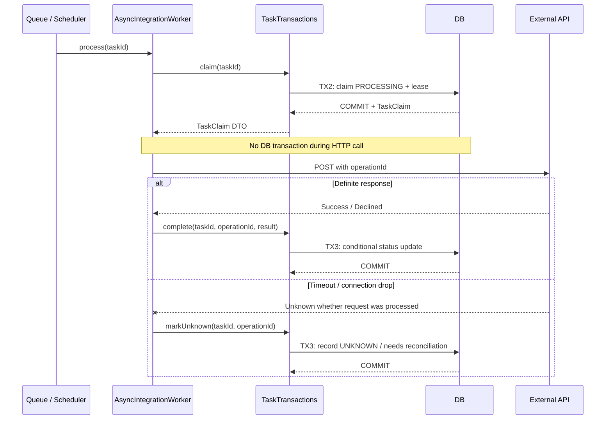
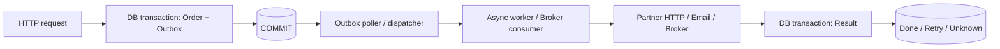

# Never Assume the Current Transaction Propagates Across `@Async`

## 1. The problem: data just written, yet the async task cannot read it

In the **SPRING_BOOT_INTEGRATION** module, a Spring Boot application routinely writes to a database and then triggers I/O work: calling an HTTP API, updating a cache, sending email, publishing events to a broker, or running a Spring Integration adapter. To shorten HTTP response times, developers often move the trailing work into an `@Async`-annotated method.

Suppose a user places an order; the order service runs inside a transaction and calls an async worker to send a confirmation email:

```java
@Service
public class OrderApplicationService {
    private final OrderRepository orders;
    private final EmailWorker emailWorker;

    public OrderApplicationService(OrderRepository orders,
                                   EmailWorker emailWorker) {
        this.orders = orders;
        this.emailWorker = emailWorker;
    }

    @Transactional
    public UUID createOrder(CreateOrderCommand command) {
        Order order = orders.save(Order.from(command));

        // May be scheduled before the current transaction commits!
        emailWorker.sendConfirmation(order.getId());
        return order.getId();
    }
}

@Service
public class EmailWorker {
    private final OrderRepository orders;
    private final EmailSender sender;

    public EmailWorker(OrderRepository orders, EmailSender sender) {
        this.orders = orders;
        this.sender = sender;
    }

    @Async("integrationExecutor")
    public void sendConfirmation(UUID orderId) {
        Order order = orders.findById(orderId).orElseThrow();
        sender.send(order.getEmail(), order.getId());
    }
}
```

This snippet assumes `@EnableAsync` is enabled and an `Executor` named `integrationExecutor` exists. `Order`, the repositories, command, and email sender are illustrative domain types.

The problem: **when `sendConfirmation()` starts executing, the transaction in `createOrder()` may not have committed yet**. Under standard DB isolation levels such as `READ COMMITTED`, a query on another transaction/connection cannot see newly inserted, uncommitted rows. The worker can throw "order not found," even as the originating HTTP request is about to succeed.

An even riskier scenario occurs when the worker receives passed data directly, sends the email successfully, and then the order-creation transaction rolls back. The customer receives a confirmation for an order that does not exist. `@Async` does not roll back external SMTP/API side effects alongside DB changes.

```mermaid
sequenceDiagram
    participant C as Client
    participant O as OrderService - Thread A
    participant DB as Database
    participant W as EmailWorker - Thread B
    participant E as Email API
    C->>O: POST /orders
    O->>DB: BEGIN; INSERT order
    O->>W: Call @Async (enqueue task to executor)
    activate W
    W->>DB: SELECT order by ID
    DB-->>W: May not see row since Thread A hasn't committed
    W-->>W: NotFound or wrong decision
    deactivate W
    O->>DB: COMMIT (happens later)
    O-->>C: 201 Created
    Note over O,W: @Async does not wait for or inherit the caller's transaction
```

**Core rule:** never treat an `@Async` invocation as a continuation of the current transaction. Explicitly design *commit timing*, *independent transactions inside the worker*, and *crash-recovery mechanisms*.

## 2. How are Spring transactions bound to threads?

In Spring's standard transaction model for JDBC/JPA, `PlatformTransactionManager` uses `TransactionSynchronizationManager` to bind resources—such as JDBC connections, `EntityManager`s, and transaction/synchronization state—to the **currently executing thread**. A method invoked via a `@Transactional` proxy starts or joins a transaction on that thread and commits or rolls back when the method returns per transaction rules.

`@Async` is a separate mechanism: Spring intercepts the call via proxy and hands execution to an `Executor`. The worker typically runs on **another thread**. Caller-bound `ThreadLocal`s **are not inherited automatically as an active transaction**.

| Component | Typical scope | Consequence when calling `@Async` |
| --- | --- | --- |
| Transaction-bound JDBC connection / `EntityManager` | Caller thread | Worker does not share the caller's transaction |
| `TransactionSynchronizationManager` | Current thread's `ThreadLocal` | Caller's transaction state does not transfer automatically |
| JPA persistence context | Corresponding transaction / `EntityManager` | Caller entities are no longer managed in the worker |
| `@Async` / `TaskExecutor` | A thread from the thread pool | Work has an independent start and end lifecycle |
| `MDC`, `SecurityContext`, request context | Thread-bound or separate context mechanisms | Never assume propagation; configure controlled propagation |
| Redis, Kafka, HTTP clients | External integration resources | Do not share an ACID transaction with the DB merely by sharing a method |

Do not assume `@Transactional` blindly "attaches a transaction" regardless of execution model. Reactive transactions may rely on Reactor context rather than `ThreadLocal`; an `@Async` method returning `CompletableFuture` bridges neither imperative transactions nor Reactor contexts. This lesson focuses on **Spring Boot using JDBC/JPA and imperative code combined with `@Async`**.

### Three facts to remember

1. **The caller still owns the caller's transaction.** Thread A may be inside transaction `T1`; after scheduling `@Async`, `T1` continues on A until the transactional method exits.
2. **The worker does not receive `T1`.** Thread B normally starts with no transaction; it only gets one if a proxied call on B explicitly opens its own transaction (e.g., via a `@Transactional` bean).
3. **A worker's own transaction does not make uncommitted data visible.** A transaction `T2` on B using `REQUIRES_NEW` or default propagation remains subject to DB visibility/isolation rules.

```text
Thread A                           Thread B (executor)
--------                           -------------------
T1: BEGIN
INSERT orders
schedule @Async  ----------------> run task
                                  T2: BEGIN if worker opens a transaction
                                  SELECT orders (may not see INSERT yet)
                                  T2: COMMIT / ROLLBACK
T1: COMMIT
```

Passing a JPA entity from transaction A to the worker does not transfer the transaction. The entity becomes detached outside its original persistence context; lazy loading can throw `LazyInitializationException`, and sharing one entity instance across threads invites concurrency bugs. Pass **IDs, versions, and immutable data** instead; let the worker open its own transaction and reload/verify committed state.

## 3. `@Async` and `@Transactional`: the real boundary is the proxy

In standard proxy mode, `@Async` only works when calls go **through a Spring-managed proxy**. `@Transactional` also typically applies via AOP proxies. Thus annotation placement and actual call paths matter.

### 3.1. Configuring a bounded executor

Spring Boot configuration example:

```java
import java.util.concurrent.ThreadPoolExecutor;

import org.springframework.context.annotation.Bean;
import org.springframework.context.annotation.Configuration;
import org.springframework.scheduling.annotation.EnableAsync;
import org.springframework.scheduling.concurrent.ThreadPoolTaskExecutor;

@Configuration(proxyBeanMethods = false)
@EnableAsync
public class IntegrationAsyncConfiguration {

    @Bean(name = "integrationExecutor")
    public ThreadPoolTaskExecutor integrationExecutor() {
        ThreadPoolTaskExecutor executor = new ThreadPoolTaskExecutor();
        executor.setCorePoolSize(4);
        executor.setMaxPoolSize(8);
        executor.setQueueCapacity(200);
        executor.setThreadNamePrefix("integration-");
        executor.setRejectedExecutionHandler(
                new ThreadPoolExecutor.AbortPolicy());
        executor.initialize();
        return executor;
    }
}
```

Pool sizes are illustrative. Size according to latency, throughput, downstream load, memory, and connection pool limits. A **bounded** queue protects the process when downstreams stall; once full, the executor can **reject** right at the `@Async` call site. Callers need an explicit policy for rejections.

`@EnableAsync` activates `@Async` processing. `@Transactional` in a Spring Boot app with an appropriate transaction manager runs via transaction interception; never think enabling `@EnableAsync` automatically creates or propagates transactions across threads.

### 3.2. Self-invocation stops `@Async` from running asynchronously

This example is easily misunderstood:

```java
@Service
class BrokenOrderService {

    @Transactional
    public void submit(UUID orderId) {
        // Direct call within the same object bypasses default proxy.
        this.sendAsync(orderId);
    }

    @Async("integrationExecutor")
    public void sendAsync(UUID orderId) {
        // May execute on the very thread running submit()!
    }
}
```

In normal proxy mode, `this.sendAsync(...)` bypasses the proxy, so `@Async` may **not apply**. The method runs synchronously inside the caller's transaction, hiding race conditions during development.

Similarly, a `@Transactional` method called via `this.otherTransactionalMethod()` normally skips transaction advice by bypassing the proxy. Place async entrypoints and intercepted transactional methods in **separate beans**, wire via constructor injection, and test actual call paths from the Spring context.

### 3.3. Can `@Async` and `@Transactional` sit on the same method?

A method can carry both annotations:

```java
@Async("integrationExecutor")
@Transactional
public CompletableFuture<Void> updateSomething(UUID id) {
    // When interceptors run on the worker,
    // the transaction here is the worker's own transaction.
    return CompletableFuture.completedFuture(null);
}
```

This **does not propagate the caller's transaction**. When properly intercepted by Spring AOP and opened on the worker thread, it is a **separate transaction**. Interceptor ordering and proxy types can affect complex configurations; do not assume combining both annotations creates the right boundary for every flow.

It is especially dangerous when a method opens its own transaction and also calls a slow external HTTP API: the worker's transaction stays open across network waits. For integration flows, it is much clearer to put **`@Async` on the orchestrator and `@Transactional` on short DB steps in a separate bean**.

## 4. Safe pattern: `@Async` orchestrates, short transactions live in another bean

Suppose an outbound notification request is persisted with a `taskId`. The worker should:

1. Claim the job in a short transaction, verify eligibility, and fetch needed data.
2. After that transaction commits, call HTTP/SMTP/broker **outside any DB transaction**.
3. Open a new transaction to record the outcome or reconciliation state.



Example code, where `TaskClaim`, `ExternalResult`, and repositories are application-defined domain components:

```java
import java.util.UUID;
import java.util.concurrent.CompletableFuture;

import org.springframework.scheduling.annotation.Async;
import org.springframework.stereotype.Service;

@Service
public class AsyncIntegrationWorker {

    private final TaskTransactions transactions;
    private final PartnerClient partnerClient;

    public AsyncIntegrationWorker(TaskTransactions transactions,
                                  PartnerClient partnerClient) {
        this.transactions = transactions;
        this.partnerClient = partnerClient;
    }

    @Async("integrationExecutor")
    public CompletableFuture<Void> process(UUID taskId) {
        // Another bean opens TX #1 for the worker and commits on return.
        TaskClaim claim = transactions.claimIfReady(taskId);
        if (claim == null) {
            return CompletableFuture.completedFuture(null);
        }

        try {
            // Runs outside any DB transaction.
            ExternalResult result = partnerClient.execute(
                    claim.operationId(), claim.payload());

            // Another bean opens TX #2, updating conditionally.
            transactions.recordResult(
                    claim.taskId(), claim.operationId(), result);
        } catch (PartnerOutcomeUnknownException ex) {
            // Timeouts do not prove downstream didn't process the call.
            transactions.markUnknown(
                    claim.taskId(), claim.operationId());
        }

        return CompletableFuture.completedFuture(null);
    }
}
```

```java
import java.util.UUID;

import org.springframework.stereotype.Service;
import org.springframework.transaction.annotation.Transactional;

@Service
public class TaskTransactions {

    private final TaskRepository tasks;

    public TaskTransactions(TaskRepository tasks) {
        this.tasks = tasks;
    }

    @Transactional
    public TaskClaim claimIfReady(UUID taskId) {
        // Note: repository must use conditional UPDATE/version/short lock
        // so two workers cannot claim the same task.
        return tasks.claimAndReturnSnapshot(taskId);
    }

    @Transactional
    public void recordResult(
            UUID taskId, UUID operationId, ExternalResult result) {
        tasks.updateResultIfCurrent(taskId, operationId, result);
    }

    @Transactional
    public void markUnknown(UUID taskId, UUID operationId) {
        tasks.markUnknownIfCurrent(taskId, operationId);
    }
}
```

`claimAndReturnSnapshot`, `updateResultIfCurrent`, and `markUnknownIfCurrent` are **illustrative repository contracts**, not built-in Spring Data methods. Implementations must use compare-and-set/conditional status checks, optimistic locking (`@Version`), or lease-based claiming.

The advantage here **does not come from `@Async` creating a transaction**. The worker simply coordinates on a separate thread; each call to `TaskTransactions` establishes a local transaction. No JDBC connections or row locks are held across HTTP calls. Read-only external calls retry easily; side-effecting calls (payments, shipments, vouchers) require stable operation IDs and idempotency at the target system.

**Edge cases to design for:**

- Crash **after claiming, before calling partner**: task gets stuck in `PROCESSING`; needs lease expiry or a recovery job.
- Crash **after partner succeeds, before persisting result**: reconcile or retry safely with the same operation ID.
- Failure writing `UNKNOWN`: never treat the task as done; repair job sweeps expired `PROCESSING` rows.
- Two workers picking up the same task: require atomic claims; never rely on `@Async` or single-JVM `synchronized` across multiple instances.
- Late responses: update only if status and `operationId` are still current; never let stale responses overwrite newer state.

## 5. Commit ordering and when tasks are triggered

Even when the worker has its own transaction, the opening example's main bug remains: **the task is scheduled before the caller commits**. Decide whether work is allowed to run while the caller's transaction is still open.

### 5.1. Never dispatch work that depends on uncommitted data

```text
Dangerous:
  Thread A: BEGIN -> INSERT order -> @Async(orderId) -> COMMIT
  Thread B:                   SELECT order ? (may miss row)

Desired:
  Thread A: BEGIN -> INSERT order -> COMMIT
  Thread B:                             process orderId
```

Splitting the two steps in sequence within one request achieves this if **the commit genuinely finishes** before `@Async` is called:

```java
@Service
public class CheckoutCoordinator {
    private final OrderTransactions orderTransactions;
    private final AsyncIntegrationWorker worker;

    public CheckoutCoordinator(OrderTransactions orderTransactions,
                               AsyncIntegrationWorker worker) {
        this.orderTransactions = orderTransactions;
        this.worker = worker;
    }

    // This method is NOT @Transactional.
    public UUID checkout(CheckoutCommand command) {
        UUID orderId = orderTransactions.persistOrder(command);
        // persistOrder() is @Transactional on another bean;
        // it commits before returning.
        worker.process(orderId);
        return orderId;
    }
}
```

This lets the worker see committed data **once `persistOrder` runs through the Spring proxy and commits**. Yet a gap remains:

1. The DB transaction commits successfully.
2. The application crashes or the executor rejects the submission.
3. `worker.process(orderId)` is never scheduled.

The order exists, yet the downstream task may **never run**. Thus this pattern suits only best-effort work or flows backed by an independent recovery sweeper.

### 5.2. Using `@TransactionalEventListener(AFTER_COMMIT)` when task loss is tolerable

To prevent workers from starting before commit, Spring supports transaction-bound event listeners:

```java
public record OrderCreatedEvent(UUID orderId) {}

@Service
public class OrderCommandService {
    private final OrderRepository orders;
    private final ApplicationEventPublisher events;

    public OrderCommandService(OrderRepository orders,
                               ApplicationEventPublisher events) {
        this.orders = orders;
        this.events = events;
    }

    @Transactional
    public UUID createOrder(CreateOrderCommand command) {
        Order order = orders.save(Order.from(command));
        events.publishEvent(new OrderCreatedEvent(order.getId()));
        return order.getId();
    }
}

@Component
public class OrderCreatedListener {
    private final AsyncIntegrationWorker worker;

    public OrderCreatedListener(AsyncIntegrationWorker worker) {
        this.worker = worker;
    }

    @TransactionalEventListener(
            phase = TransactionPhase.AFTER_COMMIT)
    public void onOrderCreated(OrderCreatedEvent event) {
        worker.process(event.orderId());
    }
}
```

Key imports:

```java
import org.springframework.context.ApplicationEventPublisher;
import org.springframework.context.event.EventListener;
import org.springframework.stereotype.Component;
import org.springframework.stereotype.Service;
import org.springframework.transaction.annotation.Transactional;
import org.springframework.transaction.event.TransactionPhase;
import org.springframework.transaction.event.TransactionalEventListener;
```

No `@Async` is needed on the listener here because it **calls an `@Async` worker bean**; the callback only submits the task. Adding `@Async` on the listener is possible in some setups, yet adds no durability.

`@TransactionalEventListener(AFTER_COMMIT)` fires only when the transaction commits; by default, events published **outside any transaction** do not trigger the listener unless `fallbackExecution = true` is set. If enabling fallback, understand the difference when no transaction exists.

**Major limitation:** this is an **in-process memory event**. If the app crashes after DB commit before the listener submits to the executor, the task is lost. Even after submission succeeds, a crash before execution loses it. Use this only when losing notifications isn't critical or when an independent sweeper exists. Never treat it as an exactly-once guarantee or distributed transaction.

**Transaction detail:** an `AFTER_COMMIT` callback can run while prior transaction resources are still attached to the thread during completion. If the listener itself must write durably to the DB on that thread, open an explicit transaction such as `REQUIRES_NEW` via another bean; never assume operations automatically commit as a new transaction. Here the listener only schedules `@Async`, and DB writes occur in the worker's own transactions.

### 5.3. When work must never be lost: transactional outbox

If the requirement is "once an order commits, the event/email/ERP sync must definitely happen," use a **transactional outbox** or equivalent durable job persistence.



Inside **one DB transaction**, store both business state and the pending task:

```java
@Service
public class OrderSubmissionService {
    private final OrderRepository orders;
    private final OutboxRepository outbox;

    public OrderSubmissionService(OrderRepository orders,
                                  OutboxRepository outbox) {
        this.orders = orders;
        this.outbox = outbox;
    }

    @Transactional
    public UUID submit(CreateOrderCommand command) {
        Order order = orders.save(Order.from(command));
        outbox.save(OutboxMessage.orderCreated(
                order.getId(),
                order.getIntegrationOperationId()));
        return order.getId();
    }
}
```

After `COMMIT`, a **poller/dispatcher** finds pending outbox rows, claims them in short transactions, and hands them to workers. Across restarts, outbox rows remain in the DB so work resumes. Implement atomic leases/claims, retries/backoff, and stuck-task handling. If the poller hands work to an in-memory executor, **never mark the outbox row `DONE` when the executor merely accepts it**; mark completion only after the side effect is confirmed per contract.

An outbox guarantees *the work intent persists with the business transaction*, not that external side effects run once. A worker can crash after calling an external API before marking the outbox done; the next attempt may resend. Design **at-least-once + idempotency**, or reconcile when providers lack idempotency.

## 6. Does `@Transactional` in the worker need `REQUIRES_NEW`?

Suppose an async worker runs:

```java
@Service
class AsyncAuditWorker {
    private final AuditTransactions auditTransactions;

    AsyncAuditWorker(AuditTransactions auditTransactions) {
        this.auditTransactions = auditTransactions;
    }

    @Async("integrationExecutor")
    public CompletableFuture<Void> run(UUID orderId) {
        auditTransactions.writeAudit(orderId);
        return CompletableFuture.completedFuture(null);
    }
}

@Service
class AuditTransactions {
    private final AuditRepository audits;

    AuditTransactions(AuditRepository audits) {
        this.audits = audits;
    }

    @Transactional
    public void writeAudit(UUID orderId) {
        audits.save(new AuditEntry(orderId, "ASYNC_STARTED"));
    }
}
```

`writeAudit`'s transaction **opens on the worker thread** via the Spring proxy call. Since no caller transaction propagates to the worker thread, default `REQUIRED` propagation already creates a new transaction. Changing it to `REQUIRES_NEW` **neither joins nor suspends the caller's transaction running on another thread**.

Comparison table:

| Call site of `@Transactional` | `REQUIRED` | `REQUIRES_NEW` |
| --- | --- | --- |
| Same thread, inside existing transaction | Joins existing transaction | Suspends existing transaction, creates a new one per manager |
| Worker thread with no transaction | Creates new transaction | Creates new transaction |
| Worker already holding its own transaction | Joins worker's transaction | Suspends worker's transaction and creates another |
| Goal of "reading caller's uncommitted data" | **Not solved** | **Not solved** |

In specialized `JtaTransactionManager` distributed transaction setups coordinating multiple resources, boundaries must still be designed explicitly; never assume those behaviors apply to default JDBC/JPA with `@Async`.

`REQUIRES_NEW` also has a cost: when a transaction is already open on the **same thread**, outer transaction resources remain held while the inner transaction borrows another connection. Under high concurrency, careless use can exhaust the connection pool. When calling external APIs, never wrap the whole network wait in a transaction "just to be safe."

## 7. Handling async results and exceptions

With `@Async`, return types are normally `void` or supported future types such as `CompletableFuture<T>`. Callers do not catch worker exceptions like normal synchronous calls.

### 7.1. `@Async` returning `void`

```java
@Async("integrationExecutor")
public void refreshExternalSnapshot(UUID id) {
    externalGateway.refresh(id);
}
```

If `externalGateway.refresh` throws, the caller has already returned and cannot `try/catch` synchronously. For `void` methods, register an `AsyncUncaughtExceptionHandler` to record uncaught errors, keeping in mind the handler **does not automatically retry, recover data, or make tasks durable**. Never use `void` for critical tasks without a status/queue table and outcome monitoring.

### 7.2. `@Async` returning `CompletableFuture`

```java
@Async("integrationExecutor")
public CompletableFuture<ExternalResult> load(UUID id) {
    ExternalResult result = externalGateway.fetch(id);
    return CompletableFuture.completedFuture(result);
}
```

Caller can observe the result:

```java
CompletableFuture<ExternalResult> future = worker.load(id);

future.whenComplete((result, error) -> {
    if (error != null) {
        // Log/emit metrics with correlation ID; needs its own recovery plan.
        logger.warn("Async integration failed for task {}", id, error);
    }
});

// Block with join() only when business logic genuinely requires sync waiting.
```

Spring returns a future representing async execution; inside the worker, the method can return `completedFuture(...)` so the framework bridges the outcome to the caller's future. Worker exceptions typically complete the future **exceptionally**, and `join()` throws `CompletionException` wrapping the cause.

**Never call `future.join()` while the caller's transaction is still open** trying to "wait for the worker to read the newly saved data": the worker may block on locks or fail to see pre-commit rows while the caller waits for the worker before committing. That causes logical deadlocks or timeouts. If an immediate result is required, run synchronously at the right step or finish the transaction before waiting.

### 7.3. Executor rejection differs from worker execution errors

When the queue is full or the executor is shutting down, scheduling `@Async` can be rejected **before the worker even starts**. Submission rejection differs from I/O exceptions inside the worker. For critical work, a durable outbox/queue offers a recovery path independent of executor state.

Never use an unbounded queue just to dodge rejections: it drives up unbounded latency and memory pressure. Monitor queue depth, active threads, rejection counts, task age, downstream latency, and `UNKNOWN`/`RETRY` statuses.

## 8. Other contexts can propagate, yet what about transactions?

Applications often attach `traceId`, `tenantId`, `SecurityContext`, or MDC to tasks for logging, auditing, and access checks. These can be passed explicitly via DTOs, or via a `TaskDecorator`/appropriate context propagation mechanism.

Example passing explicit business metadata:

```java
public record IntegrationCommand(
        UUID taskId,
        String tenantId,
        String correlationId,
        UUID operationId) {}

@Async("integrationExecutor")
public CompletableFuture<Void> process(IntegrationCommand command) {
    // tenantId and correlationId are already-validated inputs.
    // DB transactions must still be opened explicitly on repo/service calls.
    transactions.claimForTenant(
            command.taskId(), command.tenantId(), command.operationId());
    return CompletableFuture.completedFuture(null);
}
```

Verify authorization and tenant scope on the server from trusted sources; never trust a `tenantId` solely because the client sent it. Logging context never replaces security validation when authorizing data access.

| Context type | Propagable via executor? | Counts as caller transaction? |
| --- | --- | --- |
| Correlation ID / MDC | Yes, via decorator/propagation or DTO fields | **No** |
| `SecurityContext` | Yes, via dedicated security executor/decorator when appropriate | **No** |
| Locale / request metadata | Selectively propagable | **No** |
| JDBC/JPA `TransactionSynchronizationManager` | Never copy manually to another thread | **No** |
| Transaction-bound `EntityManager` / JDBC connection | Never share arbitrarily across threads | **No** |

Specifically, never write a `TaskDecorator` that copies `TransactionSynchronizationManager` or `EntityManager` to a worker thread to "keep the transaction alive." Those resources have strict thread-ownership and lifecycle rules; sharing across threads causes connection contention, corrupted state, and undefined commit/rollback behavior. When a task needs data, pass IDs and open a fresh transaction at the right moment.

## 9. Testing to prove independence from the caller's transaction

A test that merely invokes an `@Async` method and sees it run is not enough. Test **execution thread, transaction state, and commit timing**, especially when writing to the DB before triggering messages or calls.

### 9.1. Inspecting worker transaction status

With a standard transaction manager, `TransactionSynchronizationManager.isActualTransactionActive()` inspects transaction status at each step:

```java
import org.springframework.transaction.support.TransactionSynchronizationManager;

boolean active =
        TransactionSynchronizationManager.isActualTransactionActive();
```

This reports the **current thread's** Spring transaction state; it cannot prove whether another thread's transaction committed. Inside the caller's `@Transactional` method, it is typically `true`; at the top of a non-transactional async orchestrator, `false`; and inside a proxied `TaskTransactions.claimIfReady(...)`, `true`.

**Test design note:** never annotate an entire test method with `@Transactional` and expect an async worker to see rows inserted by that uncommitted test transaction. Spring Test typically rolls back the test transaction at the end of the test; the worker runs in its own transaction scope and will not see uncommitted rows. To test post-commit behavior, use `TransactionTemplate`, `TestTransaction.end()` (where appropriate), or separate steps with real committed transactions.

### 9.2. Deterministic ordering tests instead of `sleep`

To demonstrate the race condition in the broken pattern, use `CountDownLatch` synchronization points:

```text
Thread A (write transaction)        Thread B (@Async)
----------------------------        -----------------------
BEGIN, INSERT order
signal "insert complete"
                                    await "insert complete"
                                    SELECT order (before commit)
                                    record visibility result
await "worker observed"
COMMIT
```

Against a real database and matching isolation level, this test demonstrates the worker cannot see uncommitted rows. Use bounded latch timeouts so tests never hang. **Never hold an uncommitted row lock while having the worker try to update that same locked row**, or the test design itself will deadlock.

Tests for the correct pattern should verify:

1. Order creation commits before the worker receives the task.
2. Worker reads the order on its own connection.
3. Delayed external API calls do not hold locks/connections from claim/complete transactions.
4. Timeouts do not wrongly transition to `FAILED` before verifying side effects.
5. Crash/restart after commit recovers tasks from the outbox.
6. Two workers claiming the same task do not cause duplicate side effects.
7. Worker exceptions/timeouts surface via futures or DB state rather than vanishing from observability.

Use Testcontainers for PostgreSQL/MySQL, WireMock or HTTP stubs for partners, and real broker test harnesses when using Kafka/RabbitMQ. Pure Mockito repository mocks cannot prove real transaction visibility and locking.

### 9.3. Expected scenario behaviors

| Scenario | Expectation |
| --- | --- |
| Caller rolls back after calling `@Async` | No business task dispatched as though order committed; same-transaction outbox rolls back |
| Caller commits then app crashes before scheduling | Outbox retains pending record; worker recovers after restart |
| Worker HTTP succeeds, DB result update fails | Task enters reconciliation state; retries reuse same operation ID |
| Worker times out while partner already executed | Use idempotency key/status lookup rather than assuming `FAILED` |
| Worker rejected by executor | Durable task remains pending; alerts and throttling fire |
| `@Async` suffers self-invocation | Test catches execution on same thread; fixed to route via proxy |
| Worker uses `REQUIRES_NEW` | Opens separate worker transaction; still sees no uncommitted caller data |
| Missing trace ID/MDC on worker | Fix observability context propagation; never copy transaction state |
| `AFTER_COMMIT` event doesn't fire outside tx | Verify `fallbackExecution` and transaction scope per contract |

## 10. Common mistakes to avoid

| Misconception / anti-pattern | Why it fails | Fix |
| --- | --- | --- |
| "Caller is `@Transactional`, so `@Async` inherits it" | JDBC/JPA transactions bind to threads; worker uses another thread | Treat worker as an independent unit of work |
| Passing a JPA entity to async and accessing lazy fields | Caller persistence context doesn't transfer; entities aren't thread-safe | Pass IDs/DTOs and reload in a fresh transaction |
| Calling `this.asyncMethod()` inside the same bean | Self-invocation bypasses the Spring AOP proxy | Split beans and call via proxy |
| Putting `@Async` + `@Transactional` on one method with slow HTTP | Worker holds transaction open across network waits | Async orchestrator + short DB transactions in another bean |
| Using `REQUIRES_NEW` on worker to read caller's uncommitted rows | Isolation prevents seeing uncommitted writes | Trigger only after commit or use outbox |
| Treating `@TransactionalEventListener(AFTER_COMMIT)` as durable queue | In-memory events/tasks vanish on process crash | Transactional outbox / durable broker |
| Marking task `DONE` right upon calling `worker.process(...)` | Task may not have run, failed, or been rejected | Mark done only after confirmed outcome/reconciliation |
| Calling `CompletableFuture.join()` inside caller's transaction | Caller waits on worker needing committed data/locks | Commit first or respond asynchronously |
| Retrying POST with a new operation ID after timeout | Downstream may have succeeded, causing duplicates | Keep stable operation ID and idempotency/reconciliation |
| Copying transaction `ThreadLocal` to executor | Corrupts resource ownership and thread lifecycles | Propagate only appropriate non-transactional contexts |
| Using unbounded executor queues | Builds backlogs, stretches latency, raises memory pressure | Bounded pools/queues, backpressure, and alerts |

## 11. Checklist before shipping `@Async` workflows to production

- Clearly define **which transaction persists business state**, which claims the task, and which records worker outcomes.
- Confirm **no reads depend on uncommitted data**; if persisted data is needed, start workers only after real commit.
- Never expect `@Async` to transfer JDBC/JPA transactions, persistence contexts, or managed JPA entities across threads.
- Verify `@Async` calls go through Spring proxies and `@EnableAsync` is active.
- Keep worker-invoked `@Transactional` methods in separate beans and keep DB transactions **short**, outside HTTP/SMTP/broker I/O.
- When tasks must execute even across crashes, use an **outbox/job table or durable broker**, not just in-memory executors or post-commit events.
- Generate stable `operationId`/idempotency keys; define `PENDING`, `PROCESSING`, `UNKNOWN`, `DONE`, `RETRY` states and reconciliation.
- Bound executors, retry counts, outbound timeouts, queue depths, and leases; alert on overdue or repeatedly failing tasks.
- Propagate correlation IDs and needed tenant info safely; never copy transaction `ThreadLocal`s.
- Test real DB visibility/commits, worker errors, executor rejections, and crashes around commit points; confirm zero duplicate side effects.

**Practical rule:** `@Async` changes **the execution thread and timing**, never carrying over the caller's transaction. In Spring Boot Integration, keep each DB transaction focused on a brief local data change, and draw crisp boundaries between **data commit**, **durable task scheduling**, **external calls**, and **outcome recording**. That enables flows combining HTTP clients, DBs, caches, message brokers, and Spring Integration adapters to recover safely from timeouts, retries, crashes, and duplicate deliveries.

### References

- [Spring Framework Reference — Task Execution and Scheduling](https://docs.spring.io/spring-framework/reference/integration/scheduling.html): `@Async`, task executors, and exception handling.
- [Spring Framework Reference — Declarative Transaction Management](https://docs.spring.io/spring-framework/reference/data-access/transaction/declarative.html): interceptors, propagation, and transaction boundaries.
- [Spring Framework API — TransactionSynchronizationManager](https://docs.spring.io/spring-framework/docs/current/javadoc-api/org/springframework/transaction/support/TransactionSynchronizationManager.html): thread-bound resources and synchronizations.
- [Spring Framework Reference — Transaction-bound Events](https://docs.spring.io/spring-framework/reference/data-access/transaction/event.html): `@TransactionalEventListener` and phases.
- [Spring Boot Reference — Task Execution and Scheduling](https://docs.spring.io/spring-boot/reference/features/task-execution-and-scheduling.html): configuring executors and tasks in Boot apps.
