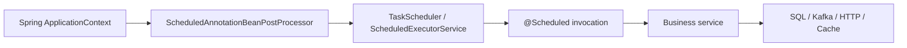
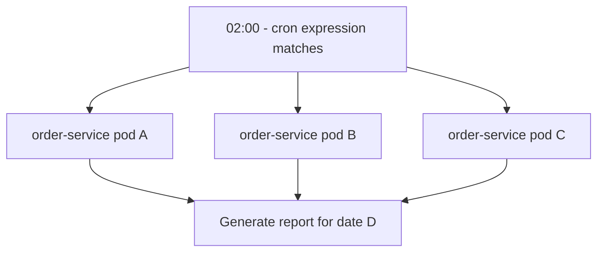
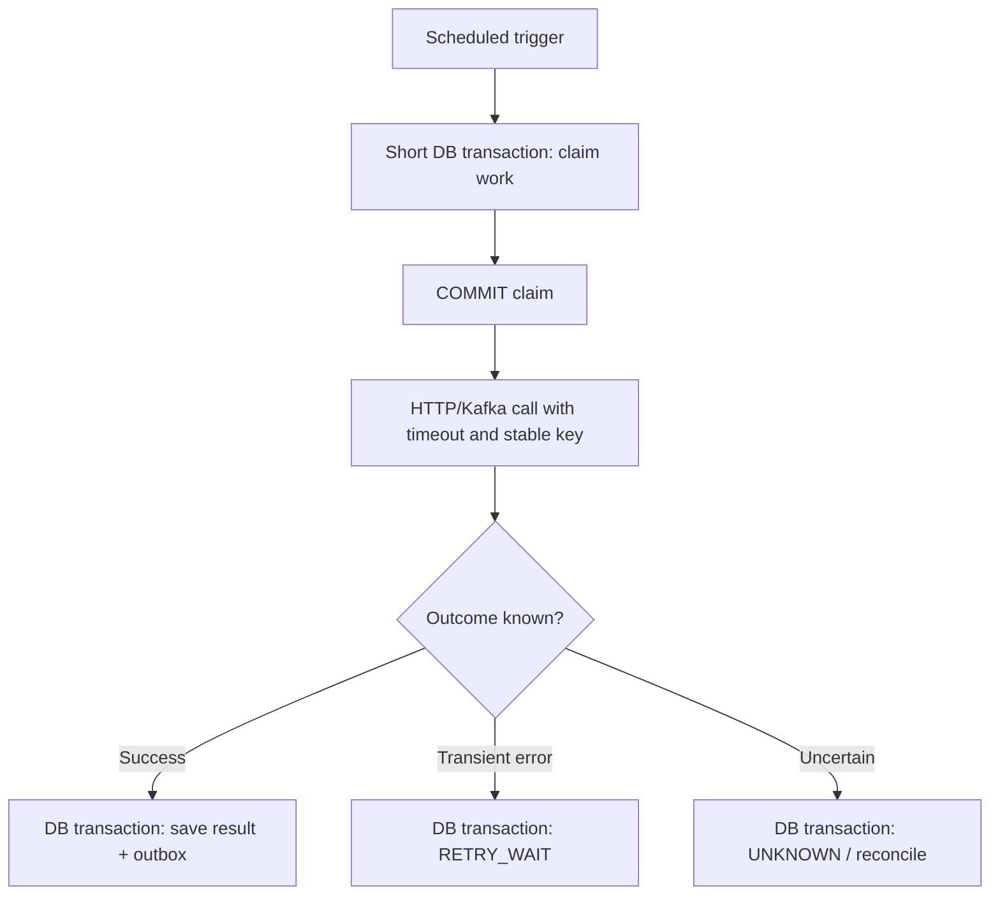

# `@Scheduled`, `fixedRate`, `fixedDelay`, and `cron`

In a Spring Boot application, not every task starts from an HTTP request or a broker message. Some work must run on a schedule: sweeping unpublished outbox rows to Kafka, reconciling payment transactions with partners, refreshing caches, expiring stale orders, purging expired retention records, or generating end-of-day reports. Spring Framework provides `@Scheduled` to declare such jobs directly on a Spring bean method.

At first glance, `fixedRate`, `fixedDelay`, and `cron` all look like ways to "run periodically." Yet they answer three different questions:

- **`fixedRate`:** attempts to trigger on a **fixed interval between start times**.
- **`fixedDelay`:** starts the next run **after the previous run finishes plus a wait interval**.
- **`cron`:** triggers when **wall-clock time and calendar** match an expression.

This distinction determines backlog behavior, API call frequency, how long-running jobs behave, and whether multiple instances execute the same side effect concurrently. `@Scheduled` provides a *trigger mechanism* inside one Spring process; it does not provision distributed locks, maintain a durable job queue, guarantee exactly-once execution, or protect a payment from running twice.

This lesson belongs to the **Async Tasks** chapter of the **SPRING_BOOT_INTEGRATION** module. The context covers Spring Boot flows integrating HTTP clients, SQL, caches, Kafka/RabbitMQ, and Spring Integration adapters, where configuration, data contracts, transactions, errors, idempotency, testing, and observability must be managed. Examples primarily target Spring Boot 3.x and Spring Framework 6.x; version-dependent behaviors noted below should be verified against your active version.

## 1. Learning objectives

After this lesson, you will be able to:

1. Enable Spring Scheduling and implement `@Scheduled` tasks using externalized configuration.
2. Read exact execution timelines for `fixedRate`, `fixedDelay`, `initialDelay`, and `cron` with concrete examples.
3. Write Spring's **six-field** cron expressions, set explicit time zones, and handle missing/repeated local times under DST.
4. Distinguish scheduler threads, `@Async` executors, concurrency across multiple jobs, and multiple replicas.
5. Spot scenarios where a job triggers multiple times, runs too long, or is skipped during process downtime.
6. Combine scheduled jobs with SQL transactions, idempotency, inbox/outbox tables, authorization, and HTTP/Kafka retries.
7. Choose among `@Scheduled`, Quartz, broker-based workers, and platform schedulers based on required durability.
8. Test time-dependent logic, transient errors, crashes/restarts, multiple instances, time zones, and catch-up backfills.

## 2. When should you use scheduled jobs?

Scheduling fits when the system must check or act **based on time**. Examples:

| Use case | Typical frequency | Business condition to watch |
|---|---|---|
| Outbox dispatcher | Every few seconds | Already committed in DB; avoid duplicate side effects |
| Retry job for failed HTTP tasks | Driven by `next_attempt_at` | Keep operation ID, backoff, and deadlines |
| Reconciliation with Payment API | Every 1–5 minutes | Timed-out outcomes may be `UNKNOWN`; status lookups must be safe |
| Derived cache refresh | Fixed interval | Avoid overwriting fresh cache with stale data; bound dependency timeouts |
| Reservation/order expiration | Every minute or near SLA | Update only due rows guarded by version/state |
| Daily report aggregation | Cron early morning in business time zone | Effective business date, catch-up after downtime, closing cutoffs |
| Old record cleanup | Cron during off-peak hours | Retention, pagination, avoiding large table locks |
| Customer reminders | Per user date/time | Deduplicate by recipient + reminder period + notification type |

For instance, an `outbox dispatcher` should re-run whenever unsent records exist; `fixedDelay` naturally throttles when the broker slows down. A report at "02:00 daily" is a calendar rule, calling for `cron` with an explicit time zone. A cleanup job can use either depending on whether the business obligation is "every 24 hours" or "at a local wall-clock hour."

Ask before choosing the annotation: **if the app is down when a job was supposed to run, must it catch up?** For un-losable obligations, due conditions belong in durable storage or a persistent scheduler; bare `@Scheduled` remembers no missed runs.

## 3. How Spring Scheduling works

Spring scans container-managed beans for `@Scheduled` methods, registers them with a scheduler, and invokes them per trigger. Scheduling must be enabled via `@EnableScheduling` or matching configuration.



In Spring Boot, when starters and auto-configuration match, a `TaskScheduler` is auto-created. Placing `@Scheduled` on a class without enabling scheduling **never runs the job**.

### 3.1. Minimal setup

```java
package example.integration.scheduling;

import org.springframework.context.annotation.Configuration;
import org.springframework.scheduling.annotation.EnableScheduling;

@Configuration(proxyBeanMethods = false)
@EnableScheduling
public class SchedulingConfiguration {
}
```

Bean containing the job:

```java
package example.integration.scheduling;

import org.springframework.scheduling.annotation.Scheduled;
import org.springframework.stereotype.Component;

@Component
public class OutboxSweepJob {

    private final OutboxDispatchService dispatchService;

    public OutboxSweepJob(OutboxDispatchService dispatchService) {
        this.dispatchService = dispatchService;
    }

    @Scheduled(
        fixedDelayString = "${integration.outbox.fixed-delay:PT5S}",
        initialDelayString = "${integration.outbox.initial-delay:PT10S}"
    )
    public void dispatch() {
        dispatchService.processDueBatch();
    }
}
```

`OutboxDispatchService` is an application-implemented business service responsible for selecting due rows, claiming them, publishing, and recording results. The annotation uses Spring `${...}` placeholders to read externalized config; keep the `$` before braces intact in Java source. `PT5S` and `PT10S` are ISO-8601 duration strings parsed by supporting Spring versions for `fixedDelayString` and `initialDelayString`.

Corresponding YAML example:

```yaml
integration:
  outbox:
    fixed-delay: PT5S
    initial-delay: PT10S
```

Never hardcode DB credentials, Kafka tokens, or HTTP passwords inside annotations. Secrets belong in dedicated secret management, while annotations reference only timing policies.

### 3.2. Method signatures and bean lifecycle

A standard synchronous `@Scheduled` method:

- Is invoked by Spring with **no arguments**.
- Normally returns `void` and returns once synchronous work finishes.
- Resides on a Spring-managed bean; objects created manually with `new` are never registered by the scanner.
- Must avoid holding transactions or network calls indefinitely on the scheduler thread.

Spring Framework 6.1+ also supports reactive `Publisher` return types and Kotlin suspending functions per framework requirements; subscription, error, and `fixedDelay` semantics differ from synchronous `void` methods. Primary examples here use synchronous methods to focus on timing, transactions, and side effects.

### 3.3. Where does async happen?

`@Scheduled` means **Spring invokes the method on a schedule**, not that operations inside run asynchronously relative to the scheduler thread. If the method executes blocking JDBC or HTTP calls, the scheduler thread waits until they complete.

`@Async` offloads invocations to an executor. Combining both requires verifying which method owns true completion, how exceptions propagate, and concurrency; returning early can let the next trigger start while earlier business work is still running.

## 4. `fixedRate`: cadence between planned start times

`fixedRate` specifies the interval between **scheduled start times**:

```java
@Scheduled(fixedRate = 5_000)
public void pollPartnerStatus() {
    partnerReconciliationService.pollPending();
}
```

Numeric values default to milliseconds (or configure `timeUnit` in supporting Spring versions). With `fixedRate = 5_000`, the scheduler targets `t=0, 5, 10, 15...` seconds from schedule start.

### 4.1. Timeline when the job is faster than the period

Suppose each execution takes 2 seconds:

```text
fixedRate = 5 seconds

t (s):  0----2    5----7    10---12   15---17
        [run1]    [run2]    [run3]    [run4]

planned starts: 0, 5, 10, 15
actual starts:  0, 5, 10, 15 (if scheduler has capacity)
```

The gap from run 1 finishing to run 2 starting is 3 seconds, which is **not** a "configured delay"; the 5-second cadence measures start-to-start.

### 4.2. When the job takes longer than the period

Suppose one execution takes 8 seconds while `fixedRate` is 5 seconds:

```text
fixedRate = 5 seconds
run1: start 0s ---- finish 8s
run2: planned 5s, actual no earlier than 8s for a single serial task
run3: planned 10s, actual depends on completion and scheduler
```

**Never assume `fixedRate` automatically opens a second thread to overlap the previous run.** For a single periodic registration on standard `ScheduledThreadPoolExecutor` or `ThreadPoolTaskScheduler`, consecutive runs of the **same registration** do not run concurrently just because duration exceeded period; overdue runs may slip, run back-to-back, or contend for scheduler threads. Overlap can still occur when:

- Multiple `@Scheduled` beans/registrations invoke the same business operation.
- Multiple `@Scheduled` annotations are stacked on one method.
- The method offloads to `@Async` or an executor and returns before completion.
- Multiple **application instances** run scheduling simultaneously.
- Another retry/redelivery mechanism runs the same work.

Thus `fixedRate` can still pressure slow upstreams even without spawning parallel threads for a single registration.

### 4.3. When to use `fixedRate`?

Good for fast, regular status checks with bounded runtime that are safe to invoke frequently—such as refreshing a metric snapshot or checking a lightweight cache. For jobs touching money, sending emails, or publishing to Kafka, always enforce idempotency and batch size limits.

## 5. `fixedDelay`: wait after the previous run completes

`fixedDelay` measures the pause **from when the previous execution ends to when the next begins**:

```java
@Scheduled(fixedDelay = 5_000)
public void dispatchOutbox() {
    outboxDispatchService.processDueBatch();
}
```

Suppose the job takes 3 seconds:

```text
fixedDelay = 5 seconds

t (s):  0---3     8---11     16---19
        [run1]    [run2]     [run3]

run1 finish: t=3
wait:        5 seconds
run2 start:  t=8
run2 finish: t=11
wait:        5 seconds
run3 start:  t=16
```

When the job slows down, the effective cadence slows down with it—often desirable when an external dependency is overloaded.

### 5.1. Simple timing formula

For execution duration `D` and fixed delay `P`:

\[
\text{Time between two starts} \approx D + P
\]

This formula illustrates a sequential job when the scheduler faces no extra thread contention or system delays.

### 5.2. When to choose `fixedDelay`?

Suited for polling, cleanup, or batch dispatching with variable runtime where chasing ideal start times makes no sense. If Kafka slows down, an outbox sweep might take 20 seconds and then rest 5 seconds, avoiding spinning tightly back-to-back.

A `fixedDelay` job **does not cure backlogs automatically**: if each run handles at most 100 rows while 10,000 new rows arrive every minute, backlog still grows. Monitor throughput, batch sizes, pools, and lag.

## 6. `fixedRate` vs. `fixedDelay` with an example

Suppose a job runs for 4 seconds with a 5-second configured interval, starting at `t=0`:

| Run | `fixedRate=5s`: planned start | `fixedDelay=5s`: start |
|---|---|---|
| 1 | 0s | 0s |
| 2 | 5s | 9s |
| 3 | 10s | 18s |
| 4 | 15s | 27s |

If the job takes **7 seconds** instead of 4 seconds:

- `fixedRate` still targets 0, 5, 10..., yet actual runs are constrained by job duration and scheduler capacity; nothing guarantees completion every 5 seconds.
- `fixedDelay` starts at 0, 12, 24... seconds in an ideal sequential model.

Decision guide:

| Question | Favors `fixedRate` | Favors `fixedDelay` |
|---|---|---|
| Need polling at roughly even intervals? | Yes | Less suitable |
| Always want a rest pause after completion? | Not its primary semantics | Yes |
| Job can run long against an overload-prone dependency? | Needs extra bounds/review | Generally easier to pace |
| Need exact clock/calendar times? | No | No; use `cron` |
| Need missed runs remembered while app is down? | Not built-in | Not built-in |

Never pick `fixedRate` thinking it is "faster," nor `fixedDelay` thinking it is "completely safe." Correctness comes from **data boundaries and side-effect safety**.

## 7. `cron`: calendar-driven triggers, not wait intervals

Spring `cron` expressions have **six fields**, starting with **seconds**:

```text
┌──────── second (0-59)
│ ┌────── minute (0-59)
│ │ ┌──── hour (0-23)
│ │ │ ┌── day of month (1-31 or ?)
│ │ │ │ ┌ month (1-12 or JAN-DEC)
│ │ │ │ │ ┌ day of week (0-7 or SUN-SAT; 0/7 is Sunday)
│ │ │ │ │ │
* * * * * *
```

Spring cron syntax **differs from five-field Linux crontab**. Never paste Linux `0 2 * * *` directly into `@Scheduled(cron=...)` expecting the same schedule.

### 7.1. Common expressions

| Spring Cron | Meaning |
|---|---|
| `0 * * * * *` | Start of every minute |
| `0 */15 * * * *` | Every 15 minutes at second 0 |
| `0 0 * * * *` | Top of every hour |
| `0 0 2 * * *` | 02:00 every day |
| `0 0 9 * * MON-FRI` | 09:00 Monday through Friday |
| `0 30 23 L * *` | 23:30 on the last day of the month |
| `0 0 8 ? * MON` | 08:00 every Monday |

Special characters to know:

- `*`: all valid values for the field.
- `*/N`: step of N across the valid range.
- `A-B`: inclusive range.
- `A,B`: list of values.
- `?`: unspecified value for day-of-month or day-of-week where supported.
- `L`: "last," context-sensitive for day-of-month or day-of-week in Spring cron.
- `#`: nth weekday of the month, e.g., `MON#2` for the second Monday.

Special symbols and combinations depend on Spring's cron parser. Unit-test expressions on your exact Spring version—especially month ends, February, and holidays.

### 7.2. Example: daily report generation

```java
package example.integration.scheduling;

import org.springframework.scheduling.annotation.Scheduled;
import org.springframework.stereotype.Component;

@Component
public class DailyReportTrigger {

    private final DailyReportService reportService;

    public DailyReportTrigger(DailyReportService reportService) {
        this.reportService = reportService;
    }

    @Scheduled(
        cron = "${jobs.report.cron:0 10 2 * * *}",
        zone = "${jobs.report.zone:Asia/Ho_Chi_Minh}"
    )
    public void run() {
        reportService.processDueBusinessDates();
    }
}
```

```yaml
jobs:
  report:
    cron: "0 10 2 * * *"
    zone: "Asia/Ho_Chi_Minh"
```

`processDueBusinessDates()` should **query missing report periods in the database**, rather than blindly assuming today's date and closing one period unchecked. For instance, if the app restarts from 02:05 to 02:20 Vietnam time, the missed 02:10 trigger will not automatically backfill via the annotation alone.

### 7.3. Distinguishing system time from business time

If `zone` is omitted, cron uses the scheduler/process default time zone. Containers often run in UTC while business operations follow `Asia/Ho_Chi_Minh`. Never rely on the host's default time zone.

For example, 02:00 UTC and 02:00 Vietnam time are different instants:

```text
Asia/Ho_Chi_Minh: UTC+07, no DST in effect at example time
02:00 Asia/Ho_Chi_Minh = 19:00 UTC of the previous day
02:00 UTC              = 09:00 Asia/Ho_Chi_Minh same day
```

When defining a business period like `reportDate`, compute `LocalDate` in the **business zone** and store that period key in the DB, while storing event timestamps as `Instant`/UTC.

## 8. Cron, daylight saving time, and uneven calendars

Some time zones observe daylight saving time (DST). For a daily cron at `02:30`:

- On spring-forward day, `02:30` local time may **not exist**.
- On fall-back day, a local hour can **occur twice**.
- Seconds between two "same local hour" days are not always 86,400.

Even in non-DST regions, cron is a **calendar/clock** schedule, not a durable execution promise. Depending on cron trigger and scheduler behavior, executions can slip or be skipped during downtime.

For financial or reporting jobs:

1. Define a business key such as `(reportType, businessDate)`.
2. Enforce a unique constraint or idempotency guard so two reports are never generated for the same period.
3. On each cron run, query **due periods not yet completed**.
4. After restarts, workers catch up missed periods within defined budgets and ordering.
5. Test month-ends, leap years, time zone changes, and DST transitions when serving DST regions.

If a cron expression targets "last day of month," explicitly define business rules for short months, leap years, and delayed closings rather than testing only a normal month.

## 9. `initialDelay`, `timeUnit`, and String attributes

`initialDelay` delays the first execution of fixed-rate/fixed-delay schedules. It helps prevent an app from immediately hammering DBs, warming caches, and hitting external APIs at the exact moment of startup.

```java
@Scheduled(initialDelay = 10_000, fixedDelay = 5_000)
public void scanDueJobs() {
    service.scan();
}
```

Here, the first run starts ~10 seconds after registration, then pauses 5 seconds after each completion. This is purely a **startup stagger**, not proof that DB/Kafka/HTTP dependencies are ready. You still need health/readiness checks, retries, and client timeouts.

### 9.1. Using named duration units

`fixedRateString`, `fixedDelayString`, and `initialDelayString` accept property placeholders and Spring-supported duration strings, such as:

```java
@Scheduled(
    fixedRateString = "${jobs.cache.refresh-rate:PT30S}",
    initialDelayString = "${jobs.cache.initial-delay:PT5S}"
)
public void refreshCache() {
    cacheRefreshService.refresh();
}
```

Or using numeric literals:

```java
import java.util.concurrent.TimeUnit;

@Scheduled(
    fixedRate = 30,
    initialDelay = 5,
    timeUnit = TimeUnit.SECONDS
)
public void refreshCache() {
    cacheRefreshService.refresh();
}
```

`timeUnit` exists in modern Spring Framework versions; older versions require milliseconds or duration strings. Never paste newer code into an older Spring version and ignore compile errors.

### 9.2. Do not mix multiple triggers in one annotation

Each `@Scheduled` typically chooses **one** of `cron`, `fixedRate`, or `fixedDelay`. `initialDelay` pairs with interval triggers, not to mean "wait N seconds before activating cron."

In Spring, `@Scheduled` is a repeatable annotation in supporting versions; placing multiple `@Scheduled` annotations on one method creates **multiple independent schedule registrations**, which can even overlap. If you want a single trigger policy, declare one trigger and verify registration counts.

## 10. Disabling cron via configuration

Spring supports the disabled cron expression `-` in `@Scheduled`, typically with placeholders:

```java
@Scheduled(
    cron = "${jobs.reconciliation.cron:-}",
    zone = "${jobs.reconciliation.zone:UTC}"
)
public void reconcile() {
    reconciliationService.processDue();
}
```

```yaml
# application-local.yml
jobs:
  reconciliation:
    cron: "-"
    zone: UTC
```

When configured with `-`, the cron trigger is not registered to run—handy so local environments don't call real payment APIs.

**Never** assume `fixedDelayString=-` or `fixedRateString=-` disables interval triggers; `-` belongs specifically to cron. To toggle interval jobs per environment, use `@ConditionalOnProperty` or split config beans, and test the condition.

### 10.1. Disabling one instance does not stop other instances

With three replicas, setting `jobs.reconciliation.cron=-` on only one replica leaves the other two running. Configuration and deployment policies must stay consistent; exclusive jobs still need coordination/leases.

## 11. Scheduler thread pool and concurrency

Spring Boot commonly exposes scheduler properties such as:

```yaml
spring:
  task:
    scheduling:
      pool:
        size: 4
      thread-name-prefix: "integration-scheduler-"
      shutdown:
        await-termination: true
        await-termination-period: 30s
```

Here the pool can run **different scheduled tasks** concurrently. It does not mean a single `fixedRate` registration will overlap itself. Size threads according to duration, frequency, blocking I/O, DB connections, and external API load.

### 11.1. Default single-thread pool and blocking tasks

Traditionally, Spring Boot's default scheduler pool has a single thread unless customized. One 90-second cleanup job delays a reconciliation job scheduled during that window even though they are distinct methods.

```text
Single thread:
00:00 -> cleanup starts
00:15 -> reconciliation due, waits for thread
01:30 -> cleanup finishes
01:30 -> reconciliation finally runs
```

Expanding the pool to four lets distinct jobs run in parallel, though you must guard dependencies: four jobs concurrently writing to DB or calling rate-limited APIs increase contention.

### 11.2. A thread pool is not a distributed lock

Three pods each with scheduler pool size 1 still run **three independent schedulers**. A 02:00 cron job can execute three times. Shrinking the per-JVM pool size never prevents cross-pod duplication.

### 11.3. Virtual threads change scheduler selection

On some Spring Boot 3.2+ / Spring Framework 6.1+ setups with `spring.threads.virtual.enabled=true`, auto-configuration may use `SimpleAsyncTaskScheduler` instead of `ThreadPoolTaskScheduler`. That scheduler has distinct rules: fixed-delay tasks may execute on a single scheduler thread per framework mechanics, while fixed-rate/cron tasks dispatch differently.

Thus, when enabling virtual threads, inspect the **actual `TaskScheduler`**, version, latency, and `fixedDelay` concurrency; never assume `spring.task.scheduling.pool.size` behaves like a traditional platform-thread pool.

## 12. `@Scheduled` with `@Async` and early-returning tasks

A surprising pitfall:

```java
@Scheduled(fixedDelay = 5_000)
public void trigger() {
    asynchronousService.sendReports(); // @Async method called via proxy.
}
```

If `sendReports()` merely submits work to an executor and returns right away, `fixedDelay` is measured from when **the `trigger()` method returns**, not when emails actually finish sending. The next tick can submit new work while earlier runs are still active.

To stay safe, choose one:

- Keep work synchronous inside the scheduled method with bounded timeouts if `fixedDelay` must reflect real completion.
- If offloading to an executor, enforce queue/concurrency limits, durable status tracking, ownership/idempotency, and completion/exception handling.
- For long or crash-recoverable jobs, use a queue/task table and separate workers; let the scheduler perform only **claim/dispatch**.

### 12.1. `@Async` does not propagate transactions across threads

Spring transaction contexts bind to the executing thread. If a `@Scheduled` method is `@Transactional` and calls an `@Async` worker, the original transaction **does not follow** the executor thread. Place `@Transactional` on the proxied service running inside the thread performing SQL work, and verify boundaries.

### 12.2. Reactive scheduled methods

In Spring Framework 6.1+, `@Scheduled` can work with methods returning a `Publisher`: the framework obtains the `Publisher` per contract and subscribes on schedule. Verify the `Publisher` supports **multiple subscriptions**; never return a single-use `Publisher` expecting every trigger to work.

For reactive tasks, completion and error semantics differ from synchronous `void`; in some cases `fixedDelay` awaits subscription termination. Use reactive scheduling only when comfortable with Reactor contexts, backpressure, cancellation, and runtime version rules.

## 13. How are exceptions in `@Scheduled` handled?

A scheduled method can encounter:

- SQL exceptions when the database is unavailable.
- HTTP 429/503/timeouts from external APIs.
- Kafka send exceptions or result timeouts.
- Event serialization failures.
- Code bugs such as `NullPointerException`.
- `OutOfMemoryError` or process kills.

In standard scheduler containers, the framework routes task errors through its scheduler/`ErrorHandler` and may continue scheduling future runs after an exception. Yet **never** assume every exception preserves the schedule or retries automatically as desired; exact behavior depends on scheduler, trigger, error handler, and method execution style.

### 13.1. Never swallow errors to keep dashboards green

```java
@Scheduled(fixedDelayString = "${jobs.retry.delay:PT10S}")
public void retry() {
    try {
        retryService.processDue();
    } catch (Exception ex) {
        // Wrong if silently swallowed and treated as business success.
    }
}
```

For transient business errors, persist state, attempts, and `nextAttemptAt` in storage, emit metrics, and log with correlation ID. For code bugs or bad configs, avoid hot-looping retries. Scheduler `ErrorHandler`s monitor **invocation** errors, not per-record error models inside a batch.

### 13.2. Never let one poison record block an entire batch forever

Suppose a job pulls 100 outbox rows and row #3 has invalid payload. If every run reads from the top and throws at row #3 without updating state, the remaining 97 rows starve.

Design:

1. Claim a bounded batch where each row has an identity and attempt count.
2. Classify errors **per record** when records are independent.
3. Transient failures schedule `next_attempt_at` with backoff.
4. Permanent failures move to quarantine/DLT or manual review per contract.
5. Valid rows keep progressing whenever ordering invariants allow.

If strict ordering per `aggregateId` is required, use key-based partitioning/claiming so newer events cannot leapfrog unfinished older ones.

## 14. Timeouts, retries, and backoff with dependencies

`fixedDelay=5s` is not an HTTP request retry policy; it only governs when the method triggers next. Inside the job, every dependency call still needs timeouts and retry budgets.

| Layer | Example limit | What to watch |
|---|---|---|
| HTTP connect timeout | 1–2 seconds | Does not cap total request duration |
| HTTP read/response timeout | 3–5 seconds | Understand transport semantics |
| SQL statement timeout | Business-specific | Distinct from pool connection acquisition timeout |
| Kafka send/result timeout | Producer config | Successful future reflects configured broker `acks` |
| Per-record retry | Max N attempts, backoff + jitter | Keep `eventId`/`operationId` constant |
| Batch/run deadline | Cap total time of one job run | Prevents monopolizing the scheduler indefinitely |
| Business deadline | e.g., close reconciliation within 24h | Escalate when overdue |

Example job calling Payment API:

```text
T0  DB holds payment_operation state=UNKNOWN
T1  @Scheduled wakes up, claims operation
T2  GET /payments/by-client-reference, timeout 3s
T3  503 -> record RETRY_WAIT with next_attempt_at=+30s
T4  @Scheduled runs next, queries due rows
T5  API returns SETTLED -> update DB and outbox in transaction
```

This is a **status-query** flow; if calling `POST charge` instead, require an idempotency key and partner contract. Never let a cron or `fixedDelay` re-issue a fresh payment when an earlier attempt might have succeeded.

## 15. A job is not just a trigger: task state must be durable

Spring `@Scheduled` knows only **when to invoke a method**, not whether an outbox row was published, a report day ran, or an email was sent. To recover across restarts, persist state:

```text
@Scheduled trigger
   |
   v
Query due work from SQL
   |
   v
Claim with bounded batch / ownership
   |
   v
Execute business unit idempotently
   |
   v
Persist result / nextAttemptAt / outbox
   |
   v
Release claim or transition to DONE / RETRY_WAIT / MANUAL_REVIEW
```

Core states might include:

| State | Meaning |
|---|---|
| `PENDING` | Due or upcoming work, unclaimed |
| `IN_FLIGHT` | Claimed by a worker, possibly calling dependencies |
| `DONE` | Outcome verified and durably persisted |
| `RETRY_WAIT` | Transient failure, waiting for `next_attempt_at` |
| `UNKNOWN` | External side effect may have occurred; needs reconciliation |
| `FAILED_PERMANENT` | Unrecoverable automatically per policy |
| `MANUAL_REVIEW` | Requires operator, evidence, and owner |

Keep `eventId` or business operation ID constant across all attempts. For non-SQL side effects (payments, emails, HTTP calls), a unique DB row **does not prevent partner duplicates** if clients resend with fresh keys or partners lack idempotency.

## 16. Practical example: `@Scheduled` sweeping an outbox to Kafka

Suppose Order Service writes orders plus an `OrderCreated` outbox event inside **one PostgreSQL transaction**. After commit, a scheduled job sweeps unpublished events to Kafka.

### 16.1. Why a transactional outbox is required

This code has an event-loss window:

```java
@Transactional
public void createOrder(CreateOrderCommand command) {
    orderRepository.save(Order.from(command));
    kafkaTemplate.send("orders.created", command.orderId(), event);
}
```

Sending to Kafka and committing SQL do not form a single atomic transaction. If SQL commits and the app crashes before the broker receives the event, the order exists without `OrderCreated`. If the broker receives the event and SQL rolls back, consumers process a non-existent order.

Replace with:

```text
SQL Transaction:
  INSERT orders(order_id, status, ...)
  INSERT integration_outbox(message_id, event_id, payload, state=PENDING)
COMMIT

@Scheduled job:
  claim PENDING/RETRY_WAIT outbox rows
  publish to Kafka with constant eventId
  await publish outcome
  update row to DONE or RETRY_WAIT
```

An outbox message can still be **published twice** if the broker accepts it and the process crashes before updating `DONE`. Consumers need idempotency on `eventId`. An outbox guarantees **never losing publish intent after DB commit**, not end-to-end exactly-once.

### 16.2. Example outbox schema

```sql
CREATE TABLE integration_outbox (
    message_id       UUID PRIMARY KEY,
    event_id         VARCHAR(160) NOT NULL UNIQUE,
    aggregate_id     VARCHAR(120) NOT NULL,
    topic            VARCHAR(160) NOT NULL,
    payload_json     JSONB NOT NULL,
    state            VARCHAR(30) NOT NULL DEFAULT 'PENDING',
    attempt_count    INTEGER NOT NULL DEFAULT 0,
    next_attempt_at  TIMESTAMPTZ NOT NULL DEFAULT now(),
    claim_token      UUID,
    lease_until      TIMESTAMPTZ,
    last_error_code  VARCHAR(100),
    created_at       TIMESTAMPTZ NOT NULL DEFAULT now(),
    updated_at       TIMESTAMPTZ NOT NULL DEFAULT now()
);

CREATE INDEX idx_outbox_due
    ON integration_outbox(state, next_attempt_at, created_at);
```

This schema is illustrative; production needs retention, partitioning, and ordering rules. `event_id` is the logical event ID; `message_id` identifies the outbox row. `claim_token` distinguishes the worker currently holding lease rights from one whose lease expired.

### 16.3. Claiming a batch in SQL without holding transactions across Kafka calls

In PostgreSQL, a batch claim can look like:

```sql
WITH due AS (
    SELECT message_id
    FROM integration_outbox
    WHERE (
        (state IN ('PENDING', 'RETRY_WAIT')
            AND next_attempt_at <= now())
        OR (state = 'IN_FLIGHT' AND lease_until < now())
    )
    ORDER BY created_at
    FOR UPDATE SKIP LOCKED
    LIMIT :batchSize
)
UPDATE integration_outbox AS o
SET state = 'IN_FLIGHT',
    claim_token = :claimToken,
    lease_until = now() + INTERVAL '45 seconds',
    attempt_count = attempt_count + 1,
    updated_at = now()
FROM due
WHERE o.message_id = due.message_id
RETURNING o.message_id, o.event_id, o.aggregate_id,
          o.topic, o.payload_json, o.claim_token;
```

Run this query in a **short local transaction** and commit before sending to Kafka. Bound `:batchSize`; `45 seconds` is illustrative and must match publish latency, network timeouts, and lease renewal strategies. `FOR UPDATE SKIP LOCKED` prevents workers from blocking on rows locked by another claiming worker.

After publishing, only the worker holding the matching token may mark completion:

```sql
UPDATE integration_outbox
SET state = 'DONE',
    lease_until = NULL,
    claim_token = NULL,
    updated_at = now()
WHERE message_id = :messageId
  AND state = 'IN_FLIGHT'
  AND claim_token = :claimToken;
```

If 0 rows update, the lease may have expired and transferred to another worker or the state changed; reconcile rather than blindly overwriting. Remember **claim tokens/CAS only protect DB state**, never strictly preventing two workers from both sending to Kafka if one stalled past its lease; consumers must still deduplicate.

### 16.4. Scheduled trigger coordinates only; service owns business work

```java
package example.integration.outbox;

import org.springframework.scheduling.annotation.Scheduled;
import org.springframework.stereotype.Component;

@Component
public class OutboxDispatchScheduler {

    private final OutboxDispatchService outboxDispatchService;

    public OutboxDispatchScheduler(
            OutboxDispatchService outboxDispatchService) {
        this.outboxDispatchService = outboxDispatchService;
    }

    @Scheduled(
        fixedDelayString = "${integration.outbox.fixed-delay:PT5S}",
        initialDelayString = "${integration.outbox.initial-delay:PT10S}"
    )
    public void dispatch() {
        outboxDispatchService.dispatchDueBatch(100);
    }
}
```

`OutboxDispatchService` is project-implemented: it claims and commits a batch, invokes the producer, awaits completion, and transitions rows to `DONE` or `RETRY_WAIT`. Keep method boundaries easy to test. If `dispatchDueBatch` returns while Kafka futures are still in flight, `fixedDelay` measures only **enqueue** duration—requiring durable tracking, bounded in-flight counts, and never assuming publishing finished.

### 16.5. Kafka ACKs and outboxes mean two different things

A successful Kafka producer `send()` means the broker acknowledged up to the configured `acks` level. It **does not** mean downstream consumers processed it, updated DBs, or sent invoices. If your system needs downstream business completion, track explicit reply events/states with correlation IDs and idempotency.

## 17. `@Scheduled` as a retry worker for external HTTP calls

Not everything can run inside a SQL transaction. Suppose a `PaymentSaga` must reconcile a timed-out charge request.

Persisted record:

```text
operationId=charge:O-101:v1
state=UNKNOWN
nextAttemptAt=2026-11-21T09:00:00Z
remoteReference=<unknown>
attemptCount=2
```

Job definition:

```java
@Scheduled(fixedDelayString = "${jobs.payment-reconcile.delay:PT30S}")
public void reconcilePayments() {
    paymentReconciliationService.reconcileDueOperations(50);
}
```

Inside `reconcileDueOperations`:

1. Select a bounded batch of due `UNKNOWN`/`RETRY_WAIT` operations.
2. Claim with ownership and commit the claim transaction.
3. Call partner **GET/status inquiry** using the stable `operationId`.
4. If settled, persist evidence (`paymentId`) and advance business state.
5. If still processing, reschedule inquiry with backoff.
6. If unresolved past SLA, create a `MANUAL_REVIEW` task.

Never automatically issue a new `POST charge` with a fresh idempotency key on every `@Scheduled` tick. If the partner API supports retrying with the same key plus reconciliation, follow that exact contract.

### 17.1. Track eligibility timestamps on records, not from scheduler cadence

`fixedDelay = 30s` does not mean each operation retries **every 30 seconds**. Actual timing depends on batch duration, row count, pools, restarts, backpressure, and replicas. `nextAttemptAt` in the DB decides **when an operation becomes eligible**; the scheduler merely wakes workers to look for work.

## 18. Multiple replicas: one cron can run multiple times

Suppose the app runs on Kubernetes with three replicas:



Each JVM has its own `ApplicationContext` and scheduler. By default, **no global coordinator** ensures only one of the three runs. If all three email customers or charge cards, duplicate side effects happen.

Common coordination strategies:

| Coordination approach | Best suited for | Limitations |
|---|---|---|
| Enable scheduler on a single dedicated deployment | Simple jobs with strong ops control | Needs deliberate failover if that instance dies |
| Row-level database claim/lease | Many independent items needing horizontal scale | Lease expiry and external side-effect races remain |
| Job-wide distributed lock | Infrequent reports or cleanups | Lock doesn't track progress, idempotency, or paused workers |
| Leader election | One instance owns coordination role | Requires health/fencing; insufficient alone for durable execution |
| Quartz JDBC clustered job store | Many dynamic triggers/jobs needing durable scheduling | Higher config and operational overhead |
| Platform scheduler like Kubernetes CronJob | Batch jobs with independent lifecycles | Must handle missed runs, concurrency, retries, and idempotency |

Choose from **outcome requirements** first. For outboxes with millions of rows, row-level claiming scales far better than a job-wide lock. For a daily report, a unique business-period key plus per-period lease/lock may suffice.

### 18.1. Distributed locks are not "exactly once"

Suppose pod A acquires a lock, sends an email, and pauses. The lock expires, pod B takes the lock, and sends the email too. Then pod A resumes. Both ran the side effect.

Therefore:

- Size lock TTL to job runtime; renew leases for long-running jobs.
- For DB state, enforce version/claim tokens or fencing so stale workers cannot overwrite newer state.
- For external side effects, still use idempotency keys or deduplicating APIs.
- For emails lacking reliable idempotency APIs, persist a single **notification intent** and define acceptable duplicate/reconciliation policies.

A distributed lock library like ShedLock can help when chosen and configured carefully, yet it does not turn `@Scheduled` into a workflow engine or replace unique constraints on business data.

## 19. Idempotency for scheduled jobs

A job can re-run due to restarts, manual operator triggers, multi-pod cron triggers, timeout retries, or lease expiry. Define the **logical unit of work** and an invariant key.

### 19.1. Daily reports

Key:

```text
reportType=DAILY_SETTLEMENT
businessDate=2026-11-20
tenant=merchant-7
```

Example schema:

```sql
CREATE TABLE generated_reports (
    report_type   VARCHAR(80) NOT NULL,
    business_date DATE NOT NULL,
    tenant_id     VARCHAR(100) NOT NULL,
    state         VARCHAR(30) NOT NULL,
    lease_until   TIMESTAMPTZ,
    version       BIGINT NOT NULL DEFAULT 0,
    result_uri    TEXT,
    created_at    TIMESTAMPTZ NOT NULL DEFAULT now(),
    updated_at    TIMESTAMPTZ NOT NULL DEFAULT now(),
    PRIMARY KEY (report_type, business_date, tenant_id)
);
```

`PRIMARY KEY` prevents inserting **two rows for the same period**, yet does not automatically ensure an email attachment goes out once. If the app inserts `RUNNING` and crashes, you still need leases, retries, and recovery; never treat "row exists" as "finished."

### 19.2. Outbox events

A good key is an immutable `eventId`. If a row published to Kafka before being marked `DONE`, the next run sends the same `eventId` and the consumer inbox blocks duplicate side effects.

### 19.3. Customer reminders

Key can be `(userId, notificationType, scheduledPeriod)`. If a user changes time zones or unsubscribes, the job must re-read current preferences and recheck eligibility before sending. Never use `correlationId` as an idempotency key: one workflow can legitimately send multiple notifications.

## 20. SQL transactions and commit timing

An anti-pattern is wrapping the entire `@Scheduled` method in `@Transactional` and calling Kafka/HTTP inside it:

```java
@Scheduled(fixedDelay = 5_000)
@Transactional
public void badJob() {
    var work = repository.findDueWork();
    for (var item : work) {
        externalPaymentApi.call(item); // Waits on network inside transaction.
        repository.markDone(item.id());
    }
}
```

What goes wrong?

- DB connections and locks stay held across slow HTTP calls.
- A DB rollback does not undo a Payment API call that already succeeded.
- Crashing after Payment succeeds before SQL commits causes re-processing.
- Large batches lock rows long enough to degrade normal user API requests.

Replace with explicit steps:



Transactions should sit on service methods invoked through Spring proxies or programmatic transaction APIs so commit timing is clear. Placing `@Transactional` on private methods or calling via `this` inside the same bean bypasses standard Spring AOP proxies.

### 20.1. Side effects and DB commits can get out of sync

| Crash window | Risk | Required safeguard |
|---|---|---|
| Before DB claim commit | No work claimed | Next run claims it |
| After claim commit, before remote call | Lease held though request wasn't sent | Lease recovery + same operation ID |
| After remote success, before DB result commit | Remote ran, DB unaware | Idempotent retry/query/reconciliation |
| After DB result commit, before broker publish | Outcome event unsent | Transactional outbox |
| After broker publish, before outbox `DONE` | Broker receives duplicate event | Consumer inbox/dedup |

These failure windows exist whether the trigger is `fixedRate`, `fixedDelay`, or `cron`. Switching trigger types never solves consistency.

## 21. Startup, readiness, and dependency ordering

A Spring Boot app can start its scheduler while database migrations are running, Kafka metadata isn't ready, or HTTP partners aren't reachable. `initialDelay=10s` is only a timer; a 40-second startup still fires jobs prematurely.

Better practices:

- Run migrations in a clearly sequenced startup lifecycle or a dedicated migration job before opening traffic.
- Use Actuator readiness to reflect critical dependencies; never confuse health checks with business transactions.
- Inside scheduled services, handle `connection refused` and transient failures with bounded timeouts and retries.
- If a job depends on warm-up state, gate it with an explicit **readiness gate** and test races between the gate and dependencies.
- Persist side-effecting work durably so skipped startup ticks never lose work.

Never put `Thread.sleep(30_000)` in a scheduled method assuming the DB is ready afterward. Compose/Testcontainers have wait strategies, yet runtime outages still require recovery.

### 21.1. What if the first tick fires before the app is ready?

If the bean is registered and triggers while a dependency is unavailable:

1. The job attempts to check work/prerequisites.
2. When unready, it logs/records a metric and returns or schedules durable retry state.
3. Never mark `DONE` when side effects haven't succeeded.
4. Once ready, the next tick sweeps all due rows.

For one-time mandatory startup tasks before accepting traffic, use coordinated startup/lifecycle hooks instead of stuffing them into a cron job.

## 22. When not to rely on `@Scheduled` alone?

`@Scheduled` suits relatively simple per-instance triggers backed by durable business state when needed. Use other tools once requirements outgrow it.

| Requirement | Generally appropriate approach |
|---|---|
| Short poller scanning a due table | `@Scheduled` + SQL claim/idempotency |
| Best-effort cron task | `@Scheduled(cron)` may suffice |
| Dynamic jobs, pause/resume, persisted schedules across nodes | Quartz with JDBC job store or dedicated scheduler |
| Cron container isolated from HTTP services | Kubernetes CronJob or platform scheduler |
| Per-item queues, retries, DLQs, independent consumer scaling | Kafka/RabbitMQ/Spring Integration workers or task table |
| Multi-day sagas, callbacks, compensation | Workflow engine or state machine/DB worker |
| Job must run for **every business period** despite downtime | Durable period/ledger table + catch-up logic |
| Exactly-once remote API effect | No scheduler grants this alone; needs remote idempotency/reconciliation |

### 22.1. How does Quartz differ from `@Scheduled`?

Quartz provides `Job`, `Trigger`, `JobStore`, persistent triggers, misfire handling, job identities, and clustered scheduling when backed by a JDBC JobStore. Choose it when **schedules and trigger history** must be persisted or modified dynamically.

Still, Quartz cannot guarantee remote side effects run "exactly once"; crashing after calling a payment API still requires business idempotency. Clustered JDBC JobStore also demands proper config, monitoring, and cluster testing—not just adding a dependency.

### 22.2. How does Kubernetes CronJob differ from `@Scheduled`?

A Kubernetes CronJob spawns Pods on a schedule with isolated lifecycles, concurrency policies, deadlines, and retries per platform version. It is not a **distributed transaction coordinator** and can still miss schedules or launch duplicate jobs operationally. Jobs must check durable work/period IDs and remain idempotent.

Separating CronJobs from HTTP services lets you change schedules without rebuilding the app, though per-Pod startup time, migrations/configs/secrets, and connection warm-up must be weighed.

## 23. Disabling schedulers or isolating jobs in tests

In integration tests, background schedulers can unexpectedly mutate test data:

- Tests inspecting an outbox see rows already published before asserting.
- Mock HTTP servers receive unexpected calls from background ticks.
- Tests sharing a Spring context interfere via scheduled runs.
- Cleanup jobs delete shared test fixtures.

Control this by gating job beans on properties:

```java
import org.springframework.boot.autoconfigure.condition.ConditionalOnProperty;
import org.springframework.scheduling.annotation.Scheduled;
import org.springframework.stereotype.Component;

@Component
@ConditionalOnProperty(
    prefix = "jobs.outbox",
    name = "enabled",
    havingValue = "true",
    matchIfMissing = false
)
public class OutboxDispatchScheduler {

    private final OutboxDispatchService service;

    public OutboxDispatchScheduler(OutboxDispatchService service) {
        this.service = service;
    }

    @Scheduled(fixedDelayString = "${jobs.outbox.delay:PT5S}")
    public void dispatch() {
        service.dispatchDueBatch(100);
    }
}
```

```yaml
# application-test.yml
jobs:
  outbox:
    enabled: false
```

This snippet is an **alternative variant** of the outbox job from section 16, not a second bean to place in the same package. Including both beans accidentally creates duplicate scheduled runs. Enable the property in dedicated scheduling tests; for business logic tests, invoke the service directly with controlled fixtures.

## 24. Testing time with `Clock` instead of `sleep`

A common mistake is writing `Thread.sleep(6000)` and asserting invocation counts. Such tests are slow, flaky under CI/GC load, and fail to prove time contracts.

Separate testing concerns:

1. **Unit-test business decisions:** inject a deterministic `Clock`, check `now()`, deadlines, and due criteria.
2. **Unit-test cron expressions:** use `CronExpression` to verify next fire times in specific time zones.
3. **Scheduling integration tests:** verify Spring beans/triggers register and invoke using bounded polling conditions rather than fixed sleeps.
4. **Recovery tests:** verify restarts and multi-instance runs neither lose nor duplicate side effects.

### 24.1. Injecting `Clock` into business services

```java
import java.time.Clock;
import java.time.Instant;
import org.springframework.stereotype.Service;

@Service
public class ReservationExpiryService {

    private final Clock clock;
    private final ReservationRepository repository;

    public ReservationExpiryService(
            Clock clock,
            ReservationRepository repository) {
        this.clock = clock;
        this.repository = repository;
    }

    public int expireDueReservations() {
        Instant now = clock.instant();
        return repository.expireReservationsDueAtOrBefore(now);
    }
}
```

Production bean:

```java
import java.time.Clock;
import org.springframework.context.annotation.Bean;
import org.springframework.context.annotation.Configuration;

@Configuration(proxyBeanMethods = false)
class ClockConfiguration {

    @Bean
    Clock clock() {
        return Clock.systemUTC();
    }
}
```

In tests:

```java
Clock fixed = Clock.fixed(
    java.time.Instant.parse("2026-11-21T10:00:00Z"),
    java.time.ZoneOffset.UTC
);
```

Business services should read time from an injected `Clock`. When SQL queries use `now()` directly, decide on a single clock source and account for clock skew between DB and app; write integration tests verifying exact boundary conditions.

### 24.2. Testing expiration boundaries

Cases to include:

- Is a record expiring at exactly `now()` selected (`<=` vs `<`)?
- Is a record due 1 millisecond later left untouched?
- When two workers expire concurrently, does state/version ensure only one transition wins?
- If a reservation is extended concurrently with expiry, which transition wins?
- After 10 minutes of downtime and restart, does the sweeper catch all overdue reservations?

## 25. Testing cron expressions

Modern Spring Framework provides `CronExpression`:

```java
import java.time.ZoneId;
import java.time.ZonedDateTime;
import org.junit.jupiter.api.Test;
import org.springframework.scheduling.support.CronExpression;

import static org.assertj.core.api.Assertions.assertThat;

class ReportCronTest {

    @Test
    void runsAtTwoTenInVietnamBusinessZone() {
        ZoneId zone = ZoneId.of("Asia/Ho_Chi_Minh");
        CronExpression cron = CronExpression.parse("0 10 2 * * *");

        ZonedDateTime before = ZonedDateTime.of(
            2026, 11, 21, 2, 0, 0, 0, zone
        );

        ZonedDateTime next = cron.next(before);

        assertThat(next).isEqualTo(
            ZonedDateTime.of(2026, 11, 21, 2, 10, 0, 0, zone)
        );
    }
}
```

This tests the parser and business time zone without booting Spring's scheduler. For DST time zones, test both spring-forward (skipped local hour) and fall-back (repeated local hour) dates. Never test only an ordinary day and assume cron works around DST.

### 25.1. Testing cron after downtime

Crucially, `CronExpression.next(...)` computes **the next tick after a given timestamp**; it does not remember missed production executions. For catch-up reports, seed missing `businessDate` rows and assert the service processes all due periods from DB state even when triggered once after restart.

## 26. Integration tests for scheduled jobs and concurrency

A solid suite covers:

| Scenario | How to set up | Pass criterion |
|---|---|---|
| Basic `fixedDelay` | Short job; measure gap from completion to next start | Interval matches within environmental tolerances |
| `fixedRate` with slow job | Job takes longer than period | Don't assume overlap from planned ticks; measure actual runs |
| Single-thread scheduler | Run a slow job alongside another job | Second job delays; metrics detect the lag |
| Multi-thread scheduler | Run two jobs concurrently | Doesn't overload DB/HTTP or break invariants |
| Multiple replicas | Boot two workers against one DB | Atomic claim prevents two owners recording outcomes |
| Crash after claim | Kill worker before HTTP/Kafka | Lease/recovery re-processes the same work ID |
| Crash after remote success | Stub records side effect; worker dies before DB update | Idempotent retry or reconciliation |
| Duplicate Kafka publish | Publish succeeds before `DONE` update | Consumer inbox applies side effect once |
| Month-end cron | Parser tests for Feb, 30/31-day months | Matches business periods |
| DST cron | DST zone on transition days | Behavior matches defined policy |
| Job disabled | Test profile `enabled=false` / `cron=-` | Zero unintended triggers |
| Retries exhausted | Dependency returns 503/timeout repeatedly | Moves to `MANUAL_REVIEW`/DLT per policy |
| Graceful shutdown | Stop app mid-job | Zero lost work; recovers on restart |

### 26.1. Wait on conditions, not fixed sleeps

In tests with scheduling enabled, use Awaitility:

```java
import static org.awaitility.Awaitility.await;
import static org.assertj.core.api.Assertions.assertThat;
import java.time.Duration;

await()
    .atMost(Duration.ofSeconds(10))
    .pollInterval(Duration.ofMillis(100))
    .untilAsserted(() ->
        assertThat(fakeJobExecutionCounter.get()).isGreaterThanOrEqualTo(1)
    );
```

`fakeJobExecutionCounter` is a test fixture counter declared and injected by the test. This proves the trigger fired within a deadline, while business correctness still needs transaction and idempotency tests. Never assert millisecond-exact timings, as OS scheduling and GC add jitter.

## 27. Graceful shutdown and in-flight jobs

When a container stops during rollout:

1. Process receives shutdown signal.
2. Spring context begins closing; scheduler stops accepting new triggers per lifecycle/config.
3. Running jobs may wait up to the shutdown deadline if configured.
4. Any job exceeding the deadline risks container termination.
5. Recovery workers on surviving instances reclaim `IN_FLIGHT` work via leases/idempotency.

Example configuration:

```yaml
spring:
  task:
    scheduling:
      shutdown:
        await-termination: true
        await-termination-period: 30s
```

This governs scheduler shutdown, **without guaranteeing all remote side effects finished**. If an API call hangs 90 seconds and the container is killed after 30 seconds, caller-side state is uncertain. Persist intents beforehand and reconcile on restart.

### 27.1. Never rely on shutdown hooks alone

Power loss, OOM kills, node crashes, or `SIGKILL` give the app no chance to run shutdown hooks. Critical jobs must stay correct even with zero "shutdown cleanup" callback.

### 27.2. Rebalances and schedulers

When running a Kafka consumer in the same app, never assume a shutting-down pod stops every scheduled job simultaneously with consumers. Component lifecycles have independent phases and timings; protect cross-component state with DB transactions, leases, and idempotency. If a scheduled job drives an outbox alongside listeners, test stopping both mid-transaction.

## 28. Observing scheduling in production

Logging only "job started" leaves operators blind when outbox backlogs climb. Emit signals for:

| Signal | Question answered |
|---|---|
| `job_invocation_count` by job name | Is the trigger firing? |
| `job_success/failure_count` | What is the failure rate? |
| `job_duration` p50/p95/p99 | Are jobs exceeding intervals or deadlines? |
| `job_queue_wait` or start lateness | Is the scheduler thread pool saturated? |
| `scheduler_active_threads`/queue if available | Are too many jobs/async tasks queued? |
| `due_work_count` | How many rows are currently due? |
| `oldest_due_work_age` | How long has the oldest pending item waited? |
| `records_claimed/completed/retried` | Per-batch throughput and retry volume |
| `lease_expiry_count` | Are workers losing ownership by timing out? |
| `outbox_unpublished_age` | Are committed events stuck waiting to publish? |
| `http_429/503/timeout` by partner | Is upstream slow or rate-limiting? |
| `manual_review_backlog` | Are unresolved failures piling up? |

Metric tags must stay low-cardinality—e.g., `job=outbox-dispatch`, `result=success`, `dependency=kafka`. Never tag metrics with `eventId`, `orderId`, or `correlationId`, which explodes series count per record. Keep specific IDs in structured logs and traces under privacy policies.

### 28.1. Per-run log summary

```text
event=scheduled_job_finished
job=outbox-dispatch
runId=bd2f...
durationMs=840
claimed=100
published=96
retryWait=4
fatalErrors=0
nextDueAgeMs=4200
instance=order-service-2
```

`runId` identifies **this execution run**, distinct from deduplication `eventId`/`operationId`. You can wrap each job run in a tracing span linked to key publish/HTTP operations; avoid creating a separate span for every single item in huge batches to prevent telemetry overload.

### 28.2. Alert on business progress

A job can wake up cleanly every 5 seconds while processing zero rows due to a SQL permission error. Monitoring only "scheduler alive" misses this completely. Alert when **oldest due age** breaches SLA, retry backlogs climb, outboxes stall, or `UNKNOWN` reconciliations linger too long.

## 29. Common incidents and diagnosis

| Symptom | Possible cause | Resolution |
|---|---|---|
| `@Scheduled` doesn't run | Missing `@EnableScheduling`, unmanaged bean, disabled by property/profile | Inspect `ApplicationContext`, active profiles, and logs |
| Cron runs at wrong hour | Default time zone differs from business zone or 5/6-field mismatch | Set explicit `zone` and unit-test parser |
| `fixedRate` drifts from cadence | Job slower than interval, busy scheduler, starved pool | Measure duration, optimize/batch, adjust pool |
| `fixedDelay` fires too frequently | Method only dispatches `@Async` and returns immediately | Track completion and bound in-flight work |
| Job runs multiple times in prod | Multiple replicas or duplicate registrations | DB claims/leases, unique business keys, remove duplicate triggers |
| Job stops after an exception | Scheduler/error handler/version behavior or broken task | Inspect stack traces and verify scheduler type |
| One poison record halts backlog | Batch throws on the same row every run | Per-record retries/quarantine where contract allows |
| Cron missed during deploy | Process was down at trigger time | Catch up from persisted business periods |
| Same outbox row published twice | Lease expired, crash, multiple workers | Consumer idempotency and claim tokens |
| Duplicate payments | Retried with fresh operation ID while partner didn't dedup | Keep same idempotency key and reconcile |
| Job fails only when virtual threads enabled | Different scheduler type/config | Check runtime scheduler/version and `fixedDelay` semantics |
| DB connection pool exhausted | Concurrent jobs, long transactions, slow SQL | Inspect Hikari metrics, batch sizes, lock waits |
| End-of-month cron misses report | Missing catch-up, irregular month lengths | Period ledger and reconciliation |
| Job fires before app is ready | `initialDelay` too short | Health/readiness gates, durable work, retries |

### 29.1. Troubleshooting checklist in order

1. **Is the job registered?** Which bean and scheduler are actually running?
2. **Is the trigger due?** Which time zone applies? Is cron disabled (`-`)?
3. **Is a thread available?** Is the pool blocked by another long job?
4. **Did the method run?** Check stack traces, timeouts, swallowed exceptions, or early async returns.
5. **Is there due work in the DB?** Check `next_attempt_at`, `state`, and `lease`.
6. **Did claiming succeed?** Check locks, CAS, multi-replica contention, SQL permissions.
7. **Did external side effects complete?** Check broker ACKs, API status, DB commits.
8. **Were outcomes persisted?** Check crash windows, outbox/inbox, DLT.

Never blindly treat symptoms by adding threads or shrinking `fixedDelay`. When DB locks or partner 429s are the bottleneck, speeding up triggers makes incidents worse.

## 30. Runbook: outbox backlog spikes during a Kafka outage

Sample incident timeline:

```text
10:00  Kafka broker temporarily unavailable.
10:01  Outbox scheduler still triggers every 5 seconds.
10:02  IN_FLIGHT rows time out, transition to RETRY_WAIT.
10:04  oldest_due_work_age rises, alert fires.
10:05  Kafka recovers; producer publishes succeed again.
10:06  Worker drains due rows in bounded batches.
10:09  Lag returns to normal; dedup counter may tick up from replays.
```

Response steps:

1. Check `outbox_unpublished_age`, row counts by state, and error classes.
2. Identify whether Kafka failed on network/auth/ACL/serialization or broker overload; inspect producer send confirmations.
3. Verify retry counts, `next_attempt_at`, and batch caps so recovery does not flood the broker.
4. For `IN_FLIGHT` rows past lease, confirm `eventId` stays unchanged across retries.
5. Confirm consumers enforce inbox/idempotency, since some messages may have reached the broker before timeout.
6. Verify outbox rows transition to `DONE` per publish policy; alert on failed CAS updates.
7. As backlog drops, verify downstream business completion, not just producer send success.
8. Document root cause, outage window, and any events needing DLT inspection.

Never delete outbox rows just to make dashboard backlogs disappear. If you must pause a job temporarily, toggle it via environment configuration or feature flags while leaving records intact in durable storage.

## 31. Case study exercises

### Case A — 5-second `fixedRate` on an 8-second job

A developer assumes `@Scheduled(fixedRate=5000)` spawns a new task at `t=5` while the previous run is still active, and uses that assumption to estimate throughput.

**Resolution:** `fixedRate` defines the **planned** start cadence; a standard single periodic registration does not overlap itself inside `ScheduledThreadPoolExecutor`. Actual start times depend on completion and scheduler threads. Duplicate side effects still arise from multiple replicas, duplicate registrations, or `@Async`.

### Case B — 10-second `fixedDelay` on an `@Async` method

The scheduled method calls an `@Async` worker and returns in 2 ms, while the worker runs for 2 minutes. Why do hundreds of jobs get submitted?

**Resolution:** `fixedDelay` is measured from when the **scheduled method returns**, without waiting for the async worker. Use queues/claims, concurrency caps, completion tracking, or synchronous execution inside the scheduled method when appropriate.

### Case C — Linux cron vs. Spring cron

A team pastes `0 2 * * *` from Linux crontab into `@Scheduled(cron=...)` and startup fails with an invalid expression error.

**Resolution:** Spring cron takes **six fields**, adding seconds at the start. Write `0 0 2 * * *`, specify business `zone`, and test it.

### Case D — Three replicas send three end-of-day emails

Every pod runs `@Scheduled(cron="0 0 23 * * *")`, causing each customer to receive three emails.

**Resolution:** there is no built-in cross-pod coordination. Persist a unique notification intent per recipient + period, use claims/leases or a dedicated scheduler, and enforce idempotency or external duplicate tolerances on email delivery.

### Case E — App restart skips daily report

The job runs at 02:10, while a deployment spans 02:00–02:30. Once back up, that day's report is missing.

**Resolution:** `@Scheduled` does not store missed ticks. Each run must query incomplete business dates from a ledger table, guarded by unique constraints and a catch-up policy.

### Case F — Outbox publish succeeds yet row stays `PENDING`

The process crashes after Kafka accepts the event before updating `DONE`. After restart, the job publishes again.

**Resolution:** outbox delivery is at-least-once; preserve a constant `eventId` and rely on consumer inbox/idempotency to prevent duplicate business effects.

### Case G — Payment reconciliation timeout

A job calls `POST /charges`, hits a read timeout, and sends a fresh POST with a new UUID.

**Resolution:** client timeouts never prove the remote side didn't charge. Persist an immutable operation ID, query status, or retry with the exact same key if the partner supports idempotency. Uncertain cases go to `UNKNOWN` and reconciliation/manual review.

### Case H — Single-thread pool lets cleanup starve reconciliation

Nightly cleanup takes 3 minutes; reconciliation needs to run every 15 seconds yet gets delayed.

**Resolution:** inspect scheduler pool implementation and job duration. Separate schedulers/pools or batch cleanup smaller; raise pool size only after checking DB connections, locks, and upstream quotas.

### Case I — Lease expires and stale worker returns

Worker A holds a 45-second lease, stalls, and Worker B claims the row. Later A gets a response and overwrites B's `DONE` state.

**Resolution:** result updates must enforce `claim_token`/version CAS to reject stale workers. For external side effects, both workers must share the same operation ID and remote idempotency, since DB fencing alone cannot prevent duplicate HTTP calls.

### Case J — Cron runs twice on DST transition day

A business region observes DST. A report job scheduled in local time skips or duplicates a tick.

**Resolution:** define explicit policies for local days, business dates, time zones, and DST. Unique period ledgers prevent duplicate reports, catch-up fills missed periods, and parser tests cover DST boundaries.

## 32. Operational checklist before running `@Scheduled` in production

- [ ] `@EnableScheduling` is active and `@Scheduled` beans are Spring-managed.
- [ ] Chosen `fixedRate`, `fixedDelay`, or `cron` accurately matches timing semantics.
- [ ] Cron uses six fields and an explicit business `zone`.
- [ ] Tested month start/end, leap years, and DST if applicable.
- [ ] Intervals/cron expressions are externalized with environment-safe disable switches.
- [ ] `initialDelay` is used only for startup staggering; readiness/retries still protect dependencies.
- [ ] Inspected actual `TaskScheduler` implementation, pool size, and virtual-thread effects.
- [ ] Completion semantics of synchronous/`@Async`/reactive scheduled methods are clear.
- [ ] Jobs enforce timeouts/deadlines, bounded batches, and per-item error isolation where valid.
- [ ] Durable tasks carry invariant `workId`/`eventId`/`operationId` across retries and restarts.
- [ ] SQL claims use short transactions, ownership/leases, and CAS/version fencing against stale workers.
- [ ] External side effects use idempotency/reconciliation, especially for payments and emails.
- [ ] Outbox/inbox patterns bridge SQL transactions and message brokers.
- [ ] Multi-replica behavior is verified; `@Scheduled` is never assumed cluster-singleton.
- [ ] Missed schedules during downtime have catch-up over persisted periods/records.
- [ ] Graceful shutdown is configured while correctness still survives crashes/`SIGKILL`.
- [ ] Migration/connection secrets/TLS and least-privilege DB access are separated from trigger logic.
- [ ] Metrics track duration, failures, oldest due age, retries, lease expiries, and manual backlogs.
- [ ] Business logic tested via injected `Clock`, cron via parser, and recovery via integration tests.
- [ ] Evaluated Quartz or platform schedulers if persistent triggers or misfire policies are required.

## 33. Summary

`@Scheduled` declares **when Spring Boot triggers a method**. With `fixedRate`, cadence follows planned start times; with `fixedDelay`, cadence runs from completion plus a wait pause; with `cron`, ticks follow a six-field calendar expression and time zone. These choices govern latency, frequency, and scheduler threads, yet never change error-handling rules for databases, Kafka, or HTTP.

For **SPRING_BOOT_INTEGRATION**, a trustworthy scheduled job decouples **triggering** from **business work**: pull due items from durable storage, claim bounded batches, keep transactions narrow, make side effects idempotent, persist outcomes, and support crash-safe retries and reconciliation. Across multiple replicas or downtime SLAs, pair it with cluster coordination or a persistent scheduler. Correct business outcomes are the goal; a cron firing on time alone never proves a workflow succeeded.
