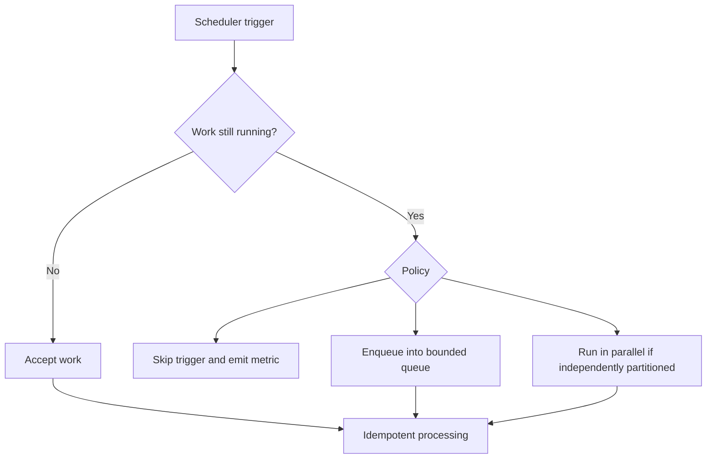
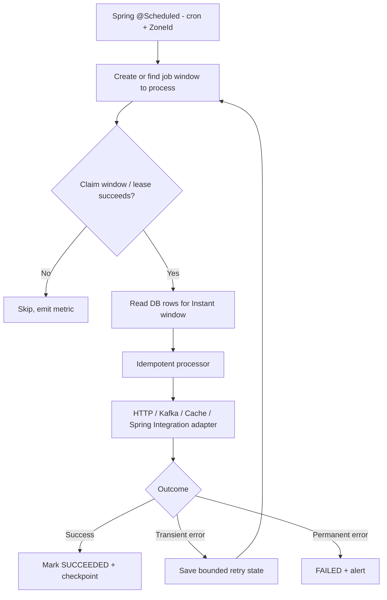

# `TaskScheduler`, Time Zones, and Overlapping Tasks

## 1. The scheduling problem in Spring Boot integrations

In the **SPRING_BOOT_INTEGRATION** module, integration flows are not triggered exclusively by HTTP requests or broker messages. Several flows must run on time-based triggers: sweeping unpublished outbox rows to Kafka, reconciling database transactions, refreshing caches, syncing data from partner APIs, downloading scheduled files, or batching data for Spring Integration adapters.

Spring Framework provides `TaskScheduler` and `@Scheduled` to trigger these jobs. However, "being scheduled" does not guarantee a task runs once, hits the right business date, or avoids overlapping runs. Separate three distinct decisions:

1. **When to trigger?** At a fixed interval, after the prior run finishes, or at a local wall-clock hour in a specific time zone.
2. **Who executes?** One thread in a JVM, one Spring Boot instance, or a single actor across the cluster.
3. **What does one run mean?** Sweeping missing data, building a report for one date, or emitting events that can be safely retried.

Example: a daily reconciliation job at 01:05 Vietnam time can run on multiple app replicas simultaneously. Without protection, two replicas read unreconciled transactions and call the partner twice. Using the JVM's default time zone can assign the report to the wrong business day. Failing partway through writing can cause duplicates on retry.

### Target outcomes

- Configure `TaskScheduler`, `@Scheduled`, and choose appropriately among `fixedRate`, `fixedDelay`, and `cron`.
- Use `ZoneId`, `Instant`, `Clock`, and calendar rules to compute execution instants and data windows, including daylight saving time (DST) effects.
- Identify sources of overlapping execution within one JVM, across replicas, after restarts, and upon lock expiration.
- Design locks, idempotency, timeouts, retries, tests, and observability for side-effecting integration jobs.

## 2. What does `TaskScheduler` do? Separating triggers from processing

`TaskScheduler` is Spring's abstraction for scheduling `Runnable` executions. Common operations:

| Scheduling method | Meaning | Use case |
|---|---|---|
| `schedule(task, Instant)` | Runs once at or after an absolute instant | One-off trigger after a wait deadline |
| `schedule(task, Trigger)` | Next run computed by `Trigger` | Cron schedules, custom schedules |
| `scheduleAtFixedRate(...)` | Schedules at a fixed start-to-start cadence | Frequent status polling |
| `scheduleWithFixedDelay(...)` | Waits a pause after the previous run ends | Polling without strict cadence chasing |
| `@Scheduled` | Declarative scheduling on a Spring bean method | Straightforward in-app jobs |

`ThreadPoolTaskScheduler` is the standard implementation using a thread pool for scheduled tasks. `@Scheduled` is declarative convenience; it still requires scheduling infrastructure and a Spring-managed bean. `@EnableScheduling` activates processing of `@Scheduled` annotations.

### 2.1. Configuring a clearly named scheduler

Example for a Spring Boot application on Spring Framework 6.x:

```java
import org.slf4j.Logger;
import org.slf4j.LoggerFactory;
import org.springframework.context.annotation.Bean;
import org.springframework.context.annotation.Configuration;
import org.springframework.scheduling.concurrent.ThreadPoolTaskScheduler;
import org.springframework.scheduling.annotation.EnableScheduling;

@Configuration
@EnableScheduling
public class SchedulingConfig {
    private static final Logger log =
        LoggerFactory.getLogger(SchedulingConfig.class);

    @Bean(name = "taskScheduler")
    ThreadPoolTaskScheduler taskScheduler() {
        ThreadPoolTaskScheduler scheduler = new ThreadPoolTaskScheduler();
        scheduler.setPoolSize(4);
        scheduler.setThreadNamePrefix("integration-scheduler-");
        scheduler.setWaitForTasksToCompleteOnShutdown(true);
        scheduler.setAwaitTerminationSeconds(30);
        scheduler.setErrorHandler(error ->
            log.error("Scheduled task failed: {}",
                error.getClass().getSimpleName())
        );
        return scheduler;
    }
}
```

- `setPoolSize(4)` allows up to four concurrent scheduled-task executions inside this instance. **It does not limit application replicas.**
- Thread names help pinpoint issues in thread dumps and logs.
- Shutdown configuration gives running tasks time to finish; align it with container/orchestrator termination grace periods and business timeouts.
- The error handler observes unhandled exceptions, yet never replaces per-job retry policies or failure states. Logs must never leak tokens, passwords, or sensitive payloads.

In Spring Boot, you can configure the auto-configured scheduler via `spring.task.scheduling.*` if you don't declare a custom bean. Depending on version and virtual-thread settings, the default scheduler type may differ; never rely on enlarging the pool to solve duplicate execution. If declaring multiple `TaskScheduler` beans, verify which bean `@Scheduled` selects.

### 2.2. Using `TaskScheduler` directly

When registering schedules dynamically at runtime, pair `CronTrigger` with `ZoneId`:

```java
import java.time.ZoneId;
import org.springframework.scheduling.TaskScheduler;
import org.springframework.scheduling.support.CronTrigger;

class RuntimeScheduleRegistry {
    private final TaskScheduler scheduler;

    RuntimeScheduleRegistry(TaskScheduler scheduler) {
        this.scheduler = scheduler;
    }

    void register(Runnable job) {
        ZoneId zone = ZoneId.of("Asia/Ho_Chi_Minh");
        scheduler.schedule(job, new CronTrigger("0 5 1 * * *", zone));
    }
}
```

`schedule(...)` returns a `ScheduledFuture<?>` (which may be `null` if the trigger produces no further executions). When re-registering jobs at runtime, track handles and `cancel(...)` prior registrations. Every `register` call can create **a new independent schedule**; forgetting to cancel old ones is a common cause of jobs running multiple times in one instance.

## 3. How do `fixedRate`, `fixedDelay`, and `cron` differ?

Suppose the first run starts at 10:00:00 and takes 80 seconds.

| Type | Meaning | What happens to the next run |
|---|---|---|
| `fixedRate = 60 s` | Targets triggers every 60 seconds from start times | Already due at 10:01:00; next run may start right when the first finishes, depending on scheduler |
| `fixedDelay = 60 s` | Waits 60 seconds after the previous run ends | Next run starts around 10:02:20 |
| `cron = "0 * * * * *"` | Evaluates top-of-minute calendar ticks | Target ticks are 10:01, 10:02...; overdue behavior depends on scheduler/trigger |

Never read `fixedRate` as "guaranteed to spawn a second concurrent thread" whenever a job runs long. On standard `ThreadPoolTaskScheduler` and `ScheduledExecutorService`, consecutive runs of the **same periodic registration** do not execute concurrently on that scheduler; an overdue run typically fires immediately after the prior run finishes. Overlaps still occur from duplicate registrations, multiple independent triggers, manual invocations, async offloading, or multiple instances.

### 3.1. Declaring via `@Scheduled`

```java
import org.springframework.scheduling.annotation.Scheduled;
import org.springframework.stereotype.Component;

@Component
class IntegrationSchedules {
    private final OutboxPublisher outboxPublisher;
    private final ReconciliationService reconciliationService;

    IntegrationSchedules(
        OutboxPublisher outboxPublisher,
        ReconciliationService reconciliationService
    ) {
        this.outboxPublisher = outboxPublisher;
        this.reconciliationService = reconciliationService;
    }

    // Runs 30 seconds after the previous sweep completes.
    @Scheduled(
        fixedDelayString = "${jobs.outbox.fixed-delay-ms:30000}",
        initialDelayString = "${jobs.outbox.initial-delay-ms:10000}"
    )
    public void pollOutbox() {
        outboxPublisher.publishPendingBatch();
    }

    // 01:05 daily in Vietnam time.
    @Scheduled(
        cron = "${jobs.reconciliation.cron:0 5 1 * * *}",
        zone = "${jobs.reconciliation.zone:Asia/Ho_Chi_Minh}"
    )
    public void reconcilePreviousDay() {
        reconciliationService.reconcilePreviousBusinessDay();
    }
}
```

`OutboxPublisher` and `ReconciliationService` are application-supplied business services, not Spring classes. `@Scheduled` methods must belong to Spring-managed beans; in typical synchronous usage, they take no arguments and finish when synchronous processing ends.

**Spring cron uses six fields:** `second minute hour day-of-month month day-of-week`. `0 5 1 * * *` means 01:05:00 daily. Do not confuse it with five-field Unix crontab.

### 3.2. Choosing a schedule for desired behavior

- **Outbox or batch cache sweeping:** `fixedDelay` pauses after each sweep finishes, avoiding chasing schedules when downstreams slow down. Across replicas, still add partitioning/claiming or independent coordination.
- **Periodic metrics or refreshes:** `fixedRate` works when you want steady cadence and know job duration stays well under budget.
- **Business-day reconciliation:** `cron` with `zone` expresses "01:05 market local time"; the job must know the exact **date/data window** to process.
- **Complex calendars, persistence, misfires, or cluster coordination:** consider Quartz with a persistent job store or an orchestration platform; bare `TaskScheduler` does not persist schedules across restarts.

## 4. Time zones: `Instant` for timestamps, `ZoneId` for business calendars

An absolute instant (`Instant`) and a local wall-clock time (`LocalDateTime`) are different concepts. `2026-11-21T01:05:00` alone does not identify a global instant without an offset or time zone; the same local timestamp string can correspond to different moments.

### 4.1. Practical rules

1. Persist event timestamps, checkpoints, and run timestamps as `Instant`/UTC or an explicit-offset type per data contract.
2. Use IANA `ZoneId` names such as `Asia/Ho_Chi_Minh` or `Europe/Berlin` instead of JVM defaults; never use a fixed offset like `+01:00` to represent a DST-observing region.
3. Configure `@Scheduled(zone=...)` in the **desired trigger time zone**, independent of the host OS time zone.
4. Compute business dates and data windows in that chosen `ZoneId`, then convert boundaries to `Instant` for querying.
5. Inject `Clock` into business logic so tests can freeze time. Avoid scattering `LocalDate.now()` across services that must agree on business dates.

Example:

```java
import java.time.Clock;
import java.time.Instant;
import java.time.LocalDate;
import java.time.ZoneId;

record TimeWindow(Instant fromInclusive, Instant toExclusive) {}

class BusinessWindowCalculator {
    private final Clock clock;
    private final ZoneId zone;

    BusinessWindowCalculator(Clock clock, ZoneId zone) {
        this.clock = clock;
        this.zone = zone;
    }

    TimeWindow previousDay() {
        LocalDate today = LocalDate.now(clock.withZone(zone));
        LocalDate businessDay = today.minusDays(1);

        return new TimeWindow(
            businessDay.atStartOfDay(zone).toInstant(),
            businessDay.plusDays(1).atStartOfDay(zone).toInstant()
        );
    }
}
```

Declare a default `Clock` bean via `Clock.systemUTC()`. When computing business days, apply the business `zone` (e.g., `Asia/Ho_Chi_Minh`) regardless of whether the JVM runs in UTC, Singapore, or Europe.

Query the DB using **half-open** intervals `[fromInclusive, toExclusive)`:

```sql
SELECT *
FROM payment
WHERE created_at >= :from_inclusive
  AND created_at <  :to_exclusive;
```

Column data types and time-zone conventions for `created_at` must stay consistent across JDBC/ORM and the DB. Never use `BETWEEN` with `"23:59:59.999"`, as differing timestamp precisions can drop or double-count midnight boundary records.

### 4.2. DST: days are not always 24 hours long

`Asia/Ho_Chi_Minh` does not currently observe daylight saving time. Yet if your system serves Europe, `Europe/Berlin` observes DST transitions. Example in 2026:

| Date in Berlin | What happens | Length from midnight to next midnight |
|---|---|---|
| 2026-03-29 | Clocks jump forward from 02:00 to 03:00 | 23 hours |
| 2026-10-25 | Clocks fall back from 03:00 to 02:00 | 25 hours |
| Ordinary day | No DST change | 24 hours |

A cron firing at **02:30 daily** can hit a non-existent local time on spring-forward day or occur twice on fall-back day. Skip/re-run policies and trigger evaluation depend on implementation, configuration, scheduler mechanics, and version. Never assume a cron expression guarantees exactly one run per business day in every time zone.

When the rule is **each business day must be processed once in net outcome**, enforce a per-day idempotency key, processed state, backfill handling, and test both DST transition days. Picking a run hour outside the transition window lowers risk, yet never replaces data-level guards.

### 4.3. Decouple trigger instant from the target work window

Suppose a job runs at 01:05 on 2026-11-21 in Vietnam to process **2026-11-20** data. If delayed until 03:00, it must still process 2026-11-20 if that was the intended run. If a container stays down across midnight and boots the next day, naively computing "yesterday" from the current clock can **permanently skip a business day**.

Therefore, durable jobs should store or receive the **scheduled business date** or `window_id` as part of the contract rather than computing `LocalDate.now()` blindly each time. A `job_windows` table can track missing, running, succeeded, and failed windows for recovery.

## 5. How do overlapping tasks arise?

Overlapping execution occurs when two runs touch the same dataset or resource before an earlier run—or its business side effects—has completed.



| Source of overlap | Example | Control |
|---|---|---|
| Multiple independent jobs in one JVM | Two `@Scheduled` methods updating one cache, or two crons on one method | Coordinate via resource/business lock |
| Manual trigger outside scheduler | Admin endpoint calls `runNow()` while cron is active | Route both through one coordinator and lock |
| Offloading to another thread | `@Scheduled` method calls `@Async` and returns immediately | Track actual work completion rather than early method return |
| Duplicate runtime registration | Creating two `ScheduledFuture`s for the same job | Manage lifecycle, cancel prior schedules, prevent duplicate registration |
| Multiple Spring Boot replicas | Two pods fire `@Scheduled` at 01:05 | Distributed locks, work claiming, or partitioning |
| Lock expires before job finishes | Instance A stalls; B acquires expired lease | Lease renewal, deadlines, fencing tokens, idempotency |
| Retries/redeliveries | Previous run published to Kafka yet lost ACK | Deduplication/idempotency by request key |
| Mid-job restart/deploy | Incomplete job while new instance boots | Persistent job state, recovery, checkpoints |

**`poolSize = 1`** serializes only tasks inside *that one* scheduler. It does not lock manual endpoints, other thread pools, other processes, or other pods. **Raising `poolSize`** improves concurrency across independent jobs, yet never prevents shared work from overlapping.

## 6. Preventing overlap inside one JVM

When work runs synchronously inside a single process, `AtomicBoolean` provides a simple guard—helpful when both cron and admin endpoints can trigger the job:

```java
import java.util.concurrent.atomic.AtomicBoolean;
import org.springframework.scheduling.annotation.Scheduled;
import org.springframework.stereotype.Component;

@Component
class LocalCacheRefreshJob {
    private final AtomicBoolean running = new AtomicBoolean(false);
    private final CacheRefreshService refreshService;

    LocalCacheRefreshJob(CacheRefreshService refreshService) {
        this.refreshService = refreshService;
    }

    @Scheduled(fixedDelayString = "${jobs.cache.fixed-delay-ms:60000}")
    public void scheduledRefresh() {
        refreshIfIdle();
    }

    public boolean refreshIfIdle() {
        if (!running.compareAndSet(false, true)) {
            return false; // Another run is already active on this instance.
        }
        try {
            refreshService.refreshSynchronously();
            return true;
        } finally {
            running.set(false);
        }
    }
}
```

`CacheRefreshService` is an example business service. `finally` must run only after **all actual refresh work completes**. If `refreshSynchronously()` merely submits to an executor and returns a `CompletableFuture`, the guard resets too early: two background runs can overlap while `running` already flipped back to `false`. For genuinely async execution, hold state until future completion (including errors), or feed a bounded serial queue/worker.

Limitations of an in-JVM guard:

- Does not coordinate across JVMs/pods.
- Resets on application restart.
- Does not make operations idempotent.
- Does not decide whether rejected triggers should be skipped, queued, or backfilled.

For a synchronous `fixedDelay` job running solely on one scheduler, internal non-overlap comes from post-completion scheduling. The guard remains useful when **additional trigger entrypoints exist**, yet never counts as distributed protection.

## 7. Multiple instances: distributed locks, leases, and work claiming

When two Spring Boot replicas both enable `@EnableScheduling`, normally **each replica runs its own scheduler**. With the same cron, both trigger at 01:05. Decide:

1. Should only one instance run the whole job?
2. Or can multiple instances claim independent batches?
3. If the lock-holding instance dies mid-run, how does work recover?

### 7.1. Cluster-wide distributed lease for a job

One approach stores timed locks (*leases*) in a shared DB or an appropriate lock service. Example PostgreSQL table:

```sql
CREATE TABLE scheduler_lease (
    job_name       VARCHAR(128) PRIMARY KEY,
    owner_id       VARCHAR(128),
    lease_until    TIMESTAMPTZ NOT NULL,
    generation     BIGINT NOT NULL DEFAULT 0
);
```

Each job name has a row in the table. When scheduled time arrives, an instance attempts to acquire the lease via an **atomic** conditional DB update:

```sql
UPDATE scheduler_lease
SET owner_id    = :owner_id,
    lease_until = CURRENT_TIMESTAMP + INTERVAL '5 minutes',
    generation  = generation + 1
WHERE job_name = :job_name
  AND lease_until < CURRENT_TIMESTAMP
RETURNING generation;
```

This is a **PostgreSQL** example illustrating atomic claiming, not portable multi-DB SQL. You must seed initial rows, manage claim transactions, use DB clock time, handle empty returns (0 rows), renew leases, release conditionally on owner/generation, and block stale lock holders. If a job can run past five minutes, safely renew the lease or size TTL accordingly. Never unconditionally delete/overwrite the current holder's lock on release.

**Leases do not guarantee "only one process is active" after expiry.** Instance A can pause (GC pause or network stall), its lease expires, B takes the lease, and then A resumes. Both A and B can emit side effects. Add:

- **Fencing tokens:** monotonically increasing `generation` per claim; data stores/downstreams must reject writes carrying stale tokens. Incrementing a counter in the lock table without checking it at write time provides no real fencing.
- **Idempotency:** unique constraints, request keys, deduplication at DB, API, or broker consumers.
- **Timeout control and recovery:** track which jobs finished, stalled, or need re-runs.

Distributed lock libraries such as ShedLock can help multiple replicas share a persistent store, provided you understand `lockAtMostFor`, `lockAtLeastFor`, jobs outliving locks, and skipped-run visibility. They do not automatically make DB, Kafka, or partner API calls exactly-once.

### 7.2. Claiming individual records instead of locking the whole batch

For an outbox or DB task queue, multiple workers can execute concurrently **if they claim disjoint rows**. In PostgreSQL, combine a short transaction with `SELECT ... FOR UPDATE SKIP LOCKED` and status updates; design retries, leases, and stuck-row recovery upfront. Kafka consumer groups/partitions likewise distribute messages across consumers natively; never build a custom distributed cron lock to replace broker-managed consumption.

Row-level claiming fits high-throughput independent items. Job-wide locks fit sequential aggregation tasks like end-of-day book closing.

## 8. Idempotency and business keys: avoiding duplicate outcomes

To let a job safely re-run after crashes, retries, or backfills without corrupting state, define a business-level **idempotency key**:

| Job | Example key | Constraint |
|---|---|---|
| Daily revenue report | `(job_name, business_date, tenant_id)` | One safely updatable result per day/tenant |
| Payment reminder emails | `(invoice_id, reminder_stage)` | Never send the same reminder stage twice |
| Outbox publishing | `event_id` | Constant across retries; consumer deduplicates by ID |
| Paginated API sync | `(source, cursor, sync_generation)` | Checkpoint per window or sync generation |
| Partner file download | `(partner_id, file_id, checksum)` | Re-downloadable without double-importing records |

A status table can store `job_name`, `window_id`, `status` (`PENDING`, `RUNNING`, `SUCCEEDED`, `FAILED`), `attempt`, `checkpoint`, `last_error_code`, and timestamps. A unique constraint on `(job_name, window_id)` prevents creating two identical **logical job runs**.

Marking `RUNNING` beforehand is not enough on its own: if the process dies after sending an external request before recording `SUCCEEDED`, retrying still doesn't know if downstream ran. Use **downstream-recognized** idempotency keys, outboxes/inboxes, deduplication, and status verification. No scheduler guarantees exactly-once across independent systems.

### 8.1. Contract between scheduler and business service

Instead of letting the service compute "yesterday" on every call, have the orchestrator pass a claimed window:

```java
record JobWindow(String jobName,
                 String windowId,
                 java.time.Instant from,
                 java.time.Instant to) {}

interface ReconciliationProcessor {
    // Must be safe to re-run for the same windowId with clear checkpoints and states.
    void reconcile(JobWindow window);
}
```

`windowId` might be `payments-2026-11-20-Asia_Ho_Chi_Minh` per naming convention. The name stores cleanly in the job table while queries still use `Instant` for `from` and `to`. On success, the coordinator commits `SUCCEEDED` through an explicit transaction/state machine rather than inferring success from a Java method return alone.

## 9. Retries, timeouts, shutdown, and backfills

Jobs talking to DBs, caches, Kafka, or HTTP hit transient failures. Yet retries at the scheduler layer can multiply retries already configured in Kafka producers, HTTP clients, consumers, or services. Define an **end-to-end budget**.

| Situation | Appropriate policy |
|---|---|
| Transient timeout calling partner HTTP | Bounded retries with backoff/jitter if idempotent, under clear deadline |
| DB constraint shows outcome already persisted | Inspect state by idempotency key; never retry blindly |
| Auth/authorization failure | Alert on config/permission error and stop automatic retries |
| Kafka broker temporarily unavailable | Keep outbox/checkpoint state for safe resend with retention limits and alerts |
| Job exceeds expected duration | Enforce I/O timeouts, alert "running too long," manage lock leases |
| App restarts before cron tick | Create/detect missed windows from persistent store and backfill within bounds |
| Trigger fires while job is running | Choose skip, queue, or shard; record skipped count metric |

**Bare `TaskScheduler` does not persist missed schedules to a DB.** If the app is down at 01:05, that cron run is missed. For mandatory daily reconciliation, use one of:

- Persistent job windows with a worker sweeping `PENDING`/`FAILED` windows.
- A persistent scheduler such as Quartz with proper misfire configuration.
- An external platform scheduler (Kubernetes CronJob or orchestrator) that signals execution while business state/idempotency remains in the app.

After a deploy or multi-day outage, never backfill hundreds of windows at once just because cron ticks were missed. Enforce batch sizes, concurrency caps, downstream quotas, ordering rules, and explicit pause/resume controls.

**Shutdown:** on `SIGTERM`, stop accepting new work, let active tasks finish within the deadline, and persist checkpoints. If force-stopped mid-run, leases and job state enable recovery; they do not replace idempotent logic. Never assume `setWaitForTasksToCompleteOnShutdown(true)` forces Kubernetes to wait forever.

## 10. Observing schedules and processing effectiveness

Key metrics and logs must distinguish **planned trigger time** from **actual start time**, and **trigger count** from **completed business windows**.

| Signal | Purpose |
|---|---|
| `scheduler.trigger.delay` | Measures how late jobs start relative to schedule |
| `job.execution.duration` | Measures runtime and spots slow jobs |
| `job.execution.result` | Succeeded, failed, skipped due to lock, canceled |
| `job.pending.windows` | Backlog of unprocessed days/windows |
| `job.lock.acquire.failure` | Shows multiple instances contending for the same work |
| `job.running.age` | Alerts on long-running stuck executions |
| `job.retry.count` | Catches retry spikes or recurring config errors |
| `job.last.success.timestamp` | Detects jobs that haven't succeeded for too long |

Sample log for a business window:

```text
job=reconcile_payments
window_id=2026-11-20
zone=Asia/Ho_Chi_Minh
scheduled_at=2026-11-20T18:05:00Z
attempt=2
result=SUCCEEDED
duration_ms=18452
```

Here `scheduled_at` is 01:05 on 2026-11-21 Vietnam time expressed in UTC. `attempt=2` indicates a retry of the same `window_id`, not a different business day.

Metric tags should use a bounded set of job names and normalized outcomes. Never put customer IDs, credentials, tokenized URLs, raw error payloads, or millions of `window_id` values into high-cardinality metric labels. Keep `window_id` details in access-controlled job state and logs; mask sensitive payloads in logs and traces.

## 11. Testing dates, schedules, overlaps, and recovery

### 11.1. Testing date logic with a fixed `Clock`

Injecting `Clock` makes time inputs deterministic:

```java
Clock clock = Clock.fixed(
    java.time.Instant.parse("2026-11-20T18:10:00Z"),
    java.time.ZoneOffset.UTC
);

BusinessWindowCalculator calculator =
    new BusinessWindowCalculator(
        clock, java.time.ZoneId.of("Asia/Ho_Chi_Minh")
    );

TimeWindow window = calculator.previousDay();
// Currently 01:10 on Nov 21 in Vietnam.
// Window to process: [2026-11-19T17:00:00Z,
//                     2026-11-20T17:00:00Z)
```

`Clock.fixed` pins time calculations **inside business logic**; it does not control `@Scheduled` or when `TaskScheduler` actually fires. Testing real scheduling requires scheduler infrastructure, proper time control, or unit-testing `Trigger` directly.

### 11.2. Minimum test suite

| Test case | Setup | What to verify |
|---|---|---|
| Cron time zone | App runs on UTC JVM, cron uses `Asia/Ho_Chi_Minh` | Fires at Vietnam hour, not host hour |
| 23-hour DST day | `Europe/Berlin` window on 2026-03-29 | `Instant` span is 23 hours; never assume 24 hours |
| 25-hour DST day | `Europe/Berlin` window on 2026-10-25 | Span is 25 hours; no missing/duplicate boundary records |
| `fixedDelay` with slow job | Job exceeds period | Next run waits after completion per semantics |
| Two triggers in one JVM | Cron and manual trigger collide | Guard or coordinator enforces skip/queue policy |
| Two replicas sharing DB | Both fire simultaneously | Only one instance claims the initial job/window lease |
| Lease expires mid-job | A stalls long, B takes lease, A resumes | Fencing/idempotency rejects A's late writes |
| Crash after DB write | Kill before updating job state | Retry recovers without creating duplicate business records |
| Lost Kafka ACK | Publish succeeds yet client sees error | `eventId` stays unchanged; consumer/outbox deduplicates |
| Restart after missed cron | Stop app across trigger time, then start | Backfill locates the incomplete window |
| Downstream 401/403 | HTTP API denies auth | Stops retrying infinitely; flags job for intervention |
| Mid-job shutdown | Send `SIGTERM` while running | Bounded stop; checkpoints/leases recover cleanly |

For concurrency tests, never just mock a scheduler call and count invocations. Run **two separate contexts/coordinators** against a real lock store, synchronize them to race on the same window, and inspect final DB/downstream state. For crash recovery, compare before/after crash states and final logical record counts.

### 11.3. Separating test levels

- **Unit tests:** window math, idempotency keys, skip/queue selection policies, parameter validation.
- **Integration tests:** `@Scheduled`/`TaskScheduler`, Spring context, DB transactions, leases, time-zone rules, Kafka/HTTP adapters.
- **Failure tests:** process crashes, pod restarts, broker outages, HTTP timeouts, expired leases, and half-completed work.

Never rely on long `Thread.sleep(...)` calls in unit tests to "prove cron works"; use simulated schedules/fixed clocks for logic and bounded polling assertions in integration tests.

## 12. Integration flow design pattern with a scheduler

A reconciliation architecture that prevents duplicate runs and supports recovery:



Boundaries to implement separately:

- **Schedule:** cron defines when to check for due windows; one cron tick does not equal one business unit.
- **Coordination:** persistent state, claims/leases, and missed-window handling; every entrypoint (cron, manual, backfill) goes through the same coordinator.
- **Data contract:** consistent `window_id`, `Instant` bounds, event IDs, schemas, and statuses.
- **Transactions:** outbox or progress state to prevent lost events between DB and Kafka; never assume DB transactions span partner APIs.
- **Errors and retries:** deadlines, backoff, attempt caps, idempotency, distinguishing transient errors from config errors.
- **Observability:** know which windows are pending, which jobs are active, who holds leases, and which side effects emitted.

This model keeps `TaskScheduler` focused strictly on triggering, while consistency and recovery are guaranteed by the coordination and business layers.

## 13. Production scheduling checklist

- [ ] Selected `fixedRate`, `fixedDelay`, or `cron` accurately for the job's semantics.
- [ ] Declared `zone` with an IANA time zone rather than relying on host defaults.
- [ ] Used `Instant` for timestamps; computed business dates via `ZoneId` and half-open intervals.
- [ ] Tested DST transition days when serving DST regions; never assumed 24-hour days.
- [ ] Separated in-JVM coordination from multi-instance coordination; handled manual runs, restarts, and duplicate registrations.
- [ ] For leases, defined TTL, renewal, owner, fencing, and stale-holder handling after expiry.
- [ ] Defined `job_name/window_id`, idempotency keys, and durable state for backfillable jobs.
- [ ] Configured HTTP, DB, cache, and Kafka timeouts and retries within an end-to-end budget.
- [ ] Prevented uncontrolled replay of write side effects; used outbox/inbox/dedup where needed.
- [ ] Tested multi-replica races, restarts, DST, downstream failures, and shutdown.
- [ ] Exported metrics for last success, backlog, duration, trigger delay, skipped locks, and retries; masked sensitive log data.

### Self-check questions

1. For an 80-second job, how do `fixedRate=60s` and `fixedDelay=60s` differ? Can you assume `fixedRate` always spawns concurrent threads for the same task?
2. Why does increasing `ThreadPoolTaskScheduler`'s `poolSize` not stop two pods from running the same cron?
3. When a 02:30 cron in `Europe/Berlin` hits a DST change day, how do you guarantee each business day produces exactly one outcome?
4. Which trigger points does `AtomicBoolean` guard? If the method submits a `CompletableFuture` and returns early, does the guard remain accurate?
5. If instance A holds a lease and pauses, its lease expires so B takes over, and A later resumes, what extra mechanism is needed?
6. Why does restarting a scheduler not automatically catch up every missed cron tick?
7. In a DB → outbox → Kafka flow, what allows safe retries after network errors without duplicating business outcomes?

**Key takeaway:** `TaskScheduler` decides **when to attempt a trigger**; `ZoneId` schedules define **business hours**; while locks, durable state, and idempotency determine **who processes which window and what happens on replay**. All three must be designed together for real-world Spring Boot integrations.
