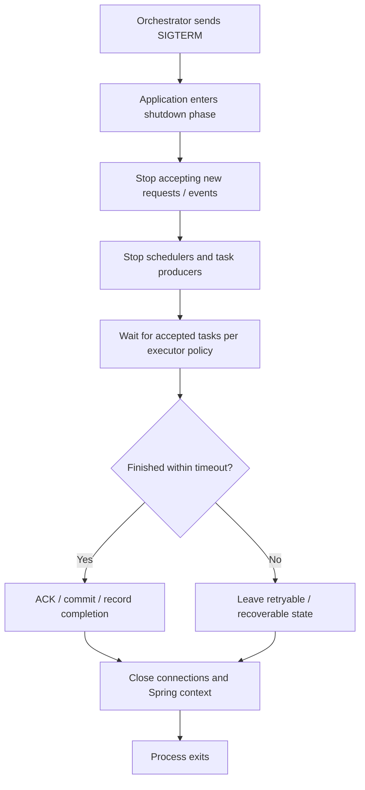
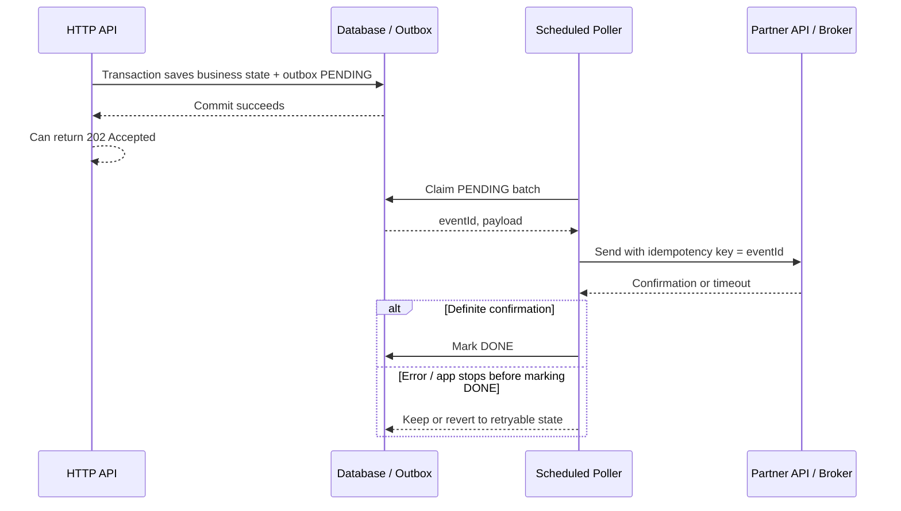

# Task Termination and Wait Timeouts During Application Shutdown

## Context and objectives

In **Spring Boot Integration**, an HTTP request can trigger `@Async` to call a partner API, a `@Scheduled` task can sweep an outbox table to publish messages, or a broker listener can offload work to a thread pool to write to a database. During new deployments, scale-ins, or `SIGTERM`, the application must **stop accepting new work, let in-flight work finish within a bounded window, and cleanly close resources**. Without this design, requests can report success while work never actually finishes, or broker messages get acknowledged without persisting business state.

This topic belongs to the **Async Tasks** chapter of the `SPRING_BOOT_INTEGRATION` module, focusing on coordinating the Spring Boot lifecycle, executors, schedulers, and transaction/ACK boundaries across integrated systems.

After this lesson, you will be able to:

1. Distinguish **stopping intake**, **allowing in-flight tasks to finish**, **canceling/rejecting tasks**, and **maximum shutdown wait timeouts**.
2. Configure shutdown for `@Async`, `@Scheduled` in Spring Boot, and custom `ThreadPoolTaskExecutor`/`ThreadPoolTaskScheduler` beans.
3. Align timeout budgets across the application, HTTP clients, brokers, databases, and container orchestration.
4. Design crash-safe restart recovery, and test completion states, timeouts, and safe replay without duplicating side effects.

> **Version scope:** Configuration examples target **Spring Boot 3.5.x / Spring Framework 6.2.x** and Java 17+ with **platform threads**. Properties and lifecycles may vary on Boot 4.x, other Framework versions, or with virtual threads enabled; always check resolved dependencies and actual executor types in the application context.

## 1. "Stopping" and "waiting" are two separate decisions

Suppose the system receives an invoice-issuance request:

```text
HTTP POST /invoices
     |
     v
Application service --submit--> @Async / taskExecutor
                                   |
                                   v
                           Call partner HTTP
                                   |
                                   v
                           Update database
```

When the application context begins closing, three buckets of work may exist:

| State | Meaning | Shutdown question |
|---|---|---|
| **Running / in-flight** | A worker picked up the task and is calling DB/HTTP/broker. | Wait for completion? For how long at most? If interrupted, does it clean up safely? |
| **Queued** | The executor accepted the task, yet no worker has started it. | Drain the queue, or reject/cancel and recover after restart? |
| **About to be submitted** (*new submissions*) | HTTP endpoints, schedulers, or message listeners may still generate tasks. | Who closes the intake gate, and how are rejected submissions handled? |

Commonly confused actions:

- **Stop intake**: cease accepting new tasks or promising acceptance. For brokers, pause/stop listeners; for HTTP, gracefully shut down the web server and gate internal producers.
- **Drain**: allow already-accepted tasks to complete. Decide whether to drain the queue too or only active running tasks.
- **Cancel/interrupt**: signal cancellation. It does **not** reliably abort an in-flight HTTP call, JDBC query, or uncooperative thread immediately.
- **Await termination**: the shutdown thread waits up to a limit for the executor to terminate. Timing out and *giving up waiting* **does not mean** all tasks stopped cleanly.

`@Async` only dispatches execution to an `Executor`. It never provides a durable queue, crash retries, or "exactly once." `@Scheduled` likewise does not record missed schedules while the app is stopped.

## 2. Shutdown sequence and real-world limits

Controlled shutdown should be viewed as a dependency chain:



This is the **desired logical sequence**; Spring does not wrap HTTP servers, listeners, executors, databases, and brokers across arbitrary libraries into one atomic shutdown transaction. Spring closes the application context via `SmartLifecycle`, publishes `ContextClosedEvent`, stops beans by phase, and then destroys beans. Identify which components produce tasks, which consume them, and which hold resources that running tasks still need.

In containers/Kubernetes, the flow typically looks like:

1. Pod/container receives termination signal (normally `SIGTERM`); traffic routing stops per orchestration lifecycle, potentially with slight propagation lag.
2. Spring Boot graceful shutdown stops accepting new HTTP requests and drains in-flight requests up to the **web server phase** budget.
3. Listeners, schedulers, executors, and other `SmartLifecycle` beans stop in phase order per config.
4. Once the orchestrator's grace period expires, the process can be force-killed via `SIGKILL`; `@PreDestroy`, `finally` blocks, and cancellation callbacks are **not guaranteed to run**.

**Never rely on a single hook** like `@PreDestroy` to finish all work. That hook might run after dependencies closed or get cut off on timeout; combine built-in executor lifecycle settings with durable job state for recovery.

## 3. Configuring Spring Boot for graceful shutdown

### 3.1. Distinguishing three timeout groups

| Property | Applies to | Does NOT mean |
|---|---|---|
| `server.shutdown: graceful` | Web server: stops new requests and drains active requests per lifecycle. | Waiting for all `@Async` tasks or broker messages. |
| `spring.lifecycle.timeout-per-shutdown-phase` | Maximum wait for **each** `SmartLifecycle` stop phase. | A single global deadline across the whole process and every bean. |
| `spring.task.execution.shutdown.await-termination` + `await-termination-period` | Boot **auto-configured** executor in compatible `ThreadPoolTaskExecutor` setups. | Tasks survive restarts or custom executors inherit this setting. |
| `spring.task.scheduling.shutdown.await-termination` + `await-termination-period` | Boot auto-configured scheduler. | Missed runs are saved or future periodic runs finish. |

Illustrative config for an app primarily running platform threads:

```yaml
# application.yml — Spring Boot 3.5.x, example configuration
server:
  shutdown: graceful

spring:
  lifecycle:
    timeout-per-shutdown-phase: 30s
  task:
    execution:
      thread-name-prefix: integration-async-
      pool:
        core-size: 4
        max-size: 8
        queue-capacity: 100
      shutdown:
        await-termination: true
        await-termination-period: 20s
    scheduling:
      pool:
        size: 2
      shutdown:
        await-termination: true
        await-termination-period: 5s
```

**How to read this:** the web server uses graceful shutdown; the auto-configured executor waits up to an illustrative **20 seconds** for completion; the scheduler waits up to **5 seconds**. Never treat these as a guarantee the app definitely stops within 20 or 30 seconds: `timeout-per-shutdown-phase` applies per phase, custom beans run their own destroy hooks, and the container deadline is an independent ceiling. These figures **illustrate configuration mechanics**, not universal SLO recommendations.

> **Verify the real executor:** When an application declares its own `Executor`/`AsyncConfigurer`, Boot may skip auto-configuring the default executor. `@Async("someExecutor")` targets that named bean, so `spring.task.execution.shutdown.*` **does not automatically apply** to custom executor beans. Likewise, Boot scheduler properties do not automatically apply to manually instantiated schedulers.

### 3.2. Orchestrator grace period length

For example, a Kubernetes Pod sets:

```yaml
spec:
  terminationGracePeriodSeconds: 60
```

**60 seconds** spans from Pod termination start until forced kill, including any `preStop` hook. It must cover traffic-routing propagation lag, Spring shutdown phases, active tasks, and resource closing. Never assume `20 + 5 + 30 = 55` is always valid math, since phases can overlap or chain differently in practice; measure **actual shutdown duration** under load and leave safety headroom.

In Spring Boot 3.5, web server graceful shutdown must be enabled with `server.shutdown=graceful`. Never equate readiness reporting `DOWN` with every broker listener having stopped; verify each integration stream individually.

## 4. Configuring lifecycle properly on self-managed executors

When an integration app needs a dedicated pool for partner calls, name it clearly so you know exactly which executor `@Async` uses. Example for **ThreadPoolTaskExecutor** in Spring Framework 6.2:

```java
import org.springframework.context.annotation.Bean;
import org.springframework.context.annotation.Configuration;
import org.springframework.scheduling.annotation.EnableAsync;
import org.springframework.scheduling.concurrent.ThreadPoolTaskExecutor;

@Configuration(proxyBeanMethods = false)
@EnableAsync
class IntegrationAsyncConfiguration {

    @Bean("integrationExecutor")
    ThreadPoolTaskExecutor integrationExecutor() {
        ThreadPoolTaskExecutor executor = new ThreadPoolTaskExecutor();
        executor.setThreadNamePrefix("integration-outbound-");
        executor.setCorePoolSize(4);
        executor.setMaxPoolSize(8);
        executor.setQueueCapacity(100);

        // Once accepted, drain queued tasks too on destroy.
        executor.setWaitForTasksToCompleteOnShutdown(true);
        // Wait at most 20s before dependent resources begin closing.
        executor.setAwaitTerminationSeconds(20);
        return executor;
    }
}
```

Two key settings explained:

- `setWaitForTasksToCompleteOnShutdown(true)` chooses `ExecutorService.shutdown()` behavior: it avoids interrupting active tasks and drains tasks **already in the queue**. When `true`, the executor skips early coordinated lifecycle stop and handles completion during bean destruction.
- `setAwaitTerminationSeconds(20)` makes the **bean-destruction thread wait up to** 20 seconds before moving on to close other resources. Setting `setWaitForTasksToCompleteOnShutdown(true)` without an await timeout risks letting tasks keep running while Spring tears down DB clients, HTTP clients, or dependent beans.

`awaitTermination` expiring merely makes shutdown **stop waiting**; it is not a reliable task kill switch. If tasks remain running, Spring proceeds to destroy resources and those tasks can fail. Conversely, the default immediate path (`waitForTasksToCompleteOnShutdown=false`) can interrupt running tasks and discard unstarted queued tasks. Decide your policy upfront: **drain the queue** or **stop fast and replay from durable storage**.

### 4.1. Example `@Async` method with observable outcomes

```java
import java.util.concurrent.CompletableFuture;
import org.springframework.scheduling.annotation.Async;
import org.springframework.stereotype.Service;

record OutboundEvent(String eventId, String payload) {}

interface PartnerGateway {
    void deliver(OutboundEvent event); // HTTP client with its own timeouts
}

@Service
class OutboundDeliveryService {
    private final PartnerGateway partnerGateway;

    OutboundDeliveryService(PartnerGateway partnerGateway) {
        this.partnerGateway = partnerGateway;
    }

    @Async("integrationExecutor")
    public CompletableFuture<Void> send(OutboundEvent event) {
        partnerGateway.deliver(event);
        return CompletableFuture.completedFuture(null);
    }
}
```

With `@EnableAsync`, calls from **another bean through the Spring proxy** run on the named executor. Failures in `PartnerGateway` complete the caller's returned future **exceptionally**; callers must observe/handle that state when reporting completion. If the method returns `void`, async exceptions never reach the caller; you need `AsyncUncaughtExceptionHandler` or dedicated status tracking. Calling `this.send(...)` inside the same bean in default proxy mode **does not** activate `@Async`.

**Never return HTTP 200 meaning "successfully delivered"** merely because calling `send()` returned a `CompletableFuture`. If an API accepts work for deferred execution, HTTP 202 is appropriate **only when** work is durably persisted or the contract explicitly permits loss. A future living solely in RAM cannot survive crashes.

### 4.2. Stopping new submissions before draining

With `setWaitForTasksToCompleteOnShutdown(true)`, the executor can keep accepting submissions during parts of context closing until destroy runs. Therefore, shut down **task producers** first: web ingress, broker listeners, polling jobs, or an application-level submission gate. `ThreadPoolTaskExecutor.setStrictEarlyShutdown(true)` (Spring Framework 6.1.4+) adjusts early-shutdown signaling in certain modes; flags like `setWaitForTasksToCompleteOnShutdown(true)` or `setAcceptTasksAfterContextClose(true)` can **override its semantics**. Never combine these flags without checking exact lifecycle behavior for your version.

An intake gate can use an `AtomicBoolean accepting`. Upon `ContextClosedEvent`, set `accepting=false`; submission code returns a **controlled rejection** or leaves broker messages un-ACKed. This is an app-level guardrail, not a replacement for stopping containers/listeners. Never convert `TaskRejectedException` into "accepted/done"; producers must know to retry or persist.

## 5. `@Scheduled` and recurring tasks during application shutdown

Schedulers differ from one-shot executors: they decide **when the next execution runs**. On shutdown, apps typically need to:

1. Avoid starting a new polling cycle.
2. Let the current polling cycle finish within a reasonable limit, or leave unfinished items for the next run to pick up.
3. Avoid trying to "catch up" every cron/`fixedRate` tick missed while the app was down.

On `ThreadPoolTaskScheduler`, two native policies merit checking:

```java
scheduler.setContinueExistingPeriodicTasksAfterShutdownPolicy(false);
scheduler.setExecuteExistingDelayedTasksAfterShutdownPolicy(false);
```

The first defaults to `false`, preventing periodic loops from continuing after shutdown; the second defaults to `true` at the scheduler layer, so explicitly set `false` if you want to **discard delayed callbacks whose time hasn't arrived**. These flags apply only to supporting schedulers/shutdown paths, not arbitrarily across all implementations. For Boot's auto-configured scheduler, start with `spring.task.scheduling.shutdown.*` and verify actual behavior.

Example short-batch outbox polling job:

```java
import org.springframework.scheduling.annotation.EnableScheduling;
import org.springframework.scheduling.annotation.Scheduled;
import org.springframework.stereotype.Component;

@Component
class OutboxPoller {
    private final OutboxDispatcher dispatcher;

    OutboxPoller(OutboxDispatcher dispatcher) {
        this.dispatcher = dispatcher;
    }

    @Scheduled(fixedDelayString = "${integration.outbox.poll-delay-ms:1000}")
    void dispatchBatch() {
        dispatcher.dispatchAtMost(50);
    }
}
```

The app must place `@EnableScheduling` on a configuration bean to activate scheduling. `dispatchAtMost(50)` is an **illustrative business method**; capping batches at 50 items bounds each cycle's runtime. When stopped mid-cycle, unfinished items remain in the outbox for the next run. If a batch takes 10 minutes while shutdown leaves 20 seconds, never rely on the scheduler finishing every item.

### 5.1. Virtual threads change pool assumptions

On Java 21+ with `spring.threads.virtual.enabled=true`, Spring Boot may auto-configure `SimpleAsyncTaskExecutor` and `SimpleAsyncTaskScheduler` using **virtual threads**; pool-size and queue-capacity properties meant for `ThreadPoolTaskExecutor` or `ThreadPoolTaskScheduler` may no longer apply. Virtual threads do not make tasks durable; they remain bound to the process lifecycle. Inspect which concrete executor/scheduler beans are wired, their termination behavior, and enforce network/DB timeouts. Never extrapolate "pool drains 100 queued tasks" to `SimpleAsyncTaskExecutor` when no such queue exists.

## 6. When running tasks are interrupted or wait too long

### 6.1. Cooperative cancellation

Fast shutdown paths may interrupt threads. Java does not guarantee every I/O driver or third-party library reacts immediately to interruption. In processing loops, add explicit checkpoints:

```java
void processBatch(List<OutboundEvent> events) {
    for (OutboundEvent event : events) {
        if (Thread.currentThread().isInterrupted()) {
            // Stop before claiming more work; unfinished items stay in outbox.
            return;
        }

        deliverWithBoundedTimeout(event);
        markDeliveredAfterSuccess(event.eventId());
    }
}
```

`deliverWithBoundedTimeout` and `markDeliveredAfterSuccess` are illustrative domain steps, not built-in APIs. For blocking calls that throw `InterruptedException`, restore the interrupt flag when not rethrowing:

```java
try {
    waitForExternalSignal();
} catch (InterruptedException ex) {
    Thread.currentThread().interrupt();
    return; // or throw an exception signaling safe stop
}
```

Never catch and ignore `InterruptedException` inside an infinite loop. Roll back uncommitted transactions; if external HTTP applied a side effect without returning a response, subsequent retries must reuse the same **idempotency key** to avoid double issuance.

### 6.2. Distinguishing timeouts at each layer

| Timeout | What does it bound? | What is **NOT** guaranteed |
|---|---|---|
| HTTP connect/read/response timeout | Caps partner connection or response wait per client config. | Does not guarantee the partner never received the request or skipped side effects. |
| JDBC query/transaction timeout | Caps query/transaction wait per driver and DB. | Does not mean the entire business workflow stops on time. |
| `future.get(5, SECONDS)` | Caps how long the **caller waits** on the future. | Does not stop the running background task. |
| `CompletableFuture.orTimeout(...)` | Completes the future exceptionally when the deadline expires. | Does not reliably interrupt/halt background computation or I/O. |
| `Future.cancel(true)` | Requests cancellation, possibly interrupting depending on future type/implementation. | Does not guarantee tasks or external side effects stopped. Note `CompletableFuture.cancel(...)` does not interrupt execution. |
| Executor `await-termination-period` | Caps how long the shutdown thread waits on the pool. | Does not roll back work, persist tasks durably, or guarantee tasks vanished. |
| `terminationGracePeriodSeconds` | Caps grace period before container force-kill. | Runs zero cleanup on `SIGKILL`; owns no business retries. |

When budgeting shutdown, keep **per-I/O deadlines** shorter than the remaining drain window. An HTTP call with a 120-second response timeout cannot reliably finish inside a 20-second executor wait. Size app timeouts to business goals with bounded retries and backoff—never initiate long downstream calls right as the container grace period is expiring.

## 7. Designing restart recovery: graceful shutdown alone cannot prevent lost work

Suppose a task enters `ThreadPoolTaskExecutor` and the process is killed when the grace period ends. The in-RAM queue vanishes. Even with `setWaitForTasksToCompleteOnShutdown(true)`, unstarted tasks do not magically reappear after restart. When **at-least-once** guarantees or zero lost work are required, back work with a durable source.

### 7.1. Outbox pattern for HTTP/database-originated tasks



A minimal work table includes a unique `event_id`, `payload`, `status` (`PENDING`/`IN_PROGRESS`/`DONE`), `attempt_count`, `next_attempt_at`, and lease/claim fields for multi-instance deployments. Flows need **atomic claims**, **expirable leases**, and reversion back to `PENDING` for crashed in-flight claims. If downstream succeeded right before the process died prior to `mark DONE`, the outbox may redeliver; receivers must enforce idempotency on `event_id`.

### 7.2. Broker-driven pattern for Kafka/RabbitMQ/Pulsar

For broker listeners, the same rule holds:

- Before side effects complete, **never ACK/commit offsets as processed** simply because work entered an executor. `submit()` succeeding means only RAM queueing.
- When ACKing after persisting durable state (such as an inbox/outbox), recovery relies on that persisted table and a dedicated dispatcher.
- When ACKing after side effects, crashing between side effect and ACK causes **redelivery**; enforce idempotency/unique constraints at the data layer.
- Each broker library handles stopping listeners, rebalances, timeouts, and redeliveries differently. Never treat `spring.task.execution.shutdown.*` as a universal shutdown policy for listener containers.

**Common buggy example:**

```java
@KafkaListener(topics = "orders")
public void onOrder(String json) {
    integrationExecutor.execute(() -> partnerGateway.deliver(parse(json)));
    // Method returns: container may consider the record processed and commit offset,
    // while the background task still sits in RAM or hasn't run yet.
}
```

This snippet illustrates the boundary; running it requires Kafka dependencies and supporting components. Choose one of two safe paths: complete work before ACKing/committing, or **persist work durably before ACKing** so another dispatcher executes it later. For money, orders, or inventory, shutdown draining merely makes deploys smoother; crash-restart recovery must still be built into the design.

## 8. Repeatable shutdown testing

Reading "Spring context closed" in logs never proves tasks finished. Test **ordering, wait times, and durable state**. A solid test suite covers:

| ID | Scenario | Passing criteria to observe |
|---|---|---|
| **S01** | 1 task running 1–2s; shutdown triggered mid-run. | Shutdown waits for completion within budget; side effect runs exactly once. |
| **S02** | 1 running task, multiple queued; shutdown in queue-drain mode. | Accepted tasks execute per policy without silent loss; shutdown stays within orchestration deadline. |
| **S03** | Submit new task after closing intake. | Returns controlled rejection/retryable error; never returns "accepted" unless durably stored. |
| **S04** | Downstream HTTP hangs past timeout. | Worker exits or fails at timeout; event remains retryable; shutdown never hangs forever. |
| **S05** | Kill process with `SIGKILL` while RAM tasks remain. | Unfinished tasks recover from outbox/broker without relying on `@PreDestroy`. |
| **S06** | Crash right after DB commit, before ACK or outbox `DONE`. | Work is picked up again, yet idempotency prevents applying side effects twice. |
| **S07** | `@Scheduled` running while next tick becomes due. | No new polling cycle starts after intake closes; remaining items sweep after restart. |
| **S08** | Scale down one instance among multiple replicas. | Remaining instances keep running; leases/partitions/ownership neither lose nor duplicate effects. |
| **S09** | `spring.threads.virtual.enabled=true` enabled. | Verify actual executor/scheduler types; never assume platform-thread pool properties apply. |

### 8.1. Testing `ThreadPoolTaskExecutor` lifecycle waiting

Using `CountDownLatch` to hold an active task while observing `ApplicationContext.close()`, referencing `integrationExecutor` from section 4 (requires JUnit 5, concurrency utilities, and Spring Context imports):

```java
@Test
void waitsForRunningTaskBeforeClosingExecutor() throws Exception {
    var context = new AnnotationConfigApplicationContext(
            IntegrationAsyncConfiguration.class);
    var executor = context.getBean(
            "integrationExecutor", ThreadPoolTaskExecutor.class);

    var started = new CountDownLatch(1);
    var release = new CountDownLatch(1);
    var finished = new CountDownLatch(1);
    var closeEvent = new CountDownLatch(1);

    context.addApplicationListener(event -> {
        if (event instanceof ContextClosedEvent) closeEvent.countDown();
    });

    try {
        executor.execute(() -> {
            started.countDown();
            try {
                release.await(); // task cooperates with the shutdown test
            } catch (InterruptedException ex) {
                Thread.currentThread().interrupt();
            } finally {
                finished.countDown();
            }
        });

        assertTrue(started.await(2, TimeUnit.SECONDS));
        CompletableFuture<Void> closing = CompletableFuture.runAsync(context::close);
        assertTrue(closeEvent.await(2, TimeUnit.SECONDS));
        assertFalse(closing.isDone()); // task still held by latch

        release.countDown();
        closing.get(5, TimeUnit.SECONDS);
        assertEquals(0, finished.getCount());
    } finally {
        release.countDown();
        context.close();
    }
}
```

Flipping the config to **not** wait for completion lets `close()` return before the task finishes, or interrupts the task. For queue tests, configure a small `queue-capacity` with latches to distinguish accepted vs. rejected tasks. Use bounded polling/latches instead of fixed `Thread.sleep()`; for process crash tests, spawn a **separate OS process**, kill it, and inspect persisted state after restart since closing a context in-JVM cannot simulate `SIGKILL`.

## 9. Observability, operations, and pitfalls to avoid

To confirm shutdowns are genuinely safe, track both pool state and business work state:

| Metric / signal | Meaning |
|---|---|
| Active, queued, and rejected task counts | Shows backlog and when intake stopped; `ThreadPoolTaskExecutor` exposes `activeCount`, `poolSize`, and queue info from `ThreadPoolExecutor` when needed. |
| Time from `SIGTERM` to process exit | Cross-check against container deadlines and Spring timeouts. |
| Succeeded, failed, timed-out, canceled counts | Separates clean drains from skipped, disconnected, or interrupted tasks. |
| Outbox/inbox `PENDING`, stale `IN_PROGRESS`, `DONE` | Proves unfinished work stays in durable storage and can retry. |
| Broker unacked/backlog, consumer lag, redeliveries | Confirms received yet un-ACKed messages return cleanly for processing. |
| `eventId`, `correlationId`, `attempt`, executor/thread name | Traces an event across HTTP, DB, cache, and broker across redeployments. |

Mistakes to avoid:

1. **Only raising timeouts** to fix data loss. `SIGKILL`, crashes, and power outages bypass graceful shutdown; durable state and idempotency are mandatory.
2. **Treating task submission as business completion.** With `@Async`, futures and task queues never substitute for contract-compliant HTTP responses or ACKs.
3. **Leaving queues unbounded** and turning on full drain. Huge queues push shutdown past grace periods; bound queues, enforce backpressure, and reject explicitly.
4. **Setting `await-termination` only on Boot's auto-configured pool** while `@Async` uses a custom executor. Verify real bean names and lifecycles.
5. **Using `CompletableFuture.orTimeout()` to cancel HTTP calls.** Expiring a future never guarantees background I/O stopped; set client/driver timeouts and idempotency.
6. **Stopping the HTTP server while schedulers keep spawning work.** Close every task producer and order adapter shutdowns.
7. **Trying to finish every `@Scheduled` tick on shutdown.** Periodic tasks need persisted cursors/state when catch-up is required.
8. **Forgetting downstream resources.** Letting a task "keep running" fails if Spring already closed the `DataSource`, HTTP client, or connection pools.

## 10. Design rules by integration flow type

| Flow | Appropriate stop policy | Mandatory recovery for high reliability |
|---|---|---|
| `@Async` for low-criticality emails/alerts | Stop submissions, drain briefly; log/monitor failures. | Persist jobs or bounded retries if notification loss is disallowed. |
| `@Async` calling payment/partner APIs | Explicit HTTP timeouts, close intake, bounded drain. | Idempotency keys, outbox, partner status inquiry on uncertain responses. |
| `@Scheduled` data sweepers | Stop new cycles, finish small batches. | Cursors/checkpoints or durable work tables with lease claims. |
| Kafka/RabbitMQ/Pulsar listeners | Stop listeners or avoid early ACKs; coordinate shutdown with active work. | ACK/offset only on real outcomes, inbox/outbox, redelivery safety. |
| Spring Integration using `ExecutorChannel` | Explicit executor, queue, rejection, and inbound adapter lifecycle. | Durable message stores/retries/channels when message loss is disallowed. |
| Reactive `Mono`/`Flux` tasks | Manage subscriptions, cancellation, and Reactor scheduler/client lifecycles. | Persist business state; never assume `spring.task.execution` pools manage every Reactor pipeline. |

When reviewing a production service, document clearly in runbooks: **which tasks are still accepted after `SIGTERM`, where accepted tasks live, who waits how long, what happens on timeout, and how killed-process recovery works**. That forms a real, testable shutdown contract for safe deployments.

## References

- [Spring Boot 3.5 – Task Execution and Scheduling](https://docs.spring.io/spring-boot/3.5/reference/features/task-execution-and-scheduling.html): executor/scheduler auto-configuration, custom executors, virtual threads.
- [Spring Boot 3.5 – Common Application Properties](https://docs.spring.io/spring-boot/3.5/appendix/application-properties/index.html): `spring.task.execution.shutdown.*`, `spring.task.scheduling.shutdown.*`, and pool properties.
- [Spring Boot 3.5 – Graceful Shutdown](https://docs.spring.io/spring-boot/3.5/reference/web/graceful-shutdown.html): `server.shutdown` and `spring.lifecycle.timeout-per-shutdown-phase`.
- [Spring Framework 6.2 – ExecutorConfigurationSupport](https://docs.spring.io/spring-framework/docs/6.2.15/javadoc-api/org/springframework/scheduling/concurrent/ExecutorConfigurationSupport.html): `setWaitForTasksToCompleteOnShutdown`, `setAwaitTerminationSeconds`, `SmartLifecycle`.
- [Spring Framework 6.2 – ThreadPoolTaskExecutor](https://docs.spring.io/spring-framework/docs/6.2.15/javadoc-api/org/springframework/scheduling/concurrent/ThreadPoolTaskExecutor.html): queues, rejection, and `setStrictEarlyShutdown`.
- [Spring Framework 6.2 – ThreadPoolTaskScheduler](https://docs.spring.io/spring-framework/docs/6.2.15/javadoc-api/org/springframework/scheduling/concurrent/ThreadPoolTaskScheduler.html): periodic and delayed task policies during shutdown.
- [Spring Framework – Task Execution and Scheduling](https://docs.spring.io/spring-framework/reference/integration/scheduling.html): `@Async`, `@Scheduled`, return types, proxies, and exception handling.
- [Kubernetes – Pod Lifecycle / Termination](https://kubernetes.io/docs/concepts/workloads/pods/pod-lifecycle/#pod-termination): `SIGTERM`, `preStop`, and termination grace periods.
