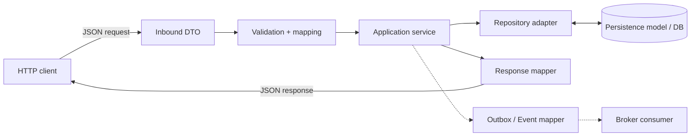
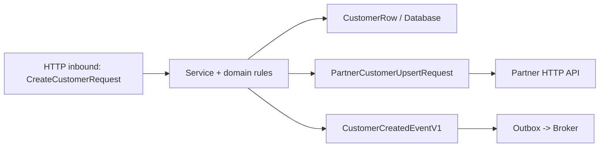

# DTOs and Separating Exchange Models from Internal Persistence Objects

In **SPRING_BOOT_INTEGRATION**, a customer object may pass through an HTTP controller, an HTTP client calling a partner, a database, a cache, a message broker, and Spring Integration adapters. Although they describe the same customer, each boundary requires a different **data contract**. Exposing the raw persistence object externally means database schema changes can break the API, internal fields can be accidentally leaked, and other systems become coupled to your implementation structure.

This lesson in the **Data Contracts** chapter explains how to use a **Data Transfer Object (DTO)** as an exchange model, how to convert between DTOs and internal data, and how this design impacts validation, API versioning, error handling, deduplication, testing, and observability of integration flows.

## 1. Objectives and Foundational Concepts

After this lesson, you will be able to:

- Distinguish **inbound DTOs**, **outbound DTOs**, **event DTOs**, **domain models**, and **persistence models**.
- Explain why an HTTP endpoint or message broker should not directly exchange JPA entities or internal records.
- Design explicit mapper layers that control which fields are exposed.
- Place validation in the right layer: data syntax at the boundary, business rules in the service/domain, and data invariants in the database.
- Evolve JSON contracts without coupling external consumers to internal schema changes.
- Test mapping, JSON serialization, HTTP behavior, and integration flows under retries or duplicate message delivery.

A **DTO** is an object that carries data across a system boundary or between layers that require an explicit contract. A DTO can be a Java `record`, an immutable Java class, or a schema-generated message type. It is not by default a database entity, nor is it the place to enforce business rules.

A **persistence model** represents how the application stores and reads data: tables, columns, JPA entities, JDBC rows, foreign keys, optimistic-locking versions, and operational fields. A **domain model** (if separated) represents state and behavior according to domain rules. In small applications, a service may work directly with objects returned by a repository, but external exchange contracts still need to be explicitly defined.



Arrows crossing a boundary are where contracts and mapping controls belong. For example: `CreateCustomerRequest` is the structure a caller is allowed to send; `CustomerRow` is the data actually stored in the database; `CustomerResponse` contains only the information permitted to be returned.

## 2. Why Not Use Entities or Rows Directly as JSON?

Suppose the `customer_profile` table contains an email, display name, internal risk score, soft-delete flag, and update version. The public API only needs the ID, email, name, and registration date. Returning the entire persistence object commonly leads to these consequences:

| Consequence | Example | Mitigation |
| --- | --- | --- |
| Data leakage | `internalRiskScore`, `deleted`, or access-control info appears in JSON | Response DTO using an allowlist of fields permitted for exposure. |
| Schema coupling | Renaming a column or JPA relationship unintentionally changes JSON | Separate storage mapping from contract mapping. |
| Over-posting (mass assignment) | Sender injects `role`, `approved`, or `internalStatus` into the request | Request DTO accepts only fields the user is authorized to supply. |
| Serialization errors | JPA lazy proxies, circular references, or N+1 queries when Jackson traverses entities | Explicit mapping before serialization. |
| Difficult evolution | A single field serves internal querying while partners treat it as an API contract | Independent DTO versioning and compatibility policies. |
| Semantic confusion | `null` in the database, JSON, and update commands is treated identically | Clearly define semantics for each field and operation. |

Putting `@JsonIgnore` on an entity can hide a few fields on one endpoint, but it does not solve the fact that the entity is carrying two responsibilities: persistence and communication. The more consumers there are, the higher the risk that modifying one annotation breaks other APIs. Dedicated DTOs provide a testable architectural boundary.

## 3. Running Example: Customer Contract over HTTP

The example uses **Java 17+** and **Spring Boot 3.x** with Jakarta Validation, Jackson, and JDBC. The persistence object models a PostgreSQL table. Each `public` top-level type in the code snippets would be a separate Java file in real implementation; imports are omitted in later snippets where clear from context.

### 3.1. Request and Response Contracts

```java
import jakarta.validation.constraints.Email;
import jakarta.validation.constraints.NotBlank;
import jakarta.validation.constraints.Size;

public record CreateCustomerRequest(
        @NotBlank @Email @Size(max = 320) String email,
        @NotBlank @Size(max = 120) String displayName
) {}
```

```java
import java.time.Instant;
import java.util.UUID;

public record CustomerResponse(
        UUID id,
        String email,
        String displayName,
        Instant registeredAt
) {}
```

Inbound JSON contract:

```json
{
  "email": "lan@example.org",
  "displayName": "Lan Nguyen"
}
```

Outbound JSON contract:

```json
{
  "id": "e398a09c-8590-4332-919f-6410748b3a70",
  "email": "lan@example.org",
  "displayName": "Lan Nguyen",
  "registeredAt": "2026-11-21T02:30:00Z"
}
```

Here `CreateCustomerRequest` has no `id`, risk score, or deletion flag. Callers cannot ask the system to trust such internal fields through the HTTP contract. `CustomerResponse` omits them as well, even if the DB adds columns or the repository reads the full record.

**Note on validation:** `@NotBlank`, `@Email`, and `@Size` check shape and basic input conditions; they do not prove that the email exists, that the sender owns it, or that the email is not already in the database. In Spring MVC, use `@Valid` on the `@RequestBody` parameter and include the appropriate validation dependency (e.g., `spring-boot-starter-validation`).

### 3.2. Internal Data Has a Different Shape

```java
import java.time.Instant;
import java.util.UUID;

// Internal row constructed by the JDBC adapter; not used as an HTTP response.
public record CustomerRow(
        UUID id,
        String email,
        String displayName,
        int internalRiskScore,
        boolean deleted,
        Instant createdAt,
        Instant updatedAt,
        long version
) {}
```

`internalRiskScore` supports an internal risk evaluation process, `deleted` supports soft deletion, and `updatedAt` and `version` support synchronization and update concurrency control. Those fields do not necessarily belong in any public DTO. If a project uses JPA, the persistence model may be an `@Entity`; with JDBC, it is a row mapped from a `ResultSet`; the boundary principle is the same.

Illustrative PostgreSQL schema:

```sql
CREATE TABLE customer_profile (
    id                  UUID PRIMARY KEY,
    email               VARCHAR(320) NOT NULL UNIQUE,
    display_name        VARCHAR(120) NOT NULL,
    internal_risk_score INTEGER NOT NULL DEFAULT 0,
    deleted             BOOLEAN NOT NULL DEFAULT FALSE,
    created_at          TIMESTAMPTZ NOT NULL,
    updated_at          TIMESTAMPTZ NOT NULL,
    version             BIGINT NOT NULL DEFAULT 0
);
```

This is an **internal schema**, not API documentation; database migrations can change columns, indexes, and data types without changing the JSON response as long as the mapper still satisfies the contract.

### 3.3. Mapping Must Express Data-Exposure Decisions

Adding an internal command separates **accepted and normalized** data from the HTTP DTO:

```java
public record CreateCustomerCommand(String email, String displayName) {}
```

```java
public final class CustomerContractMapper {
    private CustomerContractMapper() {}

    public static CreateCustomerCommand toCommand(CreateCustomerRequest request) {
        return new CreateCustomerCommand(
                request.email().trim(),
                request.displayName().trim());
    }

    public static CustomerResponse toResponse(CustomerRow row) {
        return new CustomerResponse(
                row.id(),
                row.email(),
                row.displayName(),
                row.createdAt());
    }
}
```

`toCommand` does not accept `id` or `internalRiskScore`; `toResponse` **explicitly enumerates** the four fields allowed to be exposed. The mapper is a pure function, easy to test, with no dependencies on controllers, brokers, transactions, or Jackson. Normalize only according to agreed rules: for example, do not automatically lowercase the entire email address if the business domain has not defined email comparison semantics; do not silently change timezones or round monetary amounts.

There is no need to create every possible class just to add layers. `CreateCustomerCommand` is useful when the same business action is invoked from HTTP, a consumer, or a scheduled job; if a project only has a very simple flow, the service can take validated values while still keeping request/response DTOs separate from storage.

## 4. Wiring the Layers in a Spring Boot Application

To make the boundaries clear, the following example uses a simple JDBC repository. SQL is an adapter detail; the mapper decides what JSON looks like.

```java
import java.time.Instant;
import java.util.UUID;
import org.springframework.jdbc.core.namedparam.MapSqlParameterSource;
import org.springframework.jdbc.core.namedparam.NamedParameterJdbcTemplate;
import org.springframework.stereotype.Repository;

@Repository
public class CustomerJdbcRepository {
    private final NamedParameterJdbcTemplate jdbc;

    public CustomerJdbcRepository(NamedParameterJdbcTemplate jdbc) {
        this.jdbc = jdbc;
    }

    public CustomerRow insert(CreateCustomerCommand command) {
        UUID id = UUID.randomUUID();
        Instant now = Instant.now();

        var params = new MapSqlParameterSource()
                .addValue("id", id)
                .addValue("email", command.email())
                .addValue("displayName", command.displayName())
                .addValue("createdAt", now)
                .addValue("updatedAt", now);

        jdbc.update("""
                INSERT INTO customer_profile
                    (id, email, display_name, created_at, updated_at)
                VALUES
                    (:id, :email, :displayName, :createdAt, :updatedAt)
                """, params);

        return new CustomerRow(id, command.email(), command.displayName(),
                0, false, now, now, 0);
    }
}
```

In this example, the row's default values `0`, `false`, `0` match the schema defaults. More complex applications may read the newly written record back from the database, especially when the DB has triggers, defaults, or generated values that need to be reflected accurately. `Instant.now()` is placed in the repository for illustration; production code can inject a `Clock` for deterministic time testing.

```java
import org.springframework.stereotype.Service;
import org.springframework.transaction.annotation.Transactional;

@Service
public class CustomerService {
    private final CustomerJdbcRepository repository;

    public CustomerService(CustomerJdbcRepository repository) {
        this.repository = repository;
    }

    @Transactional
    public CustomerResponse create(CreateCustomerRequest request) {
        CreateCustomerCommand command = CustomerContractMapper.toCommand(request);
        CustomerRow stored = repository.insert(command);
        return CustomerContractMapper.toResponse(stored);
    }
}
```

```java
import jakarta.validation.Valid;
import java.net.URI;
import org.springframework.http.ResponseEntity;
import org.springframework.web.bind.annotation.PostMapping;
import org.springframework.web.bind.annotation.RequestBody;
import org.springframework.web.bind.annotation.RequestMapping;
import org.springframework.web.bind.annotation.RestController;

@RestController
@RequestMapping("/api/customers")
public class CustomerController {
    private final CustomerService service;

    public CustomerController(CustomerService service) {
        this.service = service;
    }

    @PostMapping
    public ResponseEntity<CustomerResponse> create(
            @Valid @RequestBody CreateCustomerRequest request) {
        CustomerResponse response = service.create(request);
        return ResponseEntity
                .created(URI.create("/api/customers/" + response.id()))
                .body(response);
    }
}
```

Execution flow:

1. Jackson deserializes JSON into `CreateCustomerRequest`.
2. Spring MVC + Bean Validation detect missing or malformed required fields.
3. The service converts the request into a command; the repository writes according to the internal schema.
4. The mapper transforms `CustomerRow` into `CustomerResponse`, and Jackson serializes the exact public contract.

The example uses `@Transactional` for the write path and a single `DataSource`. If you add partner HTTP calls or broker publishing inside the service, a JDBC transaction does **not** automatically make external side effects atomic with the database. When reliable event emission after writes is needed, consider a transactional outbox: write business data and the outbox record in the same transaction, then let an independent publisher forward events to the broker.

## 5. Where Should Validation Live, and How Should Errors Be Returned?

For a data contract to be meaningful, three validation layers must be separated:

| Validation layer | Example | Appropriate location |
| --- | --- | --- |
| Structure and data types | Malformed `email`, blank/overlong `displayName`, wrong JSON type | DTO + Bean Validation in the HTTP/message adapter. |
| Business rules | Only verified accounts can be activated; a partner cannot change a specific attribute | Application service/domain, where business context is available. |
| Persistence invariants | Unique `email`, foreign keys, concurrency consistency checks on update | Database constraints + exception translation in adapter/service. |

Do not rely solely on `existsByEmail(...)` and assume `insert` will succeed: two concurrent requests can both pass the check before either writes. A database unique constraint is the final line of defense. The adapter should translate this conflict into an appropriate business error—such as HTTP `409 Conflict` if the email is already taken—instead of exposing stack traces or SQL to the client.

With Spring MVC, `@Valid @RequestBody` typically turns Bean Validation errors into a `400 Bad Request` response; standardize the error structure using `ProblemDetail` or a published internal error schema. An error contract may include `type`, `title`, `status`, `detail`, `instance`, `code`, and `correlationId`, but **must not** expose SQL queries, passwords, private data, or stack traces externally. Translating `DataAccessException` subclasses into external error codes should reflect the underlying cause: a transient connection drop is different from an input data violation.

**Accepting JSON does not mean every JSON field is allowed to be used.** If a client sends an extra `internalRiskScore` that the DTO does not declare, whether unknown fields are rejected or ignored depends on Jackson configuration; choose an explicit policy, test it, and do not rely on implicit defaults when building partner APIs. Even when unknown fields are ignored, the service still reads only the fields defined in the request DTO.

## 6. Inbound, Outbound, Update DTOs, and Missing Data

Do not reuse a single DTO for all CRUD operations. Even for the same `Customer`, creation, partial update, query, and event contracts have different semantics:

| Contract | Example fields | Rules |
| --- | --- | --- |
| `CreateCustomerRequest` | `email`, `displayName` | Required fields; do not let clients supply IDs or internal attributes. |
| `UpdateCustomerRequest` | Permitted updatable fields | Enforce edit permissions, record version, and missing-data semantics. |
| `CustomerResponse` | `id`, `email`, `displayName`, `registeredAt` | Expose only data appropriate for the caller and data policy. |
| `CustomerCreatedEventV1` | `eventId`, `customerId`, `occurredAt`, `schemaVersion` | Intended for broker consumers; must evolve independently from HTTP. |

In particular, for partial updates, an **absent field** and a **field with value `null`** can mean different things:

```json
{ "displayName": "New Lan" }
```

Usually means update only `displayName`.

```json
{ "displayName": null }
```

May mean clear the value or be an invalid request, depending on the contract. A plain `record UpdateCustomerRequest(String displayName)` can lose the ability to distinguish *absent* from *explicitly sent as null* after deserialization. If PATCH requires exact presence semantics, use a representation that tracks field presence (such as `JsonNode`, an appropriate wrapper, or a JSON Merge Patch implementation per RFC 7396) and test each case. Avoid using `null` to mean "keep unchanged" if the contract also needs to support "clear field."

Additional rules to define in the API contract: length limits, nullability, timestamp timezone (`Instant` fits absolute points in time), ID format (`UUID`/string), whether collection order matters, monetary precision and units of measure, and how enums behave when new values are introduced. Using `String` for everything may seem convenient initially, but it forfeits type checking and semantic clarity.

## 7. DTOs When Calling Partner HTTP APIs and Using Brokers

In an integration flow, a partner's JSON model may differ from both your published HTTP model and your internal model:



An HTTP client adapter should have dedicated DTOs for the **partner's contract** (`PartnerCustomerUpsertRequest`, `PartnerCustomerResponse`) and a mapper converting between them and the internal model. When the partner renames `full_name` to `display_name`, the impact is confined to the adapter instead of forcing changes to your public `CustomerResponse` or DB schema.

Example event DTO emitted after creating a customer:

```java
import java.time.Instant;
import java.util.UUID;

public record CustomerCreatedEventV1(
        String eventId,
        int schemaVersion,
        UUID customerId,
        String displayName,
        Instant occurredAt
) {}
```

This event intentionally omits email, risk score, and the full DB snapshot because the illustrative consumer only needs to know that a customer was created and their display name. When a consumer genuinely needs another field, evaluate data access permissions, purpose, payload growth cost, and schema evolution policy before adding it. `eventId` is generated **once** for the logical event and kept unchanged across republishes; consumers use that stable ID as an idempotency key.

**Do not share `CustomerResponse` as the HTTP body, cache entry, and broker event simply because all three represent a customer.** Each channel has a different lifecycle, compatibility policy, audience, confidentiality level, and semantics. With Spring Integration, a message can carry a DTO already parsed and validated by an adapter; the orchestration logic processing the message does not need to know what the database DTO looks like.

### Deduplication and Transactions at the Broker Boundary

A broker may deliver the same message multiple times during error handling or retries. The DTO should carry a stable event identifier, but having `eventId` in JSON alone does **not** automatically provide idempotency: the consumer must check or record this ID in a state store with an appropriate constraint, in the same transaction as the business effect whenever possible. If a flow commits to the DB and also sends HTTP or broker messages, design explicit retry/outbox/inbox state; do not expect a JDBC transaction to cover external systems.

Message validation should also separate two situations: payloads that violate the contract (typically rejected or routed to a controlled dead-letter/quarantine) and transient infrastructure failures (typically retried with limits and backoff). Logs should include `eventId`, event type, schema version, and correlation ID; do not log full sensitive payloads.

## 8. Contract Versioning and Compatibility

Renaming a column in the database **does not necessarily** change the API, because the mapper can preserve the old JSON. Conversely, when changing a JSON contract, you must account for clients or consumers still using the previous version.

| Contract change | Common impact | Controlled rollout approach |
| --- | --- | --- |
| Add optional field to response | Consumers reading only old fields usually continue working | Document defaults, run strict consumer tests, update API docs. |
| Add required field to request | Old clients omit it and may fail | Provide a default/allow omission during transition or release a new contract version. |
| Rename/remove field or change type | Old consumers may fail deserialization | Keep an alias during transition or create a new version. |
| Change field semantics without renaming | Dangerous because errors do not appear in schema checks | Define a new contract version and explicit migration. |
| Change internal table/column structure | Should not impact API callers | Adjust repository and mapper inside the application. |

For HTTP, you can version in the URL (`/v1/customers`), media type, or your organization's agreed versioning scheme. For an event broker, you can use `eventType` + `schemaVersion` or a schema registry when using Avro/Protobuf/JSON Schema. **Versioning does not replace contract compatibility**: you still need a release policy, transition window, ownership, and a way to measure which version consumers are using.

For example, `@JsonProperty("customer_id")` can map a JSON key differently from the Java component name; however, a single annotation does not fully solve renaming a field already used by clients. During a transition, test both old and new JSON, define explicit behavior when both aliases appear simultaneously, and avoid ambiguous interpretation.

**Practical rule:** publish OpenAPI or schemas for critical contracts; review contract changes as system-compatibility changes, not merely Java refactorings.

## 9. Manual Mapping, MapStruct, and Adapter Responsibilities

For DTOs with few fields, manual mappers make it obvious which fields are read, normalized, or exposed. When there are hundreds of DTOs, a code-generating mapper library such as **MapStruct** can reduce boilerplate, while keeping security rules and special conversions explicitly configured.

| Mapping approach | Strengths | Risks to manage |
| --- | --- | --- |
| Manual functions | Clear business decisions, easy to read and debug | High boilerplate in large systems. |
| MapStruct | Compile-time code generation, unmapped-field checks | Must control unmapped fields and implicit conversions. |
| Reflection/automatic bean copiers | Minimal upfront code | Easy to accidentally copy internal fields, unclear type conversions, hard to spot changes. |

Architecturally, avoid mappers that call repositories or HTTP clients to "populate" fields. Doing so introduces hidden I/O into a data transformation, causes N+1 queries, hinders testing, and complicates transaction boundaries. Services/adapters are responsible for fetching all required data; mappers are responsible for transforming data already in hand.

For sensitive data, prefer **field allowlisting** (explicitly declaring output fields) rather than copying all fields except a blocklist. When `riskLevel` is added to `CustomerRow`, an allowlist mapper will still keep it out of JSON unless intentionally reviewed and updated.

## 10. Caches Are Also a Data Contract

A cache sits close to the application internals, yet it still has a contract covering keys, value structure, TTL, access control, and invalidation timing. Consider:

- Caching `CustomerResponse` speeds up read endpoints, but the key must incorporate caller/tenant scope if the response varies by permissions; otherwise data can leak across users.
- Caching `CustomerRow` may serve multiple internal needs, but that does not permit returning the row directly from an API. Newly added row fields must follow the cache's data policy.
- When changing the value structure while multiple application versions run concurrently, use versioned keys or a serializer-compatibility strategy.
- TTL does not replace invalidation; if an email/name update commits while the cache still holds stale data, the API behaves inconsistently. Consider post-commit invalidation and retry handling when the cache is unavailable.

A cache is usually not the source of truth. Rely on cached values for authorization or business state decisions only when appropriate consistency and refresh policies are in place.

## 11. Testing Data Contracts Across Layers

Separating DTOs from persistence models only pays off when contracts are tested—especially after renaming columns, renaming fields, or upgrading serializers.

| Test level | Questions to answer | Suggestions |
| --- | --- | --- |
| Mapper unit test | Does every public field come from the right source? Are internal fields prevented from leaking? | JUnit 5 for `CustomerContractMapper`, testing `null`/empty and normalization rules if any. |
| JSON serialization test | Do key names, data types, timestamps, and missing fields match the contract? | `@JsonTest`/Jackson tests with controlled JSON fixtures or snapshots. |
| Controller contract test | Does invalid input return `400`? Does successful creation return `201`, `Location`, and the expected body? | `@WebMvcTest` + MockMvc verifying status and body structure. |
| Repository integration test | Do SQL/DDL and type conversions work against a real database? | Testcontainers PostgreSQL, run migrations, verify unique constraints and timestamps. |
| Consumer/producer contract test | Can old consumers read new events? Do retries preserve `eventId`? | Schema compatibility checks, producer/consumer contract tests, and duplicate-delivery tests. |

Example unit test for the mapper without a Spring context:

```java
import static org.junit.jupiter.api.Assertions.assertEquals;

import java.time.Instant;
import java.util.UUID;
import org.junit.jupiter.api.Test;

class CustomerContractMapperTest {
    @Test
    void responseOnlyContainsPublicFieldsFromRow() {
        UUID id = UUID.fromString("e398a09c-8590-4332-919f-6410748b3a70");
        Instant created = Instant.parse("2026-11-21T02:30:00Z");
        CustomerRow row = new CustomerRow(
                id, "lan@example.org", "Lan Nguyen", 95,
                false, created, created, 7);

        CustomerResponse response = CustomerContractMapper.toResponse(row);

        assertEquals(id, response.id());
        assertEquals("lan@example.org", response.email());
        assertEquals("Lan Nguyen", response.displayName());
        assertEquals(created, response.registeredAt());
    }
}
```

The test above verifies value mapping; to verify that **the JSON truly omits `internalRiskScore`**, add a Jackson or endpoint test:

```java
// Illustrative check using an ObjectMapper configured like the application:
String json = objectMapper.writeValueAsString(response);
JsonNode node = objectMapper.readTree(json);
assertFalse(node.has("internalRiskScore"));
assertFalse(node.has("deleted"));
assertEquals("Lan Nguyen", node.get("displayName").asText());
```

This JSON snippet requires importing `JsonNode` and JUnit assertions; `objectMapper` should come from the actual Spring Boot Jackson configuration in tests so it captures the real property-naming policy, `java.time` module, null serialization, and version compatibility.

Scenarios worth actively adding to the test suite: new fields in the row do not appear unexpectedly; requests cannot supply internal fields; invalid inputs return stable error codes; two requests with the same email trigger the unique constraint and appropriate business error; events missing a version or carrying an unsupported version are handled predictably; duplicate messages with the same `eventId` do not cause duplicate side effects; and caches do not leak responses across different permission levels.

## 12. Common Pitfalls and Design Checklist

**Using an entity as a DTO "for speed."** It takes less code initially, but easily turns a database refactor into a breaking API change and risks exposing relationships or sensitive fields. Define explicit request/response types at boundaries.

**Sharing one `CustomerDto` for create, update, read, broker, and partner flows.** Every consumer has different needs; nullable fields and annotations end up overlapping, making the contract unable to express permissions and semantics accurately. Name DTOs after the operation and communication channel.

**Relying on Bean Validation to protect all business rules.** Constraints on a request check only part of the input data. Uniqueness, modification permissions, and state preconditions must also be enforced in the service/domain and database.

**Renaming a JSON field just because a Java variable or SQL column was renamed.** If clients already rely on that key, treat it as a contract change with a compatibility/versioning strategy.

**Putting I/O or event-publishing logic inside mappers.** Mappers become unpredictable, hard to test, and may alter transaction hold times. Let services coordinate adapters; mappers should only transform data.

When reviewing an integration flow, check each item in order:

1. **Who is the recipient?** HTTP client, partner, broker consumer, or cache; which fields do they genuinely need?
2. **Which data is allowed across each boundary?** Are there sensitive fields, tenant IDs, internal statuses, or values needing masking/transformation?
3. **Are field semantics clear?** Required/optional, `null`/absent, timestamps, monetary amounts, enums, limits, and formats?
4. **How are errors published?** Do validation, conflict, and upstream unavailable cases have tested error schemas and codes?
5. **Are mapper and storage independent?** Does changing a DB column affect JSON? Does adding an internal field leak automatically?
6. **How does the contract evolve?** Are there schemas/OpenAPI specs, versions, compatibility policies, and producer–consumer tests?
7. **Are retries and duplicate deliveries safe?** Do events/commands have stable identifiers, idempotent handling, and suitable transaction/outbox design?
8. **Is observability sufficient?** Do logs/traces carry correlation ID, event ID, and schema version while logging only filtered data?

**Remember:** DTOs protect the boundary between external data exchange and how the application stores or processes data. In Spring Boot, solid DTO structure must be paired with explicit mappers, multi-layered validation, versioned contracts, error handling, and realistic tests—allowing HTTP, databases, caches, and brokers to evolve independently while keeping data promises to integrated systems.
