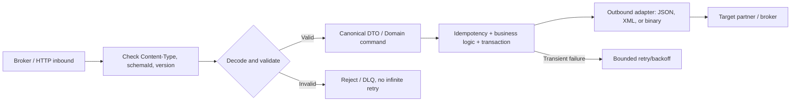

# Choosing JSON, XML, Binary Data, and Schemas

> **Chapter:** Data Contracts  
> **Scope:** In the **SPRING_BOOT_INTEGRATION** module, a Spring Boot service connects to external systems via HTTP clients, databases, caches, message brokers, and Spring Integration adapters. This lesson guides you through choosing data exchange formats and schemas, controlling contract versions, transforming data at integration boundaries, handling errors and duplicates, testing, and observing real-world flows.

## 1. Data Format and Data Contract Are Not the Same Thing

When a partner emits an "order created" event, both sides must agree on far more than whether the payload is written in JSON or XML:

- **Wire format:** JSON, XML, Protobuf, Avro, or a byte array using a custom protocol.
- **Structure/schema:** which fields are present, data types, required vs. optional, constraints, and evolution rules.
- **Semantics:** is `orderId` globally unique? Which currency does `amountMinor` represent? Is `occurredAt` the occurrence time or the send time?
- **Exchange protocol:** HTTP method, Content-Type, status codes; or broker topic name, key, headers, ack/retry, and message ordering.
- **Business behavior:** what happens on duplicate messages, which events may arrive late, which state transitions are valid, and how errors are reported.

**A schema-valid payload can still be invalid for the business.** For example, `quantity: 5` is a valid integer, yet the SKU may be discontinued, or `eventId` may have already been processed.

| Concept | Example | Question answered |
| --- | --- | --- |
| **Encoding/serialization** | UTF-8 JSON, XML, Protobuf binary | How are objects turned into bytes on the wire? |
| **Schema** | JSON Schema, XSD, `.proto`, Avro schema | What structure and types does the data have, and is it valid? |
| **API/event contract** | OpenAPI, AsyncAPI, event specification | Where and when is data sent/received, and with what outcome? |
| **Business invariants** | Unique order key, non-negative total | Does the data satisfy system rules? |
| **Compatibility policy** | Reading payloads from older versions | Will upgrading a producer/consumer break the integration? |

## 2. Comparing JSON, XML, and Binary Data

| Criterion | JSON | XML | Schema-based binary (Protobuf, Avro, etc.) |
| --- | --- | --- | --- |
| Human readability | Very good | Good, though verbose with tags and namespaces | Typically requires schema and decoding tools |
| Data representation | Object, array, string, number, boolean, null | Element, attribute, text, namespace, element order | Fields/types defined by dedicated schema |
| Payload overhead | Repeats field names, relatively compact | Usually more structural characters | Typically smaller with less overhead for structured data |
| Schema/validation | JSON Schema, OpenAPI schema | XSD and other XML rules | `.proto` / Avro schema; format-specific evolution rules |
| Common integrations | REST APIs, webhooks, simple events | SOAP, enterprise/legacy systems, namespace-heavy documents | RPC, high-volume event streaming, polyglot systems |
| Manual debugging | Easy | Easy, though parsers/namespaces add complexity | Requires tools, schema IDs, or generated classes |
| Watch-outs | Numbers/precision, absent vs. null, enums/versions | XXE, DTD, namespaces, element order, parser complexity | Depends on schema, codecs, generators, registry, field IDs |

No single format is optimal for every flow. **Actual volume, data types, partner compatibility, and operational ergonomics** matter more than picking whichever format wins an isolated microbenchmark.

### When to Choose Each Format?

- **JSON:** HTTP REST systems, webhooks, or moderate message volumes; prioritizes broad interoperability, easy debugging, and ubiquitous client support.
- **XML:** partners with existing XSD/SOAP contracts, legacy banking/ERP integrations, or documents requiring namespaces or standard XML structure; keep XML at the adapter if the core application does not need XML.
- **Protobuf:** RPC and schema-fixed event streams where compact payloads, strong typing, and multi-language code generation matter; manage field numbers carefully.
- **Avro:** events or data pipelines requiring schema evolution and writer/reader schema negotiation, often paired with a registry in broker/data platforms.
- **Byte array / binary file:** images, PDFs, compressed files, or device-specific formats; consider transferring files/streams/object storage with separate metadata instead of defaulting to embedding binary as Base64 JSON strings.

## 3. Lock Down Data Conventions Before Picking a Library

Format is only one piece of the contract. These decisions govern long-term reliability:

| Subject | Recommended convention | Common pitfall |
| --- | --- | --- |
| **Business IDs** | String; preserve case and leading zeros if opaque | Casting `"00042"` to `42` and failing lookups |
| **Money** | Integer `amountMinor` with currency, or decimal/string with defined precision and scale | Using binary floating point and introducing rounding error |
| **Time** | ISO 8601/RFC 3339 with offset, usually normalized to UTC; or epoch with documented unit | Not knowing whether a timestamp is seconds or milliseconds |
| **Enum/status** | Documented code list and policy for unknown codes | Consumer exhaustive switch crashes when a new value is added |
| **Optional/nullable** | Distinguish absent field, `null`, and empty string if they carry separate meanings | Decoding them into the same state and losing information |
| **Collections** | Define empty list and ordering; are duplicates allowed? | Using a Set drops duplicates or ordering |
| **Units of measure** | Include unit in name or docs, e.g., `weightGrams`, `durationMs` | Two systems assume different units |
| **Correlation/idempotency** | `eventId`/`requestId`, `correlationId`, stable business key | Retries create duplicate transactions |
| **Limits** | Payload size, nesting depth, string length, item count | Parser or service gets overwhelmed |

Identifiers such as account codes, SKUs, and invoice numbers are normally **strings**, even when composed solely of digits. Keep **identifiers** separate from **numeric quantities**.

## 4. JSON: Easy to Integrate, Needs Precise Schema and Conventions

Example JSON event sent via HTTP or a broker:

```json
{
  "eventId": "evt-9237",
  "eventType": "order.created",
  "schemaVersion": 1,
  "occurredAt": "2026-11-21T03:00:00Z",
  "correlationId": "corr-20261121-9",
  "data": {
    "orderId": "ORD-00042",
    "amountMinor": 125000,
    "currency": "VND"
  }
}
```

Here `amountMinor` means the count of the currency's minor units; its meaning and conversion factor must be defined per currency code. If a partner sends large decimals or must preserve exact decimal digits, standardize on a **decimal string** or platform decimal type rather than assuming every client handles JSON numbers with the same precision.

### 4.1. JSON Schema

JSON Schema describes JSON structure and automatically verifiable constraints. Abbreviated example using draft 2020-12:

```json
{
  "$schema": "https://json-schema.org/draft/2020-12/schema",
  "$id": "https://contracts.example.test/order-created-v1.schema.json",
  "type": "object",
  "required": ["eventId", "eventType", "schemaVersion", "occurredAt", "data"],
  "properties": {
    "eventId": { "type": "string", "minLength": 1 },
    "eventType": { "const": "order.created" },
    "schemaVersion": { "const": 1 },
    "occurredAt": { "type": "string", "format": "date-time" },
    "correlationId": { "type": "string" },
    "data": {
      "type": "object",
      "required": ["orderId", "amountMinor", "currency"],
      "properties": {
        "orderId": { "type": "string", "minLength": 1 },
        "amountMinor": { "type": "integer", "minimum": 0 },
        "currency": { "type": "string", "pattern": "^[A-Z]{3}$" }
      },
      "additionalProperties": true
    }
  },
  "additionalProperties": true
}
```

In this example, `additionalProperties: true` lets consumers accept newly added fields they do not recognize yet. Changing it to `false` locks down the schema strictly, so a producer adding a field can break older consumers. Choose strict or tolerant based on the contract and risk profile rather than treating one option as universally right.

**Note:** some JSON Schema libraries treat `format: "date-time"` as an annotation unless format validation is enabled; verify your actual validator's behavior. JSON Schema also cannot validate every invariant on its own, such as "`orderId` must exist in the database" or "`eventId` has never been processed."

### 4.2. Common JSON Pitfalls

JSON has numbers, but does not define `int64` or fixed-precision decimals the way some binary formats do. Some JavaScript clients have integer-precision limits on the `Number` type; large identifiers should be sent as strings. You must also agree on **absent** fields vs. `null` values, deserialization defaults, UTF-8 encoding, and how unknown enum values are handled.

JSON libraries may silently drop unknown fields or fail depending on configuration. This difference directly affects compatibility when upgrading producers and consumers.

## 5. XML: Strong Schemas, Namespaces, and Parser Safety Matter

Example equivalent message in an XML-based partner system:

```xml
<?xml version="1.0" encoding="UTF-8"?>
<ord:OrderCreated xmlns:ord="urn:example:orders:v1">
    <ord:EventId>evt-9237</ord:EventId>
    <ord:OrderId>ORD-00042</ord:OrderId>
    <ord:AmountMinor>125000</ord:AmountMinor>
    <ord:Currency>VND</ord:Currency>
</ord:OrderCreated>
```

XML distinguishes elements, attributes, text, and namespaces. The prefix `ord` can vary while the namespace URI remains the same identifier; never match payloads purely by string prefix. Many XSD contracts also strictly enforce element ordering, cardinality, and nullability.

### 5.1. XSD Defines Structure

Example XSD matching the XML above:

```xml
<?xml version="1.0" encoding="UTF-8"?>
<xs:schema xmlns:xs="http://www.w3.org/2001/XMLSchema"
           targetNamespace="urn:example:orders:v1"
           xmlns:ord="urn:example:orders:v1"
           elementFormDefault="qualified">
  <xs:element name="OrderCreated">
    <xs:complexType>
      <xs:sequence>
        <xs:element name="EventId" type="xs:string"/>
        <xs:element name="OrderId" type="xs:string"/>
        <xs:element name="AmountMinor" type="xs:nonNegativeInteger"/>
        <xs:element name="Currency" type="xs:string"/>
      </xs:sequence>
    </xs:complexType>
  </xs:element>
</xs:schema>
```

If a partner uses WSDL/SOAP, beyond XSD there are constraints on operations, bindings, and faults. **XSD validates structure only**; it does not replace the full SOAP contract or business transaction rules.

### 5.2. Security Risks When Parsing XML

For externally supplied XML, configure parsers to block **XXE** (XML External Entity), external DTDs/entities, and arbitrary resource access; enforce limits on size, depth, node count, and processing time. Whether using JAXB, Jackson XML, or DOM/SAX/StAX, verify how that specific stack version configures safe parsing. Never fetch schemas or DTDs dynamically from untrusted URLs during request processing.

When XML is only needed at a partner boundary, the common pattern is **deserialize XML → internal DTO → validate → business processing**, then serialize the result back to XML when replying to the partner. Do not leak namespace/XSD details throughout the domain layer.

## 6. Binary Data: Not a Single Kind of Contract

"Binary data" can mean an image/file, a schema-backed Protobuf/Avro payload, or a custom-protocol byte stream. Choosing a binary representation **does not automatically guarantee** compatibility, integrity, or security.

### 6.1. Protocol Buffers (Protobuf)

Protobuf describes messages in `.proto` files and assigns a stable **field number** to each field:

```proto
syntax = "proto3";

package integration.orders.v1;
option java_package = "com.example.integration.contract";
option java_multiple_files = true;

message OrderCreated {
  string event_id = 1;
  string order_id = 2;
  int64 occurred_at_epoch_millis = 3;
  int64 amount_minor = 4;
  string currency = 5;
}
```

Applications can generate Java classes from `.proto` and serialize to byte arrays. Core rules:

- Field numbers are part of the wire contract; **never change the number of an active field** and never reuse removed numbers. Use `reserved` for retired numbers/names.
- Adding a new field with a new number usually lets older consumers skip unknown fields, **provided** semantics and requiredness do not change.
- Distinguish default values from "not sent." In proto3, field presence depends on field type and declaration (`optional`/message fields); test explicitly when business logic requires distinguishing them.
- Two fields both being strings does not mean you can change their meaning and still call it compatible.

Protobuf fits RPC such as gRPC or high-throughput event streams, though it requires a code-generation pipeline and schema/version governance. Spring Boot does not automatically convert arbitrary DTOs into Protobuf simply by changing the Content-Type.

### 6.2. Apache Avro

Avro typically stores/exchanges schemas so readers know how to decode writer-produced data. An abbreviated schema:

```json
{
  "type": "record",
  "name": "OrderCreated",
  "namespace": "example.integration.orders",
  "fields": [
    { "name": "eventId", "type": "string" },
    { "name": "orderId", "type": "string" },
    {
      "name": "occurredAt",
      "type": { "type": "long", "logicalType": "timestamp-millis" }
    },
    { "name": "amountMinor", "type": "long" },
    { "name": "currency", "type": "string" },
    { "name": "note", "type": ["null", "string"], "default": null }
  ]
}
```

Giving `note` a default of `null` allows a new reader to read older records missing that field under Avro's schema-resolution rules. Still, compatibility depends on types, unions, and writer/reader schemas; a default **does not make every change safe**.

With Kafka or event streaming platforms, a **schema registry** can store schemas, issue IDs/versions, enforce compatibility rules, and back serializers/deserializers. A registry is an additional infrastructure component, not a built-in requirement of every broker or of Spring Boot.

### 6.3. Binary Files and Custom Payloads

Images, PDFs, or compressed archives are usually better transferred as streams/files or stored in object storage while sending a **reference + checksum + content type + size**. Encoding entire files as Base64 inside JSON is rarely ideal: it adds overhead and forces processors to buffer large payloads in memory if structured poorly.

If a custom binary format is unavoidable, the contract must specify: magic/version bytes, endianness, framing, field lengths, compression, checksums, size limits, string encoding, and error reporting. Undocumented binary formats are generally harder to upgrade and debug than JSON or XML.

## 7. How HTTP API Schemas Differ from Message Broker Schemas

### 7.1. HTTP: Content-Type, Accept, and OpenAPI

In HTTP, **`Content-Type`** describes the request/response body format; **`Accept`** expresses the response media types the caller accepts. Example:

```http
POST /api/v1/orders HTTP/1.1
Content-Type: application/json
Accept: application/json
X-Correlation-Id: corr-20261121-9

{"externalId":"ORD-00042","amountMinor":125000,"currency":"VND"}
```

Common MIME types:

| Payload | Common Content-Type | Notes |
| --- | --- | --- |
| JSON | `application/json` | Standardize on UTF-8; do not rely on property order |
| XML | `application/xml`, sometimes `text/xml` per contract | Preserve namespaces, charset, and XSD |
| File/byte stream | `application/octet-stream` or specific media type (`image/png`, `application/pdf`) | Not sufficient alone to infer schema or file semantics |
| Protobuf/Avro | Agreed media type, sometimes vendor-specific | Must pair with version/schema identifier and matching codec |

If a request body carries an unsupported media type, an HTTP server typically returns **415 Unsupported Media Type**; if it cannot produce a response matching what the client accepts, it may return **406 Not Acceptable**. Schema/validation errors are usually mapped to a structured 4xx error response per contract, though frameworks do not all pick the exact same status automatically.

**OpenAPI** describes endpoints, methods, content types, request/response schemas, error responses, and authentication capabilities. It **does not automatically validate runtime data** simply because a YAML/JSON spec file exists.

### 7.2. Events: Topic, Schema ID, and Key

With Kafka, RabbitMQ, or other brokers, messages typically have a **destination, key/routing key, headers, and payload**. The schema may live in code, headers, or a registry depending on the serialization setup.

An event contract should specify:

```text
Destination: orders.created
Event type: order.created
Business key: orderId
Event id: eventId
Payload format: JSON v1 (or Avro/Protobuf with schema ID)
Timestamp semantics: time order was created, UTC
Delivery assumptions: duplicates and out-of-order delivery possible
Consumer rule: deduplicate by eventId; process according to version/order state
Failure: bounded retries, then route to DLQ
```

**A schema registry does not replace idempotency.** A schema-valid message can still be redelivered by the broker if a consumer crashes after writing to the DB but before acknowledging.

## 8. Spring Boot Example: JSON at the API Boundary

With Spring Boot 3.x, Spring MVC, and Jackson, you can declare a controller that accepts JSON. This example illustrates basic structural validation; a production business service must also add authorization and duplicate-handling protections:

```xml
<dependencies>
    <dependency>
        <groupId>org.springframework.boot</groupId>
        <artifactId>spring-boot-starter-web</artifactId>
    </dependency>
    <dependency>
        <groupId>org.springframework.boot</groupId>
        <artifactId>spring-boot-starter-validation</artifactId>
    </dependency>
</dependencies>
```

```java
package com.example.integration.api;

import jakarta.validation.Valid;
import jakarta.validation.constraints.NotBlank;
import jakarta.validation.constraints.NotNull;
import jakarta.validation.constraints.PositiveOrZero;
import org.springframework.http.MediaType;
import org.springframework.http.ResponseEntity;
import org.springframework.web.bind.annotation.PostMapping;
import org.springframework.web.bind.annotation.RequestBody;
import org.springframework.web.bind.annotation.RequestMapping;
import org.springframework.web.bind.annotation.RestController;

@RestController
@RequestMapping("/api/v1/orders")
class OrderController {

    @PostMapping(
        consumes = MediaType.APPLICATION_JSON_VALUE,
        produces = MediaType.APPLICATION_JSON_VALUE
    )
    ResponseEntity<OrderAccepted> create(
            @Valid @RequestBody OrderCommand command) {

        // Contract demo; production systems must enforce idempotency
        // and transactions before persisting data.
        return ResponseEntity.accepted().body(
                new OrderAccepted(command.externalId(), "RECEIVED")
        );
    }
}

record OrderCommand(
        @NotBlank String externalId,
        @NotNull @PositiveOrZero Long amountMinor,
        @NotBlank String currency
) {}

record OrderAccepted(String externalId, String status) {}
```

Jackson maps JSON to `OrderCommand`; Bean Validation enforces the constraint annotations. **`@Valid` is not the same as running a JSON Schema validator**: if JSON Schema enforcement is required, integrate a dedicated validator or separate contract validation step. Schemas also do not replace business checks such as allowed currencies and uniqueness.

When calling a partner over HTTP, `RestClient` (Spring Framework 6.1 / Spring Boot 3.2+) lets you specify media types explicitly:

```java
OrderAccepted accepted = restClient.post()
        .uri("/api/v1/orders")
        .contentType(MediaType.APPLICATION_JSON)
        .accept(MediaType.APPLICATION_JSON)
        .body(new OrderCommand("ORD-00042", 125000L, "VND"))
        .retrieve()
        .body(OrderAccepted.class);
```

This assumes `restClient` is already configured with the base URL, TLS/authentication, and appropriate timeouts. The `202 Accepted` response here only means the request was accepted; the client **must not infer** that the order is completed when the contract defines asynchronous processing.

### 8.1. Need to Return XML to a Partner?

In a Spring MVC application using Jackson, you can add the Jackson XML module when XML encoding/decoding is needed:

```xml
<dependency>
    <groupId>com.fasterxml.jackson.dataformat</groupId>
    <artifactId>jackson-dataformat-xml</artifactId>
</dependency>
```

Once the XML message converter/codec is properly configured, endpoints can declare `consumes = MediaType.APPLICATION_XML_VALUE` or support both JSON and XML. You still must verify namespaces, element names, collections, null/optional handling, parser safety, and XSD compatibility. Adding the dependency **does not guarantee** an arbitrary DTO generates XML matching a partner's contract; if strict XML control is required, use explicit annotations/configuration or map to a dedicated XML DTO and test against fixtures/XSD.

## 9. Applying This in Brokers and Spring Integration

Spring Boot can auto-configure `KafkaTemplate`, listener containers, and related beans when dependencies and configuration are present, but **serializers/deserializers are part of the contract**:

- **JSON events:** you can use Jackson or Spring Kafka's JSON serializer/deserializer, configuring trusted types and type mapping per project policy.
- **Avro/Protobuf events:** require compatible code generators/schemas/codecs and possibly dedicated schema registry clients/serializers; you cannot emit raw bytes and assume Kafka understands the schema.
- **Spring Integration flows:** inbound adapter receives raw message → decodes according to format/version → validates → transforms to internal DTO → processes or routes → serializes per target contract.



**Practical example:** a gateway receives orders as JSON v1, an ERP partner accepts only XSD-compliant XML, and the internal event stream uses Avro. Rather than making the domain handle all three payload styles:

1. The inbound adapter parses JSON, checks the schema, and converts it to an internal DTO with standardized `orderId`, monetary amount, and timestamp semantics.
2. The service checks the idempotency key, persists state, and manages the DB transaction.
3. The ERP adapter maps the DTO to XSD-compatible XML, adding signatures/headers if required by the partner.
4. When reliable event emission after a DB write is needed, use a transactional outbox; the publisher serializes Avro with the pre-registered schema ID and sends it to the broker.
5. Consumers deduplicate by `eventId` and separate non-recoverable decode errors from transient network/broker failures.

In this flow, parse errors caused by invalid schemas should be treated as **data errors that retries cannot fix**, whereas HTTP timeouts or dropped broker connections can be retried if the operation is idempotent. A valid format alone does not guarantee transactions across separate systems.

## 10. Evolving Schemas Without Breaking Connections

### 10.1. Three Compatibility Perspectives

| Mode | Conceptual meaning | Scenario |
| --- | --- | --- |
| **Backward compatibility** | **Consumer on new schema** can read data written by producer on old schema | Upgrade consumers first; historical data remains readable |
| **Forward compatibility** | **Old consumer** can read new data written by producer on new schema | Upgrade producers first while old consumers are still running |
| **Full compatibility** | Compatible in both directions within tested boundaries | Producers and consumers deploy independently |

These are conceptual definitions; real registries may check against **only the immediate prior version** or against all prior versions (*transitive*). You must verify the concrete policy and enforcement mechanism rather than relying on the label BACKWARD/FULL alone.

### 10.2. Common Changes

| Change | Initial assessment | Must verify |
| --- | --- | --- |
| Add optional JSON field | Often kept compatible | Do old consumers tolerate unknown fields? |
| Add required JSON field | Can break old consumers/producers | Defaults, phased rollout, validation policy |
| Rename a field | Usually breaking | Alias/dual-read support during transition |
| Change string to number | Usually breaking | Actual types, precision, and historical values |
| Add enum value | Risk of breaking | Do consumers handle "unknown" values? |
| Add optional XML element | Can break if XSD is strict or sequence order is fixed | XSD, namespaces, occurrence counts, partner parser |
| Add Protobuf field with new number | Usually wire-safe | Presence, defaults, and business meaning |
| Reuse old Protobuf field number | **Unsafe** | Use `reserved` |
| Add Avro field with suitable default | Often lets new readers read old data | Writer/reader schema resolution, union/default, registry policy |
| Remove field still used by consumers | Likely breaking | Historical data and all active consumers |

**Wire compatibility is not semantic compatibility.** A new Protobuf field number may be ignored by older consumers, yet if the producer begins requiring consumers to act on that field for correct business behavior, the systems are still behaviorally incompatible.

### 10.3. Multi-Version Rollout

A practical strategy for changing `customerName` to `buyerName`:

1. Update new consumers to **read both fields**, defining precedence if both are present.
2. Deploy consumers first; run contract tests against both old and new fixtures.
3. Have producers emit `buyerName` during the transition period while keeping `customerName` if old consumers remain.
4. Monitor how many old consumers still rely on the old field and agree on a sunset date.
5. Only after all consumers have migrated, remove the old field and update schemas/versions per system policy.

If deployments cannot be coordinated, consider **versioned endpoints** (`/api/v1` and `/api/v2`), a new event type, or a new topic. Never change an event carrying `schemaVersion: 2` into a completely different format while expecting old consumers to guess.

## 11. Managing Schemas and Contracts as Source-Controlled Artifacts

Contract artifacts should be reviewed, versioned, and released alongside the software lifecycle:

- **HTTP:** OpenAPI and JSON Schema/XSD, plus success and error request/response examples.
- **Binary:** `.proto` or Avro schemas, code-generation/serializer pipelines, and schema ID governance rules.
- **Events:** documentation covering destination, key, envelope, ordering, retention, idempotency, retry/DLQ, access permissions, and ownership.
- **Fixtures:** payloads for every supported version, including invalid and boundary cases.
- **Compatibility gate:** CI checks for schema evolution and consumer contracts, plus real integration tests to verify behavior.

Avoid maintaining unsynchronized manual copies of schemas in multiple places. Establish a clear source of truth and generate docs or code where tooling supports it; with a schema registry, define how schemas are synced from source control to the registry per environment.

### Versioning Rules

Place version numbers at **the layer where they carry meaning**. API v2 may still use JSON; an event's schema version may evolve independently from the service version or serialization library version. Whether using major/minor numbers or registry IDs, consumers must know **which schema decodes the payload** without guessing from payload contents.

Do not confuse an idempotency key with a schema version: a deduplication key identifies a **business operation**, whereas a schema version identifies **how to interpret the bytes**.

## 12. Security, Errors, and Observability of Exchanged Data

| Risk | Mitigation |
| --- | --- |
| Oversized or deeply nested JSON/XML payloads | Enforce limits on request size, depth, item count, and parse time |
| XXE, external entities, untrusted schema loading | Harden XML parsers, disable external access when unneeded |
| Unsafe binary/JSON deserialization | Decode only trusted types, restrict arbitrary polymorphic deserialization |
| Sensitive data in logs/DLQ | Redact/allowlist fields, encrypt at rest, enforce RBAC and retention policies |
| Runtime schema incompatibility | Quarantine/DLQ with error codes; never infinitely retry malformed payloads |
| Producer sends wrong encoding/schema ID | Validate Content-Type/schema ID, track decode-error metrics and alert |
| Duplicates/reordering on broker redelivery | Event ID, version/state transitions, constraints/idempotency at persistence |
| Timeout after partner already committed | Look up state by business key before retrying; use idempotent APIs |

Useful metrics include deserialize failure rate by `format + schemaVersion + destination`, validation failures, transformation latency, DLQ message count, contract mismatch rate, and end-to-end processing duration. Use trace/correlation IDs to follow flows; **never use high-cardinality `orderId` or `eventId` values as metric tags**.

When storing failed payloads for replay, record the format, schema version/ID, and source. Storing raw byte blobs without recording how to decode them severely impairs recovery after upgrades.

## 13. Effective Contract Testing

| Test category | What to verify |
| --- | --- |
| **Positive serialization** | DTO encodes/decodes correctly across JSON, XML, Protobuf, or Avro with proper charset/types |
| **Schema validation** | Missing required fields, wrong types, invalid enums, and oversized payloads are intentionally rejected |
| **Compatibility** | New consumers read old payloads and/or old consumers read new payloads per contract guarantees |
| **Precision & time** | Leading-zero IDs, large amounts, decimals, timezones, and epoch millis are preserved accurately |
| **HTTP negotiation** | `Content-Type`/`Accept` handling; verify 415, 406, and validation error responses |
| **Broker integration** | Serializers/deserializers, schema IDs, keys, headers, redelivery, and DLQ run against a real broker |
| **XML interoperability** | Real partner payloads validate against XSD with expected namespaces, order, and parser safety |
| **Negative flow** | Malformed payloads do not retry indefinitely, emit safe diagnostics, and leave business state intact |
| **Idempotency** | Two messages with the same eventId or business key do not produce two side effects |

In Spring Boot, you can use `@WebMvcTest`/MockMvc for HTTP controllers and `@SpringBootTest` for end-to-end flows; test brokers and databases against real engines via Testcontainers when needed. **Round-trip tests (serializing and deserializing with the same library) are not enough**: producers and consumers in different languages or versions may interpret schemas differently. Use partner fixtures or cross-system contract tests.

## 14. Decision Checklist

Before locking down a format for an integration, answer these in order:

1. **Who controls both ends?** If a legacy partner mandates XML/XSD, the adapter boundary must obey that contract. If you control both sides, you have more options.
2. **What are the data and throughput characteristics?** JSON REST is easy to operate; high-frequency streams may benefit from binary schemas, but measure real payload sizes and CPU usage.
3. **Who owns the schema?** Is there a source-of-truth repository, compatibility rules, and a release process?
4. **Which critical data types could be misinterpreted?** Money, timestamps, IDs, null/missing, enums, ordering.
5. **How will version changes be handled?** How long can old consumers remain active? Are legacy reads and transition steps supported?
6. **How are errors classified?** Decode/schema errors usually cannot be fixed by retries; transient network/downstream failures can be conditionally retried.
7. **Can messages arrive more than once?** HTTP/broker flows need idempotency, transactions, and post-timeout status lookup.
8. **How are they observed and tested?** Can you tell whether a message failed due to format, schema, or business rules? Are there multi-version fixtures and real integration tests?

### Self-Check Questions

1. Why does a JSON payload parsing successfully not mean two systems share the same data contract?
2. When should you choose XML/XSD instead of converting every API to JSON?
3. Why are `amountMinor` and `currency` usually safer for money than floating-point numbers?
4. In Protobuf, why must field numbers never be reused after deletion?
5. Which distinct concerns do JSON Schema, OpenAPI, and Bean Validation in Spring Boot address?
6. Is adding an optional JSON field guaranteed to be backward/forward compatible in every consumer?
7. Why cannot a schema registry replace broker consumer idempotency?
8. When a system must accept JSON, call an XML ERP, and emit Avro events, where should format mapping live?

**Remember:** Choose **JSON** for ubiquity and easy debugging; choose **XML** when partner contracts, namespaces/XSD, or legacy systems require it; choose **schema-backed binary** when strong typing and efficiency at scale matter. Regardless of format, a contract is only trustworthy when it documents semantics accurately, verifies compatibility, enforces checks at integration boundaries, and clearly handles errors, retries, duplicates, and version evolution.
