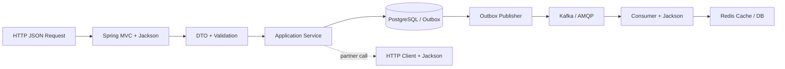

# ObjectMapper, Jackson Modules, and Shared Serialization Configuration

In **SPRING_BOOT_INTEGRATION**, JSON data can flow through HTTP controllers, HTTP clients calling partners, Kafka/AMQP, Redis caches, a transactional outbox, and Spring Integration adapters. Each touchpoint has a **data contract**: field names, numeric types, timestamp representations, enum states, `null` values, unrecognized fields, and message versions. If each component creates its own `ObjectMapper` or configures Jackson differently, an event can be written as valid JSON by the producer yet fail to deserialize at the consumer.

This lesson in the **Data Contracts** chapter explains how Spring Boot configures Jackson, how to use `ObjectMapper` and extension modules, and a strategy to **standardize serialization rules** without accidentally forcing partners with different contracts into the same format. The emphasis is on preserving data across HTTP, storage, caches, and brokers; classifying errors clearly; evolving schemas safely; and testing and observing real integration flows.

> The Java examples use **Java 17+, Spring Boot 3.x, and Jackson 2.x** (`com.fasterxml.jackson.*` packages). For other Boot/Jackson generations, check the BOM and migration guides for your exact version before copying APIs. This lesson teaches contract design, not a requirement that every system use the exact same Jackson version.

## 1. Learning Objectives

After this lesson, you will be able to:

1. Distinguish **serialization**, **deserialization**, `ObjectMapper`, `JsonNode`, `ObjectReader`, `ObjectWriter`, and Jackson modules.
2. Recognize what Jackson infrastructure Spring Boot auto-configures when appropriate dependencies and conditions are met.
3. Choose `spring.jackson.*`, `Jackson2ObjectMapperBuilderCustomizer`, `@Bean Module`, or DTO-level annotations with the right scope.
4. Design consistent JSON formats for monetary amounts, timestamps, field names, enums, and immutable Java objects.
5. Separate internal contract policies from HTTP APIs, partners, and event brokers to avoid propagating breaking changes.
6. Test round-trip JSON, invalid payloads, version compatibility, duplicate handling, caches, and deserialization failures at system boundaries.

## 2. Why Do We Need a Shared Jackson Policy?

Consider an order creation flow:



An `occurredAt` field can be serialized in two different ways:

```json
{"occurredAt":"2026-11-21T05:30:00Z"}
```

```json
{"occurredAt":1795239000.000000000}
```

Both can be valid timestamp representations depending on configuration and data types, yet **they are not interchangeable when a contract accepts only one**. Similarly, `orderId` and `order_id` differ in JSON key name; `1200.50` (number) and `"1200.50"` (string) differ in type. Changing a global mapper can simultaneously alter HTTP responses, outbox JSON, and cache values without touching a single DTO.

A **shared** policy does not mean "every JSON format in the world must look identical." It means:

- Establishing an **application-wide default policy** instead of letting each service call `new ObjectMapper()`.
- **Separating and explicitly naming** contracts with different rules (a `snake_case` partner API, legacy event versions, internal Redis caches), using dedicated mappers or codecs where needed.
- Verifying every change to policies, annotations, or modules against **fixed JSON fixtures** and producer–consumer tests.

## 3. Jackson Components in Spring Boot

| Component | Responsibility | When to use |
| --- | --- | --- |
| `ObjectMapper` | Core JSON read/write engine managing serializers, deserializers, modules, and features | Use as the central configured instance or inject it for JSON handling outside the HTTP framework. |
| `ObjectReader` | Reusable **read** configuration scoped by type and features | Consumers parsing a specific contract without modifying the shared mapper. |
| `ObjectWriter` | Reusable **write** configuration scoped by type and features | Publishers/outboxes needing consistent, thread-safe serialization. |
| `JsonNode` | Tree model preserving dynamic JSON structure | Reading multi-version envelopes, checking field presence vs. absence, PATCH. |
| `Module` | Registers support for Java types or extended serialize/deserialize rules | `JavaTimeModule`, custom modules for value objects. |
| `@JsonProperty`, `@JsonFormat`, `@JsonInclude`… | Rules scoped to **a single DTO, property, or type** | Pinning part of a contract independently of global policy. |
| Spring MVC JSON converter | Converts JSON requests/responses to/from objects in controllers | HTTP inbound/outbound when using Jackson message converters. |
| Broker/cache JSON serializer | Converts DTOs to bytes and back per client configuration | Kafka, AMQP, Redis, outbox; does not automatically share MVC's mapper. |

### Serialization and Deserialization Are Independent Directions

**Serialization**: `CustomerResponse` → JSON → HTTP response or event payload.

**Deserialization**: JSON received from partner/broker → `CreateCustomerRequest` or `OrderCreatedEventV1`.

A policy can make serialization right while deserialization goes wrong. For example, `@JsonInclude(NON_NULL)` omits `null` fields when **writing**, but does not prevent callers from sending unknown fields or `null` values in requests. `FAIL_ON_UNKNOWN_PROPERTIES` applies when **reading** JSON into a POJO, and does not stop your mapper from emitting a sensitive field.

### Java `record` and Date/Time Types

Jackson 2.12+ supports Java records under typical configurations. For `Instant`, `LocalDate`, `OffsetDateTime`, and other `java.time` types, **`JavaTimeModule`** from `jackson-datatype-jsr310` is essential for reading and writing. Only when the module is properly discovered/registered and date/time features are configured will timestamps serialize in the expected format.

Other useful modules include:

| Module | Purpose |
| --- | --- |
| `JavaTimeModule` | Supports `java.time` types; prefer this over manually formatting dates as strings in every mapper. |
| `Jdk8Module` | Supports additional JDK 8 types such as `Optional` in Jackson 2. |
| `ParameterNamesModule` | Aids binding constructor parameter names for suitable Java types when metadata is available. |
| `KotlinModule` | Integrates Kotlin class/nullability semantics when the application uses Kotlin. |
| `SimpleModule` | Registers custom application serializers and deserializers. |

Do not register modules "just in case" if you do not use those types. A custom module applied to a type used across multiple endpoints can alter the wire format of that type everywhere. Understand the blast radius and maintain regression tests.

## 4. How Much Does Spring Boot Auto-Configure Jackson?

In **Spring Boot 3.x**, when a compatible Jackson 2 is on the classpath and no custom beans cause auto-configuration to back off, Boot can register a configured `ObjectMapper` and `Jackson2ObjectMapperBuilder`. Boot's customizers, properties, and available Jackson modules are applied when building the mapper. With Spring MVC, the framework's JSON converter can conditionally use the Boot-configured mapper.

`spring-boot-starter-web` transitively brings in the required JSON dependencies via the JSON starter; an application processing JSON without MVC can declare `spring-boot-starter-json` directly. **Do not add `spring-boot-starter-web` just to inject `ObjectMapper` in a batch consumer.**

| What Boot/Framework can set up | What the application must define |
| --- | --- |
| Starter/BOM-aligned dependencies, mapper/builder infrastructure, classpath-detected modules | Which DTOs and JSON contracts are exposed externally. |
| Sensible defaults for JSON in the web stack where applicable | Field names, enums, null semantics, version compatibility, and sensitive data handling. |
| Reading `spring.jackson.*` properties and customizers | Whether to reject unknown fields, timestamp formatting, and per-partner policies. |
| Wiring `Module` beans into builder-managed mappers | Custom serializers/deserializers, testing, and impact scope. |
| HTTP client/broker/cache infrastructure via their own starters | Ensuring each adapter's codec actually receives the intended mapper. |

In Boot 3 / Jackson 2 ecosystems, Boot typically disables features such as `SerializationFeature.WRITE_DATES_AS_TIMESTAMPS` and `DeserializationFeature.FAIL_ON_UNKNOWN_PROPERTIES` on the Boot-managed mapper. **Do not rely on implicit defaults to preserve long-lived contracts:** state critical rules explicitly in configuration and tests, because a separately constructed mapper or different version may behave differently.

If you manually instantiate:

```java
ObjectMapper adHoc = new ObjectMapper();
```

that instance **does not automatically inherit** modules, timezones, customizers, or policies from Spring Boot. Consequently, the same DTO could serialize differently between a `@RestController` and message-publishing code. Prefer **injecting the Spring-managed mapper**, or building a purpose-specific mapper from a tested builder/configuration.

## 5. Global Configuration via `spring.jackson.*`

Suppose an application decides:

- `Instant` and absolute timestamps must be published as ISO-8601 strings, not numeric timestamps.
- Inbound JSON for **internal APIs requiring strict contracts** rejects unknown fields.
- Time and timezone handling are explicit rather than dependent on the host machine's timezone.

```yaml
spring:
  jackson:
    serialization:
      write-dates-as-timestamps: false
    deserialization:
      fail-on-unknown-properties: true
    time-zone: UTC
```

This applies **globally to the Boot-built and Boot-managed mapper**, not automatically to every manually instantiated mapper or every Kafka/Redis JSON codec. Nor does it replace business validation or schema validation.

Additional options to consider:

| Property or feature | Impact and caveats |
| --- | --- |
| `spring.jackson.default-property-inclusion: non_null` | Omits null properties when **writing**. Do not enable if contracts must distinguish "intentional null" from "absent." |
| `spring.jackson.property-naming-strategy: SNAKE_CASE` | Changes field-naming rules globally, which can cause breaking changes across many endpoints. |
| `spring.jackson.deserialization.fail-on-unknown-properties: true` | Rejects unknown fields when reading POJOs; tightens contract discipline but can break forward compatibility when partners add fields. |
| `spring.jackson.serialization.write-dates-as-timestamps: false` | Prefers string date/time representation for types/modules honoring this feature. Still test exact format and timezone. |
| `spring.jackson.time-zone: UTC` | Sets the timezone where Jackson uses its default timezone; does not automatically convert every date/time type to UTC or unify semantics. |

**Policy scope is an architectural decision:** For public APIs that must tolerate newly added partner fields, you should not blindly turn on strict unknown-field rejection for every inbound DTO. You can adopt a lenient default policy and enforce strictness at key boundaries via dedicated schemas, DTOs, or `ObjectReader`s—or adopt a strict default and **explicitly allow unknown fields** on contracts requiring forward compatibility. Document the decision in the API spec and test both directions.

## 6. Sample DTOs Illustrating Controlled Contracts

Suppose HTTP receives an order creation command, the service persists to PostgreSQL, and then creates an event for a broker.

### 6.1. Request DTO and Response DTO

```java
import jakarta.validation.constraints.NotBlank;
import jakarta.validation.constraints.NotNull;
import jakarta.validation.constraints.Positive;
import java.math.BigDecimal;
import java.time.Instant;
import java.util.UUID;

public record CreateOrderRequest(
        @NotBlank String orderId,
        @NotBlank String customerId,
        @NotNull @Positive BigDecimal totalAmount
) {}

public record OrderResponse(
        UUID id,
        String orderId,
        String status,
        BigDecimal totalAmount,
        Instant createdAt
) {}
```

These are two **distinct contracts**. Callers must not be allowed to send `status` or `createdAt` in the request simply because the DB table has those columns. The response must not emit `internalRiskScore` or `deleted` even if an entity contains internal fields.

Valid request JSON:

```json
{
  "orderId": "ORD-001245",
  "customerId": "CUS-0008",
  "totalAmount": 125000.50
}
```

Response JSON:

```json
{
  "id": "e398a09c-8590-4332-919f-6410748b3a70",
  "orderId": "ORD-001245",
  "status": "ACCEPTED",
  "totalAmount": 125000.50,
  "createdAt": "2026-11-21T05:30:00Z"
}
```

For monetary amounts, `BigDecimal` avoids binary floating-point rounding errors in calculations and when serializing from `double`; however, you still must specify **currency unit, decimal places, precision/scale, and rounding rules**. A JSON number does not carry a currency; contracts should include `currency` (ISO 4217) or fix it unambiguously in the API specification. `BigDecimal("1.0")` and `BigDecimal("1.00")` compare numerically equal yet differ in scale; do not rely on raw JSON string formatting to verify monetary equality unless the contract mandates exact digit formatting.

### 6.2. Event DTOs Differ from HTTP Request/Response DTOs

```java
import java.math.BigDecimal;
import java.time.Instant;
import java.util.UUID;

public record OrderAcceptedEventV1(
        String eventId,
        int schemaVersion,
        UUID orderUuid,
        String orderId,
        BigDecimal totalAmount,
        Instant occurredAt
) {}
```

`schemaVersion` helps consumers distinguish event versions. `eventId` is the **stable identifier of the logical event** and must stay identical when republished from an outbox. A retry must never generate a new `eventId`, because doing so defeats duplicate detection.

Example event JSON:

```json
{
  "eventId": "evt-order-001245",
  "schemaVersion": 1,
  "orderUuid": "e398a09c-8590-4332-919f-6410748b3a70",
  "orderId": "ORD-001245",
  "totalAmount": 125000.50,
  "occurredAt": "2026-11-21T05:30:00Z"
}
```

An event DTO should not be shared with a JPA entity or an HTTP response simply because their fields overlap. They have different consumers, access permissions, compatibility lifetimes, and business meanings. When a consumer needs a new field, evolve the **event contract** deliberately rather than automatically exposing the entire database row.

## 7. Configuring with `Jackson2ObjectMapperBuilderCustomizer`

When `spring.jackson.*` cannot express a requirement or you want centralized Java configuration, you can register a **`Jackson2ObjectMapperBuilderCustomizer`**. This extends the Boot-created mapper while keeping Boot's infrastructure and auto-detected modules intact.

```java
import com.fasterxml.jackson.databind.DeserializationFeature;
import com.fasterxml.jackson.databind.SerializationFeature;
import org.springframework.boot.autoconfigure.jackson.Jackson2ObjectMapperBuilderCustomizer;
import org.springframework.context.annotation.Bean;
import org.springframework.context.annotation.Configuration;

@Configuration(proxyBeanMethods = false)
public class JsonPolicyConfiguration {

    @Bean
    Jackson2ObjectMapperBuilderCustomizer contractJsonCustomizer() {
        return builder -> {
            builder.featuresToDisable(
                    SerializationFeature.WRITE_DATES_AS_TIMESTAMPS);
            builder.featuresToEnable(
                    DeserializationFeature.FAIL_ON_UNKNOWN_PROPERTIES);
        };
    }
}
```

The customizations above could also be declared in YAML as shown earlier; **you do not need to declare both**. If the same feature is configured in multiple places, application order can affect the final result. Choose **one primary source of policy**, clearly separate contract-specific overrides, and write tests asserting the actual configuration running in the application.

**Avoid replacing Boot's mapper with a brand-new bean just to toggle one feature:**

```java
// DO NOT blindly copy this just to adjust 1-2 features.
@Bean
ObjectMapper objectMapper() {
    return new ObjectMapper();
}
```

Declaring your own `ObjectMapper` bean can cause Boot's defaults to back off or stop applying as expected; `java.time` modules and customizers may also be skipped. If you genuinely need to replace the mapper entirely, you must take explicit responsibility for all serializers, deserializers, modules, features, converters, and corresponding tests. In normal scenarios, use `spring.jackson.*`, customizers, or `Module` beans instead of replacing the primary bean.

### Precedence of Different Customization Approaches

| Need | Appropriate mechanism |
| --- | --- |
| Change default formatting for most application JSON | `spring.jackson.*` or one centralized customizer. |
| Add support for a widely used Java type | `@Bean Module` with tested serializer/deserializer. |
| Pin a key or format within a single public DTO | `@JsonProperty`, `@JsonFormat`, or class/field annotations. |
| Partner API with distinct rules | Dedicated DTO + `ObjectReader`/`ObjectWriter` or explicitly named mapper/client codec. |
| Broker events needing an immutable contract post-publish | Versioned serializer/DTO, fixtures, and consumer contract tests; consider storing serialized outbox bytes before publishing. |

## 8. Registering a Custom Jackson Module

For instance, in the internal domain an order code may be a **value object** rather than a raw string:

```java
public record OrderCode(String value) {
    public OrderCode {
        if (value == null || !value.matches("ORD-[0-9]{6}")) {
            throw new IllegalArgumentException("Invalid order code");
        }
    }
}
```

If the JSON contract requires `"orderId": "ORD-001245"`, you can register a serializer/deserializer so Jackson does not serialize it by default as `{"value":"ORD-001245"}`. This is a classic use case for `SimpleModule`.

```java
import com.fasterxml.jackson.core.JsonGenerator;
import com.fasterxml.jackson.core.JsonParser;
import com.fasterxml.jackson.core.JsonToken;
import com.fasterxml.jackson.databind.DeserializationContext;
import com.fasterxml.jackson.databind.JsonDeserializer;
import com.fasterxml.jackson.databind.JsonMappingException;
import com.fasterxml.jackson.databind.JsonSerializer;
import com.fasterxml.jackson.databind.SerializerProvider;
import java.io.IOException;

public final class OrderCodeSerializer extends JsonSerializer<OrderCode> {
    @Override
    public void serialize(
            OrderCode value,
            JsonGenerator generator,
            SerializerProvider serializers) throws IOException {
        generator.writeString(value.value());
    }
}

public final class OrderCodeDeserializer extends JsonDeserializer<OrderCode> {
    @Override
    public OrderCode deserialize(
            JsonParser parser,
            DeserializationContext context) throws IOException {
        if (!parser.hasToken(JsonToken.VALUE_STRING)) {
            throw JsonMappingException.from(
                    parser, "order code must be a JSON string");
        }
        return new OrderCode(parser.getText());
    }
}
```

```java
import com.fasterxml.jackson.databind.Module;
import com.fasterxml.jackson.databind.module.SimpleModule;
import org.springframework.context.annotation.Bean;
import org.springframework.context.annotation.Configuration;

@Configuration(proxyBeanMethods = false)
public class OrderCodeJacksonConfiguration {

    @Bean
    Module orderCodeModule() {
        var module = new SimpleModule("order-code-v1");
        module.addSerializer(OrderCode.class, new OrderCodeSerializer());
        module.addDeserializer(OrderCode.class, new OrderCodeDeserializer());
        return module;
    }
}
```

With a Boot-built mapper via the standard builder, `Module` beans are automatically registered by Spring Boot's Jackson auto-configuration. Verify both **writing** and **reading**:

```java
public record OrderEnvelope(
        String eventId,
        OrderCode orderId
) {}
```

The resulting JSON matches the contract:

```json
{
  "eventId": "evt-123",
  "orderId": "ORD-001245"
}
```

Without the module, the format of `OrderCode` or ability to read it may differ from expectations. When a module is registered **globally**, every DTO using `OrderCode` follows the same rule—which is great for consistency **and also a change-propagation risk**. If only one partner expects a different JSON shape, isolate an adapter and mapper/reader rather than silently altering the global module.

Note: a validator in `OrderCode`'s constructor may throw `IllegalArgumentException` if the payload breaks the rule. Jackson surfaces that failure through the deserialization error path; the application must still classify it as a contract error or poison message rather than retrying infinitely like a network outage.

## 9. Annotations to Keep Partner-Specific Contracts Stable

Partner A might send `snake_case` while your public service API uses `camelCase`. Do not change `spring.jackson.property-naming-strategy` globally for a single partner.

```java
import com.fasterxml.jackson.annotation.JsonAlias;
import com.fasterxml.jackson.annotation.JsonIgnoreProperties;
import com.fasterxml.jackson.annotation.JsonProperty;
import com.fasterxml.jackson.databind.PropertyNamingStrategies;
import com.fasterxml.jackson.databind.annotation.JsonNaming;

@JsonNaming(PropertyNamingStrategies.SnakeCaseStrategy.class)
@JsonIgnoreProperties(ignoreUnknown = true)
public record PartnerCustomerResponse(
        String externalId,
        String displayName,
        @JsonProperty("account_state") String status
) {}
```

Example JSON received from the partner:

```json
{
  "external_id": "P-1001",
  "display_name": "Customer A",
  "account_state": "ACTIVE",
  "partner_revision": 7
}
```

The mapper reads `external_id`, `display_name`, and `account_state` into the three Java components; `partner_revision` is ignored **only because this DTO intentionally permits unknown fields**. When internal APIs require strict schemas, do not habitually annotate every request with `@JsonIgnoreProperties(ignoreUnknown = true)`.

Annotations to distinguish:

| Annotation | Behavior | Caveat |
| --- | --- | --- |
| `@JsonProperty("customer_id")` | Specifies the JSON property name and pins the contract key. | Changing the key can be a breaking change even if the Java field name stays the same. |
| `@JsonAlias({"old_name"})` | Allows **reading** alternative names for the same property. | Does not automatically emit both old and new names when **writing**. |
| `@JsonNaming(...)` | Sets a naming strategy at the class level. | Be careful with fields that already carry `@JsonProperty`. |
| `@JsonInclude(NON_NULL)` | Omits null properties on serialization within annotation scope. | Can erase the distinction between `null` and absent in PATCH contracts. |
| `@JsonIgnore` | Excludes a property from mapping under normal configuration. | Never treat this annotation as comprehensive authorization control. |
| `@JsonFormat` | Custom format for a property/type where supported. | May conflict with a unified ISO-8601 standard. |
| `@JsonIgnoreProperties(ignoreUnknown = true)` | Ignores unknown properties during deserialization for the type. | Convenient when partners add fields, but can also mask misspelled field names. |

### Renaming a Field Without Breaking Old Consumers

```java
import com.fasterxml.jackson.annotation.JsonAlias;
import com.fasterxml.jackson.annotation.JsonProperty;

public record CustomerLookupRequest(
        @JsonProperty("customerId")
        @JsonAlias("legacyCustomerId")
        String customerId
) {}
```

The mapper can accept `legacyCustomerId` when **reading**, yet serializes under the canonical name `customerId`. If both names appear in the same JSON payload with conflicting values, define an explicit **conflict/ambiguity detection** policy at the boundary instead of trusting parser key order. For critical contracts, test this scenario or introduce a new version rather than relying on aliases.

## 10. Missing Fields, Null, and PATCH Must Have Clear Semantics

Two different payloads:

```json
{"displayName":"Lan"}
```

```json
{"displayName":null}
```

In a partial-update endpoint, the first payload might mean "update the name"; the second might mean "clear the name" or "error," depending on the contract. Meanwhile:

```json
{}
```

might mean "change no fields." A Java record containing only `String displayName` cannot distinguish "field absent" from "explicit null" after deserialization because both become `null`.

Options depending on requirements:

1. For **full-replacement PUT**, define a request DTO requiring the relevant fields and document how absent fields are interpreted.
2. For **PATCH**, use a representation that tracks field presence, such as `JsonNode`, an appropriate wrapper type, or a standard **JSON Merge Patch (RFC 7396)** / JSON Patch implementation per API policy.
3. With event brokers, do not silently use `null` to signal deletion unless the event schema explicitly defines that semantic.

Example checking field presence with `JsonNode`:

```java
import com.fasterxml.jackson.databind.JsonNode;

public final class PartialUpdateRules {
    public static boolean shouldChangeDisplayName(JsonNode patch) {
        return patch.has("displayName");
    }

    public static boolean requestsClearDisplayName(JsonNode patch) {
        return patch.has("displayName")
                && patch.get("displayName").isNull();
    }
}
```

This code only illustrates **presence detection**; production code must also validate that the root is an object, check field types, verify edit permissions, enforce nullability rules, and validate operation schemas. Do not enable `spring.jackson.default-property-inclusion: non_null` for contracts where **explicit nulls must be serialized**.

## 11. Which Contracts Actually Share the Common Mapper?

A common misconception: **injecting the same `ObjectMapper` into a service** does not mean every library in the application automatically uses that mapper. Each channel has its own serializer/codec, and some starters create independent mappers unless wired explicitly.

| Channel | Who converts JSON? | What to verify |
| --- | --- | --- |
| Spring MVC HTTP inbound/outbound | Jackson HTTP message converter configured by Spring Web | Which mapper does the converter use, and do endpoints have custom annotations/validation? |
| `RestClient`/`RestTemplate` | HTTP message converters on the builder/client instance | Was the client built from Boot's configured builder, or did it instantiate its own converter/mapper? |
| `WebClient` | HTTP codecs/`ExchangeStrategies` | How were codecs configured on the Boot/custom client, and do Jackson encoder/decoder share the policy? |
| Kafka | Spring Kafka JSON serializer/deserializer or Avro/Protobuf codecs | Do `JsonSerializer`/`JsonDeserializer` receive the right mapper; are type headers, trusted packages, and schema versions clear? |
| RabbitMQ/AMQP | Jackson JSON message converter registered on the broker adapter | Does the converter use the chosen mapper; are content type and class binding safe? |
| Redis cache | `RedisSerializer` or `CacheManager` per configuration | Are value types, versioned keys, TTL, null semantics, and mapper aligned? |
| Transactional outbox | Code serializing the payload before/when writing the outbox | Under which version are bytes stored; does the publisher preserve the payload on retry? |
| Spring Integration | Inbound/outbound adapters or transformers per protocol | Where does conversion between `Message<?>` and JSON occur, and where are deserialization errors routed? |

### 11.1. HTTP: MVC and HTTP Clients

When Spring MVC uses Boot's default converter setup, JSON requests and responses flow through the mapper aligned with the Boot context. HTTP clients built from Boot-provided builders can reuse the starter-configured converters/codecs.

However, if an adapter calls `RestClient.create()`, `new MappingJackson2HttpMessageConverter(new ObjectMapper())`, or builds `WebClient` with completely separate `ExchangeStrategies`, the JSON format **may diverge**. Test outbound requests against a mock HTTP server to verify actual wire bytes, not only `mapper.writeValueAsString(...)`.

Example controller that accepts and returns DTOs rather than database entities:

```java
import jakarta.validation.Valid;
import org.springframework.http.ResponseEntity;
import org.springframework.web.bind.annotation.PostMapping;
import org.springframework.web.bind.annotation.RequestBody;
import org.springframework.web.bind.annotation.RequestMapping;
import org.springframework.web.bind.annotation.RestController;

@RestController
@RequestMapping("/api/orders")
public class OrderController {
    private final OrderApplicationService service;

    public OrderController(OrderApplicationService service) {
        this.service = service;
    }

    @PostMapping
    public ResponseEntity<OrderResponse> create(
            @Valid @RequestBody CreateOrderRequest request) {
        return ResponseEntity.ok(service.create(request));
    }
}
```

`OrderApplicationService` is an application-defined service; the mapper only governs JSON, and does not automatically provide transactions, unique constraints, or `customerId` ownership checks.

### 11.2. Kafka: Passing the Mapper to the Serializer Intentionally

In Spring Kafka with Jackson 2, if using the JSON serializer, you can construct a serializer with the injected mapper:

```java
import com.fasterxml.jackson.databind.ObjectMapper;
import org.springframework.kafka.support.serializer.JsonSerializer;

public final class OrderEventSerialization {
    public static JsonSerializer<OrderAcceptedEventV1> create(
            ObjectMapper objectMapper) {
        return new JsonSerializer<OrderAcceptedEventV1>(objectMapper);
    }
}
```

This is **one serializer configuration step**, not a complete Kafka `ProducerFactory`. The application still must attach this serializer to the appropriate producer factory/template for its Spring Kafka version and ensure consumers use a compatible schema. A default `JsonSerializer`, a property-configured `JsonDeserializer`, and an HTTP converter are **three separate configuration sites**: never assume they automatically share the same `ObjectMapper`.

Do not embed internal Java class names in JSON and rely on arbitrary deserialization to choose types. For event brokers, use independent `eventType` and `schemaVersion` fields; register an **allowlist of permitted event types** in the adapter, enforce strict trust policies on type headers, and reject invalid types. When using Avro/Protobuf with a schema registry, serialization is governed by those technologies; do not force every broker payload through Jackson JSON.

### 11.3. Redis/Cache: Storage Format Is Its Own Schema

With Redis caching, values may be JSON, Java-serialized bytes, or another serializer's output depending on configuration. Never assume `CacheManager` writes JSON simply because Jackson is on the classpath.

To store JSON in a cache, configure `RedisSerializationContext.SerializationPair`/`RedisSerializer` for the value type, **pass a mapper or codec with a tested policy**, and specify an explicit type schema. Avoid unrestricted JSON polymorphic deserialization for keys that untrusted sources could write to.

When evolving a JSON cache value from version 1 to version 2, instances running side-by-side during a rolling deployment may read and write the same keys. Safe strategies include versioned keys like `cache:v2:orders:{id}`, TTLs, migration/fallback readers, or controlled invalidation. **TTL is data lifetime**, not a schema version, and does not replace compatibility verification.

### 11.4. Outbox: Freezing the Payload Across Republishes

Suppose a service creates an event, writes it to an outbox, and a publisher sends it only after DB commit. There are two outbox storage options:

- **Store the JSON payload with `eventType` and `schemaVersion`** at the time of the business transaction. Retries send the **exact representation** originally recorded, preventing a new deployment from altering an unpublished legacy event's format.
- **Store domain data and serialize JSON at publish time.** This requires strict compatibility discipline because a newer deployment may serialize the same record into different JSON before it gets published.

For systems needing stable contracts and clear auditing, storing the versioned serialized payload is often beneficial. When designing an idempotency fingerprint, do not hash raw JSON directly without an agreed **canonicalization**: field order, whitespace, Unicode normalization, and number formatting can give two equivalent payloads different byte representations. Prefer a stable business key or clearly normalized data.

## 12. Classifying Deserialization and Validation Errors

An API receiving JSON should return errors by root cause rather than lumping everything into "JSON error":

| Issue | Example | Appropriate handling |
| --- | --- | --- |
| Malformed JSON syntax | Missing brace, trailing comma | Return `400 Bad Request` or corresponding inbound contract error code. |
| JSON type mismatches DTO | Object sent for a string field, invalid enum | Deserialization error maps to HTTP 400 or rejected/quarantined message depending on channel. |
| Unknown field in strict mode | `{"isAdmin":true}` on a request without that field | Reject explicitly or apply a documented lenient policy per version. |
| Bean Validation failure | `@NotBlank`, `@Positive`, `@Size` | Contract/validation error; do not retry like an infrastructure failure. |
| Valid JSON but violates business rules | Order is closed, customer lacks permission | Handle in application service/domain; return HTTP 409/422 or contract-defined code. |
| Database constraint violation | Duplicate `orderId`, optimistic lock conflict | Protect data with unique keys/locks/versions and translate exceptions to business errors. |
| Infrastructure failure | DB/broker connection lost, HTTP timeout | Bounded retries with idempotency if the operation is safe to repeat. |

**Jackson does not automatically run Bean Validation.** Calling `objectMapper.readValue(...)` parses JSON into a DTO, but does not run `@NotBlank`, `@Email`, or service validators. In Spring MVC, use `@Valid @RequestBody` with the validation starter; in Kafka/AMQP/Spring Integration, adapters must invoke a validator explicitly or wire validation integration.

Example HTTP error format with a stable code and no stack traces or SQL:

```json
{
  "type": "https://api.example.org/problems/invalid-payload",
  "title": "Invalid request body",
  "status": 400,
  "code": "INVALID_JSON_CONTRACT",
  "correlationId": "req-18f3"
}
```

You can use Spring `ProblemDetail` / `@RestControllerAdvice` to standardize API errors, while ensuring statuses and details never leak sensitive field values. In an event broker, poison payloads should not be retried infinitely; route them to a DLQ/quarantine with safe metadata for investigation and a replay procedure after fixing the schema/code.

### Why Neither Strict Nor Lenient Is Always Right for Every Source

**Strict** fits when producer and consumer are co-controlled, field violations must fail fast, and the contract disallows extensions. **Lenient** can fit when partners routinely add fields to responses and consumers read only a subset. However, lenient mode can let a typo like `orderdId` pass silently, leaving a required field `null`.

Base the choice on **source control, independent release cadence, and required-field enforcement**. Do not use a single annotation as a substitute for a contract compatibility strategy.

## 13. Security and Resource Limits When Handling JSON

JSON arriving from HTTP clients, brokers, or partners is **untrusted input**. Even syntactically valid JSON can trigger resource exhaustion or data manipulation if left unguarded.

1. **Prevent mass assignment:** never deserialize directly into a JPA entity or internal object holding fields like `role`, `approved`, or `internalStatus`. Request DTOs must include only caller-editable fields.
2. **Do not enable arbitrary polymorphic default typing on untrusted input:** type metadata can widen the attack surface by allowing overly broad Java type instantiation. If polymorphism is required, restrict subtypes tightly with `PolymorphicTypeValidator` per contract.
3. **Limit size and complexity:** cap body/message sizes in the web server, broker, and parser; Jackson 2.15+ provides `StreamReadConstraints` for nesting depth, string length, and related limits. Check your actual library version.
4. **Never log raw sensitive payloads:** keep tokens, emails, card numbers, and personal data out of logs, metric tags, and error responses. Log event type, version, correlation ID, and error category where appropriate.
5. **Do not trust arbitrary broker type headers:** if a JSON deserializer resolves Java classes from headers, restrict trusted packages/types and decouple contract `eventType` from internal implementation class names.
6. **Separate read authorization from serialization format:** the fact that Jackson serializes a field does not mean the caller is authorized to see it. Enforce authorization in services/DTO mapping and tailor responses per caller.

`@JsonIgnore` participates in serialization decisions, but it is not a security policy: another mapper, another endpoint, or a different serialization framework might not apply the same annotation or contract.

## 14. Using `ObjectReader` and `ObjectWriter` to Avoid Mutating the Shared Mapper

An `ObjectMapper` configured **before first use** is designed for safe thread-shared reuse. Avoid toggling features or modules on the shared mapper while handling requests, because serializers/deserializers may already be cached and runtime behavior becomes inconsistent.

Instead of:

```java
// Do not mutate the shared mapper per message!
sharedMapper.configure(
        DeserializationFeature.FAIL_ON_UNKNOWN_PROPERTIES, false);
```

the safe approach is to create specifically configured readers and writers:

```java
import com.fasterxml.jackson.databind.DeserializationFeature;
import com.fasterxml.jackson.databind.ObjectMapper;
import com.fasterxml.jackson.databind.ObjectReader;
import com.fasterxml.jackson.databind.ObjectWriter;

public final class PartnerJsonCodec {
    private final ObjectReader responseReader;
    private final ObjectWriter eventWriter;

    public PartnerJsonCodec(ObjectMapper applicationMapper) {
        this.responseReader = applicationMapper
                .readerFor(PartnerCustomerResponse.class)
                .without(DeserializationFeature.FAIL_ON_UNKNOWN_PROPERTIES);
        this.eventWriter = applicationMapper
                .writerFor(OrderAcceptedEventV1.class);
    }

    public PartnerCustomerResponse readResponse(String json)
            throws java.io.IOException {
        return responseReader.readValue(json);
    }

    public String writeEvent(OrderAcceptedEventV1 event)
            throws com.fasterxml.jackson.core.JsonProcessingException {
        return eventWriter.writeValueAsString(event);
    }
}
```

`ObjectReader` and `ObjectWriter` are immutable/reusable configuration objects in typical usage. They support per-contract customization without altering global configuration. When a partner requires a **completely different module or naming strategy**, build a dedicated mapper **once at startup** (e.g., via a configured builder or `ObjectMapper.copy()`), name and inject it into that adapter, and never mutate it during request processing.

Create mappers or `readValue`/`writeValue` codecs purposefully; never call `new ObjectMapper()` repeatedly per message, as constructing/caching serializers and registering modules carries runtime cost and risks missing configuration.

## 15. Testing Shared JSON Configuration

To keep contracts stable, **test the generated JSON and readable JSON**, not just Java getters. In Spring Boot, `@JsonTest` provides a test slice for serialization/deserialization and relevant Jackson components. For critical contracts, maintain fixed JSON fixtures to catch regressions caused by dependency upgrades or customizers.

### 15.1. Unit/Slice Tests with `@JsonTest`

The following example uses JUnit Jupiter, Jackson, and Spring Boot Test. If the test slice does not automatically pick up custom configuration classes depending on package layout, `@Import` explicitly registers the policies/modules under test:

```java
import static org.junit.jupiter.api.Assertions.assertEquals;
import static org.junit.jupiter.api.Assertions.assertFalse;
import static org.junit.jupiter.api.Assertions.assertThrows;
import static org.junit.jupiter.api.Assertions.assertTrue;

import com.fasterxml.jackson.databind.JsonNode;
import com.fasterxml.jackson.databind.ObjectMapper;
import com.fasterxml.jackson.databind.exc.UnrecognizedPropertyException;
import java.math.BigDecimal;
import java.time.Instant;
import java.util.UUID;
import org.junit.jupiter.api.Test;
import org.springframework.beans.factory.annotation.Autowired;
import org.springframework.boot.test.autoconfigure.json.JsonTest;
import org.springframework.context.annotation.Import;

@JsonTest
@Import({JsonPolicyConfiguration.class, OrderCodeJacksonConfiguration.class})
class OrderJsonContractTest {

    @Autowired ObjectMapper mapper;

    @Test
    void eventSerializesInstantAndMoneyAsAgreed() throws Exception {
        var event = new OrderAcceptedEventV1(
                "evt-123", 1,
                UUID.fromString("e398a09c-8590-4332-919f-6410748b3a70"),
                "ORD-001245",
                new BigDecimal("125000.50"),
                Instant.parse("2026-11-21T05:30:00Z"));

        String json = mapper.writeValueAsString(event);
        JsonNode tree = mapper.readTree(json);

        assertEquals("2026-11-21T05:30:00Z",
                tree.get("occurredAt").asText());
        assertEquals(1, tree.get("schemaVersion").asInt());
        assertTrue(tree.get("totalAmount").isNumber());
        assertFalse(tree.has("internalRiskScore"));

        OrderAcceptedEventV1 restored =
                mapper.readValue(json, OrderAcceptedEventV1.class);
        assertEquals(event.eventId(), restored.eventId());
        assertEquals(event.totalAmount(), restored.totalAmount());
        assertEquals(event.occurredAt(), restored.occurredAt());
    }

    @Test
    void strictRequestRejectsUnexpectedProperty() {
        String json = """
                {
                  "orderId": "ORD-001245",
                  "customerId": "CUS-0008",
                  "totalAmount": 125000.50,
                  "internalRiskScore": 99
                }
                """;

        assertThrows(UnrecognizedPropertyException.class,
                () -> mapper.readValue(json, CreateOrderRequest.class));
    }

    @Test
    void customModuleWritesAndReadsOrderCodeAsString()
            throws Exception {
        var envelope = new OrderEnvelope(
                "evt-123", new OrderCode("ORD-001245"));

        String json = mapper.writeValueAsString(envelope);
        assertEquals("ORD-001245",
                mapper.readTree(json).get("orderId").asText());

        OrderEnvelope restored =
                mapper.readValue(json, OrderEnvelope.class);
        assertEquals("ORD-001245", restored.orderId().value());
    }
}
```

This test validates the **mapper in the Jackson slice**; it does not prove that the Kafka producer, Redis cache, or HTTP client actually uses it. Nor does `@JsonTest` run Bean Validation annotations such as `@NotBlank`/`@Positive`. Add integration tests for those boundaries.

### 15.2. Contract Tests by Channel and Version

| Scope | Required tests | What it proves |
| --- | --- | --- |
| DTO/`ObjectMapper` | Serialize and deserialize against fixtures for UUID, timestamp, money, enum, null, unknown fields | The tested mapper's Jackson rules match the contract. |
| Spring MVC | `@WebMvcTest`/MockMvc, `@Valid`, JSON errors, and headers | HTTP converters, validation, and JSON error handling at the web boundary. |
| Outbound HTTP | Mock HTTP server checking body, headers, and content type | The real HTTP client sends bytes matching the contract. |
| Kafka/AMQP | Real broker container and actual serializer/converter; consumer reads event back | Codecs, type policies, ack/error paths, and wire payload. |
| Redis cache | Redis container, read/write, TTL, versioned key prefix | Cache serializer compatibility across reads and rolling deployments. |
| Outbox/publisher | Persist version 1 payload, restart publisher on new code, republish | Committed JSON does not mutate on retry and old consumers can read it. |
| End-to-end | HTTP request → DB/outbox → broker → consumer | Real steps work together across declared boundaries. |

A test that only checks `mapper.writeValueAsString(event)` succeeds without throwing is insufficient. For durable events, keep fixtures representing older schema versions and **read those fixtures with new consumer code**. On the producer side, verify promised fields do not disappear or change types after a Jackson upgrade.

### 15.3. Matrix of Commonly Missed Edge Cases

1. **Absent fields / explicit null / empty strings:** especially PATCH, permission-scoped responses, and state-update events.
2. **Unknown fields:** test strict or lenient behavior per contract; do not rely on undocumented defaults.
3. **Unrecognized enums:** rejection, fallback, or version routing must be defined; never map unknown values to an arbitrary valid state.
4. **Date and time:** `Instant` UTC, timezone-less `LocalDate`, offsets in `OffsetDateTime`, and date boundaries.
5. **Money:** large amounts, differing scales, negative values, and decimals exceeding database or business limits.
6. **Naming differences:** `camelCase` vs. `snake_case`, `@JsonProperty` and legacy aliases, duplicate keys.
7. **Untrusted payloads:** unusually deep objects, oversized payloads, unexpected type headers, or invalid polymorphic types.
8. **Duplicate events:** same `eventId` with differing data; re-serialization must never generate a new ID or alter deduplication behavior.
9. **Dependency upgrades:** critical fixtures for a new Jackson version must pass before release.

When data passes through multiple adapters, consider adding consumer-driven contract tests: producers and consumers agree on schemas verified independently, especially when teams release on separate schedules.

## 16. Evolving JSON Schemas and Versioning

Changing a Java class does not necessarily change a contract if the mapper preserves the JSON wire shape. Conversely, modifying the global `ObjectMapper` can cause a **wire breaking change** even when no Java DTO changed. Treat policy changes as multi-boundary changes.

| Change | Typical compatibility | Recommended policy |
| --- | --- | --- |
| Add optional field to response/event | Lenient consumers usually read fine; strict consumers may fail | Verify older consumer tolerance, publish updated schema, monitor adoption. |
| Add required field to request | Old clients omitting the field may fail | Provide clear defaults or release a new version; never change silently. |
| Rename `orderId` → `order_id` | Consumers expecting the old name can break | Transition via versioning or dedicated adapter, not a casual global naming strategy switch. |
| Change timestamp from ISO string to number | Client parsers and semantics can break | Pin format in the contract; test fixtures with both producer and consumer. |
| Change amount from number to string | Can cause deserialization or amount-handling errors | Treat as a schema change; plan migration. |
| Remove/redefine an enum value | Old consumers may fail to understand it | Version it or use an `UNKNOWN` enum with defined policy; do not assume backward compatibility. |
| Rename PostgreSQL column | Should never force a JSON change | Internal repository and mapper absorb the change. |
| Change cache key or JSON value | Old/new pods during rolling deploy may fail to read each other's entries | Version keys and use controlled migration/invalidation and TTLs. |

### Extending Events with Schema Versions

A producer emits `OrderAcceptedEventV1`, and V1 consumers understand only the committed fields. To add `currency` in V2, you can:

- Keep V1 and emit V2 events with a distinct `eventType` or `schemaVersion`.
- Or add a **truly optional** field under an agreed backward/forward compatibility policy after verifying V1 consumers ignore unknown fields.
- Avoid "bumping a version" merely by changing `@JsonProperty` or the global naming strategy, as older consumers will fail to recognize the contract.

In broker-based systems with many consumers, multiple versions often coexist longer than in HTTP APIs; retention, replay, and historical payloads must all be accounted for. Outbox payloads persisted under an earlier release may be published after newer code deploys, so compatibility with **historical data** is a practical necessity.

### When Are JSON Schema, OpenAPI, or a Schema Registry Needed?

`ObjectMapper` converts between Java and JSON; it is **not a complete contract specification**. It does not describe every rule about required fields, valid value ranges, privacy, semantics, versions, or error contracts. Therefore:

- **HTTP APIs:** publish OpenAPI/JSON Schema with success and error request/response examples.
- **Brokers:** publish event schemas, compatibility rules, versions, or use a schema registry (JSON Schema/Avro/Protobuf per technology).
- **Partners:** maintain contract fixtures and bidirectional tests, documenting message namespaces, headers, and backward-compatibility policies.
- **Internal caches:** record version/TTL/key formats clearly enough that rolling deployments do not break deserialization across instances.

## 17. Performance, Memory, and JSON Observability

Reusing a configured `ObjectMapper` avoids setup overhead and caches serializers/deserializers. Even so, large JSON payloads can pressure CPU and memory when materializing full `JsonNode` trees or deserializing millions of items into a `List`.

Principles to follow:

1. **Reuse configured mappers:** inject `ObjectMapper`, `ObjectReader`, or `ObjectWriter`; never build a mapper per message handler.
2. **Bound payloads:** enforce maximum sizes in HTTP servers, brokers, and parsers; account for compressed payloads so small network transfers do not explode in memory when decompressed.
3. **Consider streaming for very large payloads:** Jackson provides `JsonParser`/`JsonGenerator` for streaming; avoid building full DOM trees when sequential processing suffices.
4. **Keep custom serializers pure:** never call databases or partner HTTP endpoints inside `JsonSerializer`/`JsonDeserializer`; they should deterministically transform data already in memory.
5. **Measure performance in the right places:** slow serializers, oversized HTTP bodies, broker backlogs, and cache serialization can all raise integration latency; track percentiles and payload sizes, not just throughput.
6. **Never mutate a live mapper:** configure it before serving traffic; handle per-request variations through readers/writers or dedicated codecs.

### Observability Without Leaking JSON

Logs and traces should include safe fields such as `operation`, `eventType`, `schemaVersion`, `correlationId`, `payloadBytes`, `adapterName`, and exception class. Avoid logging full `JsonMappingException` messages when payloads contain sensitive data; log only a filtered property path when pinpointing errors.

Useful metrics: JSON parse failure counts by channel/version, serialization latency, message size distribution, poison-message/DLQ counts, and events rejected for schema mismatch. Never use `eventId` or business field values as metric tags due to unbounded cardinality.

A flow can **deserialize successfully** and still be wrong for the business. Combine JSON metrics with outcome metrics: DB commits, cache updates, outbox publishes, consumer processing, and duplicate rejections. JSON observability is one part of integration observability, not the whole picture.

## 18. Common Errors and How to Diagnose Them

| Symptom | Common root cause | How to diagnose |
| --- | --- | --- |
| `Instant` rejected as unsupported | Mapper lacks `JavaTimeModule` or code called `new ObjectMapper()` outside Boot | Check mapper bean, `jackson-datatype-jsr310` dependency, and actual instantiation path. |
| HTTP returns ISO strings, broker gets numeric timestamps | Kafka serializer uses a separate mapper or different policy | Inspect actual bytes on the broker and serializer/consumer configs. |
| `UnrecognizedPropertyException` after partner adds a field | Globally strict mapper or DTO missing compatibility policy | Choose per-contract reader/DTO and add fixtures for the new version. |
| Internal field appears in JSON | Entity serialized directly or overly broad reflection mapping | Use response/event DTOs with an allowlist of exposed fields. |
| `BigDecimal` gets rounded | Value passed through `double` or unintended coercion | Parse numbers directly into `BigDecimal`, verify precision/scale, and add boundary tests. |
| Partner API uses `snake_case` but app sees `null` | Naming strategy mismatch or unknown fields ignored | Inspect raw payload, `@JsonNaming`, `@JsonProperty`, and strict validation. |
| Cache cannot read old values after deploy | Serializer type/schema changed without updating key/TTL | Version cache keys, dual-read, or plan invalidation/migration. |
| Old event republished in new format | Outbox stored domain state and serialized at retry time | Persist versioned payloads or version-aware writers for historical data. |
| One malformed message triggers infinite retries | Contract deserialization error treated as transient failure | Separate schema errors from infra errors; use DLQ/quarantine and manual replay. |
| `JsonNode`/mapper spikes RAM | Oversized payloads, deep nesting, full-tree buffering | Enforce body/depth limits, stream if needed, and track payload sizes. |

## 19. Checklist for Designing Shared Jackson Configuration

Before releasing changes to `ObjectMapper`, verify:

1. **Who are the consumers?** HTTP clients, external partners, Kafka/AMQP consumers, Redis caches, or outbox replays?
2. **Where is the contract defined?** Do OpenAPI/JSON Schema, event schemas, DTOs, and fixtures specify exact field names, types, nulls, enums, and timestamps?
3. **Which mapper did Boot create?** Are custom beans overriding Boot, calling `new ObjectMapper()`, or using separate HTTP/broker codecs with mismatched formats?
4. **Which modules are required?** Are `JavaTimeModule`, `Jdk8Module`, and custom modules registered and tested for both reading and writing?
5. **Global or local?** Will a `spring.jackson.*` change impact multiple endpoints; do special partners have isolated DTOs/readers/codecs?
6. **Are errors classified?** Are JSON syntax/type/unknown-field errors, Bean Validation failures, business errors, and infrastructure failures handled differently?
7. **Is security clear?** Are request DTOs free of over-posting fields, untrusted polymorphism disabled, payload/depth limits enforced, and logging redacted?
8. **Is versioning stable?** Can old and new producers/consumers read JSON under the compatibility policy; are historical outbox/cache entries accounted for?
9. **Are retries and duplicates safe?** Are event IDs stable, schema versions explicit, poison errors prevented from infinite retries, and idempotency independent of non-canonical raw JSON?
10. **Are the right channels tested?** `@JsonTest`, MVC, outbound HTTP, broker serializers, Redis, and integration/E2E tests matched to actual risks?
11. **Is observability adequate?** Are there contract error metrics, latency, payload bytes, correlation IDs, and diagnostics that do not leak sensitive data?

**Remember:** `ObjectMapper` sits at the center of Java ↔ JSON conversion, while `Module`s, annotations, `spring.jackson.*`, and `Jackson2ObjectMapperBuilderCustomizer` define **which contract** it enforces. In Spring Boot, JSON policies should be centrally governed **without blindly imposing one rigid format across every partner and adapter**. Explicit DTOs, properly scoped codecs, versioned schemas, testing against real payloads, and consistent error classification keep HTTP, databases, caches, brokers, and Spring Integration exchanging data safely as systems evolve.
