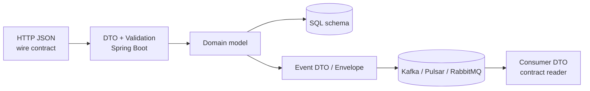
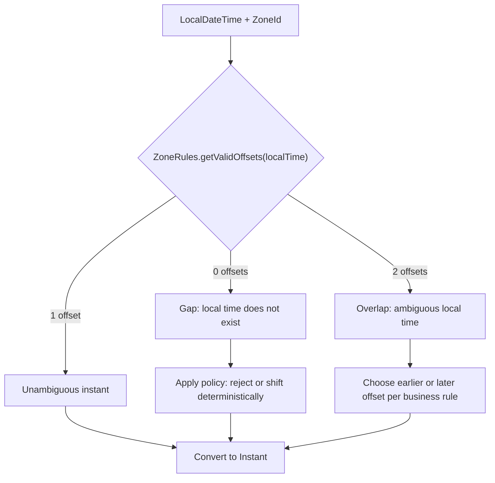
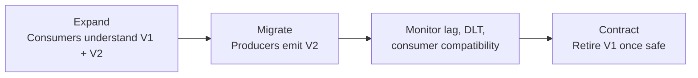

# Conventions for Field Names, Date/Time, Timezones, Money, and Null Values

## 1. Why Must Data Contracts Be Consistent Down to the Smallest Detail?

In the **SPRING_BOOT_INTEGRATION** module, a single integration flow may receive JSON over HTTP, map it to a Java DTO, write to PostgreSQL, publish an event to Kafka, and let another service store it in a Redis cache or call a partner API. Every step can "run without errors" yet propagate **wrong data semantics** if teams have not agreed on the details:

- Is `createdAt` an absolute UTC instant or the store's local wall-clock time?
- Is `total` 129,900 VND, 129,900 USD, or a count of a currency's minor units?
- Does `phoneNumber: null` mean the customer never provided one, deleted their phone number, or wants to keep the existing value?
- Are `order_id`, `orderId`, and `OrderID` the same field or three different fields?
- Is a timestamp `2026-11-21T09:30:00+07:00` or `2026-11-21T09:30:00Z`? Those two strings represent **two different instants**.

This is the core of a **data contract**: an agreement on names, types, units, formats, requiredness, semantics, and evolution rules across components. Syntactically valid field names are not enough when two services interpret their meaning differently.

For example, an API accepting monetary amounts as `double` can introduce rounding drift during addition, while an adapter writes `DECIMAL` to the database and a consumer calculates with `BigDecimal`. One service sends `2026-11-21 09:30` without an offset, another assumes UTC, and an appointment in Vietnam ends up shifted by 7 hours.

### Learning Objectives

After this lesson, you will be able to:

1. Design consistent **JSON/Java/SQL field-naming conventions**, specifying units, semantics, and identifiers.
2. Choose accurately among `Instant`, `LocalDate`, `LocalTime`, `LocalDateTime`, `OffsetDateTime`, and `ZoneId` for each use case.
3. Apply ISO 8601/RFC 3339 consistently, avoiding timezone bugs, daylight saving time (DST) traps, and precision loss.
4. Represent money using ISO 4217 codes with `BigDecimal` or minor units instead of floating point.
5. Distinguish **absent fields**, JSON `null`, empty strings, zero, and partial-update behaviors.
6. Enforce these conventions in Spring Boot/Jackson, Bean Validation, OpenAPI/JSON Schema, JDBC/JPA, and event brokers.
7. Write contract tests and plan versioning so changes never corrupt downstream data.

> **Scope:** examples use Java 17+, Spring Boot 3.x, Jackson 2.x, and Jakarta Bean Validation aligned with the Spring Boot BOM. Spring Boot 4 / Jackson 3 introduce API and package changes; verify against your target version. Dates, amounts, and addresses in examples are illustrative, not real personal or transaction data.

## 2. What Does a Clear Event Contract Look Like?

Suppose `order-service` needs to emit an `OrderCreatedV1` event after persisting an order:

```json
{
  "eventId": "evt-00124",
  "eventType": "order.created",
  "schemaVersion": 1,
  "orderId": "ORD-2408",
  "occurredAt": "2026-11-21T02:30:00Z",
  "businessDate": "2026-11-21",
  "storeTimeZone": "Asia/Ho_Chi_Minh",
  "total": {
    "currency": "VND",
    "amount": "129900"
  },
  "note": null
}
```

Reading the contract as a table:

| Field | JSON type | Semantics | Required? | Nullable? |
| --- | --- | --- | --- | --- |
| `eventId` | string | Unique ID of the **event** for duplicate detection | Yes | No |
| `eventType` | string | Stable event type defined by the contract | Yes | No |
| `schemaVersion` | integer | Version of payload structure and semantics | Yes | No |
| `orderId` | string | Business identifier of the order | Yes | No |
| `occurredAt` | string date-time | **Absolute instant** when the event occurred, in UTC | Yes | No |
| `businessDate` | string date | Store's business calendar date, not an instant | Yes | No |
| `storeTimeZone` | string | IANA timezone ID used to interpret local hours | Yes if business requires it | No |
| `total.currency` | string | ISO 4217 currency code, e.g., `VND` | Yes | No |
| `total.amount` | string decimal | Monetary amount in **major currency units**, e.g., 129900 VND | Yes | No |
| `note` | string or null | Optional note; `null` means no note provided | No | Yes |

The contract must also establish maximum sizes, encoding, unknown-field policy, `eventId` uniqueness scope, V1/V2 compatibility, null handling, and schema ownership. This is an **inter-service decision**, not merely a Java record definition.

### 2.1. Wire Contracts Differ from DTOs and Database Schemas



A SQL column named `created_at` can map to Java `createdAt` and then JSON `occurredAt` **if the business meaning truly matches**. Never force downstream consumers to mirror your column names, entity classes, or Java packages. DTOs and mapping layers protect that boundary.

## 3. Field-Naming Conventions

Before creating an API or topic, choose **one consistent convention** for the wire format. Suggested mapping:

| Layer | Convention | Example |
| --- | --- | --- |
| JSON HTTP/event payload | `lowerCamelCase` | `orderId`, `occurredAt`, `totalAmount` |
| Java field/record component | `lowerCamelCase` | `orderId`, `occurredAt` |
| Java class | `UpperCamelCase` | `OrderCreatedV1`, `MoneyDto` |
| SQL column/table | `snake_case` | `order_id`, `occurred_at`, `integration_event` |
| Enum wire value | Documented stable string, e.g., `PENDING` or `pending` | `"pending"` |
| HTTP header | Header name with clear semantics and policy | `Idempotency-Key`, `X-Correlation-Id` |
| Broker topic | Infrastructure naming rule decoupled from Java classes | `orders.events.v1` |

You **can choose `snake_case` for JSON** if your API standard uses it; what matters is **not mixing two conventions in the same contract** without explicit justification and mapping. Once a field is published, its name becomes part of the API contract.

### 3.1. Use Names That Convey Meaning, Not Just Data Type

| Ambiguous name | Clearer name | Reason |
| --- | --- | --- |
| `date` | `businessDate`, `birthDate`, `deliveryDate` | Distinguishes which calendar date |
| `time` | `scheduledLocalTime`, `occurredAt` | Distinguishes local wall-clock time from an instant |
| `amount` | `total.amount`, `tax.amount`, `discount.amount` | Clarifies what the money represents |
| `price` | `unitPrice` + `currency` | Never omits currency |
| `timeout` | `connectTimeoutMillis` or duration-contract `connectTimeout` | Prevents unit confusion |
| `status` | `paymentStatus`, `fulfillmentStatus` | Avoids confusing separate workflow states |
| `id` | `eventId`, `orderId`, `partnerId` | Identifies which entity is named |
| Unqualified `timezone` | `storeTimeZone` | Clarifies whose timezone is represented |

Do not put an `At` suffix on every temporal field: `businessDate` is a **calendar date**, not a timestamp, while `scheduledLocalTime` is a time of day. Names must reflect semantics.

### 3.2. IDs, Codes, and Numbers Are Not Always the Same

An `orderId` like `"000123"` must not be converted to integer `123`, because leading zeros are lost. Postal codes, partner codes, and currency codes may contain letters, punctuation, or leading zeros; they are **identifiers**, not arithmetic quantities.

Recommendations:

- Use `string` for opaque IDs so receivers do not assume internal structure.
- If an ID changes format from UUID to ULID, consumers still read a string and validate against the updated contract.
- Never use a Kafka `offset` as `eventId`, because republishing the same event assigns a new offset.
- Name correlation/tracing IDs separately from business idempotency keys.

### 3.3. Enum Names Are Also Part of the Contract

Example:

```json
{
  "paymentStatus": "authorized"
}
```

Changing `"authorized"` to `"AUTHORISED"`—even with the exact same business meaning—is still a wire contract change. Document the allowed values, case sensitivity, unknown-value policy, and enum evolution rules. Consumers should not blindly call `valueOf` on unvalidated input and swallow exceptions.

### 3.4. `@JsonProperty` Pins the Wire Name

When the Java identifier must differ from the public wire name:

```java
package example.integration.contract;

import com.fasterxml.jackson.annotation.JsonProperty;

public record PartnerOrderDto(
        @JsonProperty("order_id") String orderId,
        @JsonProperty("created_at") String createdAt) {
}
```

Java keeps `orderId`, while public JSON emits `order_id`. Here the annotation acts as **contract mapping**, not an excuse to flip field names arbitrarily across endpoints. For new designs, pick one naming strategy and lock it into documentation.

## 4. Rules for Safely Renaming Fields

Renaming `customer_id` to `customerId` is not a harmless refactor once external systems consume the JSON.

Suppose API V1 emits:

```json
{"customer_id": "C-001"}
```

API V2 wants to emit:

```json
{"customerId": "C-001"}
```

Options:

1. Maintain the V1 contract and introduce a versioned V2 API/event.
2. During a transition window, let consumers accept both names **with an explicit policy if both appear with conflicting values**.
3. Use adapter mapping to decouple internal code from Java field names.
4. Add contract tests covering critical consumers or partners.

Never let a consumer silently pick whichever field happens to come last when two fields conflict. Ambiguity should be detected and flagged rather than hidden.

## 5. Six Temporal Types That Are Not Interchangeable

The Java Time API distinguishes distinct concepts:

| Java type | What it represents | JSON example | Use case |
| --- | --- | --- | --- |
| `Instant` | Absolute point on the UTC timeline | `"2026-11-21T02:30:00Z"` | `occurredAt`, `publishedAt`, audit events |
| `OffsetDateTime` | Date/time paired with a specific UTC offset | `"2026-11-21T09:30:00+07:00"` | APIs that must preserve original offset |
| `ZonedDateTime` | Date/time attached to an IANA `ZoneId` with zone/DST rules | Often needs a contract carrying zone ID separately | Store schedules and DST |
| `LocalDate` | A calendar date, not an instant | `"2026-11-21"` | Birth dates, accounting dates, business dates |
| `LocalTime` | Time of day without date or offset | `"09:30:00"` | Daily opening hours |
| `LocalDateTime` | Local date/time **without timezone or offset** | `"2026-11-21T09:30:00"` | Civil wall-clock time valid only with zone/context |

`java.util.Date` or `java.sql.Timestamp` may still appear in legacy code or drivers, but new contract APIs should prefer Java Time types with clear semantics and tested mappings.

### 5.1. Rules for Choosing Types

- **Events that already occurred:** use `Instant`, serialized as ISO 8601 UTC, such as `occurredAt`.
- **Business dates, booking dates, birth dates:** use `LocalDate`; do not turn them into `00:00 UTC` when the contract only means a date.
- **Opening hours "09:00 daily":** use `LocalTime` plus the location's **`ZoneId`**.
- **An appointment at 09:00 in New York:** requires local date-time + `America/New_York` plus a policy for DST overlaps/gaps.
- **External systems requiring the original offset:** you can use `OffsetDateTime`, understanding that an offset like `+07:00` is not a region identifier like `Asia/Ho_Chi_Minh`.

### 5.2. `Instant` and Offsets Can Represent the Same Point in Time

These two strings denote **the exact same instant**:

```text
2026-11-21T09:30:00+07:00
2026-11-21T02:30:00Z
```

However:

```text
2026-11-21T09:30:00Z
```

is **7 hours later** than the first two. Simply appending `Z` to a local timestamp **assigns the wrong meaning** rather than converting timezones.

To convert properly, use the known timezone or offset:

```java
package example.integration.time;

import java.time.Instant;
import java.time.OffsetDateTime;

public class TimeConversionExample {
    public static void main(String[] args) {
        OffsetDateTime localWithOffset =
                OffsetDateTime.parse("2026-11-21T09:30:00+07:00");

        Instant utc = localWithOffset.toInstant();

        System.out.println(utc);
        // 2026-11-21T02:30:00Z
    }
}
```

**Never use `LocalDateTime.now()` for cross-service event timestamps** if it is later serialized without an offset or zone.

## 6. Standard Timestamp Formats for HTTP and Event Contracts

Recommended conventions:

| Field | Wire format | Example |
| --- | --- | --- |
| `occurredAt` | ISO 8601/RFC 3339 date-time with offset, preferably UTC `Z` | `2026-11-21T02:30:00Z` |
| `expiresAt` | Same timestamp rule; never zoneless local time | `2026-11-21T02:45:00Z` |
| `businessDate` | ISO date `YYYY-MM-DD` | `2026-11-21` |
| `scheduledLocalTime` | ISO local time | `09:30:00` |
| `timeZone` | IANA timezone ID | `Asia/Ho_Chi_Minh` |

In API practice, RFC 3339 is a widely adopted profile of ISO 8601 timestamps. When declaring `format: date-time` in OpenAPI or JSON Schema, explicitly specify offset and precision expectations so both sides behave identically.

### 6.1. Precision: Seconds, Milliseconds, or Microseconds?

Do not assume every database and broker preserves nanoseconds. For example:

```text
2026-11-21T02:30:00Z          # second precision
2026-11-21T02:30:00.123Z      # milliseconds
2026-11-21T02:30:00.123456Z   # microseconds
```

A contract must decide:

- Are fractional seconds allowed?
- If so, what is the maximum precision?
- May producers omit trailing zeros?
- At what precision does the DB store values, and does it round or truncate?
- When comparing timestamps, do we compare instants or strings?

For instance, PostgreSQL `timestamp` typically supports microsecond-level precision, whereas Java `Instant` has nanosecond resolution. Writing and reading back may not preserve nanoseconds exactly. Contract tests should assert the promised precision instead of assuming infinite resolution.

### 6.2. Epoch Timestamps Must State Their Unit

These fields:

```json
{"timestamp": 1795228200}
```

and:

```json
{"timestamp": 1795228200000}
```

differ by **seconds vs. milliseconds** if interpreted as Unix epoch time. Never force consumers to guess from digit count. If epoch numbers are used, name the field clearly like `occurredAtEpochMillis` or document the unit in the schema. For new APIs, ISO date-time strings with offsets are easier to read and far less ambiguous.

Do not use `double` for epoch nanoseconds or decimal timestamps when exact precision is required. Use sufficiently wide integers or a structured representation.

## 7. Timezone, UTC Offset, and DST: Three Distinct Concepts

A **UTC offset** is the difference from UTC at a given moment, such as `+07:00`. A **Zone ID** like `America/New_York` names a region with historical and future rules for offsets and DST. **DST** shifts offsets and causes certain local date-times either **not to exist or to occur twice**.



### 7.1. DST Example in New York

Under standard 2026 rules for `America/New_York`:

- **March 8, 2026 at 02:30 local:** falls inside a **gap** when clocks spring forward to 03:00; 02:30 never exists.
- **November 1, 2026 at 01:30 local:** falls inside an **overlap** when clocks fall back; 01:30 occurs twice, with offset `-04:00` and then `-05:00`.

Inspecting `ZoneRules` directly in Java:

```java
package example.integration.time;

import java.time.LocalDateTime;
import java.time.ZoneId;

public class DaylightSavingExample {
    public static void main(String[] args) {
        ZoneId zone = ZoneId.of("America/New_York");

        LocalDateTime gap =
                LocalDateTime.of(2026, 3, 8, 2, 30);
        LocalDateTime overlap =
                LocalDateTime.of(2026, 11, 1, 1, 30);

        System.out.println(zone.getRules().getValidOffsets(gap).size());
        // 0: time does not exist

        System.out.println(zone.getRules().getValidOffsets(overlap).size());
        // 2: time occurs twice
    }
}
```

When scheduling for a store in a DST-observing region, data needs `LocalDateTime` + `ZoneId` along with a policy for both cases. Sending `"2026-11-01T01:30:00"` alone is incomplete. Storing only `"-04:00"` is also insufficient for **future recurring schedules**, because the offset changes with the calendar date.

> **Operational note:** governments occasionally change timezone rules; the Java runtime relies on its bundled IANA tzdb version. Keep JDK/tzdb updated when long-range scheduling depends on current rules.

### 7.2. Vietnam Not Observing DST Does Not Mean Partners Do Not

`Asia/Ho_Chi_Minh` has a `+07:00` offset in modern standard usage. Yet global logistics partners, cross-border stores, or customers in other regions may observe DST. Therefore:

- **Audit/event timestamps:** store UTC instants.
- **Display times:** convert instants to the user's or location's `ZoneId`.
- **Future appointments:** store local schedule plus zone when preserving "09:00 local at the venue."
- **Business dates:** compute according to the defined zone rather than defaulting to UTC date.

## 8. From HTTP JSON to Java Time in Spring Boot

Spring Boot 3.x with standard JSON/web starters uses Jackson 2 and supports Java Time when the corresponding module is on the classpath. Map JSON fields to the right Java types:

```java
package example.integration.contract;

import java.time.Instant;
import java.time.LocalDate;

public record OrderCreatedV1(
        String eventId,
        String orderId,
        Instant occurredAt,
        LocalDate businessDate,
        MoneyDto total) {
}

record MoneyDto(String currency, String amount) {
}
```

Example input:

```json
{
  "eventId": "evt-00124",
  "orderId": "ORD-2408",
  "occurredAt": "2026-11-21T02:30:00Z",
  "businessDate": "2026-11-21",
  "total": {
    "currency": "VND",
    "amount": "129900"
  }
}
```

`Instant` carries the absolute instant; `LocalDate` carries the business date. Do not map both into `java.util.Date` with ad-hoc formatting.

### 8.1. Stable Jackson Serialization

In Boot 3.x, you can configure Java Time to serialize as ISO strings instead of numeric/array timestamps:

```yaml
spring:
  jackson:
    serialization:
      write-dates-as-timestamps: false
```

This optional configuration keeps contracts human-readable. Verify that `JavaTimeModule` and the **actual injected `ObjectMapper`** are in use; a manually constructed `ObjectMapper` misses Spring Boot customizations.

Unit test example when constructing a mapper manually:

```java
package example.integration.contract;

import com.fasterxml.jackson.databind.ObjectMapper;
import com.fasterxml.jackson.databind.SerializationFeature;
import com.fasterxml.jackson.datatype.jsr310.JavaTimeModule;
import org.junit.jupiter.api.Test;

import java.time.Instant;
import static org.assertj.core.api.Assertions.assertThat;

class JavaTimeJsonTest {

    @Test
    void serializesInstantAsUtcString() throws Exception {
        ObjectMapper mapper = new ObjectMapper()
                .registerModule(new JavaTimeModule())
                .disable(SerializationFeature.WRITE_DATES_AS_TIMESTAMPS);

        String json = mapper.writeValueAsString(
                new Occurrence(Instant.parse("2026-11-21T02:30:00Z")));

        assertThat(mapper.readTree(json).get("occurredAt").asText())
                .isEqualTo("2026-11-21T02:30:00Z");
    }

    record Occurrence(Instant occurredAt) {
    }
}
```

A manually constructed mapper test proves one specific mapping; application contract tests should use the Spring context's `ObjectMapper` to catch `@JsonFormat` overrides or shared configuration changes. For offset-preserving values, test `OffsetDateTime` serialization separately; never assume it always normalizes to `Z` in multi-timezone applications.

### 8.2. Using `Clock` to Test Time

Instead of scattering `Instant.now()` calls and making tests depend on wall-clock time, inject `Clock` into services:

```java
package example.integration.time;

import java.time.Clock;
import org.springframework.context.annotation.Bean;
import org.springframework.context.annotation.Configuration;

@Configuration(proxyBeanMethods = false)
public class ClockConfiguration {

    @Bean
    Clock applicationClock() {
        return Clock.systemUTC();
    }
}
```

```java
package example.integration.time;

import java.time.Clock;
import java.time.Instant;
import org.springframework.stereotype.Service;

@Service
public class EventTimestampService {

    private final Clock clock;

    public EventTimestampService(Clock clock) {
        this.clock = clock;
    }

    public Instant occurredAtNow() {
        return Instant.now(clock);
    }
}
```

In tests, supply `Clock.fixed(..., ZoneOffset.UTC)` for repeatable results. `Clock.systemUTC()` enforces UTC clock semantics; it does not fix an inaccurate OS clock or replace infrastructure NTP synchronization.

## 9. Timestamps in SQL and Caches: Preserve Semantics

Different databases have different date/time types and semantics:

| Data kind | PostgreSQL recommendation | Java recommendation | Warning |
| --- | --- | --- | --- |
| Absolute instant | `TIMESTAMP WITH TIME ZONE` / `timestamptz` | `Instant` or matching adapter | PostgreSQL stores an instant; it **does not store the original timezone name** |
| Business date | `DATE` | `LocalDate` | Never turn into a UTC midnight instant |
| Time of day | `TIME` | `LocalTime` | Insufficient for DST without a date and zone |
| Local date-time | `TIMESTAMP WITHOUT TIME ZONE` | `LocalDateTime` | Carries no offset; use only when semantics are genuinely local |
| Timezone ID | `VARCHAR`/text | `ZoneId`/String | Store the IANA zone ID separately if local rules must be computed |

PostgreSQL example:

```sql
CREATE TABLE integration_event (
    event_id VARCHAR(80) PRIMARY KEY,
    event_type VARCHAR(100) NOT NULL,
    occurred_at TIMESTAMP WITH TIME ZONE NOT NULL,
    business_date DATE,
    store_time_zone VARCHAR(80),
    payload_json JSONB NOT NULL
);
```

A timestamp `2026-11-21T09:30:00+07:00` normalizes to the same instant as `2026-11-21T02:30:00Z`. **PostgreSQL `timestamptz` does not retain the original offset string or region name**; formatted output can depend on the session timezone.

If a UI needs to display "09:30 in the store's timezone" or schedule a future appointment, store `store_time_zone` and the local components explicitly. Do not attempt to reconstruct the original zone from a persisted instant.

### 9.1. Differences Across MySQL and JDBC Drivers

MySQL `TIMESTAMP` and `DATETIME` have distinct timezone conversion semantics; JDBC drivers also expose connection/server timezone settings. Never copy SQL types and conversion assumptions across PostgreSQL, MySQL, and Oracle just because all have types named "timestamp."

With Spring JDBC/JPA:

- Choose DB and Java types aligned with your actual driver.
- Verify `Instant` and `OffsetDateTime` mappings and round-trip precision.
- Test under differing session timezones, not only your laptop's local timezone.
- Avoid `LocalDateTime.now()` for cross-system audit timestamps.

### 9.2. Redis TTL Is a Duration, Not an Instant

For example, `expiresAt` is an **instant**, whereas a `900 seconds` TTL is a **duration**. If a cache key must expire in 15 minutes, compute the duration between `Instant.now(clock)` and `expiresAt` with an explicit policy when already expired; do not pass `expiresAt` into a TTL API assuming the driver understands it as a timestamp.

For fields like `ttlMillis`, `ttlSeconds`, or `expireAt`, state units and semantics explicitly; avoid an undocumented `ttl: 900`.

## 10. Money Is Not Just a Plain Decimal Number

Money carries at least two pieces of information:

1. **Currency**: ISO 4217 currency unit, e.g., `VND`, `USD`, `JPY`, `KWD`.
2. **Amount**: numeric quantity plus precision, rounding, and unit policies.

These two JSON payloads are **not equivalent**:

```json
{"currency": "USD", "amount": "12.34"}
```

```json
{"currency": "VND", "amount": "12.34"}
```

VND and USD differ in unit value, decimal places, and processing rules. With `"amount": 12.34` alone, consumers may guess the currency or misinterpret the unit.

### 10.1. ISO 4217 and Minor Units

Common examples:

| Code | Unit | Typical ISO 4217 decimal places |
| --- | --- | --- |
| `VND` | Vietnamese Dong | 0 |
| `JPY` | Japanese Yen | 0 |
| `USD` | US Dollar | 2 |
| `EUR` | Euro | 2 |
| `KWD` | Kuwaiti Dinar | 3 |

These figures apply to **major currency units** under standard ISO definitions at the time. Real payment systems may apply specialized internal or partner rules (e.g., settlement, fees, loyalty points). Document explicitly whenever a contract uses a non-standard scale or unit.

In Java:

```java
import java.util.Currency;

System.out.println(Currency.getInstance("VND").getDefaultFractionDigits());
// 0
System.out.println(Currency.getInstance("USD").getDefaultFractionDigits());
// 2
```

`Currency.getDefaultFractionDigits()` can also return a negative number for codes without standard fractional units. If a currency code is invalid or unsupported by business policy, **reject it explicitly** instead of defaulting to USD or VND. The list of accepted currencies is a business policy.

### 10.2. `double` Is Unsuitable for Exact Monetary Amounts

```java
System.out.println(0.1 + 0.2);
// May print 0.30000000000000004
```

IEEE 754 binary floating point cannot represent many base-10 financial decimals accurately. Use `BigDecimal` with its **string constructor** rather than `new BigDecimal(0.1)` when an exact `0.1` is required.

```java
import java.math.BigDecimal;

BigDecimal a = new BigDecimal("0.10");
BigDecimal b = new BigDecimal("0.20");

BigDecimal result = a.add(b);
System.out.println(result.toPlainString());
// 0.30
```

`BigDecimal` preserves decimal values, yet still requires agreed conventions for **scale, rounding mode, currency, bounds, and operations**. Using `BigDecimal` alone does not make USD ↔ VND conversions business-accurate.

## 11. Two Strategies for Representing Money on the Wire

### 11.1. Strategy A — Decimal String in Major Currency Units

```json
{
  "total": {
    "currency": "USD",
    "amount": "12.34"
  }
}
```

Define clearly:

- `currency`: ISO 4217 string.
- `amount`: decimal string **without thousands separators** and never locale-formatted, e.g., `"1234.56"` rather than `"1.234,56"`.
- Specify whether negative values are allowed, whether leading zeros are allowed, precision/scale limits, and trailing-zero normalization.
- Consumers parse with `BigDecimal`, validating against currency fraction digits and business constraints.

Advantage: eliminates the risk of JavaScript or intermediary JSON numbers being parsed as binary floats. Trade-off: consumers must parse and validate the string.

### 11.2. Strategy B — Integer Minor Units

```json
{
  "total": {
    "currency": "USD",
    "minorUnits": 1234
  }
}
```

For standard USD, `1234` minor units = 12.34 USD. For VND (0 fractional digits), `1234` minor units = 1234 VND; for KWD (3 digits), `1234` minor units = 1.234 KWD.

**Never name the field `amount` and force consumers to guess whether it is cents or dollars.** If minor units are chosen, both the field name and documentation must state it unambiguously.

Note that JSON numbers in some JavaScript environments cannot accurately represent 64-bit integers beyond **2^53 - 1**. If amounts could exceed safe consumer integer ranges, consider **decimal strings for minor units** or a contract representation with explicit range checks.

### 11.3. Never Switch Strategies Silently Within the Same Version

Changing from:

```json
{"currency": "USD", "amount": "12.34"}
```

to:

```json
{"currency": "USD", "amount": 1234}
```

changes both **type and unit** and will break consumers. Never treat this as a contract-neutral serialization optimization. Introduce a new version/schema or an agreed migration.

## 12. Rounding, Scale, and Exchange Rates Need Explicit Policy

Example discount calculation:

```text
Unit price:          19.99 USD
Quantity:            3
Discount:            10%
Tax:                 per applicable law/partner rule
```

You cannot simply write "round to 2 decimal places" while leaving open:

- Round **per line item** or **on the invoice total**?
- Are prices tax-inclusive or tax-exclusive?
- Use `HALF_UP`, `HALF_EVEN`, or another rule?
- For FX conversion, how many significant digits does the rate carry and from which source?
- Does the rate have a timestamp, base/quote currencies, and effective window?
- Do refunds use the original transaction's rate or the rate at refund time?

Java example with an explicitly specified rounding policy:

```java
package example.integration.money;

import java.math.BigDecimal;
import java.math.RoundingMode;

public class MoneyCalculation {

    public static BigDecimal calculateDiscount(
            BigDecimal subtotal, BigDecimal discountRate) {

        return subtotal.multiply(discountRate)
                .setScale(2, RoundingMode.HALF_EVEN);
    }
}
```

**`HALF_EVEN` is only an example**, not an automatic standard across every jurisdiction or partner. If the currency is VND (scale 0) or KWD (scale 3), hardcoding `setScale(2)` is wrong in general; derive **currency-specific scale** and follow business policy. Monetary division typically requires specifying a rounding mode to avoid `ArithmeticException` on non-terminating decimals.

### 12.1. Validating Money in Java

```java
package example.integration.money;

import java.math.BigDecimal;
import java.math.RoundingMode;
import java.util.Currency;
import java.util.Objects;

public record MoneyAmount(String currency, String amount) {

    public BigDecimal toValidatedDecimal() {
        Objects.requireNonNull(currency, "currency is required");
        Objects.requireNonNull(amount, "amount is required");

        if (!currency.matches("[A-Z]{3}")) {
            throw new IllegalArgumentException("Invalid currency code format");
        }

        Currency isoCurrency;
        try {
            isoCurrency = Currency.getInstance(currency);
        } catch (IllegalArgumentException ex) {
            throw new IllegalArgumentException(
                    "Unknown ISO 4217 currency", ex);
        }

        int fractionDigits = isoCurrency.getDefaultFractionDigits();
        if (fractionDigits < 0) {
            throw new IllegalArgumentException(
                    "Currency does not define standard fraction digits");
        }

        final BigDecimal decimal;
        try {
            decimal = new BigDecimal(amount);
        } catch (NumberFormatException ex) {
            throw new IllegalArgumentException(
                    "Amount must be a decimal string", ex);
        }

        if (decimal.signum() < 0) {
            throw new IllegalArgumentException(
                    "Negative amount is not supported in this contract");
        }

        try {
            // Never silently round and alter the value during validation.
            return decimal.setScale(
                    fractionDigits, RoundingMode.UNNECESSARY);
        } catch (ArithmeticException ex) {
            throw new IllegalArgumentException(
                    "Amount has unsupported fraction digits", ex);
        }
    }
}
```

This snippet is **illustrative validation**: it allows non-negative amounts using JDK ISO currency codes and default scales. Production code may require magnitude limits, an allowlist of supported currencies, canonical lexical format checks, custom scale rules, and rejecting scientific notation. To forbid `"1e3"`, validate against a regex pattern before constructing `BigDecimal`.

**Never rely on `BigDecimal.equals` alone to compare monetary values**: `new BigDecimal("1.0").equals(new BigDecimal("1.00"))` returns `false` because scales differ, whereas `compareTo` returns `0`. Whether two strings are considered equivalent or format-distinct still depends on the contract.

## 13. Money Across SQL, Brokers, and APIs: One Unified Convention

In PostgreSQL:

```sql
CREATE TABLE payment_amount (
    payment_id VARCHAR(80) PRIMARY KEY,
    currency CHAR(3) NOT NULL,
    amount NUMERIC(20, 4) NOT NULL,
    occurred_at TIMESTAMP WITH TIME ZONE NOT NULL
);
```

`NUMERIC(20,4)` here is only an **intermediate storage representation with scale 4**; it does not imply every currency has four fractional digits. The application must enforce per-currency business rules and decide whether writes are rounded or normalized. If only one currency or contract scale is supported, tighten the schema accordingly; always verify DB constraints and maximum monetary ranges.

On Kafka/RabbitMQ/Pulsar:

- Serializers must preserve decimal strings or minor units per contract.
- Events must carry the currency; never rely on the database's default currency or worker locale.
- Consumers must parse into `BigDecimal`/minor units, never `double`.
- Changing from decimal string to minor units requires a new version or compatible reader.
- Under duplicate events, idempotency keys and transactions matter even more than clean money DTO serialization.

### 13.1. Locales Are for Display, Never Wire Formats

End users may see:

```text
1.234.567 đ
$1,234.56
1 234,56 €
```

These representations depend on locale and presentation rules. APIs should use canonical wire representations such as `"1234567"` with `"VND"`, or `"1234.56"` with `"USD"`; UIs format by locale in the presentation tier.

Never use `,` and `.` in JSON strings according to local display formatting unless the contract **explicitly** specifies a single format. This avoids ambiguity over whether `1,234` means one point two three four or one thousand two hundred thirty-four.

## 14. Null, Absent, Empty, and Zero: Five Distinct States

This is a frequent source of bugs in HTTP PATCH, JSON events, and SQL updates.

Consider a `note` field:

| JSON | Possible contract meaning | Equivalent? |
| --- | --- | --- |
| `note` omitted | Producer did not supply this field | **Absent** |
| `"note": null` | Field present with no value / clear value per PATCH policy | **Null** |
| `"note": ""` | Intentionally provided empty string | Not equivalent to null |
| `"note": " "` | String containing a single space | Not automatically empty string |
| `"note": "Deliver during business hours"` | Populated text | Concrete value |

Similarly for monetary values:

```json
{"discount": null}
```

differs from:

```json
{"discount": {"currency": "USD", "amount": "0.00"}}
```

Depending on the domain, **no discount information** and **explicitly zero discount** can carry different meanings. Never overload `null` to mean "none," "unknown," "not applicable," and "error" all at once if consumers need to distinguish them.

### 14.1. Three Questions to Document for Every Field

1. **Required?** Must the field appear in JSON?
2. **Nullable?** When present, is `null` a valid value?
3. **Default semantics?** When absent, does the consumer apply a default, reject, or keep existing data?

Combinations:

| Required | Nullable | Contract meaning |
| --- | --- | --- |
| Yes | No | Producer must send the field with a valid non-null value |
| Yes | Yes | Producer must send the field, and `null` is allowed |
| No | No | Field may be absent; if present, it must have a valid non-null value |
| No | Yes | Field may be absent or `null`; define whether those two states differ |

This is a JSON/OpenAPI/JSON Schema contract concept, not an automatic effect of Java's `@Nullable`. An annotation on a Java field **does not verify whether the key was present in raw JSON**.

## 15. POST, PUT, and PATCH Should Not Share Arbitrary Null Semantics

Consider a resource:

```json
{
  "customerId": "C-101",
  "displayName": "An",
  "phoneNumber": "+84901234567"
}
```

### 15.1. POST Create

For example, `POST /customers` might require `displayName` while making `phoneNumber` optional. Define **explicitly** whether absent `phoneNumber` and `null` behave differently. For creation, both often mean "not provided," but this must be stated in the contract.

### 15.2. PUT Replace Resource

Under standard HTTP semantics, `PUT` replaces the resource state with the submitted representation. If `PUT` is implemented as full replacement, an absent field may be cleared or reset to default per contract; clients should not omit fields and expect PATCH-like preservation.

In any concrete system, exact behavior follows the API design. Document and test it rather than assuming from the HTTP method name whether properties are kept or cleared.

### 15.3. JSON Merge Patch — RFC 7396

When an endpoint accepts `Content-Type: application/merge-patch+json`, standard semantics are:

```json
{}
```

**Leaves all fields unchanged**.

```json
{"phoneNumber": null}
```

**Removes** the `phoneNumber` member from the target object under JSON Merge Patch. When mapped to a nullable database column, the API may reflect this by setting `phone_number = NULL` if the resource model permits.

```json
{"phoneNumber": ""}
```

**Sets an empty string**, if the contract permits.

Important: JSON Merge Patch is **not suitable** for domains that must distinguish "set a field to JSON `null`" because `null` in Merge Patch means delete member. When you need to represent set-null, remove, and unchanged distinctly, consider JSON Patch or an explicit command DTO.

### 15.4. JSON Patch — RFC 6902

JSON Patch uses explicit operations:

```json
[
  {
    "op": "remove",
    "path": "/phoneNumber"
  },
  {
    "op": "replace",
    "path": "/displayName",
    "value": "An Nguyen"
  }
]
```

JSON Patch uses `Content-Type: application/json-patch+json` and JSON Pointer paths. A `remove` operation differs from `replace` with `null` when the resource schema allows it. Enforce allowed paths, field-level authorization, and transaction boundaries.

## 16. Jackson: Absent and Null Can Collapse Into the Same Java Value

In Jackson 2, deserializing into a record with reference fields:

```java
public record CustomerPatchDto(String displayName, String phoneNumber) {
}
```

can map **both missing `phoneNumber` and `"phoneNumber": null` to `phoneNumber == null`**, depending on mapper and creator configuration. If the API must distinguish "keep unchanged" from "clear," a plain record like this is **insufficient**.

### 16.1. Reading Raw JSON with `JsonNode` to Distinguish Them

```java
package example.integration.contract;

import com.fasterxml.jackson.databind.JsonNode;
import com.fasterxml.jackson.databind.ObjectMapper;
import java.io.IOException;

public class PatchFieldReader {

    private final ObjectMapper mapper;

    public PatchFieldReader(ObjectMapper mapper) {
        this.mapper = mapper;
    }

    public FieldValue<String> readPhoneNumber(String body)
            throws IOException {
        JsonNode root = mapper.readTree(body);
        if (root == null || !root.isObject()) {
            throw new IllegalArgumentException("Expected JSON object");
        }

        if (!root.has("phoneNumber")) {
            return new FieldValue.Absent<>();
        }

        JsonNode field = root.get("phoneNumber");
        if (field.isNull()) {
            return new FieldValue.Present<>(null);
        }

        if (!field.isTextual()) {
            throw new IllegalArgumentException(
                    "phoneNumber must be string or null");
        }
        return new FieldValue.Present<>(field.textValue());
    }

    public sealed interface FieldValue<T>
            permits FieldValue.Absent, FieldValue.Present {
        record Absent<T>() implements FieldValue<T> {}
        record Present<T>(T value) implements FieldValue<T> {}
    }
}
```

Here `Absent` differs from `Present(null)` and `Present("")`. This abstraction illustrates enforcing a **custom PATCH contract**, not a full implementation of RFC 7396 or RFC 6902. Larger projects can use a dedicated nullable wrapper or field-mask type with tested serializers and deserializers.

`JsonNode.has("phoneNumber")` returns `true` for JSON `null`, whereas `hasNonNull(...)` returns `false` for both absent and `null`; mistakenly using `hasNonNull` erases the critical distinction.

### 16.2. Java Primitives Easily Mask Data Errors

Example:

```java
public record PaymentCommand(long totalMinorUnits) {
}
```

If the input omits the field or supplies `null`, certain Jackson configurations default primitives to `0` or fail depending on coercion/creator settings. **Never assume `0` means `0` was actually sent.** When a field is required:

- Use boxed types such as `Long` or `BigDecimal` so Bean Validation can detect `null`.
- Configure strict Jackson coercion/creator handling and test both absent and explicit `null`.
- Verify requiredness in OpenAPI/JSON Schema and at the HTTP layer.

## 17. Bean Validation: Checking Business Types After Deserialization

Example Spring MVC request DTO:

```java
package example.integration.http;

import jakarta.validation.Valid;
import jakarta.validation.constraints.NotBlank;
import jakarta.validation.constraints.NotNull;
import jakarta.validation.constraints.Pattern;

import java.time.Instant;

public record CreateOrderRequest(
        @NotBlank String orderId,
        @NotNull Instant occurredAt,
        @NotNull @Valid MoneyRequest total) {
}

record MoneyRequest(
        @NotBlank @Pattern(regexp = "[A-Z]{3}") String currency,
        @NotBlank String amount) {
}
```

Controller:

```java
package example.integration.http;

import jakarta.validation.Valid;
import org.springframework.http.HttpStatus;
import org.springframework.web.bind.annotation.PostMapping;
import org.springframework.web.bind.annotation.RequestBody;
import org.springframework.web.bind.annotation.ResponseStatus;
import org.springframework.web.bind.annotation.RestController;

@RestController
public class OrdersController {

    private final OrdersService ordersService;

    public OrdersController(OrdersService ordersService) {
        this.ordersService = ordersService;
    }

    @PostMapping("/orders")
    @ResponseStatus(HttpStatus.ACCEPTED)
    public void create(@Valid @RequestBody CreateOrderRequest request) {
        ordersService.accept(request);
    }
}
```

`OrdersService` is an application service the project provides. With `@Valid`, Spring MVC triggers Jakarta Bean Validation when a validation provider is configured (typically via `spring-boot-starter-validation`). `@NotBlank` does not validate decimal amounts against currency rules, so pair it with **domain validation** like `MoneyAmount.toValidatedDecimal()`.

Regarding HTTP 202: use it only when API semantics permit asynchronous processing and the system has **reached a durable acceptance point**, such as persisting the order/outbox reliably. Never return 202 after merely pushing into an in-memory queue and calling it safely accepted.

### 17.1. Required Dependencies

```xml
<!-- pom.xml; Boot parent/BOM manages versions -->
<dependency>
    <groupId>org.springframework.boot</groupId>
    <artifactId>spring-boot-starter-web</artifactId>
</dependency>
<dependency>
    <groupId>org.springframework.boot</groupId>
    <artifactId>spring-boot-starter-validation</artifactId>
</dependency>
```

If a project is solely a Kafka consumer or integration worker without MVC, invoke validation services directly without the web starter. Validation is a business boundary, not something that happens only in HTTP controllers.

## 18. JSON Schema: Writing Contracts Both Machines and Humans Can Verify

An illustrative JSON Schema 2020-12 expressing types and nullability:

```json
{
  "$schema": "https://json-schema.org/draft/2020-12/schema",
  "title": "OrderCreatedV1",
  "type": "object",
  "required": [
    "eventId",
    "eventType",
    "schemaVersion",
    "orderId",
    "occurredAt",
    "businessDate",
    "total"
  ],
  "properties": {
    "eventId": {
      "type": "string",
      "minLength": 1
    },
    "eventType": {
      "const": "order.created"
    },
    "schemaVersion": {
      "const": 1
    },
    "orderId": {
      "type": "string",
      "minLength": 1
    },
    "occurredAt": {
      "type": "string",
      "format": "date-time"
    },
    "businessDate": {
      "type": "string",
      "format": "date"
    },
    "storeTimeZone": {
      "type": "string"
    },
    "total": {
      "type": "object",
      "required": ["currency", "amount"],
      "properties": {
        "currency": {
          "type": "string",
          "pattern": "^[A-Z]{3}$"
        },
        "amount": {
          "type": "string",
          "pattern": "^-?(0|[1-9][0-9]*)([.][0-9]+)?$"
        }
      }
    },
    "note": {
      "type": ["string", "null"]
    }
  }
}
```

**Important details:**

- `required` means the key **must be present**; it does not forbid `null` unless `type` excludes `null`.
- `note` is not in `required`, so it **may be absent**; `type: ["string","null"]` also allows explicit `null`.
- `format: date-time` may be treated as an annotation or an assertion depending on the validator and mode; test your real validator and document explicit UTC/offset rules.
- The three-uppercase-letter regex on `currency` checks **syntax only**, not whether the code is in ISO 4217 or supported by the business.
- The `amount` pattern illustrates a decimal string with an optional minus sign; if negative amounts are forbidden, enforce that separately or adjust the pattern and constraints.
- Do not add `additionalProperties: false` globally without assessing evolution impact when producers add fields; that strictness decision directly affects rollouts.

### 18.1. OpenAPI 3.0 and 3.1 Describe Nullability Differently

- **OpenAPI 3.0:** typically uses `nullable: true` alongside the schema type.
- **OpenAPI 3.1:** aligns with JSON Schema 2020-12 and can use `type: ["string","null"]` for nullability.

Do not copy schemas verbatim between the two versions without checking tooling; code generators and validators handle them differently.

### 18.2. Using a Contract Registry / Schema Files

With multiple producers and consumers, store versioned schemas in a contract repository or schema registry and have CI verify:

1. Producers generate payloads conforming to the published schema.
2. Consumers still read older schema versions lingering in broker retention.
3. Null/absent cases and optional-field changes are handled properly.
4. Timestamp and amount strings obey semantic rules, not just JSON types.

A schema registry helps manage wire schemas, yet **does not prove** every money, timezone, or idempotency rule is right. Cross-field validation and contract tests remain necessary.

## 19. HTTP Protocols and Asynchronous Messages Need Shared Semantics

A system might receive a REST request:

```json
{
  "orderId": "ORD-2408",
  "total": {
    "currency": "VND",
    "amount": "129900"
  },
  "deliveryDate": "2026-11-23"
}
```

And after committing, emit an event:

```json
{
  "eventId": "evt-00124",
  "eventType": "order.created",
  "schemaVersion": 1,
  "orderId": "ORD-2408",
  "occurredAt": "2026-11-21T02:30:00Z",
  "total": {
    "currency": "VND",
    "amount": "129900"
  }
}
```

Key differences:

- The request is a **command** asking to change state.
- The event is a **fact that occurred** under transaction/domain semantics.
- `deliveryDate` is a business calendar date and does not automatically turn into `occurredAt`.
- `occurredAt` must be assigned at a well-defined business boundary (such as inside the transaction creating the event), not arbitrarily taken as the moment a Kafka broker received the message.
- Producers and consumers must agree on contract version and money parsing.

### 19.1. Type Headers Do Not Replace `schemaVersion`

Spring Kafka's JSON serializer can attach a Java type header to records, but **Java class names should never form an inter-service contract**. A producer might have `com.shop.OrderCreated` while a consumer uses `com.billing.OrderCreatedV1`; the JSON contract remains compatible despite different package names.

Never trust arbitrary type headers to instantiate arbitrary Java classes. Prefer explicit schemas/versions or an allowlisted `eventType`, a fixed target DTO, or managed type mappings. Type metadata never replaces payload validation or producer authorization.

### 19.2. Null in an Event Is Not Always an Update Operation

An **event snapshot**:

```json
{"customerPhoneNumber": null}
```

may mean "at the time of the event, the system held no phone number." A **patch command** with the same null field may mean "delete the phone number." Never reuse the same DTO while ignoring the semantic differences among events, snapshots, and commands.

If events carry deltas, represent operations explicitly:

```json
{
  "eventType": "customer.phone-removed",
  "customerId": "C-101",
  "occurredAt": "2026-11-21T02:30:00Z"
}
```

An event with an explicit business name is safer than forcing consumers to infer deletion from a contextless `null` field.

## 20. Schema Evolution: Do Not Turn "Optional" Into a Breaking Change

Suppose event V1 has:

```json
{
  "orderId": "ORD-2408",
  "total": {
    "currency": "USD",
    "amount": "12.34"
  }
}
```

Producer V2 wants to add `taxAmount` and change `total.amount` to minor units. These are **two distinct kinds of change**:

| Change | Compatibility risk | Approach |
| --- | --- | --- |
| Add optional `taxAmount` field | Strict consumers may reject unknown fields | Contract test with old consumers; coordinate rollout |
| Rename `total` → `grandTotal` | Old consumers read null/missing field | New version or dual-field transition period |
| Change amount string to integer minor units | Changes **both type and unit** | Version the contract with clear migration |
| Change `occurredAt` from UTC string to epoch millis | Changes wire format/unit | Version or compatibility adapter |
| Turn `businessDate` into a timestamp | Changes date semantics to an instant | Never change silently; define explicit policy |
| Change `note: null` to absent | Consumers may distinguish the two states | Verify null/absent contract |
| Add `partially_refunded` enum value | Old `switch` statements may fail | Unknown-value strategy and contract tests |
| Change meaning of `total` from tax-inclusive to pre-tax | Schema still "valid" yet business logic breaks | Semantic versioning and partner coordination |

### 20.1. Expand → Migrate → Contract



Consider:

- Broker retention and replay of older events.
- How many services or partners have not deployed the new consumer?
- Do databases or caches still hold legacy values?
- Is backfill needed so new consumers understand stored data?
- Can the producer be rolled back without causing new consumers to misread data?

Changing wire semantics without this plan can allow consumers to ingest messages without errors while recording wrong amounts or timestamps—far harder to detect than a clean deserialization failure.

## 21. Contract Testing: Include Both Valid Examples and Counterexamples

### 21.1. Test Matrix

| Topic | Input/scenario | Expectation |
| --- | --- | --- |
| Naming | `orderId` vs. `order_id` | Accept only the name specified by the published version |
| IDs | `"000123"` | Never coerced into integer `123` |
| UTC/offset | `09:30+07:00` vs. `02:30Z` | Equal `Instant` |
| Timestamp missing offset | `"2026-11-21T09:30:00"` | Rejected if the contract requires an instant |
| DST gap | New York `2026-03-08T02:30` | Follow policy: reject or shift deterministically |
| DST overlap | New York `2026-11-01T01:30` | Require explicit offset/policy |
| Precision | Fractional seconds exceeding DB precision | Detected and handled per policy |
| VND amount | `"129900"` | Valid at scale 0 |
| USD amount | `"12.34"` | Valid at scale 2 |
| Over-precise USD fraction | `"12.345"` | Rejected or handled per policy; never silently rounded |
| Unknown currency | `"ZZZ"` | Rejected or handled per policy |
| BigDecimal | `0.1 + 0.2` | Exact decimal arithmetic |
| Null vs. absent | `{}` vs. `{"note":null}` | Distinguished when required by contract |
| PATCH | `{"phoneNumber":null}` merge patch | Removes member per RFC 7396 |
| JSON Schema | `required` with `null` | Validator classifies accurately |
| Backward compatibility | Producer V2 / Consumer V1 | Matches documented support policy |
| Retry/replay | Event with same `eventId` at a different offset | Never applies side effects twice |

### 21.2. Testing Instants and DST with JUnit

```java
package example.integration.contract;

import java.time.Instant;
import java.time.LocalDateTime;
import java.time.OffsetDateTime;
import java.time.ZoneId;
import org.junit.jupiter.api.Test;

import static org.assertj.core.api.Assertions.assertThat;

class TimeContractTest {

    @Test
    void equalInstantsCanHaveDifferentOffsetRepresentations() {
        Instant fromOffset = OffsetDateTime.parse(
                "2026-11-21T09:30:00+07:00").toInstant();

        assertThat(fromOffset)
                .isEqualTo(Instant.parse("2026-11-21T02:30:00Z"));
    }

    @Test
    void dstGapAndOverlapRequirePolicy() {
        ZoneId zone = ZoneId.of("America/New_York");

        assertThat(zone.getRules().getValidOffsets(
                LocalDateTime.of(2026, 3, 8, 2, 30)))
                .isEmpty();

        assertThat(zone.getRules().getValidOffsets(
                LocalDateTime.of(2026, 11, 1, 1, 30)))
                .hasSize(2);
    }
}
```

### 21.3. Testing Money and Null Semantics

```java
package example.integration.contract;

import com.fasterxml.jackson.databind.JsonNode;
import com.fasterxml.jackson.databind.ObjectMapper;
import example.integration.money.MoneyAmount;
import org.junit.jupiter.api.Test;

import java.math.BigDecimal;
import static org.assertj.core.api.Assertions.assertThat;
import static org.assertj.core.api.Assertions.assertThatThrownBy;

class MoneyAndNullContractTest {

    @Test
    void vndAndUsdUseTheirOwnFractionDigits() {
        assertThat(new MoneyAmount("VND", "129900")
                .toValidatedDecimal())
                .isEqualByComparingTo(new BigDecimal("129900"));

        assertThat(new MoneyAmount("USD", "12.34")
                .toValidatedDecimal())
                .isEqualByComparingTo(new BigDecimal("12.34"));

        assertThatThrownBy(() ->
                new MoneyAmount("USD", "12.345")
                        .toValidatedDecimal())
                .isInstanceOf(IllegalArgumentException.class);
    }

    @Test
    void missingFieldDiffersFromJsonNull() throws Exception {
        ObjectMapper mapper = new ObjectMapper();

        JsonNode missing = mapper.readTree("{}");
        JsonNode explicitNull = mapper.readTree(
                """
                {"note": null}
                """);

        assertThat(missing.has("note")).isFalse();
        assertThat(explicitNull.has("note")).isTrue();
        assertThat(explicitNull.get("note").isNull()).isTrue();
    }
}
```

These snippets are intentionally illustrative; place `MoneyAmount` in an appropriate package/public API for your project structure. Under Spring Boot, use the context-configured `ObjectMapper` and add integration tests through HTTP endpoints and Kafka to verify real wire behavior.

### 21.4. Separating Unit Tests, Contract Tests, and Integration Tests

- **Unit tests:** parsing, formatting, rounding, zone conversions, null/absent handling.
- **Contract tests:** producer JSON matches schemas; consumers understand promised versions.
- **Integration tests:** HTTP → DTO → DB → Kafka → consumer, preserving data fidelity at each hop.
- **Migration/replay tests:** can V2 consumers properly process V1 data remaining in brokers/databases?
- **Failure tests:** malformed JSON, timestamps missing offsets, invalid amount scales, duplicate messages, and downstream timeouts.

Do not stop at verifying the application boots. Data contract bugs often corrupt semantics **without throwing exceptions**, so assertions must verify final business values and actual instants.

## 22. Real-World Bugs and How to Diagnose Them

| Symptom | Possible root cause | What to check |
| --- | --- | --- |
| Events arrive "7 hours late" | Service reads `+07:00` time as UTC or appends `Z` improperly | Raw timestamp, offset, ZoneId, mapping |
| An appointment duplicates or vanishes | `LocalDateTime` landed in a DST overlap or gap | `ZoneRules` and scheduling policy |
| DB timestamps shift with server location | JDBC/session timezone or inappropriate SQL type | `timestamptz` vs. `timestamp`, driver config, session timezone |
| `0.1 + 0.2` yields precision noise | Using `double` or uncontrolled JSON number parsing | `BigDecimal`/strings, scale, rounding |
| `12.34 USD` interpreted as `1234 USD` | Producer uses minor units while consumer expects major units | Field name/`schemaVersion`/unit policy |
| VND contains invalid decimals | Currency fraction digits not validated | ISO 4217 + domain validation |
| Cannot tell if client wants to clear or keep a field | Same DTO maps both absent and `null` to `null` | Merge Patch/JSON Patch/tri-state |
| `@NotNull` misses absent fields before processing | Validation not triggered or primitive/default used | `@Valid`, provider, DTO types, raw JSON |
| Event parses cleanly yet consumer saves wrong total | Different semantic contract; tax rule changed without versioning | Schema version, contract tests, rollout |
| Kafka redelivery applies update twice | Missing `eventId`/inbox/idempotency | Offset/ack, DB unique constraints, transactions |
| Adding a new field breaks old consumers | Strict unknown-field check or incompatible schema | Consumer compatibility policy, schema registry |

### 22.1. Ordered Investigation Procedure

1. Capture the **actual wire payload** on HTTP/broker, plus version, producer, and consumer.
2. Read the contract: field names, types, required/nullable, units, precision, timezone, currency.
3. Compare Java/Jackson mappings and SQL schema for implicit conversions or defaults.
4. For date/time issues, convert values to `Instant` where applicable and inspect actual zones/offsets.
5. For money issues, check currency, major/minor units, `BigDecimal` precision/scale, and rounding.
6. For nulls, inspect whether the field was absent or explicit `null` **before** deserializers erased the difference.
7. For broker flows, verify `schemaVersion`, replay behavior, ack/offsets, and idempotency after fixing.
8. Add a minimal reproducing test plus a contract regression test to prevent recurrence.

## 23. Security and Operations for Data Contracts

A syntactically valid contract is not automatically safe. Data contracts require operational limits and policies:

- Never use user-controlled field names or event types to load Java classes or invoke dynamic code.
- Limit string/JSON sizes, amount digit counts, and object nesting depth to prevent resource exhaustion.
- Never log full `phoneNumber`, email, payment details, or raw payloads containing sensitive data into telemetry.
- Attach safe trace/correlation IDs and stable `eventId`s per event, avoiding unbounded-cardinality metric labels.
- Account for data retention, privacy, and erasure policies across databases, caches, brokers, and DLTs.
- Do not trust incoming currencies or zones solely because syntax is valid; validate against business scope, location, and tenant.
- Parse errors or unsupported `schemaVersion` values must follow an explicit error/DLT/replay path—never acknowledge and silently drop them.

Operationally, monitor signals such as:

| Metric/signal | Meaning |
| --- | --- |
| Contract validation failures | Producer or consumer is drifting in schema/semantics |
| Timestamp parse/timezone mismatch errors | Formatting or timezone/offset errors |
| Money scale/currency validation failures | Invalid monetary payloads |
| Null/required field failures | Missing mandatory data |
| Kafka DLT/consumer lag | Unreadable events or business failures |
| Idempotency duplicate count | Redelivered messages or producer retries |
| Version distribution | Which `schemaVersion` values are actively processed |

Error classification prevents infinite retries on invalid data and pinpoints the offending producer.

## 24. End-to-End Case Study: Order Placed in Vietnam for an International Customer

**Context:** an order is created at 09:30 in Vietnam on 2026-11-21, paid in USD, and scheduled for delivery on 2026-11-23 in the store's local date. Upstream sends:

```json
{
  "order_id": "000123",
  "created_at": "2026-11-21 09:30",
  "currency": "USD",
  "total": 12.3,
  "delivery_date": "2026-11-23",
  "note": null
}
```

**Problems:**

1. `created_at` lacks an offset/zone and cannot be deterministically converted to an instant.
2. `total` is a JSON number with unspecified unit, scale, and rounding; JavaScript consumers may treat it as binary float.
3. `order_id` contains leading zeros and must remain a string.
4. `delivery_date` is a calendar date, not a timestamp.
5. `note: null` means "no note" or "clear note" depending on whether this is a command or event.

**A standardized contract could look like:**

```json
{
  "orderId": "000123",
  "occurredAt": "2026-11-21T02:30:00Z",
  "storeTimeZone": "Asia/Ho_Chi_Minh",
  "total": {
    "currency": "USD",
    "amount": "12.30"
  },
  "deliveryDate": "2026-11-23",
  "note": null
}
```

The normalized contract is valid only if the service knows for certain that `created_at` came from Vietnam local time. If upstream never declared a timezone, **never guess**; coordinate a fix to the inbound contract or reject ambiguous input. Formatting `12.3` as `"12.30"` follows an agreed USD display-precision rule, not value-altering rounding. `note: null` must be documented in the context of a create command or event snapshot.

### 24.1. Fixed Integration Flow

```text
HTTP input
  → validate field names/IDs/timezone/currency/null
  → map to domain command
  → DB transaction: order + outbox
  → publish event (eventId/schemaVersion/UTC)
  → Kafka consumer deserialize + validate contract
  → inbox/idempotency + business update
  → downstream caches/APIs receive identical semantics
```

Systems do not need identical Java classes, yet they **must agree on wire field semantics**. That is the difference between a "protocol-successful" integration and a "data-correct" integration.

## 25. Data Contract Standardization Checklist

1. **Field names:** consistent JSON/Java/SQL conventions using explicit mapping instead of leaking entity names.
2. **Semantics:** every field documents business meaning, unit, range, owner, and examples.
3. **Identifiers:** keep opaque IDs as strings; `eventId` differs from `orderId`; offsets are not event IDs.
4. **Date and time:** distinguish instants, dates, local times, and scheduled local date-times.
5. **Timestamps:** ISO/RFC 3339 with offset; prefer UTC for events/audits with explicit precision.
6. **Timezones:** IANA `ZoneId` for local schedules; explicit DST gap/overlap policy.
7. **Database:** verify SQL types, driver/session timezones, and round-trip precision.
8. **Money:** ISO 4217 code + amount as major-unit decimal string or clearly named minor-unit integer.
9. **Arithmetic:** standardized `BigDecimal`, scale, rounding, and FX base/quote/`effectiveAt`.
10. **Nullability:** distinguish required, nullable, absent, `null`, empty, and zero.
11. **Updates:** clear POST/PUT/PATCH semantics; Merge Patch vs. JSON Patch.
12. **Validation:** Jackson type mapping, Bean Validation + business validators post-deserialization.
13. **Contract schemas:** OpenAPI/JSON Schema/registry accurately capture constraints and evolution.
14. **Brokers:** `eventType`/`schemaVersion`/`eventId`, DLTs, and replay idempotency.
15. **Testing:** JSON/DB round-trips, timezone DST, currency scales, null/absent, V1/V2 compatibility.
16. **Operations:** contract error metrics, DLT alerts, safe logging, schema ownership, and rollout plans.

### Self-Check Questions

**1.** Why is `"2026-11-21T09:30:00+07:00"` not equal to `"2026-11-21T09:30:00Z"`? Write the correct UTC representation of the first timestamp.

**2.** In a delivery contract, should `deliveryDate` use `LocalDate` or `Instant` if only the store's calendar date matters? Why?

**3.** What information does `ZoneId.of("America/New_York")` carry that the offset `-04:00` does not?

**4.** How do VND, USD, and KWD differ in decimal places? Why should you never apply a global `setScale(2)`?

**5.** Why do `"amount": "12.34"` and `"minorUnits": 1234` represent the same USD value yet still form two incompatible contracts?

**6.** Under JSON Merge Patch, do `{}` and `{"phoneNumber":null}` differ? If you need to **set JSON `null`** without deleting a member, what alternative should you consider?

**7.** Why does a Java record `CustomerPatchDto(String phoneNumber)` fail by default to distinguish absent from explicit `null`?

**8.** A producer adds `taxAmount` as an optional field. Why might an old consumer still fail even though it does not need the new field?

**9.** A Kafka consumer commits to the DB and crashes before committing its offset. Which data contract convention enables the consumer to prevent duplicate processing?

**10.** An event parses cleanly as JSON with `total.amount="-5.00"`, yet business rules forbid negative totals. Does this error belong to deserialization or business validation?

## References

- [Spring Boot 3.5 — JSON](https://docs.spring.io/spring-boot/3.5/reference/features/json.html): Jackson configuration and serialization in Spring Boot.
- [Spring Boot 3.5 — Validation](https://docs.spring.io/spring-boot/3.5/reference/io/validation.html): Bean Validation and validation infrastructure.
- [Java SE 17 — Date and Time API](https://docs.oracle.com/en/java/javase/17/docs/api/java.base/java/time/package-summary.html): `Instant`, `LocalDate`, `OffsetDateTime`, `ZoneId`, `ZoneRules`.
- [RFC 3339 — Date and Time on the Internet](https://www.rfc-editor.org/rfc/rfc3339): offset timestamp formatting.
- [ISO 4217 — Currency codes](https://www.iso.org/iso-4217-currency-codes.html): currency codes and fractional units.
- [RFC 7396 — JSON Merge Patch](https://www.rfc-editor.org/rfc/rfc7396): absent/null semantics for partial object updates.
- [RFC 6902 — JSON Patch](https://www.rfc-editor.org/rfc/rfc6902): add/remove/replace operations and JSON Pointer.
- [JSON Schema 2020-12](https://json-schema.org/draft/2020-12): types, required, nullability, format, and schema validation.
- [Spring for Apache Kafka — Reference](https://docs.spring.io/spring-kafka/reference/): serialization, deserialization, type mapping, and event contracts.

## Conclusion

A high-quality data contract specifies **field names, temporal types, timezones, currencies, nullability, and semantics**, not merely whether JSON parses without syntax errors. In Spring Boot, use explicit DTOs with Java Time, serialize timestamps with offsets (preferring UTC for events), preserve IANA zones for local schedules, represent money with `BigDecimal` or minor units backed by currency and rounding policies, and distinguish **absent from `null`** on updates. Finally, verify contracts with OpenAPI/JSON Schema, Bean Validation, contract tests, and end-to-end HTTP → database → broker → consumer tests. Doing so prevents the most dangerous integration bugs: payloads that travel cleanly across the wire while receivers misinterpret timestamps, monetary amounts, or the meaning of a change.
