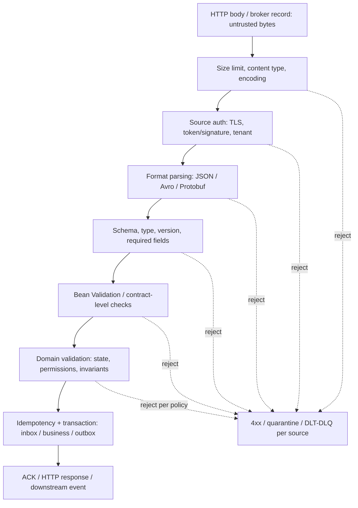
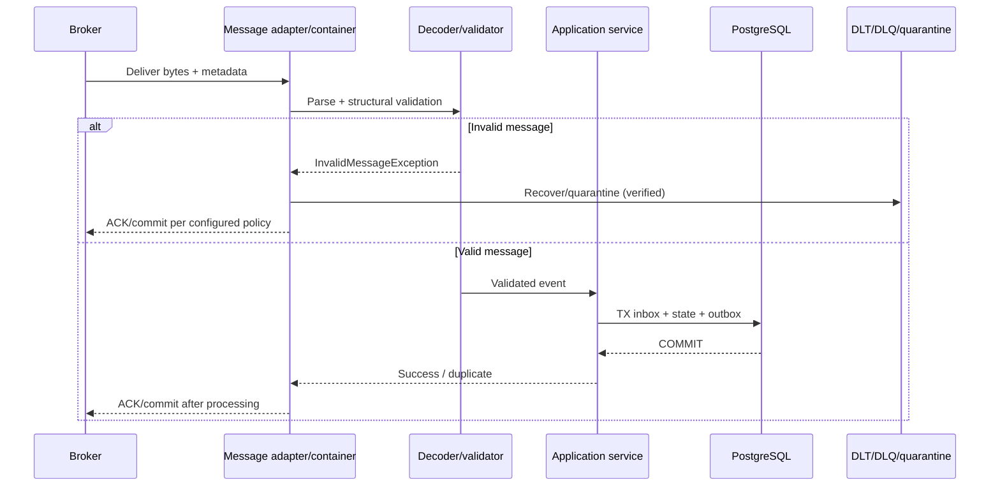
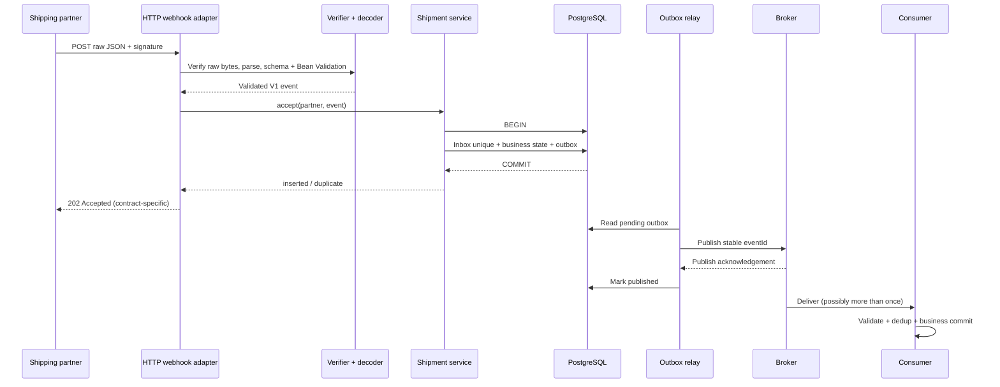

# Validating Message Structure Before Executing Business Logic

> **Chapter:** Data Contracts  
> **Module:** `SPRING_BOOT_INTEGRATION` — organizing system integration in Spring Boot across HTTP clients, databases, caches, message brokers, and Spring Integration adapters. Focuses on configuration management, data contracts, transactions, errors, deduplication, testing, and observing real integration flows.
>
> **Example scope:** Java 17+, Spring Boot 3 / Spring Framework 6, Jackson, Jakarta Bean Validation, PostgreSQL, and illustrative messaging adapters. Exact API/property names, converter behavior, and error handlers must be verified against your project's library versions. The SQL `ON CONFLICT` syntax below targets PostgreSQL and is not portable across all databases.

## 1. Why Validate Message Structure Before Running Business Logic?

Suppose a Spring Boot service receives a webhook from a shipping carrier:

```json
{
  "eventId": "evt-shipping-1001",
  "eventType": "shipment.status-changed",
  "schemaVersion": 1,
  "tenantId": "shop-a",
  "occurredAt": "2026-11-21T03:20:00Z",
  "payload": {
    "shipmentId": "sh-1001",
    "status": "DELIVERED"
  }
}
```

The system must verify the partner's signature, update the shipment in PostgreSQL, and write an outbox record to emit `ShipmentDelivered` to a broker. If data enters business processing before validation, a bad message can cause:

- Missing or `null` `eventId`: the deduplication key becomes unreliable, allowing the same event to be recorded multiple times.
- Unsupported `schemaVersion`: consumers misinterpret field meanings.
- Empty `payload.shipmentId`: update queries may affect zero or wrong records.
- `status = "DELIVRED"`: a typo in an enum value falls back to a dangerous default state.
- Invalid `occurredAt`: corrupted ordering or SLA calculations.
- JSON containing two `eventId` keys: different parsers may pick different values.
- Oversized payload: exhausts RAM, threads, or parser CPU.
- Body mismatching signature: the message may have been tampered with or spoofed before reaching the domain.

**Principle:** Only transition data into *eligible for business execution* after it passes source authentication, format, structure, data-type, and appropriate validation boundaries. "Jackson deserialized an object without throwing" does not mean the message is safe or valid.

### Learning Objectives

After this lesson, you will be able to:

1. Distinguish source authentication, parsing, schema validation, Bean Validation, and domain validation.
2. Design versioned envelopes and payloads with required fields, nullability, and unknown-field rules.
3. Use Jackson and Jakarta Bean Validation for HTTP/webhook messages at the right trust boundaries.
4. Choose JSON Schema/Avro/Protobuf validation strategies without confusing serialization with business contracts.
5. Handle contract-violating messages across HTTP, Kafka, RabbitMQ, and Spring Integration flows.
6. Combine structural validation with unique keys, inbox/outbox, transactions, and idempotency.
7. Test valid payloads, invalid payloads, duplicates, poison messages, and schema upgrades.

## 2. Validation Pipeline: From Untrusted Bytes to Domain Command

An external message should traverse multiple layers, each with a clear responsibility.



| Layer | Key question | Example failure | Responsible component |
|---|---|---|---|
| **Transport & limits** | Does the body match allowed media type, encoding, and size? | 12 MB instead of 256 KB limit | Gateway/web server/adapter |
| **Authenticity/authorization** | Who sent it? Are they authorized for this tenant/endpoint? | Invalid HMAC signature | Security adapter |
| **Parsing** | Are the bytes valid JSON? | Missing brace, bad encoding | Parser/MessageConverter |
| **Structural schema** | Are fields, types, enums, and versions valid? | `schemaVersion=99`, `payload` is a string | Schema validator/deserializer |
| **Bean Validation** | Does the DTO satisfy declared constraints? | Blank `eventId`, missing nested field | Jakarta Validation |
| **Domain validation** | Is the operation valid in the current state? | Order already cancelled yet marked delivered | Application/domain service |
| **Idempotency/transaction** | Is the event new or already processed? Are update and outbox atomic? | Two requests with the same `eventId` | DB constraints and service |
| **Delivery outcome** | When to reply/ACK and retry? | DB timeout before commit | HTTP/broker adapter and policy |

Exact ordering can vary by transport and security requirements; for instance, size limits should be enforced **before** buffering the whole body, whereas webhook signatures are usually verified over **raw bytes before parsing or normalizing**. Do not interpret the diagram as meaning every transport runs a single unified method.

## 3. Message Contracts: Versioned Envelope and Payload

In integration flows, separate common event metadata from event-specific content.

```json
{
  "eventId": "evt-shipping-1001",
  "eventType": "shipment.status-changed",
  "schemaVersion": 1,
  "tenantId": "shop-a",
  "occurredAt": "2026-11-21T03:20:00Z",
  "correlationId": "checkout-1001",
  "payload": {
    "shipmentId": "sh-1001",
    "status": "DELIVERED"
  }
}
```

This is an **application-defined contract**, not a mandatory envelope imposed by Spring Boot, Kafka, or Spring Integration.

| Field | Example contract | Risk if unvalidated |
|---|---|---|
| `eventId` | String, required, stable across retries | Cannot deduplicate; ID collisions |
| `eventType` | Allowlisted event type string | Dispatches to wrong handler |
| `schemaVersion` | Integer supported by consumer | Wrong decoding or mapping |
| `tenantId` | Required string verified against sender | Cross-tenant updates |
| `occurredAt` | ISO 8601 timestamp with offset/UTC | Incorrect ordering, SLA, or audit trail |
| `correlationId` | Optional per contract | Hard to trace; never replaces `eventId` |
| `payload.shipmentId` | Required string | Cannot identify target shipment |
| `payload.status` | Valid enum value | Invalid state side effects |

### 3.1. Events, Commands, and Replies Follow Different Rules

- **Events** describe a fact that happened; `eventId` identifies that occurrence.
- **Commands** request an action; `commandId` can act as the deduplication key against repeated execution.
- **Replies/responses** carry outcomes correlated via `correlationId` or request ID.

Using `correlationId` as a deduplication key can mistakenly drop two distinct valid events in the same workflow. Using a broker MessageId as a deduplication key can treat a republished business event as brand new.

### 3.2. Field Names and Meanings Must Be Versioned

Changing `status = "DELIVERED"` to `status = "DONE"`—even though both are strings—is still a contract change. Consumers cannot infer compatibility solely from JSON parsing cleanly. Each version must document required/optional fields, types, units, enums, `null` meanings, unknown-field rules, and upgrade steps.

## 4. JSON Schema: Describing Structure Right at the Boundary

One way to declare a formal contract is **JSON Schema**. Example using draft 2020-12:

```json
{
  "$schema": "https://json-schema.org/draft/2020-12/schema",
  "type": "object",
  "required": [
    "eventId", "eventType", "schemaVersion",
    "tenantId", "occurredAt", "payload"
  ],
  "properties": {
    "eventId": {
      "type": "string",
      "minLength": 1,
      "maxLength": 160
    },
    "eventType": {
      "const": "shipment.status-changed"
    },
    "schemaVersion": {
      "const": 1
    },
    "tenantId": {
      "type": "string",
      "minLength": 1,
      "maxLength": 80
    },
    "occurredAt": {
      "type": "string",
      "format": "date-time"
    },
    "correlationId": {
      "type": "string",
      "maxLength": 160
    },
    "payload": {
      "type": "object",
      "required": ["shipmentId", "status"],
      "properties": {
        "shipmentId": {
          "type": "string",
          "minLength": 1,
          "maxLength": 160
        },
        "status": {
          "enum": ["PICKED_UP", "IN_TRANSIT", "DELIVERED", "FAILED"]
        }
      },
      "additionalProperties": false
    }
  },
  "additionalProperties": false
}
```

What this schema shows:

- `required` enforces that a **property key exists**; it does not forbid `null` if the schema type permits `null`.
- `type` and `enum/const` validate types and allowed values.
- `additionalProperties: false` **rejects unknown fields**, a strict choice with rollout implications across versions.
- `minLength` does not automatically forbid whitespace-only strings; `@NotBlank`/trimming policies can supplement it.
- `format: "date-time"` may be an **annotation** or an assertion depending on validator, dialect, and configuration; verify that your implementation actually enforces formats rather than assuming the schema line suffices.

**Spring Boot does not automatically run a JSON Schema validator simply because a schema file exists.** You must select a library supporting your draft, load schemas from controlled sources, compile/cache validators, invoke validation, and map errors in the ingress adapter. If contracts use OpenAPI schemas, Avro, or Protobuf, validator and compatibility semantics differ from JSON Schema.

### 4.1. Strict or Tolerant Schema?

Two main approaches:

1. **Strict input:** rejects unknown fields. Catches typos and contract drift early, but rolling deployments can fail if producers emit a new field while old consumers are still running.
2. **Tolerant reader:** accepts unknown fields without using them. Supports certain additive changes, but can mask misspelled keys or silently ignore critical security fields.

There is no universal "always strict" or "always ignore" rule. Choose based on your **compatibility policy** and business sensitivity. Even when extra fields are tolerated, required fields, version, `eventType`, and invariants must still be validated.

## 5. Immutable Java DTOs and Jakarta Bean Validation

Spring Boot commonly uses Jackson to bind JSON into Java objects, followed by Bean Validation for DTO constraints. Record-based contract:

```java
package com.example.integration.contract;

import java.time.Instant;
import jakarta.validation.Valid;
import jakarta.validation.constraints.Max;
import jakarta.validation.constraints.Min;
import jakarta.validation.constraints.NotBlank;
import jakarta.validation.constraints.NotNull;
import jakarta.validation.constraints.Size;

public record ShipmentStatusChangedV1(
    @NotBlank @Size(max = 160) String eventId,
    @NotBlank String eventType,
    @NotNull @Min(1) @Max(1) Integer schemaVersion,
    @NotBlank @Size(max = 80) String tenantId,
    @NotNull Instant occurredAt,
    @Size(max = 160) String correlationId,
    @Valid @NotNull Payload payload
) {
    public record Payload(
        @NotBlank @Size(max = 160) String shipmentId,
        @NotNull ShipmentStatus status
    ) {}

    public enum ShipmentStatus {
        PICKED_UP, IN_TRANSIT, DELIVERED, FAILED
    }
}
```

Key details:

- `record` defines an immutable DTO structure; a record alone does not enforce business invariants.
- `@NotBlank` differs from `@NotNull`: `""` or whitespace-only strings must be rejected when content is required.
- `@Size` bounds string lengths against contract limits; it does not replace server-enforced raw body size limits.
- `Integer schemaVersion` paired with `@NotNull` distinguishes **missing** from `0` during binding.
- `@Valid @NotNull Payload payload` checks both the presence of the nested object and the fields inside it.
- `@NotNull ShipmentStatus` blocks null; Jackson must first convert the string to the enum before Bean Validation runs.
- `@NotNull Instant` blocks missing/null timestamps; malformed time strings usually fail earlier in Jackson.

**Note:** `@NotBlank eventType` does not guarantee it equals `"shipment.status-changed"`. Enforce the exact value via JSON Schema, an additional constraint, or an ingress dispatcher check.

### 5.1. Required Does Not Mean Non-Null in Every Tool

When Jackson deserializes into a record, an omitted JSON field can bind as Java `null` for reference types. `@NotNull` catches this **only if validation is actually invoked**; `ObjectMapper.readValue(...)` by itself does not run Bean Validation.

For primitives such as `int` or `boolean`, a missing field may silently receive a default value depending on coercion and creator-property settings, erasing the difference between "not sent" and `0`/`false`. For required inputs, use boxed types or strict parsing settings and test missing fields explicitly.

### 5.2. Null Values, Empty Strings, and Missing Fields

| JSON input | What Java may see | Contract meaning |
|---|---|---|
| `correlationId` omitted | `null` | Allowed if optional |
| `"correlationId": null` | `null` | May differ from omitted in PATCH APIs |
| `"correlationId": ""` | `""` | Not automatically equivalent to null |
| `"schemaVersion": null` | `null` | Invalid because required |
| `"schemaVersion": 0` | `0` | Invalid because unsupported version |
| `"payload": null` | `null` | Invalid |
| `"payload": {}` | Payload with null fields | Invalid when cascading `@Valid` |

For **event snapshot** webhooks, defining explicit required fields without PATCH semantics is usually cleaner. For PATCH APIs, "missing field" and "explicit null" may require two distinct behaviors—in which case a two-state DTO is insufficient and a dedicated field-presence representation is needed.

## 6. Actually Enabling Bean Validation in Spring Boot

Illustrative Gradle Groovy DSL:

```gradle
dependencies {
    implementation("org.springframework.boot:spring-boot-starter-web")
    implementation("org.springframework.boot:spring-boot-starter-validation")
    implementation("org.springframework.boot:spring-boot-starter-jdbc")
    runtimeOnly("org.postgresql:postgresql")

    testImplementation("org.springframework.boot:spring-boot-starter-test")
}
```

`spring-boot-starter-validation` provides a compatible Bean Validation implementation so `jakarta.validation.constraints.*` annotations are actually enforced. It is distinct from the Spring Boot configuration processor, Swagger/OpenAPI, or documentation-only annotations.

If a DTO is instantiated via `new` or Jackson `readValue` outside the MVC pipeline, **Bean Validation does not run automatically**. You must call `Validator.validate(...)` explicitly or route the DTO through a configured validation integration point.

### 6.1. `@Valid` and `@Validated`

- In Spring MVC, `@Valid @RequestBody Payload` typically triggers request-body validation after deserialization under Spring Boot's standard setup.
- `@Validated` supports validation groups and method-level validation via Spring AOP.
- In an event consumer, never assume `@KafkaListener`, `@RabbitListener`, or custom adapters automatically mirror MVC validation unless explicitly configured.
- `@Valid` on a nested field is a **cascade marker**, not a requirement check—add `@NotNull` too when required.

### 6.2. Do Not Use Validation to Decide "Already Processed"

Bean Validation answers: "Is this input acceptable under the contract?" It does not know whether the shipment was already delivered, whether the order truly belongs to the tenant, or whether the event is being replayed. Those checks belong in the application/domain service using DB state and idempotency keys.

## 7. HTTP Controller with `@Valid @RequestBody`: The Simple Path

For an internal API backed by prior authentication middleware, an MVC method can bind the DTO directly:

```java
import com.example.integration.contract.ShipmentStatusChangedV1;
import jakarta.validation.Valid;
import org.springframework.http.HttpStatus;
import org.springframework.http.MediaType;
import org.springframework.web.bind.annotation.PostMapping;
import org.springframework.web.bind.annotation.RequestBody;
import org.springframework.web.bind.annotation.RequestMapping;
import org.springframework.web.bind.annotation.ResponseStatus;
import org.springframework.web.bind.annotation.RestController;

@RestController
@RequestMapping("/internal/shipping-events")
class InternalShipmentEventController {

    private final ShipmentIntakeService intakeService;

    InternalShipmentEventController(ShipmentIntakeService intakeService) {
        this.intakeService = intakeService;
    }

    @PostMapping(consumes = MediaType.APPLICATION_JSON_VALUE)
    @ResponseStatus(HttpStatus.ACCEPTED)
    void receive(@Valid @RequestBody ShipmentStatusChangedV1 event) {
        intakeService.acceptInternal(event);
    }
}
```

`ShipmentIntakeService` is a project-implemented application service. Here:

1. Spring MVC selects an `HttpMessageConverter` based on media type.
2. Jackson parses JSON into `ShipmentStatusChangedV1`.
3. Bean Validation checks constraints because of `@Valid`.
4. Only after those steps succeed is the controller method invoked.

This is the **simple path for pre-authenticated internal APIs**. It does not make external webhooks safe when HMAC verification over **raw request bytes** is required. Never accept `@RequestBody DTO` and re-serialize the DTO to verify a signature, because field ordering, whitespace, escaping, and numeric formatting can change.

### 7.1. Errors Can Occur Before the Controller Runs

If the JSON has a type mismatch or an unparseable timestamp, the request can fail inside `HttpMessageConverter` with `HttpMessageNotReadableException` before the controller method is entered. If the object binds but lacks `eventId`, validation throws `MethodArgumentNotValidException`.

A `try/catch` inside the controller method **cannot catch converter or validation errors thrown beforehand**. Handle them at the MVC layer using `@RestControllerAdvice`.

## 8. Signed Webhooks: Verify Raw Body Before Parsing

For partner webhooks using HMAC, preserve the raw body to verify the signature per contract. Example wiring:

```java
import com.example.integration.contract.ShipmentStatusChangedV1;
import org.springframework.http.MediaType;
import org.springframework.http.ResponseEntity;
import org.springframework.web.bind.annotation.*;

@RestController
@RequestMapping("/webhooks/shipping")
public class ShippingWebhookController {

    private final WebhookSignatureVerifier signatureVerifier;
    private final ShipmentMessageDecoder decoder;
    private final ShipmentIntakeService intakeService;

    public ShippingWebhookController(
            WebhookSignatureVerifier signatureVerifier,
            ShipmentMessageDecoder decoder,
            ShipmentIntakeService intakeService) {
        this.signatureVerifier = signatureVerifier;
        this.decoder = decoder;
        this.intakeService = intakeService;
    }

    @PostMapping(consumes = MediaType.APPLICATION_JSON_VALUE)
    public ResponseEntity<Void> receive(
            @RequestHeader("X-Partner-Id") String partnerId,
            @RequestHeader("X-Signature") String signature,
            @RequestBody byte[] rawBody) {

        // Verify over exact original bytes before parsing or normalizing.
        signatureVerifier.verify(partnerId, signature, rawBody);

        ShipmentStatusChangedV1 event = decoder.decode(rawBody);
        intakeService.acceptFromPartner(partnerId, event, rawBody);

        return ResponseEntity.accepted().build();
    }
}
```

`WebhookSignatureVerifier`, `ShipmentMessageDecoder`, and `ShipmentIntakeService` are application-defined adapters/services. The example omits custom HMAC code because **signature verification must strictly follow the exact algorithm, canonicalization, timestamp/nonce headers, and key rotation published by the partner**.

**Important:** `@RequestBody byte[]` already buffers the entire body in JVM memory. To defend against oversized payloads, enforce limits **earlier** at the reverse proxy, API gateway, servlet container, or a tested servlet filter. Checking `rawBody.length` inside the controller happens **too late** to prevent a huge request from allocating memory.

### 8.1. Verification and JSON Ordering

- Enforce content type and body size limits before reading/parsing.
- Verify signatures over **raw bytes**, never re-formatted JSON.
- Enforce replay timestamp/nonce windows and partner tenant rules per contract.
- Only after authentication succeeds should you parse and run schema/Bean Validation.
- After structural validation, verify `tenantId` in the payload matches the authenticated sender identity.
- When persisting to the DB, use a properly scoped idempotency key, such as `(partnerId, eventId)`.

Never trust `X-Partner-Id` just because the header is present; map it to pre-configured secrets/permissions and pass it through proper signature verification.

## 9. Explicit Decoder: Strict Jackson Reader + Validator

When reading `byte[]` directly in a controller, Kafka/Rabbit listener, or file adapter, invoke validation explicitly. Example version-1 Spring bean decoder:

```java
import com.example.integration.contract.ShipmentStatusChangedV1;
import com.fasterxml.jackson.databind.DeserializationFeature;
import com.fasterxml.jackson.databind.ObjectMapper;
import com.fasterxml.jackson.databind.ObjectReader;
import jakarta.validation.ConstraintViolation;
import jakarta.validation.Validator;
import java.io.IOException;
import java.util.Set;
import org.springframework.stereotype.Component;

@Component
public class ShipmentMessageDecoder {

    private final ObjectReader reader;
    private final Validator validator;

    public ShipmentMessageDecoder(ObjectMapper objectMapper,
                                  Validator validator) {
        // Keep Boot's Java Time/Module configuration from ObjectMapper,
        // while applying an ingress-specific unknown-field policy.
        this.reader = objectMapper.readerFor(ShipmentStatusChangedV1.class)
            .with(DeserializationFeature.FAIL_ON_UNKNOWN_PROPERTIES);
        this.validator = validator;
    }

    public ShipmentStatusChangedV1 decode(byte[] rawBody) {
        final ShipmentStatusChangedV1 event;
        try {
            event = reader.readValue(rawBody);
        } catch (IOException ex) {
            throw new InvalidMessageException(
                "Malformed JSON or incompatible field type", ex);
        }

        if (event == null) {
            throw new InvalidMessageException("Event object is required");
        }

        Set<ConstraintViolation<ShipmentStatusChangedV1>> errors =
            validator.validate(event);

        if (!errors.isEmpty()) {
            // Do not expose raw invalidValue/raw payload into logs or API responses.
            throw new InvalidMessageException(
                "Message violates the declared contract");
        }

        if (!"shipment.status-changed".equals(event.eventType())) {
            throw new InvalidMessageException("Unsupported event type");
        }
        return event;
    }
}
```

And an illustrative exception so controllers/consumers can classify clearly:

```java
public final class InvalidMessageException extends RuntimeException {
    public InvalidMessageException(String message) {
        super(message);
    }

    public InvalidMessageException(String message, Throwable cause) {
        super(message, cause);
    }
}
```

Here `reader.readValue(...)` handles **parsing and Java type mapping**, `Validator.validate(...)` checks DTO constraints, and comparing `eventType` enforces a contract invariant not expressed by annotations. If using a JSON Schema validator, place it before or alongside DTO mapping per policy, ensuring the two layers never contradict each other.

### 9.1. Why Apply the Strict Reader Only at Ingress?

Spring Boot typically configures a shared `ObjectMapper` across APIs. Enabling `FAIL_ON_UNKNOWN_PROPERTIES` globally can cause endpoints or consumers needing forward compatibility to suddenly reject messages. `ObjectReader` isolates strictness to one boundary so policy changes stay testable.

### 9.2. Duplicate JSON Keys Require a Dedicated Decision

`FAIL_ON_UNKNOWN_PROPERTIES` does **not** detect duplicate keys in a JSON object. If the contract requires rejecting duplicate keys, enable strict duplicate detection on the parser/`JsonFactory` and test it against **your actual raw-byte decoder**, or use a JSON Schema/parser stack with guaranteed duplicate-key enforcement.

JSON like:

```json
{
  "eventId": "evt-safe",
  "eventId": "evt-other",
  "schemaVersion": 1
}
```

must not be silently accepted when signatures, audits, and idempotency depend on a single `eventId`. Parsers may take the first or last occurrence; only an approved, consistent policy prevents deserialization ambiguity.

## 10. Distinguishing Schema Validation from Bean Validation

The two layers complement rather than fully replace each other.

| Aspect | JSON Schema | Jakarta Bean Validation |
|---|---|---|
| Primary input | JSON document/tree/stream | Java object |
| Required/type/shape checks | Very explicit | Depends on DTO and deserialization behavior |
| Unknown properties | `additionalProperties` | Usually handled by Jackson/converters |
| String length/range/enum | Supported | `@Size`, `@Min`, enums, and custom constraints |
| Nested validation | Nested schemas/`$ref` | `@Valid` on nested objects |
| Contract versioning | Schema artifacts can be versioned independently | Requires versioned DTOs/dispatching |
| Cross-field rules | Selected keywords/extensions | Custom constraints or `@AssertTrue` |
| DB business state | No | Not by default |
| Runtime integration | Requires validator library | Requires Bean Validation provider and invocation |

### 10.1. Why Not Use Only Java Annotations?

Non-Java producers need contracts independent of consumer source code. JSON Schema, OpenAPI, Avro, and Protobuf produce artifacts usable for code generation, contract testing, and compatibility governance. Bean Validation is convenient for checking **already-mapped objects inside a Java application**.

### 10.2. Why Not Use Only JSON Schema?

A structurally valid JSON document can still demand an illegal state transition: `DELIVERED` for a nonexistent shipment, an unauthorized tenant, or an event older than the committed state version. Schemas lack live business state at processing time. Application/domain validation and transactions are still required.

## 11. Coercion Rules: Do Not Silently Convert Bad Data

Jackson and many converters support **coercion**, such as turning `"12"` into an integer or invalid values into `null`, depending on configuration and version. Some APIs intentionally accept flexible types; many integration flows require strict contracts.

Consider these distinct inputs:

```json
{"schemaVersion": 1}
```

```json
{"schemaVersion": "1"}
```

```json
{"schemaVersion": true}
```

If the contract mandates `schemaVersion` as a JSON integer, only the first is valid. In critical pipelines, enforce consistent **strict coercion policies** in the parser or JSON Schema and write negative tests for wrong types; never let converters silently coerce and assume producers always send proper types.

Likewise, `trim()` normalization may make sense for user-entered codes, yet you should never alter an opaque `eventId` used in signatures, unique keys, and traces if case or whitespace is significant under the contract. Whenever canonicalization is needed, specify it in the contract and apply it identically on both sides.

### 11.1. Numeric Precision

- Represent money using integer `amountMinor` with currency or `BigDecimal` per contract; avoid converting monetary decimals through `double`.
- Oversized integers can cause overflows or deserialization failures.
- SQL `NUMERIC`, JSON numbers, and Java `BigDecimal` must agree on scale and rounding.
- `0`, `null`, and "omitted field" are not interchangeable.

### 11.2. Date and Time

`occurredAt` should carry an offset/UTC and parse into `Instant` when representing an absolute instant. Never substitute `Instant.now()` in a decoder when a timestamp fails to parse: doing so fabricates **false facts** for auditing and event ordering.

## 12. Version Dispatch: Select the Contract Before Instantiating a DTO

A version 2 message may introduce new fields or change semantics. Always binding into DTO V1 can drop critical fields or produce misleading errors.

A clear strategy:

1. Verify raw body limits and authenticity.
2. Perform minimal envelope parsing under size and depth constraints.
3. Read `eventType` and `schemaVersion` strictly.
4. Choose the schema/DTO handler from an **allowlist of supported versions**.
5. Validate the entire message under that version's rules.
6. Convert to a domain command or versioned internal model before running business logic.

Conceptual Jackson dispatcher:

```java
import com.fasterxml.jackson.databind.JsonNode;
import com.fasterxml.jackson.databind.ObjectMapper;
import java.io.IOException;
import org.springframework.stereotype.Component;

@Component
public class VersionedShipmentDecoder {

    private final ObjectMapper mapper;
    private final ShipmentMessageDecoder v1Decoder;

    public VersionedShipmentDecoder(
            ObjectMapper mapper, ShipmentMessageDecoder v1Decoder) {
        this.mapper = mapper;
        this.v1Decoder = v1Decoder;
    }

    public ShipmentStatusChangedV1 decodeSupported(byte[] raw) {
        final JsonNode root;
        try {
            root = mapper.readTree(raw);
        } catch (IOException ex) {
            throw new InvalidMessageException("Malformed JSON", ex);
        }

        if (root == null || !root.isObject()) {
            throw new InvalidMessageException("JSON object is required");
        }

        JsonNode version = root.get("schemaVersion");
        if (version == null || !version.isIntegralNumber()
                || version.intValue() != 1) {
            throw new InvalidMessageException("Unsupported schema version");
        }

        return v1Decoder.decode(raw);
    }
}
```

This example supports only V1 to demonstrate **fail-closed** handling for unknown versions. In a multi-version consumer, the dispatcher returns a sealed domain command or common interface backed by separate V1/V2 decoders. When dispatching via a tree pass like this, keep **duplicate-key detection** aligned between `readTree` and the final decoder so the preliminary pass and final parse never interpret bytes differently.

### 12.1. Versioning Must Not Rely on "Field Guessing"

If `statusReason` is added without changing versions, old consumers may keep running while ignoring the new business meaning. Define explicitly which changes are compatible, which demand a new version, and how rolling deployments proceed.

Schema registries may offer compatibility checks, yet **structural compatibility does not guarantee semantic compatibility**. Changing time units from seconds to milliseconds or altering enum meanings passes many schema checks while silently breaking business logic.

## 13. Distinguishing Structural Validation, Authorization, and State Transitions

A schema-valid message can still carry an unauthorized request.

Example:

```json
{
  "eventId": "evt-1001",
  "eventType": "shipment.status-changed",
  "schemaVersion": 1,
  "tenantId": "shop-b",
  "occurredAt": "2026-11-21T03:20:00Z",
  "payload": {
    "shipmentId": "sh-1001",
    "status": "DELIVERED"
  }
}
```

The webhook sender is authorized only for `shop-a`, yet the JSON declares `tenantId=shop-b`. Both JSON Schema and Bean Validation may pass. Only **authorization/tenant verification** catches that this is forbidden.

Similarly, `DELIVERED` arriving after `CANCELLED` requires checking the state machine or aggregate version in the DB. Do not pack state transitions into a `ConstraintValidator` tied to the DTO, because validators should not open DB transactions or HTTP calls on every parse. Keep validators **pure**, and put state-dependent checks in the application service.

### 13.1. Error Classification for Operational Decisions

- **Invalid structure:** unparseable payload or missing required fields → reject or quarantine.
- **Unauthorized:** invalid signature or forbidden tenant → block and emit security alert.
- **Invalid domain state:** permanently reject or flag for reconciliation per contract.
- **Transient dependency failure:** database/broker unavailable → bounded retry.
- **Valid duplicate:** event ID already processed → no-op and return the contract-defined acceptance response.

Never lump everything into one `catch (Exception)` and infinitely retry or return a fake HTTP 200.

## 14. Broker Messages: Validate Before the Business Service

In Kafka, RabbitMQ, Pulsar, or Spring Integration adapters, the typical flow is:



**Important:** validation may live inside the listener or inside a deserializer/converter before the listener. For errors occurring before the listener, a `try/catch` inside the listener method never executes. Error handling must be verified across every layer.

### 14.1. Never ACK a Poison Message Without a Durable Outcome

When an unparseable message must be kept for investigation or reprocessing, choose one of these paths:

1. Persist it to a DLQ/DLT/quarantine **with durable confirmation**, then allow the source broker to commit/ACK.
2. Let a tested binder/container recoverer or error handler perform that recovery per policy.
3. If recovery is unavailable and data is critical, retain retries with alerts or pause the consumer per runbook—never swallow the error.

Never push invalid messages into an in-memory queue and ACK just to "unblock poison traffic"; a pod crash will lose both evidence and reconciliation capability.

## 15. Kafka Consumer: `byte[]` Then Decode Exactly Once

With Spring Kafka, configure a byte-array value deserializer so the application validates JSON explicitly:

```yaml
spring:
  kafka:
    consumer:
      key-deserializer: org.apache.kafka.common.serialization.StringDeserializer
      value-deserializer: org.apache.kafka.common.serialization.ByteArrayDeserializer

integration:
  shipping:
    events-topic: shipping.status-changed.v1
    consumer-group: shipping-inbox-service
```

Listener:

```java
import org.apache.kafka.clients.consumer.ConsumerRecord;
import org.springframework.kafka.annotation.KafkaListener;
import org.springframework.stereotype.Component;

@Component
public class ShippingKafkaListener {

    private final ShipmentMessageDecoder decoder;
    private final ShipmentIntakeService service;

    public ShippingKafkaListener(
            ShipmentMessageDecoder decoder,
            ShipmentIntakeService service) {
        this.decoder = decoder;
        this.service = service;
    }

    @KafkaListener(
        topics = "${integration.shipping.events-topic}",
        groupId = "${integration.shipping.consumer-group}"
    )
    public void onRecord(ConsumerRecord<String, byte[]> record) {
        ShipmentStatusChangedV1 event = decoder.decode(record.value());
        service.acceptFromKafka(record.key(), event);
    }
}
```

`ShipmentIntakeService.acceptFromKafka` is an application-implemented service. `record.key()` does not automatically establish a valid tenant or partner; validate the Kafka key contract and cross-check it against the envelope/source. Depending on the configured listener container and error handler, normal method return typically permits offset progress to be committed. Exact ACK/commit, transaction, and retry behavior vary by container settings.

### 15.1. JSON Deserializer Failures Before the Listener

If using `JsonDeserializer<ShipmentStatusChangedV1>` directly, deserialization errors occur inside the Kafka consumer **before** the listener method runs. Supported Spring Kafka versions offer `ErrorHandlingDeserializer` and `DefaultErrorHandler`/recoverers to route such failures cleanly.

Test malformed JSON values, unknown schema versions, invalid enums, and missing fields against the real container—do not merely call `onRecord` directly in unit tests. DLT routing is an explicit transport configuration, not something `@KafkaListener` creates automatically.

### 15.2. Offsets Are Not Business Transactions

Kafka offset commits and PostgreSQL transactions are two separate boundaries. A consumer can commit the DB transaction and crash before committing the offset; Kafka will redeliver the record after restart. DB idempotency ensures duplicates cause no second side effect.

If code delegates to `@Async` and returns from the listener before work is durably stored, the offset may commit while async work has not even run. Avoid that pattern for work that must not be lost.

## 16. RabbitMQ and Pulsar: Same Principles, Different ACK Mechanics

RabbitMQ also has its own message converters, listener containers, and error handlers. Example Spring AMQP listener receiving raw bytes:

```java
import org.springframework.amqp.rabbit.annotation.RabbitListener;
import org.springframework.stereotype.Component;

@Component
public class ShippingRabbitListener {

    private final ShipmentMessageDecoder decoder;
    private final ShipmentIntakeService service;

    public ShippingRabbitListener(
            ShipmentMessageDecoder decoder,
            ShipmentIntakeService service) {
        this.decoder = decoder;
        this.service = service;
    }

    @RabbitListener(queues = "shipping.status-changed.inbox")
    public void onMessage(byte[] rawBody) {
        ShipmentStatusChangedV1 event = decoder.decode(rawBody);
        service.acceptFromRabbit(event);
    }
}
```

To run this example you need the **Spring AMQP starter, queue declarations, and matching container factory/configuration**. Whether the converter hands raw `byte[]` to the listener depends on configuration; never assume `@RabbitListener` always receives `byte[]`.

- **Kafka:** progress tracked via consumer-group offsets and container acknowledgements.
- **RabbitMQ:** delivery acknowledgements, NACK/requeue, and dead-letter exchanges/queues per topology.
- **Pulsar:** subscription cursors, ACK/NACK/redelivery/DLQ per subscription type and consumer configuration.

**Never copy Kafka DLT configurations blindly to RabbitMQ or Pulsar.** Even when the business decoder is shared, each adapter's error path and ACK behavior must be tested against its real broker.

### 16.1. Spring Integration Flows

Spring Integration can receive messages through an inbound adapter, invoke transformers/validators, and route errors:

```text
Broker inbound adapter
  -> MessageChannel
  -> Transformer: parse raw bytes
  -> Filter/Validator: contract valid?
  -> Service Activator: domain service
  -> Outbox/inbox transaction
  -> Error channel / recoverer (per policy)
```

`MessageChannel` and `errorChannel` may be **in-JVM constructs**, not durable queues by default. To persist invalid messages before ACKing, attach a durable store/DLT/DLQ and verify recovery outcomes. In particular, switching from `DirectChannel` to `ExecutorChannel` alters thread boundaries, transaction contexts, and exception propagation.

## 17. HTTP Status Codes and Responses for Invalid Messages

HTTP is a request/response protocol; for webhook APIs, status codes must match the partner contract.

| Situation | Commonly considered status | Notes |
|---|---|---|
| Malformed JSON, wrong type, missing required field | `400 Bad Request` | Distinguish malformed syntax from structural validation |
| Unsupported media type | `415 Unsupported Media Type` | Check `Content-Type` |
| Oversized payload | `413 Content Too Large` | Enforce at gateway/server before buffering |
| Unauthenticated / unauthorized | `401/403` per auth scheme | Never leak secrets or signatures |
| Syntactically valid but violates business rules | `422` or `409` per API contract | Do not treat as a parsing error |
| Valid duplicate event | `200/202` or documented idempotent reply | Produce no new side effects |
| Database/broker unavailable, not durably stored | Appropriate `5xx/503` | Sender may retry per policy |
| Stored in inbox/outbox, downstream pending | `202 Accepted` | Promises durable intake only |

There is no universal rule that every webhook returns `202` or every domain error returns `422`. Some partners retry only on specific HTTP status codes; **responses must match the delivery contract** to avoid retry storms or dropped events.

### 17.1. Using `ProblemDetail` Without Leaking Data

In Spring MVC, you can map structural validation exceptions to a stable error code:

```java
import org.springframework.http.HttpStatus;
import org.springframework.http.ProblemDetail;
import org.springframework.http.ResponseEntity;
import org.springframework.http.converter.HttpMessageNotReadableException;
import org.springframework.web.bind.MethodArgumentNotValidException;
import org.springframework.web.bind.annotation.ExceptionHandler;
import org.springframework.web.bind.annotation.RestControllerAdvice;

@RestControllerAdvice
class MessageContractExceptionAdvice {

    @ExceptionHandler({
        InvalidMessageException.class,
        HttpMessageNotReadableException.class,
        MethodArgumentNotValidException.class
    })
    ResponseEntity<ProblemDetail> handleInvalidMessage(Exception ex) {
        ProblemDetail detail = ProblemDetail.forStatus(HttpStatus.BAD_REQUEST);
        detail.setTitle("Invalid message");
        detail.setDetail("Request body does not satisfy the message contract");
        detail.setProperty("code", "INVALID_MESSAGE");
        return ResponseEntity.badRequest().body(detail);
    }
}
```

Never expose `ex.getMessage()`, raw payloads, signatures, or sensitive field values in responses. A Kafka listener does not use HTTP `ProblemDetail`; it needs its own error classification and recoverer.

## 18. Retries, Poison Messages, and Quarantine

**Not every exception deserves a retry.** JSON with a wrong field type will still fail on the second attempt if the input has not changed. Conversely, a valid message may temporarily fail to reach the DB during a connection-pool blip.

| Category | Example | Handling |
|---|---|---|
| **Permanent structural** | Syntax error, unsupported `schemaVersion` | Reject or quarantine/DLT; never retry indefinitely |
| **Permanent security** | Invalid signature, forbidden tenant | Reject and emit security alert; never "auto-fix" payload |
| **Domain reject** | Illegal transition, missing ID per contract | Classify as permanent or pending reconciliation |
| **Transient infrastructure** | DB timeout, broker briefly unavailable | Retry with backoff, jitter, limits, and monitoring |
| **Unknown outcome** | Broker publish succeeded but producer lost ACK | Retry with stable event ID; consumer deduplicates |
| **Valid duplicate** | Same event ID already processed | No-op, ACK/respond per contract |

### 18.1. Quarantine Needs Its Own Contract

A quarantine record should capture enough context for investigation without exposing sensitive data:

- Source/partner/topic/partition/offset or technical message ID.
- Safely extracted `eventId` (if reliable), declared schema version, error category, and received timestamp.
- Payload hash or encrypted payload/reference per data-protection policy.
- Attempt count, failure category, and responsible owner.
- Reprocess/ignored/resolved status.

If raw bodies contain PII or credentials, do not log or retain them indefinitely solely for debugging. Enforce TTLs, access control, encryption, and retention policies.

### 18.2. When Is It Safe to ACK an Invalid Message?

Permanently discarding a structurally invalid message requires an **audited decision**. If reprocessing may be needed, verify the message is durably stored in quarantine before ACKing or committing the offset. A consumer that merely logs and returns normally risks losing messages permanently.

## 19. Idempotency Must Rely on Verified Messages

Receiving the same `eventId` more than once is normal. Processing order matters:

1. Authenticate the source and validate structure enough to trust `eventId` and `tenant`.
2. Check `(partner, eventId)` against processed records or insert via a unique constraint.
3. If the event is new, apply business changes and write to the outbox in the same DB transaction.
4. If the event already exists, return a duplicate no-op per contract.
5. If **the same `eventId` arrives with different content**, flag a collision/contract violation instead of silently accepting the altered event.

### 19.1. Why Not Write to the Inbox Before Parsing?

Recording an unverified `eventId` from unvalidated JSON as already received lets a malformed or spoofed message "claim" the ID before the legitimate message arrives—dropping real work when duplicate checks trigger.

Some systems archive every raw message to a **separate audit quarantine** before validation. Even then, unverified or invalid records **must never count as processed in the business inbox**.

### 19.2. Comparing Payloads on Duplicate Arrival

A unique constraint prevents two rows with the same business key, yet does not verify semantic equivalence of two payloads. Store the contract version and a **digest of the validated content under a defined canonicalization**, or an appropriate business hash.

Never compare SHA-256 hashes of raw JSON bytes alone to conclude "semantically different": two payloads differing only in whitespace or key order represent the same object. Conversely, do not ignore genuinely differing content simply because `eventId` matches. Document partner canonicalization rules and test collision handling.

## 20. Transactional Inbox/Outbox: Validation Is the Gate, Not All of Reliability

Illustrative PostgreSQL schema:

```sql
CREATE TABLE shipping_inbox (
    id BIGINT GENERATED BY DEFAULT AS IDENTITY PRIMARY KEY,
    partner VARCHAR(80) NOT NULL,
    event_id VARCHAR(160) NOT NULL,
    schema_version INTEGER NOT NULL,
    payload_json TEXT NOT NULL,
    state VARCHAR(24) NOT NULL DEFAULT 'RECEIVED',
    received_at TIMESTAMPTZ NOT NULL DEFAULT CURRENT_TIMESTAMP,
    CONSTRAINT uq_shipping_inbox_partner_event
        UNIQUE (partner, event_id)
);

CREATE TABLE shipping_outbox (
    id BIGINT GENERATED BY DEFAULT AS IDENTITY PRIMARY KEY,
    event_id VARCHAR(160) NOT NULL UNIQUE,
    topic VARCHAR(180) NOT NULL,
    payload_json TEXT NOT NULL,
    state VARCHAR(24) NOT NULL DEFAULT 'PENDING',
    created_at TIMESTAMPTZ NOT NULL DEFAULT CURRENT_TIMESTAMP
);
```

Create constraints via migrations such as Flyway or Liquibase. Both `partner` and `event_id` are `NOT NULL` so the deduplication key reliably protects business state; `payload_json` must come from a validated event. In multi-tenant/multi-partner systems, scope outbox uniqueness appropriately—using a composite key if `eventId` is not globally unique.

### 20.1. Application Service After Message Validation

```java
import com.fasterxml.jackson.core.JsonProcessingException;
import com.fasterxml.jackson.databind.ObjectMapper;
import org.springframework.jdbc.core.JdbcTemplate;
import org.springframework.stereotype.Service;
import org.springframework.transaction.annotation.Transactional;

@Service
public class ShipmentIntakeService {

    private final JdbcTemplate jdbc;
    private final ShippingOutboxWriter outbox;
    private final ObjectMapper mapper;

    public ShipmentIntakeService(
            JdbcTemplate jdbc,
            ShippingOutboxWriter outbox,
            ObjectMapper mapper) {
        this.jdbc = jdbc;
        this.outbox = outbox;
        this.mapper = mapper;
    }

    @Transactional
    public boolean acceptFromPartner(
            String partner,
            ShipmentStatusChangedV1 event,
            byte[] validatedRawBody) {

        // Raw body has already been verified and validated as valid UTF-8 JSON.
        return persistValidatedEvent(
            partner, event,
            new String(validatedRawBody, java.nio.charset.StandardCharsets.UTF_8)
        );
    }

    @Transactional
    public boolean acceptFromKafka(
            String partner, ShipmentStatusChangedV1 event) {
        // Partner/key must be verified per topic/ACL contract.
        return persistValidatedEvent(partner, event, serializeValidated(event));
    }

    @Transactional
    public boolean acceptFromRabbit(ShipmentStatusChangedV1 event) {
        return persistValidatedEvent(
            "rabbit-shipping", event, serializeValidated(event));
    }

    @Transactional
    public void acceptInternal(ShipmentStatusChangedV1 event) {
        persistValidatedEvent("internal", event, serializeValidated(event));
    }

    private boolean persistValidatedEvent(
            String partner, ShipmentStatusChangedV1 event, String payloadJson) {
        if (partner == null || partner.isBlank()) {
            throw new InvalidMessageException("Missing source identity");
        }

        int inserted = jdbc.update(
            """
            INSERT INTO shipping_inbox (
                partner, event_id, schema_version, payload_json
            )
            VALUES (?, ?, ?, ?)
            ON CONFLICT (partner, event_id) DO NOTHING
            """,
            partner,
            event.eventId(),
            event.schemaVersion(),
            payloadJson
        );

        if (inserted == 0) {
            return false;
        }

        // Write state/outbox only for new events, inside the same DB transaction.
        outbox.prepareShipmentUpdate(partner, event);
        return true;
    }

    private String serializeValidated(ShipmentStatusChangedV1 event) {
        try {
            return mapper.writeValueAsString(event);
        } catch (JsonProcessingException ex) {
            throw new IllegalStateException("Cannot serialize validated event", ex);
        }
    }
}
```

`ShippingOutboxWriter` is an application-implemented adapter; it must share the **same datasource and transaction manager** so inbox, business changes, and outbox commit or roll back atomically. HTTP, Kafka, RabbitMQ, and internal entrypoints share the insert logic, while sender identity and tenant verification stay in their respective adapters rather than trusting `record.key()` or JSON alone. Re-serializing the DTO on broker paths works when storing normalized events, whereas preserving exact raw payloads for audit/signature requires passing and persisting original bytes per data policy.

**Spring proxy note:** `@Transactional` normally applies via proxy only on external calls through a Spring-managed bean. Self-invocation from one method to another inside the same bean does not start a new proxy transaction; place `@Transactional` on public application service entrypoints and test actual rollback behavior.

### 20.2. Outbox Does Not Automatically Guarantee End-to-End Exactly-Once

If the outbox relay publishes successfully and crashes before marking the row `PUBLISHED`, it will publish again. Downstream consumers still need inbox deduplication by event ID. Never treat a DB commit or broker ACK alone as proof that an entire multi-system workflow finished.

## 21. Safe Processing Chain from Webhook to Broker



Name each milestone clearly:

- **Accepted:** passed validation and processing intent is durably saved per contract.
- **Published:** broker confirmed publish under transport policy.
- **Processed:** downstream applied business changes and committed.
- **Reconciled:** final state verified across related systems.

An HTTP `202` at the Accepted milestone **does not mean** the package was delivered or downstream consumers already succeeded.

### 21.1. Retry at the Right Boundary

- Partners may resend HTTP on timeout: unique constraints prevent duplicate inbox/outbox writes.
- Outbox relays may republish when ACKs are lost: preserve `eventId`.
- Brokers may redeliver if a consumer crashes before committing offset/ACK: consumers stay idempotent.
- Downstream HTTP calls may have executed despite caller timeouts: use idempotency keys, lookups, and reconciliation.

Validation blocks malformed messages from entering the domain; **idempotency and transactions** prevent valid messages from being applied twice or lost.

## 22. Managing Schema Evolution and Compatibility

When adding `payload.deliveryProofId` in V2:

| Change | Potentially compatible? | What must be verified |
|---|---|---|
| Add optional field | Often yes if readers are tolerant | Does strict `additionalProperties: false` reject it? |
| Add required field | Old consumers / new producers may break | Defaults, rollout order, and validation |
| Rename `shipmentId` | Usually breaking | New version or dual-write/adapter |
| Change `amountMinor` from integer to string | Breaking depending on converters | Contract tests with typed input |
| Add enum `RETURNED` | Exhaustive switches / unknown values | Fallback policy or new version |
| Change timestamp from seconds to milliseconds | Semantic corruption despite same number type | Domain contract and conversion |
| Remove field | Breaking if consumers still read it | Deprecation window |
| Restructure nested payload | Usually breaking | Schema diff and mixed-version tests |

### 22.1. Controlled Rollout Procedure

1. Publish the new schema/contract version and migration guide.
2. Maintain separate V1/V2 decoders; retain V1 while backlogs or partners still emit it.
3. Deploy consumers supporting V1+V2 before producers begin emitting V2 when backward-compatible rollout is required.
4. Run contract tests for new producer ↔ old consumer and old producer ↔ new consumer.
5. Test messages sitting in DLQs/backlogs days after deployment.
6. Track unknown-version and validation-failure metrics; never silently "coerce" unknown versions.
7. Retire V1 only once retention windows, partners, and replay procedures allow.

### 22.2. Contract Artifacts Independent of Code

JSON Schema, Avro, Protobuf, and OpenAPI definitions can live in a schema registry or versioned artifact repository. **Never fetch schemas dynamically from arbitrary URLs inside payloads**: that introduces SSRF/supply-chain risk and non-deterministic validation behavior. Only load schemas pinned/allowlisted from organization-governed sources.

## 23. Limiting Size, Depth, Item Counts, and Rate

A syntactically valid JSON message can still cause denial of service:

```json
{
  "eventId": "evt-large",
  "payload": {
    "items": []
  }
}
```

In practice `items` could contain millions of elements or deeply nested objects while remaining valid JSON.

Enforce limits across **multiple layers**:

1. Gateway/reverse proxy rejects bodies exceeding quotas before JVM buffering.
2. HTTP server/container bounds body size, read timeouts, concurrency, and deadlines.
3. Parsers cap nesting depth, string length, and number length per library capabilities.
4. Schemas declare appropriate `maxItems`, `maxLength`, `maxProperties`, and `maximum`.
5. Bean Validation checks DTO and collection sizes after binding.
6. Broker consumers limit max message size, fetch batches, in-flight count, and worker concurrency.
7. Protect database pools, HTTP client pools, and retry budgets.

Never rely on `@Size(max=1000)` on a DTO alone and assume a 100 MB request is safe: the server may already buffer 100 MB before validation runs.

### 23.1. Parser Hardening

- Reject media types and encodings outside the contract; verify charsets.
- Define duplicate-key and numeric-coercion behavior.
- Cap JSON nesting depth to protect stack and CPU.
- Never use native Java deserialization on untrusted data.
- Never let input pick class names, Jackson polymorphic default typing, or arbitrary bean functions.
- Never write raw bodies, tokens, or signatures to error logs.
- For XML (where adapters support it), block XXE and external entity resolution per parser policy.

## 24. When to Normalize Data vs. Preserve Verbatim

Suppose you consider normalizing `status=" delivered "` into `DELIVERED`. Three possibilities exist:

1. The contract permits case-insensitive matching and whitespace trimming and defines canonicalization.
2. A strict contract requires the exact enum token; the message above must be rejected.
3. A legacy adapter maps partner-specific rules into a clean internal event.

**Never normalize arbitrarily before verifying signatures.** Authenticate raw bytes first. Afterward, canonicalize only fields explicitly permitted by the contract, record source version, and retain audit metadata.

A clean design separates:

```text
PartnerSignedWebhookV1 (matches inbound contract)
  → Signature verification on raw bytes
  → JSON/schema validation
  → Partner-specific translator
  → InternalShipmentStatusChanged (internal contract)
  → Domain service
```

Internal models can differ from external formats: never pass partner DTOs straight through the entire domain, or every partner field rename forces edits across multiple services.

## 25. Observability: Measure Which Boundary Rejected the Message

A system tracking only HTTP 400/500 cannot tell whether failures come from schemas, auth, duplicates, or downstream outages.

| Layer | Suggested metric/log | Action |
|---|---|---|
| HTTP intake | Body rejected (size/media), signature failures, latency | Investigate client/gateway/security |
| Decoder | Parse failures, incompatible versions, unknown fields | Detect contract drift |
| Bean Validation | Required/blank/range violation counts | Monitor producer quality |
| Domain validation | Illegal transitions, wrong tenant, missing aggregate | Investigate data/business workflow |
| Inbox | Inserted, duplicates, same-ID-different-payload | Distinguish normal retries from collisions |
| Database | Transaction rollbacks, lock waits, pool exhaustion | Fix reliability or performance |
| Outbox | Pending count, oldest pending age, retry attempts | Detect blocked publishing |
| Broker | Consumer lag, retries, DLT/DLQ, deserialize errors | Detect poison messages/backlogs |
| End-to-end | Accepted → published → processed → reconciled | Pinpoint where messages stall |

### 25.1. What to Log for Investigation Without Leaking Data?

Log fields such as `eventType`, `schemaVersion`, source/partner, error category, validated event ID, and correlation ID, plus a policy-governed **hash** or reference. Never log full raw payloads, tokens, secrets, card numbers, or personal data.

Metric labels must not include high-cardinality `eventId`/`correlationId` values; keep those in structured logs and traces with appropriate retention and masking.

### 25.2. Validation Spikes Can Signal Bad Upgrades

A spike in `UNSUPPORTED_SCHEMA_VERSION` after deployment may indicate a producer emitting V2 before consumers support it. A spike in `UNKNOWN_FIELD` after a schema change may point to strict readers. Build dashboards segmented by version and partner to diagnose rapidly rather than blindly increasing retries.

## 26. Unit Testing Validation with `Validator`

Testing Bean Validation directly without an HTTP server or broker:

```java
import static org.assertj.core.api.Assertions.assertThat;

import com.example.integration.contract.ShipmentStatusChangedV1;
import jakarta.validation.Validation;
import jakarta.validation.Validator;
import java.time.Instant;
import org.junit.jupiter.api.Test;

class ShipmentContractValidationTest {

    private final Validator validator =
        Validation.buildDefaultValidatorFactory().getValidator();

    @Test
    void rejectsBlankEventIdAndMissingNestedShipmentId() {
        var event = new ShipmentStatusChangedV1(
            "  ",
            "shipment.status-changed",
            1,
            "shop-a",
            Instant.parse("2026-11-21T03:20:00Z"),
            null,
            new ShipmentStatusChangedV1.Payload(
                null,
                ShipmentStatusChangedV1.ShipmentStatus.DELIVERED
            )
        );

        var violations = validator.validate(event);

        assertThat(violations)
            .extracting(v -> v.getPropertyPath().toString())
            .contains("eventId", "payload.shipmentId");
    }
}
```

This test verifies **Java object constraints** and nested `@Valid`. It does not test JSON parsing, unknown fields, duplicate keys, auth signatures, `eventType` allowlisting, or broker ACKs—test those in decoder and adapter tests.

Across larger test suites, create `ValidatorFactory` once per test class/suite and close it appropriately; the snippet keeps setup minimal.

## 27. Testing the Decoder: Malformed JSON, Unknown Fields, Missing Required Fields

A decoder unit test constructs an `ObjectMapper` with Java Time support and a Bean Validation provider. In Spring Boot, a focused `@SpringBootTest` or slice test using real bean configuration is often easiest, while this illustrates the core idea:

```java
import static org.assertj.core.api.Assertions.assertThatThrownBy;

import com.fasterxml.jackson.databind.ObjectMapper;
import com.fasterxml.jackson.datatype.jsr310.JavaTimeModule;
import jakarta.validation.Validation;
import org.junit.jupiter.api.BeforeEach;
import org.junit.jupiter.api.Test;

class ShipmentMessageDecoderTest {

    private ShipmentMessageDecoder decoder;

    @BeforeEach
    void setup() {
        ObjectMapper mapper = new ObjectMapper();
        mapper.registerModule(new JavaTimeModule());

        decoder = new ShipmentMessageDecoder(
            mapper,
            Validation.buildDefaultValidatorFactory().getValidator()
        );
    }

    @Test
    void rejectsUnknownField() {
        byte[] raw = """
            {
              "eventId":"evt-1",
              "eventType":"shipment.status-changed",
              "schemaVersion":1,
              "tenantId":"shop-a",
              "occurredAt":"2026-11-21T03:20:00Z",
              "payload":{"shipmentId":"sh-1","status":"DELIVERED"},
              "unexpected":true
            }
            """.getBytes(java.nio.charset.StandardCharsets.UTF_8);

        assertThatThrownBy(() -> decoder.decode(raw))
            .isInstanceOf(InvalidMessageException.class);
    }

    @Test
    void rejectsMissingRequiredField() {
        byte[] raw = """
            {
              "eventType":"shipment.status-changed",
              "schemaVersion":1,
              "tenantId":"shop-a",
              "occurredAt":"2026-11-21T03:20:00Z",
              "payload":{"shipmentId":"sh-1","status":"DELIVERED"}
            }
            """.getBytes(java.nio.charset.StandardCharsets.UTF_8);

        assertThatThrownBy(() -> decoder.decode(raw))
            .isInstanceOf(InvalidMessageException.class);
    }
}
```

**Note:** `JavaTimeModule` requires a matching `jackson-datatype-jsr310` dependency, typically provided by Spring Boot's JSON starter. If using a schema validator, add formal tests for required/type/`additionalProperties`/format policies. A strict decoder test does not automatically apply strictness to Spring MVC converters or other Kafka `JsonDeserializer` instances in the app.

### 27.1. Testing Duplicate Keys and Numeric Coercion

Two crucial tests often overlooked:

- JSON containing two different `eventId` entries must follow a **consistent policy** verified by parser-level tests.
- `"schemaVersion": "1"` instead of an integer must fail when strict typing is required; `@Min/@Max` on `Integer` alone without controlling coercion may not be enough.

Never mark "structural validation PASS" merely because a happy-path JSON payload deserializes.

## 28. HTTP Integration Test: Confirm Errors Are Blocked Before the Service

In Spring MVC, a `MockMvc` test asserts that malformed/invalid DTOs return 400 and never invoke the service. Structural outline:

```java
import static org.springframework.test.web.servlet.request.MockMvcRequestBuilders.post;
import static org.springframework.test.web.servlet.result.MockMvcResultMatchers.status;
import static org.mockito.Mockito.verifyNoInteractions;

import org.junit.jupiter.api.Test;
import org.springframework.beans.factory.annotation.Autowired;
import org.springframework.boot.test.autoconfigure.web.servlet.WebMvcTest;
import org.springframework.test.context.bean.override.mockito.MockitoBean;
import org.springframework.http.MediaType;
import org.springframework.test.web.servlet.MockMvc;

@WebMvcTest(InternalShipmentEventController.class)
class ShipmentHttpContractTest {

    @Autowired MockMvc mvc;

    @MockitoBean
    ShipmentIntakeService service;

    @Test
    void rejectsInvalidRequestBeforeBusinessService() throws Exception {
        mvc.perform(post("/internal/shipping-events")
            .contentType(MediaType.APPLICATION_JSON)
            .content("""
                {"eventId":"","schemaVersion":1,"tenantId":"shop-a"}
                """))
            .andExpect(status().isBadRequest());

        verifyNoInteractions(service);
    }
}
```

**Version note:** `@MockitoBean` comes from Spring Framework 6.2+ / corresponding Spring Boot versions; older Spring Boot 3.x branches use `@MockBean` (deprecated in newer lines). Use the annotation matching your project's version.

This test covers only the **internal DTO controller** from section 7, not the raw-body signature controller from section 8. For signed webhooks, integration tests must send exact bytes and partner-valid signatures, flip one byte, and confirm rejection **before** the service is called.

### 28.1. An HTTP Status Does Not Prove a DB Commit

To verify the full path, run against a real test database (e.g., PostgreSQL via Testcontainers), execute migrations, and send a valid request. Verify inbox/outbox rows are persisted properly and duplicates add no side effects. `MockMvc` tests cover only the MVC boundary, not transactional persistence.

## 29. Broker Integration Tests and Failure Injection

To validate real message-adapter behavior, run an actual test broker alongside a real database. Mock binders or direct listener method calls verify business logic, not the delivery, offset, and ACK mechanics of Kafka, RabbitMQ, or Pulsar.

### Recommended Test Matrix

| Data/scenario | Expected outcome |
|---|---|
| Valid V1 JSON | Decode → validate → business service |
| Missing `eventId` field | Reject/quarantine; no business inbox write |
| Null `payload` or missing `shipmentId` | Bean Validation rejects |
| `status` outside enum | Deserialization/schema failure; no business execution |
| JSON with duplicate keys | Enforces consistent strict policy, verified by test |
| Unknown `schemaVersion` | Never guesses mapping; quarantine/contract alert |
| Unknown field on strict reader | Rejects and increments contract-drift metric |
| Unknown field on tolerant reader | Accepted only as defined by compatibility policy |
| Payload tenant mismatches sender | Authorization rejects |
| Oversized or deeply nested body | Blocked before or inside parser per quota |
| Duplicate `eventId`, identical payload | Idempotent no-op |
| Duplicate `eventId`, different payload | Reports conflict/contract violation |
| DB timeout on valid event | Bounded retry; no false ACK |
| DB committed, pod crashes before ACK | Broker redelivers; no repeated business side effect |
| Invalid payload routed to DLT/DLQ | Durable recovery confirmed before source ACK/offset commit |
| DLT/DLQ unavailable | Never silently ACKs and drops data |
| Outbox publish succeeds, ACK lost | Relay retries same `eventId`; consumer deduplicates |
| V1 and V2 active during rolling deploy | Compatibility preserved per contract |

### 29.1. Crash/Retry Testing Is Essential for Reliability

A parser unit test cannot reveal whether offsets or ACKs commit before a DB transaction completes. Container/broker tests must inject exceptions in handlers, kill instances around commit points, and verify behavior after restart. For outbox flows, simulate successful publish followed by a failed mark-published update to verify consumers still process at most once.

## 30. Troubleshooting: "The Message Entered the Broker, Why Didn't the Service Process It?"

| Symptom | Causes to inspect | Remediation |
|---|---|---|
| HTTP 400 before controller | Converter/Bean Validation rejected payload | Check media type, JSON syntax, and error advice |
| HTTP 415 | Wrong `Content-Type` | Match the contract; do not relax media types blindly |
| Signature valid on client, rejected on server | Canonicalization, raw bytes, proxy re-encoding, timestamp headers | Compare signature spec against exact raw bytes |
| DTO missing field does not fail | Bean Validation not active, missing `@Valid`/`@NotNull` | Check validation provider and nested annotations |
| Unknown field not blocked | Default Jackson/reader policy is lenient | Use a strict `ObjectReader` for strict ingress |
| Duplicate keys accepted | Duplicate detection not enabled | Define and configure strict parser policy |
| `schemaVersion:"1"` accepted as integer | Coercion permitted | Block via JSON Schema or strict coercion settings |
| Kafka listener never invoked | Deserialization failed before method, wrong topic/group | Inspect container error handler, DLT, and consumer logs |
| Consumer infinitely retries poison message | Failure not classified as non-retryable | Route to quarantine/DLT with bounded retries |
| Same event triggers side effect twice | Missing unique key/transaction; broker redelivery | Add inbox table and idempotent service |
| Duplicate skipped despite different payload | Checked only `eventId`, ignored payload collision | Store semantic fingerprint and enforce contract rules |
| V2 starts failing after deploy | Contract drift or strict unknown fields | Run mixed-version tests and staged schema rollout |
| DB committed, downstream missing event | Outbox relay failing or backlogged | Monitor outbox age and publish ACKs |
| HTTP 202 returned, work lost after restart | Only buffered in RAM queue or detached async future | Persist durably before returning 202 |
| Logs leak personal data | Logged raw exceptions or raw payloads directly | Redact, store hashes/references, enforce access control |

Never fix schema errors by disabling all validation, removing `@NotNull`, or always returning ACK/HTTP 200. Those shortcuts turn visible errors into **silent data loss**.

## 31. Choosing Validation Tools by Data Source

| Source | Starting point | Additions as needed |
|---|---|---|
| Unsigned internal REST JSON | `@Valid @RequestBody DTO` | Schema validator, `ProblemDetail`, integration tests |
| HMAC-signed partner webhook | Raw bytes + signature verifier → decoder → Bean Validation | Replay protection, schema version dispatcher, inbox/outbox |
| Kafka JSON bytes | `ByteArrayDeserializer` → decoder → service | Error handler/DLT, idempotency, offset recovery |
| RabbitMQ JSON message | Message converter or raw-body decoder | DLX/DLQ policy, ACK/requeue tests |
| Pulsar typed schema | Schema-aware listener/converter | Contract-level validation, subscription redelivery/DLQ |
| Spring Integration file/SFTP | Inbound adapter → parser/validator → channel | Error channel, durable store, poller/checkpoint |
| Avro/Protobuf broker event | Schema-aware deserializer + registry/descriptor | Semantic validation and version compatibility |
| XML/SOAP | Hardened XML parser + XSD/WSDL contract | XXE protection, namespace and SOAP fault policy |
| CSV/batch import | Header/column-contract parser + row validator | Skip/quarantine policy, Spring Batch checkpoints |

**Never choose validation solely by framework**; choose based on transport, data contract, and source trust level. Whether using Spring Integration transformers, Spring Cloud Stream functions, or native listeners, decoder output should reach the domain only after passing its structural boundary.

## 32. Pre-Deployment Checklist for Message Ingress

1. **Contract:** are `eventType`, `schemaVersion`, required/optional/null/enum/range rules, and units documented?
2. **Source:** are sender/tenant authentication, TLS/signature/nonce, or broker ACLs enforced?
3. **Raw bytes:** if signed, is verification performed before parsing/canonicalization and tested against single-byte tampering?
4. **Resource limits:** are body size, JSON depth, array lengths, queues/pools, timeouts, and concurrency bounded?
5. **Parser:** are versions, duplicate keys, unknown fields, numeric coercion, and encoding policies tested?
6. **Validation:** are nested `@Valid`, `@NotNull`, `@NotBlank`, custom constraints, and the Bean Validation provider active?
7. **Version dispatch:** do consumers pick V1/V2 from an allowlist rather than guessing schemas?
8. **Security:** are `tenantId`, `eventType`, and partner mappings authorized beyond structural checks?
9. **Domain:** are transitions/state invariants checked inside proper transactions without putting arbitrary DB I/O inside validators?
10. **Error classification:** are permanent, transient, duplicate, and unknown outcomes distinguished?
11. **HTTP:** are `400/401/403/413/415/422/409/503` codes aligned with the partner's retry contract?
12. **Brokers:** are pre-listener deserialization, error handlers, DLT/DLQ, ACKs, and offset commits verified?
13. **Idempotency:** is the unique key properly scoped, and are same-ID differing payloads flagged as conflicts?
14. **Transactions:** do inbox, business state, and outbox share the same datasource and transaction manager?
15. **Durability:** are ACKs and `202` withheld until work is durably persisted per contract?
16. **Compatibility:** are rolling producer/consumer deploys, legacy backlogs, and quarantine replays tested?
17. **Observability:** do metrics track validation failures by partner/version, inbox duplicates, outbox backlog, and trace IDs?
18. **Privacy:** are payloads, raw bytes, and signatures masked, stored purposefully, and governed by retention rules?
19. **Testing:** are malformed, missing, null, enum, coercion, duplicate-key, oversized, concurrency, and crash/retry cases tested?
20. **Runbook:** is there clear ownership for poison messages, replay procedures, and side-effect controls during replay?

## 33. Knowledge Self-Check

**Question 1:** Is JSON parsing cleanly into `ShipmentStatusChangedV1` enough to update PostgreSQL?  
**Answer:** No. You still need Bean Validation/schema checks, sender/tenant authorization, domain state rules, and idempotency before applying side effects.

**Question 2:** Does `@Valid` on a nested `payload` field ensure `payload` is present?  
**Answer:** Not automatically. Add `@NotNull` to require the object alongside `@Valid` to validate its child fields.

**Question 3:** Why must HMAC webhooks be verified over raw bytes?  
**Answer:** Parsing and re-serializing can alter whitespace, field ordering, or escaping, producing a different signature even for semantically identical objects. Follow the partner's exact canonicalization specification.

**Question 4:** Does `FAIL_ON_UNKNOWN_PROPERTIES` automatically reject JSON containing two `eventId` keys?  
**Answer:** No. Duplicate-key detection is a separate parser policy.

**Question 5:** When a Kafka value deserializer fails before `@KafkaListener`, can a `catch` inside the listener method handle it?  
**Answer:** No. You need an error handler/deserializer/recoverer at the consumer container level.

**Question 6:** Should schema-invalid messages be retried indefinitely?  
**Answer:** No. These are typically permanent errors; reject/quarantine/DLT them with explicit policies and alerts. Reserve retries for transient errors.

**Question 7:** Can you return HTTP `202` as soon as an event is placed into an in-memory `QueueChannel`?  
**Answer:** Not if the contract promises durable processing across crashes. Persist to a durable store such as an inbox/job/outbox table or confirmed broker first.

**Question 8:** Should the same `eventId` with a different payload be treated immediately as a valid duplicate?  
**Answer:** No. Detect collisions/contract violations and reconcile; a unique key alone only resolves DB contention.

**Question 9:** Is JSON Schema `additionalProperties: false` always better than ignoring unknown fields?  
**Answer:** No. Strict mode catches drift early but can break rolling upgrades; choose based on contract/version policies and test mixed versions.

**Question 10:** Does PostgreSQL `@Transactional` roll back a Kafka publish or a partner HTTP call?  
**Answer:** Not by default. Use a transactional outbox, idempotent consumers, and reconciliation.

**Question 11:** Is `correlationId` an event deduplication key?  
**Answer:** No. Multiple distinct events can share one correlation ID; use a stable, properly scoped event or command ID.

**Question 12:** Why are DTO size constraints insufficient against oversized payloads?  
**Answer:** Bean Validation typically runs after the body has already been read and deserialized; enforce limits earlier at the gateway, server, and parser before allocating excessive memory.

---

In the **Data Contracts** chapter of `SPRING_BOOT_INTEGRATION`, remember: **structural message validation is the first boundary between external bytes and business logic**. Source authentication, parsing, schema/version checks, and Bean Validation must happen before side effects; afterward, the application service remains responsible for authorization, state transitions, unique keys, transactions, inbox/outbox, retries, and observability. A cleanly deserialized message is merely **eligible to be evaluated by business logic**, not proof that business execution succeeded.
