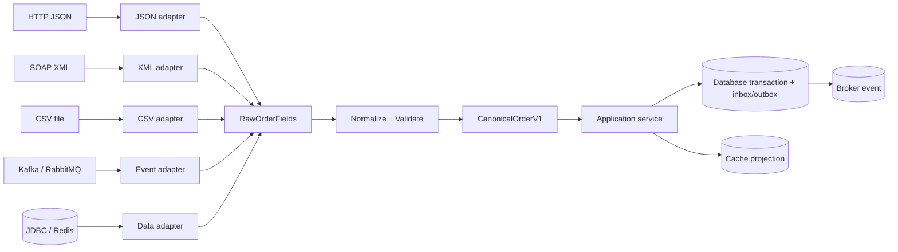
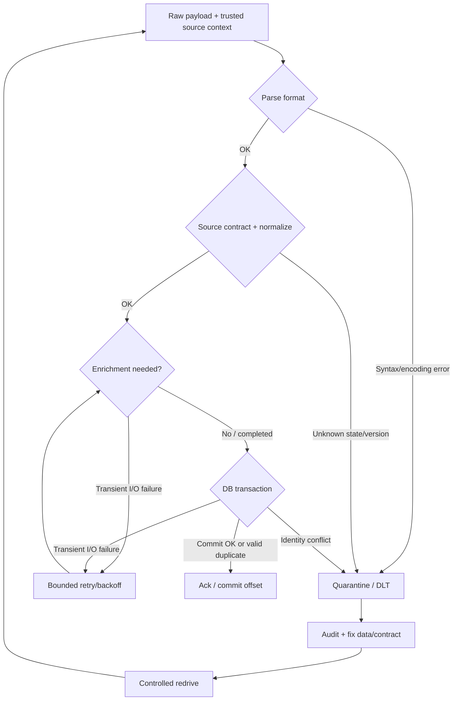

# Format Transformation and Multi-Source Data Normalization

In **SPRING_BOOT_INTEGRATION**, an order can enter the system via REST JSON, SOAP/XML, CSV files, database tables, Kafka/RabbitMQ messages, or Redis records. Each source uses different field names, data types, timezones, and status conventions. If every business service must understand every source format directly, a single partner change can corrupt database writes, caches, and emitted events.

The solution goes beyond *deserializing* into Java objects. We need a **data contract boundary** to **decode the exact format → validate the source contract → map to a canonical model → normalize semantics → validate invariants → hand off to business logic**. This lesson in the **Data Contracts** chapter covers the full transformation and normalization lifecycle—including configuration, errors, deduplication, transactions, testing, and observability in real Spring Boot integration flows.

> Examples target Java 17+, Spring Boot 3.x, Jackson 2.x, Jakarta Bean Validation, and Spring Integration 6.x. Exact artifact names and APIs must match your Spring Boot BOM version. Order data in these examples is **fictitious**, not a real partner's schema or endpoint.

## 1. Learning Objectives

After this lesson, you will be able to:

1. Distinguish **serialization/deserialization**, **transformation**, **normalization**, **validation**, **enrichment**, and **schema migration**.
2. Design separate DTOs for HTTP JSON, XML, CSV, and message brokers, keeping them isolated from persistence entities and the canonical domain model.
3. Normalize identifiers, Unicode text, statuses, currency codes, monetary amounts, timestamps, and missing values **without guessing data**.
4. Parse JSON/XML/CSV with Jackson and build per-source adapters in Spring Boot.
5. Structure parse/map/validate steps into a transparent, testable, reusable Spring Integration pipeline.
6. Govern compatibility across contract versions, unknown values, schema violations, and dead-letter/quarantine paths.
7. Protect correctness under duplicates and retries across HTTP, DBs, caches, and message brokers.
8. Build multi-source mapping test suites, monitor data errors, and roll out contract changes safely.

## 2. Why Do Multiple Sources Describe the Same Order Differently?

Suppose three partners send the *same business fact*—"order ORD-42 has been paid 125 USD"—in three different structures.

**Source A — HTTP JSON:**

```json
{
  "event_id": "evt-42",
  "order_id": "ORD-42",
  "customer_id": "CUS-9",
  "total": "125.00",
  "currency": "USD",
  "occurred_at": "2026-11-20T10:30:00Z",
  "status": "paid"
}
```

**Source B — XML payload extracted by a SOAP adapter:**

```xml
<PartnerOrder>
  <EventId>evt-42</EventId>
  <OrderNo>ORD-42</OrderNo>
  <CustomerCode>CUS-9</CustomerCode>
  <Amount>125.00</Amount>
  <Currency>USD</Currency>
  <OccurredAt>2026-11-20T17:30:00+07:00</OccurredAt>
  <State>SETTLED</State>
</PartnerOrder>
```

**Source C — a CSV row:**

```csv
event_id,order_no,customer_code,amount,currency,occurred_at,state
evt-42,ORD-42,CUS-9,125.00,USD,2026-11-20T10:30:00Z,S
```

| Business meaning | JSON A | XML B | CSV C | Canonical convention |
| --- | --- | --- | --- | --- |
| Message/event ID | `event_id` | `EventId` | `event_id` | `externalEventId` |
| Order ID | `order_id` | `OrderNo` | `order_no` | `externalOrderId` |
| Customer | `customer_id` | `CustomerCode` | `customer_code` | `customerRef` |
| Monetary amount | `total` as string | `Amount` as text | `amount` as text | Scale-validated `BigDecimal` |
| Currency | `USD` | `USD` | `USD` | Allowlisted ISO 4217 code |
| Timestamp | `...10:30:00Z` | `...17:30:00+07:00` | `...10:30:00Z` | UTC `Instant` |
| Status | `paid` | `SETTLED` | `S` | `PAID` in domain enum |

The two timestamps in JSON and XML represent the **exact same instant**, even though their strings differ. CSV's `"S"` means `PAID` **only because** Source C's specification defines it so; never guess that `"S"` always means "success."

And just as importantly: three sources may describe the same order, **yet they do not automatically form one shared deduplication scope**. `externalEventId="evt-42"` is unique only within the scope promised by that provider. Deduplication keys normally combine **source + event ID** or a normalized business key proven equivalent across sources.

### 2.1. Responsibility-Separated Normalization Pipeline



This flow is **not** meant to merge every source into one giant JSON object. Each adapter owns its source syntax and contract, then translates into a **small internal model with stable names and semantics**. The service does not care whether `Amount`, `total`, or `amount` came from a particular source.

## 3. Separating Six Tasks Often Lumped Together as "Mapping"

| Task | Question answered | Example |
| --- | --- | --- |
| **Decode/deserialize** | What format are the bytes in, and do they parse cleanly? | UTF-8 JSON → `JsonOrderDto`; XML → `XmlOrderDto`. |
| **Source validation** | Does the message satisfy the provider's contract? | JSON requires `order_id`; CSV has expected columns; supported schema version. |
| **Transformation** | How do field names and structures map? | `OrderNo` → `externalOrderId`. |
| **Normalization** | How are equivalent values represented uniformly? | `SETTLED`, `paid`, `S` → `PAID`; offset time → UTC. |
| **Canonical validation** | Which internal invariants must always hold? | Positive amount, valid currency, non-blank IDs, offset timestamps. |
| **Enrichment** | Is external data needed to complete the workflow? | Reading a customer mapping table or TTL-bounded Redis cache. |

**Serialization** is the reverse direction when emitting Java objects to JSON/XML/Avro/Protobuf or writing documents/caches. Never treat a serializer as a "domain definition": just because a Java field serializes easily does not mean every channel is allowed to receive it.

**Enrichment is not pure normalization.** Normalization should be as deterministic and I/O-free as possible: given the same raw input and rule version, it yields the same output. Calling a customer API or database after normalization to populate an email address is a separate step with its own timeouts, retries, and source consistency trade-offs.

**Schema migration/upcasting** is distinct again: when an older event lacks a new field or uses a legacy layout, apply a **versioned conversion** before handing off to the canonical model. Never default every new field to `null` and ignore mandatory semantic shifts.

### 3.1. Things You Must Never Silently "Fix"

- **Never** collapse all unrecognized status strings into `UNKNOWN` and let payment proceed.
- **Never** substitute `Instant.now()` for a missing source timestamp when event-time ordering is required.
- **Never** parse `"125,00"` using the JVM's default locale without knowing whether the source uses decimal commas or thousands separators.
- **Never** convert `double` to `BigDecimal` for exact money after precision is already lost.
- **Never** run `String.trim()` and uppercase every ID if partner identifiers are case-sensitive or whitespace-significant.
- **Never** deduplicate solely via an in-memory cache when multiple consumer pods run concurrently.

If data cannot be normalized under **contract-approved rules**, classify a contract error and quarantine it rather than "guessing and saving."

## 4. Design the Canonical Contract Before Writing Adapters

The canonical model must express **your system's own semantics**, rather than copying JPA/Mongo entities, XML XSD types, or gRPC-generated classes directly into the domain. Example:

```java
import java.math.BigDecimal;
import java.time.Instant;

public record CanonicalOrderV1(
        String sourceSystem,
        String externalEventId,
        String externalOrderId,
        String customerRef,
        BigDecimal amount,
        String currency,
        Instant occurredAt,
        OrderState state,
        int schemaVersion
) {}

public enum OrderState {
    NEW, PAID, CANCELLED
}
```

In an actual project, place these two `public` types in **separate Java files**. The model above is a minimal **canonical command/event**; real systems may also carry tenant IDs, tax, line items, rounding policies, merchant accounts, legal entities, and provenance. Never merge distinct concepts like `receivedAt` and `occurredAt` just because both are `Instant`.

### 4.1. Field-by-Field Contract

| Field | Sample rule | What must never be assumed |
| --- | --- | --- |
| `sourceSystem` | Stable source code assigned by the server-side adapter | HTTP callers cannot choose an arbitrary source value. |
| `externalEventId` | Event ID per source contract, non-blank, bounded length | Not globally unique across different sources. |
| `externalOrderId` | **Validated raw** order ID, transformed only as agreed | Never arbitrarily lowercase or strip punctuation. |
| `customerRef` | Customer key or mapping code, not a full PII profile | May require a separate identity-mapping table. |
| `amount` | `BigDecimal`, never `double`; currency-aligned scale | Negative or zero amounts allowed only for explicitly defined operations. |
| `currency` | Allowlisted currency code normalized uppercase cleanly | Never assume every three-letter code is a valid currency. |
| `occurredAt` | Real timestamp with explicit offset/timezone normalized to `Instant` | Never fill with app server clock when input is missing. |
| `state` | Business enum mapped via **per-source** lookup table | Abbreviations rarely share meanings across systems. |
| `schemaVersion` | Canonical contract version | Never reuse this number as a Kafka offset or DB row version. |

### 4.2. Where Should Provenance Metadata Live?

An ingestion pipeline often needs **transport provenance**:

```text
sourceSystem       = partner-csv
sourceContract     = partner-order-csv-v2
externalEventId    = evt-42
brokerTopic        = orders.inbound.v2 (if received from Kafka)
brokerPartition    = 3
brokerOffset       = 9182
fileName           = exports/2026-11-20/orders.csv (if file import)
lineNumber         = 42
receivedAt         = timestamp when adapter received message
correlationId      = tracing ID
```

These fields **do not all belong inside the canonical order**. Store them in a separate `IngestionContext`/audit record decoupled from the domain payload, with bounded retention and read permissions. Offsets and line numbers aid investigation or replay, yet **do not serve as cross-source idempotency keys**; files can be re-uploaded under different names, Kafka partitions change on repartitioning, and the same business event may arrive via multiple channels.

### 4.3. A Canonical Model Is Not an "Eternal Contract"

Canonical models are versioned too. Changing `amount` from "major units" to "minor units" can be a **breaking semantic change** even if the field name stays identical. Define versions, conversion steps, and consumer compatibility. Avoid creating a "universal DTO" with hundreds of nullable fields for every message type; that breeds ambiguity, weakens validation, and couples unrelated workflows.

## 5. Semantic Normalization: Define Rules Before Writing `String.replace`

Normalization requires **per-field, per-source rules**, not a blanket "trim, lowercase, parse, done" helper. Two similar-looking values are not necessarily equivalent under a contract.

### 5.1. Strings and Unicode

| Data kind | Sample rule | Notes |
| --- | --- | --- |
| Business IDs | Preserve case; reject extra whitespace if spec forbids it | `ORD-A` and `ord-a` may identify distinct orders. |
| Human display names | Unicode NFC; normalize whitespace only per contract | Never strip Vietnamese diacritics or blindly case-fold as an identifier key. |
| Currency codes | Uppercase using `Locale.ROOT`, verify allowlist | Accept lowercase only if source spec allows it. |
| Source enums/statuses | Explicit per-source mapping | Never guess `S` means `SUCCESS` or `SHIPPED`. |
| Emails | Parse/validate as needed; retain raw and canonical if required | Email local-parts have case/Unicode rules that resist naive folding. |
| Phone numbers | Normalize to E.164 when reliable country context exists | Never infer country from JVM default locale. |
| Addresses/units | May need dedicated reference-data mapping | Never combine `kg` and `g` without converting quantities. |

Two Unicode strings can **render identically** while using different code-point sequences. Java provides `java.text.Normalizer`:

```java
import java.text.Normalizer;

public static String normalizeDisplayName(String value) {
    if (value == null) {
        return null;
    }
    return Normalizer.normalize(value, Normalizer.Form.NFC);
}
```

**Never apply this unconditionally to IDs, HMAC signatures, or raw payloads used for signature checks.** Signed bytes can break if normalized before verification. Always verify raw representations per protocol first, then normalize business fields per policy.

### 5.2. Money and Decimals

Money must **never** pass through `double` on its way to `BigDecimal`. Keep raw decimal strings:

```text
"125.00" -> BigDecimal("125.00")
"125,00" -> valid only if the source profile specifies decimal comma
"1,250"  -> could be 1250 or 1.250 depending on locale; NEVER guess
125.0    -> JSON number; contract must define precision expectations
```

Sample rules used in this lesson:

1. Each source sends **decimal text** with a dot separator and no thousands separators or currency symbols.
2. `amount` must be strictly greater than `0` for order-creation events. Refunds and chargebacks are **separate business event types**.
3. `currency` must be in the example allowlist `USD` and `VND`, governed by ISO 4217 rules.
4. `USD` defaults to two decimal places and `VND` to zero; never **silently round** amounts with mismatched scale.
5. When writing to the database, JDBC uses an appropriate `NUMERIC/DECIMAL` column; when emitting JSON, converters/serializers preserve agreed precision.

For example, `"125.000"` in USD can normalize to `125.00` because only trailing zeros are trimmed, whereas `"125.005"` must be rejected or routed through a **contract-approved rounding rule**, never an arbitrary `HALF_UP`.

### 5.3. Instants and Timezones

`2026-11-20T10:30:00Z` and `2026-11-20T17:30:00+07:00` represent the **same `Instant`**. Conversely, `2026-11-20 10:30:00` has no offset; you cannot tell whether it is UTC or Vietnam time unless the source specifies it.

| Time format | Can normalize immediately? | Policy |
| --- | --- | --- |
| ISO-8601 with `Z` | Yes | Parse directly to `Instant`. |
| ISO-8601 with offset `+07:00` | Yes | Parse to `OffsetDateTime`, then `toInstant()`. |
| Zoneless local date-time | **Not automatically** | Requires a source-configured `ZoneId` and DST ambiguity handling. |
| Epoch milliseconds | Yes if **unit is published** | Distinguish millis vs. seconds and validate reasonable bounds. |
| Calendar date `2026-11-20` | Not a single instant | Keep as `LocalDate` for date semantics; never turn into UTC midnight arbitrarily. |
| Message receipt time | Distinct from event time | Store separately as `receivedAt` for audit; never replace `occurredAt`. |

If a partner specifies `Asia/Ho_Chi_Minh` in its contract config, local date-times can be interpreted in that zone **after checking missing/malformed inputs**. For DST-observing zones, a local time can **not exist** or occur twice; define explicit policies rather than falling back to JVM defaults.

### 5.4. `null`, Missing Fields, Empty Strings, and Defaults

These four inputs are distinct:

```json
{}
```

```json
{"customer_id": null}
```

```json
{"customer_id": ""}
```

```json
{"customer_id": "CUS-9"}
```

For this lesson's order-creation event, the first three are **invalid**. In a customer-profile PATCH endpoint, however, "missing field" may mean **keep unchanged**, while `null` means **clear value**. A plain Java record with a nullable `String` cannot distinguish **missing** from **explicit null**; for PATCH or merge semantics, use a presence-tracking model (such as `JsonNode` or a presence wrapper) and document rules clearly.

## 6. Spring Boot Dependencies and Configuration for Multi-Format Ingestion

Different sources require different Spring Boot modules. Do not pull in every starter simply because a project mentions "integration."

```groovy
dependencies {
    // HTTP JSON request handling if exposing REST endpoints.
    implementation 'org.springframework.boot:spring-boot-starter-web'

    // Jakarta Bean Validation (@Valid, @NotBlank, @NotNull...).
    implementation 'org.springframework.boot:spring-boot-starter-validation'

    // Add only when reading XML and CSV.
    implementation 'com.fasterxml.jackson.dataformat:jackson-dataformat-xml'
    implementation 'com.fasterxml.jackson.dataformat:jackson-dataformat-csv'

    // When using Spring Integration Message/Transformer/IntegrationFlow.
    implementation 'org.springframework.boot:spring-boot-starter-integration'

    testImplementation 'org.springframework.boot:spring-boot-starter-test'
}
```

With Maven, use the same artifact IDs under Spring Boot BOM `dependencyManagement`. For Kafka, RabbitMQ, JDBC, or Redis, add the **matching adapter starters/drivers** only when used: `spring-kafka`, `spring-boot-starter-amqp`, `spring-boot-starter-data-jdbc`/JDBC, `spring-boot-starter-data-redis`, etc. JSON/XML/CSV parsers address **format only**; they do not configure broker consumers, SQL transactions, or Redis cache policies.

### 6.1. Boot Auto-Configuration Does Not Replace Source Contracts

| Component | What Boot/Jackson provides | What the application still must control |
| --- | --- | --- |
| JSON `ObjectMapper` | JSON ↔ Java mapping and configured Jackson modules | Field names, unknown fields, coercion, schemas/versions, validation. |
| HTTP `HttpMessageConverter` | Request-body parsing for supported media types | Body size, auth, content type, controller DTOs, and 400 errors. |
| `XmlMapper`/CSV mapper | XML and CSV parsing when dependencies exist | Hardened XML parsing, delimiter/header/encoding/locale, source schemas. |
| Spring Integration | Channels, transformers, error handling, adapters | Mapping semantics, ack/rollback, idempotency, dead-lettering. |
| Validation infrastructure | Runs Jakarta Bean Validation where invoked | Separating source validation from canonical invariants. |

When adding Jackson XML alongside multiple `HttpMessageConverter`s, verify **content negotiation** by `Content-Type`; never assume "having XML mapper on the classpath handles every HTTP payload safely." Broker JSON events may also use a different deserializer than MVC; inspect those separately.

### 6.2. Per-Source Policy Configuration

```yaml
app:
  ingestion:
    sources:
      partner-json:
        contract-version: 1
        max-payload-bytes: 262144
      partner-xml:
        contract-version: 2
        max-payload-bytes: 262144
      partner-csv:
        contract-version: 1
        charset: UTF-8
        delimiter: ","
        max-file-bytes: 10485760
```

This is an **application-defined namespace**, not properties Boot reads and enforces automatically. Bind it via `@ConfigurationProperties`/validation and enforce limits across the HTTP server, file readers, broker adapters, and parsers. `max-payload-bytes` prevents oversized payloads, though you also need limits on line count, field lengths, nesting depth, and total parse time.

**Never** accept destination URLs, file paths, or source-schema selectors from untrusted HTTP parameters without allowlisting. Environment configuration is distinct from caller data and must have clear ownership.

## 7. Dedicated DTOs per Format: Never Build One "All-Annotations" Class

A JSON DTO should not know about XML element name `OrderNo`, CSV column `order_no`, and SQL column `order_number`. Source classes handle **external transport binding**, then adapters map them to an intermediate object with unified field names.

### 7.1. JSON DTO Using Jackson

```java
import com.fasterxml.jackson.annotation.JsonProperty;

public record JsonOrderDto(
        @JsonProperty("event_id") String eventId,
        @JsonProperty("order_id") String orderId,
        @JsonProperty("customer_id") String customerId,
        @JsonProperty("total") String total,
        @JsonProperty("currency") String currency,
        @JsonProperty("occurred_at") String occurredAt,
        @JsonProperty("status") String status
) {}
```

Here `total` stays `String` per JSON contract A, **avoiding** silent Jackson coercion into `BigDecimal`. If a partner sends JSON number `125.005` or `null` instead of a string, verify **deserialization coercion policies**; never assume MVC and Kafka `ObjectMapper` instances share identical coercion settings.

### 7.2. XML DTO Keeping Only Required Elements

```java
import com.fasterxml.jackson.dataformat.xml.annotation.JacksonXmlProperty;
import com.fasterxml.jackson.dataformat.xml.annotation.JacksonXmlRootElement;

@JacksonXmlRootElement(localName = "PartnerOrder")
public record XmlOrderDto(
        @JacksonXmlProperty(localName = "EventId") String eventId,
        @JacksonXmlProperty(localName = "OrderNo") String orderNo,
        @JacksonXmlProperty(localName = "CustomerCode") String customerCode,
        @JacksonXmlProperty(localName = "Amount") String amount,
        @JacksonXmlProperty(localName = "Currency") String currency,
        @JacksonXmlProperty(localName = "OccurredAt") String occurredAt,
        @JacksonXmlProperty(localName = "State") String state
) {}
```

This models the **XML payload extracted from a SOAP envelope**, not a full SOAP envelope. For real SOAP endpoints, contracts also include XML namespaces, SOAP Headers/Faults, XSDs, envelope versions, and WS-Security. Never parse a raw SOAP envelope straight into `XmlOrderDto` and assume signatures or authentication were checked.

### 7.3. CSV with Headers and Multiple Rows

CSV **does not carry type schemas**. `order_no` may look numeric, yet must stay a string if leading zeros matter. CSV dialects also vary by delimiter, quoting, escaping, embedded newlines inside quotes, BOMs, and charsets:

```csv
event_id,order_no,customer_code,amount,currency,occurred_at,state
evt-42,ORD-42,CUS-9,125.00,USD,2026-11-20T10:30:00Z,S
evt-43,"ORD,43",CUS-10,15.50,USD,2026-11-20T10:31:00Z,S
```

Never call `line.split(",")`: `"ORD,43"` is **one field**. Use a streaming CSV parser with proper quote support. Verify required headers, unexpected columns, column counts, duplicate header names, file size limits, and line/record numbers for accurate quarantining.

## 8. Adapter Layer: Decode Source Payloads and Map to an Intermediate DTO

Use an internal record containing only **parsed raw text fields**. This record is not yet canonical and does not guarantee semantic validity.

```java
public record RawOrderFields(
        String eventId,
        String orderId,
        String customerRef,
        String amount,
        String currency,
        String occurredAt,
        String state
) {}
```

Identify the source from **trusted adapter configuration**, never trusting a self-declared `sourceSystem` inside the payload:

```java
public enum OrderSource {
    PARTNER_JSON,
    PARTNER_XML,
    PARTNER_CSV
}
```

### 8.1. Mapping JSON and XML to the Same Raw Shape

```java
public final class SourceOrderMappers {
    private SourceOrderMappers() {}

    public static RawOrderFields fromJson(JsonOrderDto dto) {
        return new RawOrderFields(
                dto.eventId(), dto.orderId(), dto.customerId(),
                dto.total(), dto.currency(), dto.occurredAt(), dto.status());
    }

    public static RawOrderFields fromXml(XmlOrderDto dto) {
        return new RawOrderFields(
                dto.eventId(), dto.orderNo(), dto.customerCode(),
                dto.amount(), dto.currency(), dto.occurredAt(), dto.state());
    }
}
```

These methods only **rename and align fields**. Do not validate amounts inside `fromJson` and duplicate a different rule in `fromXml`: keep source-specific validation per source, then let canonical normalization apply unified rules.

### 8.2. JSON Parser with Explicit Unknown-Field Rules

```java
import com.fasterxml.jackson.core.JsonProcessingException;
import com.fasterxml.jackson.databind.DeserializationFeature;
import com.fasterxml.jackson.databind.ObjectMapper;
import com.fasterxml.jackson.databind.ObjectReader;
import org.springframework.stereotype.Component;

@Component
public final class JsonOrderAdapter {
    private final ObjectReader reader;

    public JsonOrderAdapter(ObjectMapper mapper) {
        this.reader = mapper
                .readerFor(JsonOrderDto.class)
                .with(DeserializationFeature.FAIL_ON_UNKNOWN_PROPERTIES);
    }

    public RawOrderFields decode(String payload) {
        try {
            return SourceOrderMappers.fromJson(
                    reader.readValue(payload));
        } catch (JsonProcessingException error) {
            throw new SourceDecodeException(
                    "Invalid partner JSON payload", error);
        }
    }
}
```

`FAIL_ON_UNKNOWN_PROPERTIES` here is an **example policy**: partner A v1 must not send fields outside the schema. For forward-compatible contracts, you may allow unknown fields while **still validating all required fields**. Never toggle a global Jackson flag for the entire application when API A needs strictness and webhook B needs tolerance.

**Note:** unknown-field checks govern keys, not necessarily coercions like JSON number → Java `String` across all configurations. When exact JSON token types are required, add schema/token checks or Jackson coercion rules and test `{"total":125.00}`, `{"total":true}`, and `{"total":null}`.

### 8.3. XML Parsing Must Enforce XXE Protections

XML brings hazards JSON lacks: DTDs, entity expansion, external entities, namespaces, and XSDs. An XML parser with network or filesystem access must never fetch external resources because a payload includes `DOCTYPE`.

Example helper configuring a StAX parser with **DTDs and external entities disabled** before handing off to Jackson:

```java
import com.fasterxml.jackson.dataformat.xml.XmlMapper;
import java.io.StringReader;
import javax.xml.stream.XMLInputFactory;
import javax.xml.stream.XMLStreamReader;
import org.springframework.stereotype.Component;

@Component
public final class XmlOrderAdapter {
    private final XmlMapper mapper = new XmlMapper();

    public RawOrderFields decode(String xmlPayload) {
        XMLInputFactory factory = XMLInputFactory.newFactory();
        factory.setProperty(XMLInputFactory.SUPPORT_DTD, false);
        factory.setProperty(
                XMLInputFactory.IS_SUPPORTING_EXTERNAL_ENTITIES, false);

        try (StringReader input = new StringReader(xmlPayload)) {
            XMLStreamReader reader =
                    factory.createXMLStreamReader(input);
            try {
                XmlOrderDto dto = mapper.readValue(
                        reader, XmlOrderDto.class);
                return SourceOrderMappers.fromXml(dto);
            } finally {
                reader.close();
            }
        } catch (Exception error) {
            throw new SourceDecodeException(
                    "Invalid partner XML payload", error);
        }
    }
}
```

This illustrates **placing a secure parser boundary**, not an exhaustive defense against every XML denial-of-service vector. Production code should also bound total bytes, node count/depth, parse duration, provider entity limits, and validate namespaces/XSDs when required. If a StAX provider rejects a security property, **fail closed** and test against the actual JDK/XML parser in use. For signed SOAP or WS-Security, verify signatures/credentials **before accepting the business payload** using appropriate libraries and order.

### 8.4. CSV Parser with Header Schema and Record Mapping

```java
import com.fasterxml.jackson.core.type.TypeReference;
import com.fasterxml.jackson.dataformat.csv.CsvMapper;
import com.fasterxml.jackson.dataformat.csv.CsvSchema;
import com.fasterxml.jackson.databind.MappingIterator;
import java.io.IOException;
import java.io.Reader;
import java.util.ArrayList;
import java.util.List;
import java.util.Map;

public final class CsvOrderAdapter {
    private final CsvMapper mapper = new CsvMapper();
    private final CsvSchema schema = CsvSchema.emptySchema().withHeader();

    public List<RawOrderFields> decode(Reader input, int maxRecords)
            throws IOException {

        if (maxRecords < 1 || maxRecords > 10000) {
            throw new IllegalArgumentException("Invalid CSV limit");
        }

        var reader = mapper
                .readerFor(new TypeReference<Map<String, String>>() {})
                .with(schema);

        List<RawOrderFields> orders = new ArrayList<>();

        try (MappingIterator<Map<String, String>> rows =
                     reader.readValues(input)) {
            while (rows.hasNextValue()) {
                if (orders.size() >= maxRecords) {
                    throw new SourceDecodeException(
                            "CSV record limit exceeded");
                }
                Map<String, String> row = rows.nextValue();
                orders.add(new RawOrderFields(
                        row.get("event_id"),
                        row.get("order_no"),
                        row.get("customer_code"),
                        row.get("amount"),
                        row.get("currency"),
                        row.get("occurred_at"),
                        row.get("state")));
            }
        }
        return orders;
    }
}
```

This demonstrates **CSV quoting + header projection + record limit**. For production, also verify **complete, non-duplicate headers**, extra/missing columns, charset/BOM, delimiter, record numbers, and per-field sizes—and avoid buffering huge files in a `List` even with a cap. Stream records through normalization/validation and process in checkpointed chunks when ingesting large files. `maxRecords` enforces an application row limit, not raw stream byte caps.

If a source switches delimiters from comma to semicolon or uses `Windows-1258`, the adapter should get that from **explicit source contract/config**, never by guessing with fragile heuristics.

### 8.5. Exceptions at the Decode Boundary

```java
public class SourceDecodeException extends RuntimeException {
    public SourceDecodeException(String safeMessage) {
        super(safeMessage);
    }

    public SourceDecodeException(
            String safeMessage, Throwable cause) {
        super(safeMessage, cause);
    }
}
```

This error means **source syntax or structure could not be decoded**; it differs from **syntactically valid values that violate semantic rules**. Never return raw XML/JSON/CSV, tokens, or PII in HTTP error bodies; send exception causes only to internal logs governed by redaction and retention policies.

## 9. One Shared Normalizer with Per-Source Rules

This layer converts `RawOrderFields` into `CanonicalOrderV1` using **deterministic** rules. State mappings remain per-source; money, instants, and IDs follow canonical policies.

### 9.1. Java Code for the Normalizer

```java
import java.math.BigDecimal;
import java.math.RoundingMode;
import java.time.OffsetDateTime;
import java.time.format.DateTimeParseException;
import java.util.Currency;
import java.util.Locale;
import java.util.Map;
import java.util.Set;
import java.util.regex.Pattern;
import org.springframework.stereotype.Component;

@Component
public final class OrderNormalizer {
    private static final Pattern BUSINESS_ID =
            Pattern.compile("[A-Za-z0-9._:-]{1,128}");
    private static final Pattern DECIMAL =
            Pattern.compile("[0-9]{1,16}(?:\\.[0-9]{1,6})?");
    private static final Set<String> ALLOWED_CURRENCIES =
            Set.of("USD", "VND");

    public CanonicalOrderV1 normalize(
            OrderSource source, RawOrderFields raw) {

        if (source == null || raw == null) {
            throw new ContractViolationException("Missing source or data");
        }
        String currency = canonicalCurrency(raw.currency());
        BigDecimal amount = canonicalAmount(raw.amount(), currency);

        return new CanonicalOrderV1(
                source.name(),
                requiredBusinessId(raw.eventId(), "eventId"),
                requiredBusinessId(raw.orderId(), "orderId"),
                requiredBusinessId(raw.customerRef(), "customerRef"),
                amount,
                currency,
                canonicalInstant(raw.occurredAt()),
                canonicalState(source, raw.state()),
                1);
    }

    private static String requiredBusinessId(
            String value, String field) {
        if (value == null
                || !BUSINESS_ID.matcher(value).matches()) {
            throw new ContractViolationException(
                    "Invalid " + field);
        }
        // Preserve case/whitespace semantics; do not trim automatically.
        return value;
    }

    private static String canonicalCurrency(String raw) {
        if (raw == null) {
            throw new ContractViolationException("Missing currency");
        }
        String code = raw.toUpperCase(Locale.ROOT);
        if (!ALLOWED_CURRENCIES.contains(code)) {
            throw new ContractViolationException("Unsupported currency");
        }
        return code;
    }

    private static BigDecimal canonicalAmount(
            String raw, String currency) {
        if (raw == null || !DECIMAL.matcher(raw).matches()) {
            throw new ContractViolationException("Invalid amount format");
        }
        try {
            BigDecimal parsed = new BigDecimal(raw);
            if (parsed.signum() <= 0) {
                throw new ContractViolationException(
                        "Amount must be positive");
            }
            int digits = Currency.getInstance(currency)
                    .getDefaultFractionDigits();
            if (digits < 0) {
                throw new ContractViolationException(
                        "Currency has no supported fraction digits");
            }
            return parsed.setScale(digits, RoundingMode.UNNECESSARY);
        } catch (ArithmeticException error) {
            throw new ContractViolationException(
                    "Amount has unsupported fraction digits", error);
        }
    }

    private static java.time.Instant canonicalInstant(
            String raw) {
        if (raw == null) {
            throw new ContractViolationException("Missing occurredAt");
        }
        try {
            return OffsetDateTime.parse(raw).toInstant();
        } catch (DateTimeParseException error) {
            throw new ContractViolationException(
                    "Invalid occurredAt offset date-time", error);
        }
    }

    private static OrderState canonicalState(
            OrderSource source, String raw) {
        if (raw == null) {
            throw new ContractViolationException("Missing state");
        }
        return switch (source) {
            case PARTNER_JSON -> switch (raw) {
                case "new" -> OrderState.NEW;
                case "paid" -> OrderState.PAID;
                case "cancelled" -> OrderState.CANCELLED;
                default -> throw new ContractViolationException(
                        "Unknown JSON state");
            };
            case PARTNER_XML -> switch (raw) {
                case "CREATED" -> OrderState.NEW;
                case "SETTLED" -> OrderState.PAID;
                case "VOID" -> OrderState.CANCELLED;
                default -> throw new ContractViolationException(
                        "Unknown XML state");
            };
            case PARTNER_CSV -> switch (raw) {
                case "N" -> OrderState.NEW;
                case "S" -> OrderState.PAID;
                case "C" -> OrderState.CANCELLED;
                default -> throw new ContractViolationException(
                        "Unknown CSV state");
            };
        };
    }
}
```

```java
public class ContractViolationException extends RuntimeException {
    public ContractViolationException(String message) {
        super(message);
    }

    public ContractViolationException(
            String message, Throwable cause) {
        super(message, cause);
    }
}
```

**What this example guarantees:**

- Three source statuses `paid`, `SETTLED`, and `S` all map to `OrderState.PAID` **through explicit published tables**, never via generic lowercasing or substring guesses.
- Both `10:30Z` and `17:30+07:00` yield the same `Instant`, independent of the JVM host timezone.
- `125.00 USD` yields `BigDecimal("125.00")`; disallowed fractional precision is **rejected** rather than silently rounded.
- ID `ORD-42` preserves case; IDs with whitespace, disallowed characters, or excess length are rejected.
- No HTTP/DB/cache calls, no `Instant.now()`, and no default-locale/timezone dependencies—ideal for golden tests and replay.

**Important limitation:** `Currency.getDefaultFractionDigits()` is a reference currency rule, not a complete precision/scale/rounding definition for **every business domain**. Some partners price in minor units, cryptoassets, or sub-unit fractions; those contracts need a dedicated `MoneyPolicy`. Java's `Currency` also depends on JDK tz/currency data; payment systems should pin and verify currency policies explicitly in business configuration.

### 9.2. Example Normalizing Three Equivalent Sources

```java
RawOrderFields json = new RawOrderFields(
        "evt-42", "ORD-42", "CUS-9", "125.00", "USD",
        "2026-11-20T10:30:00Z", "paid");

RawOrderFields xml = new RawOrderFields(
        "evt-42", "ORD-42", "CUS-9", "125.00", "USD",
        "2026-11-20T17:30:00+07:00", "SETTLED");

RawOrderFields csv = new RawOrderFields(
        "evt-42", "ORD-42", "CUS-9", "125.00", "USD",
        "2026-11-20T10:30:00Z", "S");

OrderNormalizer n = new OrderNormalizer();
CanonicalOrderV1 a = n.normalize(OrderSource.PARTNER_JSON, json);
CanonicalOrderV1 b = n.normalize(OrderSource.PARTNER_XML, xml);
CanonicalOrderV1 c = n.normalize(OrderSource.PARTNER_CSV, csv);
```

The outputs share identical `externalOrderId`, `customerRef`, `amount`, `currency`, `occurredAt`, and `state`, while intentionally retaining **distinct `sourceSystem` values**. If the system must correlate the same order across multiple providers, establish a **reliable identity-resolution rule** (such as an external-order mapping table per provider) rather than merging purely on matching strings.

## 10. Two-Layer Validation: Source Contract and Canonical Invariants

Successfully binding to a Java record does not mean the data is valid. Validate at two stages:

1. **Source validation:** JSON A requires string `order_id`, XML B requires `OrderNo` with valid namespace/XSD, CSV C requires expected headers/column counts and states from vocabulary C.
2. **Canonical validation:** every `CanonicalOrderV1` has valid IDs, positive amount, allowed currency, offset timestamp, and resolved domain state.

In Spring Boot, Jakarta Bean Validation can express basic invariants:

```java
import jakarta.validation.constraints.NotBlank;
import jakarta.validation.constraints.NotNull;
import jakarta.validation.constraints.Positive;
import java.math.BigDecimal;
import java.time.Instant;

public record ValidatedOrderCommand(
        @NotBlank String sourceSystem,
        @NotBlank String externalEventId,
        @NotBlank String externalOrderId,
        @NotNull @Positive BigDecimal amount,
        @NotNull Instant occurredAt,
        @NotNull OrderState state
) {}
```

`@Valid` on an HTTP controller only executes when integrated and invoked at the MVC boundary. Messages arriving from Kafka, RabbitMQ, file pollers, or JDBC adapters **do not automatically run MVC validation**. In plain services, inject `jakarta.validation.Validator` and call `validate(command)` after normalization, mapping violations to contract errors; **never** expect annotations to trigger automatically on every constructor call.

### 10.1. When to Reject, Enrich, or Tolerate Missing Data?

| Case | Suggested action |
| --- | --- |
| Missing `externalOrderId` | **Reject** order creation unless the source contract specifies another proven-equivalent key. |
| Missing `currency`, yet source contract guarantees a fixed currency for all messages | Populate from **versioned source configuration** and record provenance clearly. |
| Unknown `status` | **Quarantine/unknown-contract**; never default to `PAID`. |
| Valid `customerRef` missing from internal mapping table | Route to a separate **enrichment/lookup** step; retry or quarantine per policy. |
| Zoneless local `occurredAt`, yet source spec fixes timezone | Parse using **configured `ZoneId`** with DST handling; never guess from JVM. |
| Amount precision mismatch | Reject or apply **contract-signed rounding rule**; never round silently. |
| Event already seen with matching ID and payload | Return idempotent success per contract. |
| Same event ID with different payload | **Conflict**, audit, and quarantine; never skip as a harmless duplicate. |

### 10.2. Classify Errors Before Retrying

```text
DECODE_ERROR       = invalid JSON/XML/CSV syntax or encoding
SOURCE_CONTRACT    = missing field, wrong type, unsupported schema version
NORMALIZE_ERROR    = un-normalizable status code, currency, or timestamp
ENRICHMENT_FAILURE = transient HTTP/DB/cache lookup failure or missing mapping
PERSISTENCE_ERROR  = DB write error, optimistic lock, unique constraint, timeout
DELIVERY_ERROR     = message broker publish/ack/offset error
```

Each category has a **different policy**. A CSV file with broken headers will not fix itself after ten Kafka retries, whereas an unavailable PostgreSQL instance can be retried with limits. When DB write outcomes are unknown after a timeout, check business keys/inbox state before replaying.

## 11. Contract Versioning and Schema Evolution

Integration participants rarely upgrade in lockstep. A partner HTTP API may return v1 while Kafka consumers expect v2, last month's CSV sits in object storage, and Redis holds keys written by older cache projections.

**Never use a single version number for everything:**

| Version | Who owns it? | Example |
| --- | --- | --- |
| **Source contract version** | External API/file/broker producer | `partner-json-v1`, `partner-xml-v2`, `orders-csv-2026-11` |
| **Canonical model version** | Internal integration core | `CanonicalOrderV1` → `CanonicalOrderV2` |
| **Persistence schema version** | Application DB/migrations | Flyway/Liquibase migrations, Mongo document schema |
| **Event contract version** | Topic/event publisher and consumers | `OrderAcceptedEventV1`, `OrderAcceptedEventV2` |
| **Cache value version** | Application owning the Redis projection | `catalog:order:v2:...` |
| **Transport protocol version** | HTTP, SOAP, Kafka client, etc. | Never substitutes for payload schemas |

### 11.1. Additive Changes Are Not Always Backward-Compatible

Suppose JSON A v2 adds `discount_code`. If contract v1 permits unknown fields, a v1 consumer can ignore it. Yet if v2 changes `total` from "pre-tax" to "tax-inclusive," that is a **breaking semantic change** even though neither field name nor JSON type changed.

| Change | Potentially compatible? | Must verify |
| --- | --- | --- |
| Add optional field | Often yes if consumers ignore unknown fields | Unknown-field policy and default semantics. |
| Add enum state `PARTIALLY_PAID` | Can break exhaustive switches | Upgrade consumers/mapping/quarantine first. |
| Change `amount` from decimal string to integer minor units | Breaking | Scale, currency, serialization, and migration. |
| Change timestamp from ISO offset to epoch millis | Breaking if old parsers reject numbers | Units, timezone, precision. |
| Change ID from case-sensitive to case-insensitive | Breaking for identity/idempotency | Existing collisions and duplicate data. |
| Rename field or drop required field | Breaking | Upcasters or version routing. |
| Append trailing column in CSV | Depends on header policy and reader | Required columns, ordering, whether parser ignores extras. |
| Add optional XML element | Depends on XSD/namespace/policy | Schema validation and namespaces. |

### 11.2. Upcasters: Intentionally Converting Legacy Versions to Current Versions

Suppose event v1 is:

```json
{
  "schemaVersion": 1,
  "orderId": "ORD-42",
  "amount": "125.00",
  "currency": "USD"
}
```

And v2 adds `paymentStatus`, which **can only be determined from external facts** rather than inferred from `amount`. An upcaster must not fabricate `"PAID"` for every v1 event. Depending on business needs:

- Use an explicit **`UNSPECIFIED` default** if the v2 model permits it.
- Perform a versioned enrichment/lookup step and record evidence provenance.
- Or keep v1 events on a separate path for legacy handlers rather than forcing incomplete v1 data into v2.

A safer upcast example: v1 stores decimal string amounts and currencies while v2 requires normalized `BigDecimal` + currency; `OrderNormalizer` rules apply cleanly when the contract confirms v1 always used dot-separated major units.

### 11.3. Schema Registries and Schema-Less Payloads

Avro, Protobuf, and JSON Schema help enforce field types and compatibility checks in broker ecosystems, yet **schema compatibility does not prove semantic compatibility**. An Avro schema can redefine `amount` while leaving its type as `string`. Conversely, a Kafka header `contentType=application/json` does not prove a payload matches `OrderCreatedV2`.

When using a schema registry or version headers:

1. Establish who owns schema IDs/versions and how consumers fetch schemas.
2. Reject unknown/broken versions explicitly—never "try parsing as v1, and on failure try v2."
3. Roll out producers and consumers in compatibility-safe order.
4. Keep golden payloads across versions for replay tests.
5. Never let an untrusted caller's raw schema header pick arbitrary deserializers or classes.

## 12. Spring Integration Transformers: Putting Normalization Into an Explicit Flow

In Spring Integration, adapters receive HTTP/files/messages and send payloads over a **`MessageChannel`**. Transformers reshape payloads—such as raw DTOs into canonical orders—while service activators run downstream business logic.

An envelope separating data from metadata:

```java
public record RawOrderEnvelope(
        OrderSource source,
        int sourceContractVersion,
        RawOrderFields fields,
        String correlationId
) {}
```

`source` and `sourceContractVersion` **must be populated by the adapter from a trusted connection, topic, or file contract**. If an HTTP caller could pass `source=PARTNER_XML` to switch rules, it could skew status mappings or bypass validation.

### 12.1. Pipeline Using Spring Integration Annotations

```java
import org.springframework.integration.annotation.Transformer;
import org.springframework.stereotype.Component;

@Component
public final class OrderNormalizationEndpoint {
    private final OrderNormalizer normalizer;

    public OrderNormalizationEndpoint(OrderNormalizer normalizer) {
        this.normalizer = normalizer;
    }

    @Transformer(
            inputChannel = "orders.raw",
            outputChannel = "orders.canonical")
    public CanonicalOrderV1 transform(RawOrderEnvelope envelope) {
        if (envelope == null || envelope.source() == null
                || envelope.fields() == null) {
            throw new ContractViolationException("Invalid order envelope");
        }
        int expectedVersion =
                envelope.source() == OrderSource.PARTNER_XML ? 2 : 1;
        if (envelope.sourceContractVersion() != expectedVersion) {
            throw new ContractViolationException(
                    "Unsupported source contract version");
        }
        return normalizer.normalize(
                envelope.source(), envelope.fields());
    }
}
```

Basic channel configuration:

```java
import org.springframework.context.annotation.Bean;
import org.springframework.context.annotation.Configuration;
import org.springframework.integration.channel.DirectChannel;
import org.springframework.messaging.MessageChannel;

@Configuration(proxyBeanMethods = false)
public class OrderChannelsConfiguration {
    @Bean("orders.raw")
    MessageChannel ordersRaw() {
        return new DirectChannel();
    }

    @Bean("orders.canonical")
    MessageChannel ordersCanonical() {
        return new DirectChannel();
    }
}
```

**`DirectChannel`** invokes handlers synchronously on the caller's thread in typical flows, so transformation or service errors propagate back to the adapter and participate in ACKs/transactions as configured. Switching to `ExecutorChannel`, queues, or pollers shifts thread boundaries, transactions, and error propagation—never assume downstream errors still reach the caller identically.

### 12.2. Service Activator Accepts Only the Canonical Contract

```java
import org.springframework.integration.annotation.ServiceActivator;
import org.springframework.stereotype.Component;

@Component
public final class OrderPersistenceEndpoint {
    private final CanonicalOrderUseCase useCase;

    public OrderPersistenceEndpoint(CanonicalOrderUseCase useCase) {
        this.useCase = useCase;
    }

    @ServiceActivator(inputChannel = "orders.canonical")
    public void persist(CanonicalOrderV1 order) {
        useCase.apply(order);
    }
}

public interface CanonicalOrderUseCase {
    void apply(CanonicalOrderV1 order);
}
```

Place each top-level `public` type in its own Java file. `CanonicalOrderUseCase` is an **application interface**; production wires an implementation with proper transactions and idempotency. Never treat a `void persist` return as proof of commit if the implementation fires a `CompletableFuture` or reactive publisher and returns early.

### 12.3. Message Headers Are Not Canonical Payload

Spring Integration `Message<?>` carries framework headers like message ID, timestamp, reply channel, error channel, and adapter metadata. Do not serialize all of them blindly to Kafka or partner HTTP calls. When propagating correlation IDs, event IDs, or tenant scopes:

- Extract and validate from **allowlisted headers** or adapter-built `RawOrderEnvelope`.
- Carry `correlationId` for observability without treating it as a deduplication key.
- Never let a client-controlled `sourceSystem` header pick transformation rules.
- Configure retries, error channels, and ACKs per adapter, not solely on transformers.
- When messages traverse a persistent channel store, define serializers/versions for the envelope; Spring Integration does not make DTOs permanently backward-compatible on its own.

## 13. Outbound Targets from Canonical: Persistence, Events, and Caches Are Distinct Contracts

After normalization, a `CanonicalOrderV1` may feed three different outputs. Never **serialize the same object** everywhere and ignore each target's contract.

| Target | Required contract | Notes |
| --- | --- | --- |
| PostgreSQL/JPA/JDBC | SQL columns, constraints, optimistic locking, transactions | `BigDecimal` → `DECIMAL/NUMERIC`, DB-aligned timestamps, unique business keys. |
| MongoDB/Neo4j | Document/graph mapping, BSON/labels/relationships | Does not automatically inherit SQL transaction or schema guarantees. |
| Kafka/RabbitMQ | Event schema, version, event ID, key/ordering policy | Redelivery and consumer compatibility. |
| Redis | Cache keys, serialized value version, TTL, invalidation | Cache is not source of truth; data can go stale. |
| HTTP response | Public DTO/media type, privacy/authorization | Never leak raw source fields or persistence internals. |
| CSV/XML file export | Charset, quoting, XSD/schema, columns, formula safety | Never reuse ingest parsers as unguarded exporters. |

### 13.1. Database Mapping Is Not Re-Normalization

PostgreSQL example:

```sql
CREATE TABLE order_projection (
    source_system VARCHAR(64) NOT NULL,
    external_order_id VARCHAR(128) NOT NULL,
    customer_ref VARCHAR(128) NOT NULL,
    amount NUMERIC(19, 2) NOT NULL,
    currency CHAR(3) NOT NULL,
    occurred_at TIMESTAMPTZ NOT NULL,
    state VARCHAR(24) NOT NULL,
    PRIMARY KEY (source_system, external_order_id)
);
```

**`NUMERIC(19,2)` in this example fits USD or business amounts strictly at two decimal places.** If the same table stores integer-unit VND alongside other currencies, store at an agreed major-unit scale or design a currency-aware numeric policy; verify database precision/scale never rounds or truncates unexpectedly. Database constraints should also protect source codes and business-scoped uniqueness.

A JDBC adapter:

```java
import org.springframework.jdbc.core.JdbcTemplate;
import org.springframework.stereotype.Repository;

@Repository
public final class JdbcOrderProjectionAdapter {
    private final JdbcTemplate jdbc;

    public JdbcOrderProjectionAdapter(JdbcTemplate jdbc) {
        this.jdbc = jdbc;
    }

    public void upsert(CanonicalOrderV1 o) {
        jdbc.update("""
                INSERT INTO order_projection(
                    source_system, external_order_id, customer_ref,
                    amount, currency, occurred_at, state)
                VALUES (?, ?, ?, ?, ?, ?, ?)
                ON CONFLICT (source_system, external_order_id)
                DO UPDATE SET
                    customer_ref = EXCLUDED.customer_ref,
                    amount = EXCLUDED.amount,
                    currency = EXCLUDED.currency,
                    occurred_at = EXCLUDED.occurred_at,
                    state = EXCLUDED.state
                """,
                o.sourceSystem(), o.externalOrderId(), o.customerRef(),
                o.amount(), o.currency(),
                java.sql.Timestamp.from(o.occurredAt()),
                o.state().name());
    }
}
```

**This code illustrates persistence mapping, not an out-of-order event policy.** If an older event arrives after a newer one, unconditional upsert overwrites newer state with stale data. Production needs version/watermark/expected-state/sequence guards and a transactional inbox; never assume "larger `occurredAt` always wins" when sources have clock skew or correction events.

### 13.2. Public Event DTOs and Schema Versions

```java
import java.math.BigDecimal;
import java.time.Instant;

public record OrderAcceptedEventV1(
        String eventId,
        String sourceSystem,
        String externalOrderId,
        BigDecimal amount,
        String currency,
        Instant occurredAt,
        int schemaVersion
) {}
```

When emitting to a broker, `eventId` must obey **publisher-defined semantics**: it can be generated in the outbox within the database transaction. Do not automatically copy the partner's `externalEventId`, because one inbound event might produce multiple outbound events or be skipped on conflict. Consumers need their own version and idempotency contracts.

### 13.3. Redis Cache Projections Are Not Source Contracts

Example key:

```text
order-projection:v1:PARTNER_JSON:ORD-42
```

Values may be compact DTOs carrying `state`, `amount`, `currency`, and `updatedAt`. When changing serialization or schema, version the key namespace or migrate with explicit TTL/invalidation policies. **A cache miss does not mean the order does not exist**; fall back to the authoritative source with proper tenant/permission checks. Never key Redis solely by `externalOrderId` if multiple sources can collide on IDs with different meanings.

## 14. Idempotency and Transactions: Preventing Canonical Events from Applying Twice

Normalizing the same payload **does not make processing idempotent**. Brokers redeliver messages, HTTP clients retry, and file pollers reread files after restarts. Writing a new order and emitting a new payment event on each delivery creates duplicate side effects.

### 14.1. Reliable Processing Identifiers

When a source guarantees `externalEventId` stability per logical business event:

```text
Inbox key = (sourceSystem, externalEventId)
Business order key = (sourceSystem, externalOrderId)
Outbox event ID = publisher-generated event ID, preserved across republishes
```

The first two keys are **different**: one order can legitimately receive `NEW`, `PAID`, and `CANCELLED` events; deduplicating all events by `externalOrderId` alone drops valid state transitions.

If event IDs are unique only within a tenant or stream/partition per contract, include that namespace in the key. When a source omits event IDs altogether, design another deduplication strategy (business ID + version/sequence, or canonicalized content fingerprint with collision rules) rather than using Kafka offsets or file line numbers as permanent identities.

### 14.2. Inbox + Projection + Outbox in One Transaction

PostgreSQL example:

```sql
CREATE TABLE inbound_event (
    source_system VARCHAR(64) NOT NULL,
    external_event_id VARCHAR(128) NOT NULL,
    canonical_payload_hash CHAR(64) NOT NULL,
    processed_at TIMESTAMPTZ NOT NULL DEFAULT now(),
    PRIMARY KEY (source_system, external_event_id)
);

CREATE TABLE integration_outbox (
    event_id UUID PRIMARY KEY,
    event_type VARCHAR(80) NOT NULL,
    schema_version INTEGER NOT NULL,
    payload_json TEXT NOT NULL,
    publish_status VARCHAR(24) NOT NULL DEFAULT 'PENDING',
    created_at TIMESTAMPTZ NOT NULL DEFAULT now()
);
```

A `CanonicalOrderUseCase` implementation should execute **one SQL transaction** following this flow:

```text
BEGIN TRANSACTION
  canonical = normalized and validated input
  hash = SHA-256(versioned canonical representation)

  INSERT inbound_event(source, externalEventId, hash)
    ON CONFLICT DO NOTHING
  if insert did not claim:
      read existing canonical hash for same (source, externalEventId)
      if same -> return ALREADY_PROCESSED
      else      -> raise IDENTITY_CONFLICT

  check legal business state transition / sequence
  INSERT or conditional UPDATE order_projection
  INSERT integration_outbox(eventId, type, schemaVersion, payload, PENDING)
COMMIT
```

**All of these steps must share one transaction** when backed by a single DB; if canonical serialization, projection write, or outbox insert fails, the inbox claim rolls back too so a retry can reclaim it. If broker or HTTP publishing fails after DB commit, the outbox publisher replays using the same `eventId`.

**Version the canonical hash.** Raw JSON can change whitespace or key order while remaining identical; hashing raw bytes risks false conflicts. Conversely, dropping an important field before hashing can treat two distinct commands as identical. Define semantic identity fields and deterministic serialization; keep raw partner signature verification **separate**.

### 14.3. Outbox Does Not Make Brokers End-to-End "Exactly Once"

A publisher can send a Kafka event and crash before marking the outbox row `PUBLISHED`. Upon restart, the event is republished; downstream consumers need **inbox/unique event IDs/conditional updates** to prevent duplicate business effects. A Kafka transaction does not automatically cover PostgreSQL transactions or Redis updates. When calling external payment APIs, HTTP timeouts still leave an **UNKNOWN** outcome that must be reconciled using target operation IDs and idempotency contracts.

**ACK at the right boundary:** consumers must commit Kafka offsets or ACK RabbitMQ only after canonical validation and durable business persistence succeed (or after durably moving the message to quarantine per policy). Never write `catch (Exception e) { log; }` and return normally, dropping invalid data silently.

## 15. Quarantine, Dead-Lettering, and Redriving Contract Violations

When bad data arrives, decide **whether retries can fix it or it must be quarantined for investigation**. A Kafka message with broken JSON schema will still fail on attempt 100 if unchanged, whereas an enrichment call to a customer API returning 503 may succeed once the partner recovers.



### 15.1. What Metadata Does a Quarantine Record Need?

An error record might store:

```json
{
  "errorCategory": "NORMALIZE_ERROR",
  "errorCode": "UNKNOWN_SOURCE_STATE",
  "sourceSystem": "PARTNER_CSV",
  "sourceContractVersion": 1,
  "adapterName": "csv-order-import",
  "location": {
    "fileId": "batch-20261120",
    "recordNumber": 42
  },
  "correlationId": "trace-123",
  "receivedAt": "2026-11-20T10:31:00Z",
  "payloadReference": "secure://quarantine/object-id",
  "retryable": false
}
```

`payloadReference` is an **illustrative placeholder** for a secure vault, not a built-in URI scheme. When retaining raw bytes for investigation or redrive, **encrypt and store them in an access-restricted store** with retention, checksums, classification, and auditing. Never paste full raw payloads into Kafka DLT headers, log lines, or metrics. Payloads carrying PII/PCI/secrets require dedicated security controls.

### 15.2. A DLT Does Not Automatically Prevent Message Loss

In Kafka/RabbitMQ, distinguish:

- **Dead-letter:** routing unprocessable messages to an error topic/queue per policy.
- **Quarantine:** storing format/contract failures with diagnostic context for investigation.
- **Retry topic/queue:** holding messages for delayed reprocessing.
- **Parking lot:** isolating messages requiring manual intervention to avoid tight retry loops.

If a consumer fails to publish to the DLT yet commits the source offset, data can be lost. Configure publisher confirms, transactions, ACKs, and durable fallbacks per broker technology; a Spring Integration `errorChannel` is not a durable DLT by default.

### 15.3. Redrives Must Be Intentional and Version-Aware

After fixing a mapping like `state="S"`, quarantined records can be redriven. However:

1. Preserve original provenance and source contract version.
2. Record the **normalization rule version** applied during the redrive.
3. Check current inbox and business state before writing again.
4. Never re-trigger external payments or notifications if side effects already completed.
5. Audit who authorized the redrive, which batch, and counts of accepted/rejected/duplicates.
6. Reconcile outcomes with the source, especially for late events or records that have already moved forward.

**Editing a normalizer and replaying all historical events** can alter historical outcomes if rules changed. When historical reproducibility matters, pin rule versions per event or perform controlled migrations/reconciliations.

## 16. Streaming Files and Large Data: Memory, Throughput, Ordering

A 10 GB CSV or a Kafka topic with millions of events cannot be processed like a few-kilobyte JSON request. Good canonical mapping must pair with **backpressure and resource bounds**.

### 16.1. Never Call Unbounded `collectList()` or `readAll()`

| Source | Appropriate technique | What to avoid |
| --- | --- | --- |
| CSV files | Stream record-by-record/chunks; checkpoint by file ID and offset/record | `Files.readAllLines` or `CsvMapper.readAll()` on huge files. |
| Large XML | SAX/StAX streaming where contract allows; cap depth/size | Full-document DOM unless whole tree is needed; entity expansion. |
| High-item JSON | Jackson streaming parser or paged/streaming APIs | Deserializing entire payload into a giant `List`. |
| Kafka | Bounded listener concurrency, batch size, partition/order policies | Unbounded parallel HTTP/DB writes; committing offsets before durable work. |
| RabbitMQ | Prefetch, ack/nack policies, retry/parking lot | Unbounded in-memory queues; tight requeue loops. |
| JDBC polling | Keyset pagination/claim/transactions; last-seen watermarks | `SELECT *` full-table scans on every poll. |
| Redis | Bounded reads/`SCAN` aligned to use case | `KEYS *` in large production environments. |

In Reactive Streams, `Flux` regulates demand, yet **does not make expensive DB queries or aggregations cheap**. When using `WebClient` and reactive pipelines, keep CPU-bound normalization small; isolate long blocking parsers onto bounded schedulers/thread pools so they never block Reactor Netty event loops.

### 16.2. Ordering and Late-Arriving Events

Suppose a source emits:

```text
event-1: ORD-42 NEW       at 10:00
event-2: ORD-42 PAID      at 10:05
event-3: ORD-42 CANCELLED at 10:10
```

Under concurrent processing, `event-2` may reach the DB before `event-1`. Never rely on `receivedAt` or `Instant.now()` to reconstruct event order. Commonly combined defenses include:

- **Source-assigned sequence/version numbers** per aggregate where available.
- Kafka partition keys on `(source, orderId)` to preserve ordering **within a single partition**; never infer ordering across topics, partitions, or separate sources.
- Conditional state transitions and optimistic locking in the database.
- Buffering or reconciliation for missing sequences, late events, or correction events.
- Explicit handling for tombstones/deletions and cancellations per contract.

**Normalized timestamps do not guarantee causal ordering.** Two sources with skewed clocks produce incomparable timestamps; a correction event may intentionally adjust past state. Order by entity contract rules rather than globally sorting `occurredAt`.

### 16.3. File Synchronization: Tie Checkpoints to Durable Commits

A CSV import job:

```text
Read row 1 -> normalize -> commit DB
Read row 2 -> normalize -> commit DB
Process crashes before row 3
Restart -> resume or replay rows 1..2
```

A "read up to row 2" checkpoint is safe only when tied to **committed** work. Updating the checkpoint before the transaction risks **dropping rows** if the transaction fails. Updating it after commit risks replay on crash between commit and checkpoint—which idempotent inboxes and business keys must tolerate.

Filename and row number are not immutable identifiers if files get overwritten or reordered. Use a **file ID/checksum/batch version** per contract, record identities, and import status auditing. When a duplicate file arrives, re-normalize and let DB idempotency protect state instead of trusting an in-memory cache.

### 16.4. Match Processing Units to Transaction Size

Choose chunk sizes based on DB/HTTP limits, row size, and replay policies rather than picking 1,000 blindly:

- **Per-record transactions** simplify quarantining individual bad rows and idempotency, at higher commit overhead.
- **Chunk transactions** improve throughput for some workloads; clarify whether one bad row rolls back the chunk or gets isolated.
- **Whole-file transactions** hold locks/connections too long and create massive rollbacks.
- When one chunk holds multiple events for the same order, preserve ordering/version checks instead of writing them blindly in parallel.

In flows calling partner HTTP APIs, avoid holding DB transactions open across slow network calls. Read and normalize first, opening transactions only when ready to commit internal invariants.

## 17. Testing Multi-Source Transformations with Golden Fixtures

A strong test suite verifies **two independent layers**: real per-source parsers and the business normalizer. Mocking mappers to return pre-built `RawOrderFields` hides XML namespace mistakes, CSV quoting bugs, and Jackson coercion surprises.

### 17.1. Golden Cases: Same Semantics, Different Formats

```java
import static org.junit.jupiter.api.Assertions.*;
import java.math.BigDecimal;
import java.time.Instant;
import org.junit.jupiter.api.Test;

class OrderNormalizerTest {
    private final OrderNormalizer normalizer =
            new OrderNormalizer();

    @Test
    void threeSourcesNormalizeToSameBusinessValues() {
        var json = normalizer.normalize(
                OrderSource.PARTNER_JSON,
                new RawOrderFields(
                        "evt-42", "ORD-42", "CUS-9",
                        "125.00", "USD",
                        "2026-11-20T10:30:00Z", "paid"));

        var xml = normalizer.normalize(
                OrderSource.PARTNER_XML,
                new RawOrderFields(
                        "evt-42", "ORD-42", "CUS-9",
                        "125.00", "USD",
                        "2026-11-20T17:30:00+07:00", "SETTLED"));

        var csv = normalizer.normalize(
                OrderSource.PARTNER_CSV,
                new RawOrderFields(
                        "evt-42", "ORD-42", "CUS-9",
                        "125.00", "USD",
                        "2026-11-20T10:30:00Z", "S"));

        for (var result : java.util.List.of(json, xml, csv)) {
            assertEquals("ORD-42", result.externalOrderId());
            assertEquals("CUS-9", result.customerRef());
            assertEquals(new BigDecimal("125.00"), result.amount());
            assertEquals("USD", result.currency());
            assertEquals(
                    Instant.parse("2026-11-20T10:30:00Z"),
                    result.occurredAt());
            assertEquals(OrderState.PAID, result.state());
            assertEquals(1, result.schemaVersion());
        }

        // Identical business values do not mean identical provenance.
        assertNotEquals(json.sourceSystem(), xml.sourceSystem());
    }
}
```

This test proves **semantic equivalence of selected fields**, not that all three sources emitted the same physical event or should deduplicate across sources. In other setups, `ORD-42` from two partners may be two completely unrelated business orders.

### 17.2. Negative Cases and Edge Cases

```java
import static org.junit.jupiter.api.Assertions.assertThrows;
import org.junit.jupiter.api.Test;

class OrderNormalizerNegativeTest {
    private final OrderNormalizer n = new OrderNormalizer();

    @Test
    void unknownStatusIsNotGuessed() {
        assertThrows(ContractViolationException.class,
                () -> n.normalize(
                        OrderSource.PARTNER_CSV,
                        raw("125.00", "USD",
                                "2026-11-20T10:30:00Z", "SHIPPED")));
    }

    @Test
    void invalidMoneyPrecisionIsRejected() {
        assertThrows(ContractViolationException.class,
                () -> n.normalize(
                        OrderSource.PARTNER_JSON,
                        raw("125.005", "USD",
                                "2026-11-20T10:30:00Z", "paid")));
    }

    @Test
    void missingTimezoneIsRejected() {
        assertThrows(ContractViolationException.class,
                () -> n.normalize(
                        OrderSource.PARTNER_JSON,
                        raw("125.00", "USD",
                                "2026-11-20T10:30:00", "paid")));
    }

    @Test
    void malformedIdIsRejected() {
        assertThrows(ContractViolationException.class,
                () -> n.normalize(
                        OrderSource.PARTNER_JSON,
                        new RawOrderFields(
                                "evt-42", " ORD-42 ", "CUS-9",
                                "125.00", "USD",
                                "2026-11-20T10:30:00Z", "paid")));
    }

    private static RawOrderFields raw(
            String amount, String currency,
            String time, String state) {
        return new RawOrderFields(
                "evt-42", "ORD-42", "CUS-9",
                amount, currency, time, state);
    }
}
```

Expand the negative suite with: negative/zero amounts, non-allowlisted currencies, invalid offsets, overlong IDs, per-field Unicode normalization, missing vs. null fields, JSON extra fields/coercion, XML DTD/XXE, CSV duplicate headers, quotes/newlines, BOMs, duplicate messages, and late events.

### 17.3. Contract Tests Using Real Parsers

| Test | Fixture | Required assertion |
| --- | --- | --- |
| Valid JSON v1 | Sample JSON A | `JsonOrderAdapter.decode` returns expected raw fields. |
| Undeclared JSON field | `extra_sensitive_field` | Follows unknown-field policy; never silently accepted if strict. |
| Wrong JSON type | `"total": true` | Rejected under schema/token coercion policy. |
| Valid XML B namespace/XSD | Real payload from partner sandbox | `XmlOrderAdapter` extracts expected fields; verifies security if required. |
| XML with `DOCTYPE`/external entity | XXE fixture attempting file/network access | Parser fails closed without resolving entities. |
| CSV with quoted commas/newlines | `"ORD,43"` and multiline quoted fields | Parsed as one valid record; no manual splitting. |
| CSV missing/extra/duplicate headers | Malformed file | Detects contract mismatch without shifting columns. |
| Wrong CSV encoding | UTF-8/legacy bytes | Fails cleanly or transcodes per configured charset. |
| Kafka event versions | v1 and v2 with schema IDs | Upcasts/routes accurately; unknown versions quarantined. |
| Legacy JDBC rows / Redis values | Real test schema/data | Null/decimal/timestamp mapping accurate; clear migration. |

### 17.4. Integration Tests with Real Side Effects

Normalization unit tests cannot prove multi-pod duplicate handling. Using Spring Boot integration tests with PostgreSQL Testcontainers, create **real unique constraints**, race two concurrent deliveries with the same `(source, eventId)`, and assert only one inbox claim succeeds and only one outbox event commits.

For Kafka/RabbitMQ, test redelivery after **database commit before broker ACK/offset commit**. For file pollers, simulate restarts mid-chunk and verify no records are lost. For HTTP partners, use MockWebServer/WireMock with timeouts and 429/503 responses to ensure business IDs stay stable across retries. Never claim "exactly once" solely from Mockito's `verify(service, times(1))`.

## 18. Security at the Data Transformation Boundary

A parser is a **contact surface with untrusted data**. Even when a source is an "internal partner," messages can be malformed, altered in transit, or crafted maliciously. Proper encoding and validation are necessary yet **never replace authentication, authorization, and infrastructure hardening**.

### 18.1. Risks by Format

| Source/format | Risk | Required defenses |
| --- | --- | --- |
| JSON | Oversized/deeply nested payloads, duplicate keys, coercion, polymorphic type injection | Cap body/depth, strict policies, forbid unsafe default typing on untrusted input. |
| XML/SOAP | XXE, DTD/entity expansion, namespace confusion, signature spoofing if parsing body alone | Hardened StAX/SAX, XSDs, byte/depth limits, verify WS-Security/signatures when required. |
| CSV | Broken quoting, BOM/charset issues, shifted columns, CSV formula injection on **export** | Proper parser, header/size checks; escape formula cells for spreadsheet exports per policy. |
| Kafka/RabbitMQ | Type/schema spoofing, untrusted headers, poison messages | Topic/queue ACLs, type/version allowlists, DLT policies, no arbitrary Java class deserialization. |
| JDBC/NoSQL | Schema drift, unexpected nulls, SQL injection in adapter queries | Prepared statements/bind parameters, migrations, DB constraints, row-level authorization. |
| Redis | Cache poisoning, legacy value schemas, tenant key collisions | Key namespacing, serialization versions, TTLs, permission/source-of-truth checks. |
| File/object storage | Path traversal, zip/decompression bombs, file overwrites, re-ingested data | Trusted file IDs, checksums, quotas, max unpacked sizes, isolation. |

**Distinguishing CSV import from export:** `=HYPERLINK("https://...")` may be legitimate **plain text** in an inbound file. When later exporting a CSV for spreadsheet users, spreadsheet apps may treat cells starting with `=`, `+`, `-`, or `@` as formulas. Apply **export encoding/escaping policies** at the export boundary rather than mutating canonical order data to patch an export concern.

### 18.2. Raw Payload Signatures and Normalization Must Be Ordered

For webhooks with HMAC signatures:

```text
Receive exact raw bytes
  -> validate request size + source authentication
  -> verify signature against exact signed representation
  -> parse JSON/XML/CSV under secure constraints
  -> map/normalize/validate
  -> durable business handling
```

Never normalize Unicode, sort JSON keys, or normalize newlines **before verifying the signature** if the provider signed raw body bytes. Semantically identical JSON can have many byte representations; altering bytes invalidates the signature. Once verified, internal canonical deduplication hashes can follow their own versioned canonicalization rules.

### 18.3. Never Let Payloads Choose Classes, Scripts, or Dynamic Queries

Never read a field like `"className": "com.example.SomeType"` to load arbitrary Java classes during deserialization, and never enable unrestricted polymorphic typing. Never pass caller-supplied `sortField`, SQL column names, MongoDB operators, Neo4j labels, or LDAP filters into queries without strict allowlisting. **Transformation maps data**; it never grants external payloads control over query languages.

When enrichment calls a partner-supplied HTTP URL, enforce SSRF/redirect controls: allowlist base URLs/origins in the adapter and isolate credentials per partner. Never send your system's Bearer token to an arbitrary URL taken from JSON.

### 18.4. Privacy, Provenance, and Retention

Canonical payloads may contain PII. Retain only fields truly required for the workflow, isolate audit/transport provenance from public DTOs, and restrict access and retention lifetimes for raw/quarantine records. In traces and error logs:

- Use **stable** error codes, schema versions, and sources; never log passwords, tokens, or raw card details.
- Avoid putting `customerRef`, `externalOrderId`, or raw payloads into metric tags.
- Keep only payload hashes or secure references when needed for investigation; guard against re-identification and hash collisions.
- Apply encryption at rest and in transit to data and quarantine stores matching data classification.
- When erasing or anonymizing data per policy, cover caches, outboxes/DLTs, backups, and logs; normalization does not make sensitive data non-sensitive.

## 19. Observability, Troubleshooting, and Recovery Procedures

A system can show HTTP 200 and low Kafka consumer lag while silently corrupting data if a mapping turns `PAID` into `NEW` or converts currencies wrongly. Monitor **contract quality**, not just infrastructure latency.

### 19.1. Useful Metrics and Traces

| Signal | Safe label set | Operational question |
| --- | --- | --- |
| Ingest accepted/rejected count | `sourceSystem`, `contractVersion`, `errorCategory` | Which source is experiencing a spike in schema errors? |
| Decode/normalize latency p50/p95/p99 | `adapterName`, `format` | Which parser is slow or seeing bloated payloads? |
| Unknown enum/field/type count | Allowlisted `fieldName`, `sourceVersion` | Did a partner change vocabularies or schemas? |
| Missing required fields | `fieldName` from static schema | Which mandatory field suddenly vanished? |
| Quarantine size / oldest age | `sourceSystem`, `errorCategory` | Is bad data piling up unaddressed? |
| Broker consumer lag / retry / DLT | Configured topic/queue, consumer group | Are transform failures backing up the workflow? |
| Duplicate vs. conflict count | `sourceSystem`, result type | Normal retries or a producer reusing IDs improperly? |
| Inbox/outbox pending age | Event type, component | Did DB commit while downstream fell behind? |
| Watermark / event-time delay | `sourceSystem`, event type | How late or out-of-order are incoming events? |
| Cache stale / mapping version | Cache namespace/version | Are Redis projections still compatible? |

**Never create a metric per order or event ID.** High-cardinality tags can overwhelm TSDBs, waste resources, and leak sensitive data. Keep correlation IDs and event IDs in controlled traces and audit logs, while metrics use **bounded** field, source, and error-category labels.

### 19.2. Safe Logging Example

```text
operation=ingest_order
source=PARTNER_CSV
contract_version=1
normalizer_version=1
outcome=rejected
error_category=NORMALIZE_ERROR
error_code=UNKNOWN_SOURCE_STATE
record_number=42
payload_ref=secure-redacted-reference
duration_ms=8
correlation_id=trace-123
```

Never log raw order IDs, emails, monetary amounts, or raw XML/CSV when classified as sensitive and unnecessary for runbooks. `error_code` enables aggregation over a stable vocabulary instead of relying on exception messages containing arbitrary input.

### 19.3. Common Failure Modes

| Symptom | Common root cause | Diagnostic steps |
| --- | --- | --- |
| JSON parses cleanly yet amounts are wrong | Jackson coercion or intermediate `double` parsing | Check raw JSON token type, DTO field types, and `BigDecimal` rules. |
| New JSON field breaks ingestion | Strict `FAIL_ON_UNKNOWN_PROPERTIES` while producer rolled out v2 | Check source version and compatibility policy before toggling ignore globally. |
| XML has data yet fields bind as null | Wrong namespace/element name or parser read wrong SOAP layer | Inspect XSD, namespaces, XML DTO annotations, and real fixtures. |
| XML makes unexpected network calls | External entities/DTD not disabled | Configure StAX/SAX fail-closed and add security regression tests. |
| CSV extra column shifts values | Positional parsing or missing/duplicate headers | Verify header schema, quoting/delimiters, and record numbers. |
| CSV `"ORD,43"` splits into two IDs | Using `split(",")` | Switch to a quote-aware CSV parser. |
| `"125,00"` becomes `12500` | Inferred locale/decimal separator mismatch | Define per-source decimal contracts and parse text explicitly. |
| Two equal instants fail equality checks | Local time parsed under default timezone | Require explicit offsets/UTC or configured `ZoneId`. |
| Status `S` in Source C maps to `SHIPPED` | One global mapping shared across all partners | Switch/lookup by `sourceSystem + contractVersion`. |
| Kafka replay creates duplicate order rows | Missing unique business key or bad ACK/DB transaction boundary | Enforce inbox unique constraints, conditional upserts, and proper ACKs. |
| Same event ID with differing payload skipped | Only checked `exists(eventId)` | Store and compare canonical hashes; handle identity conflicts. |
| Kafka consumer infinitely retries poison message | Treating all exceptions as transient | Classify `SOURCE_CONTRACT`/`NORMALIZE` errors and route to DLT/quarantine. |
| File sync deletes data after partial import | Treating partial file/scan as a full snapshot | Checkpoint completeness, reconcile, and never delete on errors. |
| Cache returns stale status while DB is right | Cache key missing version/tenant or broken invalidation | Check TTLs, projection versions, source of truth, and lag. |
| Data quality drops after deploy | Mapping rules changed without versioning or golden tests | Compare v1/v2 golden fixtures and execute rollback/upcast plan. |

### 19.4. Seven-Step Isolation Procedure

1. **Identify the exact source and contract version**, not just the business ID.
2. **Inspect the raw representation safely**: bytes, charset, media type, XML namespace, CSV headers, or published schema ID.
3. **Separate decode from normalization**: did the parser read the field cleanly, or did enum/money/time mapping fail?
4. **Compare canonical output against a golden fixture** for that exact source version; check provenance and source policy.
5. **Classify the failure** as invalid data vs. transient I/O; inspect error channels, DLTs, and ACKs.
6. **Verify transaction boundaries**: did inbox claim, projection, and outbox commit atomically; were there duplicates or reordering?
7. **Check downstream**: cache invalidation, broker lag, consumer versions, schema registry, and final business state.

Never fix a format error by enlarging connection pools; never fix an unmapped source enum with endless retries; and never delete inbox rows to "re-run a message" without knowing which external side effects already occurred.

## 20. Checklist for Implementing Format Transformation and Data Normalization

Before releasing a new source or contract version:

1. **Source unambiguously identified:** `sourceSystem` comes from a trusted adapter with a contract owner, source schema version, and sample payloads?
2. **Small, meaningful canonical model:** source DTOs, canonical DTOs, persistence entities, broker events, and cache projections separated by responsibility?
3. **Complete field mapping:** field-name correspondence, required/optional, null/missing, enums, and units approved?
4. **Identifier semantics:** case sensitivity, Unicode handling, trimming, lengths, and tenant/uniqueness scope confirmed?
5. **Money policy:** decimal text, precision/scale, rounding, currency codes, minor units, refunds, and unsupported currencies defined?
6. **Time policy:** offsets, timezones, event time vs. `receivedAt`, DST, epoch units, and ordering/late-event rules documented?
7. **Bounded parsers:** JSON size/depth/coercion/duplicate keys; XML XXE/XSD/namespaces; CSV charset/headers/quoting/record limits?
8. **Deterministic transformations:** identical source/version/raw fields yield identical canonical output; I/O enrichment kept separate with deadlines?
9. **Two-tier validation:** both source contract validation and canonical invariant validation execute across HTTP, files, brokers, and DB adapters?
10. **Versions & compatibility:** additive/breaking changes, schema registries/upcasters, golden fixtures, rollout, and replay plans?
11. **Explicit error policies:** decode/schema/normalization poison data quarantined; transient DB/HTTP errors bounded with retry/backoff/deadlines?
12. **Idempotency:** inbox unique key scoped by source, payload conflicts detected; side effects resilient to redelivery and out-of-order arrival?
13. **Transactions:** inbox/projection/outbox share one DB transaction; no false cross-system exactly-once promises over HTTP/Kafka/Redis?
14. **Batches/streams:** large files use paging/chunks/checkpoints; no unbounded `collectList()`/`readAll()`/full SQL scans?
15. **Security:** raw signatures verified prior to normalization, secrets/PII redacted, type/query allowlists, CSV export formula escaping, and SSRF controls?
16. **Testing:** real parser fixtures, negative cases, property/edge tests, multi-pod duplicate races, retry-after-commit, late events, and quarantine redrives?
17. **Observability:** metrics by source/version/error code, quality rates/lag/backlogs, trace correlation, and safe auditing?
18. **Operations & rollback:** contract owner, reconciliation runbooks, mapper rollback strategy, quarantine retention, and remediation for bad committed data?

**Remember:** **format transformation** turns raw bytes and layouts from JSON/XML/CSV/DB/brokers into Java structures; **data normalization** ensures differing representations express the **exact same business meaning** under approved rules. Neither replaces validation, enrichment, authentication, idempotency, or transactions. In Spring Boot Integration, maintain **isolated source adapters, versioned canonical models, deterministic mappings, explicit validation, reliable transactions + inbox/outbox, and multi-source golden tests**. That way, when a partner changes a field or a broker redelivers an event, your system detects, isolates, recovers, and explains outcomes—instead of silently corrupting orders, caches, or downstream messages.
