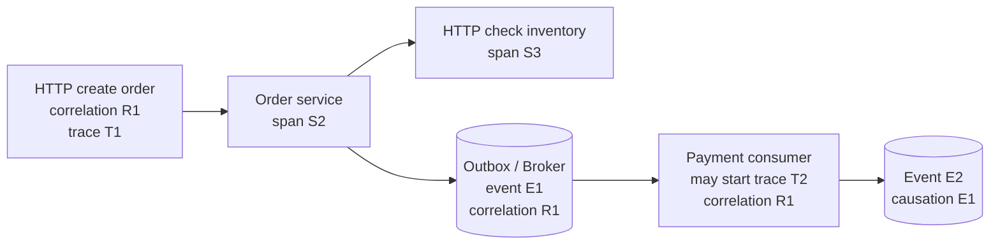

# Business Identifiers, Correlation IDs, and Exchange Metadata

## 1. Why Does System Integration Need Multiple Kinds of Identifiers?

A Spring Boot system rarely completes a business workflow in a single call. When creating an order, an API may call an inventory service over HTTP, persist data in PostgreSQL, emit an event to Kafka/RabbitMQ, update a Redis cache, and trigger a Spring Integration flow. One user action can fan out into many requests, messages, retries, and records across multiple systems.

If every component passes a single generic `id` field, it becomes nearly impossible to tell whether it represents the order, an HTTP call, an event, a retry attempt, or the entire workflow chain. Common consequences include:

- Inability to reconcile an order across systems because each system logs a different kind of ID.
- Inability to trace messages spawned by the same originating request.
- Retries creating duplicate orders or events because a correlation ID was mistakenly used as a deduplication key.
- Disconnected logs across HTTP clients, databases, caches, consumers, and integration adapters.
- Unchecked metadata accidentally leaking sensitive data, or externally supplied headers being trusted as authentication claims.

**Core principle:** Every identifier must have its **semantics, uniqueness scope, origin, lifecycle, and propagation rules** defined in the data contract. Business identifiers track business state; correlation IDs link related operations; event/message IDs identify a single exchange unit; trace IDs observe individual execution spans.

Within Spring Boot Integration, this lesson applies uniformly across `RestClient`/`WebClient`, JDBC/JPA, caches, brokers, and Spring Integration.

## 2. Distinguishing the Key Identifier Types

| Field | What it represents | When generated and kept stable? | Example usage |
| --- | --- | --- | --- |
| `orderId` / business ID | A business entity, such as an order | Generated on entity creation; stable across the entity lifecycle | Querying, state updates, order reconciliation |
| `commandId` | A specific business command | Generated when receiving or issuing the command; preserved across retries of *the same command* | Identifying the mutating `CreateOrder` command |
| `idempotencyKey` | Client intent to execute *one logical operation* | Generated by the client per logical operation; reused on retries of that operation | Preventing duplicate order creation or double charges |
| `correlationId` | A chain of exchanges belonging to one workflow/request | Generated at a trusted boundary if absent; propagated across steps in the chain | Finding logs from API → HTTP → broker → worker |
| `causationId` | The direct command or event that triggered the current event | Set to the immediate cause's ID when emitting a new message | Which `PaymentRequested` caused `PaymentConfirmed` |
| `eventId` | A single logical domain event that occurred | Generated uniquely for the event; preserved on redelivery of the same event | Consumer deduplication by event ID |
| `messageId` | A transport-level message or envelope unit | Governed by broker/adapter rules; may differ from `eventId` | Tracking a message inside intermediary middleware |
| `traceId` / `spanId` | Distributed trace and individual execution span | Managed by tracing instrumentation; typically a new span per hop | Investigating latency and call trees |
| `tenantId` | Customer/organization data boundary | Derived from authenticated identity and applied to data access | Partitioning data and scoping idempotency keys |

These IDs **cannot substitute for one another**. For example, five messages may share the same `correlationId`, while each message carries its own distinct `eventId`. Retrying the same event must keep that event's `eventId`, even if it passes through brokers or gets delivered repeatedly. `traceId` can split across async queues, long-running workflows, or replays; never use a trace ID as a business key.

### 2.1. Business Identifiers vs. Transport Identifiers

Suppose `orderId = ORD-2026-00421`. Across the synchronous API response and asynchronous workers, that value still identifies the same order. If `OrderCreated` carries `eventId = 4b5a...`, the event ID identifies **the order-created event**, while the order ID identifies **the order**. When `OrderShipped` is emitted later, `orderId` stays the same while `eventId` is newly generated.

An `eventId` can live in the payload and also be mirrored into a header for routing or observability. If transport middleware assigns its own `messageId`, document the relationship between the two IDs explicitly. Avoid relying on framework-generated internal IDs as durable cross-system event identities across republishes.

### 2.2. Correlation and Causation

- **Correlation** answers: *Which calls and events belong to the same overall workflow?*
- **Causation** answers: *Which immediately preceding command or event produced the current event?*

Example:

```text
CreateOrder (commandId = C1, correlationId = R1)
  └─ OrderCreated (eventId = E1, causationId = C1, correlationId = R1)
       ├─ StockReserved (eventId = E2, causationId = E1, correlationId = R1)
       └─ PaymentRequested (eventId = E3, causationId = E1, correlationId = R1)
            └─ PaymentConfirmed (eventId = E4, causationId = E3, correlationId = R1)
```

Here `R1` locates the **entire chain**, while `E3` is the direct cause of `E4`. When an event arises from multiple upstream causes, the contract may need a set of linked IDs or a dedicated saga model rather than overloading a single `causationId`.

## 3. Designing a Consistent Identifier Contract

Before naming headers or writing code, settle these rules for each identifier:

1. **Meaning and owner:** What does the ID represent, and who is authorized to mint or change it?
2. **Uniqueness scope:** Globally unique, unique per tenant, per aggregate, or per consumer?
3. **Type and format:** UUID, ULID, DB-generated sequence, structured business code, or opaque string?
4. **Lifetime:** How long is it retained, and do retries reuse the original ID?
5. **Placement in the contract:** Path, body, header, message key, or metadata; must it be stored in the DB/outbox?
6. **Trust and security:** Who supplies it, may it be logged, and does it need syntax/length validation?
7. **Missing or invalid handling:** Generate a new one, reject the request, or drop optional metadata?

Not every system needs UUIDs everywhere. Sequential database IDs can work well internally, while public IDs should avoid exposing record counts or insertion order if that poses a risk. UUIDs/ULIDs simplify distributed generation, though you must watch length, canonical formatting, and database index locality. Never treat ID unpredictability as an authorization mechanism.

Illustrative convention:

| Data layer | Suggested field | Placement |
| --- | --- | --- |
| REST resource | `orderId` | `/orders/{orderId}` and payload |
| Retryable HTTP command | `Idempotency-Key` | HTTP request header; server binds to tenant/principal, operation, and fingerprint |
| HTTP correlation | `X-Correlation-Id` | HTTP request/response header per internal convention |
| Standard tracing | `traceparent`, `tracestate` | W3C Trace Context managed by tracing instrumentation |
| Domain event | `eventId`, `orderId`, `occurredAt`, `eventType`, `schemaVersion` | Event envelope/payload |
| Broker metadata | `correlationId`, `causationId`, content type | Explicitly mapped headers/attributes |
| Logs/metrics | `correlationId`, `traceId`, dependency name, outcome | Structured logs and traces; keep high-cardinality IDs out of metric labels |

`X-Correlation-Id` is only an **illustrative convention**, not a universal mandatory header name. If partners already standardize on `Correlation-Id` or another header, agree explicitly on names, scopes, and boundary behaviors. Avoid maintaining sprawling, unchecked lists of aliases.

## 4. Example Exchange Contract Across HTTP and Brokers

### 4.1. Synchronous Request from a Client

```http
POST /api/orders HTTP/1.1
Content-Type: application/json
X-Correlation-Id: web-checkout-7f2b
Idempotency-Key: checkout-action-6630

{
  "customerId": "CUS-318",
  "items": [
    { "sku": "SKU-314", "quantity": 2 }
  ]
}
```

At the API gateway or Spring Boot application:

- Authenticate the user and derive the tenant from a trusted token/session.
- Validate `X-Correlation-Id` syntax and length; generate a fresh ID if absent or invalid per published policy.
- Bind `Idempotency-Key` to the authenticated principal, operation type, payload fingerprint, and retention window.
- Mint `orderId` and `commandId` for business execution; forward `correlationId` across outbound HTTP clients and messages.

An asynchronous response might look like:

```http
HTTP/1.1 202 Accepted
Content-Type: application/json
X-Correlation-Id: web-checkout-7f2b

{
  "orderId": "ORD-2026-00421",
  "status": "PENDING",
  "statusUrl": "/api/orders/ORD-2026-00421"
}
```

`202 Accepted` means the request has been accepted for processing, **not** that the order workflow has finished. If processing is fully synchronous, the server may return `201 Created` per the API contract.

### 4.2. Event Emitted for Consumers

Example JSON envelope placed as the payload in a topic or queue:

```json
{
  "eventId": "f2da93ac-1f9b-4a49-a82b-244d6a47e01d",
  "eventType": "OrderCreated",
  "schemaVersion": 1,
  "occurredAt": "2026-11-21T05:00:00Z",
  "aggregateType": "Order",
  "aggregateId": "ORD-2026-00421",
  "data": {
    "orderId": "ORD-2026-00421",
    "customerId": "CUS-318",
    "status": "PENDING"
  }
}
```

External headers alongside the envelope may contain:

```text
correlation-id = web-checkout-7f2b
causation-id   = C1
content-type   = application/json
```

Here `C1` is the `commandId` of the order-creation command. If a broker or adapter strips headers, consumers can still read business IDs and `eventId` from the payload, though correlation may be lost; therefore verify header propagation and consider persisting `correlationId` inside the outbox/event envelope when replay and end-to-end tracing matter. Keep header vs. payload placement consistent, documented, and tested.

Never put business-critical fields **only** in a header that intermediate brokers or archival pipelines might drop. Payloads should be self-describing enough to interpret the event per contract.

## 5. Spring Boot: Receiving, Sanitizing, and Propagating Correlation IDs

The snippets below illustrate REST MVC using Java 17+ and Spring Boot 3.2+ (with `RestClient`). `X-Correlation-Id` is observability metadata; it does not prove client identity. At the HTTP edge, the application may generate a replacement correlation ID when input is invalid; stricter APIs may instead return `400 Bad Request`.

### 5.1. Sanitizing Values at the HTTP Boundary

```java
import java.util.UUID;
import java.util.regex.Pattern;

public final class CorrelationIds {
    public static final String HEADER = "X-Correlation-Id";
    private static final Pattern SAFE =
            Pattern.compile("[A-Za-z0-9._-]{1,64}");

    private CorrelationIds() {}

    public static String acceptOrGenerate(String incoming) {
        return incoming != null && SAFE.matcher(incoming).matches()
                ? incoming
                : UUID.randomUUID().toString();
    }
}
```

Restricting characters and length mitigates log injection and header abuse. Even a syntactically valid header remains **untrusted input** when coming from the public internet. Behind an edge gateway spanning trust zones, the gateway may mint a fresh internal ID and store the client-provided value in a separate field to prevent log spoofing.

### 5.2. Controller Attaching Metadata to a Request

```java
import org.springframework.http.HttpStatus;
import org.springframework.http.ResponseEntity;
import org.springframework.web.bind.annotation.*;

record CreateOrderItem(String sku, int quantity) {}
record CreateOrderCommand(
        String customerId, java.util.List<CreateOrderItem> items) {}
record OrderAck(String orderId, String status) {}

@RestController
@RequestMapping("/api/orders")
class OrderController {
    private final OrderApplicationService orderService;

    OrderController(OrderApplicationService orderService) {
        this.orderService = orderService;
    }

    @PostMapping
    ResponseEntity<OrderAck> create(
            @RequestHeader(value = CorrelationIds.HEADER, required = false)
            String incomingCorrelationId,
            @RequestHeader("Idempotency-Key") String idempotencyKey,
            @RequestBody CreateOrderCommand command) {

        String correlationId =
                CorrelationIds.acceptOrGenerate(incomingCorrelationId);

        // OrderApplicationService must enforce authorization, validation,
        // and idempotency within the authenticated tenant/principal scope.
        OrderAck ack = orderService.submit(command, idempotencyKey, correlationId);

        return ResponseEntity.status(HttpStatus.ACCEPTED)
                .header(CorrelationIds.HEADER, correlationId)
                .body(ack);
    }
}
```

`OrderApplicationService` is an application-defined business class, not a built-in Spring API. This snippet focuses on metadata propagation; actual order persistence and idempotency must follow the real contract. Validate `Idempotency-Key` for length, format, and missing/invalid cases; never trust a client-supplied key as proof of order ownership.

### 5.3. Propagating Correlation IDs to an HTTP Client

```java
import org.springframework.stereotype.Component;
import org.springframework.web.client.RestClient;

record Availability(String sku, boolean available) {}

@Component
class InventoryGateway {
    private final RestClient restClient;

    InventoryGateway(RestClient.Builder builder) {
        this.restClient = builder
                .baseUrl("https://inventory.internal.example")
                .build();
    }

    Availability check(String sku, String correlationId) {
        return restClient.get()
                .uri("/api/inventory/{sku}", sku)
                .header(CorrelationIds.HEADER, correlationId)
                .retrieve()
                .body(Availability.class);
    }
}
```

Passing `correlationId` explicitly makes metadata usage obvious and works reliably when handing work from request threads to background workers. Larger projects may use contexts or interceptors for automatic propagation, provided context lifecycles are cleanly scoped and never leak to subsequent requests. Configuring HTTP timeouts, bulkheads, and circuit breakers remains a separate responsibility; a correlation ID does not protect you from slow dependencies.

With `WebClient`/reactive flows, propagate metadata through Reactor Context or request data rather than relying solely on `ThreadLocal` when execution hops across threads.

### 5.4. Structured Logging and MDC

MDC helps attach correlation IDs to synchronous log lines. A filter or handler sets context before execution and restores/clears it in `finally`:

```java
String previous = org.slf4j.MDC.get("correlationId");
try {
    org.slf4j.MDC.put("correlationId", correlationId);
    // Invoke business logic logging on the same thread.
} finally {
    if (previous == null) {
        org.slf4j.MDC.remove("correlationId");
    } else {
        org.slf4j.MDC.put("correlationId", previous);
    }
}
```

This is an **illustrative scoping snippet**, not a full servlet filter. Standard MDC is thread-bound; when crossing `@Async`, executors, `CompletableFuture`, schedulers, listeners, or reactive pipelines, propagate context using `TaskDecorator`, Micrometer Context Propagation, or compatible tracing tools. Always clean up MDC so one request's ID never leaks into the next request's logs.

## 6. Spring Integration and Broker Metadata

Spring Messaging uses `Message<T>` containing a payload and a header map. Framework headers (such as ID/timestamp, `replyChannel`, `errorChannel`) serve internal routing. When messages cross HTTP, Kafka, RabbitMQ, or other adapters, **never assume all internal headers are preserved**; header mappers, serializers, broker limits, and filters can alter or drop them.

### 6.1. Building a Message with Application Metadata

```java
import org.springframework.messaging.Message;
import org.springframework.messaging.support.MessageBuilder;

record OrderCreated(String eventId, String orderId, String status) {}

Message<OrderCreated> buildOrderMessage(
        OrderCreated event, String correlationId, String commandId) {

    return MessageBuilder.withPayload(event)
            .setHeader("correlationId", correlationId)
            .setHeader("causationId", commandId)
            .setHeader("eventId", event.eventId())
            .build();
}
```

In Spring Integration, the `correlationId` header may also be used internally by aggregators and splitters depending on flow design. If your flow uses framework message grouping alongside workflow correlation, keep names and headers clearly separated rather than conflating *aggregate grouping* with *workflow correlation*. Identical header names do not guarantee identical semantics across adapters.

**Note:** `MessageHeaders.ID` may be regenerated by the framework for derived messages. Never treat it as a replacement for an immutable domain `eventId` across transactions or replays.

### 6.2. Sending to Kafka with a Stable Key and Explicit Headers

Assuming a configured `KafkaTemplate<String, OrderCreated>` and matching serializer:

```java
import java.nio.charset.StandardCharsets;
import org.apache.kafka.clients.producer.ProducerRecord;
import org.springframework.kafka.core.KafkaTemplate;

void publishOrderCreated(
        KafkaTemplate<String, OrderCreated> kafkaTemplate,
        OrderCreated event,
        String correlationId,
        String causationId) {

    ProducerRecord<String, OrderCreated> record =
            new ProducerRecord<>(
                    "orders.created.v1",
                    event.orderId(), // Aggregate key to preserve per-partition ordering
                    event);

    record.headers().add("correlation-id",
            correlationId.getBytes(StandardCharsets.UTF_8));
    record.headers().add("causation-id",
            causationId.getBytes(StandardCharsets.UTF_8));

    kafkaTemplate.send(record);
}
```

Kafka record keys typically govern partition assignment per the partitioner and topic setup. Keying by `orderId` helps route events for the same order to the same partition while partition count and strategy stay stable; it does not guarantee global ordering across partitions or logical order if the producer emits events out of order. When business ordering is required, combine aggregate versions/sequences with conditional writes/publishing.

`KafkaTemplate.send(...)` executes asynchronously; invoking send does not guarantee the broker has persisted the record. Handle send failures, safe retries, observability, and consider a **transactional outbox** so DB writes never succeed while event publishing silently vanishes. For RabbitMQ, use AMQP properties/headers and publisher confirms per real broker setup rather than assuming Kafka semantics apply identically.

### 6.3. Header Mapping Contracts at Adapter Boundaries

Maintain a mapping table in integration documentation:

| Canonical application value | HTTP | Kafka/RabbitMQ | Storage/outbox |
| --- | --- | --- | --- |
| Correlation ID | `X-Correlation-Id` | `correlation-id` (illustrative convention) | `correlation_id` |
| Causation ID | Per contract if needed | `causation-id` | `causation_id` |
| Event ID | Usually absent on order creation API | `eventId` in payload | `event_id` |
| Business ID | URL or body | Payload and record key where appropriate | `order_id` |
| Schema version | Media type / version contract | `schemaVersion` in event envelope | `schema_version` |
| Trace context | W3C `traceparent`/`tracestate` | Propagated via compatible instrumentation headers | Rarely used as a persisted business ID |

Differing header names illustrate **intentional boundary mapping**. Define conversion policies, UTF-8 encoding rules, maximum lengths, and missing/duplicate header behavior; never blindly forward every HTTP header onto a broker. If adopting CloudEvents, map attributes like `id`, `source`, `type`, `time`, `subject`, and `dataschema` strictly per the CloudEvents spec—never conflate CloudEvent `id` with `orderId`.

## 7. Idempotency and Replay Handling: Use the Right ID

**Correlation ID is not a deduplication key.** Two different operations in one workflow share the same correlation ID; conversely, one operation may be replayed under a new trace. Idempotency requires a key identifying **one logical operation** backed by durable state.

### 7.1. Retryable Command APIs

Suppose a client sends `CreateOrder` with `Idempotency-Key=K1`. After persisting the order, the connection drops before the client receives the response. The client retries with **the same payload** and **the same key K1**:

- Server looks up the key scoped by `(tenantId, actor/client, operation, K1)` or equivalent agreed scope.
- If the key already completed with the same payload fingerprint, return the stored prior response per API policy.
- If the key is currently in progress, return an in-progress status or conflict/retry response per contract.
- If the same key is reused with a different payload, reject it rather than silently attaching to the wrong operation.
- Define key expiration windows and behavior after expiry.

An in-memory `Map` loses deduplication state across restarts and fails across multiple instances. Use unique constraints or atomic durable database/cache primitives matched to your durability guarantees. Never store raw sensitive payloads inside keys or logs; compute fingerprints over normalized payloads with appropriate safeguards.

### 7.2. Consumers Receiving Redelivered Events

Kafka, RabbitMQ, and many brokers can redeliver messages on consumer crashes, timeouts, retries, or rebalances. Consumers should deduplicate by `eventId` scoped to `consumerName`/subscriber (plus tenant where applicable), coupled atomically with business state updates whenever possible.

```sql
-- PostgreSQL example: each consumer processes a logical event at most once
CREATE TABLE processed_events (
    consumer_name VARCHAR(120) NOT NULL,
    event_id UUID NOT NULL,
    processed_at TIMESTAMPTZ NOT NULL DEFAULT now(),
    PRIMARY KEY (consumer_name, event_id)
);
```

Inside a single-database transaction, execute `INSERT ... ON CONFLICT DO NOTHING` before applying business updates and committing together. If insert reports a conflict, skip side effects in that transaction. When flows call external APIs outside the database, local transactions cannot provide cross-system exactly-once guarantees: use target idempotency keys, outbox/inbox, sagas, or reconciliation.

Specify clearly that `eventId` stays unchanged when retrying *the same event*, while a genuinely **new** event mints a fresh `eventId`. Never mint a new `eventId` merely because a broker redelivered a message.

## 8. Tracing: Correlation IDs Differ from Trace Context

Distributed tracing via W3C Trace Context uses:

- `traceparent`: carries version, trace ID, parent span ID, and trace flags.
- `tracestate`: vendor/system-specific tracing metadata per spec.
- `spanId`: identifies one concrete execution unit within a trace.

In Spring Boot, Micrometer Tracing / OpenTelemetry (when configured) automatically creates and propagates trace context across instrumented HTTP clients/servers and messaging. To prevent broken traces, use Spring-managed clients/beans, compatible tracing instrumentation, and verify propagation end-to-end. Never hand-craft a `traceparent` header by stuffing a correlation ID into it.



An async workflow running over minutes or hours may span multiple traces. Correlation ID ties the whole journey together; trace IDs and spans expose call trees and per-hop latency. Span links can connect related spans where tracing architecture supports them. `baggage` metadata must stay bounded in size and safe in content—never carry credentials or sensitive data in baggage.

In structured logs, record `correlationId`, `traceId`, `spanId`, operation name, error code, and duration. Never put correlation IDs, order IDs, or event IDs into **metric labels** if cardinality grows per request: time series will explode. Keep metric labels bounded (dependency, operation, outcome) and leave high-cardinality IDs in logs and traces.

## 9. Security, Privacy, and Trust Boundaries

Metadata forms part of the exchange contract and must be protected:

1. **Never treat IDs as access control.** Knowing an `orderId` or `correlationId` never grants permission to read someone else's order or traces.
2. **Derive tenants from verified identity.** Never trust client-supplied `X-Tenant-Id` directly for data scoping; accept tenant headers only from trusted proxies that authenticated and sanitized the boundary.
3. **Validate external headers.** Bound size, character set, and header count; strip control characters, newlines, and log-unsafe text.
4. **Allowlist propagation.** Forward only necessary metadata downstream; never blindly forward `Authorization`, cookies, internal auth claims, or sensitive headers to external partners.
5. **Minimize data exposure.** Never embed emails, phone numbers, personal IDs, or tokens inside correlation or idempotency keys. Enforce log retention, masking, and access controls.
6. **Enforce tenant isolation.** Deduplication keys, cache entries, consumer inboxes, and reconciliation queries must stay strictly scoped to the tenant.
7. **Never rely solely on headers for business truth.** Mandatory business fields belong in signed/schema-validated payloads rather than mutable transport headers.

For broker messages, not every producer is implicitly trusted. Enforce producer authentication, topic/queue ACLs, schema validation, and source verification; never let an untrusted header drive authorization, tenant selection, file paths, or SQL.

## 10. Versioning and Governance of Metadata Contracts

Every integration contract should specify both a payload schema **and** metadata conventions. Adding `correlationId` or changing header encoding is a contract change, especially for legacy adapters that omit headers. Optional new fields roll out far more smoothly than newly required headers.

Implementation principles:

- Assign one authoritative owner to mint `eventId` and `orderId` rather than letting every consumer invent separate IDs for the same entity.
- Separate required vs. optional metadata. When legacy callers omit correlation headers, generate a new correlation ID and flag missing upstream context if needed—never fabricate a fake causation ID.
- Version schemas in contracts and ensure consumers handle compatible versions; for breaking changes, separate versions, topics, or endpoints per project strategy.
- In outboxes, store the IDs and metadata needed for retries and replays alongside the business mutation in the same commit.
- Distinguish actual event occurrence timestamps (`occurredAt`) from broker receipt or consumer processing times; never use timestamps as unique keys.
- Preserve IDs across HTTP, DTO, JSON, broker, and database mappings; write round-trip tests to catch dropped metadata.

## 11. Testing Identifier Contracts and Traceability

| Scenario | How to test | Expected result |
| --- | --- | --- |
| Request with valid correlation ID | Call API and inspect response, logs, outbound HTTP, and messages | Same correlation ID flows across the entire chain |
| Request with missing or malformed ID | Omit header or inject newlines/oversized strings | Generates replacement ID or rejects per policy without log injection |
| Two operations in one workflow | Send two distinct commands sharing one correlation ID | Business, command, and event IDs stay distinct |
| Retry `CreateOrder` with same key and payload | Race concurrent calls or simulate dropped response then retry | At most one side effect; retry returns contract response |
| Reused key with different payload | Same actor, operation, key; alter payload | Returns conflict error instead of silently mutating/duplicating |
| Broker redelivery | Deliver the same `eventId` multiple times | Consumer applies no duplicate side effects; logs remain traceable |
| Subsequent event on same order | Emit `OrderCreated` then `OrderShipped` | Same `orderId`; distinct `eventId`; accurate causation |
| Async/executor/thread reuse | Run concurrent requests across worker pools | Context and MDC never bleed across requests |
| HTTP → Spring Integration → broker | Inspect payloads and headers at each boundary | Metadata mapped cleanly without losing mandatory IDs |
| Wrong tenant or spoofed header | Tamper with `tenantId`/business ID in request | Blocked by authentication/authorization; zero cross-tenant access |
| Payload version upgrade | Old consumer receives compatible new event | Required IDs remain readable; new fields do not break consumer |

In contract tests, verify **header names, data types, encoding, length limits, absence handling, and ID stability on retry**. Comparing JSON bodies alone misses bugs when correlation metadata travels in broker headers.

### Scenario Exercise

An order-creation request commits to the DB successfully, yet the HTTP client times out and the Kafka consumer receives the resulting event three times. Design:

1. One stable `orderId` to reconcile the order across every hop.
2. One stable `Idempotency-Key` for the client's retried creation operation.
3. One stable `eventId` for *the same event* delivered three times.
4. One `correlationId` linking the entire ordering chain and a `causationId` pointing to the immediate cause.
5. Unique constraints for API idempotency and consumer deduplication paired with proper transactions/outbox.
6. Logs/traces showing all three deliveries while proving only one business side effect executed.

Test the solution by injecting crashes before and after commits, reordering events, and scaling consumer instances. Remember that **at-least-once delivery** never turns into an exactly-once business effect merely by attaching a correlation ID.

## 12. Checklist for Spring Boot Integration Projects

- Every business ID, command ID, event ID, correlation ID, causation ID, and trace ID has a documented meaning and scope.
- Business IDs stay stable across retried requests, events, and messages; genuinely new events mint new event IDs.
- HTTP headers and broker headers are validated, allowlisted, and explicitly mapped; critical metadata is persisted in the outbox.
- `tenantId` comes from an authenticated source; every business ID access passes authorization.
- Idempotency keys deduplicate at the operation level; event IDs deduplicate at the consumer level.
- Spring Integration headers, Kafka headers, AMQP properties, and JSON envelopes are tested at real boundaries.
- Tracing uses standard `traceparent`/instrumentation; correlation IDs connect async hops; MDC is cleaned and propagated across executors.
- Structured logs include IDs for investigation; metric labels stay low-cardinality and free of sensitive data.
- Tests cover concurrent retries, redeliveries, stripped headers, encoding errors, version changes, multi-instance execution, and tenant isolation.

**Desired outcome:** As an order flows across REST APIs, HTTP clients, databases, caches, brokers, and Spring Integration adapters, operators can answer accurately *which entity is this*, *which operation was retried*, *which event was emitted and redelivered*, *which step caused the next*, and *which logs/traces belong to the same journey*—without ever conflating distinct identifier types.
