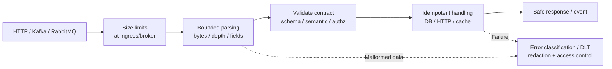
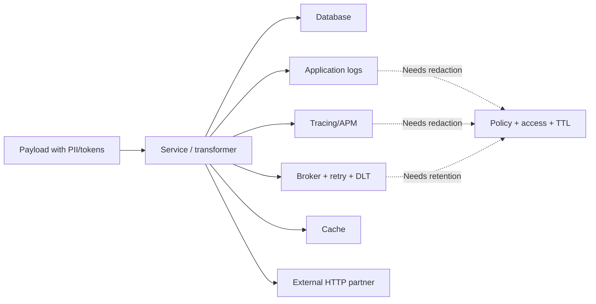

# Size Limits, Untrusted Data, and Sensitive Information

## 1. The Problem in Integration Data Contracts

In the **SPRING_BOOT_INTEGRATION** module, a Spring Boot application may receive JSON over HTTP, read Kafka records, consume RabbitMQ messages, query SQL, store values in Redis caches, or pass data through Spring Integration adapters. These systems are often built by different teams, run different deployment versions, and operate at varying levels of trust.

An **authenticated** message or one arriving from an internal network is not automatically **valid and safe to process**. A legitimate producer can still send an accidentally oversized JSON payload, a partner can change a schema, a compromised client can inject malicious data, and an unguarded log statement can leak tokens or customer records.

Suppose the service receives an order status update event:

```json
{
  "schemaVersion": 1,
  "eventId": "a4327556-6c8d-492e-aea7-1c2bec0fbb47",
  "orderId": "ORD-2026-0042",
  "status": "PAID",
  "note": "Payment confirmed"
}
```

The contract **does not stop at whether the JSON has the right fields**. It must also define:

- How many **bytes** may the payload reach? How many characters may `note` contain? How many items may appear in a list, how many object nesting levels, and how many items in a batch?
- Which fields, values, and actions is the client authorized to submit? When must untrusted data be rejected?
- Which fields hold personal data, authentication secrets, financial information, or identifying metadata?
- When errors occur, how is data handled across logs, traces, metrics, retry topics, DLTs, databases, and caches?
- If an event is redelivered after a DB commit error, HTTP timeout, or Kafka rebalance, does processing prevent duplicate side effects?

Staying safe requires combining **resource limits + structural/semantic validation + untrusted-input defenses + sensitive-data protection + boundary testing**.



## 2. Distinguishing Different Kinds of Limits

A setting called "max size" does not protect every layer of data. Always specify **unit, enforcement point, and effect**.

| Limit | Example | Protects | Does not automatically protect |
| --- | --- | --- | --- |
| **Total HTTP body** | JSON max 256 KiB | Bandwidth, memory, and parse cost for that request | Concurrent request count, bodies on other endpoints |
| **Per-field size** | `orderId` max 64 characters | Business constraints post-parse | Memory consumed parsing huge JSON before validation |
| **Item count** | Max 100 records/batch | DB operations and downstream fan-out | Size of each individual record |
| **JSON nesting depth** | Max 32 levels | Parser against deep nesting spiking CPU/stack | Flat strings tens of MBs long |
| **Number count and length** | Max 64 digits/characters per number | Part of anomalous number-parsing cost | Numeric overflow or out-of-domain values |
| **Multipart/file limit** | 5 MiB/file | Multipart file uploads | Standard JSON request bodies |
| **Broker max message** | Per-topic/queue threshold | Broker transport and storage resources | Consumer logic, PII inside DLTs |
| **Concurrency/rate limit** | 20 in-flight requests/tenant | Total capacity under many valid requests | One single oversized request |
| **Timeouts** | 3 seconds to acquire connection | Prevents threads from hanging indefinitely | Large payloads can still exhaust memory before timeout |

### Bytes, Characters, and Decompressed Size

- **Bytes** are the unit of HTTP bodies, Kafka records, memory, and bandwidth. A single Unicode string can occupy multiple bytes in UTF-8.
- `@Size(max = 64)` on a `String` checks **Java string length**, not the raw byte size of the HTTP payload.
- `Content-Length` may be absent (chunked transfer encoding) and does not reflect byte counts after a reverse proxy decompresses payloads. Never rely **solely** on that header for size limits.
- Base64 inflates binary data; JSON embedding Base64 consumes more memory and CPU than transferring binaries over a dedicated channel.
- Compressed payloads, ZIP archives, or XML documents may be tiny on the wire yet expand massively upon decompression or entity expansion. Enforce **decompressed size limits** and resource budgets at the actual processing layer.

Example: 200 concurrent requests with 2 MiB bodies already consume roughly 400 MiB just to buffer raw copies; once parsed into objects, logged/copied, queued, and retried, memory consumption grows substantially higher. Size limits via **payload size × concurrency × intermediate copies**, never in isolation from load.

## 3. Designing Defense-in-Depth Across the Integration Flow

Rather than relying on a single `@Valid` in a controller, place guards as early as possible:

| Boundary | Primary control | Response on violation |
| --- | --- | --- |
| API gateway / ingress | Body size, header size, authentication, rate/concurrency limits | Return 413/429/401 appropriately; never forward deeper |
| HTTP application | Cap actual bytes read, media type, timeouts | Reject before allocating large objects |
| JSON/XML deserializer | Depth, string/number length, structure, and data types | 400 or message quarantine |
| DTO / business contract | Required fields, enums, ranges, list lengths, version, tenant | 400/422 or contract error |
| Authorization | Identity checks, per-entity permissions, distrust client-supplied owners | 403 or appropriate resource-hiding response |
| Database | Prepared statements, unique constraints, column limits, transactions | Rollback and classified error |
| Broker/adapter | Producer/broker/consumer limits, keys, schemas, retry/DLT | Reject, quarantine, or recovery flow |
| Logging/traces/metrics | Allowlisted metadata, masking/redaction, retention, and access control | Strip sensitive values from telemetry |

When one layer cannot enforce a constraint, enforce it at the next suitable boundary. **Pre-deserialization payload limits** and **post-deserialization field limits** complement rather than replace each other.

## 4. Writing Tight Data Contracts

Keep inbound contracts separate from database entities. Spring Boot 3.x example with Jakarta Bean Validation:

```java
import jakarta.validation.constraints.NotBlank;
import jakarta.validation.constraints.NotNull;
import jakarta.validation.constraints.Pattern;
import jakarta.validation.constraints.Size;
import java.util.UUID;

public record PartnerOrderEvent(
        @NotNull Integer schemaVersion,
        @NotNull UUID eventId,
        @NotBlank
        @Size(max = 64)
        @Pattern(regexp = "[A-Z0-9-]+")
        String orderId,
        @NotNull OrderStatus status,
        @Size(max = 200) String note) {
    public enum OrderStatus { PAID, CANCELLED }
}
```

Using a `record` restricts accepted fields to those in the contract. Include `spring-boot-starter-validation` if Bean Validation is not yet on the classpath. These constraints check shape **after parsing**; they do not replace raw JSON size limits.

Key principles:

1. **Never deserialize directly into JPA entities**, admin-privileged objects, or domain objects holding server-only fields (like `tenantId`, `isAdmin`, `approvedAmount`). This prevents *mass assignment/over-posting*.
2. **Never let producers supply all trusted values.** Cross-check tenants and permissions against server-authenticated identity; a well-formed `orderId` does not prove the caller owns that order.
3. **Validate version and semantics.** For example, `schemaVersion == 1` and transitions only `PENDING → PAID` per business rules; a valid enum can still represent an illegal transition.
4. **Bound lists/maps** with `@Size(max=...)`; cascade `@Valid` and container element constraints where needed. Split large batches into bounded chunks with idempotency keys.
5. **Define unknown-field behavior.** Strict rejection catches contract bugs fast, while tolerant readers support schema evolution; choose an explicit policy backed by versioning/compatibility tests instead of accidentally ignoring business-critical fields.
6. **Prevent duplicates.** Keep `eventId` stable across retries/replays; use database unique constraints or a transactional inbox alongside side effects so redeliveries never apply twice.

Never copy raw user-supplied values verbatim into validation exception messages to "explain" errors, as exceptions frequently end up in logs or monitoring systems.

## 5. Enforcing Real HTTP JSON Body Limits in Spring MVC

For REST JSON, setting `spring.servlet.multipart.max-request-size` is **not enough**: that property governs multipart uploads. Tomcat's form-post size limits should likewise not be assumed to bound all JSON bodies.

A straightforward technique for a dedicated JSON endpoint is to **read at most N + 1 bytes** before deserializing. The example below caps this **endpoint's body** at 256 KiB without trusting `Content-Length`:

```java
import com.fasterxml.jackson.core.JsonProcessingException;
import com.fasterxml.jackson.databind.ObjectMapper;
import jakarta.servlet.http.HttpServletRequest;
import jakarta.validation.ConstraintViolation;
import jakarta.validation.Validator;
import java.io.IOException;
import java.util.Set;
import org.springframework.http.HttpStatus;
import org.springframework.http.MediaType;
import org.springframework.http.ResponseEntity;
import org.springframework.web.bind.annotation.PostMapping;
import org.springframework.web.bind.annotation.RequestMapping;
import org.springframework.web.bind.annotation.RestController;
import org.springframework.web.server.ResponseStatusException;

@RestController
@RequestMapping("/integrations")
public class PartnerOrderController {

    private static final int MAX_BODY_BYTES = 256 * 1024;
    private final ObjectMapper json;
    private final Validator validator;
    private final OrderIngestService orders;

    public PartnerOrderController(
            ObjectMapper json,
            Validator validator,
            OrderIngestService orders) {
        this.json = json;
        this.validator = validator;
        this.orders = orders;
    }

    @PostMapping(
            path = "/orders",
            consumes = MediaType.APPLICATION_JSON_VALUE)
    public ResponseEntity<Void> receive(HttpServletRequest request)
            throws IOException {

        // Memory allocated for raw body never exceeds MAX_BODY_BYTES + 1.
        byte[] raw = request.getInputStream()
                .readNBytes(MAX_BODY_BYTES + 1);
        if (raw.length > MAX_BODY_BYTES) {
            throw new ResponseStatusException(
                    HttpStatus.PAYLOAD_TOO_LARGE, "Request body too large");
        }

        final PartnerOrderEvent event;
        try {
            event = json.readValue(raw, PartnerOrderEvent.class);
        } catch (JsonProcessingException ex) {
            // Never return raw JSON or exception messages to the client.
            throw new ResponseStatusException(
                    HttpStatus.BAD_REQUEST, "Malformed JSON");
        }
        if (event == null) {
            throw new ResponseStatusException(
                    HttpStatus.BAD_REQUEST, "Event is required");
        }

        Set<ConstraintViolation<PartnerOrderEvent>> violations =
                validator.validate(event);
        if (!violations.isEmpty()) {
            throw new ResponseStatusException(
                    HttpStatus.BAD_REQUEST, "Invalid event fields");
        }

        // Beyond validation, the service must still enforce authorization,
        // schema version, business transitions, and idempotency.
        orders.acceptIfNew(event);
        return ResponseEntity.accepted().build();
    }
}
```

`OrderIngestService` is an application service you implement separately. This focuses on the read/parse/validate boundary; simpler endpoints can still use `@Valid @RequestBody` once **earlier layers enforce body limits**. The code uses Java 17+, Spring Web MVC, and Jakarta Validation (Spring Boot 3.x).

**Technique limitations:** the body still traverses the network/server layers before reaching the controller. For huge requests, the HTTP server or gateway may already allocate buffers or hold connections—so enforce **ingress/proxy limits** alongside timeouts and concurrency caps. If a proxy decompresses bodies before forwarding, enforce limits on the **decompressed** byte count at an appropriate reading layer.

Likewise, for streaming uploads, SSE, WebSockets, or large file APIs, do not mechanically buffer the entire stream into one array. Use sequential reading with byte counters, total-size caps, timeouts, and streaming storage paths.

## 6. Infrastructure and Parser Config: Which Limits Actually Apply?

The example below shows two different limit styles in a Spring Boot application using both servlet multipart and a WebFlux client:

```yaml
server:
  max-http-request-header-size: 16KB

spring:
  servlet:
    multipart:
      max-file-size: 5MB
      max-request-size: 6MB
  codec:
    max-in-memory-size: 256KB
```

Read each property's actual scope carefully:

- `server.max-http-request-header-size` caps **request headers** where supported by the embedded server, not JSON bodies.
- `spring.servlet.multipart.*` applies to **multipart** requests in Servlet configurations; never assume it blocks oversized JSON requests.
- `spring.codec.max-in-memory-size` caps memory for certain **reactive codecs buffering payloads in memory**; it is not a universal byte limit for every stream or Spring MVC HTTP request.
- Reverse proxies / API gateways (such as NGINX `client_max_body_size`) reject oversized bodies earlier; align limits consistently across clients, gateways, apps, and backends.

### Structural Limits When Jackson Parses JSON

In Jackson versions supporting `StreamReadConstraints` (Jackson 2.15+), you can cap nesting depth, string length, and number length. Example customizing Boot's builder-managed `ObjectMapper`:

```java
import com.fasterxml.jackson.core.StreamReadConstraints;
import org.springframework.boot.autoconfigure.jackson.Jackson2ObjectMapperBuilderCustomizer;
import org.springframework.context.annotation.Bean;
import org.springframework.context.annotation.Configuration;

@Configuration
public class JsonParserLimits {
    @Bean
    Jackson2ObjectMapperBuilderCustomizer constrainParser() {
        return builder -> builder.postConfigurer(mapper ->
                mapper.getFactory().setStreamReadConstraints(
                        StreamReadConstraints.builder()
                                .maxNestingDepth(32)
                                .maxStringLength(16_384)
                                .maxNumberLength(64)
                                .build()));
    }
}
```

These thresholds are examples; adjust for your Jackson version and real data requirements. Depending on framework setup, manually constructed `ObjectMapper`s or separate serializers may **not** receive Boot builder customizations. Test against the exact parser and HTTP endpoint serving traffic rather than trusting an unwired bean.

`StreamReadConstraints` limits the parser **while reading**, whereas `@Size`/`@Pattern` constrain data **after DTO construction**. If a payload sends a flat array of millions of tiny items, depth and string-length caps alone are not enough; enforce total body bytes and item-count limits per contract.

## 7. Validation Differs from Authorization and Injection Defenses

A structurally valid event may still be unauthorized. For example, a caller sends `orderId = ORD-2026-0042` belonging to a different tenant. Passing regex and length checks proves **format**, not **permission**.

Categories of untrusted input never to use raw:

| Untrusted input | Threat | Mitigation |
| --- | --- | --- |
| Client-supplied URL or hostname | SSRF targeting metadata services or internal networks | Allowlisted destinations, DNS/IP verification, redirect and network egress controls |
| SQL/filter/sort strings | SQL injection or runaway queries | Prepared parameters; allowlisted column/sort names; bounded ranges and complexity |
| Filenames / object store keys | Path traversal, overwrites | Server-generated names, canonicalization, and tenant-scoped access control |
| `X-Tenant-Id` / `X-User-Id` headers | Identity spoofing if trusted directly | Derive identity from verified auth context; permit header only from trusted proxies |
| JSON carrying admin fields | Over-posting / mass assignment | Allowlisted input DTOs and explicit domain mapping |
| Partner-supplied HTML/Markdown | XSS when rendered | Context-aware output encoding/escaping; sanitize if HTML is allowed |
| XML payloads | XXE / external entity expansion | Disable external entities/DTDs in parser; cap depth and size |
| Caller-supplied regex/filters | ReDoS / CPU exhaustion | Support only bounded simple syntax with timeouts and length caps |

Safe parameterized SQL example:

```java
String status = jdbcTemplate.queryForObject(
        "SELECT status FROM customer_orders WHERE order_id = ? AND tenant_id = ?",
        String.class,
        event.orderId(),
        authenticatedTenantId);
```

When callers choose `sortBy`, **never** interpolate arbitrary column names into SQL even after string escaping. Map allowlisted choices to server-side SQL constants. For HTTP clients, TLS/mTLS secures transport and peer identity; received payloads **still require validation**.

## 8. `WebClient` and Downstream HTTP: Do Not Let Responses Exhaust Memory

An application can cap inbound requests yet accidentally buffer a huge JSON response from a partner:

```java
import org.springframework.web.reactive.function.client.WebClient;

WebClient partnerClient = WebClient.builder()
        .baseUrl("https://api.partner.example")
        .codecs(codecs -> codecs.defaultCodecs()
                .maxInMemorySize(256 * 1024))
        .build();
```

`maxInMemorySize` protects codecs when **buffering to decode** (such as `bodyToMono(SomeDto.class)`); it is **not** an absolute cap for every streaming response. When consuming `Flux<DataBuffer>`, `InputStream`, or large files, enforce explicit limits on total bytes read, record counts, duration, and storage.

Outbound contract design:

- Call only allowlisted hosts/paths and control redirects and egress. Never pass arbitrary URLs from inbound payloads to HTTP clients.
- Set connect, response/read timeouts, max connection pools, bounded retry/backoff, and circuit breakers where appropriate.
- Check HTTP status, `Content-Type`, schema version, field lengths, and response bounds before persisting to DB or emitting messages.
- On 429/503 or timeouts, classify failures and enforce idempotency on mutating calls. **A timeout never proves the server did not execute the request.**
- Never log raw HTTP requests/responses carrying `Authorization`, cookies, tokens, customer details, or financial records.

## 9. Kafka, RabbitMQ, and Brokers: Enforce Limits on All Sides

In Kafka, oversized records can fail at the producer or broker, yet each setting governs a distinct scope:

| Kafka setting | Typical scope | Key detail |
| --- | --- | --- |
| `max.request.size` | Limits one produce request in the Kafka producer client | Does not bound individual fields inside an event |
| Broker `message.max.bytes` or topic `max.message.bytes` | Limits record batch size accepted by broker | Must align with producer limits and compression |
| `max.partition.fetch.bytes` | Target fetch threshold per partition on consumer | Has exceptions so consumers can still advance past a large first batch |
| `fetch.max.bytes` | Target total size of one fetch request | Not an absolute hard ceiling in all scenarios |
| `max.poll.records` | Caps **number of records** returned per poll | Does not bound total byte size of those records |

**No single Kafka property** replaces size and contract enforcement across both producer and consumer. If producers compress records, broker wire bytes differ from decompressed memory footprints during object parsing. Brokers and consumers need aligned resource caps, and applications must still reject oversized messages **before fanning out, deep-parsing, or writing SQL**.

In RabbitMQ, messages can face broker-level size limits depending on version and config. `frame_max` caps **one AMQP frame**, not the maximum allowed business message size—a single message can span multiple frames. Enforce limits at producers, queue/broker policies, and consumers. In Spring Integration, transformers, routers, aggregators, and internal queues can also retain copies; upstream caps prevent memory bloat across these stages.

### Never Send Oversized or Sensitive Payloads Blindly Through Retries and DLTs

Retry topics and dead-letter topics/queues often copy **both original payloads and headers**. If a message holds tokens or personal data, the DLT becomes another **sensitive data store** needing its own retention, ACLs, and read restrictions. If a message failed because it was too large, forwarding the full payload across multiple retry topics compounds the incident.

Follow this workflow:

1. Catch violations early using broker/consumer limits and schemas.
2. Separate retryable failures (transient DB outage) from non-retryable failures (invalid schema, fixed quota exceeded).
3. For unprocessable messages, consider **tightly restricted quarantine** storing metadata/IDs or pointers to encrypted objects instead of duplicating sensitive payloads.
4. Keep `eventId`, `correlationId`, and source metadata for tracing, never PII in metric tags.
5. Define retention, replay, deletion, and audit rules for every error topic/queue.

If raw records are sent to a DLT, enforce ACLs, encryption at rest per infra policy, retention windows, and test DLT-publish failures. **Never ACK/commit source offsets until DLT handoff is confirmed**; actual behavior depends on listener, recoverer, and transaction settings.

## 10. Databases, Caches, and Object Storage

HTTP limits do not protect SQL, Redis, or batch pipelines:

- **SQL:** choose right-sized column types, constraints/unique indexes, transactions, and prepared statements; never store unbounded raw payloads in `JSONB` columns. Cap query limits, page sizes, batch sizes, and LOB streaming.
- **Redis:** bound value sizes, TTLs, keys per tenant, and serialization depth. Caches are not secret vaults by default; enforce ACLs/TLS, TTLs, and avoid storing tokens/PII.
- **Spring Integration aggregators:** never accumulate unbounded groups in `MessageGroupStore` without `sequence size` or group expiry; monitor group counts and memory.
- **Object storage:** for legitimate large files or payloads, store files in access-controlled, retention-bounded object storage and send only a **verified pointer, size, content type, and checksum** in Kafka/HTTP events.

Pointer-based event example:

```json
{
  "eventId": "5b45c348-2e86-409f-87e2-e1d471cf86e0",
  "schemaVersion": 1,
  "objectKey": "tenant-42/orders/2026/11/attachment-481",
  "contentType": "application/pdf",
  "sizeBytes": 184320,
  "sha256": "a34b0d98f4a3a6eedcd0a22e3b3c50adf70f6ee70c917b13d97a48dfa19bd738"
}
```

Clients must never use `objectKey` as an unchecked direct path: the server must verify tenant/ACL permissions using scoped internal credentials. Checksums verify integrity **after download**, not authorization or sender authenticity. For untrusted files, enforce decompressed limits, magic-byte/format validation, malware scanning where policy requires, and path-traversal defenses.

## 11. Identifying and Classifying Sensitive Information

Not every field belongs in logs or should be replicated across connectors. Maintain a classification table from day one of contract design:

| Data class | Examples | Default handling |
| --- | --- | --- |
| **Authentication secrets** | Passwords, API keys, OAuth access/refresh tokens, private keys, session cookies | Never log/trace/DLT verbatim; source from secret manager, rotate, least privilege |
| **PII** | Emails, phone numbers, addresses, government IDs | Minimize collection, mask on display, bound retention and access |
| **Financial / business-sensitive** | Account numbers, transaction prices, payment details | Encrypt as required, purpose-scoped access, keep values out of telemetry |
| **Technical identifiers** | Random event IDs, correlation IDs, schema versions | Log safely for tracing; avoid using PII as IDs |
| **Client-supplied free text** | Comments, callback URLs, filenames, exception messages | Treat as untrusted; validate and escape on output; never copy raw into logs |

**Hashing emails or phone numbers does not automatically anonymize them**: constrained value domains can be reversed or linked against other datasets. Pseudonyms often still count as personal data operationally. Never put emails, tokens, or high-cardinality business IDs into Prometheus/Micrometer metric labels—that leaks data and explodes cardinality.

### Where Does Sensitive Data Leak?



Leaks frequently happen via secondary paths: debug HTTP body logs, serialized exceptions, APM agents, retry/DLT topics, centralized log aggregators, cache dumps, heap dumps, or test fixtures—not just primary database tables.

## 12. Logging, Tracing, and Error Handling Without Data Leaks

Good integration logs tell **which message, which stage, and why it failed** without dumping the body:

```text
event=ORDER_EVENT_REJECTED
correlationId=0bcb9846-42f5-4cb0-b62c-b25a1cba9582
schemaVersion=1
source=partner-a
reason=PAYLOAD_TOO_LARGE
maxBytes=262144
receivedBytesBucket=256-512KiB
```

Never log:

```text
Authorization: Bearer eyJ...
password=plain-text-value
requestBody={"customerEmail":"someone@example.com", "cardNumber":"..."}
```

Recommended safeguards:

- Use **field allowlists** for structured logs rather than logging entire DTOs and trying to regex-redact new fields later.
- For debugging, log request IDs, event IDs, size buckets, schema versions, and error codes; if sample payloads are needed for investigation, store them in access-restricted vaults with short retention.
- Scrub `Authorization`, `Cookie`, `Set-Cookie`, `X-API-Key`, and secrets from HTTP client/server logs; verify wiretap/debug logging is off in production.
- Never put exception messages containing client-supplied data into error responses or metric tags. SQL, JSON, and HTTP exceptions can embed raw input values, URLs, or headers.
- Enforce RBAC, retention/lifecycle, and erasure processes across logs, traces, audits, and DLTs.
- Spans/traces should record normalized endpoint templates, target systems, and status codes—never raw query strings with tokens, request bodies, or customer accounts.

Avoid relying on "regex-redact everything" as your sole defense. Regexes miss new fields, unusual formatting, nested objects, and encoded tokens. **Not collecting unnecessary data** remains the strongest protection.

## 13. Boundary Errors, HTTP Statuses, and Handling Policies

| Situation | Suggested HTTP status | Kafka/RabbitMQ guidance |
| --- | --- | --- |
| Body exceeds byte limit | **413 Payload Too Large** | Reject or quarantine; never retry infinitely |
| Malformed JSON syntax / type | **400 Bad Request** | Quarantine poison pill; confirm error handling per policy |
| Unsupported media type | **415 Unsupported Media Type** | Validate schema/content type per contract |
| JSON-valid field violates business rule | `400` or **422** per API contract | Do not auto-retry permanent errors; DLT/incident |
| Caller exceeds quota | **429 Too Many Requests** | Rate limiting/backpressure, bounded consumption |
| Downstream temporarily unavailable | Controlled `503`/timeout | Bounded retry + backoff while preserving idempotency |
| Caller lacks entity permission | `403`/`404` per resource-hiding policy | Reject operation; alert on suspected abuse |

For HTTP APIs, return `ProblemDetail` or an error contract with **stable error codes** and a request ID:

```json
{
  "type": "about:blank",
  "title": "Payload Too Large",
  "status": 413,
  "detail": "Request body exceeds the allowed limit",
  "requestId": "req-8f6dc2"
}
```

Never return submitted request bodies, JWTs, SQL, internal file paths, or full stack traces. A 413 response does not prove malicious intent; a producer may have changed its schema or an API gateway limit may be misaligned. Use metrics and error codes to tune contracts and capacity.

### Tie Retries to Error Nature

If an unchanged message is too large, retrying it 10 times only wastes broker and network capacity. For transient DB outages, bounded retries help. When a producer later sends a fixed version, preserve `eventId`/version and idempotency rules so the update neither duplicates writes nor confuses two differing payloads as identical.

Never treat a dead-letter topic as a public inbox for everyone to "inspect raw payloads"; DLTs often hold even more sensitive material than business topics because they combine full record copies with exception headers.

## 14. Testing Size Boundaries and Untrusted Data

Target tests at **state transitions**: just below vs. just above limits, before vs. after deserialization, before DB writes, after broker failures, and during telemetry emission.

| Test case | Expected behavior |
| --- | --- |
| Valid 256 KiB JSON | Accepted if fields, schema, and semantics are also valid |
| 256 KiB + 1 byte JSON | **413**, service never called, zero DB writes |
| Chunked request without `Content-Length` | Limit enforced on actual bytes **read**, never bypassed |
| Compressed body exceeding limit after decompression | Checked at decompression layer; never allocates over budget |
| 65-character `orderId` | **400** even when body is tiny; nothing persisted |
| Deeply nested JSON, huge string/number | Parser rejects within resource budget |
| Unknown enum or unsupported `schemaVersion` | Classified as contract error; never silently saved wrongly |
| Client injects `isAdmin` or `tenantId` | Does not grant unauthorized privileges or cross tenant boundaries |
| Callback URL targeting internal IP | Blocked by allowlist/egress SSRF policy |
| SQL query parameter with special characters | Prepared statement treats input strictly as literal data |
| Oversized Kafka/RabbitMQ message | Does not wedge consumers indefinitely or flood DLTs |
| Error triggered by payload with token/PII | Sensitive values absent from responses, logs, traces, and metrics |
| Event redelivered after DB commit | Idempotency keeps business side effects at once |

### Example MockMvc Test for HTTP Body Limits

Using `/integrations/orders` above and a `@SpringBootTest` with `MockMvc`:

```java
import static org.springframework.test.web.servlet.request.MockMvcRequestBuilders.post;
import static org.springframework.test.web.servlet.result.MockMvcResultMatchers.status;
import org.junit.jupiter.api.Test;
import org.springframework.beans.factory.annotation.Autowired;
import org.springframework.boot.test.autoconfigure.web.servlet.AutoConfigureMockMvc;
import org.springframework.boot.test.context.SpringBootTest;
import org.springframework.http.MediaType;
import org.springframework.test.web.servlet.MockMvc;

@SpringBootTest
@AutoConfigureMockMvc
class OrderBodyLimitTest {
    @Autowired MockMvc mvc;

    @Test
    void rejectsBodyAboveLimit() throws Exception {
        byte[] oversized = new byte[256 * 1024 + 1];
        java.util.Arrays.fill(oversized, (byte) 'x');

        mvc.perform(post("/integrations/orders")
                .contentType(MediaType.APPLICATION_JSON)
                .content(oversized))
                .andExpect(status().isPayloadTooLarge());
    }
}
```

This tests controller logic in `MockMvc`; it **does not replace** integration tests through your real reverse proxy/HTTP server or real Kafka/RabbitMQ brokers. In your suite, mock the service to assert `acceptIfNew` is **never called** on oversized bodies, and test realistic fixtures right at N bytes, multibyte Unicode, deeply nested batches, and malformed payloads.

Across APIs and brokers, run producer–consumer contract tests sharing identical byte limits, versions, enums, nullability, item counts, and unknown-field rules. If one side raises its message limit while the other keeps a lower limit, runtime failures occur even when every service's unit tests pass.

## 15. Operating and Monitoring Limits

Instrument metrics by **error category and code**, never by sensitive values:

- Rates of 400/413/415/422/429 per endpoint and per authenticated producer.
- Request/response size histograms/buckets without putting bodies into metric labels.
- Rates of JSON parse failures, Bean Validation failures, unknown schema versions, and unauthorized entity access.
- Parse/transform duration, JVM heap, GC pauses, active requests, queue depths, connection pools, and downstream latency.
- Volume of rejected or DLT-routed messages by payload cause, backlog depth, oldest age, and replay success rate.
- Audit events whenever an authorized operator accesses sensitive investigation records; never log secrets in audit trails.

When 413 errors spike, identify which producer changed payloads, inspect size distributions, and correlate with recent releases. Never blindly bump limits 100× just to "silence errors" without sizing RAM, bandwidth, persistence, brokers, and access controls.

If logs or traces accidentally capture sensitive data, halt the logging source immediately, lock down read access, assess replication scope, purge/revoke affected records per policy, and fix the logging code. Rotate exposed API keys or tokens; **masking in a log viewer UI never erases raw records stored underneath**.

## 16. Capstone Practice Scenario

**Context:** a Spring Boot service receives partner order events over HTTP, writes to PostgreSQL, publishes to Kafka `orders.accepted`, caches summaries in Redis, and routes processing failures to a DLT when appropriate. Payloads include a user-entered `note`; some events reference attachments.

### Requirements

1. Define contract version 1: `eventId` required, `orderId` max 64 chars, `note` max 200 chars, reject server-only fields.
2. Cap HTTP JSON at 256 KiB at both ingress and endpoint, parser depth max 32, and batches max 100 items if batching is supported.
3. Send attachments via a dedicated file/object-storage endpoint; events carry only a permission-verified pointer, size, media type, and checksum.
4. Reject callback URLs outside an allowlist and never bind `tenantId` from JSON into domain context; derive tenant from authenticated principal.
5. Execute SQL via bound parameters, unique event IDs, and transactions; design retry/outbox so DB commits and Kafka publishes never drop or duplicate events.
6. Align limits across Kafka producers, topics, and consumers; secure DLTs with tight access control, bounded retention, and protection for sensitive payloads.
7. Log only event/correlation IDs, error codes, and size buckets; test that tokens and emails never leak into responses, logs, or traces.
8. Test boundary cases from 1 byte below to 1 byte above limits, deep JSON nesting, Unicode, redelivered messages, and downstream timeouts.

### Acceptance Criteria

| Check | Expected outcome |
| --- | --- |
| Body over 256 KiB | 413 returned with zero side effects |
| Valid JSON missing ID or wrong schema | Explicit contract error without leaking raw input |
| Client-supplied restricted fields | Server-owned fields untouched; zero cross-tenant access |
| Broker record sizing | Stays within serialization/deserialization budgets without bouncing huge payloads through DLTs |
| DB retry/redelivery | Event applied at most once for business state |
| Telemetry | Includes error codes and correlation IDs; zero unnecessary secrets or PII |
| File/object pointers | Downloads verify permissions, size, media type, and integrity |
| Capacity test | Stays within CPU/RAM budgets under target concurrency without bottlenecks |

## 17. Pitfalls to Avoid

1. Using `@Size` on a DTO as your sole defense against multi-megabyte JSON payloads.
2. Assuming `spring.servlet.multipart.max-request-size` caps all JSON requests.
3. Treating Kafka's `max.poll.records` as a byte-size limit.
4. Increasing broker max message sizes without sizing downstream deserialization, retries, and DLTs.
5. Trusting payloads solely because they arrived over HTTPS, mTLS, an internal network, or from an authenticated producer.
6. Using database entities as request DTOs and letting clients supply role or tenant fields.
7. Logging full HTTP bodies, broker records, or exceptions containing tokens/PII on error.
8. Using email addresses or phone numbers as correlation IDs or metric labels.
9. Retrying schema-invalid or oversized messages indefinitely.
10. Storing unredacted sensitive payloads in caches, DLTs, test fixtures, or object stores without access and retention controls.
11. Treating an object checksum as proof that the requester is authorized to download it.
12. Ignoring decompressed sizes, deeply nested JSON, large collections, and concurrent request amplification.

## 18. Self-Check Questions

1. Why must you cap body size before parsing, even when `@Size` is already on `note`?
2. How do `Content-Length`, `@Size`, and `maxInMemorySize` address different concerns?
3. Why can a tiny compressed JSON payload still exhaust memory?
4. In Kafka, how does `max.poll.records` differ from `max.partition.fetch.bytes`?
5. What is the risk of routing raw records containing access tokens straight into a DLT?
6. Why do payloads arriving over mTLS still require validation and per-entity authorization?
7. How do you prevent mass assignment and SSRF when mapping DTOs into the domain?
8. If a DB transaction commits yet the Kafka offset commit fails, what safeguard must the application have?
9. Why does using email as a metric label cause both security and cardinality problems?
10. What does a `MockMvc` 413 test prove, and what remains unverified at real ingress?

## Summary

Secure integration data contracts specify not only **field types and meanings** but also **resource bounds, trust assumptions, and sensitive-data classification**. In Spring Boot, enforce limits early at ingress and brokers, bound bytes and nesting depth during deserialization, validate DTOs and authorization before side effects, and protect retries with transactions and idempotency. Account for every copy of a payload across HTTP clients, SQL, Redis, Kafka, RabbitMQ, Spring Integration adapters, buffers, queues, DLTs, and logs. Combine allowlists, schema versioning, safe error responses, access controls, retention limits, and boundary testing to keep integration flows resilient without leaking data.

### References

- [Spring Framework Reference — HTTP Message Conversion](https://docs.spring.io/spring-framework/reference/web/webmvc/message-converters.html)
- [Spring Boot Reference — Servlet Web Applications](https://docs.spring.io/spring-boot/reference/web/servlet.html)
- [Spring Boot Reference — Validation](https://docs.spring.io/spring-boot/reference/io/validation.html)
- [Spring for Apache Kafka Reference](https://docs.spring.io/spring-kafka/reference/)
- [OWASP — Input Validation Cheat Sheet](https://cheatsheetseries.owasp.org/cheatsheets/Input_Validation_Cheat_Sheet.html)
- [OWASP — Logging Cheat Sheet](https://cheatsheetseries.owasp.org/cheatsheets/Logging_Cheat_Sheet.html)
- [OWASP — API Security Top 10: Unrestricted Resource Consumption](https://owasp.org/API-Security/editions/2023/en/0xa4-unrestricted-resource-consumption/)
