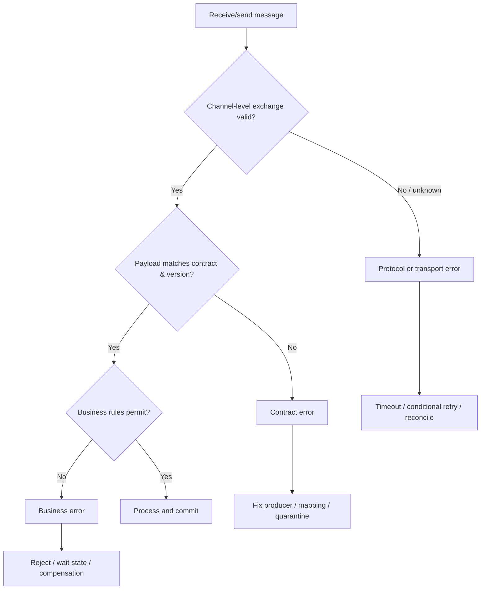
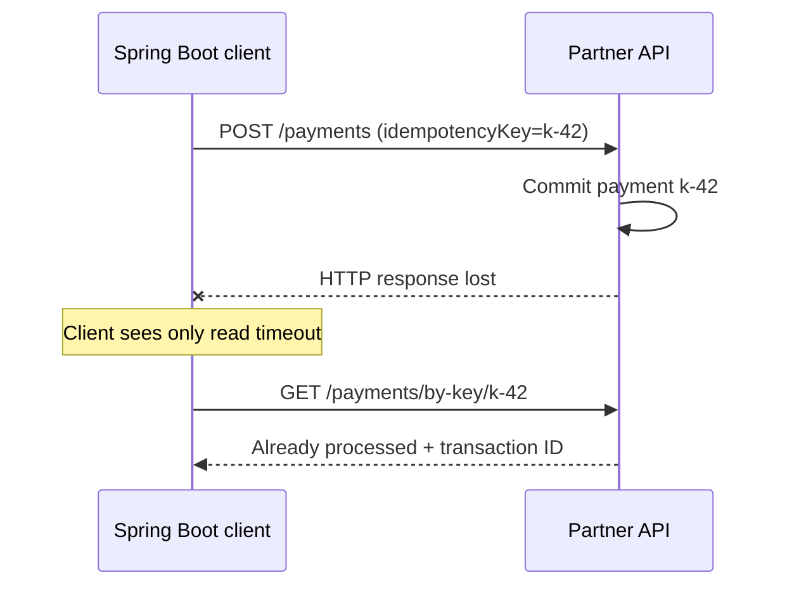
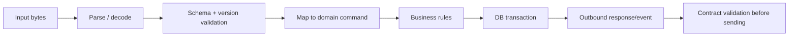
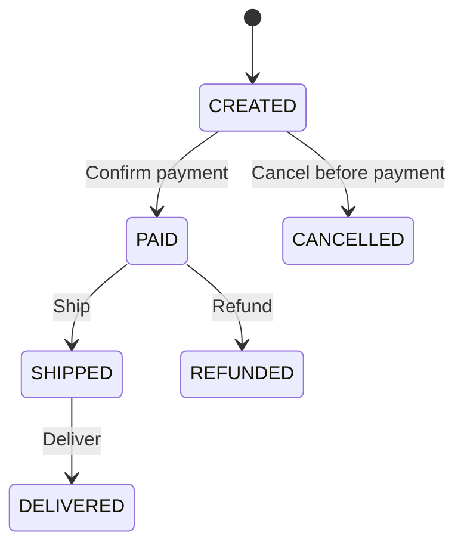
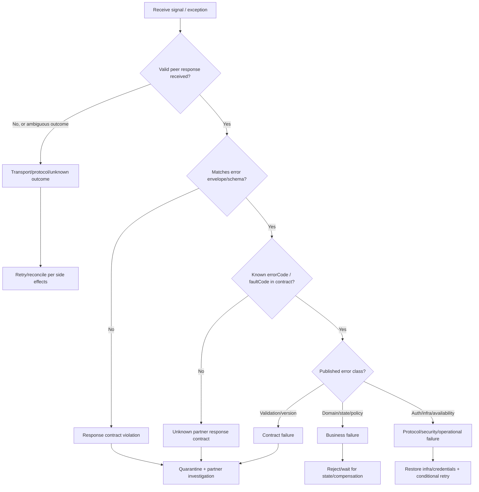
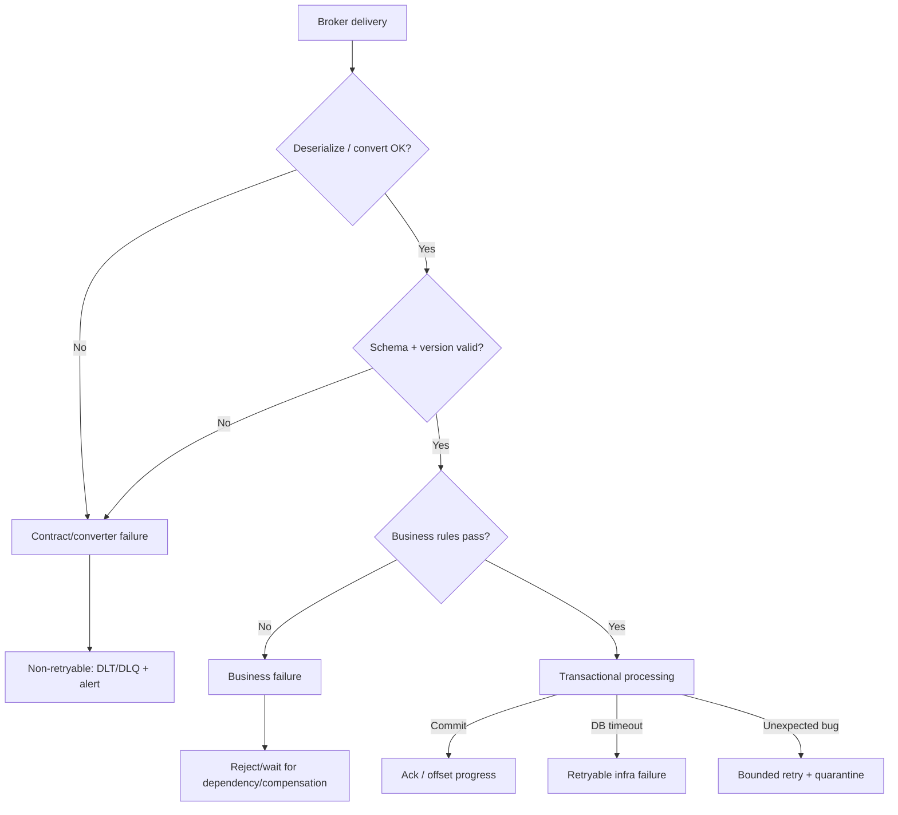
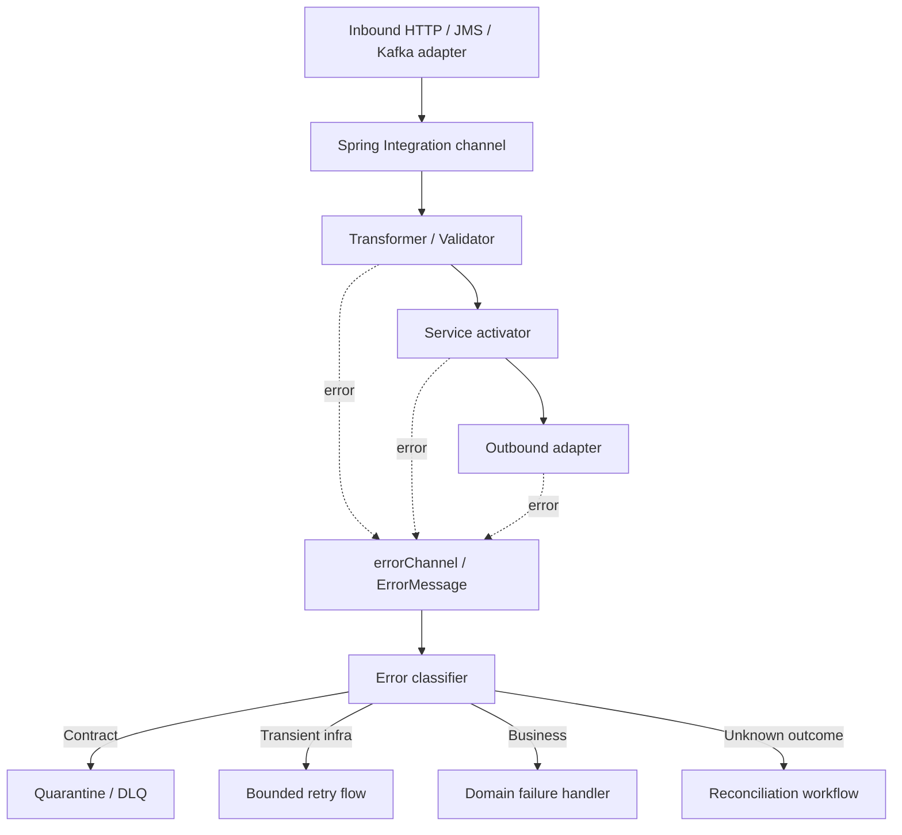
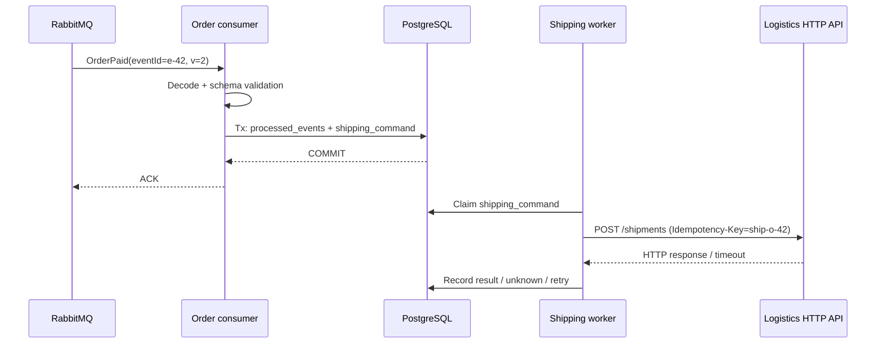

# Distinguishing Protocol Errors, Contract Errors, and Business Errors

In a Spring Boot integration flow, the same symptom—"calling a service failed"—can stem from completely different causes: a dropped HTTPS connection, JSON missing a required field, an unsupported order status code, or a valid order that **cannot be refunded** because its return window expired. Grouping all of them into one generic `IntegrationException` and retrying identically risks overwhelming downstream services, creating duplicate side effects, or trapping unfixable messages in endless loops.

This lesson belongs to the **Data Contracts** chapter of the `SPRING_BOOT_INTEGRATION` module. It focuses on distinguishing three error layers—**protocol/transport**, **data contract**, and **business rules**—and tying each layer to error codes, response design, retries, idempotency, transactions, dead-letter queues, testing, and observability. These principles apply across HTTP clients, SOAP, JDBC, caches, Kafka, RabbitMQ, and Spring Integration adapters, while respecting each protocol's native error mechanics.

## 1. Three Error Layers Answer Three Different Questions

| Error layer | Core question | Examples | First response step |
| --- | --- | --- | --- |
| **Protocol / transport** | Could the two systems exchange a message under transport, session, and channel-acknowledgement rules? | DNS failure, TLS handshake failure, HTTP proxy rejection, HTTP framing error, Kafka broker unavailable, RabbitMQ channel closed | Verify connectivity, authentication, routing, and **whether the peer may have accepted the request** |
| **Data contract** | Does the received payload satisfy the structure, types, schema version, fields, and data semantics agreed by both sides? | JSON missing `orderId`, unknown enum, malformed timestamp, wrong SOAP namespace, event missing `eventId`, invalid `currency` per contract | Return validation error, quarantine payload, or fix mapping/schema; avoid infinitely retrying unchanged content |
| **Business rule** | Is a **contract-valid** request permitted in the current state and policy? | Cancelled order cannot be shipped, insufficient balance, refund past deadline, out of stock | Return stable business error; reject, wait for state change, or trigger compensation per rules |



This diagram is a **mental model**, not a rule that every error classifies instantaneously. For example, a timeout occurring after the peer processed the request is an **unknown outcome**, not proof the request never ran. A valid `HTTP 409` received over HTTP may signal a business state conflict, or it may signal a contract-level versioning/idempotency conflict. Read the **endpoint contract and error code** rather than guessing purely from HTTP status.

### 1.1. Distinguishing Communication Failures from Partner-Reported Rejections

Receiving `HTTP 422` with `{"code":"INVALID_CURRENCY"}` means the HTTP channel **worked cleanly**; the partner application is rejecting a payload under the contract. Conversely, a `ConnectException` before any TCP connection succeeds is a channel/transport failure where you know nothing about earlier attempts. An `HTTP 200` whose JSON body fails to parse is a **response contract error**, even though the HTTP transport succeeded.

Separate two axes:

1. **Where detected:** transport/protocol, parser/schema validator, application/domain handler.
2. **Root cause and recovery:** transient, requires fixing data, requires changing business state, requires ops intervention, or unknown whether side effects happened.

A protocol error can be permanent (invalid certificate), whereas a business error can be temporary (inventory not yet synced). Never equate "protocol error = retry" and "business error = never retry."

## 2. Protocol and Transport Errors: The Channel Produced No Reliable Outcome

The lowest layer spans DNS, TCP/TLS, HTTP/AMQP/Kafka wire protocols, proxies, broker routing, connections/sessions, and acknowledgements. It helps to subdivide further:

- **Transport errors:** connection refused, TLS handshake failure, connection reset, read/write timeouts.
- **Protocol/session errors:** invalid message framing, unsupported protocol version, proxy `407`, AMQP channel `PRECONDITION_FAILED`, protocol-level broker rejections.
- **Unknown remote outcomes:** the peer may have received and processed the request before the response or ACK was lost.

| Scenario | Signal | What must never be inferred |
| --- | --- | --- |
| DNS fails to resolve host | Unknown host, lookup timeout | Never conclude the target endpoint received the request |
| Invalid TLS cert or hostname | SSL handshake/verification exception | Never "fix" by disabling TLS verification |
| HTTP proxy demands auth | HTTP `407 Proxy Authentication Required` | Never forward the origin's Bearer token as proxy credentials |
| Server rejects HTTP request media type | `415 Unsupported Media Type` | Never classify as a domain error like "out of stock" |
| Kafka producer future fails/times out | Send exception/timeout | Never guarantee the record never reached the broker |
| RabbitMQ publish confirm lost | Timeout awaiting confirm | Never assert the broker definitely did or did not store the message |
| JDBC connection drops during commit | SQL/network exception | Never assume the transaction rolled back if commit state is unknown |

**Never confuse HTTP status codes with transport failures:** `401`, `403`, `404`, `409`, and `503` are valid HTTP responses exchanged successfully and then interpreted by the application layer. `401` is typically an auth failure, `503` a service outage, and `409` a business/state conflict. Status codes are **signals**, not a complete taxonomy.

### 2.1. Example: Timeout After Partner Already Processed the Request



Retrying `POST` with a **new idempotency key** can create a double payment. Keep the operation ID/key stable, query status if supported, and record `UNKNOWN/PENDING_RECONCILIATION` until reconciled. Both your application and the target system must share an idempotency contract; attaching an arbitrary header never forces a partner to deduplicate.

### 2.2. Protocol Security and Authentication Data

Distinguish three cases:

- **Transport/identity authentication failed:** untrusted mTLS cert, expired API token, unauthenticated proxy. Fix config/credentials or refresh per policy rather than hot-retrying with the same secret.
- **Authenticated yet forbidden:** HTTP `403` or broker lacking publish/consume ACLs. This is an access-control decision, not malformed order data.
- **Invalid contract security metadata:** wrong payload signature or missing required security header. Depending on contract, classify as integrity/auth protocol failure or contract failure; document clearly so classification stays consistent.

Never log tokens, passwords, HMAC secrets, private keys, or full messages carrying sensitive data while investigating these errors.

## 3. Contract Errors: Payload Violates the Agreed Terms

A **data contract** encompasses more than a JSON Schema:

| Contract element | Example condition | Violation |
| --- | --- | --- |
| Media type & serialization | `Content-Type: application/json`, UTF-8, SOAP Body XML with matching namespace | Unsupported content type, bad framing/encoding |
| Structure | Contains `eventId`, `orderId`; proper nesting | Missing or unexpected required field |
| Data types & formats | Decimal `amount`, ISO-8601 `occurredAt` | String in numeric field, unparseable timestamp |
| Cross-field constraints | `amount > 0`; `currency` in supported enum; `startAt <= endAt` | Type matches yet validation fails |
| Identity & versioning | Supported `schemaVersion`, `eventId` stable on retry | Unsupported version, message ID mutated on replay |
| Null/default rules | `null` distinct from absent, empty list distinct from omitted | Producer and consumer interpret differently |
| Semantic contract | Monetary units, timezones, ID formats, field meaning | Sending cents when consumer expects dollars; local time read as UTC |

Agreed HTTP request example:

```json
{
  "eventId": "7b59a727-3b75-4c36-995c-7745c20ab1aa",
  "schemaVersion": 2,
  "orderId": "ORD-1042",
  "amount": 125000,
  "currency": "VND",
  "occurredAt": "2026-11-21T03:20:00Z"
}
```

A producer sending `"amount":"125000"` instead of a JSON number, or `"currency":"XYZ"` when only `VND` and `USD` are allowed, violates the declared contract. A producer sending `"amount":125000` meaning **125,000 cents** while the consumer assumes **125,000 VND** violates the **semantic contract** even when standard JSON Schema passes.

### 3.1. Contract Errors on Requests and Responses

On the **server**, validate before applying side effects: if the request is invalid, return a clear error code without running business logic. On the **client**, validate the response before writing to DB or emitting downstream events: HTTP 2xx never guarantees the response matches the contract.



On outbound flows, validate data **before sending** as well: letting the remote server return `400` for mistakes you could detect locally adds latency and mixes data bugs with network noise.

### 3.2. Separating Validation from Business Rules

For instance, `amount > 0` is an input data constraint; `amount <= availableCredit` depends on live account state and is a business rule. Requiring `currency` to be a supported contract code is validation; a customer exceeding a transaction limit in a valid currency is a business error.

The line between the two sometimes depends on design choices: an out-of-window `deliveryDate` might be modeled as a contract constraint or a business policy. What matters is not pedantic labeling, but **consistent error codes, clear ownership, defined retry rules, and actionable remediation**.

## 4. Business Errors: Valid Data, Disallowed Operation

A schema-valid command can still be rejected due to domain state or policy.

Order state machine example:



If `ShipOrder(orderId=ORD-1042)` arrives while the order is `CANCELLED`, `orderId` is valid; what fails is the **state transition**. Retrying every second makes no sense if the state has not changed. Return `ORDER_NOT_SHIPPABLE` with `currentState=CANCELLED` per contract, or route into a compensation flow if the business permits.

| Scenario | Contract or business error? | Characteristics |
| --- | --- | --- |
| Blank or malformed `orderId` | Contract | Detectable before querying the DB |
| Well-formed `orderId` that does not exist yet | Business/resource lookup, API-dependent | May be permanent not-found or lagging data sync |
| Order already cancelled yet shipment requested | Business | Transition forbidden by current state |
| Refund limit is 30 days, requested on day 45 | Business | Requires domain decision, not schema tweaks |
| Consumer receives unsupported `schemaVersion=99` | Contract/compatibility | Requires consumer upgrade or event transformation |
| Positive `amount` exceeds current balance | Business | Depends on persisted state and concurrency |

### 4.1. Enforce Invariants Inside Transactions

DB-dependent business rules face race conditions between check and write. Never rely solely on:

```java
// Race-prone example: two concurrent requests both observe status=PAID.
if (orderRepository.findStatus(orderId).equals("PAID")) {
    orderRepository.markShipped(orderId);
}
```

Use optimistic locking, versioning, appropriate locks, or conditional SQL transitions within a transaction:

```sql
UPDATE orders
   SET status = 'SHIPPED',
       version = version + 1
 WHERE order_id = :order_id
   AND status = 'PAID'
   AND version = :expected_version;
```

If updated rows equal `0`, read the current state to distinguish `ORDER_NOT_FOUND`, `ORDER_ALREADY_SHIPPED`, and `VERSION_CONFLICT`. If a client retries the same command after commit because the response dropped, an **idempotency key** returns the prior result instead of raising a false business conflict.

## 5. Classifying by Detection Layer, Error Code, and Remediation Owner

A good classifier does more than attach labels—it identifies **who must fix it** and **which recovery can be automated**.



Never base retry decisions on free-form `Throwable.getMessage()` text. Human error strings change across locales, implementations, and library versions. Classify using **stable error codes**, HTTP/SOAP/broker metadata, transaction state, and business context.

| Failure | Primary owner | Retry identical payload? | Condition for safe retry |
| --- | --- | --- | --- |
| Misconfigured DNS/TLS/proxy | Platform/security/integration owner | Usually no until fixed | Valid endpoint, CA, or secret |
| HTTP 503, broker unavailable | Infra/downstream | Possibly | Backoff, budget, circuit breaker, idempotency |
| JSON missing required field | Producer or mapping owner | No | Payload fixed or schema negotiated |
| Unknown enum / schema version | Producer–consumer contract owner | Not on the same consumer version | Consumer upgraded, upcast, or routed compatibly |
| Business rule `INSUFFICIENT_FUNDS` | Domain owner | Not immediately | Customer adds funds or alternate workflow runs |
| Business rule `DEPENDENCY_NOT_READY` | Domain/workflow owner | Possibly after delay | Bounded deadline and state can legitimately change |
| Remote commit unknown after timeout | Application/operations | Never retry blindly | Query operation ID; reuse same idempotency key |
| Same event ID with differing payload | Contract/data-integrity owner | No | Investigate conflict; never silently deduplicate |

### 5.1. Never Use HTTP Status as the Sole Label

| Status or signal | Possible interpretations | What else to inspect |
| --- | --- | --- |
| `400 Bad Request` | Malformed JSON, missing field, or poorly mapped business error | `errorCode`, API docs, violation fields |
| `401 Unauthorized` | Missing or expired credentials | Origin vs. proxy? Is token refresh allowed? |
| `403 Forbidden` | Authenticated yet unauthorized | Scopes/policies; distinct from business state |
| `404 Not Found` | Resource missing or wrong route | Endpoint path vs. contract resource lookup |
| `409 Conflict` | Version conflict, illegal state transition, idempotency payload mismatch | `errorCode` and committed state |
| `415 Unsupported Media Type` | Unsupported Content-Type/body encoding | HTTP protocol and serialization contract |
| `422 Unprocessable Content` | Payload parsed, yet validation or domain rules failed | Field constraint or business invariant? |
| `429 Too Many Requests` | Rate limiting/throttling | `Retry-After`, quotas, retry budget |
| `500/502/503/504` | Server/gateway failure or timeout | Could side effects have committed? Is retry idempotent? |
| `200 OK` with schema-invalid JSON/XML | **Response contract violation** | Never persist bad data to the DB |

One server uses `422` for business errors while another uses `409`. The taxonomy aims to produce clear cross-boundary error codes, **not to dictate one universal HTTP status for every domain**.

## 6. Designing Machine-Readable Error Contracts

For HTTP, **Problem Details** per RFC 9457 (media type `application/problem+json`) provides standard fields `type`, `title`, `status`, `detail`, and `instance` plus application extensions. Spring Framework provides `ProblemDetail`, extensible via `setProperty(...)`.

Example rejecting an invalid payload:

```http
HTTP/1.1 422 Unprocessable Content
Content-Type: application/problem+json

{
  "type": "https://errors.example.org/contracts/invalid-currency",
  "title": "Payload violates the integration contract",
  "status": 422,
  "detail": "Currency is unsupported for this API version",
  "instance": "/api/orders",
  "errorClass": "CONTRACT",
  "errorCode": "INVALID_CURRENCY",
  "retryable": false,
  "correlationId": "trace-7c42",
  "violations": [
    {"field": "currency", "code": "UNSUPPORTED_VALUE"}
  ]
}
```

A business error can share the exact same envelope with a distinct error code:

```json
{
  "type": "https://errors.example.org/business/order-not-shippable",
  "title": "Order cannot be shipped in the current state",
  "status": 409,
  "errorClass": "BUSINESS",
  "errorCode": "ORDER_NOT_SHIPPABLE",
  "retryable": false,
  "correlationId": "trace-7c43",
  "currentState": "CANCELLED"
}
```

Here `type` is a URI identifying the **error kind**, not required to expose internal documentation publicly; hosting error docs varies by system. `errorClass`, `errorCode`, `retryable`, `correlationId`, and `violations` are **custom extension fields**, not mandatory RFC 9457 members. For external clients, **`retryable` is only a hint from the server**; the client's final retry decision must still respect operation type, idempotency keys, and potential committed state.

### 6.1. Principles for Designing Error Codes

A cross-language error contract should provide:

1. **Stable codes:** e.g., `INVALID_CURRENCY`, `SCHEMA_VERSION_UNSUPPORTED`, `ORDER_NOT_SHIPPABLE`, `DEPENDENCY_UNAVAILABLE`; never branch logic on prose messages.
2. **Clear scope:** which API/operation, version, and field a code applies to; adding enum values requires checking compatibility.
3. **Concrete retry semantics:** change payload, wait for domain state, refresh token, or reconcile?
4. **Right-sized context:** field/code violations, `Retry-After`, safe domain state, and correlation ID.
5. **Data protection:** zero stack traces, SQL statements, JWTs, passwords, PII, or sensitive payloads.
6. **Versioning:** consumers must tolerate new extension fields; changing the meaning of an existing `errorCode` is a breaking change.

### 6.2. Error Ownership Matrix

| Example `errorClass` | `errorCode` | Primary owner | Automation |
| --- | --- | --- | --- |
| `PROTOCOL` | `UPSTREAM_CONNECT_TIMEOUT` | Infra/integration | Retry with idempotency and deadline |
| `PROTOCOL` | `TLS_IDENTITY_INVALID` | Security/platform | Halt and alert |
| `CONTRACT` | `MISSING_REQUIRED_FIELD` | Producer/mapper | Fix input; no hot retry |
| `CONTRACT` | `SCHEMA_VERSION_UNSUPPORTED` | API/schema owner | Upgrade/migrate/route |
| `BUSINESS` | `ORDER_ALREADY_CANCELLED` | Domain/order owner | Return current state; do not blindly replay |
| `BUSINESS` | `DEPENDENCY_NOT_READY` | Workflow owner | Bounded delayed retry |
| `UNKNOWN` | `REMOTE_OUTCOME_UNKNOWN` | Integration coordinator | Persist pending and reconcile |

Never cram mysterious errors into `PROTOCOL`. Maintain an `UNKNOWN` or `UNCLASSIFIED_REMOTE_RESPONSE` category to prevent dangerous retries; once root cause is understood, update the taxonomy and tests.

## 7. Server-Side Spring Boot: Separating Validation and Domain Exceptions

Example shipment-creation endpoint. The DTO expresses the **contract**; the service enforces the **business** state machine. Boundary validation rejects invalid requests before creating side effects.

```java
public record ShipOrderRequest(
        @NotBlank String orderId,
        @NotBlank String carrierCode,
        @NotNull @Positive BigDecimal declaredValue) {
}

public record ShipOrderResponse(String operationId, String status) {}

@RestController
@RequestMapping("/api/shipments")
public class ShipmentController {
    private final ShipmentService shipmentService;

    public ShipmentController(ShipmentService shipmentService) {
        this.shipmentService = shipmentService;
    }

    @PostMapping
    public ResponseEntity<ShipOrderResponse> ship(
            @Valid @RequestBody ShipOrderRequest request,
            @RequestHeader("Idempotency-Key") String idempotencyKey) {
        ShipOrderResponse result =
                shipmentService.requestShipment(request, idempotencyKey);
        return ResponseEntity.accepted().body(result);
    }
}
```

Annotations come from `jakarta.validation.constraints`, `jakarta.validation.Valid`, and `org.springframework.web.bind.annotation`. Include the matching validation dependency (such as `spring-boot-starter-validation`) so constraints run in Spring Boot. `ShipmentService` is your business service, responsible for validating idempotency-key length/format, tenant permissions, state transitions, and persisting idempotency records via DB constraints.

A `@RestControllerAdvice` can map all three cases cleanly:

```java
@RestControllerAdvice
public class IntegrationErrorAdvice {

    @ExceptionHandler(HttpMessageNotReadableException.class)
    ResponseEntity<ProblemDetail> malformedJson(
            HttpMessageNotReadableException ignored) {
        return problem(
                HttpStatus.BAD_REQUEST,
                "CONTRACT", "MALFORMED_JSON",
                "Request body cannot be decoded");
    }

    @ExceptionHandler(MethodArgumentNotValidException.class)
    ResponseEntity<ProblemDetail> invalidFields(
            MethodArgumentNotValidException ignored) {
        return problem(
                HttpStatus.UNPROCESSABLE_ENTITY,
                "CONTRACT", "VALIDATION_FAILED",
                "Request fields violate the published schema");
    }

    @ExceptionHandler(OrderNotShippableException.class)
    ResponseEntity<ProblemDetail> businessRule(
            OrderNotShippableException ignored) {
        return problem(
                HttpStatus.CONFLICT,
                "BUSINESS", "ORDER_NOT_SHIPPABLE",
                "Order state does not allow shipment");
    }

    private ResponseEntity<ProblemDetail> problem(
            HttpStatus status,
            String errorClass,
            String errorCode,
            String detail) {
        ProblemDetail body = ProblemDetail.forStatus(status);
        body.setTitle("Integration request rejected");
        body.setDetail(detail);
        body.setProperty("errorClass", errorClass);
        body.setProperty("errorCode", errorCode);
        body.setProperty("retryable", false);
        return ResponseEntity.status(status)
                .contentType(MediaType.APPLICATION_PROBLEM_JSON)
                .body(body);
    }
}
```

Key imports: `org.springframework.http.HttpStatus`, `ProblemDetail`, `MediaType`, `ResponseEntity`; `org.springframework.http.converter.HttpMessageNotReadableException`; `org.springframework.web.bind.MethodArgumentNotValidException`; `RestControllerAdvice`, `ExceptionHandler`. `OrderNotShippableException` is an application-defined business exception. `@Valid` violations on `@RequestBody` DTOs normally trigger `MethodArgumentNotValidException` in MVC; method/path parameter validation or type-binding errors can throw different exceptions and need corresponding handlers.

**Never pass `ignored.getMessage()` straight into production responses.** Parser and DB exceptions can expose internal schemas, paths, sensitive data, and raw caller input. Log the redacted internal cause and return a correlation ID to the caller.

### 7.1. Media Type, Method, and Security Errors Follow Separate Paths

`HttpMediaTypeNotSupportedException` (HTTP 415), `HttpRequestMethodNotSupportedException` (HTTP 405), and Spring Security authentication/access-denied failures **do not necessarily pass through the three handlers above**. Let the framework or security filter chain return the right status or normalize the error envelope at the appropriate layer, and **never** map authentication failures to `VALIDATION_FAILED` or `ORDER_NOT_SHIPPABLE`.

If a client sends schema-valid JSON with `Content-Type: text/plain`, the problem is **content negotiation / protocol contract**, not a domain invariant violation. For missing URLs, check routing before concluding an order ID does not exist.

### 7.2. Error Codes Stay Stable Even When Display Text Changes

Changing `detail` prose from English to Vietnamese must never alter client retry behavior. Clients must key off published `errorCode` values; `detail` is for human readers. When documenting an API, list which codes each operation can return, suggested statuses, and recovery actions.

## 8. Client-Side Spring Boot: Classify Both HTTP Status and Response Body

A `RestClient` calling a partner cannot judge solely from `retrieve()` returning vs. throwing. Inspect **HTTP-level outcome**, **body contract**, and **domain semantics in the response**.

Logic example:

```java
public record PartnerInvoiceResponse(
        String invoiceId,
        String status,
        BigDecimal amount) {
}

@Service
public class PartnerInvoiceClient {
    private final RestClient restClient;
    private final ObjectMapper objectMapper;

    public PartnerInvoiceClient(
            RestClient restClient, ObjectMapper objectMapper) {
        this.restClient = restClient;
        this.objectMapper = objectMapper;
    }

    public PartnerInvoiceResponse getInvoice(String invoiceId) {
        ResponseEntity<String> raw;
        try {
            raw = restClient.get()
                    .uri("/v1/invoices/{id}", invoiceId)
                    .retrieve()
                    .toEntity(String.class);
        } catch (RestClientResponseException remoteStatus) {
            // Received HTTP 4xx/5xx response: classify using both
            // status and errorCode from the partner's error contract.
            throw mapRemoteHttpFailure(remoteStatus);
        } catch (ResourceAccessException transport) {
            // Connect/read timeout: remote outcome may be unknown.
            throw new PartnerTransportFailure(
                    "Partner invoice transport failed", transport);
        }

        if (raw.getBody() == null || raw.getBody().isBlank()) {
            throw new PartnerContractFailure(
                    "Missing invoice response body");
        }
        try {
            PartnerInvoiceResponse reply = objectMapper.readValue(
                    raw.getBody(), PartnerInvoiceResponse.class);
            if (reply.invoiceId() == null
                    || !reply.invoiceId().equals(invoiceId)
                    || reply.status() == null
                    || !Set.of("PAID", "PENDING", "CANCELLED")
                            .contains(reply.status())
                    || reply.amount() == null
                    || reply.amount().signum() < 0) {
                throw new PartnerContractFailure(
                        "Invoice reply violates the partner contract");
            }
            return reply;
        } catch (JsonProcessingException invalidJson) {
            throw new PartnerContractFailure(
                    "Malformed partner invoice response", invalidJson);
        }
    }

    private RuntimeException mapRemoteHttpFailure(
            RestClientResponseException response) {
        // Replace with a parser for ProblemDetail/errorCode
        // published in the partner's contract.
        int status = response.getStatusCode().value();
        if (status == 429 || status == 503) {
            return new PartnerTemporaryFailure(
                    "Partner unavailable or throttling", response);
        }
        if (status == 400 || status == 422) {
            return new PartnerContractFailure(
                    "Partner rejected invoice query contract", response);
        }
        return new PartnerRemoteFailure(
                "Partner returned HTTP " + status, response);
    }
}
```

`PartnerTransportFailure`, `PartnerContractFailure`, `PartnerTemporaryFailure`, and `PartnerRemoteFailure` are application-defined exceptions. This assumes a `RestClient` bean configured with base URL, TLS, timeouts, and credentials; with multiple partners, use `@Qualifier` to inject the right client. Main imports: `com.fasterxml.jackson.databind.ObjectMapper`, `com.fasterxml.jackson.core.JsonProcessingException`, `org.springframework.web.client.RestClient`, `RestClientResponseException`, `ResourceAccessException`, `org.springframework.http.ResponseEntity`, `java.util.Set`, and `java.math.BigDecimal`.

This **simplifies status mapping for clarity**. In production, parse the partner's published error body schema; a `422` might carry `ORDER_NOT_SHIPPABLE` (business) rather than always being a contract violation. If status is `200` yet the body has `status="UNKNOWN_VALUE"`, halt before persisting corrupt state to the DB.

### 8.1. Do Not Turn Every Client Exception Into "Protocol Error"

Framework wrappers distinguish failure modes:

- `RestClientResponseException`: remote returned an HTTP error status—inspect the **response body contract**.
- `ResourceAccessException`: I/O or connection failure—check whether the body was sent if observable; timeouts leave unknown outcomes.
- `HttpMessageConversionException` / Jackson exceptions: response payload failed DTO parsing—usually a response contract violation.
- `WebClientResponseException` in `WebClient`: analogous to HTTP error statuses when reactive pipelines map 4xx/5xx to exceptions.
- `WebClientRequestException`: request/transport failure in `WebClient`.
- `SoapFaultClientException`: remote returned a valid SOAP Fault at the SOAP layer—inspect fault code, detail, and contract.

Never catch `Exception` and label everything `UPSTREAM_TIMEOUT`. Catching broadly and dropping causes prevents tracing and retry logic from separating code bugs, schema breaks, and network outages.

### 8.2. Reactive Pattern with `WebClient`

`WebClient.retrieve()` provides `onStatus(...)` to map error responses per contract before `bodyToMono(...)` decodes success bodies. `exchangeToMono(...)` gives direct access to `ClientResponse` to inspect both status and body:

```java
public Mono<PartnerInvoiceResponse> getInvoiceReactive(String id) {
    return webClient.get()
            .uri("/v1/invoices/{id}", id)
            .exchangeToMono(response -> {
                if (response.statusCode().isError()) {
                    return response.bodyToMono(String.class)
                            .defaultIfEmpty("")
                            .flatMap(body -> Mono.error(
                                    classifyRemoteError(
                                            response.statusCode(), body)));
                }
                return response.bodyToMono(PartnerInvoiceResponse.class)
                        .switchIfEmpty(Mono.error(
                                new PartnerContractFailure(
                                        "Missing SOAP/HTTP invoice body")))
                        .flatMap(reply -> validateReply(id, reply));
            })
            .onErrorMap(WebClientRequestException.class,
                    error -> new PartnerTransportFailure(
                            "Reactive transport failed", error));
}
```

`classifyRemoteError` and `validateReply` are application-implemented methods; `validateReply` returns `Mono<PartnerInvoiceResponse>` when valid or signals `PartnerContractFailure` if invalid. This shows where classification lives rather than a complete copy-pasteable service. Adjust `switchIfEmpty` if HTTP 204 or empty bodies are valid under the contract. In reactive flows, never execute blocking JDBC directly on the Netty event loop when committing to the DB.

## 9. SOAP: Valid Faults Differ from XML/Schema Errors and Network Failures

SOAP highlights these distinctions clearly:

| Signal | Nearest error layer | Example handling |
| --- | --- | --- |
| TLS handshake fails before SOAP | Protocol/transport | Fix truststore/certs; no hot retries |
| HTTP error without a valid SOAP Envelope | Transport/gateway or response contract | Classify by HTTP status + gateway error contract |
| SOAP Envelope uses wrong namespace/version | SOAP protocol / contract binding | Fix SOAP 1.1/1.2 message factory, content type |
| SOAP Body missing required element | XML/XSD contract | Fix JAXB mapping, namespace, schema version |
| SOAP `Sender/Client Fault` for invalid field | Usually contract failure | Do not retry identical payload |
| SOAP `Receiver/Server Fault` | Often server-side failure | Conditional retry; never assume safe for mutating operations |
| SOAP Fault `detail` reports limit exceeded | Business failure | Map domain error code per WSDL/contract |
| HTTP 200 yet reply fails to unmarshal | Response contract violation | Investigate version; never write bad data to DB |

A SOAP call returning a Fault **successfully exchanged a SOAP message**; resolve and classify the fault rather than equating it with `SocketTimeoutException`.

Adapter handler example:

```java
try {
    GetInvoiceResponse reply = partnerSoapGateway.lookup(request);
    return mapToDomain(reply);
} catch (SoapFaultClientException soapFault) {
    // Extract fault code/detail per contract, not merely message text.
    throw classifySoapFault(soapFault);
} catch (WebServiceTransportException transportFailure) {
    throw new PartnerTransportFailure(
            "SOAP transport failed", transportFailure);
} catch (XmlMappingException contractFailure) {
    throw new PartnerContractFailure(
            "SOAP response does not match expected XML", contractFailure);
}
```

This snippet shows catch placement inside an adapter method, not a standalone Java file. `GetInvoiceResponse`, `partnerSoapGateway`, `request`, `mapToDomain`, `classifySoapFault`, and `XmlMappingException` represent application types or Spring OXM exceptions. Exact unmarshalling exceptions vary by configuration, so test against real SOAP envelopes and responses for your library version.

### 9.1. Do Not Treat SOAP Faults as Raw HTTP Status Substitutes

SOAP gateways commonly return HTTP 500 carrying a valid SOAP Fault per binding rules. A client that checks only `HTTP 500` and retries will ignore an unrecoverable `INVALID_CUSTOMER_ID` fault. Conversely, an HTTP 200 carrying invalid XML must never be treated as success just because the HTTP status was `200`.

In Spring-WS, test `WebServiceTemplate`, fault resolvers, message factories, and interceptors. `MockWebServiceServer` works well for simulating SOAP payloads and faults; testing HTTP/TLS/proxy transport requires a real stub/server rather than in-memory mocks.

## 10. Kafka and RabbitMQ: Contract Errors in Consumers Must Be Isolated

In messaging, exceptions thrown **before vs. after entering the listener** trigger different retry paths.



### 10.1. RabbitMQ: Conversion Failures vs. Listener Errors

In Spring AMQP, the JSON message converter can throw **before `@RabbitListener` runs**, such as when a newly added enum fails DTO binding. A `try/catch` inside the listener method will never catch pre-listener conversion errors; configure `ConditionalRejectingErrorHandler`, conversion error handling, and container retry/requeue policies.

- **Contract poison messages:** reject with `requeue=false` to route to DLX/DLQ where topology supports it.
- **Transient DB outages:** bounded retries with backoff or delayed retry queues per policy; avoid tight requeue loops.
- **Business dependency not yet ready:** bounded delayed retry if allowed by the domain; do not lump with schema failures.
- **DB committed before ACK lost:** broker redelivers; consumer deduplicates via `eventId`.

RabbitMQ DLX/DLQ is only error routing—a message landing in a DLQ is not yet resolved. If a source queue lacks a DLX or has misconfigured routing, rejected messages may vanish instead of reaching a terminal DLQ; test the real topology and queue types.

### 10.2. Kafka: Deserialization Failures Can Block an Entire Partition

Spring Kafka handles pre-listener deserialization errors through `ErrorHandlingDeserializer` wrapping a delegate deserializer paired with `DefaultErrorHandler`/recoverers for your version, classifying non-retryable records and forwarding them to a DLT when permitted. Mishandling a single poison record can wedge a consumer at the same offset.

Guidelines:

| Kafka scenario | Handling |
| --- | --- |
| Unparseable record bytes | `ErrorHandlingDeserializer`/error handler, DLT, and alert; no infinite retries |
| Unsupported new schema version | Contract/version failure; upgrade consumer or route compatibly |
| DB lock timeout | Bounded retry; withhold offset commit while unpersisted |
| Disallowed domain transition | Record domain outcome or DLT/quarantine per contract |
| DB committed before offset commit | Redelivery possible; deduplicate on redelivery |

A Kafka DLT is **another topic** receiving failed records, not semantically identical to RabbitMQ DLX. Routing, publish success, offset commits, and recovery depend on container config. Specifically, **publishing to DLT and committing the source offset** must follow explicit policy rather than assuming atomic guarantees across DB and Kafka.

### 10.3. Deduplicate by Business Event ID, Not by Error or Offset

`OrderPaid(eventId=e-42, orderId=o-7)` may arrive repeatedly across retries. Consumers persist `processed_events(consumer_name, event_id)` under a unique constraint in the **same DB transaction** as the business update. Re-receiving `e-42` produces no second ledger entry.

Never use Kafka offsets or RabbitMQ delivery tags alone as **logical event IDs**: republished events get new offsets and tags. Nor should you deduplicate all events purely by `orderId`, since one order legitimately progresses through `OrderCreated`, `OrderPaid`, and `OrderCancelled`. If **the same `eventId` carries different payload data**, raise a contract violation instead of silently ignoring it.

## 11. JDBC, Redis, and Spring Integration: Where Do Error Boundaries Sit?

### 11.1. JDBC: Constraint Errors Are Not Always Contract Errors

A `DataIntegrityViolationException` can indicate several distinct causes:

- `NOT NULL` or type constraint failure: request or mapper likely broke the **contract**.
- `UNIQUE(idempotency_key)` violation: either a **legitimate retry** of a committed command (return cached outcome) or a **contract conflict** if the same key carries a different payload.
- `FOREIGN KEY` failure: missing reference data in the payload (contract/data consistency) or an uncreated upstream dependency.
- `CHECK(balance >= 0)` failure: a DB-enforced business invariant—do not treat every constraint error as syntax validation.

`CannotAcquireLockException`, deadlocks, serialization failures, and dropped connections belong to **infra/concurrency**, safe for bounded **transaction** retries with idempotency. However, a connection drop during commit leaves an unknown outcome; inspect DB/driver behavior and verify operation state before replaying external side effects.

In Spring Boot, `@Transactional` governs the local DB transaction per configured transaction manager. It never rolls back an already-sent email or an HTTP request executed by a partner. To pair DB writes with broker events, use a transactional outbox rather than holding DB transactions open across HTTP or broker I/O.

### 11.2. Redis Cache: A Cache Timeout Does Not Mean the Business Command Failed

Suppose a service updates an order and invalidates Redis. A Redis timeout is a cache/transport failure, **not** an `OrderUpdated` contract failure. Policy may allow returning the committed business outcome and retrying/handling invalidation asynchronously if TTLs and consistency trade-offs are designed accordingly.

Conversely, if business state is stored **only in Redis** as the system of record, a write timeout leaves an **unknown outcome** requiring operation tracking and reconciliation rather than ignoring cache failures as in cache-aside patterns.

| Redis failure | Impact scope | Considerations |
| --- | --- | --- |
| Cache GET timeout | Cache read path | Fall back to DB per policy while guarding against stampedes |
| Cache DELETE/INVALIDATE timeout after DB commit | Cache consistency | Retry invalidation, use TTLs, monitor staleness |
| Redis key serialization type mismatch | Cache serialization contract | Fix mapping/codec/schema version; do not retry same bytes |
| Cache holds legacy schema version | Contract evolution | Version cache keys, TTLs, or migrations |
| Redis command mutates business state | Non-DB business state | Enforce idempotency/reconciliation; never assume rollback |

### 11.3. Spring Integration `ErrorChannel` Is Error Transport, Not Automatic Classification

Spring Integration routes messages across channels, adapters, and endpoints. When async flows throw, the framework can send an `ErrorMessage` to a configured `errorChannel`. Its payload is normally an exception—often `MessagingException` wrapping `failedMessage`. Yet **an error channel only transports failure events**; it does not decide whether an exception is protocol, contract, or business.



A `@ServiceActivator(inputChannel = "integrationErrors")` handler can receive `ErrorMessage` and log/route by root cause:

```java
@Component
public class IntegrationErrorObserver {

    @ServiceActivator(inputChannel = "integrationErrors")
    public void onError(ErrorMessage errorMessage) {
        Throwable cause = errorMessage.getPayload();
        Message<?> original = errorMessage.getOriginalMessage();

        // Illustrative: classify(...) and audit(...) are application-defined.
        IntegrationFailure failure = classify(cause, original);
        audit(failure);
    }
}
```

`IntegrationFailure`, `classify`, and `audit` are project abstractions, not built-in Spring Integration APIs. Typical imports: `org.springframework.integration.annotation.ServiceActivator`, `org.springframework.messaging.support.ErrorMessage`, `org.springframework.messaging.Message`, and `org.springframework.stereotype.Component`. You must **declare the `integrationErrors` channel** and configure error-channel routing on the flow; a standalone method does not catch every exception across all adapters automatically.

### 11.4. Error Channels Do Not Replace Broker ACK/Retry Semantics

In synchronous `DirectChannel` flows, exceptions propagate back to the caller; with `ExecutorChannel`, pollers, gateways, or message-driven adapters, error delivery and transaction boundaries differ. If an `ErrorMessage` handler "succeeds" without rethrowing, the framework may treat the failure as handled—affecting how inbound broker containers ACK or requeue depending on adapter design.

Therefore, test the full **consumer container → Spring Integration flow → errorChannel → ack/retry/DLQ** path rather than merely checking that an exception was logged. Swallowing an exception in an error channel risks ACKing a broker message before DB work committed unless a durable recovery store took ownership.

## 12. Driving Retries, ACK/NACK, and HTTP Responses from Error Class

Classification achieves nothing if every error triggers the same behavior. Policies must state **when**, **how many times**, and **under what preconditions** retries occur.

| Classification and example | Synchronous HTTP API | Broker consumer | Automatic retry |
| --- | --- | --- | --- |
| Transport drop before send | `503/504` or gateway error per contract | Retain work, reconnect | Bounded with backoff |
| Remote timeout after mutating POST | `202`/pending or unknown-outcome error per contract | Persist workflow pending; withhold premature ACK | Only after reconciliation / same key |
| Malformed JSON/XML schema | `400/422`, `CONTRACT` | Reject/quarantine/DLT/DLQ | Never with identical payload |
| Unsupported schema version | `422` or published version error | Quarantine, route/up-convert if supported | Only after contract upgrade/fix |
| Business state conflict | `409` + domain code | Persist failed outcome; retry only if state can shift | Domain-driven, never infinite |
| Rate limit or unavailable dependency | `429/503` with retry guidance | Budgeted delayed retry | Yes, honoring `Retry-After` where appropriate |
| Authentication/authorization failure | `401/403` | Stop and alert on routes/secrets/scopes | Only after fix/refresh |
| Duplicate command/event | Return prior outcome or conflict if payload differs | Deduplicate, then ACK post-commit | Never apply side effect twice |
| Unclassified code bug | `500` + correlation ID | Short retry then quarantine/alert | Bounded to prevent hot loops |

### 12.1. Retrying Without Idempotency Creates a Brand-New Business Operation

Suppose a producer sends `CreateShipment(eventId=e-42)` and times out. Generating a new `eventId=e-43` on retry against a carrier without idempotency creates two shipments. Conversely, retrying with the same ID and a **different payload** violates the contract. Store the original command's identifier and canonical payload/fingerprint so every retry stays identical.

An idempotency record table might look like:

```sql
CREATE TABLE command_idempotency (
    tenant_id VARCHAR(100) NOT NULL,
    idempotency_key VARCHAR(160) NOT NULL,
    request_fingerprint VARCHAR(128) NOT NULL,
    status VARCHAR(20) NOT NULL,
    result_reference VARCHAR(200),
    created_at TIMESTAMPTZ NOT NULL DEFAULT NOW(),
    PRIMARY KEY (tenant_id, idempotency_key),
    CONSTRAINT chk_command_status CHECK (
        status IN ('PROCESSING','COMPLETED','FAILED')
    )
);
```

This is an illustrative schema. Inside business transactions, use unique constraints and locks/versions so two concurrent requests cannot execute concurrently. When the same key arrives with a differing fingerprint, return **`IDEMPOTENCY_KEY_REUSED_WITH_DIFFERENT_PAYLOAD`** (contract conflict). When the same key and payload match an already-completed operation, return the saved result per contract. Add lease/expiry recovery for `PROCESSING` rows stuck after crashes.

### 12.2. Account for Retry Budgets Across All Layers

`RestClient`, Resilience4j, Spring Retry, Spring Kafka/Rabbit retry advice, and broker redelivery can all retry independently. If an HTTP client retries 3 times, a listener retries 4 times, and the broker redelivers 5 times, one logical command can trigger **up to 60 network attempts** in worst-case cascading failures.

Designate one layer as owner of the retry budget per `operationId`, pass deadlines/attempt metadata internally where helpful, bound concurrency, and track retries across layers. For poison messages, exhaust the budget quickly and quarantine. Unlimited retries never heal contract errors; they amplify load and starve healthy messages.

### 12.3. Never Handle All Timeouts the Same Way

| When timeout occurs | What can be inferred | What cannot be inferred |
| --- | --- | --- |
| Before TCP connection established | No HTTP request went over that connection | Earlier attempts of the same operation never ran |
| While streaming request body | Peer may have received part or all | Whether side effects executed |
| After peer committed, before response arrived | Peer may have succeeded | That the request definitely failed |
| Awaiting broker publisher confirm | Producer does not know confirm outcome within deadline | That the broker definitely lacked the record |
| Connection lost during DB commit | DB may have committed | That it definitely rolled back; query/reconcile |

Principle: **a transport error signals a channel issue, not necessarily a business outcome**. Whenever remote non-execution cannot be proven, persist an unknown outcome and reconcile by stable ID.

## 13. Schema Evolution and Backward/Forward Compatibility

Many contract errors surface only when a new producer deploys while old consumers are still running. Retries cannot fix these; manage **compatibility** deliberately.

Suppose `OrderCreated v1` is:

```json
{
  "schemaVersion": 1,
  "eventId": "2a6e0f3c-7d68-433d-ae30-e92e4f3d34d1",
  "orderId": "ORD-1",
  "amount": 50000
}
```

And v2 adds an optional field:

```json
{
  "schemaVersion": 2,
  "eventId": "2a6e0f3c-7d68-433d-ae30-e92e4f3d34d1",
  "orderId": "ORD-1",
  "amount": 50000,
  "currency": "VND"
}
```

This is **not automatically backward-compatible** if v1 consumers reject unknown fields or v2 consumers demand `currency` when reading v1 payloads. Verify compatibility via schema rules and real consumer serializer tests. Moreover, changing `amount` from major units to cents is a **breaking semantic change** even if JSON types stay unchanged.

### 13.1. Frequent Change Patterns

| Change | Risk | Management approach |
| --- | --- | --- |
| Add optional field with clear default | Old consumers may reject unknown fields | Test old readers against new writers; configure tolerance intentionally |
| Add required field without default | Legacy messages lack the field | Major version/migration or contract-proven default |
| Change `amount` number to string | Deserialization failures | Versioned transition; never change silently |
| Add `REFUNDED` enum value | Old consumers fail to parse | Unknown-value fallback or versioned routing |
| Change timezone or unit of measure | Semantic corruption while schema passes | Document units/timezones explicitly in data contracts |
| Remove or rename field | Old consumers fail | Deprecation/migration window and contract tests |
| Change SOAP namespace or registry subject | Clients fail to parse or locate schema | Contract negotiation and coordinated rollout |
| Redefine existing error code | Clients mis-retry or misbehave | Keep error code semantics stable; add new codes |

### 13.2. Run Contract Tests in Both Producer and Consumer Directions

Practical structure:

- **Producer tests:** serialize real payloads, validate against published schemas, verify required fields, semantic constraints, and error envelopes.
- **Consumer tests:** decode payloads across every supported version, including unknown optional fields, missing defaults, and new enum values.
- **Compatibility checks:** if using an Avro/Protobuf/JSON Schema registry, configure `BACKWARD`/`FORWARD`/`FULL` aligned with **your real schema versions and usage**; mode names alone never replace tests.
- **Deployment tests:** uncoordinated producer/consumer rollouts, historical event replay, and multi-day delayed retries.
- **Error contract tests:** verify error codes and `retryable` semantics never shift unexpectedly across versions.

For Avro and Protobuf, compatibility depends on field numbers, defaults, schema-evolution rules, and tooling—do not mechanically apply JSON rules to every serializer. For SOAP, QNames/namespaces and WSDL/XSD bindings often matter more than local element names. Keep versioned contract fixtures and test them before every release.

## 14. Error Observability: Measure Error Classes, Not Just HTTP 5xx

Dashboards showing only total HTTP 500s or DLQ counts hide where integrations actually broke. Standardize boundary telemetry:

| Metric/log group | Fields or indicators | Operational question answered |
| --- | --- | --- |
| Protocol/transport errors | `integration_name`, `transport`, `operation`, `status`, TLS/DNS/connect/read timeouts | Which external channel is unreachable? |
| Contract errors | `schema_version`, `errorCode`, `field_code`, producer/consumer versions | Which producer and consumer drifted out of sync? |
| Business errors | `domain_error_code`, `aggregate_type`, transition | Which business rule is rejecting traffic? |
| Retries | attempt, retry budget, delay, deadline, circuit state | Are we triggering a retry storm? |
| Unknown outcomes | `operationId`, `reconciliation_status`, age | How many operations await reconciliation? |
| Brokers | DLT/DLQ depth, oldest age, nack/requeue rate, consumer lag | Are failed messages piling up unaddressed? |
| Databases | Constraint violations, deadlocks, lock waits, rollbacks | Is the bottleneck a business invariant or DB infra? |
| Business outcomes | processed/deduplicated events, outbox backlog, mismatch count | Are real side effects consistent? |

Minimal redacted structured log:

```text
integration=shipping-partner
operation=createShipment
operationId=ship-2026-1042
correlationId=trace-a81f
failureClass=CONTRACT
errorCode=UNSUPPORTED_SCHEMA_VERSION
sourceVersion=4
consumerVersion=3
action=QUARANTINE
retryable=false
durationMs=38
```

Values above are illustrative, not fixed Spring Boot metric names. In Micrometer, keep **tags low-cardinality**—such as integration name, operation, `failureClass`, and normalized `errorCode`—never operation IDs, emails, full URLs, exception messages, or raw payloads.

### 14.1. Correlation IDs, Event IDs, and Trace IDs Are Not Interchangeable

| ID | Meaning |
| --- | --- |
| `correlationId` | Links logs/messages across an end-to-end communication flow |
| `traceId` | Identifies a distributed trace in observability tooling |
| `eventId` | Identifies a logical business event; stable across retries/replays |
| `operationId` or `idempotencyKey` | Identifies a mutating command or workflow |
| Kafka offset / Rabbit delivery tag | Broker-supplied position/delivery metadata |

Having a trace ID on an exception never implies deduplication. Nor should an event ID become a metric tag, which creates unbounded cardinality. Log IDs cleanly while aggregating metrics by error class and operation.

### 14.2. Classify Errors Without Leaking Data

Never copy verbatim:

- `HttpMessageNotReadableException.getMessage()` when it embeds request JSON fragments.
- SOAP Fault details carrying personal data or documents.
- SQL exceptions/statements exposing bind values or connection credentials.
- Access tokens, JWTs, API keys, `Proxy-Authorization`, or full URIs containing secret query params.
- Entire Kafka/RabbitMQ payloads into unprotected logs or public DLT UIs.

Instead log normalized error codes, filtered field paths, schema versions, event IDs, and safe references. Payloads needed for deep forensics belong in an **encrypted, access-controlled quarantine with bounded retention and auditing**—never dumped into CI artifacts or public error responses.

## 15. End-to-End Scenario: Creating a Shipment Across HTTP, DB, and RabbitMQ

Suppose the system consumes `OrderPaid` from RabbitMQ, stores a shipment command in PostgreSQL, and a worker calls a logistics HTTP API. Different error classes occur at distinct stages:



### 15.1. Four Similar-Looking Failures with Different Responses

**Case A — Event fails to decode:** producer sent `amount` as a string while the consumer expects a number. This is a **contract failure** at the message boundary. Do not create `shipping_command` or hot-requeue; route to DLQ/DLT with schema/version metadata and alert the contract owner. Once the mapping/consumer is fixed, replay with **the same `eventId`**.

**Case B — Order already cancelled:** the event parses cleanly and signature/tenant are valid, yet order state forbids shipping. This is a **business failure**. The consumer records the domain rejection (e.g., `SHIPMENT_NOT_ALLOWED`) in a DB transaction, then ACKs once durably saved per contract. If another system must learn of the rejection, write an outbox event in the same transaction.

**Case C — Logistics API unreachable:** the worker fails TLS handshake or receives HTTP 503. This is a **transport/operational failure**. Wrong TLS identity requires fixing config; HTTP 503 can retry with backoff and circuit breakers within resource budgets. Never hold DB transactions open across the HTTP call.

**Case D — POST may have succeeded yet HTTP response dropped:** neither validation nor a business rule failed. The worker records **remote outcome unknown** and queries status using the idempotency key / operation ID per contract. If retrying, reuse the identical key and payload. Mark completed only upon policy-compliant confirmation.

| Scenario | `failureClass` | Action | Data to preserve |
| --- | --- | --- | --- |
| Event missing required field | `CONTRACT` | Quarantine/DLQ | Original payload, schema version, event ID |
| Order `CANCELLED` | `BUSINESS` | Persist rejection outcome | Aggregate ID, state, error code |
| Logistics 503 | `PROTOCOL`/`OPERATIONAL` | Delayed retry | Command, attempt count, deadline |
| Logistics POST timeout | `UNKNOWN` | Reconcile before retry | Idempotency key, request fingerprint, status |

### 15.2. Why Not Put Everything Into One Retry Queue?

Retrying a schema-invalid event repeatedly will fail identically every time. Retrying a permanently rejected business action wastes CPU and floods logs. Retrying a succeeded HTTP POST without idempotency creates duplicate side effects. Route failures **by error class**, while retaining safe recovery paths when initial classification is uncertain (e.g., quarantining unclassified responses for investigation).

### 15.3. Contracts at Every Boundary

| Boundary | Contract to manage | Failures to test |
| --- | --- | --- |
| RabbitMQ → consumer | Event type, ID, schema version, field/semantic validation | Bad JSON, unknown enum, v2 vs. v3 differences |
| Consumer → PostgreSQL | Transactions, unique keys, state transitions, deduplication | Constraint conflict, DB rollback |
| PostgreSQL → shipping worker | Command statuses, leases/claims, retry deadlines | Crash after claim, two workers racing |
| Worker → logistics | HTTP endpoint, auth, request body, error codes, idempotency | 422 contract, 409 business, 503, timeouts |
| Worker → DB result | Result contract and `UNKNOWN` states | DB commit failure, dropped response, replay |

**Every boundary has its own contract.** A valid inbound JSON event does not guarantee valid outbound HTTP requests; a committed database row does not guarantee partner receipt; a RabbitMQ ACK does not guarantee logistics shipment creation succeeded.

## 16. Testing Error Classification Across Boundaries

Test matrices must cover happy paths plus errors commonly misclassified:

| Scenario | Expected classification | Key assertion |
| --- | --- | --- |
| HTTP request has malformed JSON | `CONTRACT` | `400/422` with error code; business service never called |
| HTTP request valid yet order `CANCELLED` | `BUSINESS` | `409` + `ORDER_NOT_SHIPPABLE`; no shipment created |
| HTTP 200 with schema-invalid body | `CONTRACT` | Client throws contract exception; zero DB commits |
| HTTP 422 + `INVALID_CURRENCY` | `CONTRACT` | Never retries identical payload |
| HTTP 409 + `ORDER_NOT_SHIPPABLE` | `BUSINESS` | No hot retries; surfaces current state if allowed |
| HTTP 503 | `OPERATIONAL` | Bounded retries with backoff |
| Invalid TLS hostname | `PROTOCOL`/`SECURITY` | Verification stays enabled; raises alert |
| POST timeout after remote commit | `UNKNOWN` | Reconciles via idempotency key; no duplicate side effects |
| SOAP Sender Fault | `CONTRACT` per contract | Maps fault code; never retries infinitely |
| SOAP business Fault detail | `BUSINESS` | Preserves domain code instead of generic 500 |
| Unparseable Kafka record | `CONTRACT` | Routes to DLT/quarantine without wedging partition |
| RabbitMQ converter fails pre-listener | `CONTRACT` | Error handler routes cleanly; no tight requeue loop |
| RabbitMQ DB commits, ACK lost | Normal redelivery | Unique `eventId` blocks second side effect |
| JDBC deadlock/serialization retry | `OPERATIONAL`/`CONCURRENCY` | Bounded transaction retry preserves invariants |
| Idempotency key reused with different payload | `CONTRACT CONFLICT` | Rejects rather than skipping silently |
| Cache reads legacy JSON version | Cache `CONTRACT` | Falls back, migrates, or evicts per policy |
| Old consumer reads v2 event with new field | `COMPATIBILITY` | Verified in both directions per published rules |

### 16.1. Testing Server Error Envelopes with Spring MVC

Example using `MockMvc` in a Spring MVC test context with the real controller and advice:

```java
@Test
void invalidRequestUsesContractErrorCode() throws Exception {
    mockMvc.perform(post("/api/shipments")
                    .contentType(MediaType.APPLICATION_JSON)
                    .header("Idempotency-Key", "req-42")
                    .content("""
                            {
                              "orderId": "ORD-42",
                              "carrierCode": "",
                              "declaredValue": -5
                            }
                            """))
            .andExpect(status().isUnprocessableEntity())
            .andExpect(jsonPath("$.errorClass").value("CONTRACT"))
            .andExpect(jsonPath("$.errorCode").value("VALIDATION_FAILED"));

    verifyNoInteractions(shipmentService);
}
```

Typical imports are `MockMvcRequestBuilders.post`, `MockMvcResultMatchers.status`/`jsonPath`, and Mockito `verifyNoInteractions`. This is a test method inside a class injecting `MockMvc` and mocking `shipmentService`; setup annotations are omitted. Be sure to also test `OrderNotShippableException` returning `BUSINESS` and `409`, plus security errors handled outside the three main advice methods.

### 16.2. Testing Client HTTP Status and Response Body

With `RestClient`, use `MockRestServiceServer` when the builder/factory matches, or a real HTTP stub to test transport behavior. Essential cases:

1. `200` with valid JSON matching `invoiceId` → returns domain DTO.
2. `200` missing `status` → throws **`PartnerContractFailure`**.
3. `422` with `INVALID_CURRENCY` → **`CONTRACT`**, zero retries.
4. `409` with `ORDER_NOT_SHIPPABLE` → **`BUSINESS`**, never treated as generic server error.
5. `503` with `Retry-After` → bounded retries within overall timeout.
6. Server closes socket after accepting POST → unknown outcome; queries operation ID.

Client-level mocks verify response mapping but **cannot prove** network timeouts or TLS behavior; test connectivity with a real HTTP stub supporting delays, resets, and fault injection. Verify your mock binds to the exact `RestClient` instance under test.

### 16.3. Testing Consumers Against Real Brokers and Databases

For Kafka and RabbitMQ, use real broker containers (such as Testcontainers) and a real database with unique constraints to verify:

- Schema-invalid messages route to DLT/DLQ rather than ACKing as business success.
- Schema-valid messages failing business rules record the right domain error code.
- Two identical deliveries with the same `eventId` produce exactly one DB effect.
- Same `eventId` with differing payloads triggers a **contract conflict** alert.
- Handler commits to DB and dies before ACK/offset commit; redelivery causes no second side effect.
- Poison records never wedge partitions or queues indefinitely once retry budgets expire.

Mocking `KafkaTemplate`, `RabbitTemplate`, or repositories cannot prove broker ACK, redelivery, unique-constraint, and commit-boundary behavior. Split unit, contract, integration, and fault-injection suites cleanly in CI.

### 16.4. Pre-Deployment Contract Tests

In CI, producers and consumers can share **schema registries or contract artifacts** without sharing Java DTO JARs forever. Test real producer serialization, real consumer deserialization, all supported historical versions, and error codes. For public APIs, publish OpenAPI/JSON Schema or WSDL/XSD and run compatibility checks—remembering schema diffs help only when **semantics** (units, timezones, idempotency, permissions) are also verified.

## 17. Batches and Partial Results: One Request Can Have Multiple Errors

Many integrations process 1,000-row batches, call bulk APIs, or ingest paginated datasets. In these cases, a single HTTP `200` or `207`, or a single broker ACK, **cannot represent every individual item's outcome**. Contracts must specify atomicity level and per-item error reporting.

Custom bulk-import response example:

```json
{
  "operationId": "bulk-20261121-001",
  "status": "PARTIAL_SUCCESS",
  "items": [
    {
      "sourceId": "R-1",
      "status": "IMPORTED",
      "targetId": "ORD-1"
    },
    {
      "sourceId": "R-2",
      "status": "REJECTED",
      "errorClass": "CONTRACT",
      "errorCode": "INVALID_CURRENCY"
    },
    {
      "sourceId": "R-3",
      "status": "REJECTED",
      "errorClass": "BUSINESS",
      "errorCode": "CUSTOMER_BLOCKED"
    },
    {
      "sourceId": "R-4",
      "status": "RETRY_PENDING",
      "errorClass": "PROTOCOL",
      "errorCode": "DEPENDENCY_UNAVAILABLE"
    }
  ]
}
```

This is an **application-defined error envelope**, not something Spring Boot generates automatically. Before choosing HTTP `207 Multi-Status`, evaluate its WebDAV semantics and whether clients/partners support it; never return 207 merely to mean "some rows failed" without contract agreement. Many bulk APIs return `200/202` with a per-item status array; what matters is **publishing explicit partial-outcome contracts**.

### 17.1. Checkpoints and Per-Item Errors

When batches checkpoint progress across crashes:

1. Advance checkpoints only past items whose results or **durable quarantine entries** have committed per policy.
2. Do not fail the entire batch for one bad row if partial success is permitted—and never silently skip failed items either.
3. Retain `sourceId`, schema version, business key, and error code to support per-item replay.
4. Retry transiently failed items under their own budgets without re-running already-succeeded items unnecessarily.
5. For outbound HTTP side effects, record operation IDs and unknown outcomes before retrying.

If a batch uses a single DB transaction per chunk, rolling back the whole chunk on error is simple and consistent. For partial commits, isolate per-item transactions or meaningful savepoints rather than catching an exception and continuing inside a transaction already marked rollback-only.

### 17.2. Async APIs: Job Status Is Its Own Contract

An API may return `202 Accepted` with an operation ID while a background worker executes. `202` confirms intake per contract, **not business completion**.

```http
HTTP/1.1 202 Accepted
Location: /operations/op-812
Content-Type: application/json

{"operationId":"op-812","status":"PENDING"}
```

`GET /operations/op-812` should expose clear states such as `PENDING`, `RUNNING`, `COMPLETED`, `FAILED`, and `UNKNOWN` alongside an error contract. A payload failure puts the job in `FAILED` with `CONTRACT`; a cancelled order produces `FAILED` with `BUSINESS`; a dropped response after possible partner commit yields `UNKNOWN` until reconciled. This avoids collapsing every async failure into an unexplainable HTTP 500.

## 18. Common Misconceptions and Fixes

| Misconception | Consequence | Accurate mental model |
| --- | --- | --- |
| "All HTTP 4xx errors are contract errors." | Wrong retries or UX on 409 business states or 401 auth | Inspect error code and per-operation documentation |
| "All HTTP 5xx errors are safe to retry immediately." | Mutating POSTs apply twice | Check idempotency and unknown remote outcomes |
| "200 means the data is valid." | Bad schemas or wrong semantics get persisted | Validate response contracts even on 2xx |
| "Clean JSON parse means contract compliance." | Wrong units, timezones, or versions slip through | Enforce semantic contracts and schema versions |
| "Violating `@NotNull` is a business error." | Mixes syntax validation with domain state | Field constraints are contracts; invariants are separate |
| "Retrying a cancelled order will eventually work." | Infinite retry loops | Forbidden transitions require business handling |
| "A TLS error is just like a JSON error." | Fixing mappers while certificates are broken | Channel/auth failures and payload errors have separate owners |
| "SOAP Faults are always transport errors." | Business fault details ignored | Faults are valid SOAP messages carrying domain/contract info |
| "Consumer exceptions always happen in the listener method." | Converter poison pills requeue before entering listener | Configure container-level error handlers and deserializers |
| "RabbitMQ DLX / Kafka DLT means the error is handled." | Unowned backlogs pile up silently | Quarantine needs alerts, replay, retention, and audits |
| "A DB unique violation is always a bug." | Idempotent retries fail wrongly | Distinguish valid duplicates from payload conflicts |
| "`@Transactional` rolls back HTTP and broker calls too." | DB and external side effects diverge | Respect transaction boundaries; use outbox and idempotency |
| "Generating a fresh `eventId` per retry avoids duplicates." | Consumers see distinct events and apply twice | Reuse the exact same ID for retries of the same event/command |
| "`x-death` or Kafka offsets identify business events." | Deduplication breaks on republish or redelivery | Use stable business IDs in payloads/metadata |
| "Adding an optional field is always backward-compatible." | Strict old consumers reject unknown fields | Test real readers and writers across versions |
| "`ProblemDetail.detail` is enough for client retry logic." | Changing prose breaks workflows | Branch on stable `errorCode` and explicit policies |
| "`retryable=true` makes retries automatically safe." | Side effects repeat when responses drop | Pair with operation IDs, idempotency keys, and reconciliation |
| "Any unclear error is transient." | Retry storms or data corruption | Classify `UNKNOWN`/quarantine and reconcile |

## 19. Implementation Checklist for a Spring Boot Integration Flow

1. **Boundaries:** list every HTTP, SOAP, JDBC, cache, broker, and Spring Integration channel/adapter and where each error class surfaces.
2. **Taxonomy:** separate `PROTOCOL/TRANSPORT`, `CONTRACT`, `BUSINESS`, and `UNKNOWN_OUTCOME`—and further tag transient vs. permanent plus owner.
3. **Data contracts:** specify schemas, versions, types, requiredness, null/default semantics, units, timezones, enums, and semantic constraints for requests, responses, and events.
4. **Error responses:** emit stable codes such as `INVALID_CURRENCY` or `ORDER_NOT_SHIPPABLE` alongside HTTP statuses, SOAP Faults, or exceptions.
5. **Server validation:** validate before side effects; map 400/415/422/409/401/403 accurately without leaking internal exception text.
6. **Client validation:** validate 2xx response bodies, remote error envelopes, SOAP Faults, schema versions, and business states—never trust 2xx blindly.
7. **Retries:** define which errors retry and under what conditions, enforcing backoff, jitter, deadlines, circuit breakers, and cross-layer budgets.
8. **Unknown outcomes:** on timeouts during POSTs, broker confirms, or DB commits, persist operation IDs and fingerprints and reconcile before retrying.
9. **Idempotency:** preserve IDs across retries of the same command/event, enforce DB unique constraints, and detect differing-payload conflicts.
10. **Consumers:** route converter/deserializer errors to DLT/DLQ or quarantine, bound retries for transient errors, and commit ACKs/offsets only after durable writes.
11. **Transactions:** keep business state and outbox/inbox markers in the same local transaction while isolating remote HTTP, email, and broker side effects.
12. **Schema evolution:** test mixed old/new versions, unknown enums, missing defaults, and semantic or error-code changes during rolling upgrades.
13. **Batches/async:** define partial success, per-item errors, operation status endpoints, checkpoints, and quarantine metadata for replay.
14. **Observability:** log error classes/codes, integrations, correlation/event IDs, and retry/quarantine decisions without exploding metric cardinality or leaking PII.
15. **Testing:** cover HTTP 200 bad bodies, 409 business conflicts, 422 contract rejections, 503 transient errors, SOAP Faults, poison messages, DB deadlocks, ambiguous timeouts, and pre-ACK crashes.
16. **Operations:** document error-code ownership, data/contract remediation runbooks, `UNKNOWN` reconciliation, controlled replays, auditing, and retention.

**Conclusion:** protocol errors answer **whether the channel is reliable and the outcome was confirmed**, contract errors answer **whether the payload satisfies what both sides agreed to**, and business errors answer **whether a valid operation is allowed in the current state**. Spring Boot expresses these three classes across HTTP, SOAP, databases, caches, and brokers via diverse exceptions and statuses; the key is classifying at the right boundary, keeping error codes stable, and picking matching actions. Whenever remote outcomes are **unknown**, reconcile and enforce idempotency instead of assuming failure or success.
