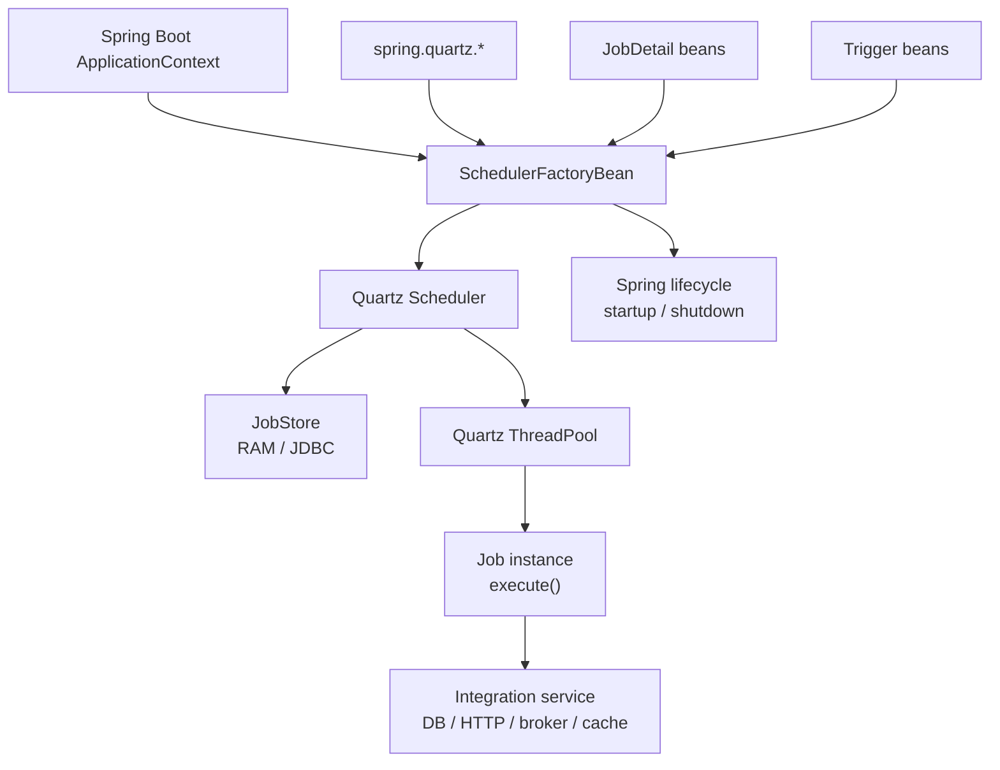
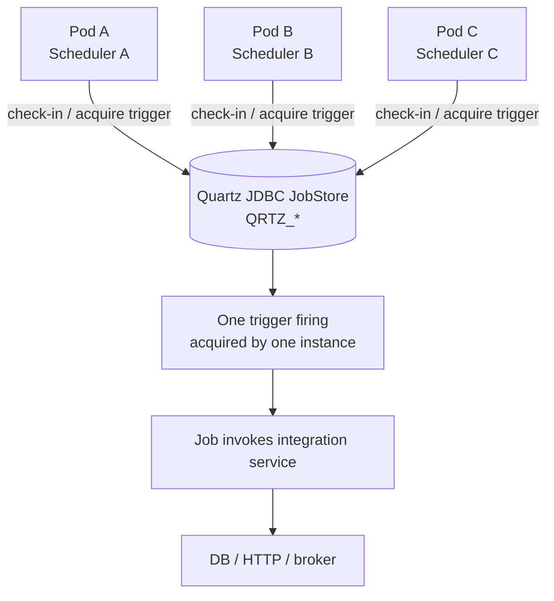
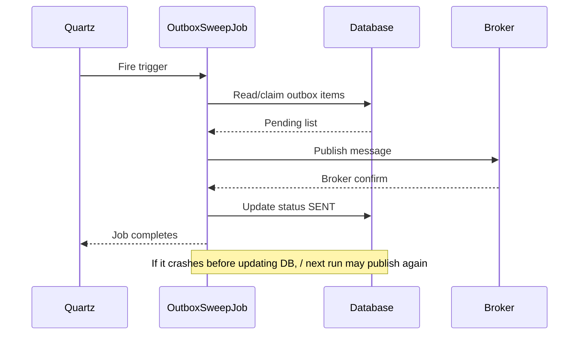

# spring-boot-starter-quartz and SchedulerFactoryBean

## 1. What Problem Does Quartz Solve in Spring Boot Integration?

In an integration system, not every operation is triggered immediately by an HTTP request or a message from a broker. Many tasks need to run **on a schedule** or **be scheduled dynamically**: sweeping an outbox to send pending events, synchronizing partner data overnight, checking transactions without responses, cleaning up expired idempotency records, or retrying an integration request after a delay.

**Quartz** is a Java task scheduling library that provides the concepts of jobs, triggers, execution schedules, and a schedule state store. In the **SPRING_BOOT_INTEGRATION** module, Quartz is the component that orchestrates *when an integration task should start*. It works alongside HTTP clients, databases, caches, message brokers, and Spring Integration adapters to perform the work; Quartz itself does not replace these mechanisms.

The two most important components in this lesson:

- **`spring-boot-starter-quartz`** provides the dependency and enables Quartz auto-configuration following Spring Boot conventions.
- **`SchedulerFactoryBean`** is a Spring Framework integration class used to create, configure, and manage the lifecycle of an `org.quartz.Scheduler` in the application context.

After this lesson, you will be able to choose between Quartz and `@Scheduled`, declare jobs/triggers, configure `spring.quartz.*`, choose between `RAMJobStore` or JDBC JobStore, understand the impact of running multiple replicas, and design integration tasks that are safe against failures, re-execution, and application version changes.

> Scope: Examples use Spring Boot with Quartz via the official starter. Specific APIs, properties, and configurations should be verified against your project's Spring Boot/Spring Framework/Quartz versions when deploying. The PostgreSQL and cron examples below are illustrative and do not imply that all databases use the same DDL or locking characteristics.

## 2. When to Use Quartz Instead of @Scheduled?

Spring Framework already provides `@Scheduled` for running periodic methods. Quartz is useful when you need to persist schedule state, manage multiple triggers, control schedules dynamically, and coordinate schedules across multiple instances via a JDBC JobStore.

| Requirement | `@Scheduled` | Quartz |
| --- | --- | --- |
| Run a method every few minutes in a single process | Simple, minimal configuration | Usable, but involves more components |
| Register/modify/delete schedules dynamically at runtime | Requires building a custom management layer | Provides `Scheduler`, `JobKey`, `TriggerKey` APIs |
| Persist jobs/triggers across restarts | Does not provide a persistent schedule store out of the box | Provides JDBC JobStore when configured |
| Multiple replicas where each trigger firing is claimed by only one node in a cluster | Each instance typically has its own schedule; requires external coordination | Quartz JDBC clustering has a trigger acquisition mechanism |
| Misfire policies, pause/resume, job groups | Must be built separately or limited | Provides dedicated scheduling capabilities |
| Simple API sync without needing schedule persistence | Usually suitable | Consider the added complexity |

**Do not treat a Quartz cluster as a business "exactly-once" guarantee.** Quartz can coordinate the right to run a trigger among instances sharing a JDBC JobStore, but a job can still be recovered/re-executed when a process crashes; side effects in the database, HTTP endpoints, or broker must be idempotent.

Examples of tool selection:

- Sending a heartbeat from an experimental process every 30 seconds: `@Scheduled` may be sufficient.
- Managing reconciliation schedules for hundreds of partners that can be paused, rescheduled, and preserved across restarts: Quartz is more suitable.
- An HTTP callback that must be processed immediately and retried according to delivery rules: HTTP adapters, queues, outboxes, and retry mechanisms remain the primary components; Quartz is only appropriate if work needs to be triggered by time.
- A job processing a very large dataset requiring step-by-step partitioning/restarts: consider combining Quartz to *launch* a Spring Batch job, while Spring Batch manages the steps and checkpoints.

## 3. Key Concepts and the Role of SchedulerFactoryBean



| Component | Function | Example |
| --- | --- | --- |
| `Job` | The processing logic invoked by Quartz when an execution starts | Sweeping unsent outbox records |
| `JobDetail` | Defines the job identity, job class, `JobDataMap`, and properties such as durable/recovery | Job `integration.outbox-sweep` |
| `Trigger` | Specifies the condition or time to fire a job | Running every 5 minutes with a CronTrigger |
| `Scheduler` | Manages job/trigger registration, pause, resume, firing, and execution coordination | `scheduleJob`, `rescheduleJob` |
| `JobStore` | Stores job/trigger state and metadata required by Quartz | RAM memory or `QRTZ_*` tables |
| Quartz thread pool | Provides threads to execute due jobs | Maximum concurrent jobs according to configuration |
| `SchedulerFactoryBean` | Integrates `Scheduler` with Spring, binding properties, data source, job/trigger beans, and lifecycle | Bean created by Spring Boot auto-configuration |

**JobDetail is not a schedule:** one JobDetail can have one or more triggers. **Trigger does not contain business logic:** it decides when Quartz executes the corresponding JobDetail. **SchedulerFactoryBean is not a job:** it creates and manages the Quartz Scheduler, and picks up JobDetail/Trigger beans configured in Spring.

A typical flow proceeds as follows:

1. The application context initializes `SchedulerFactoryBean`.
2. The factory creates or connects the `Scheduler`, prepares the JobStore and thread pool, and registers jobs/triggers declared as beans.
3. When the scheduled time arrives, Quartz acquires the due trigger and creates a job instance via the JobFactory.
4. The job invokes the business service, such as fetching paginated data from a partner API or dispatching messages from the outbox.
5. Quartz updates the trigger state and waits for the next execution; business service transactions still need to be designed separately.

## 4. Installing spring-boot-starter-quartz

### Maven

With Spring Boot parent/BOM managing dependencies:

```xml
<dependency>
    <groupId>org.springframework.boot</groupId>
    <artifactId>spring-boot-starter-quartz</artifactId>
</dependency>
```

### Gradle

```groovy
dependencies {
    implementation 'org.springframework.boot:spring-boot-starter-quartz'
}
```

The starter pulls in the Quartz libraries and the necessary Spring integration classes. You will also need to add the JDBC starter or datasource/database driver dependencies if storing jobs via JDBC. To minimize compatibility issues, rely on Spring Boot's dependency management/BOM rather than pinning an independent Quartz version unnecessarily.

When auto-configuration conditions are met and the application has not provided its own Scheduler, Spring Boot typically creates a `SchedulerFactoryBean` and a `Scheduler` that can be injected into services. Beans of type `JobDetail`, `Trigger`, and `Calendar` are automatically wired into the scheduler configuration by Spring Boot.

The starter **does not create business database tables**, does not run HTTP integration flows by itself, and merely having Quartz on the classpath does not mean every `Job` will be scheduled automatically. You must declare a JobDetail and trigger, or register the schedule via `Scheduler`.

## 5. Complete Example: Scheduling an Outbox Sweep Every 5 Minutes

Suppose a service receives HTTP requests, writes integration events into an outbox table, and needs to periodically sweep unpublished records to a broker. We separate **scheduling** from **delivery logic** so that it can be tested, reused, and managed transactionally.

### 5.1. Job Calling the Business Service

```java
import org.quartz.DisallowConcurrentExecution;
import org.quartz.JobExecutionContext;
import org.quartz.JobExecutionException;
import org.springframework.scheduling.quartz.QuartzJobBean;

@DisallowConcurrentExecution
public class OutboxSweepJob extends QuartzJobBean {

    private final OutboxDispatchService outboxDispatchService;

    public OutboxSweepJob(OutboxDispatchService outboxDispatchService) {
        this.outboxDispatchService = outboxDispatchService;
    }

    @Override
    protected void executeInternal(JobExecutionContext context)
            throws JobExecutionException {
        try {
            outboxDispatchService.dispatchPending(100);
        } catch (Exception ex) {
            // Preserve error details for Quartz and observability mechanisms.
            throw new JobExecutionException("Outbox sweep failed", ex);
        }
    }
}
```

`OutboxDispatchService` is a business service **implemented by the project**; the example above assumes an implementation bean is registered and has a `dispatchPending(int batchSize)` method. The service must manage its own transactions, record states, and ensure duplicate handling. Do not blindly send messages on every job run.

With the default Quartz integration configuration in Spring Boot versions that support job autowiring, Spring dependencies can be injected into the job instance. If the application replaces `JobFactory` with a custom implementation, you must verify the job instantiation and dependency injection mechanism; plain Quartz does not use Spring to instantiate objects by default.

`@DisallowConcurrentExecution` instructs Quartz not to run **executions of the same JobDetail/JobKey** concurrently. It does not prevent equivalent work performed by an HTTP endpoint, another job key, another application, or a broker worker. Therefore, idempotency at the data layer is still required.

### 5.2. Defining JobDetail and CronTrigger

```java
import java.util.TimeZone;

import org.quartz.CronScheduleBuilder;
import org.quartz.JobBuilder;
import org.quartz.JobDetail;
import org.quartz.Trigger;
import org.quartz.TriggerBuilder;
import org.springframework.beans.factory.annotation.Qualifier;
import org.springframework.context.annotation.Bean;
import org.springframework.context.annotation.Configuration;

@Configuration
public class OutboxQuartzConfiguration {

    @Bean
    JobDetail outboxJobDetail() {
        return JobBuilder.newJob(OutboxSweepJob.class)
            .withIdentity("outbox-sweep", "integration")
            .withDescription("Dispatch pending integration outbox messages")
            .storeDurably()
            .build();
    }

    @Bean
    Trigger outboxSweepTrigger(
            @Qualifier("outboxJobDetail") JobDetail jobDetail) {

        return TriggerBuilder.newTrigger()
            .forJob(jobDetail)
            .withIdentity("outbox-every-5-minutes", "integration")
            .withSchedule(
                CronScheduleBuilder.cronSchedule("0 0/5 * * * ?")
                    .inTimeZone(TimeZone.getTimeZone("Asia/Ho_Chi_Minh"))
                    .withMisfireHandlingInstructionDoNothing()
            )
            .build();
    }
}
```

This snippet creates a JobDetail with key `integration.outbox-sweep` and a trigger that fires at second 0 of minutes 0, 5, 10,... in the `Asia/Ho_Chi_Minh` time zone. `storeDurably()` allows the JobDetail to remain even without triggers; this is useful for flexible schedule management but not mandatory for every job.

`withMisfireHandlingInstructionDoNothing()` instructs the CronTrigger to **ignore missed firings** and wait for the next valid occurrence. This policy makes sense for *sweeping current state* because the subsequent sweep can cover any pending records. It may be **incorrect** if business rules require a record for every daily run, such as end-of-day closing. Choose the misfire policy according to the business contract.

In real projects, cron expressions, time zones, and batch sizes are typically externalized so environments can adjust them without modifying code. If using a JDBC JobStore and the schedule already exists, combine this with the trigger update rules in Section 9.

### 5.3. Why Not Put All Business Logic Inside executeInternal?

A job can crash after successfully writing data but before Quartz records the outcome; it can also be triggered manually or run after an operational retry. Therefore, `executeInternal` should only:

- Pass execution context such as `fireInstanceId`, trigger fire time, and correlation ID to the service if needed.
- Call a service with appropriate transaction boundaries, timeouts, and retries.
- Throw meaningful exceptions when the task fails; avoid catching all exceptions and always returning success.
- Avoid holding connection resources during unbounded wait times.
- Avoid depending directly on the in-memory state of a single replica.

## 6. Configuring spring.quartz.* in application.yml

Minimal example using **RAMJobStore**, suitable for local or demo environments where schedules do not need to survive restarts:

```yaml
spring:
  quartz:
    scheduler-name: integration-scheduler
    job-store-type: memory
    auto-startup: true
    startup-delay: 0s
    wait-for-jobs-to-complete-on-shutdown: true
```

| Property | Meaning | Deployment Notes |
| --- | --- | --- |
| `spring.quartz.scheduler-name` | Name of the Quartz scheduler | Use a consistent value, especially when configuring clustering |
| `spring.quartz.job-store-type` | Choose `memory` or `jdbc` | `memory` does not persist schedules across restarts |
| `spring.quartz.auto-startup` | Whether to start the scheduler automatically with the Spring lifecycle | If disabled, startup must be controlled intentionally |
| `spring.quartz.startup-delay` | Delay before the scheduler starts running jobs | Does not replace dependency readiness checks |
| `spring.quartz.wait-for-jobs-to-complete-on-shutdown` | Wait for running jobs to finish when shutting down the scheduler | Tasks must be time-bounded so shutdown does not hang |
| `spring.quartz.overwrite-existing-jobs` | Whether to overwrite stored job definitions with job/trigger beans at startup | Critical with JDBC JobStore and schedule changes across releases |
| `spring.quartz.properties.*` | Pass native `org.quartz.*` properties | Used for instanceId, clustering, threadPool, JobStore tuning... |
| `spring.quartz.jdbc.initialize-schema` | How to run Quartz table creation scripts when using JDBC | Do not let it re-run scripts that destroy production data |
| `spring.quartz.jdbc.schema` | Location of custom Quartz schema script if using the initializer | Must match the database dialect/version |

There are two related but distinct configuration layers:

1. **Spring Boot properties `spring.quartz.*`** are bound into Spring Boot's configuration and passed to `SchedulerFactoryBean`.
2. **Quartz properties `org.quartz.*`** are forwarded via `spring.quartz.properties.*`, for example `org.quartz.threadPool.threadCount`.

Do not confuse `spring.task.scheduling.pool.size` (used for Spring's task scheduling mechanism) with the **Quartz** job thread count. When using Quartz, tune the thread pool via Quartz-specific properties or configuration.

## 7. SchedulerFactoryBean: Auto-Configuration, Lifecycle, and Customization

`SchedulerFactoryBean` belongs to `org.springframework.scheduling.quartz` and implements `FactoryBean<Scheduler>`. It accepts components such as `JobDetail`, `Trigger`, `DataSource`, Quartz properties, JobFactory, and listeners; it then manages the scheduler through the Spring lifecycle.

In a typical application using the starter:

```java
import org.quartz.Scheduler;
import org.quartz.SchedulerException;
import org.springframework.stereotype.Service;

@Service
public class QuartzScheduleInspector {

    private final Scheduler scheduler;

    public QuartzScheduleInspector(Scheduler scheduler) {
        this.scheduler = scheduler;
    }

    public boolean isRunning() throws SchedulerException {
        return scheduler.isStarted() && !scheduler.isShutdown();
    }
}
```

Inject `Scheduler` to manage or inspect schedules rather than instantiating a new `StdSchedulerFactory`. Creating another factory manually can accidentally spin up two schedulers with inconsistent JobStore configurations, thread pools, or schedule data.

### When to Use SchedulerFactoryBeanCustomizer?

Spring Boot provides **`SchedulerFactoryBeanCustomizer`** to tweak factory options that YAML properties cannot express directly, such as registering a Spring-managed `JobListener` or configuring system-specific behavior. Prefer `spring.quartz.*` properties for standard needs; a customizer preserves auto-configuration rather than replacing the entire `SchedulerFactoryBean` with a hand-rolled bean.

Conceptual example of a customizer:

```java
import org.quartz.JobListener;
import org.springframework.boot.autoconfigure.quartz.SchedulerFactoryBeanCustomizer;
import org.springframework.context.annotation.Bean;
import org.springframework.context.annotation.Configuration;

@Configuration
public class QuartzCustomization {

    @Bean
    SchedulerFactoryBeanCustomizer registerJobAuditListener(
            JobListener auditJobListener) {
        return factory -> factory.setGlobalJobListeners(auditJobListener);
    }
}
```

This example assumes `auditJobListener` is already provided as a bean. Every listener must be lightweight, handle errors properly, and avoid slowing down worker threads. Across major Spring Boot upgrades, auto-configuration package names may change, so verify against your active dependency version before copying imports.

**When you need to define `SchedulerFactoryBean` manually:** only for specialized requirements that neither the starter nor customizer can address. Providing your own bean may cause auto-configuration to back off; you must then manually verify wiring of `JobDetail`/`Trigger`, `DataSource`, transaction manager, properties, and lifecycle. Defining this bean manually is not required for normal Quartz usage.

## 8. RAMJobStore and JDBC JobStore

### RAMJobStore

With `spring.quartz.job-store-type=memory`, jobs/triggers are stored in the scheduler's memory. Characteristics:

- Simple setup; no Quartz tables needed.
- When the process stops, schedules and state in RAM are not preserved.
- If two applications/replicas share the same job configuration, each RAM scheduler runs its schedule independently.
- Suitable for dev, testing, or tasks that do not require persistent schedules or system-wide single execution.

### JDBC JobStore

With `spring.quartz.job-store-type=jdbc`, Quartz stores JobDetails, triggers, states, and coordination metadata in a database. Tables typically use the `QRTZ_` prefix, such as `QRTZ_JOB_DETAILS`, `QRTZ_TRIGGERS`, `QRTZ_CRON_TRIGGERS`, `QRTZ_FIRED_TRIGGERS`, and `QRTZ_LOCKS`. The exact table list and DDL syntax depend on the Quartz version and database.

Basic configuration example:

```yaml
spring:
  datasource:
    url: ${DB_URL}
    username: ${DB_USER}
    password: ${DB_PASSWORD}

  quartz:
    scheduler-name: integration-scheduler
    job-store-type: jdbc
    jdbc:
      initialize-schema: never
    overwrite-existing-jobs: false
```

Here `initialize-schema: never` **assumes Quartz tables have already been created via migrations** matching the correct version and dialect. Spring Boot provides a script initialization mechanism for Quartz, but standard Quartz-supplied scripts may **drop existing tables before recreating them**, wiping out schedules and triggers. Therefore, never enable `spring.quartz.jdbc.initialize-schema=always` in production without thoroughly reviewing the script contents and consequences. The preferred approach for systems needing schedule persistence is placing the version-matched Quartz DDL into Flyway/Liquibase and applying it once before the scheduler uses it.

`spring.jpa.hibernate.ddl-auto` does **not** create `QRTZ_*` tables in place of Quartz DDL. Nor should you copy an arbitrary SQL schema from the internet meant for a different version/DB and apply it directly.

### Dedicated DataSource for Quartz

When an application uses one database for business data but wants Quartz to use another datasource, Spring Boot supports dedicated qualifier annotations such as `@QuartzDataSource` and, where appropriate, `@QuartzTransactionManager`. You must manage migrations, connection pools, and credentials for the chosen datasource.

Separating datasources can reduce interference between business query load and trigger/lock load, but it does not automatically merge transactions across two databases into a distributed transaction. If Quartz and business data do not share the same transaction boundary, design recovery mechanisms such as transactional outbox or durable checkpoints.

### JobDataMap Data in JDBC JobStore

Do not put `DataSource`, HTTP clients, Spring beans, access tokens, or large business objects into `JobDataMap`. Store only IDs, task types, contract versions, or simple parameters. The job should use the ID to load the latest state from the database/service.

If `org.quartz.jobStore.useProperties=true` is enabled, design `JobDataMap` values so they can be represented as strings. If using Java object serialization, renaming packages, classes, or versions can break the ability to read stored schedules. Do not treat `JobDataMap` as a business data store.

## 9. Clustering Multiple Replicas with JDBC JobStore

Suppose a deployment has three Spring Boot pods, each with its own `SchedulerFactoryBean` but sharing the same Quartz database. To coordinate triggers instead of having each pod run the schedule independently, configure **Quartz clustering** consistently.

Example in `application.properties` for a cluster with migrated Quartz tables:

```properties
spring.quartz.scheduler-name=integration-scheduler
spring.quartz.job-store-type=jdbc
spring.quartz.jdbc.initialize-schema=never

spring.quartz.properties.org.quartz.scheduler.instanceId=AUTO
spring.quartz.properties.org.quartz.jobStore.isClustered=true
spring.quartz.properties.org.quartz.jobStore.clusterCheckinInterval=15000
spring.quartz.properties.org.quartz.threadPool.threadCount=8
```

Instances in the **same Quartz cluster** must share the same scheduler name, the same JobStore tables/prefix, and distinct `instanceId` values; `AUTO` is an option to let Quartz generate a unique ID per instance. The database must support the required locking mechanisms, machines should have synchronized clocks, and non-clustered schedulers must not be mixed onto the same tables used by a cluster.



The true meaning of clustering: Quartz coordinates **the right to acquire a trigger** among active instances. Quartz does not guarantee that HTTP/SQL/broker side effects occur exactly once. If a pod dies after publishing a message but before saving progress, the message may need to be sent again; duplicate events must be detectable.

Additional considerations:

- **Thread pool multiplies per replica:** `threadCount=8` across three pods can allow many jobs to run concurrently across the cluster. Do not interpret 8 as a cluster-wide total limit.
- **Database pressure:** multiple pods polling, locking Quartz tables, updating triggers, and running business processing can generate heavy load.
- **System clocks:** significant clock drift affects trigger evaluation and cluster check-in; time synchronization is required.
- **Recovery strategy:** configure `requestRecovery` on `JobDetail` when appropriate; recovered jobs must be safe under repeated side effects.
- **Maintenance mode:** when migrating Quartz tables or upgrading versions, control compatibility between old and new schedulers.

## 10. Cron, SimpleTrigger, Time Zones, and Misfires

### CronTrigger

Quartz cron expressions usually have **6 required fields**: second, minute, hour, day-of-month, month, day-of-week; the year field is optional. It is not identical to standard 5-field Linux cron.

| Quartz cron | Example interpretation | Suitable for |
| --- | --- | --- |
| `0 0/5 * * * ?` | Every 5 minutes, at second 0 | Outbox or pending-state sweeps |
| `0 0 2 * * ?` | 02:00 daily in the trigger's time zone | Overnight reconciliation |
| `0 30 8 ? * MON-FRI` | 08:30, Monday through Friday | Business-day schedules; excludes holiday awareness |
| `0 0 0 1 * ?` | 00:00 on the first day of every month | Monthly data aggregation |

The `?` character is typically used in either the day-of-month or day-of-week field when that field is unspecified. For daily/weekly/monthly tasks, explicitly configure the time zone: a trigger firing at 02:00 `Asia/Ho_Chi_Minh` differs from 02:00 UTC. In regions with daylight saving time, skipped or repeated local hours can affect execution counts; business rules must account for this.

### SimpleTrigger

When you only need a fixed interval and a bounded repeat count, `SimpleTrigger` can be clearer than cron:

```java
import org.quartz.SimpleScheduleBuilder;
import org.quartz.Trigger;
import org.quartz.TriggerBuilder;

Trigger trigger = TriggerBuilder.newTrigger()
    .withIdentity("retry-check-every-30-seconds", "integration")
    .startNow()
    .withSchedule(
        SimpleScheduleBuilder.simpleSchedule()
            .withIntervalInSeconds(30)
            .repeatForever()
    )
    .build();
```

This example creates a standalone trigger; for Quartz to execute it, the trigger must be linked to a `JobDetail` via `.forJob(...)` and registered with the `Scheduler`. In production, to coordinate individual retries for specific business events, it is often better to store retry state in a business table and let a periodic job sweep due records, rather than creating millions of individual triggers without load or lifecycle control.

### What Is a Misfire?

A misfire occurs when a trigger misses its scheduled fire time beyond a Quartz-configured threshold—for example because the scheduler was stopped, the thread pool was exhausted, or the database was temporarily unavailable. Quartz provides different instructions depending on the trigger type:

- **Cron + `DoNothing`:** ignore missed firings and wait for the next scheduled time.
- **Cron + `FireAndProceed`:** fire once to catch up, then resume the normal cycle.
- **SimpleTrigger:** provides strategies affecting remaining/existing repeat counts and the next fire timestamp.

There is no universal misfire policy for all jobs. For backlog-sweeping jobs, the next sweep can catch up on all pending data. For daily report generation, skipping yesterday's schedule may miss a reporting period; in such cases, compute **business periods** independently and track which periods have completed.

## 11. Registering, Modifying, and Deleting Schedules Dynamically via Scheduler

`JobDetail`/`Trigger` beans suit static schedules managed alongside code. If each partner has its own schedule changeable at runtime, use the `Scheduler` API:

| Operation | Common Quartz API | Key Considerations |
| --- | --- | --- |
| Register a job with a trigger | `scheduleJob(jobDetail, trigger)` | `JobKey` and `TriggerKey` must be managed consistently |
| Reschedule a trigger | `rescheduleJob(triggerKey, newTrigger)` | `newTrigger` must reference the right job; updates JDBC JobStore |
| Pause a trigger/job | `pauseTrigger` / `pauseJob` | Pausing does not necessarily stop an already running job |
| Resume execution | `resumeTrigger` / `resumeJob` | Check misfire behavior if scheduled times were missed |
| Delete a job | `deleteJob` | May delete associated triggers; verify impact before deleting |
| Check state | `checkExists` / `getTriggerState` | State may change immediately after reading under concurrency |

Example of updating an existing trigger:

```java
import org.quartz.CronScheduleBuilder;
import org.quartz.Scheduler;
import org.quartz.SchedulerException;
import org.quartz.Trigger;
import org.quartz.TriggerBuilder;
import org.quartz.TriggerKey;
import org.springframework.stereotype.Service;

@Service
public class PartnerScheduleService {

    private final Scheduler scheduler;

    public PartnerScheduleService(Scheduler scheduler) {
        this.scheduler = scheduler;
    }

    public void updateSchedule(String cronExpression)
            throws SchedulerException {

        TriggerKey key =
            TriggerKey.triggerKey("outbox-every-5-minutes", "integration");

        Trigger updated = TriggerBuilder.newTrigger()
            .withIdentity(key)
            .forJob("outbox-sweep", "integration")
            .withSchedule(
                CronScheduleBuilder.cronSchedule(cronExpression)
                    .withMisfireHandlingInstructionDoNothing()
            )
            .build();

        if (scheduler.rescheduleJob(key, updated) == null) {
            throw new IllegalStateException("Trigger does not exist");
        }
    }
}
```

This example is intentionally minimal; a real API must validate `cronExpression`, time zone, caller permissions, rate limits, audit trail, and change history. Concurrent updates to the same trigger by multiple users or replicas must be guarded. If job/trigger names come from user input, never allow arbitrary access to another partner's jobs.

### overwrite-existing-jobs and Persisted Schedule Data

When using JDBC JobStore, `JobDetail`/`Trigger` entries may exist from a previous release or have been modified via API. Changing a trigger bean in code **does not mean** the old schedule is automatically replaced on restart. The `spring.quartz.overwrite-existing-jobs` property controls whether factory-registered definitions overwrite existing entries.

Determine schedule ownership clearly:

- **Code-owned static schedules:** cron changes can be rolled out through controlled releases and configuration migrations.
- **User/partner-owned dynamic schedules:** runtime changes must be preserved; do not enable global overwriting on every deployment.
- **Hybrid:** separate `JobKey`/`TriggerKey` group names or synchronization policies so ownership does not conflict.

## 12. Concurrency, Idempotency, and Transactions

Quartz can prevent overlapping runs of a `JobDetail` via `@DisallowConcurrentExecution` when using a consistent `JobKey` and proper clustering. However, execution across HTTP/SQL/broker still has multiple failure points:



**Note:** This `sequenceDiagram` illustrates a reference flow; in practice you need locks/leases, transactions, publisher confirms/returns, and recovery mechanisms if a step fails. If publishing to the broker succeeds but updating SQL status fails, a re-executed job can publish again. This is why downstream message consumers must rely on `eventId` for idempotent processing.

A practical design typically includes:

1. Writing business changes and outbox records in the **same database transaction** when receiving an HTTP request.
2. Having the Quartz job select a batch of outbox items; if multiple workers exist, use an appropriate claim/lease/lock mechanism.
3. Publishing with a correlation ID, tracking broker confirms and unroutable/returned statuses.
4. Updating delivery results, attempt counts, and `nextAttemptAt` in the database within an appropriate transaction.
5. Downstream consumers deduplicating based on a stable event key.
6. Routing persistently failing events to investigation workflows or dead-letter handling instead of retrying infinitely.

**Do not assume SchedulerFactoryBean transactions and business service transactions merge automatically.** Especially when Quartz uses a separate datasource, schedule registration and business writes can occur in different transactions. If two steps must remain consistent, define an explicit recover/reconcile strategy.

### Exceptions and Job-Level Retries

`JobExecutionException` lets a job report failures to Quartz, and certain flags can request immediate refiring or unscheduling a trigger/job. **Do not repeatedly enable `refireImmediately`** to handle a down API; it can create a hot loop, traffic storms, and bypass business backoff.

Many integration scenarios are better served by storing `retryCount`, `nextAttemptAt`, and the last outcome in a data table; Quartz simply sweeps due records. When a downstream broker/HTTP endpoint is overloaded, apply timeouts, bounded retries, exponential backoff, and circuit breakers in the adapter.

## 13. Shutdown, Recovery, and Availability

The scheduler lifecycle is bound to the application context:

- When the application context starts and `auto-startup=true`, the scheduler starts with the lifecycle; `startup-delay` allows deferring start.
- On shutdown, `wait-for-jobs-to-complete-on-shutdown=true` waits for currently running jobs. A job that blocks indefinitely due to missing HTTP timeouts can severely delay shutdown.
- The scheduler may pause or encounter errors if the JobStore database loses connectivity. Monitor logs, recovery capability, and restart policies.
- Jobs may need recovery after crashes; `JobBuilder.requestRecovery(true)` signals recovery intent for eligible jobs, but does not replace transactions/idempotency.
- Even if the scheduler reports a started state, that does not prove all triggers are firing properly, free of misfires, or that downstream systems are healthy.

For example, if a job can run for 20 minutes but the pod has a 30-second termination grace period: adjust execution deadlines, process in small batches with checkpoints, or design the job to be safely interrupted and resumed. Enabling shutdown waiting alone does not guarantee Kubernetes will wait indefinitely.

For critical systems, decide explicitly whether schedules should **skip**, **catch up once**, or **run every missed period** after downtime. Quartz misfire policies govern trigger scheduling; business data may require its own per-period checkpoint table.

## 14. Integration Testing Quartz

Do not only test that `Job` is invoked. With Quartz, many real-world bugs occur in the JobStore, triggers, clustering, and startup ordering.

| Test Scenario | Acceptance Criteria |
| --- | --- |
| Startup with RAMJobStore | Scheduler starts; JobDetail and Trigger can be queried |
| Startup with JDBC JobStore on empty migrated DB | Quartz tables match dialect; scheduler starts without error |
| Application restart | Jobs/triggers remain in JDBC; no duplicates created or schedules lost |
| Updating schedule via `Scheduler` | Next fire time updates; restart honors ownership policy |
| Two replicas sharing a cluster | A single firing is acquired by one valid instance, not duplicated by concurrent schedulers |
| Pod killed mid-processing | System recovers per policy; business side effects are not duplicated |
| Job exceeds expected duration | Logs/metrics/timeouts present; thread pool is not exhausted |
| Database or broker disconnects | Bounded retries, clear backlog/alerts, no loss of committed state |
| Misfire from paused scheduler | Skip or catch-up behavior matches business requirements |
| Downstream payload or contract version change | Job does not misprocess old data; compatibility plan exists |

For integration tests involving JDBC JobStore, use a realistic production-like database such as PostgreSQL via Testcontainers to verify locking and dialect behavior. Testing two instances is essential if clustering is a functional requirement; testing a single application instance does not prove cluster coordination.

Example test verifying job and trigger registration in Spring:

```java
import static org.junit.jupiter.api.Assertions.*;

import org.junit.jupiter.api.Test;
import org.quartz.JobKey;
import org.quartz.Scheduler;
import org.quartz.TriggerKey;
import org.springframework.beans.factory.annotation.Autowired;
import org.springframework.boot.test.context.SpringBootTest;

@SpringBootTest
class QuartzRegistrationIT {

    @Autowired
    Scheduler scheduler;

    @Test
    void registersOutboxJobAndTrigger() throws Exception {
        assertTrue(
            scheduler.checkExists(
                JobKey.jobKey("outbox-sweep", "integration")
            )
        );

        assertNotNull(
            scheduler.getTrigger(
                TriggerKey.triggerKey(
                    "outbox-every-5-minutes",
                    "integration"
                )
            )
        );
    }
}
```

This test only verifies **schedule registration**; you still need tests for business logic, misfires, JDBC persistence, and failure scenarios. If you do not want the scheduler running during certain tests, disable `spring.quartz.auto-startup` in the test profile and invoke the API manually when needed. Real integration tests must still verify execution against the broker/database where appropriate.

## 15. Observability: Monitoring Both Quartz and Integration Flows

Quartz provides visibility into jobs/triggers via the `Scheduler` API, listeners, and logs. Spring Boot Actuator may expose a Quartz endpoint depending on version, dependencies, enablement, and exposure settings; check actual endpoint configuration and secure access appropriately.

Valuable signals include:

| Metric / Event | Why It Matters |
| --- | --- |
| `jobKey`, `triggerKey`, `fireInstanceId` | Correlates a trigger firing with specific logs/jobs |
| Start time, end time, duration | Detects slow, stuck, or overrunning jobs |
| `scheduledFireTime` and `fireTime` | Detects scheduling latency and thread pool/database saturation |
| Success/failure counts by job type | Assesses reliability and identifies recurring failures |
| Paused/misfired trigger counts | Detects affected execution periods |
| Pending, retrying, and failed outbox record counts | Reflects business outcomes, not just scheduler status |
| Broker publish confirm/return, queue depth | Reflects downstream results when Quartz triggers event dispatch |
| JDBC pool, DB lock wait, thread pool utilization | Isolates resource bottlenecks when running many schedules |

You can implement `JobListener` and `TriggerListener` to record metrics/tracing. Avoid placing slow network operations inside listeners because they can impact Quartz execution threads. Attach business correlation IDs, `eventId`, and partner IDs where appropriate; do not log secrets or full sensitive payloads.

An easily missed hazard: the scheduler keeps running and triggers keep firing, yet the service returns early because an error is caught and swallowed. Track metrics for **actual records processed** and **completed reconciliation periods** to confirm success at the business level.

## 16. Common Configuration Pitfalls

| Symptom | Possible Cause | Resolution |
| --- | --- | --- |
| Job never runs | Only `Job` class exists, no JobDetail/Trigger registered; scheduler not started | Check beans, `auto-startup`, JobKey/TriggerKey, and startup logs |
| Every pod runs the same job | Per-pod RAMJobStore or clustering not configured | Use JDBC JobStore and clustering when a single shared trigger is needed |
| `QRTZ_*` table does not exist error | Quartz DDL not applied, wrong schema/datasource | Run version/dialect-matched migration and verify permissions |
| All triggers lost after restart | RAMJobStore or Quartz init script contains DROP table | Check `job-store-type`, `jdbc.initialize-schema`, and migration history |
| Cron changed in code but old schedule persists | JDBC stores old trigger; `overwrite-existing-jobs` policy | Define schedule ownership; use migrations or controlled rescheduling |
| Job fails to inject service | Custom JobFactory bypasses Spring DI | Inspect JobFactory and job instantiation; avoid creating Quartz outside context |
| Two jobs modify the same data and conflict | Different JobKeys, multiple systems processing, or missing locks | Use DB constraints/idempotency/leases keyed by business key |
| Job runs too long, next run fails to start | `@DisallowConcurrentExecution`, exhausted worker threads, or slow downstream | Measure duration, bound batches/timeouts, tune concurrency with evidence |
| Schedule fires at wrong time | Wrong time zone or Quartz cron syntax differs from Unix cron | Declare time zone explicitly and test with absolute timestamps |
| Scheduler hangs on shutdown | Blocking job, missing timeouts, long wait-for-completion | Bound task duration and design resume/checkpoint logic |
| Same event published multiple times | Crash after publish/before checkpoint, retries, or replays | Use outbox + eventId + consumer deduplication |

## 17. Reference Configuration for PostgreSQL and Multiple Replicas

Assuming migrations have created the `QRTZ_*` tables, instances share PostgreSQL for Quartz, and jobs implement business-layer idempotency keys:

```properties
# Example datasource; DB_URL/DB_USER/DB_PASSWORD come from the environment.
spring.datasource.url=${DB_URL}
spring.datasource.username=${DB_USER}
spring.datasource.password=${DB_PASSWORD}

# Manage the Quartz scheduler with Spring Boot.
spring.quartz.scheduler-name=integration-scheduler
spring.quartz.job-store-type=jdbc
spring.quartz.jdbc.initialize-schema=never
spring.quartz.auto-startup=true
spring.quartz.wait-for-jobs-to-complete-on-shutdown=true

# Preserve runtime schedule changes in JDBC unless a deployment
# process intentionally overwrites JobDetail/Trigger definitions.
spring.quartz.overwrite-existing-jobs=false

# All replicas in the same cluster share the scheduler name,
# but need distinct instanceId values.
spring.quartz.properties.org.quartz.scheduler.instanceId=AUTO
spring.quartz.properties.org.quartz.jobStore.isClustered=true
spring.quartz.properties.org.quartz.jobStore.clusterCheckinInterval=15000

# Tuning depends on job speed, broker/API/DB capacity, and replica count.
spring.quartz.properties.org.quartz.threadPool.threadCount=8
```

Before applying to production, verify:

1. All instances use the exact **same Quartz tables**, scheduler name, cluster settings, and have unique instance IDs.
2. The datasource and transaction manager actually used by Quartz are confirmed; the schema exists before `SchedulerFactoryBean` starts.
3. Jobs have timeouts, idempotency, and handling for partial work when a pod stops.
4. The thread pool and replica count do not exceed database, partner HTTP, or message broker limits.
5. The release process handles changes to pre-existing JobDetails/Triggers while preserving dynamic schedules.
6. Observability tracks both scheduler latency **and** integration adapter processing outcomes.
7. Database credentials/accounts are granted appropriate permissions per operational policy; never commit real passwords to the repository.

This configuration is an illustrative starting point and does not replace load testing, selecting the proper Quartz dialect, or verifying your specific cluster topology.

## 18. Self-Assessment Scenario

A Spring Boot Integration platform has three replicas. Every 10 minutes, the system must sweep orders not yet synchronized to a carrier API; operators can pause each partner's schedule. Current issues: every deployment causes duplicate sync requests; after changing cron in code, the old schedule keeps running; some successfully sent orders remain in `PENDING` status.

Analyze across layers:

1. **Scheduler selection:** use Quartz with JDBC JobStore instead of independent per-replica RAM schedules when persistent and clustered schedules are needed.
2. **Schedule ownership:** use stable per-partner `JobKey`/`TriggerKey` identifiers, define which schedules are modified at runtime; use `rescheduleJob` and handle `overwrite-existing-jobs` carefully.
3. **Cluster coordination:** enable `isClustered`, share the JobStore/scheduler name, use unique instance IDs, and synchronize clocks.
4. **Prevent overlapping runs:** apply `@DisallowConcurrentExecution` on the appropriate JobDetail, and use business keys/leases if other jobs or flows can process the same order.
5. **Prevent duplicate side effects:** persist attempts, request idempotency keys, sync status, and checkpoints; assume a job can crash after calling the API but before committing the result.
6. **Error classification:** HTTP 429/503 errors can be retried with backoff; invalid data errors must be quarantined, investigated, and kept out of hot retry loops.
7. **Recovery:** choose a misfire policy suited to sweeping `PENDING` items; a single post-downtime sweep can cover all waiting records if queried properly.
8. **Verification:** test restarts, rescheduling, pause/resume, running two replicas, disconnecting after HTTP success, and monitor actual synchronized order counts.

**Takeaway:** `spring-boot-starter-quartz` brings Quartz into Spring Boot, while `SchedulerFactoryBean` manages the Scheduler within the application context. A reliable design combines **JobDetail/Trigger + JobStore + `spring.quartz.*` configuration + transactions, idempotency, testing, and observability** so that HTTP, database, and broker flows operate accurately across restarts, replica scaling, and real-world failures.
