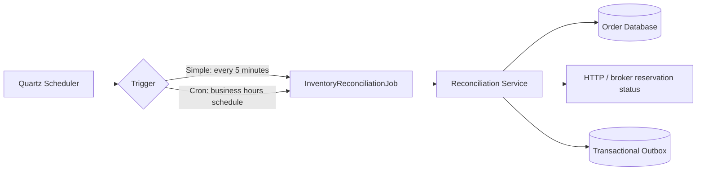
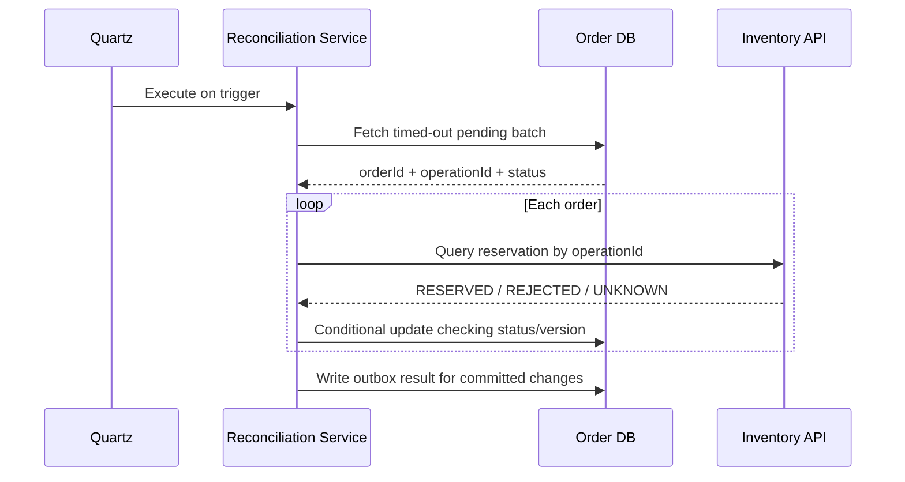

# Declaring Simple or CronTrigger Schedules

## 1. Problem Statement and Expected Outcomes

A Spring Boot application does not always process work triggered by an HTTP request or a broker message. Many tasks must be initiated **on a schedule**: sweeping overdue orders, synchronizing data with partner systems, reconciling incomplete transactions, purging caches, or generating end-of-day reports. When requirements go beyond a simple `@Scheduled` task, **Quartz Scheduler** helps manage jobs, triggers, firing times, missed schedules, and database-backed schedule persistence.

This lesson belongs to the **Quartz** chapter of the **SPRING_BOOT_INTEGRATION** module. The module explores system integration in Spring Boot via HTTP clients, databases, caches, message brokers, and Spring Integration adapters, focusing on **configuration management, data contracts, transactions, error handling, deduplication, testing, and observability**. Therefore, scheduling must be paired with side-effect controls: Quartz decides when to invoke a job, but **does not automatically guarantee** that partner HTTP requests, SQL transactions, and broker events all succeed exactly once.

After this lesson, you will be able to:

- Distinguish `Job`, `JobDetail`, `Trigger`, `SimpleTrigger`, `CronTrigger`, `JobKey`, and `TriggerKey`.
- Declare a job using an interval-based schedule or a cron expression in Spring Boot.
- Explain Quartz cron (seconds, `?`, time zones), daylight saving time (DST) risks, and misfire options.
- Design jobs for long execution times, overlapping runs, restarts, and multi-instance deployments with RAM/JDBC job stores.
- Test trigger firing times and business logic without waiting a full day or calling production dependencies.

> **Version scope:** Examples target **Java 17+, Spring Boot 3.2+, and Quartz 2.x** with dependencies managed by the Spring Boot parent/BOM. Quartz cron is not completely identical to Linux cron or Spring `@Scheduled`; when changing versions, check the `org.quartz` APIs and corresponding properties. Java snippets omit imports to focus on configuration.

### Running Scenario: Reconciling Pending Orders

**Order Service** stores orders in the `PENDING_RESERVATION` state in PostgreSQL. When a reservation request has been sent over HTTP or a broker but the response is lost, you should not assume the reservation failed. An **`InventoryReconciliationJob`** finds orders waiting too long, queries reservation status using a **stable operation ID**, updates the database, and optionally records an outbox event.

There are two scheduling needs:

1. **Option A – Simple schedule:** reconcile every 5 minutes from the trigger's start time.
2. **Option B – CronTrigger:** reconcile at minutes `0, 15, 30, 45` during business hours, Monday through Friday, in the organization's time zone.

These two options are **alternatives** for the same job; do not declare both triggers unless you intentionally want the job fired by two schedules.



The diagram shows two trigger **options** and does not imply both are active simultaneously. Quartz is responsible for deciding when to call `Job.execute`; the service decides which orders to reconcile, how to remain retry-safe, and how to handle errors.

## 2. Job and Trigger Structure in Quartz

| Component | Role | Example |
|---|---|---|
| `Job` | Defines the logic invoked by Quartz when due | `InventoryReconciliationJob` |
| `JobDetail` | Defines the job class, identity, and job data | `inventoryReconcileJob` |
| `JobKey` | Logical identifier of a job via **name + group** | `("inventoryReconcileJob", "integration")` |
| `Trigger` | Defines firing times and target job | `inventorySimpleTrigger` |
| `TriggerKey` | Identifier of a trigger via **name + group** | `("inventorySimpleTrigger", "integration")` |
| `SimpleTrigger` | Fires once or repeats at a **fixed interval** | Every 5 minutes |
| `CronTrigger` | Fires at **wall-clock points** matching a Quartz cron | Every 15 minutes during business hours |
| `Scheduler` | Coordinates triggers, dispatches jobs to threads, and manages state | Scheduler configured by Spring Boot |
| `JobDataMap` | Appropriately typed parameter data passed by Quartz to the job | Tenant ID, batch size, operation label |

One `JobDetail` can be associated with **multiple triggers**. Each time a trigger fires, Quartz executes the `JobDetail`; the job object may be instantiated by a `JobFactory`. Never treat an instance of the job class as a place to store business state across executions.

### 2.1. `startNow()` Does Not Mean the Job Runs Inside the Bean Factory Method

In `TriggerBuilder`, `startNow()` sets the start time to when the trigger is created. The job actually executes when **the scheduler is started, the trigger is registered, and a thread is available**. If the scheduler has `auto-startup=false` or is not yet connected to the JDBC job store, the first run may arrive late or follow misfire policy rules.

### 2.2. Wall-Clock Points, Intervals, and Time Zones

**SimpleTrigger** schedules relative intervals between firings, suitable for periodic polling/reconciliation. **CronTrigger** matches hour/minute/day points in a **time zone**, suitable for reporting or business-hour schedules. If you need "5 minutes after the previous run finishes" rather than a fixed schedule, re-evaluate the requirement: fixed-interval triggers do not inherently wait for completion before counting again.

### 2.3. How Does Quartz Differ from `@Scheduled`?

Spring `@Scheduled` fits small tasks with simple schedules inside a single application; `@Scheduled(cron=...)` uses Spring's cron syntax and scheduler mechanism, **not Quartz CronTrigger**. Quartz is useful when you need `JobDetail`, independent triggers, schedule persistence, misfire handling, or JDBC-based cluster scheduling.

| Requirement | `@Scheduled` | Quartz |
|---|---|---|
| Run tasks at periodic times | Yes | Yes |
| Job/trigger identities and schedule manipulation | Not Quartz-model based | `JobKey`/`TriggerKey`, Scheduler API |
| Simple interval / cron | Spring's mechanism | `SimpleTrigger`/`CronTrigger` |
| Granular misfire management | Differs from Quartz | Per-trigger-type policies |
| Persist schedule state in a JDBC job store | Not a default `@Scheduled` feature | Supported with Quartz JDBC JobStore |
| Cluster coordinating a trigger across nodes | Requires another solution | Supported with JDBC JobStore and proper clustering |

Quartz **does not make I/O tasks faster**. If a job calls REST APIs, databases, or brokers, you must still design timeouts, retries, idempotency, and concurrency limits.

## 3. Dependencies and Spring Boot Configuration

### 3.1. Maven / Gradle

With Maven using Spring Boot parent/BOM:

```xml
<dependencies>
    <dependency>
        <groupId>org.springframework.boot</groupId>
        <artifactId>spring-boot-starter-quartz</artifactId>
    </dependency>

    <dependency>
        <groupId>org.springframework.boot</groupId>
        <artifactId>spring-boot-starter-test</artifactId>
        <scope>test</scope>
    </dependency>
</dependencies>
```

Equivalent in Gradle Kotlin DSL:

```kotlin
dependencies {
    implementation("org.springframework.boot:spring-boot-starter-quartz")
    testImplementation("org.springframework.boot:spring-boot-starter-test")
}
```

The Quartz starter integrates the Scheduler into the Spring Boot lifecycle, including auto-configuring `SchedulerFactoryBean` and detecting matching `JobDetail`, `Trigger`, or `Calendar` beans in the context. In standard cases, you do not need to call `new StdSchedulerFactory()` manually, as that creates an independent scheduler outside Spring Boot's configuration and lifecycle.

### 3.2. Configuring the Schedule as an Application Contract

```yaml
# application.yml — option for simple interval execution
spring:
  quartz:
    auto-startup: true
    job-store-type: memory
    properties:
      org.quartz.threadPool.threadCount: 5

integration:
  reconcile:
    mode: simple
    interval-minutes: 5
    # When choosing mode: cron, provide:
    cron: "0 0/15 9-17 ? * MON-FRI"
    zone: Asia/Ho_Chi_Minh
```

- `spring.quartz.auto-startup` controls whether the scheduler starts automatically.
- `spring.quartz.job-store-type=memory` uses RAMJobStore, which does not persist schedules across restarts; suitable for demos or tasks that do not need schedule recovery.
- `org.quartz.threadPool.threadCount` caps the number of threads executing jobs in that specific Quartz scheduler, **not** database connection pools or broker consumers.
- `integration.reconcile.mode` is a **custom application property**, not a built-in Quartz property. It will be used with `@ConditionalOnProperty` to register only **one** trigger.
- `cron` and `zone` here represent the organization's schedule points; cron schedules require careful handling of time zones and DST.

When running multiple instances with RAMJobStore, **each instance has its own scheduler and schedule**, so the same job logic can run on every instance. RAMJobStore **does not** cluster automatically. If the goal is a clustered scheduler coordinating work, use JDBC JobStore with clustering configured and an appropriate database (see Section 8).

## 4. Building a Job Decoupled from Business Logic

### 4.1. Interface to Isolate Reconciliation Logic

The job should be a thin orchestrator. The service layer is responsible for reading the database, querying external status, and making idempotent decisions.

```java
// InventoryReconciliationService.java
public interface InventoryReconciliationService {
    void reconcilePendingReservations();
}
```

In a real application, the implementation can process in batches using short transactions, query pending orders by status/time window, and call HTTP clients with timeouts or emit reconciliation broker events. Avoid holding a long SQL transaction open across HTTP calls.

### 4.2. Quartz Job

```java
// InventoryReconciliationJob.java — imports omitted
@DisallowConcurrentExecution
public class InventoryReconciliationJob extends QuartzJobBean {

    @Autowired
    private InventoryReconciliationService reconciliationService;

    @Override
    protected void executeInternal(JobExecutionContext context)
            throws JobExecutionException {
        try {
            reconciliationService.reconcilePendingReservations();
        } catch (RuntimeException ex) {
            throw new JobExecutionException(
                    "Inventory reconciliation failed", ex);
        }
    }
}
```

`QuartzJobBean` is a Spring helper; `JobExecutionContext` and `JobExecutionException` belong to Quartz. `@DisallowConcurrentExecution` asks Quartz not to run multiple executions of **the same `JobDetail`/`JobKey`** concurrently within the scheduler or supported clustered job store; it **does not** prevent other jobs from touching the same SKU/order in external systems. Business deduplication at the database layer is still required.

In the example, `reconciliationService` is injected by Spring when the job instance is created by an **autowiring-capable JobFactory**, such as Spring Boot's default Quartz integration. If the application replaces `JobFactory` or manually initializes the Quartz scheduler, you must configure dependency injection explicitly or use `SchedulerContext`/adapters by design; never assume every `Job` is a Spring singleton.

Errors are wrapped in `JobExecutionException` so Quartz records failure information. By default, **throwing an exception does not mean Quartz automatically retries with backoff**. Do not use `setRefireImmediately(true)` for transient downstream errors without limits and idempotency; retry policies across the application/broker/trigger must be explicitly designed.

### 4.3. `JobDetail` with Stable Identity

```java
// ReconciliationQuartzConfiguration.java — imports omitted
@Configuration(proxyBeanMethods = false)
public class ReconciliationQuartzConfiguration {

    @Bean
    JobDetail inventoryReconcileJobDetail() {
        return JobBuilder
                .newJob(InventoryReconciliationJob.class)
                .withIdentity("inventoryReconcileJob", "integration")
                .withDescription("Reconcile pending inventory reservations")
                .storeDurably()
                .build();
    }
}
```

`storeDurably()` allows Quartz to keep the JobDetail even when no trigger is attached; it **does not automatically turn RAMJobStore into persistent storage across restarts**. When JDBC JobStore is needed, configure persistence and Quartz schema.

`withIdentity(name, group)` creates a stable key. With JDBC JobStore, changing name/group without migration can leave old jobs/triggers behind alongside the new definition. Version and manage identity changes as production schedule changes.

## 5. Option A: Declaring SimpleTrigger

`SimpleTrigger` fits tasks that run **once** or repeat at regular intervals without tying to wall-clock business hours/days. For reconciling pending reservations, "every 5 minutes" is a classic example.

### 5.1. Repeating Forever Every 5 Minutes

Add the trigger bean to the `ReconciliationQuartzConfiguration` class where `JobDetail` is declared:

```java
@Bean
@ConditionalOnProperty(
        prefix = "integration.reconcile",
        name = "mode",
        havingValue = "simple",
        matchIfMissing = true
)
SimpleTrigger inventorySimpleTrigger(
        JobDetail inventoryReconcileJobDetail,
        @Value("${integration.reconcile.interval-minutes:5}")
        int intervalMinutes
) {
    if (intervalMinutes <= 0) {
        throw new IllegalArgumentException(
                "interval-minutes must be greater than 0");
    }

    return TriggerBuilder.newTrigger()
            .forJob(inventoryReconcileJobDetail)
            .withIdentity("inventorySimpleTrigger", "integration")
            .startNow()
            .withSchedule(
                    SimpleScheduleBuilder.simpleSchedule()
                            .withIntervalInMinutes(intervalMinutes)
                            .repeatForever()
                            .withMisfireHandlingInstructionNextWithRemainingCount()
            )
            .build();
}
```

| Builder call | Effect |
|---|---|
| `forJob(jobDetail)` | Links the trigger to the target job |
| `withIdentity(...)` | Sets a stable name/group for the trigger |
| `startNow()` | Sets the start time to when the trigger is created |
| `withIntervalInMinutes(5)` | Defines a nominal 5-minute repeat interval |
| `repeatForever()` | Allows repeating indefinitely until replaced/unscheduled or reaching an end condition |
| `withMisfireHandlingInstructionNextWithRemainingCount()` | On misfire, adjusts the schedule to the next firing according to SimpleTrigger rules without catching up all missed runs |

**Important:** Because `startNow()` sets the anchor when the trigger bean is created, the initial repetition aligns with **the trigger's start time**, not necessarily the exact minute the scheduler starts. If the scheduler starts late, the misfire policy may adjust firing times. Nor does this example guarantee Quartz executes the job at exact 5-minute intervals under all load conditions: thread pools, database latency, and misfires can affect timing.

If a job runs longer than the interval, the next firing may become due before the previous one finishes. `@DisallowConcurrentExecution` prevents overlapping runs for the same `JobKey`, but due runs may be delayed or classified as misfires depending on the configured threshold.

### 5.2. One-Time or Bounded Runs

Once at a specific instant:

```java
Trigger oneTime = TriggerBuilder.newTrigger()
        .forJob(inventoryReconcileJobDetail)
        .withIdentity("inventoryOneTime", "integration")
        .startAt(Date.from(
                Instant.parse("2027-01-01T00:00:00Z")))
        .build();
```

Omitting `withSchedule(...)` creates a simple trigger for a single firing at `startAt`. The timestamp in this example is a **UTC instant**; displaying it in local time does not change the instant.

A finite schedule with three repeats **after the first run**:

```java
SimpleScheduleBuilder finite = SimpleScheduleBuilder
        .simpleSchedule()
        .withIntervalInSeconds(30)
        .withRepeatCount(3);
```

The nominal total number of firings is **4** (one initial run + three repeats), before accounting for misfires or scheduler shutdown. This is a common off-by-one mistake when reading `repeatCount`.

If the goal is "run on a given date and stop," use a single-shot trigger with `startAt`. If the goal is "every 5 minutes until end of day," add `endAt` or design a specific time-based schedule.

### 5.3. Is SimpleTrigger a Fixed-Delay Schedule?

Not by default. `SimpleTrigger` intervals are measured by **trigger schedule**, not "wait 5 minutes after the previous run finishes." If a service needs a fixed rest interval after **the previous completion**, you can reschedule the trigger upon completion or use another coordination pattern, while handling crashes/restarts and persistent state. Do not use `repeatForever` and describe it as completion-based fixed-delay.

## 6. Option B: Declaring CronTrigger

`CronTrigger` fits requirements tied to **clocks and calendars**: top of the hour, business days, first day of the month, or reporting windows.

### 6.1. Quartz Cron Has 6 or 7 Fields

A Quartz cron expression typically has **6 required fields** and an **optional year** field:

```text
second  minute  hour  day-of-month  month  day-of-week  [year]
  0      0/15   9-17       ?          *      MON-FRI
```

Example: `0 0/15 9-17 ? * MON-FRI` means at **second 0**, every 15 minutes (0, 15, 30, 45), during hours 09 through 17, Monday through Friday, in the trigger's time zone.

| Position | Example | Meaning |
|---|---|---|
| Second | `0` | At second 0 |
| Minute | `0/15` | Minutes 0, 15, 30, 45 |
| Hour | `9-17` | Hours 09–17, **inclusive of 17** |
| Day of month | `?` | No condition specified in this field |
| Month | `*` | Every month |
| Day of week | `MON-FRI` | Monday through Friday |
| Year (optional) | Omitted | No year restriction |

In Quartz cron, `?` is typically used in either **day-of-month** or **day-of-week** when not constraining that field. Do not treat `?` as equivalent to the `*` wildcard in every context. Quartz also supports `L`, `W`, and `#` with specific semantics; complex expressions should be tested with `CronExpression` before production use.

### 6.2. CronTrigger Bean with Explicit Time Zone

Add the bean below to the **same** `ReconciliationQuartzConfiguration` class:

```java
@Bean
@ConditionalOnProperty(
        prefix = "integration.reconcile",
        name = "mode",
        havingValue = "cron"
)
CronTrigger inventoryCronTrigger(
        JobDetail inventoryReconcileJobDetail,
        @Value("${integration.reconcile.cron}")
        String cronExpression,
        @Value("${integration.reconcile.zone:Asia/Ho_Chi_Minh}")
        String zone
) {
    TimeZone timeZone = TimeZone.getTimeZone(ZoneId.of(zone));

    CronScheduleBuilder schedule = CronScheduleBuilder
            .cronSchedule(cronExpression)
            .inTimeZone(timeZone)
            .withMisfireHandlingInstructionDoNothing();

    return TriggerBuilder.newTrigger()
            .forJob(inventoryReconcileJobDetail)
            .withIdentity("inventoryCronTrigger", "integration")
            .withSchedule(schedule)
            .build();
}
```

In `application.yml`, update:

```yaml
integration:
  reconcile:
    mode: cron
    cron: "0 0/15 9-17 ? * MON-FRI"
    zone: Asia/Ho_Chi_Minh
```

Because of the two `@ConditionalOnProperty` annotations, `mode=simple` registers only `SimpleTrigger`, and `mode=cron` registers only `CronTrigger`. `JobDetail` remains a single shared bean. If an unsupported `mode` value is supplied, **no trigger at all** may be registered; production systems should validate configuration with `@ConfigurationProperties`, operational runbooks, or startup checks to catch this early.

If you intentionally want to support **both** triggers, explicitly account for the same `JobDetail` firing twice close together; control overlapping schedules, identities, misfires, and idempotency accordingly.

### 6.3. Common Cron Examples

| Requirement | Quartz cron | Notes |
|---|---|---|
| Daily at 02:30 | `0 30 2 * * ?` | Depends on time zone and DST |
| 08:00 Monday to Friday | `0 0 8 ? * MON-FRI` | In the trigger's time zone |
| 00:00 first day of month | `0 0 0 1 * ?` | According to local calendar |
| Every 5 minutes | `0 0/5 * * * ?` | Matches clock minutes, unlike relative SimpleTrigger anchor |
| Every 15 minutes during 09–17 business days | `0 0/15 9-17 ? * MON-FRI` | Includes 17:45 |

**Do not copy Linux cron expressions blindly.** Unix cron typically has five fields, and Spring `@Scheduled` also has its own rules and macros; Quartz requires seconds and specific special characters. For example, Linux-style `0 0 * * *` is not a valid full Quartz expression.

### 6.4. Time Zones and DST Can Shift Schedules

A trigger's time zone must be configured deliberately. `Asia/Ho_Chi_Minh` does not observe DST in modern times, but multinational systems may run schedules in `America/New_York` or `Europe/Berlin`. During daylight saving transitions:

- A local hour may **not exist** on the spring-forward day. A cron for "02:30 daily" may not fire as expected that day.
- A local hour may **occur twice** when clocks fall back. Verify how the scheduler and business contract handle duplicate clock times rather than guessing from the expression.
- Local wall-clock schedules **do not guarantee** exact 24-hour intervals between every firing.

If you need exact UTC alignment or strict 24-hour intervals regardless of local calendars, design schedules using UTC or appropriate intervals. If you need "close books every business day," implement a business date model, holiday calendar, and guard against running twice on the same date. A cron expression does not automatically know your organization's public holidays.

## 7. Misfires: What Happens When a Job Misses Its Scheduled Time?

**Misfire** occurs when a trigger is past due beyond the JobStore's misfire threshold—for instance due to scheduler downtime, JVM restart, unavailable JDBC database, or busy worker pools. Quartz provides different misfire instructions per trigger type. Handling a misfire does not necessarily mean catching up **every** missed firing.

| Trigger | Example Policy | Design Meaning |
|---|---|---|
| `CronTrigger` | `withMisfireHandlingInstructionDoNothing()` | Ignore missed times, wait for the next cron firing |
| `CronTrigger` | `withMisfireHandlingInstructionFireAndProceed()` | Fire once after misfire, then continue normal cron schedule |
| `SimpleTrigger` | `withMisfireHandlingInstructionNextWithRemainingCount()` | Advance to next scheduled time, adjusting remaining repeat count per rules |
| `SimpleTrigger` | `withMisfireHandlingInstructionNowWithExistingCount()` | Fire promptly after misfire and continue counting per rules |
| Any | SMART_POLICY (default varies by type) | Quartz applies its type-specific default strategy; check documentation per trigger |

In the **pending order reconciliation** scenario, skipping several intervals and scanning all pending state on the next run is acceptable. Choosing `DoNothing()` for CronTrigger prevents burst backlogs after an outage. However, for **generating daily financial reports**, skipping a day may be unacceptable; store business dates and run controlled backfills rather than assuming a "fire now" misfire policy guarantees every day is processed.

### 7.1. Misfire Behavior Example After One Hour of Downtime

Suppose cron is `0 0/15 * * * ?` and the scheduler is down from 10:02 to 11:08. The 10:15, 10:30, 10:45, and 11:00 firings passed:

- `DoNothing`: in principle does not catch up missed times; waits for the next point, e.g., 11:15 (depending on time zone and scheduler state).
- `FireAndProceed`: fires once near recovery time and then resumes future points. **It does not fire four times** just because four points were missed.

Exact behavior also depends on the misfire threshold, trigger state, calendar/scheduler configuration, and recovery timestamp. Before relying on a policy in production, write integration tests simulating pause/restart against your actual job store.

### 7.2. Misfires Differ from Business Retries

A cron firing on time while the HTTP client returns `503` is a **job execution failure**, not a misfire in the sense of an untriggered schedule. Quartz does not automatically retry HTTP requests with exponential backoff simply because `JobExecutionException` is thrown. Classify failures clearly:

- **Transient errors:** timeouts, HTTP `503`, temporarily saturated pools; perform bounded retries in the adapter/service or let the next trigger run reconcile again.
- **Permanent errors:** invalid payloads, revoked credentials, schema mismatches; send to alerts/quarantine instead of retrying infinitely.
- **Unknown outcomes:** timeout after a downstream write; query status via operation ID before retrying.

Do not use misfire instructions to replace dead-letter queues, idempotency, or transactional outboxes.

## 8. RAMJobStore, JDBC JobStore, and Multiple Instances

### 8.1. When Is RAMJobStore Enough?

`spring.quartz.job-store-type=memory` is appropriate for:

- Labs, proofs of concept, or tasks whose entire schedule can be recreated after restart.
- Lightweight jobs that re-scan pending state from a database and do not need to remember individual trigger firings.
- **Single-instance** environments or cases where multiple instances running the job simultaneously is explicitly acceptable.

RAMJobStore keeps schedules in **JVM memory**. When the application restarts, Spring-declared `JobDetail`/`Trigger` beans are re-registered; dynamically created/modified schedules without an external source may disappear. Two replicas with RAMJobStore **do not share schedules or execution state**.

### 8.2. JDBC JobStore for Schedule Persistence and Clustering

When running multiple application instances and needing Quartz to coordinate firing of **one logical trigger** across a scheduler cluster, use JDBC JobStore with a properly managed database:

```yaml
# application-prod.yml — example with a valid PostgreSQL DataSource
spring:
  datasource:
    url: ${APP_JDBC_URL}
    username: ${APP_DB_USERNAME}
    password: ${APP_DB_PASSWORD}

  quartz:
    job-store-type: jdbc
    jdbc:
      initialize-schema: never
    auto-startup: true
    overwrite-existing-jobs: false
    properties:
      org.quartz.scheduler.instanceName: inventoryReconcileScheduler
      org.quartz.scheduler.instanceId: AUTO
      org.quartz.jobStore.isClustered: true
      org.quartz.jobStore.clusterCheckinInterval: 20000
      org.quartz.threadPool.threadCount: 5
```

**Mandatory prerequisites:**

1. A valid **JDBC DataSource** compatible with Quartz and the database, plus the corresponding JDBC driver. Do not confuse `spring.r2dbc.url` with `spring.datasource.url`: Quartz JDBC JobStore relies on JDBC.
2. Quartz tables (`QRTZ_*` by default prefix) must be created using a schema matching the **database vendor and Quartz version**. Manage via migrations or reviewed scripts.
3. All nodes in **the same Quartz cluster** share the same database/table prefix and `instanceName`, while each node has a unique `instanceId` (e.g., `AUTO`). Node clocks must be synchronized.
4. Set `org.quartz.jobStore.isClustered=true` whenever multiple schedulers share the same job store; **never** let independent instances share tables with inconsistent cluster settings.
5. Understand connection pool sizing, DB max connections, transaction isolation/locks, and trigger recovery needs after node failures.

With Spring Boot, `job-store-type: jdbc` lets auto-configuration integrate Quartz with the `DataSource`. Do not blindly copy `org.quartz.jobStore.class` from plain Quartz examples, as it can conflict with Spring Boot's `LocalDataSourceJobStore` configuration. When using `@QuartzDataSource` or multiple datasources, explicitly define which datasource and transaction manager Quartz uses.

**Migration warning:** Never enable `spring.quartz.jdbc.initialize-schema=always` in production without understanding Boot's scripts: Quartz initialization scripts often **drop existing tables and schedule data**. Use `never` after migrations guarantee tables exist, or use a dedicated provisioning workflow for fresh environments.

### 8.3. What Does a Quartz Cluster Actually Guarantee?

In a properly configured Quartz JDBC cluster, scheduler nodes coordinate to acquire the right to fire a trigger in shared tables. This avoids having the same trigger scheduled concurrently across nodes compared to independent RAMJobStores. However:

- If a node calls HTTP or writes SQL and crashes before Quartz finishes updating the execution record, there is still an **uncertain business outcome**; recovery/re-firing depends on job details and settings.
- Another job with a different `JobKey` can still process the same set of orders.
- Manual admin actions, broker events, or HTTP client retries can introduce duplicate processing **outside Quartz**.
- "Cluster fires once" does not mean **exactly-once side effects on databases, brokers, or HTTP endpoints**.

For critical mutations, add business locks, unique constraints/operation IDs, optimistic locks, or leases in the database. For long-running jobs, consider recovery/timeouts and avoid holding DB transactions open too long.

### 8.4. Bean-Declared Schedules vs. Existing Schedules in JDBC Store

With a JDBC job store, stored `JobDetail`/`Trigger` definitions persist across restarts. The `spring.quartz.overwrite-existing-jobs` property controls whether Spring Boot overwrites existing JobDetail/Trigger definitions during scheduler initialization.

- Keep `false` to preserve schedules modified at runtime via the Scheduler API.
- Set `true` **only when** you intentionally want Spring configuration to be the source of truth and understand how cron/interval edits affect persisted schedules.
- When changing `JobKey`, `TriggerKey`, job data structure, or group names, perform a **controlled migration/cleanup** instead of merely changing constants in code.

Never assume editing `application.yml` is enough to update existing schedules in a JDBC store. Verify `Scheduler.getTrigger(...)`, next fire time, and schedule audit logs after deployment.

## 9. Overlapping Runs, Duplicates, and Idempotency

### 9.1. Limitations of `@DisallowConcurrentExecution`

Suppose `reconcilePendingReservations()` takes 8 minutes while `SimpleTrigger` repeats every 5 minutes. Without concurrency protection, runs could overlap and process the same `PENDING_RESERVATION` order simultaneously.

`@DisallowConcurrentExecution` tells Quartz not to run executions of **the same `JobKey`** concurrently per scheduler/job store rules. However, it **does not** replace:

- Database locks/transactions preventing different tasks from updating the same order concurrently.
- Deduplication across two independent RAM schedulers on separate replicas.
- Protection against duplicates from HTTP retries, broker redeliveries, manual triggers, or renamed JobKeys.
- Deadlines for jobs hung indefinitely on downstream calls.

To persist state variables in `JobDataMap` across runs, Quartz provides `@PersistJobDataAfterExecution`. Even so, `JobDataMap` is unsuitable for critical transaction state; use a database with proper locks, constraints, and transactions. With JDBC job store, avoid storing Spring beans/connections/clients in `JobDataMap` due to serialization, class upgrade, and compatibility risks.

### 9.2. Designing Idempotent Reconciliation

A reconciliation job should work in **bounded batches**, such as fetching up to 100 timed-out `PENDING_RESERVATION` orders. A single run does not have to process the entire dataset every time.



**Key principles:**

1. Keep `operationId` stable across HTTP retries, broker redeliveries, and Quartz runs.
2. Query status **using the recorded ID**; if the endpoint only supports creating reservations, do not issue a new creation request on every cron run.
3. Use conditional updates like `UPDATE ... WHERE status='PENDING_RESERVATION'`, `version` checks, or claim/lease mechanisms so multiple workers cannot finalize the same order twice.
4. Any ambiguous outcome must stay in `UNKNOWN/PENDING_RECONCILIATION` for later reconciliation rather than treating a timeout as failure.
5. When publishing events via a broker, insert the **outbox row in the same SQL transaction** as the order status update. The outbox worker publishes asynchronously and downstream consumers remain idempotent.

Example conditional SQL update ensuring a transition only succeeds while the record is still pending:

```sql
UPDATE orders
   SET status = 'RESERVED',
       updated_at = CURRENT_TIMESTAMP
 WHERE order_id = :orderId
   AND operation_id = :operationId
   AND status = 'PENDING_RESERVATION';
```

If affected rows = 0, read the current state to determine why: already processed, already canceled, missing, or updated by another worker. **Do not emit the result event twice** just because SQL ran again. You can add a unique key on outbox events by operation ID + event type to guard against duplicates.

### 9.3. Quartz Transactions Are Not Business Transactions

Quartz JDBC JobStore uses transactions to manage **schedules and trigger states**. Transactions of `OrderRepository`, HTTP calls, Redis caches, or RabbitMQ/Kafka publishes **do not automatically join** that transaction.

If a job performs three steps—"call Inventory → update orders → send event"—crashes or lost responses can still occur between steps. Quartz only knows whether the execution succeeded or failed at the scheduler level. Use outboxes, idempotency, result events, compensating/reconciliation states, and alerts instead of relying on the Quartz job store for distributed transactions.

### 9.4. Retries and Concurrent Job Limits

`org.quartz.threadPool.threadCount` does not replace HTTP connection limits, database connection pools, or broker consumer concurrency. If 10 Quartz jobs each process 100 orders in parallel, total outbound requests can be huge even with only 5 scheduler threads. Set batch sizes, reactive pipeline/executor concurrency, deadlines, and rate limits according to downstream capacity.

Transient errors can be handled with a few retries using backoff and jitter in the adapter, or left for the next Quartz run to reconcile; avoid simultaneously retrying in the HTTP client, retrying in the job, and redelivering in the broker without a shared budget. For write operations, timeouts can happen **after the server commits**, so retry policies must respect idempotency.

## 10. Testing SimpleTrigger and CronTrigger

### 10.1. Testing Cron Expressions with Fixed Timestamps

Do not write tests that wait until 09:00 the next day to verify a cron expression. Quartz provides `CronExpression` to compute the next fire time after a fixed `Date`.

```java
// ReconciliationCronTest.java — imports omitted
class ReconciliationCronTest {

    @Test
    void nextFireIsTheNextQuarterHourInBusinessTimezone()
            throws ParseException {
        CronExpression cron = new CronExpression(
                "0 0/15 9-17 ? * MON-FRI");
        cron.setTimeZone(
                TimeZone.getTimeZone(
                        ZoneId.of("Asia/Ho_Chi_Minh")));

        // 2026-11-20 (Friday), 10:07 Vietnam time.
        Date after = Date.from(
                Instant.parse("2026-11-20T03:07:00Z"));
        Date next = cron.getNextValidTimeAfter(after);

        assertNotNull(next);
        assertEquals(
                Instant.parse("2026-11-20T03:15:00Z"),
                next.toInstant());
    }

    @Test
    void invalidCronIsRejected() {
        assertFalse(CronExpression.isValidExpression(
                "0 0 * * *")); // 5-field Unix style, missing field
    }
}
```

This test verifies **how the Quartz parser evaluates** the given expression and time zone without starting Spring. It does not prove the Quartz database, thread pool, or job execution works.

Add test cases for:

- A timestamp after 17:45 on Friday jumping to Monday (unless a different cron/holiday policy applies).
- `SimpleTrigger` with `repeatCount=3` having 4 nominal firings.
- Schedules crossing DST transition days in DST-observing zones, especially 02:30 on transition days.
- Invalid cron expressions or nonexistent `ZoneId` values causing startup rejection.

### 10.2. Verifying JobDetail/Trigger Bean Registration

`@SpringBootTest` works well to verify that Spring Boot detects the beans and configures the Scheduler. Set `auto-startup=false` so tests do not fire tasks immediately when the context starts.

```java
// ReconciliationQuartzWiringIT.java — imports omitted
@SpringBootTest(
    webEnvironment = SpringBootTest.WebEnvironment.NONE,
    properties = {
        "spring.quartz.auto-startup=false",
        "spring.quartz.job-store-type=memory",
        "integration.reconcile.mode=cron",
        "integration.reconcile.cron=0 0/15 9-17 ? * MON-FRI",
        "integration.reconcile.zone=Asia/Ho_Chi_Minh"
    }
)
class ReconciliationQuartzWiringIT {

    @Autowired
    Scheduler scheduler;

    @MockBean
    InventoryReconciliationService reconciliationService;

    @Test
    void registersCronTriggerForExpectedJob()
            throws SchedulerException {
        JobKey jobKey = JobKey.jobKey(
                "inventoryReconcileJob", "integration");
        TriggerKey triggerKey = TriggerKey.triggerKey(
                "inventoryCronTrigger", "integration");

        JobDetail detail = scheduler.getJobDetail(jobKey);
        Trigger trigger = scheduler.getTrigger(triggerKey);

        assertNotNull(detail);
        assertNotNull(trigger);
        assertInstanceOf(CronTrigger.class, trigger);
        assertEquals(jobKey, trigger.getJobKey());
        assertEquals(
                "Asia/Ho_Chi_Minh",
                ((CronTrigger) trigger).getTimeZone().getID());
        assertNull(scheduler.getTrigger(
                TriggerKey.triggerKey(
                        "inventorySimpleTrigger", "integration")));
    }
}
```

`@MockBean` applies to Spring Boot 3.2–3.3 to inject a mock service into the context; in newer Spring Boot versions check `@MockitoBean`. If the application defines runners, JDBC, caches, or brokers, those beans **may still initialize** in a full context, so isolate dependencies using test profiles.

### 10.3. Testing Job Execution When the Scheduler Is Triggered

When testing that the Scheduler invokes the job and DI works, you can start a test scheduler initialized with `auto-startup=false` and fire the job manually:

```java
@Test
void schedulerInvokesInjectedService()
        throws SchedulerException {
    JobKey key = JobKey.jobKey(
            "inventoryReconcileJob", "integration");
    scheduler.start();
    try {
        scheduler.triggerJob(key);
        verify(reconciliationService, timeout(3_000))
                .reconcilePendingReservations();
    } finally {
        scheduler.standby();
    }
}
```

This test can sit inside `ReconciliationQuartzWiringIT` above. Because that test uses `mode=cron` during business hours, an automatic firing occurring right during the test run could interfere; for rock-solid tests, use a cron set **far in the future** or an isolated scheduler/test fixture, and reset mocks/cleanup state between tests.

`scheduler.triggerJob(JobKey)` requests an immediate single firing and **does not** prove the cron fires automatically on business days. To verify misfires or retries in a JDBC cluster, write dedicated integration tests against a real store and multiple schedulers rather than extrapolating from `CronExpression` unit tests.

### 10.4. Operational Test Matrix

| Scenario | What to Verify |
|---|---|
| `simple` mode | Exactly one `SimpleTrigger`, positive interval, and matching job key |
| `cron` mode | Exactly one `CronTrigger`, accurate cron/time zone |
| Invalid config | Invalid cron, unknown time zone, or `interval <= 0` rejected |
| Job executes successfully | Service invoked; outcomes logged/metered/persisted to business state |
| Service throws exception | Execution failure recorded; no false assumption of automatic retry |
| Quartz paused/restarted | Misfire policy behaves properly for Simple/Cron and business backlog |
| Job runs longer than interval | No overlap when `@DisallowConcurrentExecution` is applied on same JobKey |
| Two instances | RAM store may double-run; JDBC cluster verified to coordinate |
| Transient database error | Job does not swallow error; pending records remain for next sweep |
| HTTP timeout after external mutation | No duplicate write issued; uses operation ID and status lookup |
| JDBC schema/upgrade | Quartz tables survive restarts and match version migrations |
| Schedule change | Persisted definition updates per `overwrite-existing-jobs`/migration |

For database or broker tests, you can use Testcontainers, but use the same database engine, migrations, and state persistence mechanism. To test **JDBC job store**, do not run against H2 or RAMJobStore and assume a PostgreSQL cluster is verified; locks, cluster check-ins, and transactions must be measured in a production-like environment.

## 11. Observing and Operating Quartz

### 11.1. Key Metrics to Track

| Group | What to Measure/Log |
|---|---|
| Schedule | `JobKey`, `TriggerKey`, previous/next fire times, paused/normal/error state |
| Execution | Start counts, success/failure counts, p95/p99 duration, slow runs |
| Misfires | Misfire counts/alerts, lag from scheduled fire time to actual fire time |
| Scheduler | Thread pool, currently executing jobs, instance/cluster state, job store errors |
| JDBC store | DB latency, lock waits, connection pool, migration/schema version |
| Business | Pending orders checked, `RESERVED`/`REJECTED` counts, remaining backlog |
| Downstream | HTTP timeouts/`5xx`, broker publish confirms, outbox backlog and retries |

Quartz provides extension points such as `JobListener`, `TriggerListener`, and `SchedulerListener` to capture events. You can add Micrometer custom metrics and correlated logs by `JobKey`/execution. **Do not assume** all metrics in the table come out of the box just by adding `spring-boot-starter-quartz` or Actuator; check what instrumentation is active.

Measuring the delta between `context.getScheduledFireTime()` and `context.getFireTime()` reveals scheduling lag. However, for strict SLAs, distinguish trigger fire time from **business transaction commit time** and consumer acknowledgment time.

**Never use** `orderId`, operation ID, user ID, SKU, or per-run timestamps as high-cardinality metric tags. Logs may include correlation IDs under proper access and security policies; never log HTTP tokens, database/broker passwords, or sensitive payloads.

### 11.2. Inspecting State via the Scheduler API

```java
// Example operational inspection logic
JobKey jobKey = JobKey.jobKey(
        "inventoryReconcileJob", "integration");
TriggerKey triggerKey = TriggerKey.triggerKey(
        "inventoryCronTrigger", "integration");

JobDetail job = scheduler.getJobDetail(jobKey);
Trigger trigger = scheduler.getTrigger(triggerKey);
Trigger.TriggerState state = scheduler.getTriggerState(triggerKey);

if (job != null && trigger != null) {
    log.info("Quartz job={}, trigger={}, state={}, nextFire={}",
            jobKey, triggerKey, state, trigger.getNextFireTime());
}
```

Do not rely solely on `scheduler.getCurrentlyExecutingJobs()` on one node to conclude no job is running across the whole cluster; that call reflects the local scheduler instance. In a JDBC cluster, combine job store tables, scheduler metadata, and telemetry from every instance when investigating.

### 11.3. Common Pitfalls

| Symptom | Possible Cause | Resolution |
|---|---|---|
| No jobs running | Missing trigger, `auto-startup=false`, job/trigger unregistered | Check beans, mode, Scheduler API, startup logs |
| Runs at wrong hour | JVM/default time zone, wrong Quartz cron, DST | Set `inTimeZone`, test `CronExpression` with fixed instants |
| Runs twice on two pods | Two independent RAMJobStores with same cron | JDBC cluster or controlled idempotency/leader election |
| Overlapping jobs and data races | Missing concurrency control or multiple JobKeys | `@DisallowConcurrentExecution`, DB constraints/claims |
| New cron missing after deploy | JDBC store retains old schedule, `overwrite=false` | Controlled migration or rescheduling |
| `QRTZ_*` missing errors | Quartz migration not applied | Provision vendor/version-matched schema |
| Schedule lost after restart | Using RAMJobStore, unpersisted dynamic schedules | JDBC store or reconstructible config source |
| Job misses injected service | Custom JobFactory lacks autowire support | Verify DI and test actual execution |
| Job errors repeat without expected backoff | `JobExecutionException` does not add automatic backoff | Design dedicated retry/idempotency and misfire policies |
| Execution duration keeps growing | Slow SQL, missing HTTP timeouts, unbounded batches | Measure p95/p99, batch work, bound concurrency |
| Startup wipes persisted jobs | Destructive schema init script or renamed keys | Safe migrations, avoid indiscriminate `init=always` |

## 12. Choosing SimpleTrigger vs. CronTrigger in Real Systems

| Requirement | Recommendation | Explanation |
|---|---|---|
| Reconcile pending items every few minutes | `SimpleTrigger` or cron `0 0/5 ...` | Simple uses intervals, cron aligns to clock ticks |
| Run once at a specific instant | Simple single-shot | Use `startAt` |
| Report at 08:00 on business days | `CronTrigger` | Explicit calendar and time zone |
| Run on the first day of the month | `CronTrigger` | Set `day-of-month=1` and time zone |
| "5 minutes after previous run finishes" | Evaluate dedicated fixed-delay approach | Simple intervals do not inherently wait for completion |
| Never miss a business day across downtime | Cron + business date state and backfill | Misfires do not guarantee per-day processing |
| Multiple replicas needing persistent/coordinated schedules | JDBC JobStore + clustering | RAMJobStore does not coordinate across pods |
| Write commands must never execute twice | Add idempotency, unique constraints, outbox | Quartz does not provide end-to-end exactly-once |

### Pre-Deployment Checklist

1. Clarify whether **this job runs by interval or by wall-clock time**; never conflate "every day" with "every 24 hours."
2. Assign stable `JobKey`/`TriggerKey` names and manage schedule change lifecycles.
3. Choose a valid Quartz cron expression, IANA time zone, and verify DST/holidays.
4. Define **misfire** behavior: skip missed runs, fire once, or backfill business periods systematically.
5. Decide on RAM/JDBC job store and multi-instance policies; migrate Quartz schemas safely.
6. Bound batch sizes, execution durations, retries, transactions, and downstream request rates.
7. Prevent duplicate processing in the database, especially under crashes/restarts/manual triggers or broker redeliveries.
8. Decouple business logic from the Quartz adapter so it can be unit tested.
9. Include tests for cron logic, Spring wiring, execution, misfire/restart, and connection errors.
10. Monitor next fire time, execution latency, error rates, pending backlogs, and late-job alerts.

### Self-Check Questions

1. How do `JobDetail` and `Trigger` differ? Can one `JobDetail` have multiple `Trigger`s?
2. When should you use `SimpleTrigger` instead of `CronTrigger`?
3. How many nominal firings does `repeatCount=3` produce if there are no misfires?
4. What fields make up Quartz cron `0 0/15 9-17 ? * MON-FRI`? What is the `?` symbol for?
5. Why is a 5-minute repeating `SimpleTrigger` not inherently a 5-minute fixed-delay after job completion?
6. When a scheduler stops for one hour, how do `DoNothing` and `FireAndProceed` behave differently for `CronTrigger`?
7. Why must you configure a time zone and test DST for multi-region jobs?
8. What scope does `@DisallowConcurrentExecution` prevent overlaps in? Why are unique constraints still required?
9. How do RAMJobStore and JDBC JobStore differ with two Spring Boot instances?
10. Why is `spring.quartz.jdbc.initialize-schema=always` dangerous with persisted jobs?
11. Why does throwing `JobExecutionException` not automatically retry HTTP requests with backoff?
12. How can you test the next cron fire time without waiting until the actual clock time?
13. If the database committed but the Quartz job crashed, how do you prevent sending a reservation command twice?

**Takeaway:** **SimpleTrigger** describes a single firing or interval-based repetition; **CronTrigger** describes calendar-based clock points using Quartz syntax, time zones, and misfire policies. In Spring Boot, separate `JobDetail` and `Trigger` beans, use configuration modes to select schedules explicitly, and manage JobStores and concurrency properly. Quartz only handles **orchestrating execution timing**; a reliable integration still requires timeouts, error handling, idempotency, transactions/outbox, testing with realistic resources, and observability of business outcomes.
