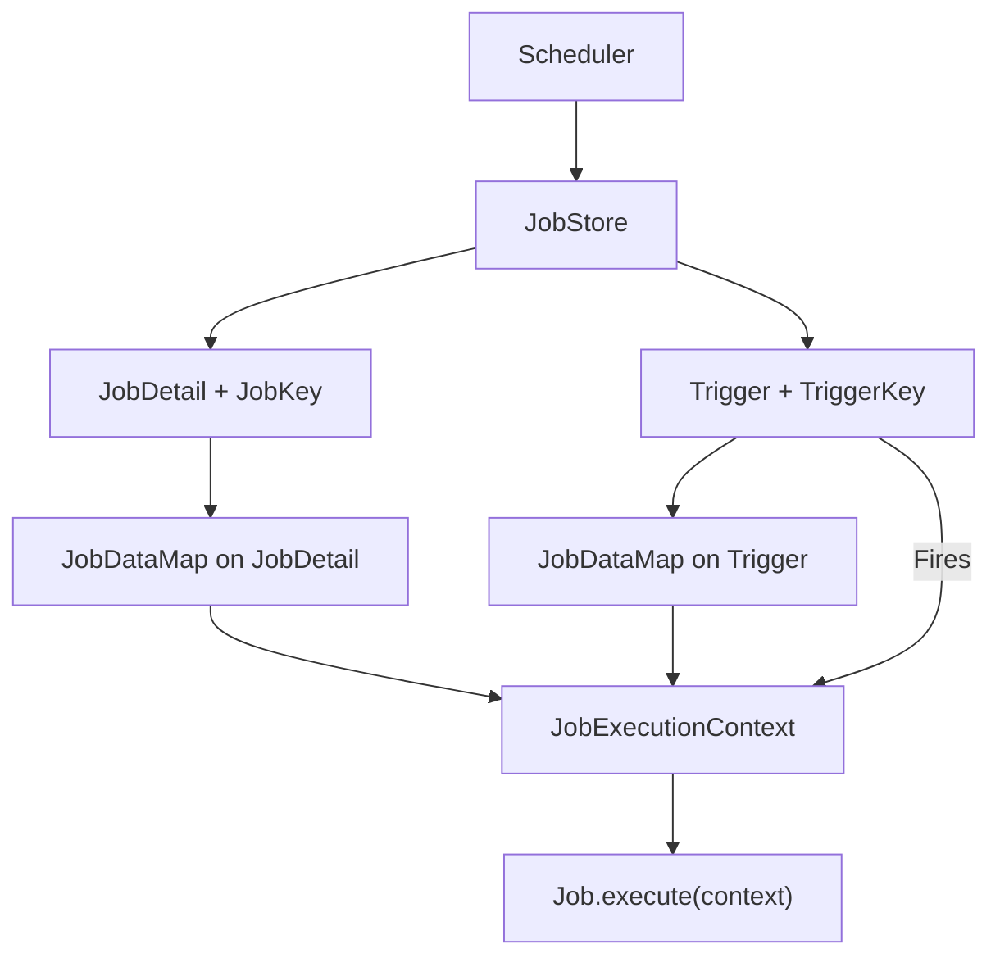
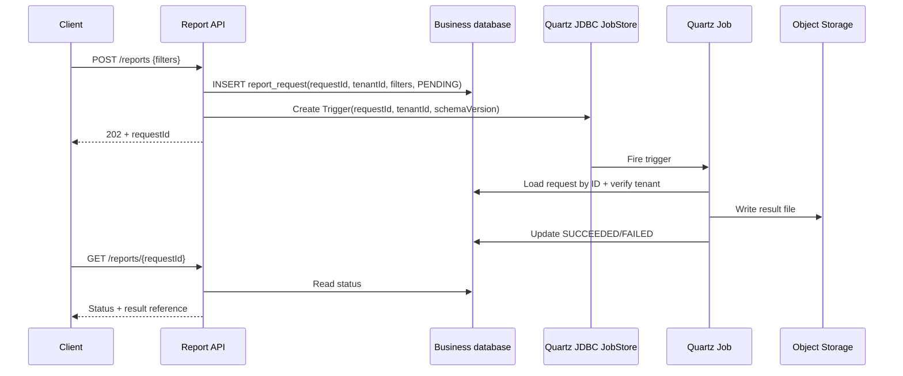
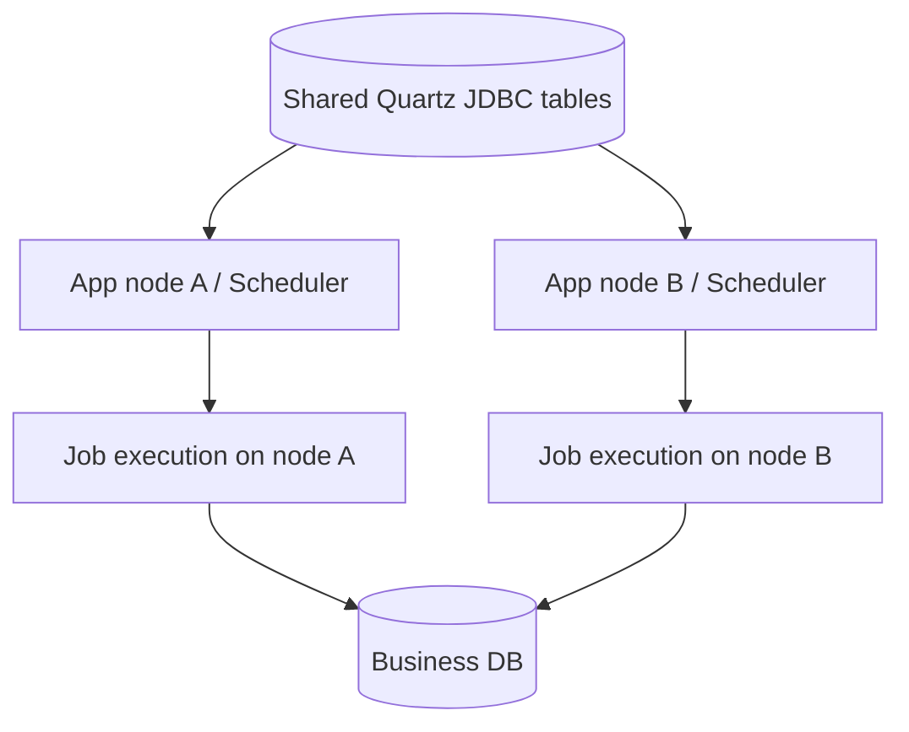
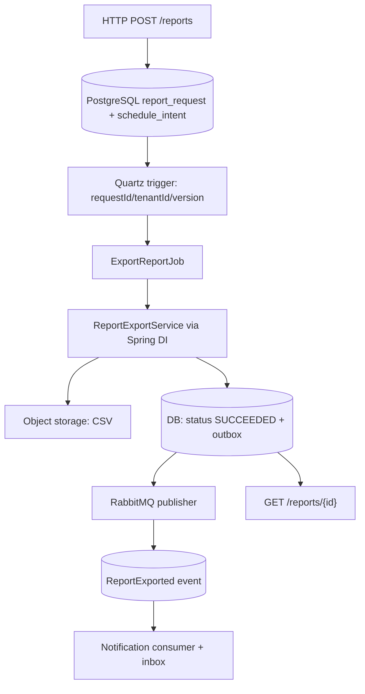

# JobDataMap, Passing Data, and Serialization Limits

## 1. Why Is JobDataMap Part of the Integration Contract?

In the **SPRING_BOOT_INTEGRATION** module, Spring Boot connects HTTP clients, databases, caches, message brokers, and Spring Integration adapters. Not every task should execute synchronously inside an HTTP request: an application may need to send a report at 02:00, reconcile transactions overnight, sweep an unpublished outbox, or retry work after a delay.

**Quartz** is a scheduler built around `Job`, `JobDetail`, `Trigger`, and `JobStore`. One question arises immediately when designing a scheduled task: *when the job runs later, how does it know which request, tenant, document, or timestamp to process?*

Quartz provides **`JobDataMap`** to attach key–value pairs to `JobDetail` and `Trigger`. However, what you put into the map determines whether the job survives restarts, runs on another instance, stays compatible with newer application versions after deployment, and protects sensitive information.

Example of an API accepting a report export request:

```text
POST /api/reports
  → save report_request(request_id, tenant_id, filters, status)
  → create Quartz trigger with JobDataMap:
       requestId = "req-1024"
       tenantId  = "tenant-17"
       schemaVersion = "1"
  → HTTP 202 Accepted + requestId

When due:
  → Quartz invokes ExportReportJob
  → Job reads requestId/tenantId from JobDataMap
  → Repository loads saved request
  → Service exports file to object storage
  → Updates status SUCCEEDED/FAILED
```

**Core principle:** `JobDataMap` is suitable for carrying **small, stable metadata that can cross the scheduler boundary**. It should never become storage for a live HTTP request, JPA entity, Spring bean, sensitive data, or full workflow state.

```mermaid
flowchart LR
    A["HTTP / Integration Gateway"] --> B["Save business request to DB"]
    B --> C["Quartz Scheduler"]
    C --> D["JobDetail + Trigger"]
    D --> E["JobDataMap: ID / version / small options"]
    E --> F["Job.execute(context)"]
    F --> G["Read DB by requestId"]
    G --> H["HTTP / DB / Redis / Broker adapters"]
    H --> I["Update durable status"]
```



This lesson uses **Spring Boot 3.x**, **Quartz 2.x**, and Java 17+. Examples primarily use `org.quartz` APIs and the Spring Boot Quartz starter. When applying to newer versions, verify property metadata and official documentation; Quartz database configuration must match your actual Quartz version and RDBMS.

## 2. Distinguishing Job, JobDetail, Trigger, JobStore, and JobDataMap

These five components are often conflated, but their responsibilities differ:

| Component | Responsibility | Example |
| --- | --- | --- |
| `Job` | Code that executes a single run | `ExportReportJob implements Job` |
| `JobDetail` | Job definition: Job class, `JobKey`, and job-level data | `export-report` in group `reports` |
| `Trigger` | Determines when to fire a job; carries `TriggerKey` and its own data | Immediate firing or nightly cron |
| `JobStore` | Manages metadata/trigger state needed by the scheduler, in RAM or JDBC | `RAMJobStore`, JDBC-based JobStore |
| `JobDataMap` | Key/value pairs passed to a JobDetail/Trigger | `requestId`, `tenantId`, `schemaVersion` |



**One `JobDetail` can be fired by multiple `Trigger`s.** Shared job-wide data belongs in the JobDetail map; data specific to a single firing/schedule belongs in the Trigger map. Quartz combines both maps when building `JobExecutionContext`.

### 2.1. JobKey and TriggerKey Differ from Business Request IDs

- `JobKey` identifies the **job definition** in the scheduler, e.g., `("export-report", "reporting")`.
- `TriggerKey` identifies the **trigger**, e.g., `("run-req-1024", "reporting")`.
- `requestId` or `eventId` is the **business ID** for deduplication and reconciliation.

Never assume `JobKey` replaces a unique constraint in the business database. Quartz knows when schedules fire; Order Service/Report Service knows whether the same business operation is allowed to execute twice.

### 2.2. Whose JobDataMap Is Persisted?

`JobDetail.getJobDataMap()` and `Trigger.getJobDataMap()` belong to scheduler metadata. When using JDBC JobStore, these maps can be persisted per JobStore policy; with RAMJobStore, data stays only in JVM memory.

`JobExecutionContext.getMergedJobDataMap()` is a **combined view for convenient reading inside the job**. It is not a workflow table sharing an automatic transaction with a PostgreSQL business database.

## 3. Creating JobDetail and Trigger with String Data

A self-contained Spring Boot example configuring a report export job. First add the starter.

### 3.1. Dependency

Maven with Spring Boot parent/BOM:

```xml
<dependency>
    <groupId>org.springframework.boot</groupId>
    <artifactId>spring-boot-starter-quartz</artifactId>
</dependency>
```

Gradle:

```groovy
dependencies {
    implementation("org.springframework.boot:spring-boot-starter-quartz")
}
```

The starter provides Quartz/Spring Boot integration and creates a `Scheduler` when auto-configuration conditions are satisfied. It **does not create production JDBC JobStore metadata tables automatically**, nor does adding the dependency provide a business workflow with retries and idempotency.

### 3.2. JobDetail with Fixed Data

```java
package example.integration.reports;

import org.quartz.JobBuilder;
import org.quartz.JobDetail;
import org.springframework.context.annotation.Bean;
import org.springframework.context.annotation.Configuration;

@Configuration
public class ReportQuartzConfiguration {

    @Bean
    JobDetail exportReportJobDetail() {
        return JobBuilder.newJob(ExportReportJob.class)
            .withIdentity("export-report", "reporting")
            .usingJobData("taskType", "EXPORT")
            .usingJobData("schemaVersion", "1")
            .storeDurably()
            .build();
    }
}
```

`storeDurably()` allows the JobDetail to remain in the scheduler even when no Trigger currently references it, per Quartz semantics. This is useful when APIs create dynamic triggers later.

**Do not confuse `storeDurably()` with surviving JVM restarts.** Whether data survives restarts depends on the `JobStore`, database, scheduler re-initialization policy, and whether configuration overwrites old definitions.

### 3.3. Trigger Passing a Per-Request ID

A service creates a trigger for the already-registered job:

```java
package example.integration.reports;

import org.quartz.JobKey;
import org.quartz.Scheduler;
import org.quartz.SchedulerException;
import org.quartz.Trigger;
import org.quartz.TriggerBuilder;
import org.springframework.stereotype.Service;

@Service
public class ReportScheduleService {

    private final Scheduler scheduler;

    public ReportScheduleService(Scheduler scheduler) {
        this.scheduler = scheduler;
    }

    public void schedule(
            String requestId,
            String tenantId) throws SchedulerException {

        Trigger trigger = TriggerBuilder.newTrigger()
            .withIdentity("run-" + requestId, "reporting")
            .forJob(JobKey.jobKey("export-report", "reporting"))
            .usingJobData("requestId", requestId)
            .usingJobData("tenantId", tenantId)
            .startNow()
            .build();

        scheduler.scheduleJob(trigger);
    }
}
```

This pattern assumes the `JobDetail` bean was registered into `Scheduler` by Spring Boot before the service schedules triggers; with a custom `SchedulerFactoryBean`, verify registration ordering. **Validate** `requestId`/`tenantId`: length, character set, tenant ownership, and prevent arbitrary client keys from bloating scheduler metadata.

`scheduler.scheduleJob(trigger)` can throw exceptions, including duplicate `TriggerKey` errors or JobStore failures. Never catch `SchedulerException` broadly and return success. If an API promises "work accepted," define a durable boundary between **saving the request and saving the trigger**.

## 4. Job Reading Data via JobExecutionContext

A Quartz Job executes when its trigger fires. Quartz passes `JobExecutionContext` to `execute(...)`.

```java
package example.integration.reports;

import org.quartz.Job;
import org.quartz.JobDataMap;
import org.quartz.JobExecutionContext;
import org.quartz.JobExecutionException;

public class ExportReportJob implements Job {

    private final ReportExportService exportService;

    public ExportReportJob(ReportExportService exportService) {
        this.exportService = exportService;
    }

    @Override
    public void execute(JobExecutionContext context)
            throws JobExecutionException {

        JobDataMap data = context.getMergedJobDataMap();

        String requestId = data.getString("requestId");
        String tenantId = data.getString("tenantId");
        String schemaVersion = data.getString("schemaVersion");

        if (requestId == null || requestId.isBlank()
                || tenantId == null || tenantId.isBlank()
                || !"1".equals(schemaVersion)) {
            throw new JobExecutionException(
                "Invalid Quartz job parameters"
            );
        }

        exportService.export(requestId, tenantId);
    }
}
```

`ReportExportService` is an application-implemented Spring service that loads the request from a repository, verifies authorization/tenant, exports the file, and updates status. With Boot Quartz auto-configuration, the Spring-managed job factory supports autowiring; if replaced by a custom `JobFactory`, **ensure Jobs are instantiated through a DI-capable mechanism**. Never put `ReportExportService` directly into `JobDataMap`.

### 4.1. Why Not Pass the Entire ExportRequest?

A DTO can contain numerous filters, thousands of IDs, attachments, or sensitive information. Putting the full object into `JobDataMap` creates problems:

- RAMJobStore can hold references to mutable objects inside the same JVM.
- JDBC JobStore may require Java serialization or reject the object depending on configuration.
- Renaming the DTO class/package after deployment can prevent old jobs from deserializing.
- Sensitive data can end up in scheduler tables or exception logs.
- The map may be serialized/deserialized repeatedly on every persist/fire, adding unnecessary overhead.

Instead, store **`requestId`** and load the payload from a store with its own schema, versioning, and lifecycle. Quartz only carries enough information to know "what to process."

## 5. Two JobDataMaps: Job-Level and Trigger-Level

Quartz supports a map on `JobDetail` and a map on `Trigger`. Inside a job execution, you can access:

```java
JobDataMap jobData =
    context.getJobDetail().getJobDataMap();

JobDataMap triggerData =
    context.getTrigger().getJobDataMap();

JobDataMap merged =
    context.getMergedJobDataMap();
```

Example:

```text
JobDetail map:
  taskType      = EXPORT
  schemaVersion = 1
  format        = CSV

Trigger map:
  requestId     = req-1024
  tenantId      = tenant-17
  format        = JSON

Merged map:
  taskType      = EXPORT
  schemaVersion = 1
  format        = JSON
  requestId     = req-1024
  tenantId      = tenant-17
```

**On key collisions, Trigger data overrides JobDetail data for that key in the merged map.** Remember this behavior if an application has multiple triggers sharing one `JobDetail` with per-trigger parameters.

### 5.1. Which Map Should Be the Source of Truth?

| Need | Recommended Placement | Reason |
| --- | --- | --- |
| Fixed job type/schedule contract | JobDetail map | Shared across triggers |
| Request ID for a specific firing | Trigger map | Scoped to a specific trigger |
| Environment settings like URLs/secrets | Spring configuration/secret manager | Avoid copying secrets into the scheduler store |
| Large business data | Database/object storage | Independent versioning, transactions, retention |
| Read-only metadata inside a job | `getMergedJobDataMap()` | Reads the combined view from both sources |
| State persisted across executions | Business store or JobDetail map with controlled semantics | Never write to the merged map expecting persistence |

Avoid reusing the same key for conflicting purposes. For instance, if `JobDetail` sets `tenantId` for security and a Trigger can override `tenantId` from untrusted input, a routing bug could process the wrong tenant. Sensitive keys must always be validated and cross-checked against the business record.

### 5.2. The Merged Map Is a Read Snapshot, Not a Write-Through Map

An incorrect example:

```java
JobDataMap merged = context.getMergedJobDataMap();
merged.put("status", "COMPLETED");

// Wrong assumption: Quartz will automatically save status into JobDetail or Trigger.
```

Mutations to **the merged map** do not persist back to `JobDetail` or `Trigger`. It is simply a convenience map of merged parameters. To update job-level data using Quartz semantics, mutate the JobDetail map with the appropriate annotation; however, for business status, persisting to a database in a dedicated transaction is safer and clearer.

## 6. JobDataMap Is a Map<String, Object>, but Not Every Object Is Safe to Store

`org.quartz.JobDataMap` is a key-value structure with `String` keys and Java object values. Looking only at the API, you could write:

```java
import org.quartz.JobDataMap;

JobDataMap map = new JobDataMap();
map.put("requestId", "req-1024");
map.put("attempt", 2);
map.put("exportOptions", new ExportOptions("CSV", true));
```

`ExportOptions` is an illustrative application-defined type. An in-memory map can hold these objects, but **survival across restarts, persistence in JDBC, and reading on other nodes are not automatically guaranteed**.

**Key distinctions:**

- The map API allows storing objects.
- The JobStore determines how data is stored.
- With JDBC JobStore, the `useProperties` setting controls how `JobDataMap` is persisted.
- Deserialization after deployment depends on type/class/version compatibility.
- Immutability, security, and payload size remain the application's responsibility.

### 6.1. Do Not Confuse "Serializable" with a "Durable Contract"

A class implementing `Serializable` satisfies the technical requirement for Java serialization, yet does not guarantee:

- Deserialization after renaming packages or removing classes.
- Compatibility between two nodes running different application versions.
- Security of data read from or written to scheduler tables.
- Absence of JPA proxies, threads, sockets, file handles, or large object graphs.
- Readability of serialized bytes by services written in other languages.

Therefore, **`Serializable` is merely Java object encoding; it is not a schema evolution standard or cross-system integration contract**.

## 7. RAMJobStore: In-Memory References and Restart Limits

Quartz `RAMJobStore` stores job/trigger metadata in JVM memory. It fits demos, simple tests, and tasks whose schedules can be rebuilt from another store on application restart.

Example:

```yaml
spring:
  quartz:
    job-store-type: memory
```

With RAMJobStore:

- `JobDataMap` can hold arbitrary Java objects at the API level if usage is valid.
- No database serialization happens when saving a job.
- **Job/trigger metadata in RAM does not survive JVM restarts.**
- Two application instances do not share a RAMJobStore, so both can schedule and run the same logical job redundantly if each registers schedules.
- Mutable objects in the map can cause shared-state bugs; RAM storage does not guarantee immutability.

### 7.1. Anti-Pattern: Passing Spring Beans via JobDataMap

```java
// DO NOT do this:
JobDataMap data = new JobDataMap();
data.put("reportService", reportExportService);
data.put("dataSource", dataSource);
data.put("httpClient", restClient);
```

These beans typically hold lifecycles, connection pools, ThreadLocals, or runtime settings tied to one application context. They are not business data and make no sense when serialized to a JDBC job store or executed on another node.

Use **constructor injection** via a Spring-managed job factory instead. `JobDataMap` should contain only `requestId`, `tenantId`, schema version, or well-defined scalar parameters.

### 7.2. RAMJobStore Is Not a Durable Queue

If an API returns HTTP `202 Accepted` after creating a trigger stored only in RAM, and the JVM subsequently crashes, the trigger is lost. To guarantee work executes after a restart, you need JDBC JobStore or a business job store/outbox with recovery policies. Moving from a synchronous HTTP call to in-process Quartz **does not automatically create durability**.

## 8. JDBC JobStore: How JobDataMap Is Persisted to a Database

Quartz JDBC JobStore uses `QRTZ_*` tables to store scheduler metadata, job details, triggers, and coordination state. It can support restarts and clustering when configured properly.

In Spring Boot:

```yaml
spring:
  quartz:
    job-store-type: jdbc
    jdbc:
      initialize-schema: never
```

This configuration **assumes Quartz tables are already provisioned** by migrations or DBA procedures. Without tables matching the Quartz version and RDBMS, the scheduler may fail to start.

### 8.1. Two Storage Modes in JDBC JobStore

| `useProperties` | Suitable Data | Practical Mindset | Risks |
| --- | --- | --- | --- |
| `false` (common Quartz JDBC default) | Compatible serializable objects | `JobDataMap` may be stored via Java object serialization | Class/version drift, size, deserialization security |
| `true` | **String values** in `JobDataMap` | Stores key/value pairs using properties format | Non-String values can cause persistence failures |

Setting `useProperties=true` is usually a **safer way to enforce type constraints** and avoid Java serialization of arbitrary business objects in `JobDataMap`. It does not encrypt secrets, validate business schemas, or replace securing Quartz tables.

In Spring Boot, this property is passed to Quartz via:

```yaml
spring:
  quartz:
    job-store-type: jdbc
    jdbc:
      initialize-schema: never
    properties:
      org.quartz.jobStore.useProperties: "true"
```

`spring.quartz.properties` passes **native Quartz properties**. Do not put `useProperties` under `spring.quartz.jdbc` expecting Boot to bind it unless such a property exists. Also, if the app customizes Quartz programmatically, check `SchedulerFactoryBean` and the actual `JobStore` class to confirm the property map is applied.

### 8.2. Why Not Store Entire DTOs as Blobs?

Suppose v1 persists a Java object:

```java
public class ExportOptions implements java.io.Serializable {
    private static final long serialVersionUID = 1L;

    private String format;
    private java.util.List<String> columns;
}
```

If `JobDataMap` holds `ExportOptions` and Quartz serializes it into JDBC, deploying v2 might rename the class, alter fields, change libraries, or remove `serialVersionUID`. Old jobs remain in the DB, and when Quartz reloads the `JobDataMap`, deserialization can fail underneath with `ClassNotFoundException` or `InvalidClassException`.

The problem goes beyond field versions: serialized data from years ago may persist, nodes may have different classpaths, and deserialization paths should not implicitly trust database bytes.

**A stable `serialVersionUID` on a DTO is insufficient for schema migration of persisted data.** Design durable data contracts rather than treating Java serialization as an API.

### 8.3. When useProperties=true, Every Value Should Be a String

Prefer:

```java
JobDataMap data = new JobDataMap();
data.put("requestId", "req-1024");
data.put("tenantId", "tenant-17");
data.put("attemptLimit", "3");
data.put("schemaVersion", "1");
data.put("businessDate", "2026-11-20");
```

Avoid:

```java
// Incompatible with String-only policy:
data.put("attemptLimit", 3);                // Integer
data.put("createdAt", java.time.Instant.now());
data.put("payload", new ExportOptions());   // Object
```

Even though `JobDataMap.putAsString(...)` or integer builder overloads exist in some API versions, **verify actual stored value types** before saving; with `useProperties=true`, explicitly pass `String` values for all fields. Do not put a Java `Map` or JSON node object as a value expecting Quartz to convert it to JSON.

### 8.4. Can You Serialize JSON Into a String?

Technically, yes:

```java
data.put(
    "requestJson",
    "{\"requestId\":\"req-1024\",\"format\":\"CSV\"}"
);
```

However, `JobDataMap` is **not an optimal place for large JSON**:

- Large JSON strings are read and written repeatedly across scheduler operations.
- When schemas change, all persisted jobs must still decode/validate old formats.
- Data may store secrets/PII inside `QRTZ_*` tables and backups.
- Lacks business querying/indexing compared to a dedicated request table.
- Business history and run status are not automatically tied to scheduler transactions.

If a payload is tiny, immutable, and genuinely part of schedule config, a JSON string may be acceptable with **schema versioning, size limits, and compatibility tests**. For real requests/tasks, storing `requestId` and loading from a database/domain store is far cleaner.

## 9. Configuring Spring Boot Quartz for Local and Production

### 9.1. Local: Using RAMJobStore to Test Scheduling

```yaml
# application-local.yml
spring:
  quartz:
    job-store-type: memory
    auto-startup: true
```

Suitable for single-instance demos running at fixed times. Remember that job metadata disappears on restart. You can test job logic with unit tests and scheduling semantics with integration tests without needing a JDBC store.

### 9.2. Production: JDBC JobStore and String-Only Data

```yaml
# application-prod.yml
spring:
  quartz:
    scheduler-name: report-scheduler
    job-store-type: jdbc
    jdbc:
      initialize-schema: never
    overwrite-existing-jobs: false
    wait-for-jobs-to-complete-on-shutdown: true
    properties:
      org.quartz.scheduler.instanceId: AUTO
      org.quartz.jobStore.useProperties: "true"
      org.quartz.jobStore.isClustered: "true"
      org.quartz.jobStore.clusterCheckinInterval: "20000"
      org.quartz.threadPool.threadCount: "8"
```

Conditional notes:

- `job-store-type=jdbc` requires a properly managed datasource and Quartz schema.
- `initialize-schema=never` prevents production apps from running destructive SQL init scripts; provision Quartz tables via migrations/DBA.
- `overwrite-existing-jobs=false` avoids overwriting persisted job details/triggers on every startup per Boot mechanics, though **it does not replace a strategy for upgrading stored schedules**.
- `wait-for-jobs-to-complete-on-shutdown=true` supports graceful shutdown, though it cannot force an orchestrator to wait past its termination grace period.
- `instanceId=AUTO` helps when running multiple instances in the same scheduler cluster.
- `isClustered=true` should only be enabled when nodes **genuinely share a Quartz JDBC JobStore/schema** with consistent scheduler config.
- `threadPool.threadCount` caps Quartz worker threads in one Scheduler; it does not cap total concurrent HTTP/DB calls across the entire cluster.

**Note on Spring Boot datasource integration:** Boot usually configures a `JobStore` matched to `SchedulerFactoryBean` and the Spring-managed datasource. Avoid forcing `org.quartz.jobStore.class=org.quartz.impl.jdbcjobstore.JobStoreTX` or reconfiguring the datasource manually without good reason, as that can conflict with Spring Boot's setup. With multiple datasources, explicitly designate the Quartz datasource and transaction manager via proper qualifiers.

### 9.3. Quartz Schema Initialization Can Destroy Data

Spring Boot supports:

```yaml
spring:
  quartz:
    jdbc:
      initialize-schema: never
```

Never set `initialize-schema=always` in production as a shortcut to "ensure tables exist." Some database-specific Quartz initialization scripts **drop and recreate scheduler tables**, wiping out persisted jobs and triggers. Use Flyway/Liquibase or DBA-reviewed scripts per environment.

## 10. Data Types and Encoding: Keeping the Contract Stable

With a String-only policy, define a **compact schema** for `JobDataMap`:

| Key | Stored Type | Rules | Example |
| --- | --- | --- | --- |
| `schemaVersion` | String | JobDataMap contract version | `"1"` |
| `requestId` | String | ID existing in the business store | `"req-1024"` |
| `tenantId` | String | Tenant identity verified in repository | `"tenant-17"` |
| `businessDate` | ISO date String | `yyyy-MM-dd` with business time zone defined separately | `"2026-11-20"` |
| `attemptLimit` | Decimal String | 1–5 per application policy | `"3"` |
| `mode` | Enum name String | Allowlisted values | `"FULL"` or `"DELTA"` |
| `payloadRef` | Opaque reference String | Authorized key, not a raw URL with tokens | `"object:reports/req-1024"` |

Do not store `LocalDate`/`Instant` objects in persistent `JobDataMap` when `useProperties=true`. Encode them as ISO strings and parse with validation.

Parsing example:

```java
import java.time.LocalDate;
import org.quartz.JobDataMap;

public final class JobParameters {

    private JobParameters() {}

    public static LocalDate requireBusinessDate(JobDataMap data) {
        String raw = data.getString("businessDate");
        if (raw == null || raw.isBlank()) {
            throw new IllegalArgumentException(
                "businessDate is required"
            );
        }
        return LocalDate.parse(raw);
    }

    public static int requireAttemptLimit(JobDataMap data) {
        String raw = data.getString("attemptLimit");
        if (raw == null) {
            throw new IllegalArgumentException(
                "attemptLimit is required"
            );
        }

        int value = Integer.parseInt(raw);
        if (value < 1 || value > 5) {
            throw new IllegalArgumentException(
                "attemptLimit must be between 1 and 5"
            );
        }
        return value;
    }
}
```

`Integer.parseInt`/`LocalDate.parse` throw exceptions on malformed values; classify those as invalid persistent job data rather than infinitely retrying the same malformed string. Using strings is only step one: **contract validation remains mandatory**.

### 10.1. Versioning JobDataMap

During rolling deployments, a job created by v1 may execute after v2 is deployed. Therefore:

- Include `schemaVersion` in `JobDataMap` whenever parameter structures evolve.
- Only add optional keys if v1 handlers tolerate them.
- When renaming keys, include a transition period reading both old and new names.
- Never remove the v1 decoder while v1 jobs remain pending in JDBC JobStore.
- Have a plan to migrate, cancel, or reschedule pending legacy jobs.
- Never alter a Job class's behavior incompatibly without accounting for persisted triggers.

Decoder example:

```java
String version = data.getString("schemaVersion");

String requestId = switch (version) {
    case "1" -> data.getString("requestId");
    case "2" -> data.getString("exportRequestId");
    default -> throw new IllegalArgumentException(
        "Unsupported Quartz JobDataMap version: " + version
    );
};
```

Do not dump raw `data.toString()` into exceptions or logs if the map may contain secrets or PII. For untrusted inputs, bound lengths and allowed values before logging.

## 11. Never Pass HTTP Requests, JPA Entities, or Service Beans Directly

These types are especially prone to failure.

### 11.1. HTTP Requests or Security Contexts

An `HttpServletRequest` lives only for the duration of an HTTP request. When a Quartz job executes minutes later, the old request object is meaningless. Similarly, ThreadLocal-based `SecurityContextHolder` is typically absent on Quartz worker threads.

**Avoid:**

```java
jobDataMap.put("httpRequest", request);
jobDataMap.put("authentication", authentication);
jobDataMap.put("jwt", rawAccessToken);
```

Instead:

1. Validate authentication/authorization at HTTP ingress.
2. Persist the request along with normalized tenant/actor/audit context in the business database.
3. Have the job load the request by ID and authorize using a service-to-service model.
4. Obtain short-lived service credentials from a secret/token provider when calling downstream services.
5. Never write expiring user tokens into persistent scheduler tables.

### 11.2. JPA Entities and Persistence Contexts

An `@Entity` can contain lazy proxies, mutable collections, references to `EntityManager`, and object graphs tied to an old transaction. Serializing an entity into `JobDataMap` risks:

- `LazyInitializationException` or unintended queries.
- Large object graphs exposing PII.
- Serialized schema diverging from the database after entity edits.
- Stale values relative to current database state.
- Classloading failures when workers run newer deployments.

**Store `entityId`**, and re-query inside the job's transaction. If you need a point-in-time snapshot at scheduling, save a versioned snapshot in the database or object storage rather than relying on live entities.

### 11.3. Spring Beans, HTTP Clients, and Connections

`DataSource`, `RestClient`, `WebClient`, `RedisTemplate`, `RabbitTemplate`, `ApplicationContext`, and `ObjectMapper` belong to runtime configuration. They must be injected into the Job or service via Spring DI, **never placed in `JobDataMap`**.

With Spring Boot, verify that Quartz `JobFactory` actually supports dependency injection when using custom configuration. `JobDataMap` is for **data**, not a service locator.

## 12. When Does @PersistJobDataAfterExecution Apply?

Quartz provides the annotation:

```java
import org.quartz.PersistJobDataAfterExecution;
```

When a Job class is annotated with `@PersistJobDataAfterExecution`, Quartz persists updates made to the **JobDetail's JobDataMap** after execution per JobStore semantics, rather than discarding changes after the current run.

An execution-counter example illustrating the mechanism:

```java
import org.quartz.DisallowConcurrentExecution;
import org.quartz.Job;
import org.quartz.JobDataMap;
import org.quartz.JobExecutionContext;
import org.quartz.JobExecutionException;
import org.quartz.PersistJobDataAfterExecution;

@PersistJobDataAfterExecution
@DisallowConcurrentExecution
public class QuartzExecutionCounterJob implements Job {

    @Override
    public void execute(JobExecutionContext context)
            throws JobExecutionException {

        JobDataMap persistentData =
            context.getJobDetail().getJobDataMap();

        String raw = persistentData.getString("runCount");
        int previous = raw == null ? 0 : Integer.parseInt(raw);

        persistentData.put(
            "runCount",
            Integer.toString(previous + 1)
        );
    }
}
```

This example uses `String` to remain compatible with `useProperties=true`. Never modify `getMergedJobDataMap()` expecting persistence; you must mutate the JobDetail's map per Quartz's contract.

### 12.1. Why Pair with @DisallowConcurrentExecution?

If the same `JobDetail` runs concurrently, two executions could both read `runCount=3` and write `4`, losing an update. `@DisallowConcurrentExecution` prevents overlapping executions for **the same JobDetail/JobKey** at the scheduler level.

Note:

- The annotation applies per **JobDetail key**; it does not globally lock different JobKeys using the same Java class.
- Clustering requires shared JDBC JobStore state and proper configuration to coordinate across nodes.
- It does not lock business database tables or stop another application from processing the same `requestId`.
- Worker crashes or timeouts can still leave a window where "side effect occurred but state wasn't updated," requiring reconciliation.

### 12.2. State in JobDataMap Is Not a Business Transaction

Suppose a Job:

```text
1. Calls Payment API successfully
2. Increments runCount in JobDataMap
3. Process crashes before Quartz persists the new map
```

The next run will not see the incremented `runCount`, even though Payment API **already committed**. Conversely, persisted Quartz metadata does not prove downstream side effects completed. **`@PersistJobDataAfterExecution` does not provide an atomic transaction across the Quartz store, business DB, HTTP, and broker.**

If state determines correctness—such as `lastProcessedOrderId`, `workflowStatus`, or `retryAttempt` for payments—store it in the business store with dedicated concurrency control and idempotency.

### 12.3. Do Not Use JobDataMap as a Reliable Distributed Counter

A `JobDataMap` integer/string counter may suffice for **demo scheduler state**, but is unsuitable for:

- Counting successful payments.
- Enforcing rate limits across multiple applications.
- Global cursors for workers operating on separate business keys.
- Transaction logs or audit trails.
- Proof that an email was sent exactly once.

Those require database constraints, optimistic locking, atomic operations, or domain-specific event logs.

## 13. Misfires, Retries, Job Recovery, and Trigger-Attached Data

A trigger can **misfire** if the scheduler was stopped or overloaded when it was due. When the scheduler resumes, Quartz applies the trigger's misfire policy.

**Misfire handling is not business retry.** Misfires concern **trigger scheduling**; business retries concern handling a failed execution attempt.

| Mechanism | Question Answered | Does Not Guarantee |
| --- | --- | --- |
| Quartz misfire instruction | How should a missed schedule firing be handled? | Non-duplicate side effects |
| `JobExecutionException` | How does a job signal a failed execution? | Durable retry queue with backoff |
| `refireImmediately` / `setRefireImmediately(true)` | Should Quartz rerun immediately? | Retry budget, jitter, circuit breaker |
| `requestsRecovery` on JobDetail | Should execution recover after certain scheduler failures? | Exactly-once business transaction |
| Business job store | Status/attempt/lease/recovery of a logical operation | Quartz running automatically without an integrated worker |
| Broker DLQ/retry | Message delivery/reprocessing policy | Sync with Quartz job state |

### 13.1. Do Not Use refireImmediately for Infinite Loops

Anti-pattern:

```java
try {
    downstream.call();
} catch (Exception ex) {
    JobExecutionException retry =
        new JobExecutionException(ex);
    retry.setRefireImmediately(true);
    throw retry;
}
```

If downstream persistently returns 503, this creates an immediate tight refire loop with zero backoff, causing a retry storm. For transient failures needing retries, design explicitly: bounded retries with exponential backoff/jitter in the adapter, or persist status `RETRY_PENDING` and schedule a future trigger.

### 13.2. Retrying via a New Trigger Still Requires Idempotency

Logical flow:

```text
JobDataMap: requestId=req-1024
Job attempt 1: calls HTTP upstream, response times out
Business DB: status=RETRY_PENDING, nextRetryAt=t+30s
Quartz: schedules trigger for req-1024 at nextRetryAt
Job attempt 2: reloads requestId from DB
```

If upstream already applied the side effect before timing out, attempt 2 must send **the same idempotency key** and/or reconcile status. `JobDataMap` only carries `requestId`; it does not deduplicate automatically.

**Never let random Quartz `TriggerKey`s replace business unique constraints.** When scheduling retries while preventing duplicate triggers per request, use deterministic trigger names, business-store locking/transactions, and handle scheduling race conditions.

## 14. Spring Boot SchedulerFactoryBean and Injection into Jobs

Spring Boot applications typically create `Scheduler` via Quartz auto-configuration. A Job is not instantiated as a `@Component` the same way as an HTTP controller in every setup: Quartz uses **`JobFactory`** to create job instances when triggers fire.

In a proper Boot setup, dependencies can be injected through the Boot-configured job factory. However, **if you configure a custom `JobFactory` or `SchedulerFactoryBean`**, ensure required beans are wired properly.

### 14.1. Inject Services via Constructor, Not JobDataMap

```java
public class ExportReportJob implements org.quartz.Job {

    private final ReportExportService exportService;

    public ExportReportJob(ReportExportService exportService) {
        this.exportService = exportService;
    }

    @Override
    public void execute(org.quartz.JobExecutionContext context)
            throws org.quartz.JobExecutionException {
        String requestId =
            context.getMergedJobDataMap().getString("requestId");
        exportService.export(requestId);
    }
}
```

If the job factory does not support constructor injection, Quartz may fail to instantiate the Job. Never work around this by putting `exportService` into the map; fix the job factory/Spring Boot integration for your runtime.

### 14.2. Do Not Turn a Quartz Job Into a Monolithic "Business Service"

Separate two layers:

- **Quartz Job**: reads the map, validates version/ID, sets correlation context, and delegates execution timing.
- **Application Service**: loads the durable request, opens transactions, calls HTTP/DB/Redis/broker, updates status, and enforces idempotency.

This separation lets you unit test business logic without a scheduler and switch from Quartz to a broker or different job queue without rewriting core business rules.

## 15. Payload Reference Pattern: Pass IDs, Keep Data in the Business Store

This pattern should be preferred whenever jobs handle large payloads or outlive deployments.



### 15.1. Illustrative Business Table

```sql
CREATE TABLE report_requests (
    request_id VARCHAR(64) PRIMARY KEY,
    tenant_id VARCHAR(64) NOT NULL,
    schema_version INTEGER NOT NULL,
    request_json TEXT NOT NULL,
    status VARCHAR(24) NOT NULL,
    attempt_count INTEGER NOT NULL DEFAULT 0,
    result_ref VARCHAR(500),
    created_at TIMESTAMP WITH TIME ZONE NOT NULL,
    updated_at TIMESTAMP WITH TIME ZONE NOT NULL,
    version BIGINT NOT NULL DEFAULT 0
);
```

This table serves the **business contract**. A production system also needs constraints on `status`, indexes on status/due time, retention, tenant access controls, audits, and lease/claim semantics when multiple workers exist.

JSON inside `request_json` also needs versioning and size bounds, but it is governed by business schema migrations rather than hidden inside Quartz BLOBs. You can use JSONB, normalized tables, or object storage depending on query requirements.

### 15.2. Commit Boundary Between DB and Scheduler

These two operations are **not inherently atomic**:

```text
INSERT report_requests
scheduler.scheduleJob(trigger)
```

If DB commits and the scheduler call fails, the request remains `PENDING` with no trigger. If the scheduler writes a trigger and the DB transaction rolls back, the job may fire and fail to find the request.

Resolving this requires a **source of truth and reconciliation**:

1. Write the business request to the DB with an appropriate status.
2. Write an outbox/schedule intent in **the same DB transaction** to guarantee durability.
3. A dispatcher reads schedule intents and creates Quartz triggers idempotently.
4. The job processes only committed requests and checks current status.
5. Periodic reconciliation detects unscheduled requests or orphaned triggers without valid requests.

Even when Quartz and business tables reside in the same physical database, **do not assume every Scheduler API call joins the business `@Transactional` transaction**. Verify Quartz JobStore/transaction manager wiring and commit ordering explicitly.

## 16. Quartz Clustering: JobDataMap Must Be Readable on Every Node

When multiple Spring Boot instances run together, Quartz JDBC JobStore can coordinate clustering if the shared store and scheduler identities are configured properly.



**`JobDataMap` must be decodable by any node eligible to pick up the job.** If the map stores a v1 serializable Java object and node B runs v2 without that class, one node may succeed while the other fails loading the job.

For rolling deployments:

- Use `String`-only data and `schemaVersion`.
- Keep decoders for older contracts until all legacy jobs/triggers are processed or migrated.
- Ensure all nodes share consistent `schedulerName`, JobStore DB/schema, and compatible Quartz versions.
- Prevent newer binaries from claiming incompatible legacy jobs if running complex mixed-version clusters.
- Separate scheduler cluster metadata from domain business IDs and payloads.
- Verify clock synchronization, misfire thresholds, and resource limits.

**Quartz clustering does not provide exactly-once side effects:** a worker can commit to the DB and crash before Quartz finishes recording execution state; recovery may re-run the job per configuration. Idempotent job design and business state reconciliation remain mandatory.

## 17. Security and Serialization: Avoid Turning the Scheduler Database Into a Secret Store

### 17.1. Never Store Secrets or Sensitive Data

Never put into `JobDataMap`:

- User bearer tokens or refresh tokens.
- Redis/PostgreSQL/RabbitMQ passwords.
- Private keys or mTLS keystore bytes.
- Raw credit card/payment details or unnecessary PII.
- Long-lived signed URLs granting document access.
- Full HTTP request bodies containing sensitive fields.

Quartz JDBC tables may be backed up, dumped, queried by DBAs, or restored to other environments. Sensitive fields in `JobDataMap` can outlive the original request and linger in backups.

**Pass opaque IDs**, then retrieve secrets at execution time from a secret manager or service credentials with tight TTLs and permissions. If storing sensitive fields is strictly necessary, design encryption, key management, access logging, and retention at the business store layer; never assume Quartz encrypts the map.

### 17.2. Restrict Java Deserialization

Java serialization of arbitrary objects in persistent `JobDataMap` increases compatibility and security risks. `useProperties=true` enforces String-only constraints on Quartz's JDBC `JobDataMap` path, though **it does not replace database security, dependency hygiene, and input validation**.

Guidelines:

1. Never persist arbitrary Java object graphs.
2. Never deserialize data from untrusted sources into arbitrary types.
3. Never enable broad Jackson polymorphic default typing for JSON payload references.
4. Apply least privilege to the Quartz database and runtime accounts.
5. Validate `requestId`, `tenantId`, `mode`, and `schemaVersion` before use.
6. Never log raw `JobDataMap` contents in structured logs or detailed exceptions.

### 17.3. JobDataMap Also Has Practical Size Limits

Quartz does not define a single universal "safe byte limit for every application." Practical limits come from DB column/storage limits, serialization cost, network overhead, and JobStore lock duration. A map containing multi-megabyte JSON can slow scheduling, increase lock contention, or exhaust memory when loading scheduler metadata.

Enforce **application-level limits** per use case: maximum key count, key/value length bounds, allowlisted keys, and total size. For large payloads, write to a database or object storage and pass only a reference.

## 18. Testing JobDataMap and Serialization Before Production

A unit test checking only the Quartz Job method will not catch JDBC JobStore issues after restarts. Build layered tests.

### 18.1. Unit Test: String-Only Data Contract

```java
import static org.assertj.core.api.Assertions.assertThat;

import java.util.Map;
import org.junit.jupiter.api.Test;
import org.quartz.JobDataMap;

class QuartzJobDataContractTest {

    @Test
    void createsStringOnlyJobData() {
        JobDataMap data = new JobDataMap(
            Map.of(
                "requestId", "req-1024",
                "tenantId", "tenant-17",
                "schemaVersion", "1"
            )
        );

        assertThat(data.getString("requestId"))
            .isEqualTo("req-1024");

        assertThat(data.values())
            .allMatch(value -> value instanceof String);
    }
}
```

This test guards **value types** and basic keys. It does not test JDBC schemas, restarts, clustering, or Quartz triggers.

### 18.2. Testing Parsing and Input Validation

```java
import static org.assertj.core.api.Assertions.assertThat;
import static org.assertj.core.api.Assertions.assertThatThrownBy;

import org.junit.jupiter.api.Test;
import org.quartz.JobDataMap;

class QuartzParameterParsingTest {

    @Test
    void readsIsoBusinessDate() {
        JobDataMap map = new JobDataMap();
        map.put("businessDate", "2026-11-20");

        assertThat(JobParameters.requireBusinessDate(map))
            .isEqualTo(java.time.LocalDate.of(2026, 11, 20));
    }

    @Test
    void rejectsUnboundedAttempts() {
        JobDataMap map = new JobDataMap();
        map.put("attemptLimit", "999");

        assertThatThrownBy(
            () -> JobParameters.requireAttemptLimit(map)
        ).isInstanceOf(IllegalArgumentException.class);
    }
}
```

When testing the actual job, also test missing keys, invalid versions, wrong tenant, missing request IDs, and deleted payload references. Never infinitely retry permanent data errors.

### 18.3. JDBC JobStore Integration Test with PostgreSQL

In Spring Boot tests, use PostgreSQL Testcontainers with Quartz JDBC JobStore and migrated `QRTZ_*` tables. Verify:

1. Scheduling a `JobDetail`/`Trigger` with a String-only `JobDataMap`.
2. Scheduler persisting metadata to PostgreSQL.
3. Cleanly stopping the scheduler/test context.
4. Starting a fresh scheduler against the same database.
5. Confirming the job/trigger still exist and `JobDataMap` reads accurately.
6. Firing the job on a second context/node if testing clustering.
7. Attempting non-String values with `useProperties=true` to verify failure detection before rollout.

**Testcontainers lifecycle note:** if a test stops the container between creating the two schedulers, the database is gone and persistence cannot be checked. Share one container/database or test fixture across both contexts. Never accidentally set `spring.quartz.jdbc.initialize-schema=always` on the second context, as the schema init script could wipe newly persisted rows.

### 18.4. Testing Class Versions and Rolling Deployments

If the application previously stored Java serialized objects in `JobDataMap`, test upgrade paths against a **database snapshot containing real v1 jobs**. Check:

- Whether old classes/`serialVersionUID` values can still be read.
- How many pending jobs need migration or rescheduling.
- Whether migrating from BLOBs to String-only format can be done safely.
- Whether v1 and v2 apps run side by side against a shared store.
- Whether deserialization failures have a quarantine/recovery path.

**Flipping `useProperties=false` to `true` does not automatically migrate stored `JobDataMap` BLOBs.** That is a storage format change requiring a dedicated migration/cleanup plan, testing on a DB clone, and verifying current Quartz/JDBC schema behavior.

### 18.5. Key Test Case Matrix

| Case | Expectation |
| --- | --- |
| Map contains only String values | JDBC persists and reloads cleanly |
| Value is a Java object when `useProperties=true` | Detected/rejected rather than silently treated as JSON |
| Both JobDetail and Trigger set `format` | Trigger value wins in merged map |
| Handler mutates merged map | Does not act as write-through to JobDetail/Trigger state |
| `JobDataMap` missing `requestId` | Fails explicitly without business side effects |
| `JobDataMap` has old `schemaVersion` | Legacy decoder or migration path is used |
| Trigger executes on another node | Does not depend on in-memory object references |
| Business DB commits then process crashes | Retry/recovery does not duplicate side effects |
| Scheduler restarts | Trigger/job persist under JDBC store, disappear under RAM store |
| Quartz tables missing | Startup/scheduling fails rather than reporting false success |
| Two instances process same `requestId` | Business idempotency prevents duplicates |
| Job uses old API token in map | Tests/linters block secret persistence |
| Multi-MB map value | Validation enforces size bounds |
| Unsupported trigger misfire | Business state and schedule recovery remain clear |

## 19. Observing and Troubleshooting JobDataMap Issues in Operations

To operate a scheduler in an integration platform, you must know whether **Quartz fired the job**, **the job had valid parameters**, **the business operation committed**, and **downstream systems received the outcome**.

### 19.1. Signals to Monitor

| Signal | Why It Helps |
| --- | --- |
| Scheduled/fired/misfired trigger counts | Shows whether the scheduler keeps up with schedules |
| Job execution duration and failures | Spots stuck or slow jobs |
| JDBC JobStore connection/lock latency | Detects scheduler DB overload |
| Invalid `schemaVersion` / missing job parameters | Detects incompatible persisted job data |
| Deserialization/`JobPersistenceException` | Identifies type/upgrade incompatibilities |
| Business request `PENDING`/`RUNNING`/`FAILED` | Measures real business health |
| Request age and retry backlog | Detects jobs existing without making progress |
| Downstream HTTP/Redis/broker failures | Points to adapter errors inside jobs |
| Duplicate processing prevented count | Verifies idempotency is active |

For end-to-end tracing, use stable `requestId`/`eventId` in **controlled structured logs/traces**, never as high-cardinality metric labels. Use `JobKey`, group name, job type, and exception class as bounded-cardinality tags.

### 19.2. Common Errors

| Symptom | Possible Cause | Investigation Path |
| --- | --- | --- |
| Job works locally but disappears after restart | `RAMJobStore` | Check `spring.quartz.job-store-type` |
| JDBC JobStore fails when scheduling | Missing `QRTZ_*` tables/DB permissions | Check migrations and datasource |
| Data-related `JobPersistenceException` | Non-serializable value, or non-String with `useProperties=true` | Check map contents and storage mode |
| Old jobs fail to load after deploy | Java class inside serialized BLOB changed | Review snapshots/versions and migration plan |
| Spring bean is null inside Job | JobFactory lacks injection support | Check custom `SchedulerFactoryBean`/`JobFactory` |
| `getMergedJobDataMap()` returns unexpected value | Trigger overrides JobDetail key | Inspect both underlying maps |
| State counter fails to increment after run | Mutated merged map instead of JobDetail map, missing annotation | Check `@PersistJobDataAfterExecution` |
| Same job runs on multiple nodes | Improper cluster store, duplicate JobKeys, or business IDs | Check scheduler identity, DB, and deduplication |
| HTTP 202 returned but job never runs | Trigger failed to persist/schedule, missing reconciliation | Check schedule intent and trigger state |
| Job succeeds yet events arrive twice | Scheduler execution not atomic with broker | Use outbox/inbox and stable `eventId` |
| Misfires after maintenance | Trigger missed time window, misfire policy | Check trigger type/schedule/misfire instruction |
| Tenant data cross-contaminated | Trusted `tenantId` from trigger without DB authorization check | Validate tenant ownership when loading request |

**Never stop at checking that Quartz `execute()` threw no exception.** A job may call an API, write to DB, or send an async message and return before the business operation completes. Define job success explicitly and update business status based on trustworthy signals.

## 20. Integration Example: Exporting a Report and Emitting a Completion Event

Let's combine these principles into one workflow:

- Client requests a report export via HTTP.
- API saves the request in PostgreSQL and returns `202` after recording a durable schedule intent.
- Quartz invokes the Job with a `JobDataMap` containing only String IDs and version.
- The Job uses a Spring service to load the request and upload CSV to object storage.
- The database updates status and writes a `ReportExported` outbox entry.
- A publisher sends the event via RabbitMQ; Notification Service uses inbox/deduplication.
- Redis may cache job status with a TTL, while the database remains the source of truth.



### 20.1. Condensed Configuration Template

```yaml
spring:
  quartz:
    job-store-type: jdbc
    jdbc:
      initialize-schema: never
    properties:
      org.quartz.jobStore.useProperties: "true"
      org.quartz.scheduler.instanceId: AUTO
      org.quartz.jobStore.isClustered: "true"
```

Requires a datasource and migrated Quartz tables. If running a single local Scheduler on JDBC, clustering is optional; **never enable clustering just because multiple Spring Boot instances exist** if they do not share a Quartz database and scheduler identity.

### 20.2. Payload Reference and Business Validation

```java
String requestId =
    context.getMergedJobDataMap().getString("requestId");

ReportRequest request = repository.findById(requestId)
    .orElseThrow(() ->
        new IllegalArgumentException("Unknown report request")
    );

if (!request.tenantId().equals(
        context.getMergedJobDataMap().getString("tenantId"))) {
    throw new SecurityException("Tenant mismatch");
}

exportService.process(request);
```

`ReportRequest`, `repository`, and `exportService` above are application-defined. Tenant and status validation must happen inside an appropriate transaction/concurrency policy, not just an in-memory value comparison. If two workers pick up the same request, DB uniqueness/leases/optimistic locking must ensure only one performs the side effect.

### 20.3. Failure Windows to Simulate

1. **DB commits but scheduler fails to create trigger:** schedule intent persists; dispatcher/reconciliation recreates the trigger idempotently.
2. **Quartz trigger fires after request was canceled:** job reads `CANCELLED` status and exits without side effects.
3. **Job writes file but DB update fails:** retry uses a deterministic result key or checks existing file so duplicate files are not created.
4. **DB status commits but publisher crashes before emitting event:** outbox ensures the event remains available to send later.
5. **Broker confirm lost:** publisher may resend the same event ID; consumer inbox deduplicates.
6. **Rolling deploy while a v1 trigger remains stored:** v2 understands `schemaVersion=1` or prior migration handles it.
7. **JobDataMap holds an object from a legacy Java class:** JDBC deserialization may fail; do not fix by enabling `useProperties=true` on unmigrated legacy data.

### 20.4. Pre-Merge Checklist

- [ ] Distinguished `JobDetail`, `Trigger`, `JobStore`, and both `JobDataMap`s?
- [ ] Key overrides between job-level and trigger-level maps controlled?
- [ ] Job reads `getMergedJobDataMap()` without treating it as persistent state?
- [ ] With JDBC JobStore and `useProperties=true`, are all values strictly Strings?
- [ ] No beans/HTTP requests/JPA entities/passwords/large DTOs persisted in `JobDataMap`?
- [ ] `schemaVersion` and decoders present for jobs surviving rolling deployments?
- [ ] Understood that `@PersistJobDataAfterExecution` and `@DisallowConcurrentExecution` govern Quartz semantics only?
- [ ] Critical jobs backed by a business request store, status, idempotency, and reconciliation?
- [ ] Separated scheduler misfire/recovery from business error retries?
- [ ] Quartz JDBC tables provisioned via controlled migrations; destructive init-schema avoided?
- [ ] Tested JDBC restarts, clustering, invalid values, version migration, and post-commit failures?
- [ ] Safe logs/metrics in place for job latency, invalid parameters, retries, and business completion?

**Conclusion:** `JobDataMap` is Quartz's mechanism for passing metadata from **JobDetail/Trigger to Job execution**, not a transactional business store with automatic schema evolution. With RAMJobStore, objects can live in memory but do not survive restarts. With JDBC JobStore, Java serialized objects introduce compatibility and security hazards; `org.quartz.jobStore.useProperties=true` encourages **String-only key/value** design and avoids object serialization in `JobDataMap`. In Spring Boot Integration, the resilient strategy is passing **ID + schemaVersion** via Quartz, loading payloads from a business store, injecting dependencies via Spring, enforcing idempotency/outbox/inbox for side effects, and testing recovery across scheduler and application restarts.
