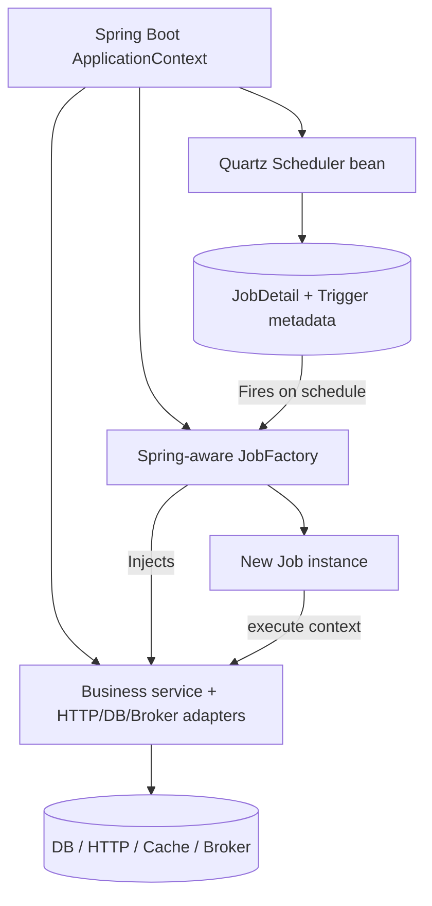
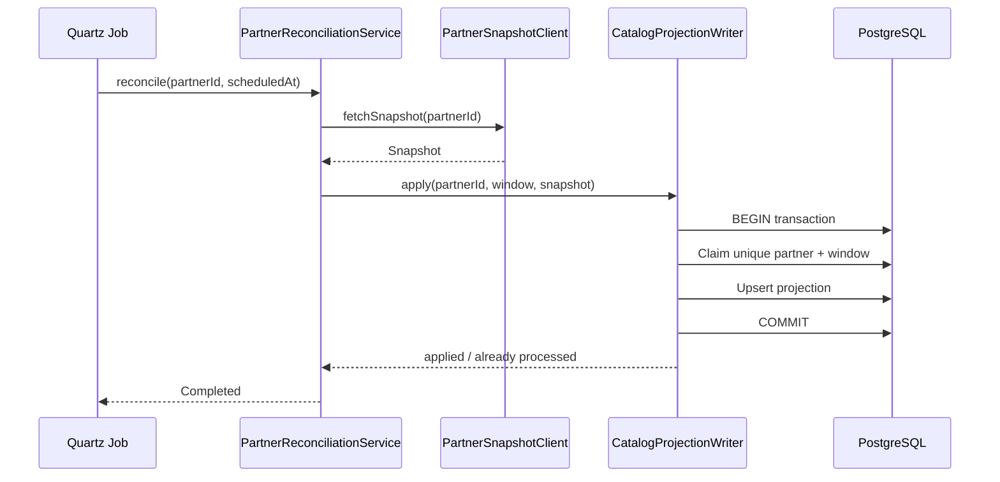

# Integrating Business Beans and Injecting Dependencies into Jobs

In **SPRING_BOOT_INTEGRATION**, a Quartz task may periodically call partner APIs, read or update data via JDBC/JPA, refresh Redis, publish messages to Kafka/RabbitMQ, or trigger a Spring Integration flow. The crux is not just writing an `execute()` method: Quartz has **its own Job creation lifecycle**, whereas business logic, HTTP clients, repositories, and transactions are typically **Spring beans** managed in the `ApplicationContext`. If these two worlds are wired improperly, a job can suffer `NullPointerException` from uninjected dependencies, recreate HTTP clients on every run, or write duplicates during scheduler retries.

This lesson belongs to the **Quartz** chapter and focuses on **integrating business beans and injecting dependencies into jobs** in Spring Boot. We will distinguish `JobDetail`, `Trigger`, `JobFactory`, `Job` instances, and Spring services; practice safe constructor injection; explain why `JobDataMap` should only carry serializable identifiers/configuration; and organize transactions, error handling, deduplication, testing, and operations when jobs connect multiple systems.

> Examples target **Java 17+, Spring Boot 3.x, and Quartz 2.x**. `RestClient` (where used) is available starting in Spring Framework 6.1/Spring Boot 3.2; examples below use adapter interfaces so they do not depend on a specific HTTP engine. Boot/Quartz APIs and default `JobFactory` behavior may differ by version or when an application declares a custom `SchedulerFactoryBean`; always verify your actual running configuration rather than assuming every injection style works.

## 1. Learning Objectives

After this lesson, you will be able to:

1. Explain **who creates Job instances**: the Spring container, Quartz `JobFactory`, or a custom component.
2. Distinguish persistent `JobDetail`/`Trigger` metadata from each **execution** (`JobExecutionContext` and `Job` instance).
3. Configure the Spring Boot Quartz starter, a `JobDetail`, and a `Trigger` using managed beans.
4. Use **constructor injection** for Jobs via `SchedulerFactoryBeanCustomizer` and `AutowireCapableBeanFactory` when an explicit Job creation strategy is needed.
5. Place business logic in Spring services and HTTP clients/repositories/transactions in their proper layers instead of stuffing everything into `execute()`.
6. Pass `partnerId`, sync scope, data windows, or business operation IDs via `JobDataMap`, while keeping `DataSource`, services, and secrets out of it.
7. Understand concurrency, job identity, misfires, retries, JDBC JobStore, clustering, and idempotency boundaries.
8. Test a Job actually instantiated by Quartz, verify business beans are injected, and handle failure scenarios cleanly.

## 2. Four Concepts to Keep Separate

Quartz operates with distinct components:

| Concept | Role | Lifecycle and Ownership |
| --- | --- | --- |
| `Scheduler` | Manages schedules, triggers, and workers executing jobs | Usually a **long-lived Spring bean**; may be auto-configured by Boot. |
| `JobDetail` | Defines **job identity**, Job class, `JobDataMap`, and durability | Metadata managed by the scheduler; can be stored in JDBC JobStore. |
| `Trigger` | Defines **when** a JobDetail fires | Separate metadata; one JobDetail can have multiple triggers. |
| `JobFactory` | Creates a `Job` instance when execution is needed | Bridge between Quartz and Spring DI; determines constructor/field injection support. |
| `Job` instance | Holds `execute(JobExecutionContext)` invoked by Quartz | Usually created per firing; **never treat as a singleton service**. |
| Spring service bean | Holds use cases, transactions, repositories, HTTP/broker adapters | `ApplicationContext` manages lifecycle and dependency graph. |
| `JobExecutionContext` | Information for **a single firing**: keys, trigger, scheduled/actual times, map | Valid only for that execution; never cache globally. |



A `JobDetail` can stay persisted for months, whereas a **Job instance** lives only during execution. Each time a trigger fires, Quartz may ask `JobFactory` for a new instance; never use instance fields as progress memory across runs. Progress, checkpoints, and idempotency require durable storage (DB/outbox/inbox) if they must survive restarts.

### 2.1. Why `@Component` on a Job Is Not a Guaranteed Solution

```java
import org.quartz.Job;
import org.quartz.JobExecutionContext;
import org.springframework.stereotype.Component;

@Component
public class FragileExampleJob implements Job {
    private final PartnerReconciliationService service;

    public FragileExampleJob(PartnerReconciliationService service) {
        this.service = service;
    }

    @Override
    public void execute(JobExecutionContext context) {
        service.reconcile("catalog", context.getScheduledFireTime().toInstant());
    }
}
```

This **only declares how Spring creates a bean**. If Quartz instantiates `FragileExampleJob` using a `JobFactory` that lacks Spring DI support, the parameterized constructor may not be invoked as expected. Even when Spring creates a `FragileExampleJob` bean, Quartz does not automatically have to use that exact bean when executing. A given Boot setup may support injection automatically; the right practice is to **verify the active `JobFactory`**, not guess from annotations.

**Design rule:** A Job is a thin adapter instantiated by Quartz via `JobFactory`; services hold the business workflows, transactions, HTTP clients, repositories, and retry/idempotency logic.

## 3. Initializing Quartz in Spring Boot

Starter:

```xml
<dependency>
    <groupId>org.springframework.boot</groupId>
    <artifactId>spring-boot-starter-quartz</artifactId>
</dependency>
```

Or Gradle Groovy:

```groovy
dependencies {
    implementation 'org.springframework.boot:spring-boot-starter-quartz'
}
```

When auto-configuration conditions match, Boot creates `SchedulerFactoryBean`/`Scheduler`, wiring `JobDetail`, `Trigger`, `Calendar` beans, and customizers. The application must define **what runs, when it runs, the `JobFactory`/lifecycle, and the storage policy**.

```yaml
spring:
  quartz:
    auto-startup: true
    job-store-type: memory
    properties:
      org.quartz.threadPool.threadCount: 5
```

This is an illustrative profile for a single-instance or dev app: `memory` **does not persist schedules across restarts** and does not provide durable clustering. `threadCount=5` only limits Quartz worker threads here; it does not limit HTTP/DB connection pools, Kafka consumer counts, or external queue capacities.

### 3.1. A JobDetail and Trigger Defining the Schedule

```java
import java.util.TimeZone;
import org.quartz.CronScheduleBuilder;
import org.quartz.JobBuilder;
import org.quartz.JobDetail;
import org.quartz.Trigger;
import org.quartz.TriggerBuilder;
import org.springframework.context.annotation.Bean;
import org.springframework.context.annotation.Configuration;

@Configuration(proxyBeanMethods = false)
public class PartnerReconciliationSchedule {

    @Bean
    JobDetail catalogReconciliationDetail() {
        return JobBuilder.newJob(PartnerReconciliationJob.class)
                .withIdentity("catalog-reconciliation", "integration")
                .withDescription("Reconcile one configured catalog partner")
                .usingJobData("partnerId", "catalog")
                .storeDurably()
                .build();
    }

    @Bean
    Trigger catalogReconciliationTrigger(
            @org.springframework.beans.factory.annotation.Qualifier(
                    "catalogReconciliationDetail") JobDetail catalogReconciliationDetail) {
        return TriggerBuilder.newTrigger()
                .withIdentity("catalog-every-five-minutes", "integration")
                .forJob(catalogReconciliationDetail)
                .withSchedule(
                        CronScheduleBuilder
                                .cronSchedule("0 0/5 * * * ?")
                                .inTimeZone(TimeZone.getTimeZone("UTC"))
                                .withMisfireHandlingInstructionDoNothing())
                .build();
    }
}
```

The schedule **`0 0/5 * * * ?`** fires at minutes divisible by 5, at second 0, in UTC in this example. It **does not** mean "wait 5 minutes after app startup then run"; the `DoNothing` misfire policy skips missed firings per Quartz rules and waits for the next valid point. Choose misfire policies based on business needs: syncs may want catch-up, whereas payment/bulk syncs should not burst through every missed interval.

`withIdentity(...)` sets a **stable `JobKey`** consisting of name and group. Multiple triggers can point to `catalogReconciliationDetail`; `storeDurably()` keeps the `JobDetail` even without triggers, though it does not imply the schedule has started firing.

### 3.2. JobDetail Metadata Differs from Business Bean Instances

In the example, `.newJob(PartnerReconciliationJob.class)` only registers the **class**; `JobDetail` **does not hold a Spring service instance**. On firing, the scheduler uses `JobFactory` to instantiate the Job and inject dependencies per configuration. That bridge must be configured cleanly.

## 4. Injecting Beans via JobFactory: Explicit Constructor Injection

A clear, testable approach is using `SchedulerFactoryBeanCustomizer` to configure a `JobFactory` that instantiates each Job with Spring's `AutowireCapableBeanFactory.createBean(...)`. This supports **constructor injection** rather than requiring Quartz to call a no-arg constructor and inject fields afterward.

```java
import org.quartz.spi.TriggerFiredBundle;
import org.springframework.beans.factory.config.AutowireCapableBeanFactory;
import org.springframework.boot.autoconfigure.quartz.SchedulerFactoryBeanCustomizer;
import org.springframework.context.annotation.Bean;
import org.springframework.context.annotation.Configuration;
import org.springframework.scheduling.quartz.SpringBeanJobFactory;

@Configuration(proxyBeanMethods = false)
public class QuartzJobFactoryConfiguration {

    @Bean
    SchedulerFactoryBeanCustomizer springConstructorInjectedJobs(
            AutowireCapableBeanFactory beanFactory) {

        return schedulerFactoryBean ->
                schedulerFactoryBean.setJobFactory(new SpringBeanJobFactory() {
                    @Override
                    protected Object createJobInstance(
                            TriggerFiredBundle bundle) throws Exception {

                        return beanFactory.createBean(
                                bundle.getJobDetail().getJobClass());
                    }
                });
    }
}
```

**How it works:**

1. Spring Boot creates `SchedulerFactoryBean` and applies `SchedulerFactoryBeanCustomizer` beans when auto-configuration matches.
2. When Quartz requests an instance, `JobFactory` calls `beanFactory.createBean(JobClass)` so Spring constructs the object and resolves constructor dependencies.
3. The new Job receives services/repositories via its constructor; Quartz invokes `execute(context)` for that firing.
4. **`JobDataMap` is still read from `JobExecutionContext`**; it is not automatically bound as Job properties by this custom bean creation path.

**Lifecycle note:** `createBean(...)` creates a **new instance** and does not turn the Job into a standard Spring singleton retrieved via `getBean(...)`. Objects created manually via `AutowireCapableBeanFactory` should not rely on `@PreDestroy` cleanup like registered singletons; keep Jobs **stateless, owning no sockets/threads/pools**. HTTP clients, DataSources, and resource-holding services must be shared Spring-managed beans.

**Boot version note:** Spring Boot may already provide a default `JobFactory` supporting dependency injection. This customizer demonstrates an **explicit mechanism for constructor injection** when a project requires certainty; do not add a redundant `JobFactory` if your current setup already satisfies this. If you define a custom `SchedulerFactoryBean`, verify that customizers are applied or set the `JobFactory` directly according to your application design.

### 4.1. Why Not Use a `@Component` Singleton Job as a Factory?

A `Job` can be triggered repeatedly, even concurrently (without `@DisallowConcurrentExecution` on the same key). Reusing **one Job instance with mutable fields** across firings can bleed state like `currentTenant`, `page`, `error`, or `accessToken` between executions. **Quartz Jobs should hold no business state across runs**; singleton services must only keep immutable state or manage concurrency safely.

## 5. Thin Job Adapter: Pick Context and Call the Use Case

Building on the `JobDetail` from Section 3, we create a Job with **constructor injection**, validate `partnerId` from `JobDataMap`, extract the scheduled fire time, and call a Spring service:

```java
import java.time.Instant;
import java.util.Date;
import java.util.Set;
import org.quartz.DisallowConcurrentExecution;
import org.quartz.Job;
import org.quartz.JobExecutionContext;
import org.quartz.JobExecutionException;

@DisallowConcurrentExecution
public final class PartnerReconciliationJob implements Job {
    private static final Set<String> ALLOWED_PARTNERS =
            Set.of("catalog");

    private final ReconciliationUseCase service;

    public PartnerReconciliationJob(ReconciliationUseCase service) {
        this.service = service;
    }

    @Override
    public void execute(JobExecutionContext context)
            throws JobExecutionException {

        String partnerId = context.getMergedJobDataMap()
                .getString("partnerId");
        Date scheduledFireTime = context.getScheduledFireTime();

        if (partnerId == null
                || !ALLOWED_PARTNERS.contains(partnerId)
                || scheduledFireTime == null) {
            throw new JobExecutionException(
                    new IllegalArgumentException(
                            "Invalid scheduled reconciliation job data"),
                    false);
        }

        Instant scheduledAt = scheduledFireTime.toInstant();

        try {
            service.reconcile(partnerId, scheduledAt);
        } catch (Exception error) {
            // Quartz records failure; retries must be governed by an explicit policy.
            throw new JobExecutionException(error, false);
        }
    }
}
```

Key details to get right:

- `@DisallowConcurrentExecution` prevents **concurrent executions of the same `JobKey`** per Quartz rules; it **does not lock all instances of the same Java Job class** across different JobKeys, and does not replace distributed locking when schedulers do not share a cluster/job store.
- `getMergedJobDataMap()` merges data from `JobDetail` and `Trigger`; on key collision, `Trigger` data **overrides** the corresponding value. Do not treat map fields as immutable configuration or blindly trusted when scheduler admin APIs allow altering triggers.
- `scheduledFireTime` represents when the trigger was supposed to fire; `fireTime` is when Quartz actually began running. During misfires or executor contention, the two timestamps diverge. Business IDs should follow your contract—never mechanically use `fireInstanceId` as a deduplication key.
- `JobExecutionException(error, false)` **does not request immediate refiring**. Quartz processes the failure per trigger/instructions and listeners; **there is no automatic retry with backoff** merely from throwing an exception. Different error classes should be routed to quarantine, rescheduling, or alerting at the workflow layer.
- This example **writes no state to Job fields**, does not look up `ApplicationContext` via static holders, and does not instantiate HTTP clients or DB connections.

### 5.1. Supporting Multiple Partners with One Job Class

You can register another `JobDetail` `billing-reconciliation` sharing `PartnerReconciliationJob.class` with a different `JobKey` and `JobDataMap`; constructor DI still injects the same **service bean**. With this pattern, replace `ALLOWED_PARTNERS` with a controlled partner config allowlist rather than adding `new Driver` or `new RestClient` inside Jobs.

**Never** store a `static String currentPartner` across jobs or mutate a singleton HTTP client's configuration from `JobDataMap`: two JobKeys can run concurrently. The service must use per-partner configuration, a qualifier/allowlisted client registry, and per-request headers.

## 6. Business Service: HTTP Outside DB Transactions, Writes Inside

Consider a use case syncing a catalog snapshot from a partner API into PostgreSQL. Architecture:



### 6.1. DTO and HTTP Adapter Contract

```java
public record PartnerSnapshot(
        String sourceVersion,
        long itemCount
) {}

public interface PartnerSnapshotClient {
    PartnerSnapshot fetchSnapshot(String partnerId);
}
```

One implementation might use a singleton `RestClient` preconfigured with base URL/timeouts/auth for catalog; another might use `WebClient` or HTTP interfaces. **The Job does not need to know** which client handles JSON, TLS, query parameters, 429s, or credential rotation.

### 6.2. Orchestrator Without SQL Transaction Around HTTP

```java
import java.time.Instant;

@FunctionalInterface
public interface ReconciliationUseCase {
    void reconcile(String partnerId, Instant scheduledAt);
}
```

```java
import java.time.Instant;
import org.springframework.stereotype.Service;

@Service
public class PartnerReconciliationService implements ReconciliationUseCase {
    private final PartnerSnapshotClient snapshots;
    private final CatalogProjectionWriter writer;

    public PartnerReconciliationService(
            PartnerSnapshotClient snapshots,
            CatalogProjectionWriter writer) {
        this.snapshots = snapshots;
        this.writer = writer;
    }

    @Override
    public void reconcile(String partnerId, Instant scheduledAt) {
        PartnerSnapshot snapshot = snapshots.fetchSnapshot(partnerId);
        writer.apply(partnerId, scheduledAt, snapshot);
    }
}
```

`PartnerReconciliationService` is a Spring singleton injected into every Job instance. It holds no mutable job state in fields; `partnerId` and `scheduledAt` are **per-firing** parameters. If logic must check Redis, send notifications, or emit Kafka events, define clean boundaries rather than executing them directly **inside a long-held SQL transaction waiting on HTTP**.

### 6.3. Idempotent Writer with a Unique Constraint

For illustration, PostgreSQL has two tables:

```sql
CREATE TABLE reconciliation_run (
    partner_id VARCHAR(64) NOT NULL,
    window_start TIMESTAMPTZ NOT NULL,
    status VARCHAR(32) NOT NULL,
    PRIMARY KEY (partner_id, window_start)
);

CREATE TABLE catalog_projection (
    partner_id VARCHAR(64) PRIMARY KEY,
    source_version VARCHAR(128) NOT NULL,
    item_count BIGINT NOT NULL
);
```

In this example, the cron fires every **5 minutes UTC**. We normalize windows to 300 seconds and record **claim + projection in the same transaction**:

```java
import java.sql.Timestamp;
import java.time.Instant;
import org.springframework.jdbc.core.JdbcTemplate;
import org.springframework.stereotype.Service;
import org.springframework.transaction.annotation.Transactional;

@Service
public class CatalogProjectionWriter {
    private final JdbcTemplate jdbc;

    public CatalogProjectionWriter(JdbcTemplate jdbc) {
        this.jdbc = jdbc;
    }

    @Transactional
    public void apply(
            String partnerId,
            Instant scheduledAt,
            PartnerSnapshot snapshot) {

        long epochSeconds = scheduledAt.getEpochSecond();
        long windowEpoch = Math.floorDiv(epochSeconds, 300L) * 300L;
        Timestamp window = Timestamp.from(
                Instant.ofEpochSecond(windowEpoch));

        int claimed = jdbc.update("""
                INSERT INTO reconciliation_run(
                    partner_id, window_start, status)
                VALUES (?, ?, 'COMPLETED')
                ON CONFLICT (partner_id, window_start) DO NOTHING
                """, partnerId, window);

        if (claimed == 0) {
            // This window already committed successfully in an earlier run.
            return;
        }

        jdbc.update("""
                INSERT INTO catalog_projection(
                    partner_id, source_version, item_count)
                VALUES (?, ?, ?)
                ON CONFLICT (partner_id) DO UPDATE SET
                    source_version = EXCLUDED.source_version,
                    item_count = EXCLUDED.item_count
                """,
                partnerId, snapshot.sourceVersion(), snapshot.itemCount());
    }
}
```

**Why not keep `boolean alreadyProcessed` in a Job field?** Quartz can restart or run across multiple pods; only a unique key in the **shared database** can enforce deduplication on `partnerId + windowStart` here. Two executions racing on the same key are arbitrated by PostgreSQL's unique constraint; if the upsert fails, the transaction rolls back the claim too so a later job can retry.

**Semantics caution:** this code only guarantees "**at most one successful projection write per window**"; it does not guarantee the HTTP snapshot truly reflects that 5-minute window or prevent out-of-order overwrites when a job runs late. Production code should track source watermarks/versions and only apply newer data; when catching up missed windows, the service must fetch **per-window** data in proper order. A single projection table does not replace an event history; it merely illustrates transaction boundaries and idempotency.

### 6.4. Why Put `@Transactional` on the Writer Service, Not the Job?

`CatalogProjectionWriter.apply` is called through a **Spring proxy** from a different bean (`PartnerReconciliationService`), ensuring the JDBC transaction applies. Calling a `@Transactional` method via **self-invocation** inside the same object commonly bypasses Spring AOP proxies, resulting in no transaction at all.

Putting `@Transactional` across the entire `PartnerReconciliationJob.execute` or wrapping `snapshots.fetchSnapshot` would hold JDBC connections and DB locks while waiting on HTTP. A healthier boundary is **fetch outside the transaction, write atomically in a short transaction**. Even after DB writes succeed, Kafka publishes and Redis caches still require outboxes/reconciliation if multi-system consistency is required.

## 7. JobDataMap Passes Data, Not Spring Beans

`JobDataMap` is where Quartz stores **parameters for a JobDetail or Trigger**. Example:

```java
JobDetail detail = JobBuilder
        .newJob(PartnerReconciliationJob.class)
        .withIdentity("catalog-reconciliation", "integration")
        .usingJobData("partnerId", "catalog")
        .usingJobData("schemaVersion", 1)
        .storeDurably()
        .build();
```

| Good for JobDataMap | Bad for JobDataMap |
| --- | --- |
| Allowlisted `partnerId` or `tenantKey` | `DataSource`, `JdbcTemplate`, `RestClient`, or Spring service objects |
| `jobConfigurationVersion`, `schemaVersion` | Access tokens, OAuth refresh tokens, DB passwords, secrets |
| `businessRunId` or stable contract correlation ID | HTTP request/response/`InputStream`, threads, lambdas, or sessions |
| Validated, bounded `pageSize` and filter keys | Huge DTOs or lists of millions of IDs |
| ID of a durable work item/outbox record | Mutable in-memory objects acting as restart checkpoints |

With **JDBC JobStore**, `JobDataMap` can be persisted/serialized depending on configuration (`useProperties` and Quartz constraints). Putting Spring beans into it is not only poor design but can trigger serialization errors, class-version mismatches, and secret leaks in Quartz tables. For large payloads, store them in the business database and put only **`workItemId`** in `JobDataMap`.

### 7.1. Triggers Can Override JobDetail Data

A `JobDetail` carrying `partnerId=catalog` paired with a `Trigger` carrying `partnerId=billing` causes `context.getMergedJobDataMap()` to return **billing**. Whenever these values select hosts, credentials, or tenants, validate them and restrict permissions to modify triggers; never assume `JobDataMap` only originates from trusted static code.

Prefer storing a **policy identifier key** in `JobDataMap` and resolving it against a controlled server-side configuration registry. Never build a `RestClient` pointing to a raw URL stored in `JobDataMap`; that invites SSRF and credential exposure if admin scheduler APIs are misused.

### 7.2. Do Not Use JobDataMap as a Transaction Log

`JobDataMap` can mutate between executions under Quartz rules, particularly with `@PersistJobDataAfterExecution`. However, it does not replace **progress checkpoints, inboxes, outboxes, or durable deduplication**. For SQL transactions and brokers, use application tables with unique constraints/versions; Quartz metadata like `nextFireTime` describes scheduling, not business write completion.

## 8. Field/Setter Injection: Works, with Caveats

A pattern sometimes seen:

```java
import org.quartz.Job;
import org.quartz.JobExecutionContext;
import org.springframework.beans.factory.annotation.Autowired;

public class SetterInjectionJob implements Job {
    private PartnerReconciliationService service;

    @Autowired
    public void setService(PartnerReconciliationService service) {
        this.service = service;
    }

    @Override
    public void execute(JobExecutionContext context) {
        service.reconcile(
                "catalog",
                context.getScheduledFireTime().toInstant());
    }
}
```

Setter/field injection **only works** if the `JobFactory` or bean creation hook actually performs Spring dependency injection. `SpringBeanJobFactory` in some usages binds properties from `JobDataMap` onto setters, yet **property binding from Quartz data is not the same as `@Autowired` Spring bean injection**. Do not conflate the two.

A custom `JobFactory` doing:

```java
Object instance = super.createJobInstance(bundle);
beanFactory.autowireBean(instance);
return instance;
```

can inject fields/setters after Quartz instantiates the object, **but fails for constructors with parameters** because `super.createJobInstance` still requires a no-arg constructor. That is why Section 4 used `beanFactory.createBean(JobClass)` for constructor injection and read business parameters from `JobExecutionContext` rather than relying on setter property binding.

**Recommendation:** prefer constructor injection with `final` fields in Jobs, singleton or properly scoped service/interface beans, and a `JobFactory` verified by integration tests. Field/setter injection remains usable in legacy code, though it obscures dependencies and hides `JobFactory` misconfigurations.

## 9. Bean Lifecycles: Quartz Worker Threads Are Not HTTP Request Scope

A Quartz Job does not run inside a normal HTTP request. `@RequestScope`, HTTP sessions, the current user's `SecurityContext`, or Reactor contexts from inbound calls **do not automatically exist** when Quartz fires a cron trigger.

| Dependency | Usually Safe for a Job? | Reason |
| --- | --- | --- |
| Singleton `@Service` holding use cases/stateless orchestration | **Yes** | Each new Job delegates to the shared service bean. |
| `JdbcTemplate`/`EntityManagerFactory` or Spring Data repositories | **Yes**, via services | Spring infrastructure manages connections and transactions. |
| Per-partner singleton `RestClient`/`WebClient` | **Yes**, via adapters | Pools/credentials/timeouts live on the shared bean. |
| `KafkaTemplate`/`RabbitTemplate` | Yes, with outbox or publisher design | Do not assume message sending and DB commit share one transaction. |
| `@RequestScope` bean from an HTTP controller | **No by default** | No active request context; proxy injection merely defers failure until call time. |
| User `HttpServletRequest`/session cookie | No | Quartz does not act on behalf of a live HTTP caller without explicit delegation design. |
| `EntityManager` held in a Job field | No | EntityManager/sessions are transaction/lifecycle-scoped and not arbitrarily thread-safe. |
| `ThreadLocal` carrying user/tenant from an earlier request | No | Quartz worker threads are pooled and reused; risks context leakage. |

### 9.1. What If a Job Runs on Behalf of a Tenant or User?

Pass a **`tenantId` or `workItemId`** in `JobDataMap`, look up the principal/policy from a trusted server-side source, and **check authorization** for the requested operation. Never persist long-lived JWTs/access tokens or raw HTTP headers in the JobStore. For OAuth2 calls, use service-account/client-credentials flows; for delegated user tokens, design explicit refresh, expiration, and consent handling.

In multi-tenant systems, services must apply tenant scoping explicitly across all DB, cache, and HTTP calls. If the application uses a thread-local tenant context, always **set and clear it inside `try/finally`**—or better yet, pass the tenant as a method parameter—to prevent leaking across Jobs on the same Quartz thread.

### 9.2. Shutdown and Disposed Dependencies

When the Spring context closes, the scheduler should stop accepting new triggers and handle in-flight jobs per policy before datasources/HTTP clients are disposed. Setting `spring.quartz.wait-for-jobs-to-complete-on-shutdown` asks the scheduler to wait for active jobs, yet **does not** guarantee the JVM/container waits indefinitely; Kubernetes termination grace periods or shutdown deadlines can still terminate the process.

If a job is interrupted mid-HTTP call after the partner API already committed, the rerun must rely on operation IDs/idempotency. If mid-SQL transaction, rollback/commit depends on timing and connection state. Rely on durable checkpoints/outboxes and restart policies rather than expecting Spring to invoke `@PreDestroy` on per-run Job instances.

## 10. `@DisallowConcurrentExecution`, JobKey, and Instance Count

Suppose a `JobDetail` with `JobKey` `integration.catalog-reconciliation` has two triggers: a 5-minute cron and a manual admin trigger. If the job runs for 8 minutes, Quartz can overlap executions unless concurrency is restricted.

Adding:

```java
@DisallowConcurrentExecution
public final class PartnerReconciliationJob implements Job {
    // ...
}
```

instructs Quartz **not to run multiple instances of the same `JobDetail` concurrently**. Although placed on the Job class, the actual lock key is **`JobKey`**, not the Java class alone.

| Scenario | Does Annotation Prevent Overlap? | Notes |
| --- | --- | --- |
| Two triggers targeting the `catalog` JobKey | Yes, within the same Scheduler/cooperating cluster | Subsequent runs may wait or misfire. |
| Two JobDetails (`catalog` and `billing`), different JobKeys, same class | **Does not** block parallel execution | Service/client registries must be thread-safe. |
| Two pods with independent RAMJobStores, both having `catalog` JobKey | **Does not** create a distributed lock between them | Each pod runs its own scheduler and can double-execute. |
| Two Quartz cluster nodes sharing a properly configured JDBC JobStore | Quartz coordinates claims/misfires for that scheduler cluster | Requires shared DB/table prefix, unique instance IDs, and healthy environment. |
| Two workflows creating the same payment via different JobKeys | Outside the annotation's scope | Requires idempotency/unique business keys at the target system. |

**`@DisallowConcurrentExecution` does not make a job "exactly once."** A node can lose network after applying a side effect and before updating scheduler state; Quartz may recover/refire per configuration. External systems like Kafka can redeliver messages and Spring Integration may retry independently.

### 10.1. `@PersistJobDataAfterExecution`: Do Not Use as a Default Business Counter

Quartz provides `@PersistJobDataAfterExecution` to save mutations made to the **JobDetail's `JobDataMap`** after each run per scheduler/job store semantics. When mutating state, it is typically recommended alongside `@DisallowConcurrentExecution` to avoid concurrent writes to `JobDataMap`.

However:

- Never store user credentials, HTTP clients, file streams, or large object graphs in `JobDataMap`.
- Do not rely on an integer `lastProcessedPage` in the map as the primary checkpoint for syncing thousands of records when transactional consistency with the database is needed.
- Restarts, recovery, misfires, and trigger changes can diverge schedule state from committed DB/broker state.
- With multiple JobKeys, having per-key maps does not replace locking by business ID.

If exact sync progress recovery is required, store progress in a versioned/keyed `sync_checkpoint` table updated **in the same transaction** as applied data. `JobDataMap` should only hold the checkpoint ID to read.

## 11. Misfires, Recovery, and Retry Types Must Be Separated

A trigger expected to fire at 10:00 while the scheduler was down until 10:20 may **misfire**. Quartz uses the trigger's misfire policy and JobStore metadata to decide how to handle missed firings. That is a **scheduling mechanism**, not an HTTP retry on partner 503 or a Kafka message replay.

| Phenomenon | Controlling Component | Required Handling |
| --- | --- | --- |
| Cron firing missed during server downtime | Quartz trigger misfire instruction | Skip, catch up once, or apply trigger-specific rule. |
| Job throws `JobExecutionException` | Job + Scheduler/JobListeners + retry orchestration | No automatic exponential backoff unless explicitly built. |
| Transient SQL driver disconnect | Service/DB retry policy | Retry only safe segments without multiplying side effects. |
| Partner HTTP timeout after POST | HTTP adapter/workflow | Partner may have committed; requires idempotency/reconciliation. |
| Process crashes after DB commit before broker publish | Outbox publisher | Re-emit event with the same event ID. |
| Kafka/RabbitMQ redelivers duplicate message | Consumer inbox/dedup | Avoid duplicate business effects. |
| Cluster scheduler node stops | Quartz JDBC JobStore/recovery settings | Recover schedule/job per config; cannot roll back external side effects. |

### 11.1. Do Not Overuse `refireImmediately`

`JobExecutionException` allows setting `refireImmediately` in certain cases. Yet if a service fails authentication, exhausts DB connections, or receives HTTP 429, requesting **immediate re-execution on the same worker** creates a tight backoff-free retry loop that worsens outages.

For transient errors, a sound design typically includes:

1. Classifying exceptions (transient / permanent / unknown outcome).
2. Bounding attempts and deadlines for **a single business operation**.
3. Applying backoff with jitter and downstream rate limits.
4. For retries that must survive restarts, persisting durable work items and rescheduling or enqueuing to a broker instead of sleeping on a Quartz thread.
5. Quarantining contract-violating payloads rather than retrying endlessly.
6. Keeping business idempotency keys stable across attempts.

### 11.2. When to Use Quartz vs. a Broker?

Quartz excels at **periodic schedules, cron, and trigger distribution**; brokers excel at **work queues, redelivery, and decoupling producers from consumers**. A heavy 2-hour batch job does not have to tie up a Quartz worker for 2 hours: the job can **create durable batch/work items in the database**, letting broker-backed workers process them concurrently with proper retry/checkpoint control.

However, if the Quartz job simply publishes a message and returns `COMPLETED`, define "completed" as **command durably enqueued**, not the entire batch finished. If APIs display progress, back them with a workflow table tracking `SCHEDULED`, `QUEUED`, `RUNNING`, `COMPLETED`/`FAILED` instead of inferring state from Quartz's `nextFireTime`.

## 12. JDBC JobStore and Multiple Spring Boot Instances

When schedules must survive restarts or run clustered, Quartz provides JDBC JobStore. In Spring Boot:

```yaml
spring:
  quartz:
    job-store-type: jdbc
    jdbc:
      initialize-schema: never
    properties:
      org.quartz.scheduler.instanceName: partner-scheduler
      org.quartz.scheduler.instanceId: AUTO
      org.quartz.jobStore.isClustered: true
      org.quartz.threadPool.threadCount: 8
```

**Prerequisites for this configuration to be valid:** Quartz tables exist with schemas matching your driver/version; all cluster instances share the same JDBC store/table prefix and `instanceName`; each scheduler instance has a unique ID; clocks and infrastructure are stable. Setting `isClustered=true` without a matching JDBC JobStore/cluster schema does not magically turn RAMJobStore into a distributed scheduler.

### 12.1. Quartz Schema Is Not the Business Schema

- `QRTZ_*` tables store JobDetail, Trigger, lock, and scheduling metadata.
- `reconciliation_run` or `inbox`/`outbox` tables store **business state**, deduplication records, and actual outcomes.
- Quartz cluster coordination does not replace PostgreSQL projection transactions or external API idempotency.
- Never store `PartnerReconciliationService`/`RestClient` in JDBC `JobDataMap`; use scalar keys and Spring DI.

For production, follow a **controlled Quartz schema migration/initialization process**. Be cautious with `spring.quartz.jdbc.initialize-schema=always`: depending on script/DB, initialization may drop existing Quartz tables and persisted schedules. Never use that setting in production just to "auto-fix missing tables."

### 12.2. Boot Bean Definitions vs. Persisted Schedules

Spring Boot can register `JobDetail`/`Trigger` beans when the scheduler starts. When the JDBC store already holds data, `spring.quartz.overwrite-existing-jobs` governs in certain cases whether code definitions overwrite stored ones. Never edit a cron expression in code and assume persisted schedules automatically update. Verify:

1. Existing JobDetail/Trigger state in JDBC JobStore.
2. `overwrite-existing-jobs` and the expected rollout procedure.
3. Whether jobs are created dynamically via admin APIs.
4. Job class/package renames when Quartz persists class names across deployments.
5. Not renaming `JobKey` arbitrarily and leaving old and new jobs running side by side.

### 12.3. Multiple `SchedulerFactoryBean`s and Bean Customization

If an application constructs `SchedulerFactoryBean` manually, defines a separate `JobFactory`, or registers multiple `SchedulerFactoryBeanCustomizer` beans that set `JobFactory`, configuration ordering can silently override one customizer with another. Constructor injection may appear configured while Quartz instantiates Jobs differently.

Therefore, tests must **let Quartz actually fire the Job**, not merely assert that `PartnerReconciliationService` exists in the Spring context. Also verify which scheduler executes the job when multiple `Scheduler` beans or service deployments exist.

## 13. Completing the Dependency Graph: HTTP Adapter, JDBC, and Partner Config

In Section 6, `PartnerSnapshotClient` was an interface. For Spring to construct the real `PartnerReconciliationService`, the application context needs an **implementation bean** of that interface, plus `CatalogProjectionWriter`, `JdbcTemplate`, and their dependencies.

### 13.1. Dependencies for the HTTP + PostgreSQL Example

Using Spring Boot 3.2+ and `RestClient`:

```xml
<dependency>
    <groupId>org.springframework.boot</groupId>
    <artifactId>spring-boot-starter-web</artifactId>
</dependency>
<dependency>
    <groupId>org.springframework.boot</groupId>
    <artifactId>spring-boot-starter-jdbc</artifactId>
</dependency>
<dependency>
    <groupId>org.postgresql</groupId>
    <artifactId>postgresql</artifactId>
    <scope>runtime</scope>
</dependency>
```

`spring-boot-starter-quartz` **does not provide** web clients or business database schemas. For apps without inbound HTTP, you can substitute an appropriate HTTP client dependency instead of `spring-boot-starter-web`, provided Spring Boot/Framework versions and auto-configuration are compatible.

Configuration example:

```yaml
app:
  partners:
    catalog:
      base-url: ${CATALOG_BASE_URL:https://catalog.example.org}
spring:
  datasource:
    url: ${APP_DB_URL:jdbc:postgresql://localhost:5432/integration}
    username: ${APP_DB_USERNAME}
    password: ${APP_DB_PASSWORD}
```

In production, `base-url` must be allowlisted and governed by TLS/timeout/pool/secret policies; `APP_DB_PASSWORD` comes from a secret manager. `reconciliation_run` and `catalog_projection` tables are created by migrations before the job runs, **not auto-created by Quartz**.

### 13.2. Configuring `RestClient` Once and Injecting Into the Adapter

```java
import org.springframework.beans.factory.annotation.Value;
import org.springframework.context.annotation.Bean;
import org.springframework.context.annotation.Configuration;
import org.springframework.web.client.RestClient;

@Configuration(proxyBeanMethods = false)
public class CatalogClientConfig {

    @Bean
    RestClient catalogRestClient(
            RestClient.Builder bootBuilder,
            @Value("${app.partners.catalog.base-url}") String baseUrl) {

        return bootBuilder
                .baseUrl(baseUrl)
                .build();
    }
}
```

```java
import org.springframework.beans.factory.annotation.Qualifier;
import org.springframework.stereotype.Component;
import org.springframework.web.client.RestClient;

@Component
public class CatalogSnapshotHttpClient implements PartnerSnapshotClient {
    private final RestClient client;

    public CatalogSnapshotHttpClient(
            @Qualifier("catalogRestClient") RestClient client) {
        this.client = client;
    }

    @Override
    public PartnerSnapshot fetchSnapshot(String partnerId) {
        if (!"catalog".equals(partnerId)) {
            throw new IllegalArgumentException("Unknown partner");
        }

        PartnerSnapshot result = client.get()
                .uri("/v1/snapshot")
                .retrieve()
                .body(PartnerSnapshot.class);

        if (result == null
                || result.sourceVersion() == null
                || result.itemCount() < 0) {
            throw new IllegalStateException(
                    "Invalid partner snapshot");
        }
        return result;
    }
}
```

This is a **fictional endpoint** illustrating the dependency graph. Production requires HTTP authentication, JSON contracts, connection pooling, connect/response timeouts, retries only on safe GETs, and response body size limits; default `RestClient.Builder` settings do not replace those operational decisions.

**Clear ownership:**

```text
ApplicationContext
  ├─ RestClient.Builder -> catalogRestClient (singleton HTTP client)
  ├─ DataSource -> JdbcTemplate
  ├─ CatalogSnapshotHttpClient implements PartnerSnapshotClient
  ├─ CatalogProjectionWriter       (@Transactional)
  ├─ PartnerReconciliationService  implements ReconciliationUseCase
  └─ Quartz Scheduler + JobFactory
       └─ per firing -> PartnerReconciliationJob(ReconciliationUseCase)
```

`JobFactory` resolves the Job constructor **when Quartz fires**, while Spring constructs business services and adapter beans **for the application context**. Never call `ApplicationContext.getBean(...)` or use static holders inside `execute`. A missing bean dependency or ambiguous unqualified beans will cause job instantiation to fail; catch this via integration tests before deployment.

### 13.3. Each `public` Class Needs Its Own Java File

Snippets in this lesson are grouped by role for readability. In a real project, place each top-level `public` class/interface/record in a matching `.java` file, such as `PartnerReconciliationJob.java`, `ReconciliationUseCase.java`, `PartnerReconciliationService.java`, and `CatalogProjectionWriter.java`. You must wire configurations, run DB migrations, and run dependency/integration tests; copying isolated snippets alone does not make a runnable app.

## 14. Testing Bean Injection with a Real Quartz Scheduler

**Instantiating a Job manually via `new PartnerReconciliationJob(service)` only proves the constructor accepts an argument**; it does not prove Quartz `JobFactory` uses that strategy. Write tests that start the Spring Boot context with `JobDetail`/`Trigger`, **let Quartz fire the Job**, and verify the business callback is invoked.

### 14.1. Testing the Spring Context with a Safe Fake Service

The test below uses a fake `ReconciliationUseCase` that signals a `CountDownLatch`, because the goal is strictly **JobFactory constructor injection and real scheduling**; it performs no HTTP or database writes. Helper types are nested inside the test:

```java
import static org.junit.jupiter.api.Assertions.*;
import java.time.Instant;
import java.util.concurrent.CountDownLatch;
import java.util.concurrent.TimeUnit;
import java.util.concurrent.atomic.AtomicReference;
import org.junit.jupiter.api.Test;
import org.quartz.JobKey;
import org.quartz.Scheduler;
import org.springframework.beans.factory.annotation.Autowired;
import org.springframework.boot.SpringBootConfiguration;
import org.springframework.boot.autoconfigure.EnableAutoConfiguration;
import org.springframework.boot.autoconfigure.jdbc.DataSourceAutoConfiguration;
import org.springframework.boot.test.context.SpringBootTest;
import org.springframework.boot.test.context.TestConfiguration;
import org.springframework.context.annotation.Bean;
import org.springframework.context.annotation.Import;

@SpringBootTest(
    classes = QuartzJobWiringIT.TestApp.class,
    properties = {
        "spring.quartz.job-store-type=memory",
        "spring.quartz.auto-startup=false"
    }
)
class QuartzJobWiringIT {

    @Autowired Scheduler scheduler;
    @Autowired JobInvocationProbe probe;

    @Test
    void quartzCreatesJobWithInjectedBusinessUseCase() throws Exception {
        JobKey key = JobKey.jobKey(
                "catalog-reconciliation", "integration");
        assertNotNull(scheduler.getJobDetail(key));

        scheduler.start();
        try {
            scheduler.triggerJob(key);
            assertTrue(
                    probe.called.await(5, TimeUnit.SECONDS),
                    "Quartz must invoke the injected ReconciliationUseCase");
            assertEquals("catalog", probe.partnerId.get());
            assertNotNull(probe.scheduledAt.get());
        } finally {
            scheduler.standby();
        }
    }

    static final class JobInvocationProbe {
        final CountDownLatch called = new CountDownLatch(1);
        final AtomicReference<String> partnerId = new AtomicReference<>();
        final AtomicReference<Instant> scheduledAt =
                new AtomicReference<>();

        void record(String partner, Instant time) {
            partnerId.set(partner);
            scheduledAt.set(time);
            called.countDown();
        }
    }

    @SpringBootConfiguration
    @EnableAutoConfiguration(exclude = DataSourceAutoConfiguration.class)
    @Import({
        QuartzJobFactoryConfiguration.class,
        PartnerReconciliationSchedule.class,
        ProbeConfiguration.class
    })
    static class TestApp {}

    @TestConfiguration(proxyBeanMethods = false)
    static class ProbeConfiguration {
        @Bean
        JobInvocationProbe jobInvocationProbe() {
            return new JobInvocationProbe();
        }

        @Bean
        ReconciliationUseCase reconciliationProbe(
                JobInvocationProbe probe) {
            return probe::record;
        }
    }
}
```

**Why is this test valuable?** It never instantiates `PartnerReconciliationJob` manually and does not require a `PartnerReconciliationService` hitting real HTTP/DB. Quartz auto-configuration registers `JobDetail`/`Trigger`, the custom `JobFactory` instantiates the Job, Spring injects the single `ReconciliationUseCase`, and `execute()` calls `probe.record(...)`.

**Limitations:** an in-memory `JobStore` and single scheduler test **do not prove clustering, JDBC persistence, transactions, or idempotency**. The cron schedule could also fire upon `scheduler.start()` if aligned with the clock; the test asserts **at least one callback** with the right ID rather than asserting exact counts under a live cron trigger. The test uses a 5-second timeout rather than blind sleeps. When multiple tests share a Spring context, isolate test schedulers so they do not interfere with other tests' jobs.

### 14.2. Unit Testing JobDataMap Validation and Exception Policies

To test the Job in isolation without network calls:

```java
import static org.junit.jupiter.api.Assertions.*;
import static org.mockito.Mockito.*;
import java.util.Date;
import org.junit.jupiter.api.Test;
import org.quartz.JobDataMap;
import org.quartz.JobExecutionContext;
import org.quartz.JobExecutionException;

class PartnerReconciliationJobTest {

    @Test
    void rejectsUnknownPartnerWithoutCallingService() {
        ReconciliationUseCase useCase =
                mock(ReconciliationUseCase.class);
        JobExecutionContext context =
                mock(JobExecutionContext.class);

        JobDataMap data = new JobDataMap();
        data.put("partnerId", "unknown-partner");
        when(context.getMergedJobDataMap()).thenReturn(data);
        when(context.getScheduledFireTime()).thenReturn(new Date());

        PartnerReconciliationJob job =
                new PartnerReconciliationJob(useCase);
        assertThrows(JobExecutionException.class,
                () -> job.execute(context));

        verifyNoInteractions(useCase);
    }
}
```

This unit test checks the Job's input policy, but **does not replace the `quartzCreatesJobWithInjectedBusinessUseCase` integration test**. Similarly, mocking `JdbcTemplate` for duplicate-key tests does not verify real race conditions; use a PostgreSQL Testcontainer with live SQL constraints.

### 14.3. Testing JDBC Transactions and Redelivery

| Scenario | Test Approach | Expected Outcome |
| --- | --- | --- |
| Upsert succeeds | PostgreSQL Testcontainers with real schema | Exactly one `reconciliation_run` and corresponding projection |
| Two jobs same partner/window | Start two concurrent transactions against real unique index | Only one transaction claims successfully; no duplicate update |
| Failure after claim before upsert | Inject SQL exception on subsequent statement | Whole claim rolls back, permitting retry |
| Job reruns after restart | Create fresh Spring context preserving database | Skips/reconciles by business key, independent of Job instance fields |
| HTTP GET timeout | Slow mock server; fake/probe writer | No projection written without valid snapshot |
| DB commit succeeds, broker publish fails | Workflow outbox/broker test | Event can still be republished and consumer is idempotent |
| Invalid `JobDataMap` | Pass partner outside allowlist | Job fails explicitly without calling arbitrary host |
| Two JobKeys sharing Job class | Two JobDetails/triggers in scheduler | Can run concurrently; service leaks no state |

If the goal is proving **distributed scheduling** across pods, a single `@SpringBootTest` with RAMJobStore is insufficient. Run an integration setup with at least two scheduler instances sharing a JDBC Quartz JobStore and verify ownership, recovery, and misfires when one node stops.

## 15. Adding Observability to Jobs and Business Workflows

A job can be marked **finished** by Quartz while the business workflow remains incomplete: for instance, the Job only published a Kafka message, and the consumer has not yet updated Neo4j or Redis. Therefore, separate at least two observability layers:

1. **Scheduler execution**: did the trigger fire, was it on time, how long did it take, what error was thrown, were there misfires/refires?
2. **Business outcome**: was partner data fetched, did SQL commit, did outbox/broker publish, did the consumer finish processing?

| Signal | Source | Question Answered |
| --- | --- | --- |
| `JobKey` and trigger identity | Quartz metadata | Which schedule and use case are running? |
| Scheduled vs actual fire time | `JobExecutionContext` | How late was the job due to misfires, pool saturation, or stopped scheduler? |
| Job runtime | Quartz execution/context | Is it running longer than the cron period? |
| Job success/failure | Quartz listeners + service | Did the job finish cleanly or throw an exception? |
| Worker threads and pending triggers | Quartz scheduler/JobStore | Is Quartz saturated or waiting on triggers? |
| Business idempotency claim status | SQL `reconciliation_run` | Has this window already been processed? |
| HTTP partner status/latency | Outbound HTTP adapter | Is the partner API slow, returning 429/503, or expired token? |
| JDBC transaction duration | Business writer/DataSource | Are DB locks or pool saturation occurring? |
| Outbox age, broker lag | Outbox publisher/consumer | Did the job kick off the workflow while downstream lags behind? |
| Total completed business windows | Business tables/metrics | Are windows being skipped even though cron keeps firing? |

### 15.1. Using `JobListener` to Measure Execution Outcomes

Quartz supports `JobListener`/`TriggerListener` to observe scheduler lifecycle events without stuffing logging code into `execute()`:

```java
import org.quartz.JobExecutionContext;
import org.quartz.JobExecutionException;
import org.quartz.listeners.JobListenerSupport;
import org.springframework.stereotype.Component;

@Component
public final class ReconciliationJobListener extends JobListenerSupport {

    @Override
    public String getName() {
        return "reconciliation-job-observer";
    }

    @Override
    public void jobWasExecuted(
            JobExecutionContext context,
            JobExecutionException error) {

        String jobName = context.getJobDetail().getKey().getName();
        long elapsedMillis = context.getJobRunTime();
        boolean succeeded = (error == null);

        // Record metrics/logs by JobKey, duration, and outcome.
        // Never log full JobDataMap, credentials, payloads, or tokens.
        recordJobObservation(jobName, elapsedMillis, succeeded);
    }

    private void recordJobObservation(
            String jobName, long elapsedMillis, boolean succeeded) {
        // Integration point for application-provided Micrometer/logger.
        // Avoid blocking I/O or throwing exceptions from listeners.
    }
}
```

This is an **instrumentation boundary example**; it collects no real metrics until `recordJobObservation` is wired to a real logger/`MeterRegistry`. Register the listener via `SchedulerFactoryBeanCustomizer` and `setGlobalJobListeners(...)` if supported by your API/version, and verify the listener is active on the running scheduler:

```java
import org.springframework.boot.autoconfigure.quartz.SchedulerFactoryBeanCustomizer;
import org.springframework.context.annotation.Bean;
import org.springframework.context.annotation.Configuration;

@Configuration(proxyBeanMethods = false)
public class QuartzObservabilityConfiguration {
    @Bean
    SchedulerFactoryBeanCustomizer reconciliationListenerCustomizer(
            ReconciliationJobListener listener) {
        return factory -> factory.setGlobalJobListeners(listener);
    }
}
```

This customizer and the `JobFactory` customizer in Section 4 **have independent responsibilities**; they do not overwrite the same property. If the app has other listener customizers, verify global listener setting/appending behavior per version. Listeners are strictly for observation; do not put DB writes, HTTP retries, or critical Kafka publishes inside listeners without recovery, as listener failures must not alter business success semantics.

### 15.2. Metric Labels Must Have Low Cardinality

Measure `job_name=catalog-reconciliation`, `job_group=integration`, `result=success|failure`, or bounded error categories. Avoid placing `tenantId`, `requestId`, `fireInstanceId`, raw HTTP URLs, or full `JobDataMap` contents into metric tags: each firing can explode time series cardinality and leak sensitive data.

Correlation IDs may flow from the Job to business logs and broker events per policy, yet **correlation ID is not a unique business operation ID**. A single cron run can emit multiple events, each with its own event ID; when a job retries, determine which IDs remain invariant per business window for deduplication.

### 15.3. Business Status Tables Are the Source of Truth for Progress

Quartz provides `nextFireTime`/`previousFireTime`, yet **`nextFireTime` does not prove the previous sync succeeded**. If operators ask "up to which window is the catalog partner synced?", query the checkpoint/`reconciliation_run` table with unique keys and actual commit timestamps.

Dashboards can display both side by side:

```text
Scheduler:
  next_fire_time = 2026-11-21T11:00:00Z
  previous_fire_time = 2026-11-21T10:55:00Z
  last_job_execution = success

Business:
  latest_committed_window = 2026-11-21T10:50:00Z
  missing_windows = 1
  outbox_oldest_pending_age_seconds = 190
```

These sample numbers show the scheduler running normally while **the actual workflow lags by one window**. That calls for reconciliation/catch-up, not tweaking the cron expression.

## 16. Security When Jobs Are Triggered Automatically or Manually

Quartz typically exposes `Scheduler.triggerJob(...)` or admin APIs to alter schedules. Permission to create/modify triggers must be guarded like permission to **invoke business operations**, especially when `JobDataMap` carries `tenantId`/`partnerId`, job names, or task types.

| Risk | Mitigation |
| --- | --- |
| Unauthorized caller triggers `triggerJob` via admin API | Authorization on admin endpoints, auditing actor/time/reason |
| Arbitrary `partnerId` in trigger map steers HTTP to internal hosts | Allowlist partner configurations; never accept arbitrary URLs from `JobDataMap` |
| `JobDataMap` stores API tokens or DB passwords in Quartz JDBC tables | Store only non-sensitive IDs and scalars; load secrets from Spring-managed providers |
| Job runs with DB superuser privileges | Use a least-privilege principal for job services/schemas |
| One tenant triggers sync for another tenant | Resolve tenant from authenticated/allowlisted sources; enforce scope on queries and events |
| Logs expose customer lists, SQL error payloads, or tokens | Redact secrets, bound error details, and limit metric cardinality |
| Manual retry resends payment with a new operation ID | Use durable IDs, outcome reconciliation, and partner idempotency contracts |
| Heavy job starves HTTP traffic | Per-subsystem bulkheads/thread pools/rate limits and backpressure |

### 16.1. Do Not Use Quartz SchedulerContext as a Secret Store

`SchedulerContext` can hold application-supplied objects, and `JobFactory`/Spring integration may use it to access beans. Still, **never store `DataSource`, raw JWTs, or passwords in `JobDataMap`/`SchedulerContext`** as a dependency shortcut. Business resources should be injected via services, secret providers, and Spring-managed configuration properties.

With JDBC JobStore, lock down permissions on Quartz tables; JobDetail/Trigger metadata may reveal workflow/partner names and operational details. Never treat them as secret storage.

## 17. Troubleshooting Common Bean Injection and Job Execution Errors

| Symptom | Possible Cause | Check / Fix |
| --- | --- | --- |
| `NoSuchMethodException` / missing no-arg constructor on firing | Quartz `JobFactory` instantiates Jobs directly without constructor injection | Check active `JobFactory` and `AutowireCapableBeanFactory.createBean` |
| `service` is `null` inside `execute()` | Job is not autowired by Spring or instantiated via another path | Don't just add `@Component`; test a real Quartz trigger |
| Spring holds a Job bean, yet Quartz runs a different instance | `JobDetail` stores Job class; Quartz uses its own `JobFactory` | Compare `JobFactory`/config; avoid relying on `getBean(Job.class)` |
| `No qualifying bean` when creating Job | Missing `PartnerSnapshotClient` impl, wrong qualifier, or multiple candidate beans | Register adapter bean and resolve DI ambiguity explicitly |
| `Could not instantiate Job` after deploy | Constructor signature changed; incompatible class metadata persisted in JDBC store | Check persisted JobDetails/classes and migration/rollout plan |
| Job runs twice after scaling to two pods | Per-pod RAMJobStore or misconfigured JDBC scheduler cluster | Check JobStore/`isClustered`/instanceName; enforce business unique constraints |
| `@DisallowConcurrentExecution` used, yet two partners run in parallel | Two distinct JobKeys | Expected semantics; use distributed bulkheads for global partner limits |
| `@Transactional` does not roll back DB | Self-invocation, wrong transaction manager, connection outside transaction | Test real JDBC and Spring proxy boundaries |
| Job cannot find HTTP request scope | Quartz worker runs outside any HTTP request | Use singleton services and pass tenant/work IDs |
| `SerializationException` when saving job | `JobDataMap` contains Spring beans/non-serializable or version-drifted DTOs | Store scalar keys only; keep payloads in business DB |
| `Misfire` after downtime | Missed cron or saturated workers, trigger misfire policy | Compare scheduled vs actual fire time; adjust policy/catch-up |
| Trigger fires yet data does not change | Business idempotency skipped it or worker swallowed an error | Check `reconciliation_run`, service outcomes, and `JobListener` |
| Retries fire too fast, partner returns 429 | Used `refireImmediately` or layered retries without backoff | Enforce retry budget, jitter/rate limits, durable retry queues |
| Job reports success before async Kafka/HTTP completes | Service fires-and-forgets or returns unawaited `CompletableFuture` | Choose durable enqueue semantics or await completion with deadline |
| DB connection held for 30s during HTTP call | `@Transactional` wraps outbound HTTP call | Fetch outside transaction, keep writes short |
| Quartz uses wrong app DB schema or credentials | JDBC JobStore shares default DataSource without explicit config | Verify `@QuartzDataSource` when using a dedicated source and schema migrations |
| Old cron schedule persists after rollout | JDBC JobStore keeps persisted trigger; overwrite policy differs from expectation | Check `overwrite-existing-jobs` and schedule migrations |
| App shuts down mid-job leaving partial data | Shutdown deadline, async fire-and-forget, external commits | Durable checkpoints, idempotency/recovery, shutdown policy |

### 17.1. Layered Verification Checklist

1. **Is the Scheduler running?** Check `auto-startup`, `Scheduler` state, `JobKey`, and `Trigger` metadata.
2. **Which `JobFactory` is active?** Did a custom factory/`SchedulerFactoryBean` override it?
3. **How is the instance created?** Does Spring resolve constructor interface `ReconciliationUseCase` to the expected implementation?
4. **Is `JobDataMap` valid?** Check `partnerId`, trigger overrides, schema/version, and tenant policies.
5. **What errors does the service encounter?** HTTP auth/status, JDBC locks/transactions, broker, or cache?
6. **What outcome does Quartz record?** Exception thrown vs swallowed, listeners, and misfire/refire policies?
7. **What did the business layer commit?** Query run keys, projections, outbox/inbox, event IDs, and checkpoints.
8. **Is multi-instance coordination active?** RAMJobStore vs JDBC cluster, consumer redeliveries, and duplicate writes.

Do not fix every problem by cranking up `spring.quartz.properties.org.quartz.threadPool.threadCount`. If the bottleneck is SQL lock contention, HTTP rate limits, missing beans, or broken persisted `JobDetail`s, adding worker threads only amplifies the damage.

## 18. Comparing Quartz Job Injection with `@Scheduled` and Spring Integration Pollers

| Aspect | Quartz `Job` | Spring `@Scheduled` | Spring Integration Poller |
| --- | --- | --- | --- |
| Scheduling | Quartz Trigger, CronTrigger, SimpleTrigger | `@Scheduled` cron/fixedDelay/fixedRate | Poller metadata on flow |
| Bean creation/call | Quartz creates Job via `JobFactory`, calls `execute` | Spring invokes method on managed bean | Framework triggers flow endpoints/handlers |
| Constructor injection | Requires DI-capable `JobFactory` when Quartz instantiates | Standard Spring bean constructor DI | Handler/service beans use Spring DI |
| Durable schedule/JDBC job store | Supported with Quartz JDBC JobStore | No built-in persistent schedule | Depends on poller/metadata store; differs from Quartz |
| Cluster coordination | Quartz JDBC clustering when properly configured | No built-in distributed lock | Requires adapter/metadata store leader/lock/claim strategy |
| Misfire/recovery | Trigger policies and Quartz recovery | Spring scheduler semantics, not equivalent to Quartz | Depends on poller/adapter/checkpoints |
| `JobDataMap` | Supported for scalar params/IDs | No equivalent Quartz API | Message headers/payloads, not `JobDataMap` |
| Transactions/side effects | Needs service + idempotency/outbox | Needs service + idempotency/outbox | Needs service + idempotency/outbox |

**Choose the right tool:** for running a single method every minute on one instance, `@Scheduled` can be simpler; when you need dynamic triggers, persisted schedules, and a clustered scheduler, Quartz shines. For polling files/DB/MQ, Spring Integration pollers suit integration flows but do not solve failover correctness automatically. In all three approaches, **business services should remain reusable** and decoupled from any specific scheduler framework.

## 19. Implementation and Operations Checklist

Before promoting a Quartz Job to production:

1. **Clear JobDetail/Trigger:** stable `JobKey`/`TriggerKey`, cron/time zone/misfire policy aligned with SLAs; never use trigger names as business IDs.
2. **Quartz instance creation:** know exactly which `JobFactory` instantiates Jobs; constructor injection verified against the real Boot-managed `Scheduler`.
3. **Dependency graph:** `ReconciliationUseCase`, HTTP clients, `JdbcTemplate`/repositories, and token/secret providers are properly configured/qualified Spring beans.
4. **Stateless Jobs:** no mutable tenant/currentPage/context stored in Job fields or unsafe singleton services.
5. **Safe `JobDataMap`:** only validated scalar identifiers/config; never store Spring beans, passwords, JWTs, streams, or large raw payloads.
6. **Transaction scope:** external HTTP calls outside DB transactions; short, atomic writes/claims; never mix up managers across multiple databases.
7. **Idempotency:** unique keys by partner/business window; never rely on `@DisallowConcurrentExecution` as distributed exactly-once.
8. **Retries:** separate Quartz misfires, `JobExecutionException`, transient HTTP errors, database retries, and broker redeliveries; enforce deadlines and backoff.
9. **Clustering:** JDBC Quartz schema/migrations, consistent `instanceName`/`instanceId`/`isClustered`/table prefix, synchronized clocks, and proper permissions for multi-pod setups.
10. **Persisted definitions:** manage `overwrite-existing-jobs`, `JobKey`/class renames, cron rollouts/rollbacks, and existing persisted schedules.
11. **HTTP/broker:** never invoke external side effects inside managed transaction retry callbacks; use outbox/inbox and stable idempotency keys.
12. **Async:** never fire-and-forget and report job success without a durable handoff; cap Quartz worker concurrency.
13. **Shutdown:** align `wait-for-jobs-to-complete-on-shutdown` with container grace periods; prepare restart/recovery checklists.
14. **Security:** admin trigger authorization/auditing, tenant allowlists, outbound host/credential isolation, secret redaction.
15. **Testing:** real Quartz `JobFactory` DI, runtime triggers, invalid `JobDataMap`, SQL uniqueness/rollbacks, duplicate executions, and multi-node recovery when clustered.
16. **Observability:** schedule lag, Job execution time/outcomes, business committed windows, outbox pending/consumer lag, and alerts keyed by operation rather than dynamic IDs.

**Takeaway:** Quartz manages **when to run**, `JobFactory` determines **how Job instances are created**, and Spring **business services** own **what to do and how outcomes are guaranteed**. Keep Jobs thin, use constructor injection via a verified `JobFactory`, pass small parameters in `JobDataMap`, and talk to HTTP/DB/cache/brokers through shared Spring beans. A fired Job or handled `JobExecutionException` **does not** prove business logic ran only once; that requires **proper transaction boundaries, unique business keys, outboxes/inboxes, bounded retries, realistic tests, and observability separating scheduler status from business outcomes**.
